# 1주차 이론 — 이동 로봇의 최근 동향과 ROS

[레포지토리 안내](../../README.ko.md) | [English](Concepts_Lecture.md) | [한국어](Concepts_Lecture.ko.md)

> **최종 수정일:** 2026-11-04

> **학습 목표:**
> 1. 이동 로봇을 이동 방식(다리, 바퀴, 바퀴와 다리의 결합, 비행)에 따라 분류하고 실제 사례의 특징과 최근 동향을 설명할 수 있다
> 2. ROS가 로봇 소프트웨어를 위한 메타 운영체제이자 미들웨어인 이유와 ROS의 주요 특징을 설명할 수 있다
> 3. 노드, 토픽, 메시지, 퍼블리셔, 서브스크라이버, 서비스, 마스터, 패키지의 뜻과 서로의 관계를 설명할 수 있다
> 4. 운영체제 버전에 맞는 ROS 배포판을 고르고, turtlesim으로 설치와 통신을 확인하는 절차를 설명할 수 있다
> 5. 마스터가 XMLRPC로 노드 정보를 중개하고 노드끼리 TCPROS로 직접 메시지를 주고받는 과정을 단계별로 설명할 수 있다

---

## 목차

- [1. 이동 로봇의 최근 동향](#1-이동-로봇의-최근-동향)
  - [1.1 이동 로봇 운행 시스템의 학습 범위](#11-이동-로봇-운행-시스템의-학습-범위)
  - [1.2 이동 로봇의 정의와 이동 방식](#12-이동-로봇의-정의와-이동-방식)
  - [1.3 다리형 로봇](#13-다리형-로봇)
  - [1.4 바퀴형 로봇](#14-바퀴형-로봇)
  - [1.5 바퀴와 다리를 결합한 로봇](#15-바퀴와-다리를-결합한-로봇)
  - [1.6 비행 로봇과 우주 로봇](#16-비행-로봇과-우주-로봇)
  - [1.7 사례에서 본 기술 동향](#17-사례에서-본-기술-동향)
- [2. ROS의 개념과 특징](#2-ros의-개념과-특징)
  - [2.1 ROS란 무엇인가](#21-ros란-무엇인가)
  - [2.2 ROS의 기본 개념](#22-ros의-기본-개념)
  - [2.3 통신 기능](#23-통신-기능)
  - [2.4 로봇 기능 라이브러리](#24-로봇-기능-라이브러리)
  - [2.5 개발 도구](#25-개발-도구)
  - [2.6 배포판 선택](#26-배포판-선택)
  - [2.7 설치와 환경 설정](#27-설치와-환경-설정)
  - [2.8 turtlesim을 이용한 동작 확인](#28-turtlesim을-이용한-동작-확인)
- [3. ROS 노드 간 메시지 통신](#3-ros-노드-간-메시지-통신)
  - [3.1 마스터, 노드, 메시지 통신의 관계](#31-마스터-노드-메시지-통신의-관계)
  - [3.2 XMLRPC와 TCPROS](#32-xmlrpc와-tcpros)
  - [3.3 토픽 연결이 만들어지는 여덟 단계](#33-토픽-연결이-만들어지는-여덟-단계)
  - [3.4 서비스 요청과 응답](#34-서비스-요청과-응답)
  - [3.5 예제: turtlesim의 통신 과정](#35-예제-turtlesim의-통신-과정)
- [개념 적용](#개념-적용)
- [요약](#요약)
- [점검 문제](#점검-문제)
- [참고 문헌](#참고-문헌)

---

<br>

## 1. 이동 로봇의 최근 동향

### 1.1 이동 로봇 운행 시스템의 학습 범위

이동 로봇 운행 시스템은 로봇이 스스로 자신의 위치를 알고, 갈 길을 정하고, 그 길을 따라 움직이도록 하는 하드웨어와 소프트웨어 전체를 말한다. 이 과목의 목표는 이동 로봇의 운행 메커니즘과 구동 시스템을 이해하고 적용하는 것이며, 다루는 내용은 다음 세 갈래로 나뉜다.

| 영역 | 세부 내용 | 다루는 주차 |
|:-----|:-----|:-----|
| 로봇 운영 시스템(ROS)의 설치와 활용 | 리눅스와 ROS 설치, 개발 환경 설치, 예제 코드의 작성과 실행 | 1주차, 4\~7주차 |
| 오픈 소스 자율주행 소프트웨어를 이용한 실제 자동차 자율주행 | Autoware 설치와 테스트, 자율주행에 필요한 센서 설치와 데이터 취득, 시뮬레이션을 이용한 자율주행 알고리즘 테스트 | 2\~5주차, 9\~14주차 |
| 자율주행에 쓰이는 정밀 지도(HD map) | 정밀 지도 기반 위치 인식 기법, 정밀 지도의 구성, 정밀 지도 작성과 시뮬레이션 테스트 | 2주차, 3주차, 9주차 |

*표 1. 이동 로봇 운행 시스템 과목의 학습 범위*

> **용어 정의:** **정밀 지도(HD map, high-definition map)** 는 차선, 정지선, 신호등 같은 도로 요소의 위치를 센티미터 수준의 정확도로 담은 지도이다. 자율주행차는 이 지도와 센서 데이터를 대조하여 자신의 위치를 찾고, 지도에 담긴 차선 정보를 따라 경로를 만든다. 2주차의 포인트 클라우드 지도와 벡터 지도가 정밀 지도의 예이다.

### 1.2 이동 로봇의 정의와 이동 방식

**이동 로봇(mobile robot)** 은 한자리에 고정되지 않고 환경 안을 스스로 옮겨 다니며 일하는 로봇이다. 공장의 로봇 팔처럼 바닥에 고정된 **매니퓰레이터(manipulator)** 와 달리, 이동 로봇은 움직이는 동안 주변 환경을 인식하고, 자신의 위치를 추정하고, 장애물을 피해 목표 지점까지 가야 한다. 이동 로봇을 설계할 때 가장 먼저 정하는 것은 어떤 방식으로 움직일지, 곧 **이동 메커니즘(locomotion mechanism)** 이다 [1].

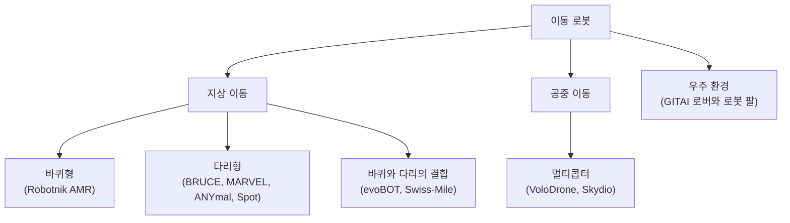

*그림 1. 이동 메커니즘에 따른 이동 로봇의 분류와 사례*

다음 아홉 사례는 최근의 이동 로봇이 쓰는 다양한 메커니즘을 보여 준다. 각 사례를 이동 방식에 따라 정리하면 다음과 같다.

| 이동 방식 | 사례 | 개발 기관 | 핵심 특징 |
|:-----|:-----|:-----|:-----|
| 다리형(이족) | BRUCE | UCLA RoMeLa | 충격을 흡수하는 순응성을 높인 소형 인간형 이족 보행 로봇 [2] |
| 다리형(사족) | MARVEL | KAIST | 자석 발로 철제 벽과 천장을 걷는 사족 보행 로봇 [3], [4] |
| 다리형(사족) | ANYmal, Spot | Oxford Robotics Institute의 현장 시험 | 에너지 설비를 자율 점검하는 사족 보행 로봇 [5] |
| 바퀴형 | RB-CAR, SUMMIT-XL 등 | Robotnik | 실내외 물류와 운송을 위한 자율 이동 로봇 제품군 [6] |
| 바퀴와 다리의 결합 | evoBOT | Fraunhofer IML | 두 바퀴로 균형을 잡으며 형태를 바꾸는 물류 로봇 [7] |
| 바퀴와 다리의 결합 | Swiss-Mile 로봇 | ETH Zurich 분사 기업 | 다리 끝에 바퀴를 단 사족 로봇으로, 두 다리로 서서 문을 연다 [8] |
| 비행(멀티콥터) | VoloDrone | Volocopter | 무거운 화물을 매달아 나르는 대형 화물 드론 [9], [10] |
| 비행(멀티콥터) | Skydio Dock, Remote Ops | Skydio | 도크에서 스스로 이착륙하며 원격으로 운용하는 점검 드론 [11] |
| 우주 환경 | 달 탐사 로버, 자벌레형 로봇 팔 | GITAI | 우주 공간과 달 표면에서 작업하는 로봇 [12] |

*표 2. 이동 로봇의 다양한 메커니즘을 보여 주는 사례*

이동 방식마다 장단점이 뚜렷하다. 평평한 바닥에서는 바퀴가 가장 효율적이지만, 계단이나 험지에서는 발을 디딜 곳을 골라 딛는 다리가 유리하다. 최근에는 두 방식의 장점을 합친 로봇과 공중으로 이동하는 로봇이 늘고 있다.

| 이동 방식 | 장점 | 단점 |
|:-----|:-----|:-----|
| 바퀴형 | 구조와 제어가 단순하고, 평지에서 빠르고 에너지 효율이 높다 | 계단, 큰 턱, 험지를 넘기 어렵다 |
| 다리형 | 발 디딜 곳을 골라 계단과 험지를 지나고, 장애물을 넘을 수 있다 | 관절이 많아 구조와 제어가 복잡하고, 평지에서 바퀴보다 느리고 에너지를 많이 쓴다 |
| 바퀴와 다리의 결합 | 평지에서는 바퀴로 빠르게 달리고 험지에서는 다리로 걷는다 | 기계 구조와 제어가 가장 복잡하다 |
| 비행(멀티콥터) | 지형과 상관없이 이동하고 높은 곳에 접근한다 | 비행 시간과 탑재 중량이 배터리에 크게 제한된다 |

*표 3. 이동 방식별 장점과 단점*

> **용어 정의:** 로봇이 순간적으로 움직일 수 있는 방향이 제한되는 제약을 **비홀로노믹 제약(nonholonomic constraint)** 이라 한다. 예를 들어 자동차와 두 바퀴 차동 구동 로봇은 바퀴가 옆으로 미끄러지지 않는 한 제자리에서 옆으로 움직일 수 없다. 반대로 메카넘 휠(mecanum wheel)이나 옴니 휠(omni wheel)을 단 로봇은 어느 방향으로든 바로 움직일 수 있어 **홀로노믹(holonomic)** 하다고 한다 [1]. 자동차의 비홀로노믹 제약은 10주차의 경로 계획에서 다시 다룬다.

### 1.3 다리형 로봇

**BRUCE(Bipedal Robot Unit with Compliance Enhanced)** 는 UCLA의 RoMeLa(Robotics and Mechanisms Laboratory)가 개발한 소형 인간형 이족 보행 로봇이다 [2]. 이름 그대로 관절의 **순응성(compliance)**, 곧 외부 힘을 받았을 때 단단히 버티지 않고 부드럽게 받아들이는 성질을 높인 것이 특징이다. 순응성이 높은 관절은 발이 땅에 닿을 때의 충격을 흡수하므로, 걷기뿐 아니라 뛰기처럼 충격이 큰 동적인 동작을 할 수 있다. BRUCE의 동작은 시뮬레이션 모델로 먼저 검증한 뒤 실제 로봇에서 걷기와 몸을 낮추는 동작으로 구현된다.

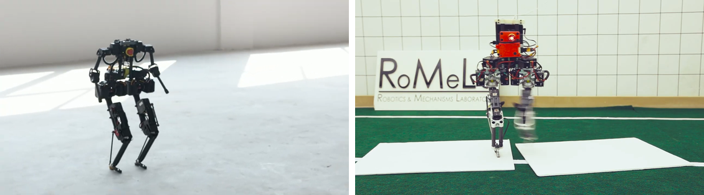

*그림 2. 이족 보행 로봇 BRUCE의 보행 장면*

**MARVEL**은 KAIST가 개발한 사족 보행 로봇으로, 철로 된 벽과 천장을 걸어 다닌다 [3], [4]. 발에는 두 가지 소재를 결합했다.

- **전기 영구 자석(EPM, electro-permanent magnet):** 짧은 전류 펄스로 자화 상태를 켜고 끌 수 있는 자석이다. 자화된 상태에서는 전류 없이도 자력을 유지하므로, 발을 붙이고 있는 동안 전력을 거의 쓰지 않는다.
- **자기 유변 탄성체(MRE, magnetorheological elastomer):** 자성 입자를 섞은 고무 소재로, 강철 표면과의 마찰 계수가 커서 발이 미끄러지지 않게 한다.

MARVEL은 모델 예측 제어(MPC, model predictive control)로 자세를 안정시키며, 실험에서 수직 벽을 최대 0.7 m/s, 천장을 0.5 m/s로 이동하고, 10 cm 폭의 틈을 건너고, 5 cm 높이의 장애물을 넘었다 [4]. 녹과 먼지로 덮인 곡면 저장 탱크도 0.35 m/s로 오른다 [3]. 이런 로봇은 선박, 교량, 저장 탱크처럼 사람이 올라가기 위험한 철 구조물을 점검하는 데 쓸 수 있다.

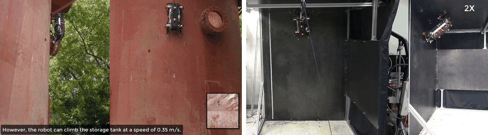

*그림 3. 녹슨 저장 탱크와 수직 벽을 오르는 MARVEL*

사족 보행 로봇은 산업 현장의 **자율 점검(autonomous inspection)** 에도 쓰이기 시작했다. Oxford Robotics Institute(ORI)는 2022년 3월 벨기에 겐트에 있는 Chevron의 혼합 공장(blending plant)에서 ANYbotics의 ANYmal과 Boston Dynamics의 Spot으로 현장 시험을 했다 [5]. 이 시험은 에너지 산업용 로봇 응용을 개발하기 위해 Net Zero Technology Centre의 지원으로 이루어졌다. ANYmal은 물에 들어가도 동작하는 완전 방수 구조이며, 최신 모델은 폭발 위험이 있는 환경에서 쓸 수 있는 장비에 주는 유럽 연합의 ATEX 인증을 받았다 [5]. 시험은 두 부분으로 이루어졌다.

1. **험지 보행(ANYmal):** 학습 기반 보행 제어 알고리즘(RLOC)이 주변 지형을 지도로 만들고, 그 지도를 이용하여 계단과 거친 바닥을 지난다.
2. **자율 점검 임무(Spot, ANYmal):** 먼저 실시간 지도 작성 기술로 공장의 3D 지도를 만든 다음, 로봇이 지도 위의 웨이포인트(waypoint) 사이를 스스로 이동하며 멈춰 서서 압력계를 촬영하고 정밀 스캔을 한다. 팬-틸트-줌(PTZ) 카메라와 열화상 카메라로 계기와 설비의 상태를 기록하며, 같은 대상을 반복해서 같은 구도로 촬영할 수 있다. 가는 길이 막히면 이전 웨이포인트로 돌아가 새 경로를 받고, 실패한 경로는 일정 시간이 지난 뒤에만 다시 시도한다.

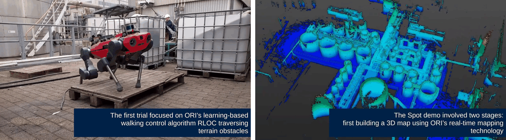

*그림 4. 공장 설비 사이를 걷는 ANYmal과 실시간으로 만든 공장의 3D 지도*

> **핵심:** 점검 로봇의 임무는 지도 작성, 지도 위의 위치 인식, 경로 계획, 장애물을 만났을 때의 재계획으로 이루어진다. 이는 자율주행차가 수행하는 일과 같은 구조이며, 이 과목이 Autoware로 다루는 내용(3주차, 9\~10주차)이다.

### 1.4 바퀴형 로봇

스페인의 Robotnik는 실내외 물류, 운송, 연구용 **자율 이동 로봇(AMR, autonomous mobile robot)** 을 만든다 [6]. 제품마다 용도에 따라 바퀴 구성과 크기가 다르다.

- **RB-CAR:** 다목적 소형 차량을 자율주행 차량으로 개조한 플랫폼으로, 차체 앞에 LiDAR를 달았다.
- **RB-VO:** 상자를 싣고 공원 같은 실외 길을 주행하는 배송형 로봇이다.
- **SUMMIT-XL:** 네 바퀴 로봇으로, 메카넘 휠을 달면 제자리에서 옆으로도 움직이는 홀로노믹 주행을 한다.
- **RB-1 BASE:** 실내에서 짐을 나르거나 다른 장비를 올리는 원통형 이동 플랫폼이다.
- **RB-ROBOUT:** 컨베이어 같은 무거운 장비를 위에 싣고 공장 안을 이동하는 대형 AMR이다.
- **SUMMIT-XL STEEL:** 물류 창고에서 작업자의 주문 피킹을 돕는 운반 로봇이다.

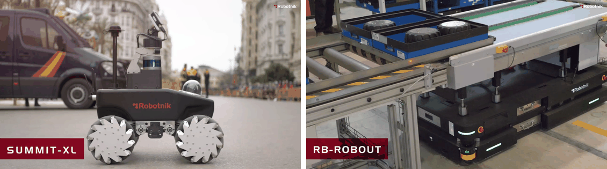

*그림 5. 메카넘 휠을 단 SUMMIT-XL과 컨베이어를 실은 RB-ROBOUT*

> **참고:** 공장의 **무인 운반차(AGV, automated guided vehicle)** 는 바닥의 자기 테이프나 선처럼 미리 깔아 둔 유도 장치를 따라 움직인다. AMR은 이런 유도 장치 없이 센서로 주변을 인식하고 지도 위에서 스스로 경로를 계획하므로, 작업 공간이 바뀌어도 설비를 다시 깔 필요가 없다.

### 1.5 바퀴와 다리를 결합한 로봇

Fraunhofer IML의 **evoBOT**은 두 바퀴 위에서 균형을 잡는 물류 로봇이다 [7]. 거꾸로 세운 막대가 넘어지지 않도록 받침을 계속 움직이는 **도립 진자(inverted pendulum)** 원리로 균형을 잡으므로, 넘어지지 않게 하는 별도의 균형추가 필요 없다. 두 팔로 물건을 양쪽에서 눌러 잡아 들어 올리며, 팔을 바닥에 짚어 네 점으로 서는 형태로 바꾸어 상자를 싣고 이동할 수도 있다. 이런 능력으로 evoBOT은 여행 가방을 잡아 옮기고, 잔디밭에서 상자를 들어 올리고, 상자를 자동차 트렁크 앞까지 날라 사람이 싣도록 돕는 적재 보조 역할을 한다.

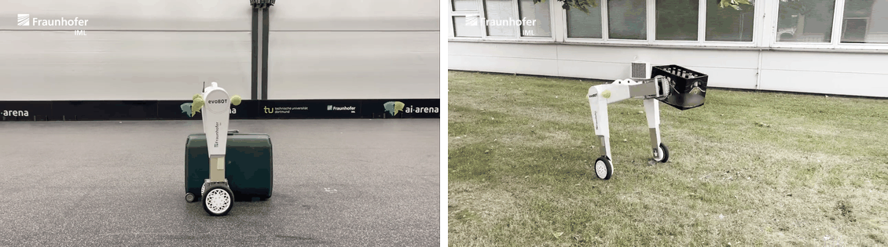

*그림 6. 두 바퀴로 균형을 잡는 evoBOT과 상자를 싣고 이동하는 형태*

ETH Zurich에서 분사한 Swiss-Mile의 로봇은 사족 보행 로봇 ANYmal의 다리 끝에 구동 바퀴를 단 **바퀴-다리 로봇(wheeled-legged robot)** 이다 [8]. 평지에서는 네 바퀴로 빠르게 달리고, 계단에서는 다리로 오르며, 뒷다리 두 개로 일어서서 앞다리로 문손잡이를 돌려 문을 연다. 이런 능력은 물류 차량에서 건물 현관까지 짐을 나르는 **라스트 마일 배송(last-mile delivery)** 을 목표로 한다. 라스트 마일 구간에는 보도, 계단, 문, 엘리베이터가 섞여 있어 바퀴만으로도, 다리만으로도 효율적으로 지나기 어렵기 때문이다.

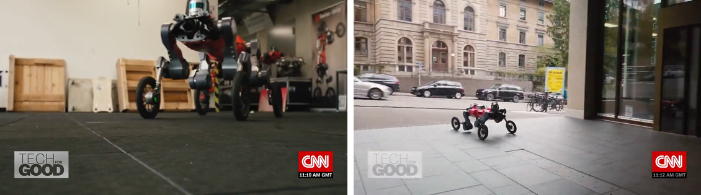

*그림 7. 두 다리로 선 Swiss-Mile 로봇과 도심 보도를 주행하는 모습*

### 1.6 비행 로봇과 우주 로봇

Volocopter의 **VoloDrone**은 18개의 로터를 원형 틀에 배치한 대형 멀티콥터 화물 드론으로, 약 200 kg의 화물을 나르도록 설계되었다 [10]. VoloDrone은 화물을 줄에 매달아 나를 수 있어, 눈 덮인 비행장에서 크리스마스트리를 매달고 날아오르는 시연도 했다 [9]. 화물을 아래에 매다는 방식은 화물의 모양에 제약이 적다.

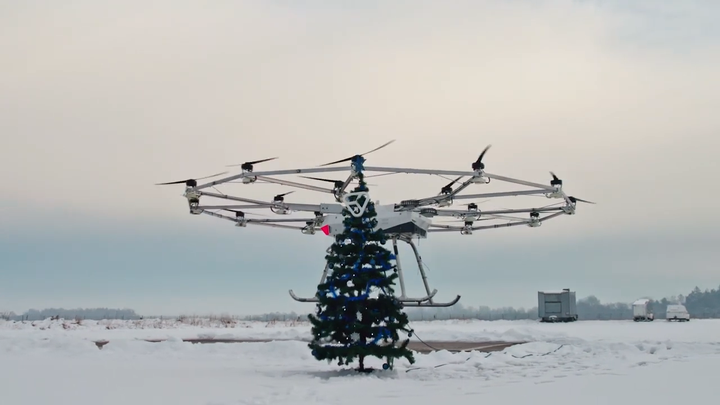

*그림 8. 크리스마스트리를 매달고 이륙하는 VoloDrone*

Skydio의 **Skydio Dock**은 드론이 스스로 이륙, 착륙, 충전하는 기지이고, **Skydio Remote Ops**는 원격지에서 웹으로 드론을 띄우고 임무를 지정하는 운용 소프트웨어이다 [11]. 드론은 장애물을 피하며 설비 안팎을 비행하여 사진, 열화상, 3D 스캔 데이터를 모으고, 사용자는 현장에 가지 않고도 필요할 때 데이터를 얻는다. 고소 작업차에 올라 사람이 직접 하던 위험한 점검을 대신하는 것이 목표이다.

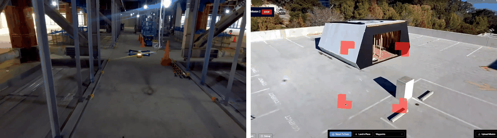

*그림 9. 설비 내부를 비행하는 Skydio 드론과 원격 운용 화면*

GITAI는 미국 로스앤젤레스 지역에 개발 거점을 둔, 우주에서 작업하는 로봇을 개발하는 기업이다 [12]. 두 팔을 단 **달 탐사 로버(lunar robotic rover)** 는 경사로를 오르고 모래 위를 주행하며, 양 끝에 집게를 단 **자벌레형 로봇 팔(inchworm-type robotic arm)** 은 한쪽 끝으로 구조물을 잡고 다른 쪽 끝을 옮기는 방식으로 우주 정거장 모듈의 외벽을 따라 이동한다. 우주 로봇은 우주인의 위험한 선외 활동을 줄이는 것을 목표로 한다.

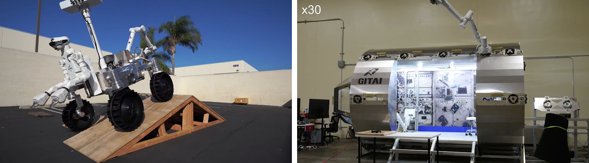

*그림 10. GITAI의 달 탐사 로버와 모듈 위의 자벌레형 로봇 팔*

### 1.7 사례에서 본 기술 동향

아홉 사례에서 공통으로 드러나는 동향은 다음과 같다.

1. **이동 메커니즘의 다양화와 결합:** 바퀴, 다리, 비행에 머물지 않고 바퀴와 다리를 결합하거나(Swiss-Mile), 상황에 따라 형태를 바꾸거나(evoBOT), 자석 발로 벽을 타는(MARVEL) 로봇이 등장하고 있다.
2. **위험하고 반복적인 작업의 대체:** 설비 점검(ANYmal, Spot, Skydio, MARVEL), 물류와 배송(Robotnik, evoBOT, Swiss-Mile, VoloDrone), 우주 작업(GITAI)처럼 사람에게 위험하거나 반복적인 일을 로봇이 맡는다.
3. **자율성의 향상:** 로봇이 스스로 지도를 만들고, 그 지도에서 위치를 추정하고, 경로를 계획하고, 막히면 다시 계획한다. 사람은 원격에서 임무만 지정한다.

이 자율성을 이루는 기능, 곧 인식, 위치 인식, 경로 계획, 제어는 어떤 이동 방식의 로봇이든 필요하다. 이 과목은 이 기능들을 ROS와 오픈 소스 자율주행 소프트웨어 Autoware 위에서 구현하는 방법을 다룬다. 2절에서는 그 바탕이 되는 ROS를 살펴본다.

---

<br>

## 2. ROS의 개념과 특징

### 2.1 ROS란 무엇인가

**ROS(Robot Operating System)** 는 로봇 소프트웨어를 작성하기 위한 유연한 프레임워크로, 다양한 로봇 플랫폼에서 복잡하고 견고한 로봇 동작을 만드는 일을 단순하게 하려는 도구, 라이브러리, 관례의 모음이다. 이름에 운영체제가 들어 있지만 Windows나 Linux 같은 운영체제가 아니라, Linux(주로 Ubuntu) 같은 운영체제 위에서 동작하면서 운영체제와 비슷한 서비스를 로봇에 제공하는 **메타 운영체제(meta-operating system)** 이다 [13]. ROS가 제공하는 서비스는 하드웨어 추상화, 저수준 장치 제어, 자주 쓰는 기능의 구현, 프로세스 간 메시지 전달, 패키지 관리이다. ROS는 2007년 스탠퍼드 대학교에서 시작되어 Willow Garage가 개발을 이어 갔고 [14], 2010년 첫 배포판 Box Turtle(2.6절)이 나온 뒤 오픈 소스로 발전해 왔다. 이 단원에서 ROS는 ROS 1을 가리킨다.

ROS를 이루는 요소는 다음 네 가지로 정리된다.

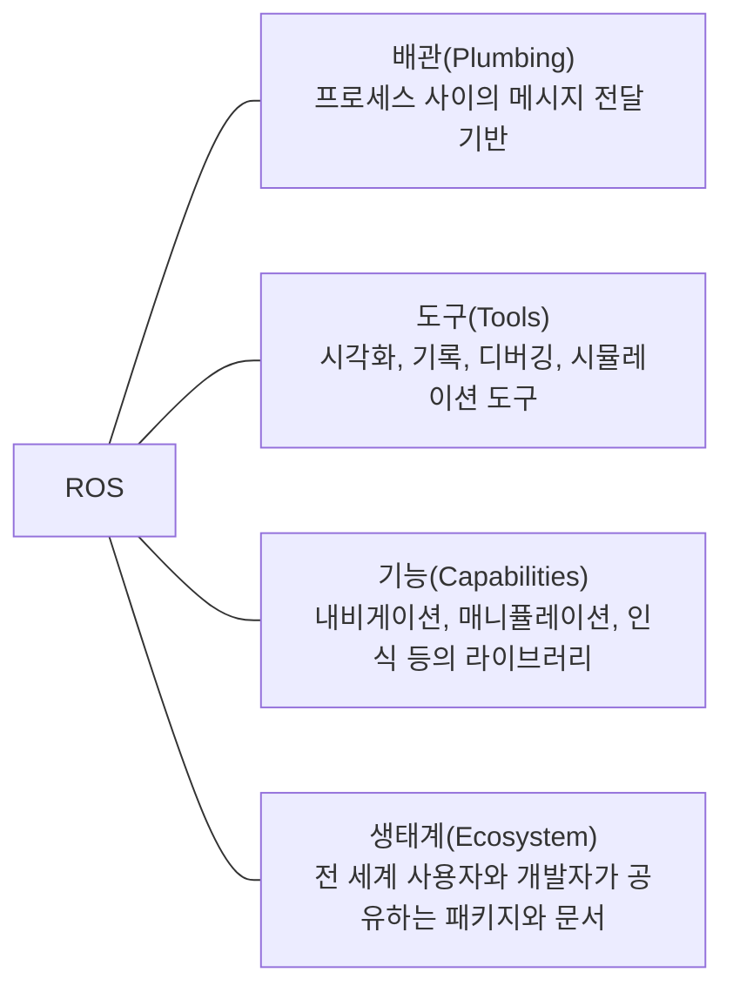

*그림 11. ROS를 이루는 네 가지 요소*

로봇 소프트웨어를 처음부터 만들면 센서 드라이버, 통신, 시각화, 알고리즘을 모두 직접 짜야 한다. ROS를 쓰면 통신 기반(배관)과 도구는 그대로 쓰고, 다른 사람이 만든 기능 패키지를 가져다 조합한 뒤, 자신이 개발하는 부분에만 집중할 수 있다. 또한 ROS는 Ubuntu, macOS, Android, iOS 같은 운영체제와 Arduino, mbed 같은 마이크로컨트롤러 플랫폼에서도 동작하는 라이브러리를 갖추어, 서로 다른 플랫폼 위의 로봇, 센서, 응용 프로그램이 같은 방식으로 데이터를 주고받게 한다.

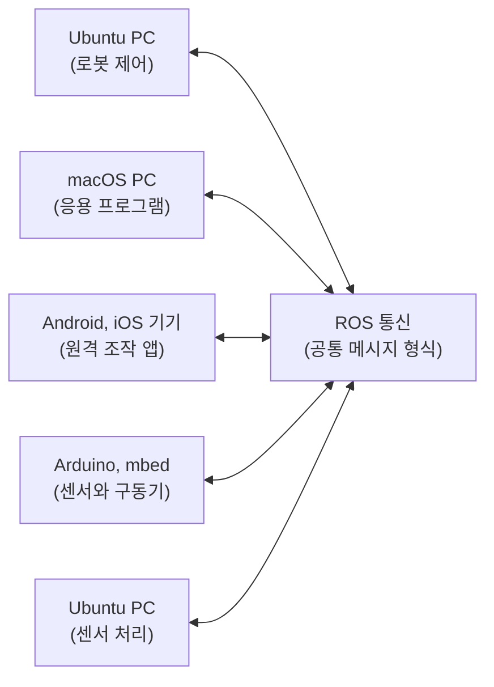

*그림 12. 서로 다른 플랫폼의 로봇, 센서, 앱이 ROS로 연결되는 구조*

> **[운영체제]** 운영체제는 하드웨어를 추상화하고, 프로세스를 관리하고, 프로세스 사이의 통신(IPC)을 제공한다. ROS는 이 가운데 프로세스 사이의 통신과 패키지 관리를 로봇 소프트웨어에 맞게 한 단계 위에서 다시 제공하며, 실제 스케줄링과 메모리 관리는 아래의 Linux가 맡는다.

### 2.2 ROS의 기본 개념

ROS의 프로그램들은 서로 메시지를 주고받는 프로세스들의 네트워크를 이룬다. 이 네트워크를 **계산 그래프(computation graph)** 라 하며, 다음 용어로 설명한다 [15].

| 용어 | 정의 |
|:-----|:-----|
| **노드(node)** | 계산을 수행하는 하나의 프로세스이다. 하나의 로봇 시스템은 LiDAR 드라이버 노드, 위치 인식 노드, 경로 계획 노드처럼 기능별로 나뉜 여러 노드로 이루어진다. 노드마다 고유한 이름을 갖는다 |
| **마스터(master)** | 노드의 이름과 각 노드가 발행하거나 구독하는 토픽, 제공하는 서비스를 등록받아 관리하는 이름 서비스이다. 노드들은 마스터를 통해 서로를 찾은 뒤 직접 통신한다. `roscore` 명령으로 실행한다 |
| **메시지(message)** | 노드 사이에 오가는 데이터의 형식이다. 정수, 실수, 문자열, 배열과 다른 메시지를 필드로 갖는 구조체이며, `.msg` 파일로 정의한다. 예를 들어 `geometry_msgs/Twist`는 선속도와 각속도를 담는다 |
| **토픽(topic)** | 메시지가 오가는 이름 붙은 통로이다. 메시지를 보내는 쪽과 받는 쪽은 상대가 누구인지 모른 채 토픽 이름만 알고 통신한다 |
| **퍼블리셔(publisher)** | 토픽에 메시지를 내보내는 노드, 또는 노드 안에서 그 일을 하는 객체이다. 메시지를 내보내는 일을 **발행(publish)** 이라 한다 |
| **서브스크라이버(subscriber)** | 토픽의 메시지를 받는 노드, 또는 노드 안에서 그 일을 하는 객체이다. 메시지를 받겠다고 등록하는 일을 **구독(subscribe)** 이라 한다 |
| **서비스(service)** | 요청(request)을 보내면 응답(response)을 돌려받는 일대일 통신이다. 요청과 응답의 형식은 `.srv` 파일로 정의하며, 요청하는 쪽을 서비스 클라이언트, 응답하는 쪽을 서비스 서버라 한다 |
| **매개변수 서버(parameter server)** | 마스터 안에서 동작하는 공유 사전으로, 노드들이 설정값을 이름(키)으로 저장하고 읽는다 |
| **백(bag)** | 토픽의 메시지를 시간 정보와 함께 저장한 파일(`.bag`)이다. 나중에 같은 순서와 간격으로 다시 발행할 수 있다 |
| **패키지(package)** | 노드, 라이브러리, 메시지 정의, 설정 파일을 묶은 ROS 소프트웨어의 기본 단위이다. 빌드하고 배포하는 단위이기도 하다 |

*표 4. ROS 계산 그래프의 기본 개념*

토픽은 한 노드가 발행한 메시지를 여러 노드가 동시에 받을 수 있고, 한 토픽에 여러 노드가 발행할 수도 있는 **다대다(many-to-many)**, **단방향(unidirectional)** 통신이다. 센서 데이터처럼 계속 흘러가는 데이터에 알맞다. 서비스는 한 번 묻고 한 번 답하는 **일대일(one-to-one)**, **양방향(bidirectional)** 통신으로, 설정 변경이나 계산 요청처럼 결과를 기다려야 하는 일에 알맞다.

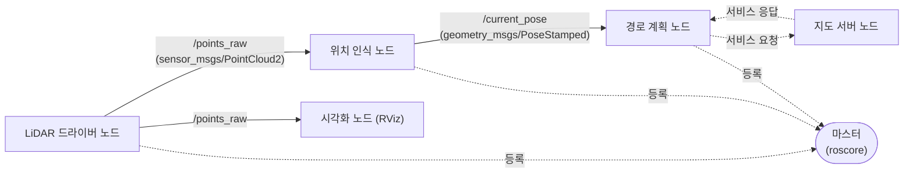

*그림 13. 노드, 토픽, 서비스, 마스터로 이루어진 계산 그래프의 예*

그림 13에서 사각형은 노드, 실선 화살표의 이름은 토픽과 메시지 형식, 점선은 서비스와 마스터 등록을 나타낸다. LiDAR 드라이버 노드가 발행한 `/points_raw` 토픽은 위치 인식 노드와 시각화 노드가 함께 구독하며, 드라이버 노드는 누가 구독하는지 알 필요가 없다. 이처럼 노드 사이의 결합이 느슨하므로 노드를 하나 바꾸거나 더해도 나머지 노드를 고칠 필요가 없다.

> **용어 정의:** **catkin**은 ROS 1의 공식 빌드 시스템으로, CMake를 확장하여 여러 패키지를 한꺼번에 빌드한다. catkin으로 빌드하는 폴더를 **작업 공간(workspace)** 이라 하며, 소스를 두는 `src`, 빌드 중간 파일을 두는 `build`, 빌드 결과와 환경 설정 스크립트를 두는 `devel` 폴더로 이루어진다. 패키지를 만들고 빌드하는 방법은 2주차와 5주차에서 다룬다.

### 2.3 통신 기능

ROS의 가장 중요한 기능은 노드 사이의 데이터 통신이다. 이 기능을 흔히 **미들웨어(middleware)**, 곧 운영체제와 응용 프로그램 사이에서 프로그램끼리의 통신을 대신 처리해 주는 소프트웨어라 부른다.

- **메시지 전달 인터페이스:** 로봇 개발에 자주 쓰이는 통신 방식(토픽, 서비스)을 제공한다. 메시지의 직렬화와 해석(파싱)을 ROS가 처리하므로 개발자는 메시지의 필드만 다루면 된다. 노드들이 메시지라는 약속된 인터페이스로만 연결되므로 각 노드의 내부 구현은 감추어지고(캡슐화), 한 번 만든 노드를 다른 로봇에서 다시 쓰기 쉽다.
- **메시지의 기록과 재생:** 노드 사이에 오간 메시지를 백 파일로 저장하고 필요할 때 다시 발행한다. 실제 센서 없이도 같은 데이터로 알고리즘을 반복해서 실험할 수 있어 알고리즘 개발과 디버깅이 쉬워진다. 2주차에서 Autoware로 이 기능을 쓴다.
- **여러 프로그래밍 언어의 사용:** 노드 사이의 데이터 교환은 언어와 무관한 메시지 형식으로 이루어지므로, 각 노드를 서로 다른 언어로 작성할 수 있다. 언어마다 ROS 기능을 쓰게 해 주는 **클라이언트 라이브러리(client library)** 가 있다.
- **분산 매개변수 시스템:** 시스템에서 쓰는 변수를 전역 키와 값의 쌍으로 매개변수 서버에 저장하여 여러 노드가 공유하고 수정한다. 값을 바꾸면 그 뒤에 값을 읽는 노드에 바로 반영된다.

| 클라이언트 라이브러리 | 언어 |
|:-----|:-----|
| `roscpp` | C++ |
| `rospy` | Python |
| `roslisp` | Common Lisp |
| `rosjava` | Java |
| `roslua` | Lua |
| `roscs` | C# |
| `roseus` | EusLisp |
| `PhaROS` | Pharo Smalltalk |
| `rosR` | R |

*표 5. ROS의 클라이언트 라이브러리와 언어*

`roscpp`, `rospy`, `roslisp`가 주요 클라이언트 라이브러리이고, 나머지는 실험적인 클라이언트 라이브러리이다 [16]. 그 가운데 `roscpp`가 가장 널리 쓰이며, 마스터와 `roslaunch` 같은 ROS 도구는 `rospy`로 작성되어 있다. 이 과목의 노드는 `roscpp`로 C++로 작성한다(5\~7주차).

> **주의:** 매개변수 서버는 고속 통신용이 아니다. 노드가 시작할 때 설정값을 읽는 용도에 알맞으며, 노드가 이미 읽어 둔 값은 매개변수를 바꾸어도 노드가 다시 읽기 전에는 바뀌지 않는다. 계속 변하는 데이터는 토픽으로 보낸다.

### 2.4 로봇 기능 라이브러리

ROS는 통신 기반 위에 로봇 개발에 공통으로 필요한 기능을 라이브러리로 제공한다.

| 기능 | 내용 |
|:-----|:-----|
| 로봇의 표준 메시지 정의 | 카메라, IMU, 레이저 같은 센서 데이터, 오도메트리, 경로와 지도 같은 내비게이션 데이터의 표준 메시지(`sensor_msgs`, `nav_msgs`, `geometry_msgs` 등)를 정의한다. 모두 같은 형식을 쓰므로 모듈화와 협업이 쉬워진다 |
| 로봇 기하학 라이브러리(TF) | 로봇 몸체, 바퀴, 센서마다 붙은 좌표계 사이의 상대 위치와 자세를 트리 구조로 관리하고, 시간에 따라 바뀌는 좌표 변환을 계산해 준다 |
| 로봇 기술 언어(URDF) | 로봇의 링크, 관절, 질량, 외형 같은 물리적 특성을 XML 문서로 기술한다 |
| 진단 시스템 | 로봇 각 부분의 상태를 모아 한눈에 파악하게 한다 |
| 센싱과 인식 | 센서 드라이버와 센싱, 인식 수준의 라이브러리를 제공한다 |
| 내비게이션 | 로봇의 포즈(위치와 자세) 추정, 지도 안의 자기 위치 추정, 지도 작성에 필요한 SLAM, 지도 안에서 목적지를 찾아가는 내비게이션 라이브러리를 제공한다 |
| 매니퓰레이션 | 로봇 팔의 역기구학(IK)과 순기구학(FK), 물건을 집어 옮기는 pick and place 같은 응용 동작을 지원하는 라이브러리와 GUI 도구(MoveIt!)를 제공한다 |

*표 6. ROS가 제공하는 로봇 기능 라이브러리*

> **용어 정의:** **포즈(pose)** 는 위치(position)와 자세(orientation)를 합친 것이다. 3차원 공간의 포즈는 위치 $(x, y, z)$와 세 축에 대한 회전으로 나타낸다. **SLAM(simultaneous localization and mapping)** 은 지도가 없는 환경에서 지도를 만드는 동시에 그 지도 안에서 자신의 위치를 추정하는 기술이다. **순기구학(forward kinematics)** 은 관절 각도로부터 팔 끝의 포즈를 구하는 계산이고, **역기구학(inverse kinematics)** 은 원하는 팔 끝의 포즈를 만드는 관절 각도를 구하는 계산이다.

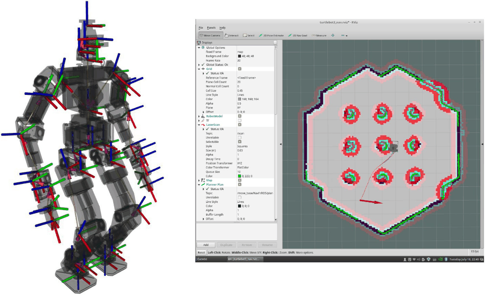

*그림 14. 인간형 로봇의 링크마다 붙은 TF 좌표계와 RViz의 내비게이션 화면*

그림 14의 왼쪽은 인간형 로봇의 링크마다 붙은 좌표계를 빨강(x축), 초록(y축), 파랑(z축) 화살표로 보여 준다. TF는 이 좌표계들을 부모와 자식 관계의 트리로 관리하므로, 예를 들어 머리의 카메라가 본 물체의 위치를 발 기준 좌표로 바로 바꿀 수 있다. 오른쪽은 지도(회색 격자) 위에서 로봇의 위치를 추정하고 목적지까지 가는 내비게이션 화면이다.

> **[컴퓨터그래픽스]** 한 좌표계의 점을 다른 좌표계로 옮기는 좌표 변환은 회전과 평행 이동으로 이루어지며, 동차 좌표를 쓰면 하나의 4 × 4 행렬로 나타낼 수 있다. 트리에서 두 좌표계를 잇는 경로를 따라 변환 행렬을 차례로 곱하면(자식에서 부모 쪽으로 거슬러 올라가는 구간에서는 역행렬을 곱한다) 멀리 떨어진 두 좌표계 사이의 변환을 얻는다. TF는 이 계산을 자동으로 해 준다.

### 2.5 개발 도구

ROS는 로봇 개발의 효율을 높이는 다양한 개발 도구를 제공한다. **명령행 도구(command-line tools)** 만으로도 GUI 없이 로봇에 접근하여 ROS의 거의 모든 기능을 쓸 수 있다.

| 명령 | 하는 일 |
|:-----|:-----|
| `roscore` | 마스터, 매개변수 서버, 로그를 모으는 `rosout` 노드를 실행한다 |
| `rosrun 패키지 노드` | 패키지 안의 노드 하나를 실행한다 |
| `roslaunch 패키지 파일.launch` | launch 파일에 적은 여러 노드와 매개변수를 한꺼번에 실행한다 |
| `rosnode list`, `rosnode info` | 실행 중인 노드의 목록과 정보를 본다 |
| `rostopic list`, `rostopic echo`, `rostopic pub` | 토픽 목록을 보고, 토픽의 메시지를 출력하고, 메시지를 직접 발행한다 |
| `rosservice call` | 서비스를 호출한다 |
| `rosparam get`, `rosparam set` | 매개변수를 읽고 쓴다 |
| `rosmsg show` | 메시지 형식의 정의를 본다 |
| `rosbag record`, `rosbag play` | 토픽을 백 파일로 기록하고 재생한다 |

*표 7. 자주 쓰는 ROS 명령행 도구*

그래픽 도구로는 다음 세 가지가 대표적이다.

- **RViz:** 강력한 3D 시각화 도구이다. 레이저, 카메라 같은 센서 데이터, 로봇의 외형, 계획된 동작을 3차원으로 표시한다.
- **rqt:** Qt를 기반으로 GUI 도구를 만드는 프레임워크이다. 노드와 그 사이의 연결을 그래프로 표시하는 `rqt_graph`, 인코더 값, 전압처럼 시간에 따라 변하는 숫자를 그래프로 그리는 `rqt_plot`, 데이터를 메시지 형태로 기록하고 재생하는 `rqt_bag` 같은 플러그인이 있다.
- **Gazebo:** 물리 엔진을 탑재한 3차원 로봇 시뮬레이터로, 로봇, 센서, 환경 모델을 지원하며 ROS와의 호환성이 높다. 실제 로봇 없이 시뮬레이션에서 알고리즘을 먼저 시험할 수 있다.

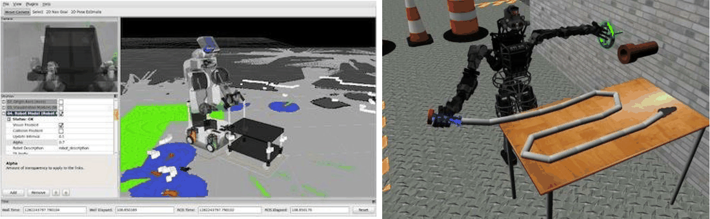

*그림 15. RViz의 센서 데이터 시각화 화면과 Gazebo의 로봇 시뮬레이션 화면*

그림 15의 왼쪽은 RViz가 로봇 모델, 카메라 영상, 깊이 센서의 점들을 한 화면에 겹쳐 보여 주는 모습이고, 오른쪽은 Gazebo 안에서 인간형 로봇이 탁자 위의 물체를 다루는 시뮬레이션이다.

### 2.6 배포판 선택

ROS는 일정한 시기마다 패키지 묶음을 **배포판(distribution)** 으로 출시한다. 배포판 이름은 알파벳 순서로 붙이며, 거북이를 주제로 한 이름과 포스터를 쓴다 [17].

| 배포판 | 출시일 | 지원 종료(EOL) |
|:-----|:-----|:-----|
| Noetic Ninjemys | 2020-05-23 | 2025년 5월 (Ubuntu 20.04 Focal 지원 종료와 같음) |
| Melodic Morenia | 2018-05-23 | 2023년 6월 27일 (Ubuntu 18.04 Bionic 지원 종료 시기) |
| Lunar Loggerhead | 2017-05-23 | 2019년 5월 |
| Kinetic Kame | 2016-05-23 | 2021년 4월 (Ubuntu 16.04 Xenial 지원 종료와 같음) |
| Jade Turtle | 2015-05-23 | 2017년 5월 |
| Indigo Igloo | 2014-07-22 | 2019년 4월 (Ubuntu 14.04 Trusty 지원 종료와 같음) |
| Hydro Medusa | 2013-09-04 | 2015년 5월 |
| Groovy Galapagos | 2012-12-31 | 2014년 7월 |
| Fuerte Turtle | 2012-04-23 | |
| Electric Emys | 2011-08-30 | |
| Diamondback | 2011-03-02 | |
| C Turtle | 2010-08-02 | |
| Box Turtle | 2010-03-02 | |

*표 8. ROS 1의 배포판과 출시일, 지원 종료 시기*

배포판을 고를 때는 다음을 고려한다.

1. **운영체제와의 짝:** 배포판마다 지원하는 Ubuntu 버전이 정해져 있다. Melodic은 Ubuntu 18.04, Noetic은 Ubuntu 20.04를 주 대상으로 한다 [18]. 다른 버전의 Ubuntu에는 바이너리 패키지가 없어 설치가 어렵다.
2. **장기 지원(LTS):** Indigo부터는 짝수 해에 나온 배포판(Indigo, Kinetic, Melodic, Noetic)이 Ubuntu LTS와 짝을 이루어 5년 동안 지원되는 장기 지원 배포판이다. 그 사이 홀수 해에 나온 Jade와 Lunar는 지원 기간이 2년으로 짧다.
3. **사용할 소프트웨어의 요구:** 이 과목에서 쓰는 Autoware.ai 1.14.0은 ROS Melodic을 기준으로 하므로, 이 과목은 Ubuntu 18.04와 ROS Melodic을 쓴다(4주차).

> **참고:** Melodic의 지원 종료는 처음에 2023년 5월로 예정되었다가 2023년 6월 27일로 정해졌다 [17], [18]. Noetic은 ROS 1의 마지막 배포판이며 2025년 5월에 지원이 끝났다. 이후 ROS 개발은 통신 계층을 DDS로 바꾸고 마스터 없이 노드가 서로를 찾는 **ROS 2**로 옮겨 갔고, Autoware도 ROS 2 기반으로 다시 개발되었다. 그러나 노드, 토픽, 메시지, 서비스, 패키지라는 개념은 ROS 2에서도 그대로이므로 ROS 1로 익힌 개념은 ROS 2에도 적용된다.

### 2.7 설치와 환경 설정

ROS Melodic은 Ubuntu 18.04에 ROS 저장소를 등록하고 `apt`로 설치한다. 공식 설치 문서의 핵심 단계는 다음과 같다 [19].

```bash
# 1. ROS 패키지 저장소를 등록하고 저장소의 서명 키를 추가한다
sudo sh -c 'echo "deb http://packages.ros.org/ros/ubuntu $(lsb_release -sc) main" > /etc/apt/sources.list.d/ros-latest.list'
sudo apt install curl    # curl이 설치되어 있지 않으면 먼저 설치한다
curl -s https://raw.githubusercontent.com/ros/rosdistro/master/ros.asc | sudo apt-key add -

# 2. 패키지 목록을 갱신하고 ROS, rqt, RViz, Gazebo 등을 모두 포함한 desktop-full을 설치한다
sudo apt update
sudo apt install ros-melodic-desktop-full

# 3. 새 터미널마다 ROS 환경 변수가 설정되도록 .bashrc에 등록한다
echo "source /opt/ros/melodic/setup.bash" >> ~/.bashrc
source ~/.bashrc

# 4. 패키지의 의존성을 자동으로 설치하는 rosdep을 초기화한다
sudo apt install python-rosdep python-rosinstall python-rosinstall-generator python-wstool build-essential
sudo rosdep init
rosdep update
```

설치가 끝나면 자신의 패키지를 만들고 빌드할 catkin 작업 공간을 만든다 [20].

```bash
mkdir -p ~/catkin_ws/src     # 작업 공간과 소스 폴더를 만든다
cd ~/catkin_ws/
catkin_make                  # 빈 작업 공간을 빌드하여 build, devel 폴더를 만든다
source devel/setup.bash      # 작업 공간의 패키지를 ROS가 찾을 수 있게 환경 변수를 설정한다
echo $ROS_PACKAGE_PATH       # /home/<사용자>/catkin_ws/src:/opt/ros/melodic/share 처럼 출력되면 성공이다
```

`setup.bash`를 `source`하는 이유는 ROS 명령이 패키지를 찾는 경로(`ROS_PACKAGE_PATH`), 마스터의 주소(`ROS_MASTER_URI`) 같은 환경 변수를 현재 셸에 설정하기 위해서이다. 이 설정은 터미널마다 따로 적용되므로, 새 터미널을 열 때마다 다시 하거나 `.bashrc`에 등록해 둔다. 설치의 전체 과정과 네트워크 환경 변수 설정은 4주차에서 자세히 다룬다.

> **주의:** ROS 위키에는 배포판마다 설치 문서가 따로 있다(예: Kinetic은 `kinetic/Installation/Ubuntu`, Melodic은 `melodic/Installation/Ubuntu`). Kinetic은 Ubuntu 16.04용이므로, Ubuntu 18.04에서는 Melodic의 설치 문서를 따라야 한다. 설치 명령의 `melodic` 부분은 설치하려는 배포판 이름과 일치해야 하며, 운영체제와 짝이 맞지 않는 배포판을 설치하면 패키지를 찾지 못한다.

### 2.8 turtlesim을 이용한 동작 확인

**turtlesim**은 ROS를 처음 배우는 사람을 위한 2차원 거북이 시뮬레이터 패키지이다 [21]. 화면 속 거북이를 키보드로 움직여 보며 노드, 토픽, 메시지가 실제로 동작하는지 확인한다. 아래 명령을 각각 다른 터미널에서 실행한다.

```bash
roscore                                  # 터미널 1: 마스터를 실행한다
. devel/setup.bash                       # 터미널 2~4 각각에서 노드를 실행하기 전에 작업 공간의 환경을 불러온다
rosrun turtlesim turtlesim_node          # 터미널 2: 거북이 창을 띄우는 노드를 실행한다
rosrun turtlesim turtle_teleop_key       # 터미널 3: 키보드 입력을 속도 명령으로 바꾸는 노드를 실행한다
rosrun rqt_graph rqt_graph               # 터미널 4: 노드와 토픽의 연결 그래프를 띄운다
```

`. devel/setup.bash`는 `source devel/setup.bash`와 같은 명령이다. turtlesim처럼 `apt`로 설치한 패키지는 `/opt/ros/melodic/setup.bash`만 불러와도 실행되지만, 작업 공간에서 직접 빌드한 패키지를 실행하려면 그 작업 공간의 `devel/setup.bash`를 불러와야 한다. `turtle_teleop_key`를 실행한 터미널을 선택한 상태에서 방향키를 누르면 거북이가 움직이며 지나간 자리에 선을 그린다.

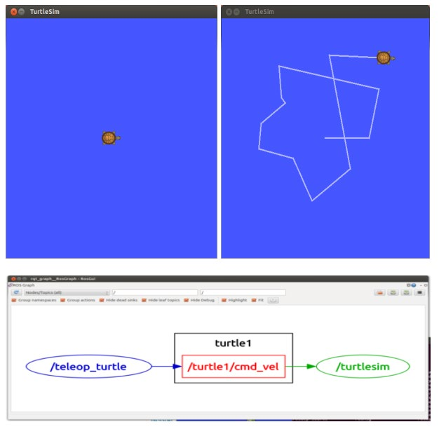

*그림 16. 방향키 입력으로 움직인 turtlesim의 거북이와 rqt_graph가 보여 주는 노드 연결*

`rqt_graph`에서 타원은 노드, 사각형은 토픽이다. 키보드 노드 `/teleop_turtle`이 `/turtle1/cmd_vel` 토픽에 속도 명령을 발행하고, 시뮬레이터 노드 `/turtlesim`이 그 토픽을 구독한다. 토픽의 메시지 형식과 실제 내용은 명령행 도구로 확인할 수 있다.

```bash
rostopic type /turtle1/cmd_vel       # geometry_msgs/Twist
rosmsg show geometry_msgs/Twist      # 메시지의 필드 구성을 출력한다
rostopic echo /turtle1/cmd_vel       # 방향키를 누를 때마다 발행되는 메시지를 출력한다
```

`rosmsg show geometry_msgs/Twist`는 다음과 같이 출력한다. `Twist`는 3차원 벡터 두 개, 곧 선속도 `linear`(m/s)와 각속도 `angular`(rad/s)로 이루어진다.

```text
geometry_msgs/Vector3 linear
  float64 x
  float64 y
  float64 z
geometry_msgs/Vector3 angular
  float64 x
  float64 y
  float64 z
```

위쪽 방향키를 누르면 `rostopic echo`에 다음 메시지가 출력된다. `turtle_teleop_key`는 기본 배율 2.0을 곱해 위, 아래 방향키는 `linear.x`를 $\pm 2.0$으로, 왼쪽, 오른쪽 방향키는 `angular.z`를 $\pm 2.0$으로 정한다. 거북이는 평면에서 움직이므로 앞뒤 방향 속도(`linear.x`)와 수직축 둘레의 회전 속도(`angular.z`)만 쓴다.

```text
linear: 
  x: 2.0
  y: 0.0
  z: 0.0
angular: 
  x: 0.0
  y: 0.0
  z: 0.0
---
```

---

<br>

## 3. ROS 노드 간 메시지 통신

### 3.1 마스터, 노드, 메시지 통신의 관계

ROS에서 가장 기본이 되는 기술은 노드 간의 메시지 통신이다. 노드들은 서로의 주소를 미리 알지 못하므로, 먼저 마스터에 자신의 정보를 등록하고 마스터에게서 상대의 접속 정보를 얻는다. 그 뒤 실제 메시지는 마스터를 거치지 않고 노드끼리 직접 주고받는다.

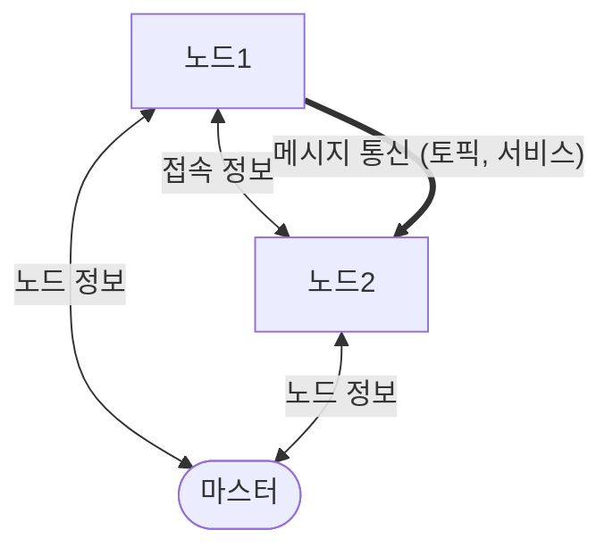

*그림 17. 마스터와 노드 사이의 정보 교환과 노드 사이의 메시지 통신*

> **핵심:** 마스터는 전화번호부처럼 누가 어떤 토픽을 발행하고 구독하는지만 알려 주며, 메시지 데이터는 마스터를 거치지 않는다. 그래서 대용량 센서 데이터가 오가도 마스터에 부하가 몰리지 않는다. 한편 마스터가 없으면 새 노드가 상대를 찾을 수 없으므로 모든 노드보다 마스터를 먼저 실행해야 한다.

### 3.2 XMLRPC와 TCPROS

노드와 마스터, 노드와 노드 사이의 통신에는 두 가지 프로토콜이 쓰인다 [22].

| 프로토콜 | 용도 | 특징 |
|:-----|:-----|:-----|
| **XMLRPC(XML Remote Procedure Call)** | 마스터에 노드 정보를 등록하고 조회하며, 노드끼리 연결 방식을 협상한다 | 요청과 응답을 XML로 표현하여 HTTP로 주고받는 원격 함수 호출 방식이다. 주고받는 정보가 작고 가끔만 오가므로 단순한 방식으로 충분하다 |
| **TCPROS** | 토픽의 메시지와 서비스의 요청, 응답 데이터를 실제로 전달한다 | TCP 연결 위에서 ROS 메시지를 직렬화하여 보내는 ROS 고유의 전송 방식이다. 연결을 처음 맺을 때 연결 헤더(connection header)로 토픽 이름, 메시지 형식, 형식의 해시값(MD5)을 교환해 양쪽의 메시지 형식이 같은지 확인한다 |

*표 9. 노드 통신에 쓰이는 XMLRPC와 TCPROS*

> **[분산시스템]** **원격 프로시저 호출(RPC, remote procedure call)** 은 다른 컴퓨터나 다른 프로세스에 있는 함수를 자기 프로그램의 함수처럼 호출하는 통신 방식이다. 호출하는 쪽(클라이언트)이 함수 이름과 인자를 보내면, 받는 쪽(서버)이 함수를 실행하고 결과를 돌려준다. XMLRPC는 함수 이름, 인자, 결과를 XML 문서로 표현하는 RPC이다.

마스터는 XMLRPC 서버로 동작하며, 그 주소는 환경 변수 `ROS_MASTER_URI`로 정한다. 기본값은 `http://localhost:11311`로, 포트 11311이 마스터의 기본 포트이다. 노드도 저마다 XMLRPC 서버를 하나씩 열어, 마스터나 다른 노드가 자신을 호출할 수 있게 한다. 노드의 XMLRPC 서버 주소는 `http://ROS_HOSTNAME:포트` 꼴이며, `ROS_HOSTNAME`은 그 노드가 실행되는 컴퓨터의 이름이나 IP 주소이다.

> **[컴퓨터네트워크]** 한 컴퓨터 안에서 여러 프로그램이 동시에 통신하므로, IP 주소만으로는 어느 프로그램에 데이터를 전달할지 알 수 없다. **포트(port)** 번호는 이를 구별하는 0\~65535의 번호이다. TCP는 데이터가 순서대로, 빠짐없이 도착하도록 보장하는 연결형 전송 계층 프로토콜이다.

### 3.3 토픽 연결이 만들어지는 여덟 단계

노드1(퍼블리셔)이 노드2(서브스크라이버)에게 토픽 메시지를 보내기까지는 다음 여덟 단계를 거친다. 아래 그림의 포트 번호(1234, 5678, 3456, 7890)는 설명을 위한 예이며, 실제로는 노드가 실행될 때 운영체제가 비어 있는 포트를 골라 준다.

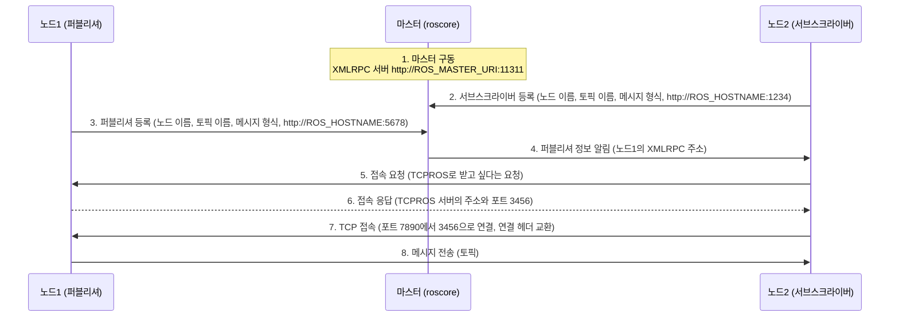

*그림 18. 마스터 구동부터 토픽 메시지 전송까지의 여덟 단계*

1. **마스터 구동:** `roscore`를 실행하면 마스터가 XMLRPC 서버를 `http://ROS_MASTER_URI:11311`에서 열고 노드 정보를 관리할 준비를 한다.
2. **서브스크라이버 노드 구동:** `rosrun 패키지 이름 노드 이름`으로 노드2를 실행한다. 노드2는 XMLRPC 클라이언트로서 마스터를 호출하여 자신의 노드 이름(`/subscriber_node_name`), 구독할 토픽 이름(`/topic_name`), 메시지 형식(`message_type`), 자신의 XMLRPC 서버 주소(`http://ROS_HOSTNAME:1234`)를 등록한다.
3. **퍼블리셔 노드 구동:** 같은 방법으로 노드1을 실행한다. 노드1은 자신의 노드 이름(`/publisher_node_name`), 발행할 토픽 이름, 메시지 형식, XMLRPC 서버 주소(`http://ROS_HOSTNAME:5678`)를 마스터에 등록한다.
4. **퍼블리셔 정보 알림:** 마스터는 같은 토픽을 구독하는 노드2에게 새로운 퍼블리셔인 노드1의 정보를 알린다.
5. **퍼블리셔 노드에 접속 요청:** 노드2는 마스터에게서 받은 노드1의 XMLRPC 주소로 노드1을 직접 호출하여, TCPROS로 메시지를 받고 싶다고 요청한다.
6. **서브스크라이버 노드에 접속 응답:** 노드1은 TCPROS 연결을 받을 자신의 TCP 서버 주소와 포트 번호(`ROS_HOSTNAME:3456`)를 응답으로 보낸다.
7. **TCP 접속:** 노드2가 TCP 클라이언트로서 노드1의 TCPROS 서버(`ROS_HOSTNAME:3456`)에 접속하여 퍼블리셔와 직접 연결된다. 이때 노드2 쪽에서 쓰는 포트(예에서 7890)는 운영체제가 정한다.
8. **메시지 전송:** 퍼블리셔 노드는 이 연결로 서브스크라이버 노드에게 토픽 메시지를 보낸다. 연결이 유지되는 동안 발행되는 모든 메시지가 이 연결로 전달된다.

| 단계 | 방향 | 프로토콜 | 오가는 정보 |
|:-----|:-----|:-----|:-----|
| 1 | 마스터 | | XMLRPC 서버 시작 (포트 11311) |
| 2 | 노드2 → 마스터 | XMLRPC | 서브스크라이버 정보 등록 |
| 3 | 노드1 → 마스터 | XMLRPC | 퍼블리셔 정보 등록 |
| 4 | 마스터 → 노드2 | XMLRPC | 새 퍼블리셔의 XMLRPC 주소 |
| 5 | 노드2 → 노드1 | XMLRPC | TCPROS 접속 요청 |
| 6 | 노드1 → 노드2 | XMLRPC | TCPROS 서버의 주소와 포트 |
| 7 | 노드2 → 노드1 | TCP | 연결 수립과 연결 헤더 교환 |
| 8 | 노드1 → 노드2 | TCPROS | 토픽 메시지 |

*표 10. 토픽 연결 과정의 단계별 방향, 프로토콜, 정보*

> **참고:** 공식 문서의 XMLRPC 함수 이름으로 쓰면 2단계는 `registerSubscriber`, 3단계는 `registerPublisher`, 4단계는 마스터가 노드2의 XMLRPC 서버를 호출하는 `publisherUpdate`, 5\~6단계는 노드2가 노드1의 XMLRPC 서버를 호출하는 `requestTopic`과 그 반환값(`TCPROS`, 호스트, 포트)이다 [22]. 2단계에서 노드2를 XMLRPC 클라이언트라고 한 것은 마스터와 노드1을 호출하는 역할을 가리키며, 4단계처럼 마스터가 호출할 때는 노드2의 XMLRPC 서버가 그 호출을 받는다. 또한 순서가 반대로 퍼블리셔가 먼저 등록되어 있으면, 서브스크라이버가 등록할 때 마스터가 이미 있는 퍼블리셔 목록을 반환값으로 돌려주므로 4단계의 알림 없이 바로 5단계로 넘어간다.

### 3.4 서비스 요청과 응답

서비스도 TCPROS로 데이터를 주고받지만, 토픽과 달리 **한 번만 접속하여 서비스 요청과 서비스 응답을 수행하고 서로의 접속을 끊는다.** 서비스 서버는 시작할 때 서비스 이름과 자신의 서비스 주소를 마스터에 등록하고, 서비스 클라이언트는 호출할 때 마스터에게 그 서비스 주소를 물어 서버에 직접 접속한다.

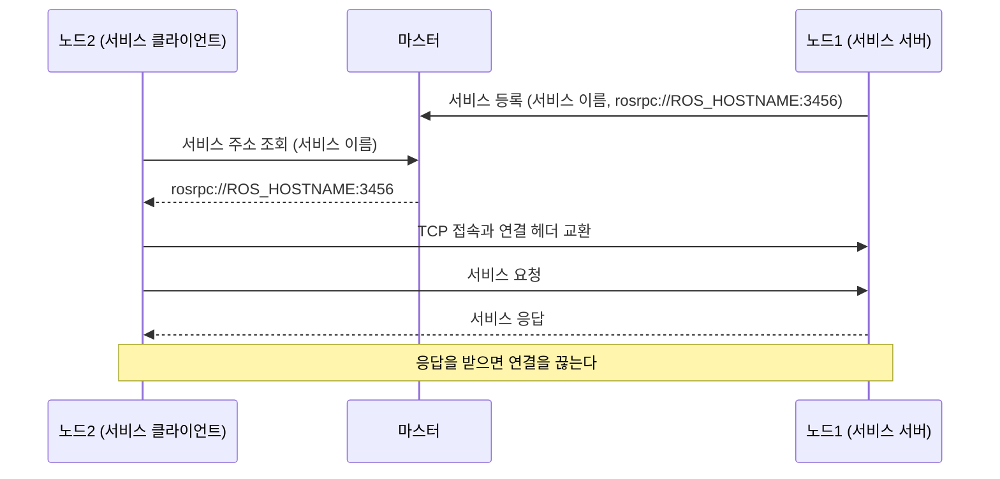

*그림 19. 서비스 요청과 응답의 과정*

| 구분 | 토픽 | 서비스 |
|:-----|:-----|:-----|
| 통신 방향 | 단방향 (퍼블리셔 → 서브스크라이버) | 양방향 (요청 → 응답) |
| 참여자 수 | 다대다 | 서버 하나와 클라이언트 |
| 연결 | 한 번 맺으면 계속 유지하며 메시지를 연속으로 보낸다 | 호출할 때마다 접속하고, 응답 후 끊는다 |
| 동기성 | 비동기: 발행하는 쪽은 받는 쪽을 기다리지 않는다 | 동기: 클라이언트는 응답이 올 때까지 기다린다 |
| 알맞은 데이터 | 센서 데이터, 속도 명령처럼 주기적으로 흐르는 데이터 | 설정 변경, 계산 요청처럼 결과가 필요한 일회성 작업 |
| 형식 정의 | `.msg` 파일 | `.srv` 파일 (요청과 응답) |

*표 11. 토픽과 서비스의 비교*

> **참고:** 서비스 클라이언트는 영속 연결(persistent connection)을 요청하여 여러 번의 호출에 같은 연결을 쓸 수도 있다. 호출이 잦을 때 매번 접속하는 비용을 줄이는 방법이며, 기본 동작은 위와 같이 호출마다 접속하고 끊는 것이다.

### 3.5 예제: turtlesim의 통신 과정

2.8절의 turtlesim을 IP 주소가 `192.168.4.100`인 컴퓨터 한 대에서 실행하면 위의 과정이 다음과 같이 일어난다.

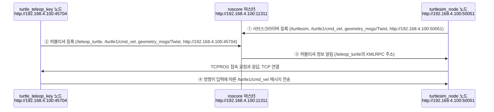

*그림 20. turtlesim 예제에서 일어나는 등록, 알림, 메시지 전송*

1. `roscore`가 `http://192.168.4.100:11311`에서 마스터를 실행하고 노드 정보를 관리한다.
2. ① `turtlesim_node`가 실행되면 노드 이름 `/turtlesim`, 토픽 `/turtle1/cmd_vel`, 메시지 형식 `geometry_msgs/Twist`, 자신의 주소 `http://192.168.4.100:50051`을 서브스크라이버 정보로 등록한다.
3. ② `turtle_teleop_key`가 실행되면 노드 이름 `/teleop_turtle`, 같은 토픽과 메시지 형식, 주소 `http://192.168.4.100:45704`를 퍼블리셔 정보로 등록한다.
4. ③ 마스터가 `/turtlesim`에게 퍼블리셔 `/teleop_turtle`의 정보를 알리고, 두 노드는 3.3절의 5\~7단계로 TCPROS 연결을 맺는다.
5. ④ 사용자가 방향키(←, ↑, ↓, →)를 누를 때마다 `/teleop_turtle`이 `/turtle1/cmd_vel`에 `Twist` 메시지를 발행하고, `/turtlesim`이 이를 받아 거북이를 움직인다.

> **참고:** `turtlesim_node`는 구독만 하는 것이 아니라 거북이의 현재 위치를 `/turtle1/pose` 토픽으로 발행하기도 한다. 이처럼 한 노드가 여러 토픽의 퍼블리셔이자 서브스크라이버일 수 있으며, 연결마다 위와 같은 등록과 연결 과정이 따로 일어난다.

---

<br>

## 개념 적용

| 상황 | 결과와 이유 |
|:-----|:------------|
| 계단이 많은 건물 안에서 소포를 배달하는 로봇을 설계한다. | **다리형이나 바퀴-다리 결합형이 알맞다.** 바퀴형은 계단을 오를 수 없고, 다리 끝에 바퀴를 단 로봇은 복도에서는 빠르게 달리고 계단에서는 걸을 수 있다. |
| 자동차를 제자리에서 바로 옆으로 움직이려 한다. | **움직일 수 없다.** 자동차는 비홀로노믹 제약 때문에 옆 방향 속도를 바로 낼 수 없으므로 앞뒤로 움직이며 방향을 바꾸어야 한다. |
| `roscore`를 실행하지 않고 `rosrun turtlesim turtlesim_node`를 실행한다. | **노드가 마스터를 찾지 못한다.** 노드는 시작할 때 `ROS_MASTER_URI`의 마스터에 자신을 등록해야 하므로, 마스터에 연결할 수 없다는 오류 메시지(`Failed to contact master`)를 출력하며 마스터가 실행될 때까지 등록을 다시 시도한다. |
| 토픽 연결이 맺어진 뒤 `roscore`를 종료한다. | **이미 맺어진 토픽 통신은 계속된다.** 메시지는 노드끼리 TCPROS로 직접 오가기 때문이다. 다만 새로 실행한 노드는 상대를 찾을 수 없다. |
| LiDAR 포인트 클라우드를 초당 10번 위치 인식 노드에 보낸다. | **토픽을 쓴다.** 주기적으로 흐르는 데이터이고 받는 노드가 여럿일 수 있으며, 보내는 쪽이 응답을 기다릴 필요가 없다. |
| 지도 파일을 다시 읽으라고 지도 노드에 명령하고 성공 여부를 받는다. | **서비스를 쓴다.** 한 번의 요청에 대한 결과가 필요한 일회성 작업이기 때문이다. |
| Ubuntu 20.04에 ROS Melodic을 `apt`로 설치하려 한다. | **바이너리 패키지를 찾지 못한다.** Melodic의 주 대상은 Ubuntu 18.04이고, 20.04에는 Noetic을 설치해야 한다. |
| 새 터미널에서 직접 빌드한 패키지의 노드를 `rosrun`으로 실행했더니 패키지를 찾지 못한다. | **작업 공간의 `devel/setup.bash`를 불러오지 않았다.** 환경 변수는 터미널마다 따로 설정되므로 새 터미널에서 다시 `source`해야 한다. |

*표 12. 이동 로봇과 ROS 통신에 관한 상황별 결과와 그 이유*

**T/F 점검:**

| 문장 | 판단과 근거 |
|:-----|:------------|
| ROS는 Linux를 대신하는 로봇 전용 운영체제이다. | **F.** ROS는 Linux 같은 운영체제 위에서 동작하는 메타 운영체제이자 미들웨어이다. |
| 토픽 메시지는 마스터를 거쳐 서브스크라이버에게 전달된다. | **F.** 마스터는 접속 정보만 중개하고, 메시지는 노드끼리 TCPROS로 직접 오간다. |
| 하나의 토픽에 여러 퍼블리셔와 여러 서브스크라이버가 있을 수 있다. | **T.** 토픽은 다대다 통신이다. |
| 서비스는 응답을 받은 뒤 기본적으로 연결을 끊는다. | **T.** 영속 연결을 요청하지 않으면 호출마다 접속하고 응답 후 끊는다. |
| 노드의 XMLRPC 포트와 TCPROS 포트는 항상 1234, 5678처럼 정해진 번호를 쓴다. | **F.** 마스터의 11311을 빼면 노드의 포트는 실행할 때 운영체제가 비어 있는 번호를 골라 준다. |
| C++로 작성한 퍼블리셔 노드와 Python으로 작성한 서브스크라이버 노드는 서로 통신할 수 있다. | **T.** 노드는 언어와 무관한 메시지 형식으로 통신한다. |
| MARVEL의 전기 영구 자석은 벽에 붙어 있는 동안 계속 전류를 흘려야 한다. | **F.** 전류 펄스로 자화 상태만 바꾸고, 자화된 상태에서는 전류 없이 자력을 유지한다. |

---

<br>

## 요약

| 개념 | 핵심 요약 |
|:--------|:------------|
| 이동 로봇 | 환경 안을 스스로 옮겨 다니며 일하는 로봇으로, 인식, 위치 인식, 경로 계획, 제어가 필요하다. |
| 이동 메커니즘 | 바퀴형은 평지에서 효율적이고, 다리형은 험지와 계단에 강하며, 둘을 결합한 로봇과 비행 로봇이 늘고 있다. |
| 비홀로노믹 제약 | 순간적으로 움직일 수 있는 방향이 제한되는 제약이다. 자동차와 차동 구동 로봇은 옆으로 바로 움직일 수 없다. |
| 최근 동향 | 메커니즘의 다양화, 점검과 물류 같은 위험하고 반복적인 작업의 대체, 지도 작성과 경로 재계획을 포함한 자율성의 향상이다. |
| ROS | 운영체제 위에서 하드웨어 추상화, 메시지 전달, 패키지 관리를 제공하는 로봇 소프트웨어용 메타 운영체제이다. |
| 노드 | 계산을 수행하는 하나의 프로세스로, 마스터에 등록된 고유한 이름을 갖는다. |
| 토픽과 메시지 | 토픽은 메시지가 오가는 이름 붙은 통로로, 다대다, 단방향, 비동기 통신이다. 메시지는 `.msg`로 정의한 데이터 형식이다. |
| 서비스 | 요청과 응답으로 이루어진 일대일, 양방향, 동기 통신으로, 기본적으로 호출마다 접속하고 응답 후 끊는다. |
| 마스터 | 노드, 토픽, 서비스의 정보를 등록받아 노드들이 서로를 찾게 하는 이름 서비스이며, 매개변수 서버를 포함한다. |
| 패키지와 catkin | 패키지는 ROS 소프트웨어의 빌드와 배포 단위이고, catkin은 CMake 기반의 ROS 1 빌드 시스템이다. |
| 개발 도구 | 명령행 도구, 3D 시각화 도구 RViz, Qt 기반 GUI 프레임워크 rqt, 물리 시뮬레이터 Gazebo가 있다. |
| 배포판 | 운영체제 버전과 짝을 이루어 출시되며, 이 과목은 Ubuntu 18.04와 Melodic을 쓴다. ROS 1은 Noetic으로 끝났다. |
| XMLRPC | 마스터 등록, 퍼블리셔 알림, 연결 협상에 쓰는 XML 기반 원격 함수 호출이다. 마스터의 기본 포트는 11311이다. |
| TCPROS | TCP 연결 위에서 연결 헤더로 메시지 형식을 확인한 뒤 직렬화된 메시지를 보내는 ROS의 전송 방식이다. |
| 토픽 연결 과정 | 마스터 구동, 서브스크라이버 등록, 퍼블리셔 등록, 퍼블리셔 알림, 접속 요청, 접속 응답, TCP 접속, 메시지 전송의 여덟 단계이다. |

---

<br>

## 점검 문제

1. **이동 방식의 선택:** 바퀴형, 다리형, 바퀴와 다리의 결합형 로봇의 장단점을 비교하고, 라스트 마일 배송에 바퀴-다리 로봇이 쓰이는 이유를 설명하라.

   <details>
   <summary>정답</summary>

   바퀴형은 구조와 제어가 단순하고 평지에서 빠르고 효율적이지만 계단과 턱을 넘기 어렵다. 다리형은 발 디딜 곳을 골라 험지와 계단을 지나지만 구조와 제어가 복잡하고 평지에서 느리며 에너지를 많이 쓴다. 결합형은 평지에서는 바퀴로, 험지에서는 다리로 이동하지만 구조와 제어가 가장 복잡하다. 라스트 마일 구간에는 보도, 계단, 문, 엘리베이터가 섞여 있어 한 가지 방식만으로는 효율적으로 지나기 어려우므로, 평지에서 빠르고 계단도 오르며 일어서서 문까지 여는 바퀴-다리 로봇이 쓰인다.

   </details>

2. **홀로노믹 주행:** 메카넘 휠을 단 SUMMIT-XL과 일반 자동차의 차이를 홀로노믹이라는 말로 설명하라.

   <details>
   <summary>정답</summary>

   메카넘 휠을 단 로봇은 바퀴마다 속도를 조합하여 어느 방향으로든 바로 움직일 수 있으므로 홀로노믹하다. 자동차는 바퀴가 옆으로 미끄러지지 않는 한 옆 방향으로 바로 움직일 수 없는 비홀로노믹 제약을 가지므로, 옆으로 가려면 앞뒤로 움직이며 방향을 바꾸어야 한다.

   </details>

3. **메타 운영체제:** ROS를 운영체제가 아니라 메타 운영체제라고 부르는 이유를 쓰고, ROS가 제공하는 서비스를 세 가지 이상 쓰라.

   <details>
   <summary>정답</summary>

   ROS는 스스로 하드웨어를 관리하는 운영체제가 아니라 Ubuntu 같은 운영체제 위에서 동작하며, 운영체제와 비슷한 서비스를 로봇 소프트웨어에 맞게 한 단계 위에서 제공하기 때문이다. 제공하는 서비스는 하드웨어 추상화, 저수준 장치 제어, 자주 쓰는 기능의 구현, 프로세스 간 메시지 전달, 패키지 관리이다.

   </details>

4. **토픽과 서비스:** 다음 데이터를 토픽과 서비스 가운데 무엇으로 주고받는 것이 알맞은지 이유와 함께 쓰라. (가) 카메라 영상 30 fps, (나) 로봇 팔의 목표 관절 각도를 계산해 달라는 요청, (다) 거북이의 속도 명령

   <details>
   <summary>정답</summary>

   (가)는 주기적으로 계속 흐르고 여러 노드가 받을 수 있는 데이터이므로 토픽이 알맞다. (나)는 한 번 요청하고 계산 결과를 받아야 하는 일회성 작업이므로 서비스가 알맞다. (다)는 키를 누를 때마다 계속 보내는 명령이고 보내는 쪽이 응답을 기다릴 필요가 없으므로 토픽이 알맞으며, turtlesim도 `/turtle1/cmd_vel` 토픽을 쓴다.

   </details>

5. **마스터의 역할:** 토픽 메시지가 마스터를 거치지 않도록 설계한 이유를 쓰고, 그 결과 마스터를 종료했을 때 일어나는 일을 설명하라.

   <details>
   <summary>정답</summary>

   LiDAR 포인트 클라우드나 카메라 영상처럼 큰 데이터가 모두 마스터를 거치면 마스터가 병목이 되므로, 마스터는 접속 정보만 중개하고 데이터는 노드끼리 직접 보낸다. 그래서 마스터를 종료해도 이미 맺어진 토픽 연결의 통신은 계속되지만, 새로 실행한 노드는 마스터에 등록할 수 없어 상대를 찾지 못한다.

   </details>

6. **여덟 단계:** 서브스크라이버가 먼저 실행되고 퍼블리셔가 나중에 실행되는 경우에 토픽 연결이 만들어지는 과정을 단계별로 쓰고, 각 단계에 쓰이는 프로토콜을 밝혀라.

   <details>
   <summary>정답</summary>

   (1) `roscore`가 포트 11311에서 마스터의 XMLRPC 서버를 연다. (2) 서브스크라이버가 XMLRPC로 노드 이름, 토픽, 메시지 형식, 자신의 XMLRPC 주소를 마스터에 등록한다. (3) 퍼블리셔가 같은 정보를 XMLRPC로 등록한다. (4) 마스터가 XMLRPC로 서브스크라이버에게 새 퍼블리셔의 주소를 알린다. (5) 서브스크라이버가 XMLRPC로 퍼블리셔에게 TCPROS 접속을 요청한다. (6) 퍼블리셔가 XMLRPC 응답으로 TCPROS 서버의 주소와 포트를 보낸다. (7) 서브스크라이버가 TCP로 그 포트에 접속하고 연결 헤더를 교환한다. (8) 퍼블리셔가 TCPROS로 메시지를 보낸다.

   </details>

7. **순서가 바뀐 경우:** 퍼블리셔가 먼저 실행된 뒤 서브스크라이버가 실행되면 3.3절의 4단계는 어떻게 되는가?

   <details>
   <summary>정답</summary>

   서브스크라이버가 마스터에 등록할 때 마스터가 이미 등록된 퍼블리셔 목록을 반환값으로 돌려주므로, 별도의 퍼블리셔 정보 알림(`publisherUpdate`) 없이 서브스크라이버가 바로 퍼블리셔에게 접속을 요청하는 5단계로 넘어간다.

   </details>

8. **연결 헤더:** TCPROS 연결을 맺을 때 연결 헤더로 메시지 형식과 그 해시값을 교환하는 이유는 무엇인가?

   <details>
   <summary>정답</summary>

   퍼블리셔와 서브스크라이버가 같은 토픽 이름을 쓰더라도 서로 다른 메시지 형식을 기대하면, 받은 바이트열을 잘못된 구조로 해석하게 된다. 연결 헤더로 메시지 형식과 정의의 해시값(MD5)을 비교하면 형식이 일치하는 경우에만 연결하므로 이런 오류를 막을 수 있다.

   </details>

9. **turtlesim 메시지:** 왼쪽 방향키를 누를 때 `turtle_teleop_key`가 발행하는 `geometry_msgs/Twist` 메시지의 필드 값을 쓰고, 거북이가 어떻게 움직이는지 설명하라.

   <details>
   <summary>정답</summary>

   `linear`의 `x`, `y`, `z`와 `angular`의 `x`, `y`는 0.0이고 `angular.z`는 2.0이다. 수직축 둘레의 양의 각속도이므로 거북이는 제자리에서 반시계 방향으로 회전한다.

   </details>

10. **배포판 선택:** Autoware.ai 1.14.0을 쓰려는 사람이 Ubuntu 18.04와 ROS Melodic을 선택하는 이유를 운영체제와의 짝과 장기 지원의 관점에서 설명하라.

    <details>
    <summary>정답</summary>

    ROS 배포판은 지원하는 Ubuntu 버전이 정해져 있어 Melodic의 바이너리 패키지는 Ubuntu 18.04를 주 대상으로 한다. Melodic은 Ubuntu 18.04 LTS와 짝을 이루는 장기 지원 배포판이며, Autoware.ai 1.14.0이 Melodic을 기준으로 개발되었으므로 이 조합을 써야 의존 패키지를 문제없이 설치하고 빌드할 수 있다.

    </details>

---

<br>

## 참고 문헌

1. R. Siegwart, I. R. Nourbakhsh, and D. Scaramuzza, *Introduction to Autonomous Mobile Robots*, 2nd ed. Cambridge, MA, USA: MIT Press, 2011.
2. RoMeLa, "BRUCE: Bipedal Robot Unit with Compliance Enhanced," YouTube. https://www.youtube.com/watch?v=NYFfn8bBUek
3. Science X, "Quadruped robot with magnetized feet can climb on metal buildings and structures," YouTube. https://www.youtube.com/watch?v=hVS-2XByRao
4. S. Hong *et al.*, "Agile and versatile climbing on ferromagnetic surfaces with a quadrupedal robot," *Science Robotics*, vol. 7, no. 73, Art. no. eadd1017, 2022.
5. Oxford Dynamic Robot Systems Group, "Inspection of Energy Facilities with Legged Robots," YouTube. https://www.youtube.com/watch?v=_b0GtwXo5Qk
6. Robotnik Automation, "Robotnik's Autonomous Mobile Robots," YouTube. https://www.youtube.com/watch?v=X9qRKnegxUY
7. Fraunhofer IML, "evoBOT als Ladeassistenz," YouTube. https://www.youtube.com/watch?v=Qb1Ly7vCOSA
8. K. Lu Stout, "Tech For Good: A transformer robot designed for last-mile delivery," YouTube. https://www.youtube.com/watch?v=f4Au-n0IhYE
9. Volocopter, "Christmas tree flying high this year," YouTube. https://www.youtube.com/watch?v=x0tuSf_ErFg
10. Vertical Flight Society, "Volocopter VoloDrone (prototype)," *eVTOL News*. https://evtol.news/volocopter-volodrone/
11. Skydio, "Introducing Skydio Dock and Skydio Remote Ops," YouTube. https://www.youtube.com/watch?v=BrfeUgGtLCY
12. GITAI, "GITAI LA office is a hub for space robot innovation!," YouTube. https://www.youtube.com/watch?v=24aAGzqa1yQ
13. ROS Wiki, "ROS/Introduction." https://wiki.ros.org/ROS/Introduction
14. M. Quigley *et al.*, "ROS: an open-source Robot Operating System," in *Proc. ICRA Workshop on Open Source Software*, 2009.
15. ROS Wiki, "ROS/Concepts." https://wiki.ros.org/ROS/Concepts
16. ROS Wiki, "Client Libraries." https://wiki.ros.org/Client%20Libraries
17. ROS Wiki, "Distributions." https://wiki.ros.org/Distributions
18. ROS Enhancement Proposals, "REP 3: Target Platforms." https://www.ros.org/reps/rep-0003.html
19. ROS Wiki, "Ubuntu install of ROS Melodic." https://wiki.ros.org/melodic/Installation/Ubuntu
20. ROS Wiki, "Installing and Configuring Your ROS Environment." https://wiki.ros.org/ROS/Tutorials/InstallingandConfiguringROSEnvironment
21. ROS Wiki, "turtlesim." https://wiki.ros.org/turtlesim
22. ROS Wiki, "ROS/Technical Overview." https://wiki.ros.org/ROS/Technical%20Overview
