# Week 1 Lecture — Recent Trends in Mobile Robots and ROS

[Repository Guide](../../README.md) | [English](Concepts_Lecture.md) | [한국어](Concepts_Lecture.ko.md)

> **Last Updated:** 2026-11-04

> **Learning Objectives:**
> 1. Classify mobile robots by locomotion (legs, wheels, combined wheels and legs, flight) and explain the features of real examples and recent trends
> 2. Explain why ROS is a meta-operating system and middleware for robot software, and describe its main features
> 3. Explain the meaning of node, topic, message, publisher, subscriber, service, master, and package, and how they relate to one another
> 4. Choose a ROS distribution that matches the operating system version, and describe how to check the installation and communication with turtlesim
> 5. Explain step by step how the master brokers node information over XMLRPC and how nodes exchange messages directly over TCPROS

---

## Table of Contents

- [1. Recent Trends in Mobile Robots](#1-recent-trends-in-mobile-robots)
  - [1.1 Scope of Mobile Robot Navigation Systems](#11-scope-of-mobile-robot-navigation-systems)
  - [1.2 Definition and Locomotion of Mobile Robots](#12-definition-and-locomotion-of-mobile-robots)
  - [1.3 Legged Robots](#13-legged-robots)
  - [1.4 Wheeled Robots](#14-wheeled-robots)
  - [1.5 Robots Combining Wheels and Legs](#15-robots-combining-wheels-and-legs)
  - [1.6 Aerial Robots and Space Robots](#16-aerial-robots-and-space-robots)
  - [1.7 Technology Trends Seen in the Examples](#17-technology-trends-seen-in-the-examples)
- [2. Concepts and Features of ROS](#2-concepts-and-features-of-ros)
  - [2.1 What ROS Is](#21-what-ros-is)
  - [2.2 Basic Concepts of ROS](#22-basic-concepts-of-ros)
  - [2.3 Communication Features](#23-communication-features)
  - [2.4 Robot Capability Libraries](#24-robot-capability-libraries)
  - [2.5 Development Tools](#25-development-tools)
  - [2.6 Choosing a Distribution](#26-choosing-a-distribution)
  - [2.7 Installation and Environment Setup](#27-installation-and-environment-setup)
  - [2.8 Checking Operation with turtlesim](#28-checking-operation-with-turtlesim)
- [3. Message Communication Between ROS Nodes](#3-message-communication-between-ros-nodes)
  - [3.1 Relationship Among the Master, Nodes, and Message Communication](#31-relationship-among-the-master-nodes-and-message-communication)
  - [3.2 XMLRPC and TCPROS](#32-xmlrpc-and-tcpros)
  - [3.3 Eight Steps to Establish a Topic Connection](#33-eight-steps-to-establish-a-topic-connection)
  - [3.4 Service Request and Response](#34-service-request-and-response)
  - [3.5 Example: Communication in turtlesim](#35-example-communication-in-turtlesim)
- [Concept Applications](#concept-applications)
- [Summary](#summary)
- [Self-Check Questions](#self-check-questions)
- [References](#references)

---

<br>

## 1. Recent Trends in Mobile Robots

### 1.1 Scope of Mobile Robot Navigation Systems

A mobile robot navigation system is the whole of the hardware and software that lets a robot know its own position, decide where to go, and move along that path by itself. The goal of this course is to understand and apply the navigation mechanisms and drive systems of mobile robots, and its content falls into the following three areas.

| Area | Details | Weeks |
|:-----|:-----|:-----|
| Installing and using the Robot Operating System (ROS) | Installing Linux and ROS, installing the development environment, writing and running example code | Week 1, Weeks 4-7 |
| Autonomous driving of a real car with open-source autonomous driving software | Installing and testing Autoware, installing the sensors needed for autonomous driving and acquiring data, testing autonomous driving algorithms in simulation | Weeks 2-5, Weeks 9-14 |
| High-definition maps (HD maps) for autonomous driving | Localization techniques based on HD maps, the composition of HD maps, building HD maps and testing them in simulation | Weeks 2, 3, and 9 |

*Table 1. Scope of the mobile robot navigation systems course*

> **Definition:** A **high-definition map (HD map)** is a map that records the positions of road elements such as lanes, stop lines, and traffic lights with centimeter-level accuracy. An autonomous vehicle finds its own position by matching this map against sensor data, and builds a path along the lane information in the map. The point cloud map and the vector map of Week 2 are examples of HD maps.

### 1.2 Definition and Locomotion of Mobile Robots

A **mobile robot** is a robot that is not fixed in one place but moves around its environment by itself to do its work. Unlike a **manipulator** fixed to the floor, such as a robot arm in a factory, a mobile robot must perceive its surroundings, estimate its own position, and reach the goal while avoiding obstacles, all while it moves. The first decision in designing a mobile robot is how it will move, that is, its **locomotion mechanism** [1].

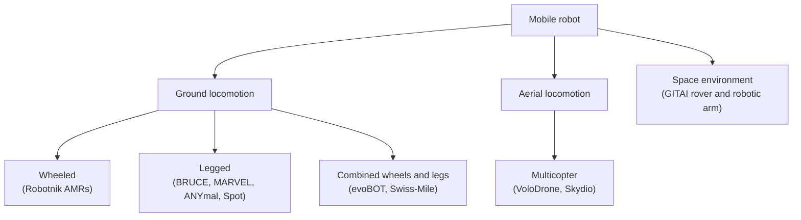

*Figure 1. Classification of mobile robots by locomotion mechanism, with examples*

The following nine examples show the variety of mechanisms used by recent mobile robots. Organized by locomotion, they are as follows.

| Locomotion | Example | Developer | Key feature |
|:-----|:-----|:-----|:-----|
| Legged (biped) | BRUCE | UCLA RoMeLa | Small humanoid biped with enhanced compliance that absorbs impacts [2] |
| Legged (quadruped) | MARVEL | KAIST | Quadruped that walks on steel walls and ceilings with magnetic feet [3], [4] |
| Legged (quadruped) | ANYmal, Spot | Field trial by the Oxford Robotics Institute | Quadrupeds that autonomously inspect energy facilities [5] |
| Wheeled | RB-CAR, SUMMIT-XL, and others | Robotnik | Family of autonomous mobile robots for indoor and outdoor logistics and transport [6] |
| Combined wheels and legs | evoBOT | Fraunhofer IML | Logistics robot that balances on two wheels and changes its shape [7] |
| Combined wheels and legs | Swiss-Mile robot | ETH Zurich spin-off | Quadruped with wheels at the ends of its legs that stands on two legs to open doors [8] |
| Aerial (multicopter) | VoloDrone | Volocopter | Large cargo drone that carries heavy loads slung below it [9], [10] |
| Aerial (multicopter) | Skydio Dock, Remote Ops | Skydio | Inspection drone that takes off and lands at a dock by itself and is operated remotely [11] |
| Space environment | Lunar rover, inchworm-type robotic arm | GITAI | Robots that work in space and on the lunar surface [12] |

*Table 2. Examples showing the variety of mobile robot mechanisms*

Each locomotion type has clear strengths and weaknesses. Wheels are the most efficient on flat ground, but on stairs and rough terrain legs, which choose where to step, have the advantage. Recently, robots that combine the strengths of both and robots that move through the air have been increasing.

| Locomotion | Strengths | Weaknesses |
|:-----|:-----|:-----|
| Wheeled | Simple structure and control; fast and energy efficient on flat ground | Hard to climb stairs, high curbs, and rough terrain |
| Legged | Chooses footholds to pass stairs and rough terrain, and can step over obstacles | Many joints make the structure and control complex; slower than wheels on flat ground and uses more energy |
| Combined wheels and legs | Runs fast on wheels on flat ground and walks on legs over rough terrain | The most complex mechanical structure and control |
| Aerial (multicopter) | Moves regardless of terrain and reaches high places | Flight time and payload are strongly limited by the battery |

*Table 3. Strengths and weaknesses of each locomotion type*

> **Definition:** A constraint that limits the directions in which a robot can move instantaneously is called a **nonholonomic constraint**. For example, a car or a two-wheeled differential-drive robot cannot move sideways on the spot unless its wheels slip sideways. In contrast, a robot with mecanum wheels or omni wheels can move directly in any direction and is called **holonomic** [1]. The nonholonomic constraint of a car returns in the path planning of Week 10.

### 1.3 Legged Robots

**BRUCE (Bipedal Robot Unit with Compliance Enhanced)** is a small humanoid biped developed by the RoMeLa (Robotics and Mechanisms Laboratory) at UCLA [2]. As its name says, its distinguishing feature is enhanced joint **compliance**, the property of yielding softly to an external force instead of resisting it rigidly. Compliant joints absorb the impact when a foot strikes the ground, so the robot can perform not only walking but also high-impact dynamic motions such as jumping. BRUCE's motions are first verified on a simulation model and then realized on the real robot as walking and crouching.

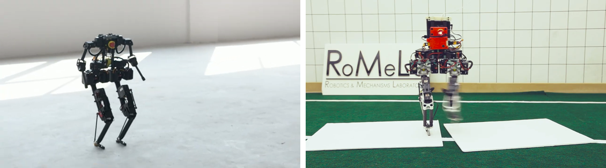

*Figure 2. Walking scenes of the biped robot BRUCE*

**MARVEL** is a quadruped developed at KAIST that walks on steel walls and ceilings [3], [4]. Its feet combine two materials.

- **Electro-permanent magnet (EPM):** A magnet whose magnetization can be switched on and off with a short current pulse. In the magnetized state it keeps its magnetic force without current, so it uses almost no power while the foot stays attached.
- **Magnetorheological elastomer (MRE):** A rubber material mixed with magnetic particles. Its friction coefficient is higher than that of a steel surface, so it keeps the foot from slipping.

MARVEL stabilizes its posture with model predictive control (MPC), and in experiments it moved at up to 0.7 m/s on vertical walls and 0.5 m/s on ceilings, crossed 10 cm wide gaps, and stepped over 5 cm high obstacles [4]. It also climbs a curved storage tank covered with rust and dust at 0.35 m/s [3]. Such robots can inspect steel structures that are dangerous for people to climb, such as ships, bridges, and storage tanks.

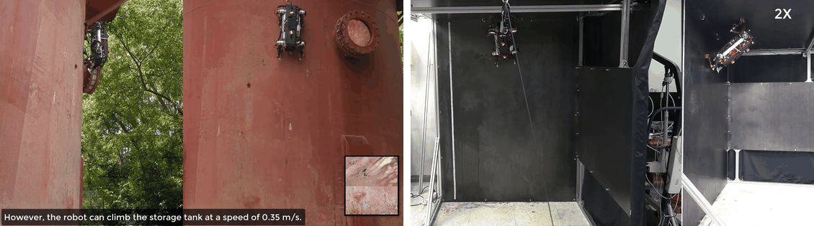

*Figure 3. MARVEL climbing a rusty storage tank and a vertical wall*

Quadrupeds have also begun to be used for **autonomous inspection** at industrial sites. In March 2022, the Oxford Robotics Institute (ORI) ran field trials with ANYbotics' ANYmal and Boston Dynamics' Spot at Chevron's blending plant in Ghent, Belgium [5]. The trials consisted of two parts.

1. **Walking over rough terrain (ANYmal):** A learning-based locomotion control algorithm (RLOC) maps the surrounding terrain and uses that map to pass stairs and rough ground.
2. **Autonomous inspection missions (Spot, ANYmal):** First a 3D map of the plant is built with real-time mapping technology; then the robot moves by itself between waypoints on the map, stopping to photograph pressure gauges and take detailed scans. It records the state of gauges and equipment with a pan-tilt-zoom (PTZ) camera and a thermal camera, and can photograph the same object repeatedly from the same viewpoint. When the way is blocked, it returns to the previous waypoint and receives a new route, and it retries a failed route only after a timeout.

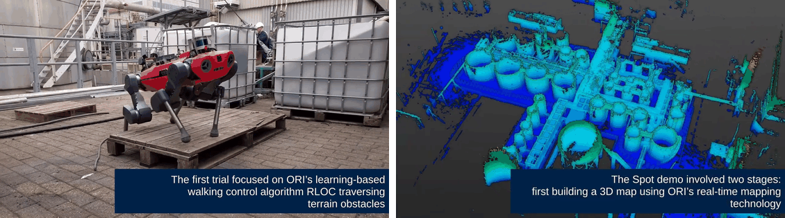

*Figure 4. ANYmal walking among plant equipment and the 3D map of the plant built in real time*

> **Key Point:** The mission of an inspection robot consists of mapping, localization on the map, path planning, and replanning when an obstacle is met. This is the same structure as the work of an autonomous vehicle, and it is what this course covers with Autoware (Week 3, Weeks 9-10).

### 1.4 Wheeled Robots

The Spanish company Robotnik builds **autonomous mobile robots (AMRs)** for indoor and outdoor logistics, transport, and research [6]. Each product has a wheel configuration and size suited to its purpose.

- **RB-CAR:** A platform that converts a small utility vehicle into an autonomous vehicle, with a LiDAR mounted at the front of the body.
- **RB-VO:** A delivery robot that carries boxes and drives on outdoor sidewalks.
- **SUMMIT-XL:** A four-wheeled robot that, when fitted with mecanum wheels, drives holonomically and can move sideways on the spot.
- **RB-1 BASE:** A cylindrical mobile platform that carries loads indoors or carries other equipment on top.
- **RB-ROBOUT:** A large AMR that carries heavy equipment such as a conveyor on top and moves inside a factory.
- **SUMMIT-XL STEEL:** A transport robot that helps workers with order picking in logistics warehouses.

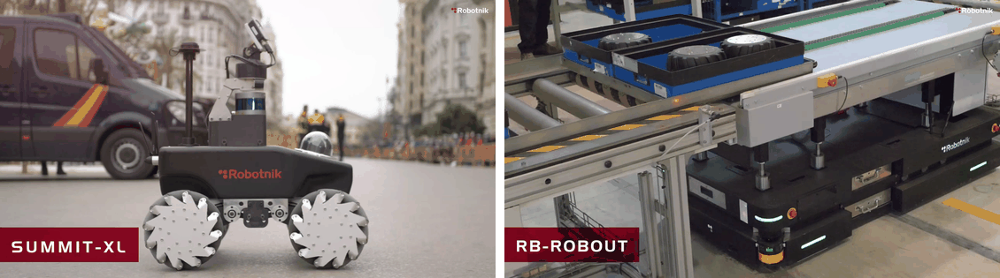

*Figure 5. SUMMIT-XL with mecanum wheels and RB-ROBOUT carrying a conveyor*

> **Note:** A factory **automated guided vehicle (AGV)** follows guidance laid in advance, such as magnetic tape or lines on the floor. An AMR perceives its surroundings with sensors and plans its own path on a map without such guidance, so nothing has to be laid again when the workspace changes.

### 1.5 Robots Combining Wheels and Legs

Fraunhofer IML's **evoBOT** is a logistics robot that balances on two wheels [7]. It balances by the **inverted pendulum** principle, keeping its base moving so that the upright body does not fall, like keeping a stick balanced upright, so it needs no separate counterweight. It grips an object from both sides with its two arms to lift it, and it can also change into a form that stands on four points with its arms on the ground to carry a box. With these abilities, evoBOT grips and moves a suitcase, lifts a box on a lawn, and acts as a loading assistant that carries a box to the trunk of a car for a person to load.

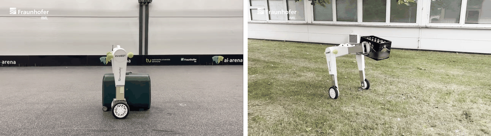

*Figure 6. evoBOT balancing on two wheels and in its form for carrying a box*

The robot of Swiss-Mile, a spin-off of ETH Zurich, is a **wheeled-legged robot** with driven wheels at the ends of the legs of the quadruped ANYmal [8]. It runs fast on four wheels on flat ground, climbs stairs with its legs, and stands up on its two hind legs to turn a door handle with a front leg and open the door. These abilities target **last-mile delivery**, carrying parcels from a delivery vehicle to the entrance of a building. The last mile mixes sidewalks, stairs, doors, and elevators, which are hard to pass efficiently with wheels alone or with legs alone.

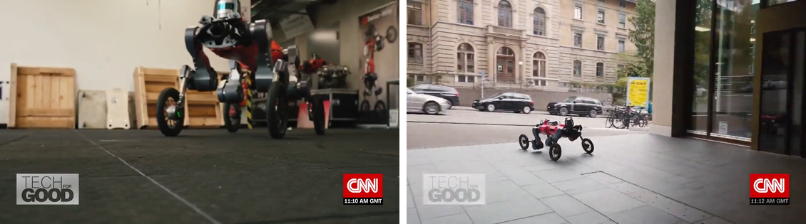

*Figure 7. The Swiss-Mile robot standing on two legs and driving on a city sidewalk*

### 1.6 Aerial Robots and Space Robots

Volocopter's **VoloDrone** is a large multicopter cargo drone with 18 rotors arranged on a ring frame, designed to carry about 200 kg of cargo [10]. VoloDrone can carry cargo slung on a line, and it has demonstrated lifting off from a snow-covered airfield with a Christmas tree hanging below [9]. Slinging the cargo below places few restrictions on the cargo's shape.

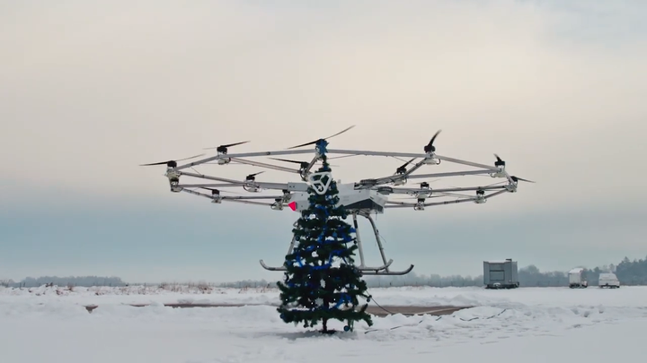

*Figure 8. VoloDrone taking off with a Christmas tree slung below*

Skydio's **Skydio Dock** is a base where a drone takes off, lands, and charges by itself, and **Skydio Remote Ops** is operations software for launching drones and assigning missions over the web from a remote site [11]. The drone flies inside and around facilities while avoiding obstacles to collect photographs, thermal images, and 3D scan data, and users get the data whenever they need it without going to the site. The goal is to replace dangerous inspections that people used to perform from aerial work platforms.

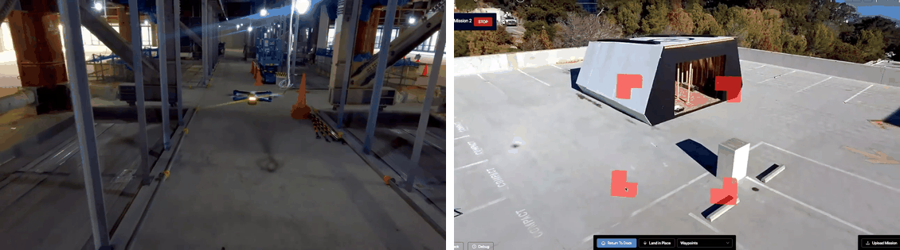

*Figure 9. A Skydio drone flying inside a facility and the remote operations screen*

GITAI is a company with a development base in the Los Angeles area of the United States that builds robots to work in space [12]. Its two-armed **lunar robotic rover** climbs ramps and drives on sand, and its **inchworm-type robotic arm**, with grippers at both ends, moves along the outer wall of a space station module by holding a structure with one end and moving the other end. Space robots aim to reduce the dangerous extravehicular activity of astronauts.

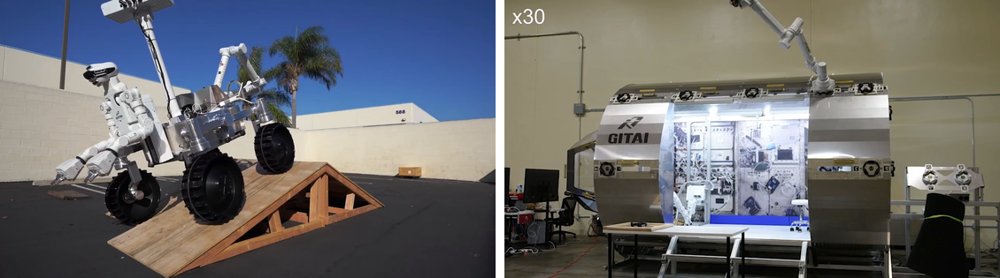

*Figure 10. GITAI's lunar rover and the inchworm-type robotic arm on a module*

### 1.7 Technology Trends Seen in the Examples

The trends common to the nine examples are as follows.

1. **Diversification and combination of locomotion mechanisms:** Beyond wheels, legs, and flight, robots are appearing that combine wheels and legs (Swiss-Mile), change their shape to suit the situation (evoBOT), or climb walls with magnetic feet (MARVEL).
2. **Replacing dangerous and repetitive work:** Robots take over work that is dangerous or repetitive for people, such as equipment inspection (ANYmal, Spot, Skydio, MARVEL), logistics and delivery (Robotnik, evoBOT, Swiss-Mile, VoloDrone), and work in space (GITAI).
3. **Increasing autonomy:** Robots build maps by themselves, estimate their positions on those maps, plan paths, and replan when blocked. People only assign missions remotely.

The functions that make up this autonomy, namely perception, localization, path planning, and control, are needed by robots of every locomotion type. This course covers how to implement them on ROS and on the open-source autonomous driving software Autoware. Section 2 examines ROS, the foundation for this.

---

<br>

## 2. Concepts and Features of ROS

### 2.1 What ROS Is

**ROS (Robot Operating System)** is a flexible framework for writing robot software, a collection of tools, libraries, and conventions that aim to simplify the task of creating complex and robust robot behavior across a wide variety of robotic platforms. Although its name contains "operating system," it is not an operating system like Windows or Linux; it is a **meta-operating system** that runs on top of an operating system such as Linux (mainly Ubuntu) and provides the robot with services similar to those of an operating system [13]. The services ROS provides are hardware abstraction, low-level device control, implementation of commonly used functionality, message passing between processes, and package management. ROS started at Stanford University in 2007, its development was continued by Willow Garage, and it has grown as open source since its first distribution in 2010 [14]. In this note, ROS means ROS 1.

The elements that make up ROS are summarized as the following four.

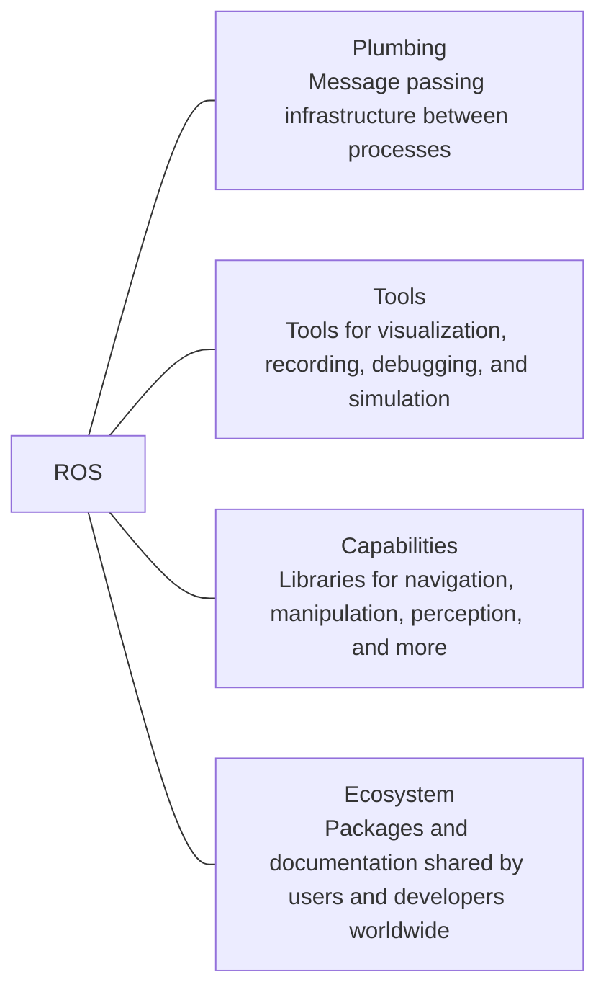

*Figure 11. The four elements that make up ROS*

Building robot software from scratch means writing sensor drivers, communication, visualization, and algorithms all by hand. With ROS, one reuses the communication infrastructure (plumbing) and the tools as they are, combines capability packages written by others, and concentrates only on the part one is developing. ROS also provides libraries that run on operating systems such as Ubuntu, macOS, Android, and iOS and on microcontroller platforms such as Arduino and mbed, so that robots, sensors, and applications on different platforms exchange data in the same way.

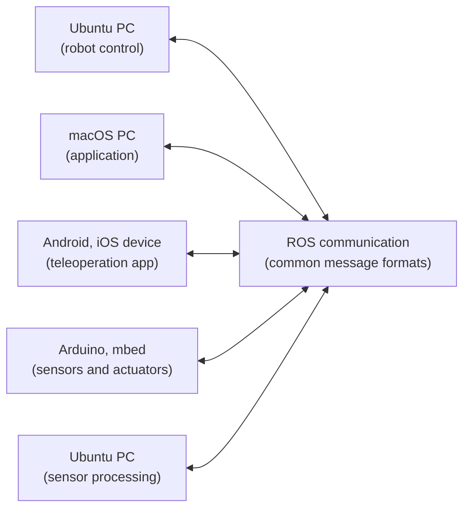

*Figure 12. Structure in which robots, sensors, and apps on different platforms are connected through ROS*

> **[Operating Systems]** An operating system abstracts the hardware, manages processes, and provides communication between processes (IPC). Of these, ROS provides communication between processes and package management again one level higher, tailored to robot software, while the actual scheduling and memory management are left to Linux underneath.

### 2.2 Basic Concepts of ROS

ROS programs form a network of processes that exchange messages with one another. This network is called the **computation graph**, and it is described with the following terms [15].

| Term | Definition |
|:-----|:-----|
| **Node** | A single process that performs computation. A robot system consists of many nodes divided by function, such as a LiDAR driver node, a localization node, and a path planning node. Each node has a unique name |
| **Master** | A naming service that registers and manages node names, the topics each node publishes or subscribes to, and the services it provides. Nodes find one another through the master and then communicate directly. It is started with the `roscore` command |
| **Message** | The format of the data exchanged between nodes. It is a structure whose fields are integers, floating-point numbers, strings, arrays, and other messages, defined in a `.msg` file. For example, `geometry_msgs/Twist` holds a linear velocity and an angular velocity |
| **Topic** | A named channel through which messages flow. The sending side and the receiving side communicate knowing only the topic name, without knowing who the other side is |
| **Publisher** | A node that sends messages to a topic, or the object inside a node that does so. Sending a message is called **publishing** |
| **Subscriber** | A node that receives the messages of a topic, or the object inside a node that does so. Registering to receive messages is called **subscribing** |
| **Service** | One-to-one communication in which sending a request returns a response. The formats of the request and response are defined in a `.srv` file; the requesting side is the service client and the responding side is the service server |
| **Parameter server** | A shared dictionary running inside the master, in which nodes store and read configuration values by name (key) |
| **Bag** | A file (`.bag`) that stores topic messages together with timing information. They can later be published again in the same order and at the same intervals |
| **Package** | The basic unit of ROS software, bundling nodes, libraries, message definitions, and configuration files. It is also the unit of building and release |

*Table 4. Basic concepts of the ROS computation graph*

A topic is **many-to-many**, **unidirectional** communication: several nodes can receive a message published by one node at the same time, and several nodes can publish to one topic. It suits continuously flowing data such as sensor data. A service is **one-to-one**, **bidirectional** communication that asks once and answers once, suited to work whose result must be awaited, such as changing a setting or requesting a computation.

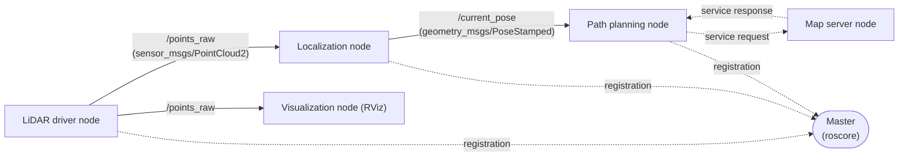

*Figure 13. Example computation graph of nodes, topics, a service, and the master*

In Figure 13, the rectangles are nodes, the labels on solid arrows are topics and message types, and the dotted lines are a service and registration with the master. The `/points_raw` topic published by the LiDAR driver node is subscribed by both the localization node and the visualization node, and the driver node does not need to know who subscribes. Because nodes are loosely coupled in this way, replacing or adding one node does not require changing the others.

> **Definition:** **catkin** is the official build system of ROS 1, which extends CMake to build many packages at once. The folder built with catkin is called a **workspace**, and it consists of a `src` folder for sources, a `build` folder for intermediate build files, and a `devel` folder for build results and environment setup scripts. How to create and build packages is covered in Weeks 2 and 5.

### 2.3 Communication Features

The most important feature of ROS is data communication between nodes. This feature is often called **middleware**, software that sits between the operating system and applications and handles communication between programs on their behalf.

- **Message passing interface:** ROS provides the communication styles frequently used in robot development (topics and services). ROS handles the serialization and parsing of messages, so developers deal only with message fields. Because nodes are connected only through the agreed interface of messages, the internal implementation of each node stays hidden (encapsulation), and a node once written is easy to reuse on another robot.
- **Recording and playback of messages:** Messages exchanged between nodes are saved to a bag file and published again when needed. Algorithms can be tested repeatedly on the same data without real sensors, which makes algorithm development and debugging easier. Week 2 uses this feature with Autoware.
- **Use of multiple programming languages:** Data is exchanged between nodes in language-independent message formats, so each node can be written in a different language. Each language has a **client library** that provides the ROS features.
- **Distributed parameter system:** Variables used in the system are stored on the parameter server as pairs of global keys and values, so that many nodes share and modify them. A changed value takes effect immediately for any node that reads it afterward.

| Client library | Language |
|:-----|:-----|
| `roscpp` | C++ |
| `rospy` | Python |
| `roslisp` | Common Lisp |
| `rosjava` | Java |
| `roslua` | Lua |
| `roscs` | C# |
| `roseus` | EusLisp |
| `PhaROS` | Pharo Smalltalk |
| `rosR` | R |

*Table 5. ROS client libraries and their languages*

`roscpp` and `rospy` are the main client libraries officially supported by ROS, and the rest are experimental libraries built by the user community [16]. The nodes of this course are written in C++ with `roscpp` (Weeks 5-7).

> **Caution:** The parameter server is not designed for high-speed communication. It suits reading configuration values when a node starts; a value a node has already read does not change, even if the parameter is changed, until the node reads it again. Continuously changing data is sent over topics.

### 2.4 Robot Capability Libraries

On top of its communication infrastructure, ROS provides libraries for functions commonly needed in robot development.

| Capability | Description |
|:-----|:-----|
| Standard message definitions for robots | Defines standard messages (`sensor_msgs`, `nav_msgs`, `geometry_msgs`, and others) for sensor data from cameras, IMUs, and lasers, for odometry, and for navigation data such as paths and maps. Because everyone uses the same formats, modularization and collaboration become easier |
| Robot geometry library (TF) | Manages, as a tree, the relative positions and orientations between the coordinate frames attached to the robot body, wheels, and sensors, and computes coordinate transforms that change over time |
| Robot description language (URDF) | Describes physical properties of the robot such as links, joints, masses, and appearance in an XML document |
| Diagnostics system | Collects the state of each part of the robot so it can be grasped at a glance |
| Sensing and perception | Provides sensor drivers and libraries at the sensing and perception levels |
| Navigation | Provides estimation of the robot's pose (position and orientation), self-localization within a map, SLAM for building maps, and navigation libraries for reaching a destination within a map |
| Manipulation | Provides libraries supporting inverse kinematics (IK) and forward kinematics (FK) of robot arms and application motions such as pick and place, together with a GUI tool (MoveIt!) |

*Table 6. Robot capability libraries provided by ROS*

> **Definition:** A **pose** combines a position and an orientation. A pose in 3D space is expressed as a position $(x, y, z)$ and rotations about three axes. **SLAM (simultaneous localization and mapping)** is the technique of building a map of an unknown environment while estimating one's own position within that map at the same time. **Forward kinematics** computes the pose of the end of an arm from its joint angles, and **inverse kinematics** computes the joint angles that produce a desired pose of the end of the arm.

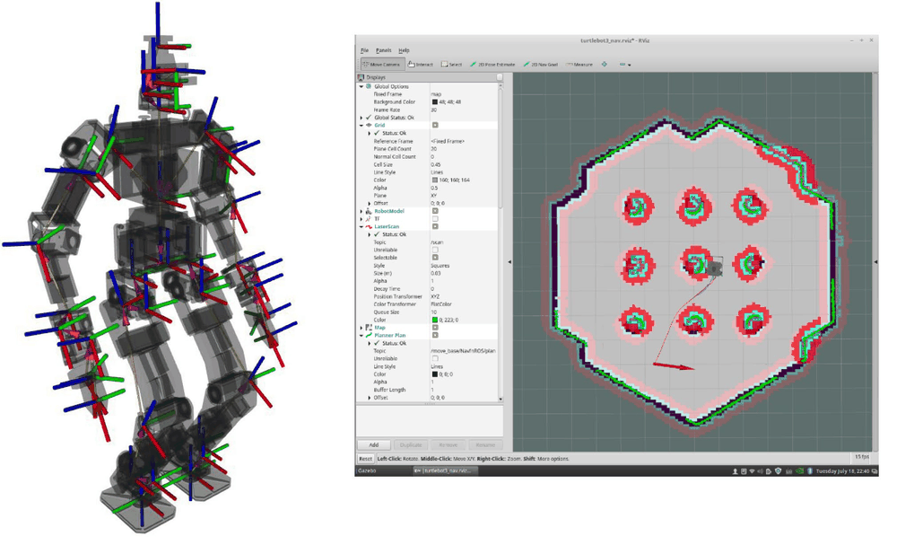

*Figure 14. TF coordinate frames attached to each link of a humanoid robot, and the RViz navigation view*

The left side of Figure 14 shows the coordinate frame attached to each link of a humanoid robot as red (x axis), green (y axis), and blue (z axis) arrows. TF manages these frames as a tree of parent and child relations, so, for example, the position of an object seen by the camera in the head can be converted directly into coordinates relative to the foot. The right side is a navigation view that estimates the robot's position on a map (gray grid) and moves it to a destination.

> **[Computer Graphics]** A coordinate transform that moves a point from one frame to another consists of a rotation and a translation, and with homogeneous coordinates it can be represented by a single 4 × 4 matrix. Multiplying the transform matrices in turn while going from parent to child along the tree gives the transform between two frames that are far apart. TF performs this computation automatically.

### 2.5 Development Tools

ROS provides a variety of development tools that improve the efficiency of robot development. With the **command-line tools** alone, one can access the robot without a GUI and use almost every feature of ROS.

| Command | What it does |
|:-----|:-----|
| `roscore` | Starts the master, the parameter server, and the `rosout` node that collects logs |
| `rosrun package node` | Runs one node in a package |
| `roslaunch package file.launch` | Runs at once the nodes and parameters listed in a launch file |
| `rosnode list`, `rosnode info` | Shows the list of running nodes and their information |
| `rostopic list`, `rostopic echo`, `rostopic pub` | Lists topics, prints the messages of a topic, and publishes a message directly |
| `rosservice call` | Calls a service |
| `rosparam get`, `rosparam set` | Reads and writes parameters |
| `rosmsg show` | Shows the definition of a message type |
| `rosbag record`, `rosbag play` | Records topics to a bag file and plays them back |

*Table 7. Frequently used ROS command-line tools*

The following three are representative graphical tools.

- **RViz:** A powerful 3D visualization tool. It displays sensor data such as lasers and cameras, the robot's appearance, and planned motions in three dimensions.
- **rqt:** A Qt-based framework for building GUI tools. Its plugins include `rqt_graph`, which shows nodes and the connections between them as a graph, `rqt_plot`, which plots numbers that change over time such as encoder values and voltages, and `rqt_bag`, which records and plays back data as messages.
- **Gazebo:** A 3D robot simulator with a physics engine that supports robot, sensor, and environment models and is highly compatible with ROS. Algorithms can be tested in simulation first, without a real robot.

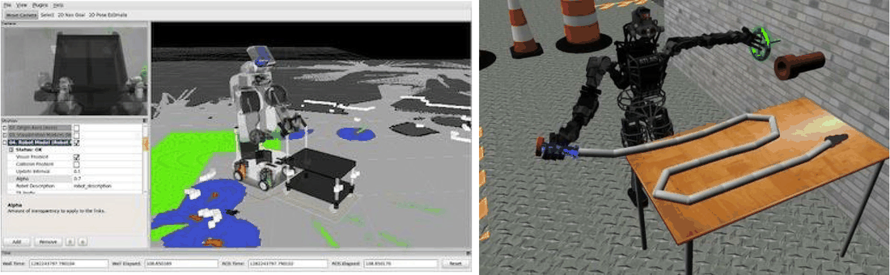

*Figure 15. RViz visualizing sensor data and Gazebo simulating a robot*

The left side of Figure 15 shows RViz overlaying a robot model, a camera image, and the points of a depth sensor in one view, and the right side is a Gazebo simulation in which a humanoid robot handles an object on a table.

### 2.6 Choosing a Distribution

ROS releases its packages as a bundle, a **distribution**, at regular intervals. Distribution names are assigned in alphabetical order, with turtle-themed names and posters [17].

| Distribution | Release date | End of life (EOL) |
|:-----|:-----|:-----|
| Noetic Ninjemys | 2020-05-23 | May 2025 (same as the EOL of Ubuntu 20.04 Focal) |
| Melodic Morenia | 2018-05-23 | May 2023 (same as the EOL of Ubuntu 18.04 Bionic) |
| Lunar Loggerhead | 2017-05-23 | May 2019 |
| Kinetic Kame | 2016-05-23 | April 2021 (same as the EOL of Ubuntu 16.04 Xenial) |
| Jade Turtle | 2015-05-23 | May 2017 |
| Indigo Igloo | 2014-07-22 | April 2019 (same as the EOL of Ubuntu 14.04 Trusty) |
| Hydro Medusa | 2013-09-04 | May 2015 |
| Groovy Galapagos | 2012-12-31 | July 2014 |
| Fuerte Turtle | 2012-04-23 | |
| Electric Emys | 2011-08-30 | |
| Diamondback | 2011-03-02 | |
| C Turtle | 2010-08-02 | |
| Box Turtle | 2010-03-02 | |

*Table 8. ROS 1 distributions with release dates and end-of-life dates*

When choosing a distribution, consider the following.

1. **Pairing with the operating system:** Each distribution supports specific Ubuntu versions. Melodic mainly targets Ubuntu 18.04, and Noetic targets Ubuntu 20.04 [18]. Other Ubuntu versions have no binary packages, which makes installation difficult.
2. **Long-term support (LTS):** Indigo, Kinetic, Melodic, and Noetic, released in even years, pair with Ubuntu LTS releases and are long-term support distributions supported for five years. The distributions in between have short support periods of about two years.
3. **Requirements of the software to be used:** Autoware.ai 1.14.0, used in this course, is based on ROS Melodic, so this course uses Ubuntu 18.04 and ROS Melodic (Week 4).

> **Note:** Noetic is the last distribution of ROS 1, and its support ended in May 2025. ROS development has since moved to **ROS 2**, which replaces the communication layer with DDS and lets nodes discover one another without a master, and Autoware has also been redeveloped on ROS 2. The concepts of node, topic, message, service, and package remain the same in ROS 2, however, so concepts learned with ROS 1 also apply to ROS 2.

### 2.7 Installation and Environment Setup

ROS Melodic is installed on Ubuntu 18.04 with `apt` after registering the ROS repository. The key steps of the official installation document are as follows [19].

```bash
# 1. Register the ROS package repository and add the repository's signing key
sudo sh -c 'echo "deb http://packages.ros.org/ros/ubuntu $(lsb_release -sc) main" > /etc/apt/sources.list.d/ros-latest.list'
curl -s https://raw.githubusercontent.com/ros/rosdistro/master/ros.asc | sudo apt-key add -

# 2. Update the package list and install desktop-full, which includes ROS, rqt, RViz, Gazebo, and more
sudo apt update
sudo apt install ros-melodic-desktop-full

# 3. Register in .bashrc so that the ROS environment variables are set in every new terminal
echo "source /opt/ros/melodic/setup.bash" >> ~/.bashrc
source ~/.bashrc

# 4. Initialize rosdep, which installs package dependencies automatically
sudo apt install python-rosdep python-rosinstall python-rosinstall-generator python-wstool build-essential
sudo rosdep init
rosdep update
```

After installation, create a catkin workspace in which to create and build one's own packages [20].

```bash
mkdir -p ~/catkin_ws/src     # create the workspace and its source folder
cd ~/catkin_ws/
catkin_make                  # build the empty workspace to create the build and devel folders
source devel/setup.bash      # set environment variables so that ROS can find the workspace packages
echo $ROS_PACKAGE_PATH       # success if it prints something like /home/<user>/catkin_ws/src:/opt/ros/melodic/share
```

The reason for sourcing `setup.bash` is to set environment variables such as the path where ROS commands look for packages (`ROS_PACKAGE_PATH`) and the address of the master (`ROS_MASTER_URI`) in the current shell. This setting applies to each terminal separately, so it must be repeated whenever a new terminal is opened, or registered in `.bashrc`. The whole installation process and the network environment variables are covered in detail in Week 4.

> **Caution:** The ROS wiki has a separate installation document for each distribution (for example, `kinetic/Installation/Ubuntu` for Kinetic and `melodic/Installation/Ubuntu` for Melodic). Kinetic is for Ubuntu 16.04, so on Ubuntu 18.04 the Melodic installation document must be followed. The `melodic` part of the installation commands must match the name of the distribution being installed, and installing a distribution that does not pair with the operating system fails to find the packages.

### 2.8 Checking Operation with turtlesim

**turtlesim** is a 2D turtle simulator package for people learning ROS for the first time [21]. Moving the turtle on the screen with the keyboard confirms that nodes, topics, and messages actually work. Run each of the commands below in a different terminal.

```bash
roscore                                  # terminal 1: start the master
. devel/setup.bash                       # in each of terminals 2-4, load the workspace environment before running a node
rosrun turtlesim turtlesim_node          # terminal 2: start the node that opens the turtle window
rosrun turtlesim turtle_teleop_key       # terminal 3: start the node that turns key presses into velocity commands
rosrun rqt_graph rqt_graph               # terminal 4: open the graph of node and topic connections
```

`. devel/setup.bash` is the same command as `source devel/setup.bash`. Packages installed with `apt`, like turtlesim, run after loading only `/opt/ros/melodic/setup.bash`, but running a package built in one's own workspace requires loading that workspace's `devel/setup.bash`. With the terminal running `turtle_teleop_key` selected, pressing the arrow keys moves the turtle, which draws a line where it passes.

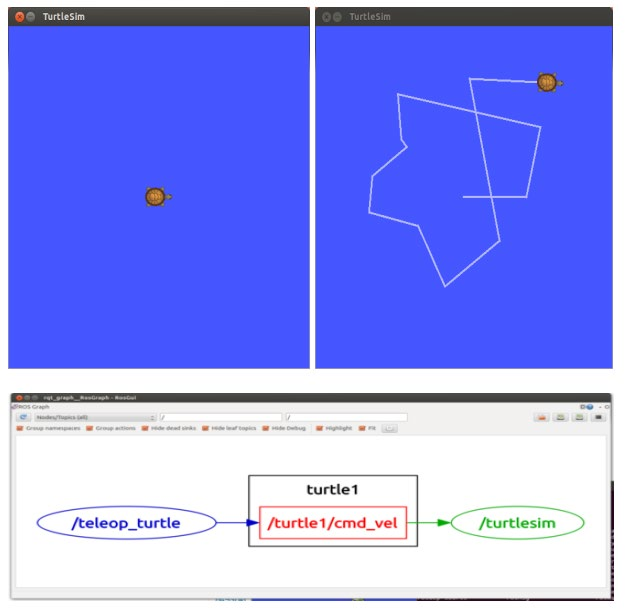

*Figure 16. The turtlesim turtle moved with the arrow keys and the node connections shown by rqt_graph*

In `rqt_graph`, ellipses are nodes and rectangles are topics. The keyboard node `/teleop_turtle` publishes velocity commands to the `/turtle1/cmd_vel` topic, and the simulator node `/turtlesim` subscribes to that topic. The message type of the topic and its actual contents can be checked with the command-line tools.

```bash
rostopic type /turtle1/cmd_vel       # geometry_msgs/Twist
rosmsg show geometry_msgs/Twist      # print the field structure of the message
rostopic echo /turtle1/cmd_vel       # print the message published each time an arrow key is pressed
```

`rosmsg show geometry_msgs/Twist` prints the following. `Twist` consists of two 3D vectors: the linear velocity `linear` (m/s) and the angular velocity `angular` (rad/s).

```text
geometry_msgs/Vector3 linear
  float64 x
  float64 y
  float64 z
geometry_msgs/Vector3 angular
  float64 x
  float64 y
  float64 z
```

Pressing the up arrow key makes `rostopic echo` print the following message. `turtle_teleop_key` multiplies by a default scale of 2.0, so the up and down keys set `linear.x` to $\pm 2.0$ and the left and right keys set `angular.z` to $\pm 2.0$. Because the turtle moves on a plane, it uses only the forward velocity (`linear.x`) and the rotational velocity about the vertical axis (`angular.z`).

```text
linear: 
  x: 2.0
  y: 0.0
  z: 0.0
angular: 
  x: 0.0
  y: 0.0
  z: 0.0
---
```

---

<br>

## 3. Message Communication Between ROS Nodes

### 3.1 Relationship Among the Master, Nodes, and Message Communication

The most fundamental technology in ROS is message communication between nodes. Nodes do not know one another's addresses in advance, so each first registers its own information with the master and obtains the other side's connection information from the master. After that, the actual messages are exchanged directly between nodes without passing through the master.

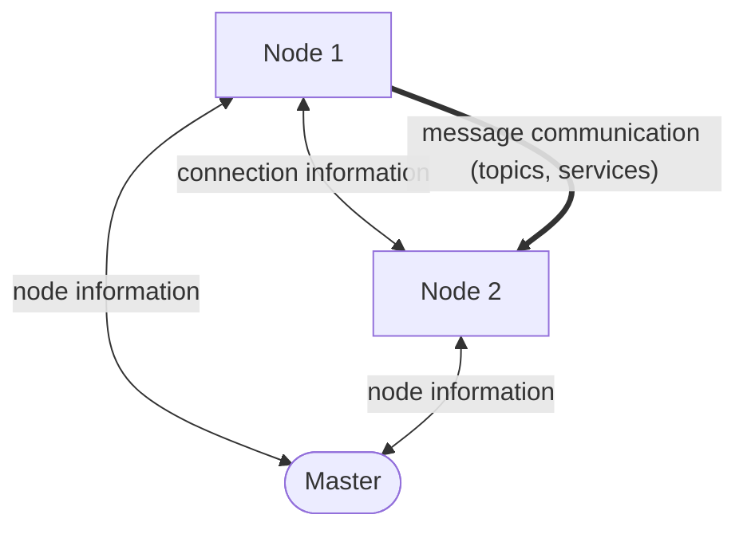

*Figure 17. Information exchange between the master and nodes, and message communication between nodes*

> **Key Point:** Like a telephone directory, the master only tells who publishes and who subscribes to which topic, and message data does not pass through the master. So even when large volumes of sensor data flow, the load does not concentrate on the master. On the other hand, without the master a new node cannot find its peers, so the master must be started before any node.

### 3.2 XMLRPC and TCPROS

Two protocols are used for communication between nodes and the master and between nodes [22].

| Protocol | Use | Characteristics |
|:-----|:-----|:-----|
| **XMLRPC (XML Remote Procedure Call)** | Registers and looks up node information with the master, and lets nodes negotiate how to connect | A remote procedure call method that expresses requests and responses in XML and exchanges them over HTTP. The information exchanged is small and infrequent, so a simple method suffices |
| **TCPROS** | Actually carries topic messages and service request and response data | ROS's own transport that sends serialized ROS messages over a TCP connection. When a connection is first established, a connection header exchanges the topic name, message type, and the type's hash value (MD5) to check that both sides use the same message type |

*Table 9. XMLRPC and TCPROS used in node communication*

> **[Distributed Systems]** A **remote procedure call (RPC)** is a communication method that calls a function located on another computer or in another process as if it were a function of one's own program. The calling side (client) sends the function name and arguments, and the receiving side (server) runs the function and returns the result. XMLRPC is an RPC that expresses the function name, arguments, and results as XML documents.

The master runs as an XMLRPC server, and its address is set by the environment variable `ROS_MASTER_URI`. The default is `http://localhost:11311`, so port 11311 is the master's default port. Each node also opens an XMLRPC server of its own so that the master and other nodes can call it. A node's XMLRPC server address has the form `http://ROS_HOSTNAME:port`, where `ROS_HOSTNAME` is the name or IP address of the computer on which the node runs.

> **[Computer Networks]** Many programs on one computer communicate at the same time, so an IP address alone cannot tell which program should receive the data. A **port** number, from 0 to 65535, distinguishes them. TCP is a connection-oriented transport-layer protocol that guarantees data arrives in order and without loss.

### 3.3 Eight Steps to Establish a Topic Connection

Before node 1 (publisher) can send topic messages to node 2 (subscriber), the following eight steps take place. The port numbers in the figure below (1234, 5678, 3456, 7890) are examples for explanation; in practice the operating system picks a free port when a node starts.

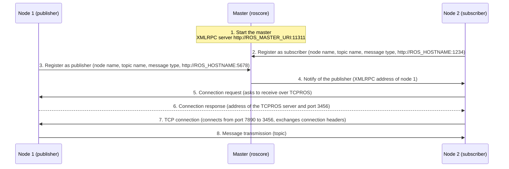

*Figure 18. Eight steps from starting the master to sending topic messages*

1. **Start the master:** Running `roscore` makes the master open its XMLRPC server at `http://ROS_MASTER_URI:11311` and get ready to manage node information.
2. **Start the subscriber node:** Run node 2 with `rosrun package_name node_name`. As an XMLRPC client, node 2 calls the master to register its node name (`/subscriber_node_name`), the topic name to subscribe to (`/topic_name`), the message type (`message_type`), and the address of its own XMLRPC server (`http://ROS_HOSTNAME:1234`).
3. **Start the publisher node:** Run node 1 in the same way. Node 1 registers its node name (`/publisher_node_name`), the topic name to publish, the message type, and its XMLRPC server address (`http://ROS_HOSTNAME:5678`) with the master.
4. **Notify of the publisher:** The master informs node 2, which subscribes to the same topic, of the information of node 1, the new publisher.
5. **Request a connection to the publisher node:** Node 2 calls node 1 directly at the XMLRPC address received from the master and asks to receive messages over TCPROS.
6. **Respond to the subscriber node:** Node 1 replies with the address and port number of its own TCP server that will accept the TCPROS connection (`ROS_HOSTNAME:3456`).
7. **TCP connection:** As a TCP client, node 2 connects to node 1's TCPROS server (`ROS_HOSTNAME:3456`) and is connected directly to the publisher. The port used on node 2's side (7890 in the example) is chosen by the operating system.
8. **Send messages:** The publisher node sends topic messages to the subscriber node over this connection. While the connection lasts, every published message is delivered over it.

| Step | Direction | Protocol | Information exchanged |
|:-----|:-----|:-----|:-----|
| 1 | Master | | Start of the XMLRPC server (port 11311) |
| 2 | Node 2 → master | XMLRPC | Registration of subscriber information |
| 3 | Node 1 → master | XMLRPC | Registration of publisher information |
| 4 | Master → node 2 | XMLRPC | XMLRPC address of the new publisher |
| 5 | Node 2 → node 1 | XMLRPC | Request for a TCPROS connection |
| 6 | Node 1 → node 2 | XMLRPC | Address and port of the TCPROS server |
| 7 | Node 2 → node 1 | TCP | Establishing the connection and exchanging connection headers |
| 8 | Node 1 → node 2 | TCPROS | Topic messages |

*Table 10. Direction, protocol, and information of each step of the topic connection*

> **Note:** In terms of the XMLRPC function names of the official documentation, step 2 is `registerSubscriber`, step 3 is `registerPublisher`, step 4 is `publisherUpdate`, in which the master calls node 2's XMLRPC server, and steps 5-6 are `requestTopic`, in which node 2 calls node 1's XMLRPC server, and its return value (`TCPROS`, host, port) [22]. Labeling node 2 as "XMLRPC: client" in the figure refers to its role of calling the master and node 1; when the master calls, as in step 4, node 2's XMLRPC server receives the call. Also, if the order is reversed and the publisher is registered first, the master returns the list of existing publishers when the subscriber registers, so the subscriber goes directly to step 5 without the notification of step 4.

### 3.4 Service Request and Response

Services also exchange data over TCPROS, but unlike topics, **they connect only once, perform the service request and service response, and then close the connection.** When a service server starts, it registers the service name and its own service address with the master, and when a service client calls, it asks the master for that service address and connects to the server directly.

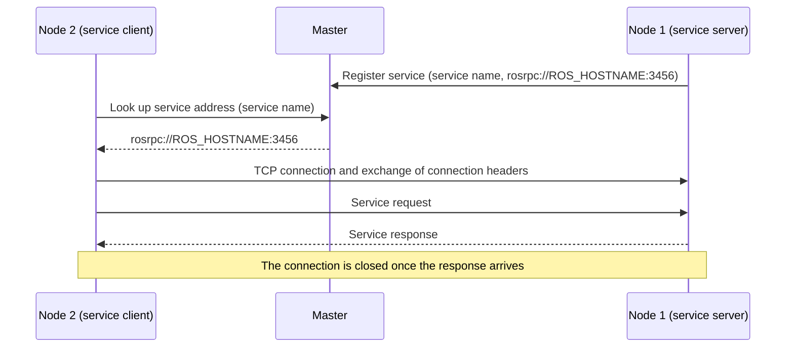

*Figure 19. Process of a service request and response*

| Aspect | Topic | Service |
|:-----|:-----|:-----|
| Direction | Unidirectional (publisher → subscriber) | Bidirectional (request → response) |
| Participants | Many-to-many | One server and its clients |
| Connection | Once established, kept open while messages are sent continuously | Connects at each call and disconnects after the response |
| Synchrony | Asynchronous: the publisher does not wait for receivers | Synchronous: the client waits until the response arrives |
| Suitable data | Periodically flowing data such as sensor data and velocity commands | One-off tasks that need a result, such as changing settings or requesting computations |
| Type definition | `.msg` file | `.srv` file (request and response) |

*Table 11. Comparison of topics and services*

> **Note:** A service client can also request a persistent connection and use the same connection for many calls. This reduces the cost of connecting each time when calls are frequent; the default behavior is to connect and disconnect at every call, as above.

### 3.5 Example: Communication in turtlesim

When the turtlesim of Section 2.8 runs on a single computer with IP address `192.168.4.100`, the process above takes place as follows.

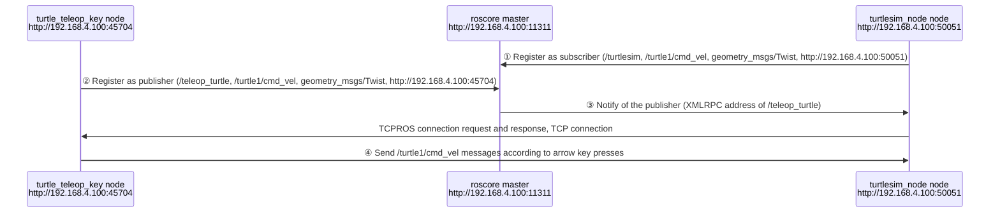

*Figure 20. Registration, notification, and message transmission in the turtlesim example*

1. `roscore` starts the master at `http://192.168.4.100:11311` and manages node information.
2. ① When `turtlesim_node` starts, it registers the node name `/turtlesim`, the topic `/turtle1/cmd_vel`, the message type `geometry_msgs/Twist`, and its own address `http://192.168.4.100:50051` as subscriber information.
3. ② When `turtle_teleop_key` starts, it registers the node name `/teleop_turtle`, the same topic and message type, and the address `http://192.168.4.100:45704` as publisher information.
4. ③ The master informs `/turtlesim` of the publisher `/teleop_turtle`, and the two nodes establish a TCPROS connection through steps 5-7 of Section 3.3.
5. ④ Each time the user presses an arrow key (←, ↑, ↓, →), `/teleop_turtle` publishes a `Twist` message to `/turtle1/cmd_vel`, and `/turtlesim` receives it and moves the turtle.

> **Note:** `turtlesim_node` does not only subscribe; it also publishes the turtle's current position on the `/turtle1/pose` topic. A node can thus be a publisher and a subscriber of several topics, and the registration and connection process above takes place separately for each connection.

---

<br>

## Concept Applications

| Situation | Result and reason |
|:-----|:------------|
| Design a robot that delivers parcels inside a building with many stairs. | **A legged or combined wheeled-legged robot is suitable.** A wheeled robot cannot climb stairs, whereas a robot with wheels at the ends of its legs can run fast in corridors and walk on stairs. |
| Try to move a car directly sideways on the spot. | **It cannot move.** Because of its nonholonomic constraint, a car cannot produce a sideways velocity directly, so it must change direction while moving forward and backward. |
| Run `rosrun turtlesim turtlesim_node` without running `roscore`. | **The node cannot find the master.** A node must register itself with the master at `ROS_MASTER_URI` when it starts, so it keeps retrying the registration and prints warnings until the master starts. |
| Shut down `roscore` after a topic connection has been established. | **Topic communication already established continues.** Messages flow directly between nodes over TCPROS. A newly started node, however, cannot find its peers. |
| Send LiDAR point clouds to a localization node ten times a second. | **Use a topic.** The data flows periodically, there may be several receiving nodes, and the sender does not need to wait for a response. |
| Command a map node to reload its map file and receive whether it succeeded. | **Use a service.** It is a one-off task that needs the result of a single request. |
| Try to install ROS Melodic on Ubuntu 20.04 with `apt`. | **The binary packages are not found.** Melodic mainly targets Ubuntu 18.04; on 20.04, Noetic must be installed. |
| In a new terminal, running a node of a self-built package with `rosrun` fails to find the package. | **The workspace's `devel/setup.bash` has not been loaded.** Environment variables are set separately for each terminal, so it must be sourced again in the new terminal. |

*Table 12. Results and reasons for situations involving mobile robots and ROS communication*

**True/False Check:**

| Statement | Judgment and reason |
|:-----|:------------|
| ROS is a robot-specific operating system that replaces Linux. | **F.** ROS is a meta-operating system and middleware that runs on top of an operating system such as Linux. |
| Topic messages pass through the master on their way to subscribers. | **F.** The master only brokers connection information; messages flow directly between nodes over TCPROS. |
| A single topic can have several publishers and several subscribers. | **T.** A topic is many-to-many communication. |
| By default, a service closes its connection after receiving the response. | **T.** Unless a persistent connection is requested, it connects at each call and disconnects after the response. |
| The XMLRPC and TCPROS ports of nodes always use fixed numbers such as 1234 and 5678. | **F.** Apart from the master's 11311, the operating system picks free port numbers for nodes when they start. |
| A publisher node written in C++ and a subscriber node written in Python can communicate with each other. | **T.** Nodes communicate in language-independent message formats. |
| MARVEL's electro-permanent magnets must keep drawing current while attached to a wall. | **F.** A current pulse only switches the magnetization, and in the magnetized state the magnet keeps its force without current. |

---

<br>

## Summary

| Concept | Key Summary |
|:--------|:------------|
| Mobile robot | A robot that moves around its environment by itself to do work; it needs perception, localization, path planning, and control. |
| Locomotion mechanism | Wheeled robots are efficient on flat ground, legged robots are strong on rough terrain and stairs, and robots combining both as well as aerial robots are increasing. |
| Nonholonomic constraint | A constraint that limits the directions of instantaneous motion. Cars and differential-drive robots cannot move directly sideways. |
| Recent trends | Diversification of mechanisms, replacement of dangerous and repetitive work such as inspection and logistics, and increasing autonomy including mapping and replanning. |
| ROS | A meta-operating system for robot software that provides hardware abstraction, message passing, and package management on top of an operating system. |
| Node | A single process that performs computation, with a unique name registered with the master. |
| Topic and message | A topic is a named channel for messages, with many-to-many, unidirectional, asynchronous communication. A message is a data format defined in a `.msg` file. |
| Service | One-to-one, bidirectional, synchronous communication consisting of a request and a response; by default it connects at each call and disconnects after the response. |
| Master | A naming service that registers information about nodes, topics, and services so that nodes can find one another; it includes the parameter server. |
| Package and catkin | A package is the unit of building and release of ROS software, and catkin is the CMake-based build system of ROS 1. |
| Development tools | Command-line tools, the 3D visualization tool RViz, the Qt-based GUI framework rqt, and the physics simulator Gazebo. |
| Distribution | Released in pairs with operating system versions; this course uses Ubuntu 18.04 and Melodic. ROS 1 ended with Noetic. |
| XMLRPC | XML-based remote procedure calls used for registration with the master, publisher notification, and connection negotiation. The master's default port is 11311. |
| TCPROS | The ROS transport that checks the message type with a connection header over a TCP connection and then sends serialized messages. |
| Topic connection process | Eight steps: starting the master, registering the subscriber, registering the publisher, notifying of the publisher, connection request, connection response, TCP connection, and message transmission. |

---

<br>

## Self-Check Questions

1. **Choosing locomotion:** Compare the strengths and weaknesses of wheeled, legged, and combined wheeled-legged robots, and explain why wheeled-legged robots are used for last-mile delivery.

   <details>
   <summary>Answer</summary>

   Wheeled robots have simple structures and control and are fast and efficient on flat ground, but they have difficulty with stairs and curbs. Legged robots choose footholds to pass rough terrain and stairs, but their structure and control are complex, and they are slow and use much energy on flat ground. Combined robots move on wheels on flat ground and on legs over rough terrain, but their structure and control are the most complex. The last mile mixes sidewalks, stairs, doors, and elevators, which are hard to pass efficiently with a single method, so wheeled-legged robots are used because they are fast on flat ground, climb stairs, and can even stand up and open doors.

   </details>

2. **Holonomic driving:** Explain the difference between a SUMMIT-XL with mecanum wheels and an ordinary car using the word holonomic.

   <details>
   <summary>Answer</summary>

   A robot with mecanum wheels can move directly in any direction by combining the speeds of its wheels, so it is holonomic. A car has a nonholonomic constraint: it cannot move directly sideways unless its wheels slip sideways, so to go sideways it must change direction while moving forward and backward.

   </details>

3. **Meta-operating system:** Explain why ROS is called a meta-operating system rather than an operating system, and list at least three services that ROS provides.

   <details>
   <summary>Answer</summary>

   ROS is not an operating system that manages hardware by itself; it runs on top of an operating system such as Ubuntu and provides services similar to those of an operating system one level higher, tailored to robot software. The services it provides are hardware abstraction, low-level device control, implementation of commonly used functionality, message passing between processes, and package management.

   </details>

4. **Topics and services:** State whether each of the following data should be exchanged with a topic or a service, with reasons. (a) camera images at 30 fps, (b) a request to compute target joint angles for a robot arm, (c) velocity commands for the turtle

   <details>
   <summary>Answer</summary>

   (a) The data flows periodically and continuously and several nodes may receive it, so a topic is suitable. (b) It is a one-off task that requests once and must receive the computed result, so a service is suitable. (c) The commands are sent continuously each time a key is pressed and the sender need not wait for a response, so a topic is suitable, and turtlesim indeed uses the `/turtle1/cmd_vel` topic.

   </details>

5. **Role of the master:** Explain why topic messages are designed not to pass through the master, and describe what happens as a result when the master is shut down.

   <details>
   <summary>Answer</summary>

   If large data such as LiDAR point clouds and camera images all passed through the master, the master would become a bottleneck, so the master only brokers connection information and data is sent directly between nodes. Therefore, after the master is shut down, communication over topic connections already established continues, but newly started nodes cannot register with the master and cannot find their peers.

   </details>

6. **The eight steps:** For the case where the subscriber starts first and the publisher starts later, write step by step how a topic connection is established, and state the protocol used in each step.

   <details>
   <summary>Answer</summary>

   (1) `roscore` opens the master's XMLRPC server on port 11311. (2) The subscriber registers its node name, topic, message type, and its own XMLRPC address with the master over XMLRPC. (3) The publisher registers the same information over XMLRPC. (4) The master notifies the subscriber of the new publisher's address over XMLRPC. (5) The subscriber requests a TCPROS connection from the publisher over XMLRPC. (6) The publisher sends the address and port of its TCPROS server as an XMLRPC response. (7) The subscriber connects to that port over TCP and exchanges connection headers. (8) The publisher sends messages over TCPROS.

   </details>

7. **Reversed order:** If the publisher starts first and the subscriber starts afterward, what happens to step 4 of Section 3.3?

   <details>
   <summary>Answer</summary>

   When the subscriber registers with the master, the master returns the list of already registered publishers as the return value, so the subscriber goes directly to step 5, requesting a connection from the publisher, without a separate publisher notification (`publisherUpdate`).

   </details>

8. **Connection header:** Why are the message type and its hash value exchanged in the connection header when a TCPROS connection is established?

   <details>
   <summary>Answer</summary>

   Even if a publisher and a subscriber use the same topic name, if they expect different message types, the received bytes will be interpreted with the wrong structure. Comparing the message type and the hash value (MD5) of its definition in the connection header lets the connection be made only when the types match, which prevents such errors.

   </details>

9. **turtlesim message:** Write the field values of the `geometry_msgs/Twist` message that `turtle_teleop_key` publishes when the left arrow key is pressed, and explain how the turtle moves.

   <details>
   <summary>Answer</summary>

   The `x`, `y`, `z` of `linear` and the `x`, `y` of `angular` are 0.0, and `angular.z` is 2.0. This is a positive angular velocity about the vertical axis, so the turtle rotates counterclockwise in place.

   </details>

10. **Choosing a distribution:** Explain, in terms of pairing with the operating system and long-term support, why someone who wants to use Autoware.ai 1.14.0 chooses Ubuntu 18.04 and ROS Melodic.

    <details>
    <summary>Answer</summary>

    Each ROS distribution supports specific Ubuntu versions, and the binary packages of Melodic mainly target Ubuntu 18.04. Melodic is a long-term support distribution paired with Ubuntu 18.04 LTS, and Autoware.ai 1.14.0 was developed against Melodic, so using this combination allows the dependency packages to be installed and built without problems.

    </details>

---

<br>

## References

1. R. Siegwart, I. R. Nourbakhsh, and D. Scaramuzza, *Introduction to Autonomous Mobile Robots*, 2nd ed. Cambridge, MA, USA: MIT Press, 2011.
2. RoMeLa, "BRUCE: Bipedal Robot Unit with Compliance Enhanced," YouTube. https://www.youtube.com/watch?v=NYFfn8bBUek
3. Science X, "Quadruped robot with magnetized feet can climb on metal buildings and structures," YouTube. https://www.youtube.com/watch?v=hVS-2XByRao
4. S. Hong *et al.*, "Agile and versatile climbing on ferromagnetic surfaces with a quadrupedal robot," *Science Robotics*, vol. 7, no. 73, Art. no. eadd1017, 2022.
5. Oxford Dynamic Robot Systems Group, "Inspection of Energy Facilities with Legged Robots," YouTube. https://www.youtube.com/watch?v=_b0GtwXo5Qk
6. Robotnik Automation, "Robotnik's Autonomous Mobile Robots," YouTube. https://www.youtube.com/watch?v=X9qRKnegxUY
7. Fraunhofer IML, "evoBOT als Ladeassistenz," YouTube. https://www.youtube.com/watch?v=Qb1Ly7vCOSA
8. K. Lu Stout, "Tech For Good: A transformer robot designed for last-mile delivery," YouTube. https://www.youtube.com/watch?v=f4Au-n0IhYE
9. Volocopter, "Christmas tree flying high this year," YouTube. https://www.youtube.com/watch?v=x0tuSf_ErFg
10. Vertical Flight Society, "Volocopter VoloDrone (prototype)," *eVTOL News*. https://evtol.news/aircraft/volocopter-volodrone/
11. Skydio, "Introducing Skydio Dock and Skydio Remote Ops," YouTube. https://www.youtube.com/watch?v=BrfeUgGtLCY
12. GITAI, "GITAI LA office is a hub for space robot innovation!," YouTube. https://www.youtube.com/watch?v=24aAGzqa1yQ
13. ROS Wiki, "ROS/Introduction." https://wiki.ros.org/ROS/Introduction
14. M. Quigley *et al.*, "ROS: an open-source Robot Operating System," in *Proc. ICRA Workshop on Open Source Software*, 2009.
15. ROS Wiki, "ROS/Concepts." https://wiki.ros.org/ROS/Concepts
16. ROS Wiki, "Client Libraries." https://wiki.ros.org/Client%20Libraries
17. ROS Wiki, "Distributions." https://wiki.ros.org/Distributions
18. ROS Enhancement Proposals, "REP 3: Target Platforms." https://www.ros.org/reps/rep-0003.html
19. ROS Wiki, "Ubuntu install of ROS Melodic." https://wiki.ros.org/melodic/Installation/Ubuntu
20. ROS Wiki, "Installing and Configuring Your ROS Environment." https://wiki.ros.org/ROS/Tutorials/InstallingandConfiguringROSEnvironment
21. ROS Wiki, "turtlesim." https://wiki.ros.org/turtlesim
22. ROS Wiki, "ROS/Technical Overview." https://wiki.ros.org/ROS/Technical%20Overview
