# 2주차 이론 — 오픈 소스 기반 이동 로봇 핵심 기술

[레포지토리 안내](../../README.ko.md) | [English](Concepts_Lecture.md) | [한국어](Concepts_Lecture.ko.md)

> **최종 수정일:** 2026-11-04

> **학습 목표:**
> 1. Autoware가 ROS 위에서 동작하는 오픈 소스 자율주행 소프트웨어임을 계층 구조로 설명하고, 인식, 판단, 조작 기능과 사용자 인터페이스를 설명할 수 있다
> 2. rosbag으로 토픽을 기록하고 재생하는 원리와 `/use_sim_time` 매개변수의 역할을 설명할 수 있다
> 3. Autoware의 노드 그래프에서 노드와 토픽을 구분하고, 센서 드라이버에서 차량 명령까지의 데이터 흐름을 따라갈 수 있다
> 4. ROS와 Autoware의 패키지 조건에 맞게 패키지를 만들고, 토픽을 구독하고 발행하는 노드를 작성하고 빌드할 수 있다
> 5. 실차 운용에 필요한 최소 노드 구성을 기능별로 설명할 수 있다
> 6. NDT 스캔 매칭으로 3D 지도를 만들고, 벡터 지도를 더한 뒤, NDT 매칭으로 위치를 인식하는 과정을 설명할 수 있다

---

## 목차

- [1. Autoware의 구성](#1-autoware의-구성)
  - [1.1 Autoware와 ROS](#11-autoware와-ros)
  - [1.2 rosbag](#12-rosbag)
  - [1.3 Autoware가 제공하는 기능](#13-autoware가-제공하는-기능)
  - [1.4 사용자 인터페이스](#14-사용자-인터페이스)
  - [1.5 노드 그래프 읽기](#15-노드-그래프-읽기)
  - [1.6 인식과 위치 인식의 노드 구성](#16-인식과-위치-인식의-노드-구성)
  - [1.7 경로 계획과 지도의 노드 구성](#17-경로-계획과-지도의-노드-구성)
  - [1.8 센서 드라이버와 차량 인터페이스의 노드 구성](#18-센서-드라이버와-차량-인터페이스의-노드-구성)
- [2. Autoware용 ROS 노드 개발](#2-autoware용-ros-노드-개발)
  - [2.1 개발 순서](#21-개발-순서)
  - [2.2 패키지 작성](#22-패키지-작성)
  - [2.3 노드 작성](#23-노드-작성)
  - [2.4 노드 빌드](#24-노드-빌드)
  - [2.5 노드 동작 확인](#25-노드-동작-확인)
- [3. Autoware의 구성 기술 요소](#3-autoware의-구성-기술-요소)
  - [3.1 실차 운용에 필요한 노드 구성](#31-실차-운용에-필요한-노드-구성)
  - [3.2 데이터 기록과 재생](#32-데이터-기록과-재생)
  - [3.3 NDT 스캔 매칭의 원리](#33-ndt-스캔-매칭의-원리)
  - [3.4 3D 지도 작성](#34-3d-지도-작성)
  - [3.5 벡터 지도 작성](#35-벡터-지도-작성)
  - [3.6 NDT 매칭을 이용한 위치 인식](#36-ndt-매칭을-이용한-위치-인식)
- [개념 적용](#개념-적용)
- [요약](#요약)
- [점검 문제](#점검-문제)
- [참고 문헌](#참고-문헌)

---

<br>

## 1. Autoware의 구성

### 1.1 Autoware와 ROS

1주차 3절에서 본 것처럼 ROS에서 가장 기본이 되는 기술은 노드 간의 메시지 통신이다. 노드들은 마스터에 자신의 정보를 등록하고, 마스터에게서 받은 접속 정보로 서로 직접 토픽과 서비스를 주고받는다. 자율주행 소프트웨어 Autoware는 이 구조 위에서 수많은 노드가 토픽으로 연결된 거대한 ROS 시스템이다.

> **용어 정의:** **Autoware**는 ROS를 기반으로 하는 오픈 소스 자율주행 소프트웨어이다. 일본 나고야 대학교가 자율주행 연구와 개발을 위해 개발하여 2015년 GitHub에 공개했다 [1]. 이후 Autoware를 처음 만든 가토 신페이(Shinpei Kato)가 세운 기업 TIER IV가 개발을 이끌었고, 지금은 2018년 12월에 TIER IV 등이 함께 설립한 비영리 단체 Autoware Foundation이 관리한다 [2].

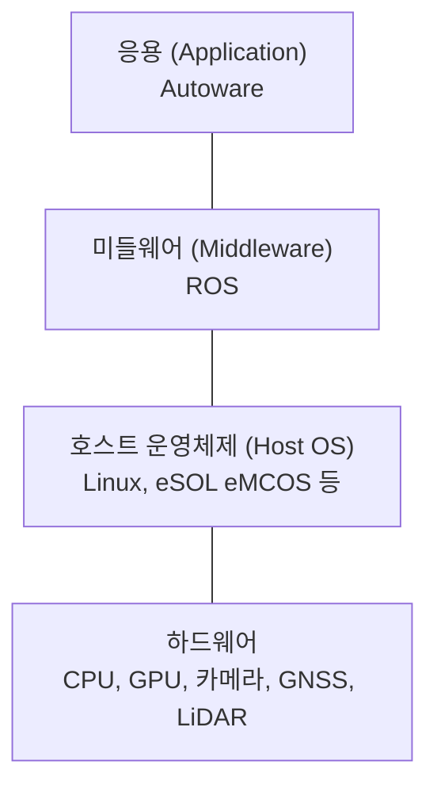

*그림 1. Autoware의 소프트웨어 계층 구조*

Autoware는 네 계층으로 이루어진다.

- **응용 계층:** Autoware가 위치 인식, 물체 검출, 경로 계획, 차량 제어 같은 자율주행 기능을 ROS 노드로 구현한다.
- **미들웨어 계층:** ROS가 노드 사이의 메시지 전달, 기록과 재생, 시각화 도구를 제공한다.
- **호스트 운영체제 계층:** 주로 Linux(Ubuntu)를 쓰며, 임베디드 차량용으로는 eSOL의 eMCOS처럼 여러 코어를 가진 프로세서용 실시간 운영체제도 쓸 수 있다. **실시간 운영체제(RTOS, real-time operating system)** 는 작업이 정해진 시간 안에 끝나도록 보장하는 데 중점을 둔 운영체제이다.
- **하드웨어 계층:** 계산을 맡는 CPU와 GPU, 주변을 감지하는 카메라, 위성 신호로 위치를 재는 **GNSS(global navigation satellite system)**, 레이저를 쏘아 돌아오는 시간으로 거리를 재는 **LiDAR(light detection and ranging)** 가 있다. GPU는 카메라 영상의 딥러닝 기반 물체 검출처럼 계산량이 큰 작업을 병렬로 처리한다.

> **참고:** 이 단원에서 Autoware는 ROS 1 기반의 Autoware.ai(이 과목은 1.14.0)를 가리킨다. Autoware.ai는 개발이 끝났으며, Autoware Foundation은 ROS 2 기반으로 다시 설계한 Autoware(Autoware Universe)를 개발하고 있다 [3]. 노드와 토픽으로 기능을 나누는 구조와 위치 인식, 경로 계획의 원리는 두 버전에 공통이다.

### 1.2 rosbag

ROS에서는 토픽의 모든 메시지를 시간 정보(타임스탬프)와 함께 **rosbag**이라 부르는 `.bag` 파일에 기록할 수 있다 [4]. 기록한 메시지는 다시 발행하여 ROS의 3D 시각화 도구인 RViz로 볼 수 있다. 로봇 공학에서는 여러 센서의 상호 작용을 한꺼번에 분석하기 어려운 경우가 많은데, rosbag은 시스템을 효율적으로 분석하고 디버깅하게 해 준다. 또한 기록한 메시지를 몇 번이든 반복해서 재생할 수 있으므로, 개발자는 실제 센서 없이도 자신의 시스템을 디버깅할 수 있다.

rosbag이 자율주행 개발에 특히 중요한 이유는 다음과 같다.

1. **재현성:** 실제 도로 주행은 같은 상황을 다시 만들 수 없다. 한 번 기록한 데이터는 같은 순서와 간격으로 몇 번이든 재생되므로, 알고리즘을 고친 뒤 같은 입력으로 결과를 비교할 수 있다.
2. **안전과 비용:** 차량과 센서를 매번 움직이지 않고 책상 위의 컴퓨터에서 개발할 수 있다.
3. **오프라인 처리:** 3.4절처럼 주행 중에 데이터만 기록해 두고, 지도 작성처럼 계산량이 큰 작업은 나중에 기록을 재생하며 수행할 수 있다.

### 1.3 Autoware가 제공하는 기능

Autoware는 다음 기능을 제공한다.

- **위치 인식(localization):** 지도 위에서 차량의 현재 위치와 방향을 추정한다.
- **물체 검출(object detection):** 카메라와 LiDAR로 차량, 보행자, 신호등 같은 주변 물체를 찾는다.
- **주행 제어(driving control):** 경로를 따라가도록 가속, 제동, 조향을 계산한다.
- **3D 지도 생성과 공유(3D map generation and sharing):** LiDAR 데이터로 3D 지도를 만들고 여러 차량이 공유한다.

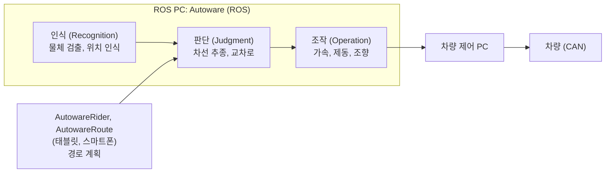

*그림 2. Autoware의 인식, 판단, 조작 흐름과 외부 장치*

Autoware를 실행하는 ROS PC 안에서 처리는 세 단계로 흐른다. **인식** 단계는 센서 데이터로 주변 물체를 검출하고 자기 위치를 추정한다. **판단** 단계는 인식 결과와 지도를 바탕으로 차선을 따라갈지, 교차로에서 멈출지 같은 주행 행동을 정한다. **조작** 단계는 그 행동을 가속, 제동, 조향 명령으로 바꾼다. 목적지까지의 경로는 태블릿이나 스마트폰 앱(AutowareRider, AutowareRoute)에서 계획하여 판단 단계에 넘긴다. 조작 명령은 차량 제어 PC를 거쳐 차량 내부 네트워크인 **CAN(controller area network)** 으로 차량에 전달된다. CAN은 13\~14주차에서 다룬다.

### 1.4 사용자 인터페이스

Autoware에서 쓸 수 있는 사용자 인터페이스는 다음과 같다.

| 인터페이스 | 역할 |
|:-----|:-----|
| Runtime Manager | Autoware를 제어하는 GUI 응용 프로그램이다. 노드를 켜고 끄고, 매개변수를 정하고, 기록과 재생을 한다 |
| RViz | 위치 인식, 물체 검출, 경로 계획, 경로 추종 같은 Autoware의 여러 기능을 통합하여 3D로 시각화한다 |
| AutowareRider | 경로 계획을 설정하고 생성하며, 자율주행 모드를 켜는 태블릿 앱이다 |
| 기타 인터페이스 | 사용 중인 3D 지도를 차량 안의 디스플레이나 Oculus 같은 기기에서 시각화할 수 있다 |

*표 1. Autoware의 사용자 인터페이스*

Runtime Manager는 기능별 탭으로 이루어진다. 각 탭에서 해당 기능의 노드를 체크 상자로 켜고 끄며, 아래쪽 버튼으로 기록(ROSBAG), RViz, rqt를 띄운다. 화면 맨 아래에는 CPU 코어별 사용률과 메모리 사용량이 표시된다 [5].

| 탭 | 하는 일 |
|:-----|:-----|
| Quick Start | 지도, 센싱, 위치 인식, 검출, 임무 계획, 동작 계획의 launch 파일을 지정하여 한꺼번에 실행한다 |
| Setup | 차량 기준 좌표계와 센서 좌표계 사이의 위치 관계(TF)와 차량 모델을 설정한다 |
| Map | 포인트 클라우드 지도, 벡터 지도, 지도 좌표계의 TF를 불러온다 |
| Sensing | 센서 드라이버와 포인트 클라우드 필터를 실행한다 |
| Computing | 위치 인식, 검출, 경로 계획, 경로 추종 노드를 실행한다 |
| Interface | 차량과의 연결을 설정한다 |
| Database | 지도 데이터베이스와 연동한다 |
| Simulation | 백 파일을 재생한다 |
| Status, Topics | 실행 상태와 로그, 발행 중인 토픽을 확인한다 |

*표 2. Runtime Manager의 탭*

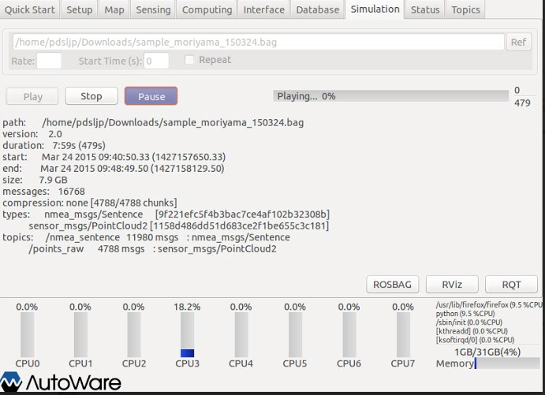

*그림 3. 샘플 백 파일을 불러온 Runtime Manager의 Simulation 탭*

그림 3은 Autoware의 데모 데이터인 `sample_moriyama_150324.bag`을 Simulation 탭에 불러온 모습이다. 탭 가운데에 백 파일의 정보가 출력되며, 그 뜻은 다음과 같다.

| 항목 | 값 | 뜻 |
|:-----|:-----|:-----|
| `version` | 2.0 | 백 파일 형식의 버전 |
| `duration` | 7:59s (479s) | 기록 시간. 시작 시각 09:40:50.33에서 끝 시각 09:48:49.50까지 479.17초이다 |
| `start`, `end` | Mar 24 2015 09:40:50.33 (1427157650.33) 등 | 첫 메시지와 마지막 메시지의 시각. 괄호 안은 1970년 1월 1일부터 센 초(Unix 시간)이다 |
| `size` | 7.9 GB | 파일 크기 |
| `messages` | 16768 | 전체 메시지 수 |
| `compression` | none [4788/4788 chunks] | 압축하지 않았다는 뜻이다 |
| `types` | `nmea_msgs/Sentence`, `sensor_msgs/PointCloud2` | 기록된 메시지 형식과 그 해시값 |
| `topics` | `/nmea_sentence` 11980 msgs, `/points_raw` 4788 msgs | 토픽별 메시지 수와 형식 |

*표 3. 백 파일 정보의 항목*

이 정보만으로도 센서의 특성을 계산할 수 있다.

- 메시지 수의 합은 $11980 + 4788 = 16768$으로 `messages`와 같다.
- LiDAR 포인트 클라우드 토픽 `/points_raw`의 발행 주기는 $4788 / 479.17 \approx 9.99$, 곧 약 10 Hz이다. LiDAR가 1초에 10번 회전하며 한 바퀴마다 포인트 클라우드 하나를 발행한다는 뜻이다.
- GNSS 수신기의 문장 토픽 `/nmea_sentence`는 $11980 / 479.17 \approx 25.0$, 곧 약 25 Hz로 발행되었다.
- NMEA 문장은 수십 바이트의 짧은 문자열이므로 파일 크기의 대부분은 포인트 클라우드이다. `rosbag info`는 크기를 1024배 단위로 나타내므로 7.9 GB는 $7.9 \times 1024^3 \approx 8.48 \times 10^9$바이트이다 [6]. 따라서 포인트 클라우드 하나의 크기는 $8.48 \times 10^9 / 4788 \approx 1.77 \times 10^6$바이트, 곧 약 1.77 MB이다. 8분 기록에 7.9 GB가 필요하다는 사실은 LiDAR 데이터를 기록할 때 저장 공간을 넉넉히 준비해야 함을 보여 준다.

> **용어 정의:** **NMEA 문장(NMEA sentence)** 은 GNSS 수신기가 위치, 시각, 위성 정보를 출력할 때 쓰는 NMEA 0183 표준의 문자열로, `$GPGGA,...`처럼 `$`로 시작하고 쉼표로 필드를 나눈다. **포인트 클라우드(point cloud, 점군)** 는 LiDAR가 측정한 3차원 점 $(x, y, z)$의 집합이며, ROS에서는 `sensor_msgs/PointCloud2` 메시지로 주고받는다.

### 1.5 노드 그래프 읽기

Autoware의 기능은 많은 노드가 토픽으로 연결되어 이루어진다. 아래 그림들은 노드 그래프로 그 연결을 보여 준다. 이 절의 그림에서 **타원은 노드**, **회색 사각형은 토픽**이며, 화살표는 노드가 토픽에 발행하거나 토픽을 구독하는 방향이다. 그림 4의 rqt_graph에서는 노드와 같은 이름의 사각형 틀이 노드를 감싼 네임스페이스를 나타낸다.

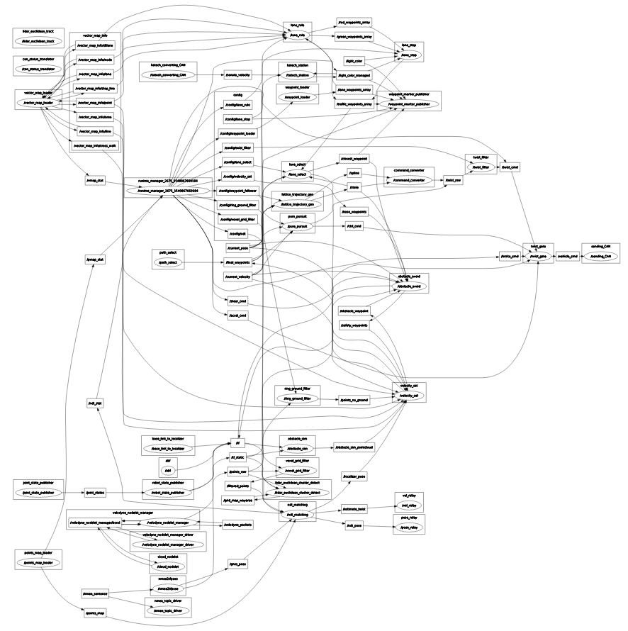

*그림 4. 실행 중인 Autoware 전체의 노드 그래프*

그림 4는 실제로 자율주행을 수행하는 Autoware를 `rqt_graph`로 그린 것이다. 글자를 하나하나 읽기 어려울 만큼 노드와 토픽이 많지만, 큰 흐름은 왼쪽 아래의 센서 드라이버(Velodyne LiDAR, GNSS)와 지도 로더에서 시작하여, 가운데의 위치 인식(`ndt_matching`)과 경로 계획 노드들(`lane_rule`, `lane_select`, `velocity_set`, `pure_pursuit` 등)을 지나, 오른쪽의 속도 명령 처리(`twist_filter`, `twist_gate`)와, 차량 명령 `vehicle_cmd`를 받아 차량에 CAN 명령을 보내는 노드(`sending_CAN`)로 끝난다. 노드 그래프는 이처럼 시스템의 데이터 흐름을 한눈에 보여 주므로, 어떤 토픽이 발행되지 않아 시스템이 멈추었는지 찾는 디버깅에 쓰인다. 다음 1.6\~1.8절에서는 기능별로 나눈 그래프를 차례로 읽는다.

### 1.6 인식과 위치 인식의 노드 구성

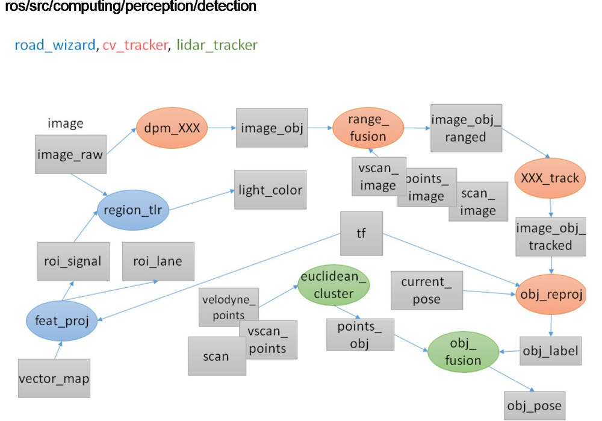

*그림 5. 물체 검출과 신호등 인식의 노드 그래프*

그림 5는 `ros/src/computing/perception/detection`에 있는 검출 패키지들의 노드 그래프이다. 세 가지 흐름이 있다.

| 흐름 | 패키지 | 노드와 토픽의 흐름 | 하는 일 |
|:-----|:-----|:-----|:-----|
| 카메라 물체 검출 | `cv_tracker` | `image_raw` → `dpm_XXX` → `image_obj` → `range_fusion` → `image_obj_ranged` → `XXX_track` → `image_obj_tracked` → `obj_reproj` → `obj_label` | 영상에서 차량이나 보행자를 찾고(`dpm_XXX`, XXX는 검출 대상), LiDAR 점을 영상에 투영한 `vscan_image`, `points_image`, `scan_image`로 거리를 붙이고(`range_fusion`), 프레임 사이에서 같은 물체를 추적한 뒤(`XXX_track`), 차량 위치(`current_pose`)와 좌표 변환(`tf`)으로 3차원 위치를 되살린다(`obj_reproj`) |
| LiDAR 물체 검출 | `lidar_tracker` | `velodyne_points`, `vscan_points`, `scan` → `euclidean_cluster` → `points_obj` → `obj_fusion` → `obj_pose` | 포인트 클라우드를 서로 가까운 점끼리 묶어 물체 후보를 만들고(`euclidean_cluster`), 카메라 검출 결과 `obj_label`과 합쳐 물체의 위치를 낸다(`obj_fusion`) |
| 신호등 인식 | `road_wizard` | `vector_map`, `tf` → `feat_proj` → `roi_signal` → `region_tlr` → `light_color` | 벡터 지도에 저장된 신호등 위치를 카메라 영상 위로 투영하여 신호등이 보일 관심 영역(ROI)을 정하고(`feat_proj`, 차선의 관심 영역 `roi_lane`도 낸다), 카메라 영상 `image_raw`의 그 영역에서 신호의 색을 인식한다(`region_tlr`) |

*표 4. 검출 노드 그래프의 세 가지 흐름*

> **용어 정의:** **DPM(deformable part model)** 은 물체를 전체 모양과 여러 부분(예: 사람의 머리, 팔, 다리)의 배치로 표현하고, 부분의 위치가 어느 정도 변형되는 것을 허용하여 물체를 검출하는 방법이다 [7]. **유클리드 군집화(Euclidean clustering)** 는 서로의 거리가 정한 값보다 가까운 점들을 같은 무리로 묶는 방법으로, 도로 위의 포인트 클라우드를 차량, 보행자 같은 물체 단위로 나눈다.

카메라는 물체의 종류를 잘 알아보지만 거리를 직접 재지 못하고, LiDAR는 거리를 정확히 재지만 물체의 종류를 알아보기 어렵다. 그래서 두 센서의 결과를 합치는 **센서 융합(sensor fusion)** 이 쓰인다. `range_fusion`과 `obj_fusion`이 그 역할을 한다. 신호등 인식에서 지도를 쓰는 이유도 같다. 영상 전체에서 작은 신호등을 찾는 대신, 지도로 신호등이 있을 자리를 미리 알면 좁은 영역만 살피면 되므로 빠르고 오검출이 적다.

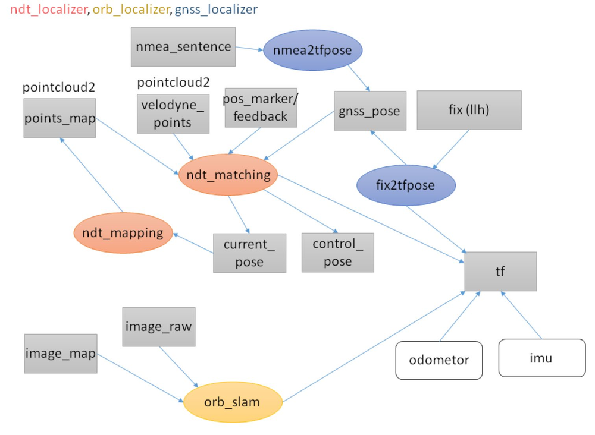

*그림 6. 위치 인식의 노드 그래프*

그림 6은 세 가지 위치 인식 방법의 노드 그래프이다.

| 방법 | 패키지 | 입력 | 출력 |
|:-----|:-----|:-----|:-----|
| LiDAR 포인트 클라우드와 3D 지도의 NDT 매칭 | `ndt_localizer` (`ndt_matching`, `ndt_mapping`) | 지도 포인트 클라우드 `points_map`, LiDAR 포인트 클라우드 `velodyne_points`, RViz의 마커로 준 위치 `pos_marker/feedback`, GNSS 위치 `gnss_pose` | 차량 위치 `current_pose`, 제어용 위치 `control_pose`, 좌표 변환 `tf` |
| 카메라 영상 기반 SLAM | `orb_localizer` (`orb_slam`) | 카메라 영상 `image_raw`, 영상 지도 `image_map` | 좌표 변환 `tf` |
| GNSS | `gnss_localizer` (`nmea2tfpose`, `fix2tfpose`) | NMEA 문장 `nmea_sentence`, 위도, 경도, 높이(llh) 형식의 위치 `fix` | GNSS 위치 `gnss_pose`, 좌표 변환 `tf` |

*표 5. 위치 인식 방법별 노드와 입출력*

`ndt_matching`은 LiDAR 포인트 클라우드를 미리 만든 3D 지도와 맞추어 차량의 위치를 구하며(3.6절), 맞추기 시작할 초기 위치로 GNSS 위치나 RViz에서 지정한 위치를 쓴다. `ndt_mapping`은 반대로 지도가 없을 때 포인트 클라우드를 이어 붙여 지도 `points_map`을 만든다(3.4절). 휠 오도메트리(`odometer`)와 관성 측정 장치(`imu`)의 정보도 `tf`로 들어와 위치 추정을 돕는다.

> **용어 정의:** **오도메트리(odometry)** 는 바퀴의 회전수처럼 차량 자신의 움직임을 재어 이동 거리와 방향을 누적하여 위치를 추정하는 방법이다. 짧은 시간에는 정확하지만 오차가 계속 쌓인다. **IMU(inertial measurement unit)** 는 가속도와 각속도를 재는 센서이다.

### 1.7 경로 계획과 지도의 노드 구성

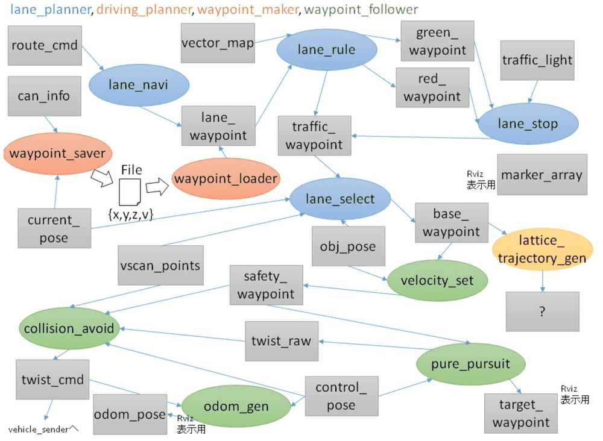

*그림 7. 경로 계획과 경로 추종의 노드 그래프*

그림 7은 차선 계획(`lane_planner`), 주행 계획(`driving_planner`), 웨이포인트 생성(`waypoint_maker`), 웨이포인트 추종(`waypoint_follower`) 패키지의 노드 그래프이다. 그림 안의 일본어 "Rviz 表示用"은 "RViz 표시용", "vehicle_senderへ"는 "vehicle_sender로"라는 뜻이며, 그림의 `odom_pose`, `target_waypoint`, `marker_array`가 이런 RViz 표시용 출력이다. **웨이포인트(waypoint)** 은 차량이 지나갈 경로 위의 점으로, 위치와 그 점에서의 목표 속도를 담는다. 데이터는 다음 순서로 흐른다.

| 단계 | 노드 | 입력 | 출력과 하는 일 |
|:-----|:-----|:-----|:-----|
| 경로 만들기 | `waypoint_saver` | `current_pose`, `can_info` | 사람이 운전하는 동안 차량의 위치와 속도를 $\lbrace x, y, z, v\rbrace$ 형식의 파일로 저장한다 |
| | `waypoint_loader` | 저장된 파일 | 파일의 웨이포인트를 `lane_waypoint`로 발행한다 |
| | `lane_navi` | `route_cmd`, 벡터 지도 | 목적지까지의 경로를 벡터 지도의 차선 위에서 만들어 `lane_waypoint`로 발행한다 |
| 교통 규칙 적용 | `lane_rule` | `lane_waypoint`, `vector_map` | 정지선 같은 지도 정보로 웨이포인트의 속도를 조정하여, 신호가 초록일 때의 `green_waypoint`와 빨강일 때의 `red_waypoint`를 만든다 |
| | `lane_stop` | `green_waypoint`, `red_waypoint`, `traffic_light` | 신호등 상태에 따라 둘 중 하나를 골라 `traffic_waypoint`로 발행한다 |
| 차선 선택 | `lane_select` | `traffic_waypoint`, `current_pose` 등 | 현재 위치에 맞는 차선의 웨이포인트를 골라 `base_waypoint`로 발행한다 |
| 속도 계획 | `velocity_set` | `base_waypoint`, `vscan_points`, `obj_pose` | 앞에 장애물이 있으면 감속하거나 멈추도록 속도를 고쳐 `safety_waypoint`로 발행한다 |
| 경로 추종 | `pure_pursuit` | `safety_waypoint`, `control_pose` | 경로 위의 목표점을 따라가는 선속도와 각속도를 계산하여 `twist_raw`로 발행하고, 추종 중인 목표점을 RViz 표시용 `target_waypoint`로 낸다 |
| 최종 확인 | `collision_avoid` | `twist_raw`, `safety_waypoint`, `vscan_points` 등 | 충돌 위험을 마지막으로 확인한 속도 명령을 `twist_cmd`로 발행하며, 이 명령이 `vehicle_sender`로 간다 |
| 시각화 | `odom_gen` | `twist_cmd`, `control_pose` | 속도 명령으로 차량 위치를 계산하여 RViz 표시용 `odom_pose`를 낸다 |

*표 6. 경로 계획과 추종 노드의 데이터 흐름*

`lattice_trajectory_gen`은 `base_waypoint`에서 격자(lattice) 모양의 후보 궤적을 만드는 노드로, 출력이 "?"로 남아 있는 것은 출력 토픽이 정해지지 않은 개발 단계의 기능이라는 뜻이다. `pure_pursuit` 알고리즘은 차량 앞쪽 일정 거리의 경로 위 점을 목표로 정하고 그 점을 지나는 원호를 따라가도록 조향하는 방법이며 [8], 3주차에서 자세히 다룬다.

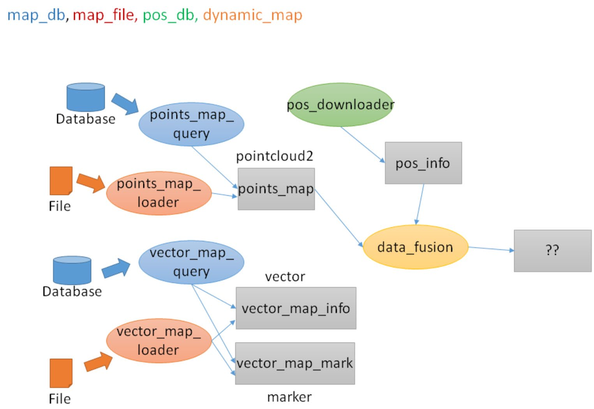

*그림 8. 지도 관리의 노드 그래프*

그림 8은 지도를 불러오는 패키지(`map_db`, `map_file`)와 다른 차량의 위치를 공유하는 패키지(`pos_db`, `dynamic_map`)의 노드 그래프이다. 포인트 클라우드 지도는 데이터베이스에서 읽는 `points_map_query`나 파일에서 읽는 `points_map_loader`가 `points_map`(PointCloud2) 토픽으로 발행한다. 벡터 지도도 같은 방식으로 `vector_map_query`나 `vector_map_loader`가 읽어 지도 요소 정보 `vector_map_info`와 RViz 표시용 마커 `vector_map_mark`로 발행한다. `pos_downloader`는 서버에서 다른 차량의 위치 `pos_info`를 내려받고, `data_fusion`은 이를 지도와 합쳐 주변 상황이 반영된 **동적 지도(dynamic map)** 를 만든다. 출력이 "??"인 것은 아직 정해지지 않은 기능임을 뜻한다.

### 1.8 센서 드라이버와 차량 인터페이스의 노드 구성

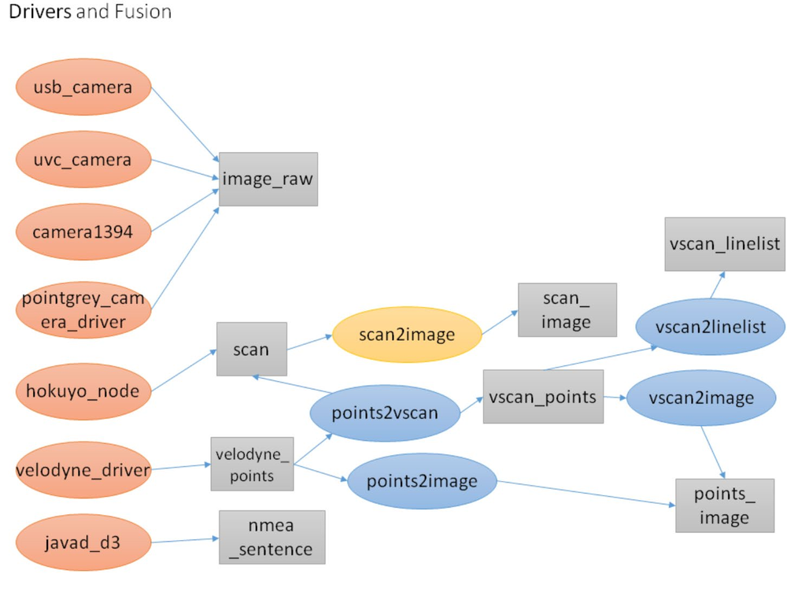

*그림 9. 센서 드라이버와 센서 데이터 변환의 노드 그래프*

그림 9의 왼쪽 주황색 타원은 센서 드라이버 노드이고, 파란색과 노란색 타원은 센서 데이터를 다른 형태로 바꾸는 노드이다.

| 노드 | 센서 또는 입력 | 출력 토픽 |
|:-----|:-----|:-----|
| `usb_camera`, `uvc_camera`, `camera1394`, `pointgrey_camera_driver` | USB, UVC, IEEE 1394 방식의 카메라와 Point Grey 카메라 | `image_raw` |
| `hokuyo_node` | Hokuyo 2D 레이저 스캐너 | `scan` |
| `velodyne_driver` | Velodyne 3D LiDAR | `velodyne_points` |
| `javad_d3` | JAVAD GNSS 수신기 | `nmea_sentence` |
| `scan2image` | `scan` | `scan_image` (2D 스캔을 영상 위에 투영) |
| `points2vscan` | `velodyne_points` | `vscan_points`, `scan` (가상 스캔) |
| `vscan2image`, `vscan2linelist` | `vscan_points` | `points_image`, `vscan_linelist` |
| `points2image` | `velodyne_points` | `points_image` (포인트 클라우드를 영상 위에 투영) |

*표 7. 센서 드라이버와 데이터 변환 노드*

같은 종류의 센서라면 드라이버가 달라도 같은 토픽 이름(`image_raw`)과 같은 메시지 형식으로 발행하므로, 카메라를 바꾸어도 그 뒤의 검출 노드는 고칠 필요가 없다. 이것이 1주차에서 본 표준 메시지의 이점이다. **가상 스캔(virtual scan, vscan)** 은 3차원 포인트 클라우드를 수평 각도마다 가장 가까운 장애물까지의 거리만 남긴 2차원 스캔 형태로 줄인 것으로, 장애물 판단에 필요한 정보는 남기면서 계산량을 크게 줄인다. 포인트 클라우드를 영상에 투영하려면 카메라와 LiDAR 사이의 상대 위치와 카메라의 내부 매개변수를 미리 구하는 **캘리브레이션(calibration)** 이 필요하다.

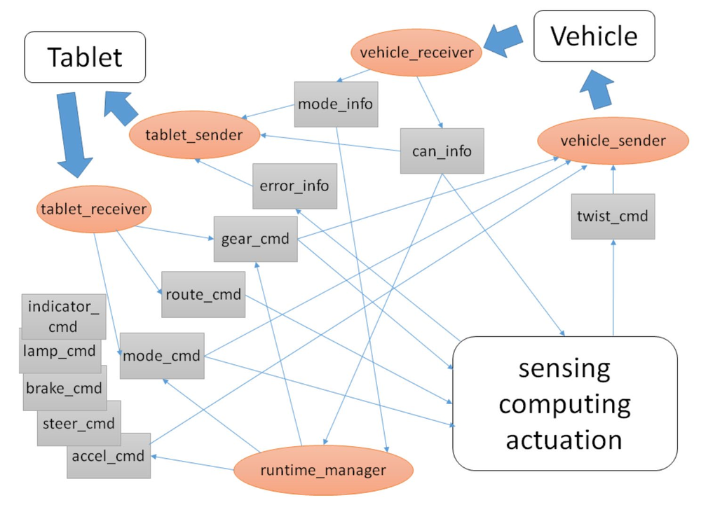

*그림 10. 태블릿, 차량과 Autoware 사이의 인터페이스 노드 그래프*

그림 10은 Autoware가 태블릿, 차량과 정보를 주고받는 노드의 그래프이다. 굵은 파란 화살표는 Autoware 밖의 장치와의 통신이다.

- **태블릿에서 들어오는 명령:** `tablet_receiver`가 태블릿의 입력을 받아 기어 명령 `gear_cmd`, 경로 명령 `route_cmd`, 운전 모드 명령 `mode_cmd`로 발행한다.
- **Runtime Manager의 명령:** `runtime_manager`는 수동 조작용 명령 `accel_cmd`, `brake_cmd`, `steer_cmd`, `lamp_cmd`, `indicator_cmd`와 `gear_cmd`, `mode_cmd`를 발행한다.
- **차량에서 들어오는 정보:** `vehicle_receiver`가 차량의 상태를 받아 운전 모드 `mode_info`와 CAN 정보 `can_info`(속도, 조향각 등)로 발행하며, 이 정보는 센싱, 계산, 구동 노드들과 `runtime_manager`, `tablet_sender`가 쓴다.
- **차량으로 나가는 명령:** 센싱, 계산, 구동 노드들이 만든 속도 명령 `twist_cmd`와 각종 명령을 `vehicle_sender`가 모아 차량으로 보낸다.
- **태블릿으로 나가는 정보:** `tablet_sender`가 `mode_info`, `can_info`, 오류 정보 `error_info`를 태블릿에 보낸다.

---

<br>

## 2. Autoware용 ROS 노드 개발

### 2.1 개발 순서

Autoware에서 쓸 수 있는 ROS 노드는 다음 네 단계로 개발한다.


*그림 11. Autoware용 ROS 노드의 개발 순서*

이 절의 절차는 Autoware.ai의 초기 버전에서 쓰던 catkin 작업 공간과 `ros/src` 디렉토리 구조를 따른다. 이 과목에서 쓰는 Autoware.ai 1.14.0은 같은 패키지를 colcon으로 빌드하며, 그 절차는 5주차와 14주차에서 다룬다.

### 2.2 패키지 작성

ROS에서 패키지는 다음 조건을 만족해야 한다.

- 패키지 정보를 담은 파일 `package.xml`이 디렉토리 안에 있다.
- 빌드 시스템 CMake(<http://www.cmake.org/>)의 설정 파일 `CMakeLists.txt`가 디렉토리 안에 있다.
- 한 디렉토리에는 패키지 하나만 둔다.

Autoware에서는 위의 조건과 함께 다음 조건을 만족해야 한다.

- 패키지 디렉토리는 `ros/src/sensing/fusion`처럼 기능 분류(카테고리)를 나타내는 디렉토리 아래의 `packages` 디렉토리 바로 아래에 만든다.
- 노드와 같은 이름의 디렉토리를 만들고 그 안에 노드의 소스 코드를 둔다.
- 메시지 파일은 `msg` 디렉토리에 둔다.
- 여러 노드가 함께 쓰는 라이브러리가 있으면 `lib`나 `include` 같은 디렉토리에 라이브러리 소스 코드를 둔다.

```text
ros/src/<category>/.../packages/<package_name>/
    package.xml
    CMakeLists.txt
    nodes/
        <node_name_1>/
            <node_name_1>.cpp
        <node_name_2>/
            <node_name_2>.cpp
        ...
    include/
        (library header files)
    lib/
        (library source files)

ros/src/msgs/<message_package>/
    msg/
        <message_name_1>.msg
```

*그림 12. Autoware 패키지의 디렉토리 구조*

패키지는 `catkin_create_pkg` 명령으로 만든다. 형식은 `catkin_create_pkg <패키지 이름> <의존 패키지 1> <의존 패키지 2> ...`이며, 의존 패키지로는 C++ 클라이언트 라이브러리 `roscpp`, 기본 메시지 형식을 담은 `std_msgs`, Autoware의 메시지 정의를 담은 `autoware_msgs` 등을 적는다. Autoware에서는 `packages` 디렉토리로 이동하여 다음과 같이 실행한다.

```bash
cd ros/src/<category>/packages/
catkin_create_pkg katech_test_pkg roscpp std_msgs autoware_msgs
ls -F katech_test_pkg/
```

```text
Successfully created files in /home/<user>/Autoware/ros/src/<category>/packages/katech_test_pkg. Please adjust the values in package.xml.
CMakeLists.txt  include/  package.xml  src/
```

`catkin_create_pkg`는 패키지 디렉토리와 함께 `CMakeLists.txt`, `package.xml`, 헤더 파일용 `include/`, 소스 파일용 `src/`를 만든다. 다음으로 두 설정 파일을 패키지에 맞게 고친다.

- **`package.xml`:** 패키지의 이름, 버전, 설명, 관리자(maintainer), 라이선스 같은 프로젝트 관리 정보와 의존 패키지를 적는 **매니페스트(manifest)** 이다 [9].
- **`CMakeLists.txt`:** 무엇을 어떤 순서로 빌드할지 적는 CMake 빌드 스크립트이다 [10].

위 명령이 만드는 `package.xml`의 핵심 내용은 다음과 같다(설명 주석을 줄였다).

```xml
<?xml version="1.0"?>
<package format="2">
  <name>katech_test_pkg</name>
  <version>0.0.0</version>
  <description>The katech_test_pkg package</description>
  <maintainer email="user@todo.todo">user</maintainer>
  <license>TODO</license>
  <buildtool_depend>catkin</buildtool_depend>
  <depend>roscpp</depend>
  <depend>std_msgs</depend>
  <depend>autoware_msgs</depend>
</package>
```

`<buildtool_depend>`는 빌드 도구로 catkin을 쓴다는 뜻이고, `<depend>`는 빌드할 때와 실행할 때 모두 필요한 패키지를 적는다. `catkin_create_pkg`는 이를 빌드용(`build_depend`), 내보내기용(`build_export_depend`), 실행용(`exec_depend`)으로 나누어 적지만 뜻은 같다. 공개할 패키지라면 `description`, `maintainer`, `license`를 실제 값으로 고친다.

### 2.3 노드 작성

노드는 C++로 작성하는 예를 보며, Python으로도 작성할 수 있다. 순서는 다음과 같다.

1. Autoware의 구조에서는 소스를 `nodes/` 아래에 두므로, `catkin_create_pkg`가 만든 불필요한 폴더(`include`, `src` 등)를 지운다.
2. `nodes/test_node/` 디렉토리를 만들고 `gedit test_node.cpp` 명령으로 노드 파일을 만든다.
3. 만든 노드 파일에 소스 코드를 작성한다.

다음 노드는 문자열 토픽 `mysubstr`를 구독하여, 받은 문자열의 길이를 정수 토픽 `mypubval`로 발행한다.

```cpp
#include "ros/ros.h"
#include "std_msgs/String.h"
#include "std_msgs/Int32.h"

static ros::Publisher pub;

static void sub_callback(const std_msgs::String& smsg)
{
    std_msgs::Int32 pmsg;

    pmsg.data = smsg.data.size();

    pub.publish(pmsg);
}

int main(int argc, char *argv[])
{
    ros::init(argc, argv, "mynode");
    ros::NodeHandle n;

    pub = n.advertise<std_msgs::Int32>("mypubval", 10);

    ros::Subscriber sub = n.subscribe("mysubstr", 10, sub_callback);

    ros::spin();

    return 0;
}
```

코드를 줄별로 보면 다음과 같다 [11].

- **`#include "ros/ros.h"`:** `ros::init`, `ros::NodeHandle`, `ros::spin`처럼 roscpp의 기본 기능을 선언한 헤더를 포함한다.
- **`#include "std_msgs/String.h"`, `"std_msgs/Int32.h"`:** 메시지 형식 `std_msgs/String`(문자열 필드 `data` 하나)과 `std_msgs/Int32`(32비트 정수 필드 `data` 하나)를 C++ 구조체로 쓰게 하는 헤더이다. 빌드할 때 `.msg` 파일에서 자동으로 만들어진다.
- **`static ros::Publisher pub;`:** 퍼블리셔 객체를 전역 변수로 둔다. `main`에서 만들고 콜백 함수에서 쓰기 때문이다. `static`은 이 이름을 이 파일 안에서만 보이게 한다.
- **`static void sub_callback(const std_msgs::String& smsg)`:** `mysubstr` 토픽에 메시지가 도착할 때마다 roscpp가 호출하는 **콜백 함수(callback function)** 이다. 받은 메시지를 복사하지 않도록 상수 참조로 받는다.
- **`std_msgs::Int32 pmsg;`:** 발행할 메시지를 만든다.
- **`pmsg.data = smsg.data.size();`:** 받은 문자열(`std::string`)의 길이를 정수 필드에 넣는다. `size()`는 문자 수가 아니라 바이트 수를 돌려준다.
- **`pub.publish(pmsg);`:** 메시지를 `mypubval` 토픽에 발행한다.
- **`ros::init(argc, argv, "mynode");`:** ROS를 초기화하고 이 노드의 이름을 `mynode`로 정한다. 명령행 인자로 이름이나 토픽을 바꿀 수 있도록 `argc`, `argv`를 넘긴다.
- **`ros::NodeHandle n;`:** 노드 핸들을 만든다. 첫 노드 핸들을 만들 때 노드가 마스터에 등록되며, 이후 퍼블리셔와 서브스크라이버는 이 핸들로 만든다.
- **`n.advertise<std_msgs::Int32>("mypubval", 10)`:** `mypubval` 토픽에 `std_msgs/Int32` 메시지를 발행하겠다고 마스터에 알리고 퍼블리셔를 돌려받는다. 10은 보내지 못한 메시지를 쌓아 둘 큐의 크기이다.
- **`n.subscribe("mysubstr", 10, sub_callback)`:** `mysubstr` 토픽을 구독하고, 메시지가 오면 `sub_callback`을 부르도록 등록한다. 10은 처리하지 못한 메시지를 쌓아 둘 큐의 크기이며, 큐가 차면 오래된 메시지부터 버린다. 돌려받은 `sub` 객체가 사라지면 구독도 끝나므로 변수에 저장해 둔다.
- **`ros::spin();`:** 노드가 종료될 때까지 기다리며, 도착한 메시지마다 콜백 함수를 호출한다. 이 호출이 없으면 콜백 함수가 실행되지 않는다.

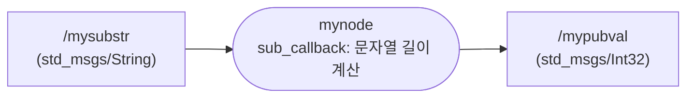

*그림 13. 예제 노드 mynode가 구독하고 발행하는 토픽*

> **[컴퓨터프로그래밍]** 콜백 함수는 다른 코드에 함수를 넘겨 두고, 특정 사건이 일어났을 때 그 코드가 대신 호출하게 하는 함수이다. `n.subscribe`에 넘긴 `sub_callback`은 함수 포인터로 저장되었다가, `ros::spin`이 메시지 도착을 확인할 때 호출된다. 개발자가 `sub_callback`을 직접 호출하는 곳은 없다.

### 2.4 노드 빌드

빌드하기 전에 `CMakeLists.txt`를 고친다.

1. Autoware에서는 C++ 컴파일 옵션을 지정하므로 `set(CMAKE_CXX_FLAGS "-std=c++0x -O2 -Wall ${CMAKE_CXX_FLAGS}")`를 추가한다.
2. 소스 코드가 `nodes/test_node/test_node.cpp`에 있음을 알리기 위해 `add_executable(test_node nodes/test_node/test_node.cpp)`를 추가한다.
3. ROS의 일반적인 라이브러리를 쓰기 위해 `target_link_libraries(test_node ${catkin_LIBRARIES})`를 추가한다.

이를 반영한 `CMakeLists.txt`의 전체 모습은 다음과 같다.

```cmake
cmake_minimum_required(VERSION 2.8.3)
project(katech_test_pkg)

set(CMAKE_CXX_FLAGS "-std=c++0x -O2 -Wall ${CMAKE_CXX_FLAGS}")

find_package(catkin REQUIRED COMPONENTS
  roscpp
  std_msgs
  autoware_msgs
)

catkin_package()

include_directories(
  ${catkin_INCLUDE_DIRS}
)

add_executable(test_node nodes/test_node/test_node.cpp)
target_link_libraries(test_node
  ${catkin_LIBRARIES}
)
```

| 명령 | 뜻 |
|:-----|:-----|
| `cmake_minimum_required`, `project` | 필요한 CMake의 최소 버전과 프로젝트(패키지) 이름을 정한다 |
| `set(CMAKE_CXX_FLAGS ...)` | C++ 컴파일 옵션을 정한다. `-std=c++0x`는 C++11 표준을 쓰라는 뜻(C++11의 확정 전 이름)이고, `-O2`는 최적화 수준, `-Wall`은 대부분의 경고를 출력하라는 뜻이다 |
| `find_package(catkin REQUIRED COMPONENTS ...)` | catkin과 의존 패키지를 찾아, 그 헤더 경로를 `catkin_INCLUDE_DIRS`에, 라이브러리를 `catkin_LIBRARIES`에 모은다 |
| `catkin_package()` | 이 패키지를 catkin 패키지로 등록하여 다른 패키지가 쓸 수 있게 한다 |
| `include_directories(...)` | 컴파일할 때 헤더를 찾을 경로를 더한다 |
| `add_executable(test_node 소스)` | 소스 파일로 실행 파일 `test_node`를 만든다 |
| `target_link_libraries(test_node ...)` | 실행 파일 `test_node`에 ROS 라이브러리를 링크한다. 첫 인자는 `add_executable`의 대상 이름과 같아야 한다 |

*표 8. CMakeLists.txt의 주요 명령*

실행 파일의 이름(`test_node`)과 노드의 이름(`ros::init`에 준 `mynode`)은 다를 수 있다. `rosrun`은 실행 파일 이름으로 프로그램을 찾고, 실행된 프로그램은 마스터에 `mynode`라는 노드 이름으로 등록된다.

> **참고:** ROS Melodic은 C++14를 기준 언어로 삼는다 [12]. `-std=c++0x`(C++11)로도 위 노드는 빌드되지만, Melodic의 라이브러리 가운데 C++14 기능을 쓰는 헤더를 포함하면 오류가 날 수 있으므로 Melodic에서는 `-std=c++14`를 쓰는 편이 안전하다.

고친 뒤 Autoware의 `ros` 디렉토리로 이동하여 빌드 스크립트를 실행한다.

```bash
cd ~/Autoware/ros
./catkin_make_release                        # Autoware 전체를 Release 모드로 빌드한다
catkin_make -DCMAKE_BUILD_TYPE=Release       # 바뀐 부분만 다시 빌드하여 시간을 줄인다
```

`catkin_make_release`로 매번 빌드하면 시간이 많이 걸리므로, 노드를 고친 뒤에는 `catkin_make -DCMAKE_BUILD_TYPE=Release`로 바뀐 부분만 빌드하여 시간을 줄일 수 있다. `CMAKE_BUILD_TYPE=Release`는 디버깅 정보 대신 최적화를 켜고 빌드하라는 뜻이다. 자율주행 노드는 포인트 클라우드처럼 큰 데이터를 실시간으로 처리하므로 최적화하지 않은 빌드로는 처리 속도가 부족할 수 있다.

### 2.5 노드 동작 확인

빌드한 노드는 다음과 같이 확인한다. 각 명령은 서로 다른 터미널에서 실행하며, 마스터(`roscore`)가 먼저 실행되어 있어야 한다.

```bash
source ~/Autoware/ros/devel/setup.bash                      # 빌드한 작업 공간의 환경을 불러온다
rosrun katech_test_pkg test_node                            # 터미널 1: 노드를 실행한다
rostopic echo /mypubval                                     # 터미널 2: 발행되는 정수를 출력한다
rostopic pub -1 /mysubstr std_msgs/String "data: 'hello'"   # 터미널 3: 문자열 메시지를 한 번 발행한다
```

터미널 3에서 `"hello"`를 발행하면 노드의 콜백 함수가 호출되어 길이 5를 발행하고, 터미널 2에 다음이 출력된다.

```text
data: 5
---
```

`size()`는 바이트 수를 세므로, UTF-8로 한 글자에 3바이트를 쓰는 한글 문자열 `"안녕"`을 보내면 2가 아니라 6이 출력된다. `-1` 옵션을 빼고 `rostopic pub`을 실행하면 메시지를 보낸 뒤에도 그 노드가 남아 있으므로, 그동안 `rqt_graph`를 띄우면 `/rostopic_...` 노드에서 `/mysubstr`를 거쳐 `/mynode`로, 다시 `/mypubval`을 거쳐 `rostopic echo` 노드로 이어지는 연결을 볼 수 있다.

---

<br>

## 3. Autoware의 구성 기술 요소

### 3.1 실차 운용에 필요한 노드 구성

실제 차량으로 자율주행을 하려면 다음 노드와 데이터가 반드시 필요하다.

| 분류 | 구성 요소 | 하는 일 |
|:-----|:-----|:-----|
| 데이터 | TF | 지도 좌표계와 차량, 센서 좌표계 사이의 위치 관계이다. LiDAR가 차량의 어디에 달려 있는지도 여기에 담긴다 |
| | 포인트 클라우드 지도 | 위치 인식에 쓰는 3D 지도(PCD 파일)이다 |
| | 웨이포인트 | 따라갈 경로를 담은 파일이다 |
| 센싱 | LiDAR | LiDAR 드라이버가 포인트 클라우드 `points_raw`를 발행한다 |
| 위치 인식 | `voxel_grid_filter` | 포인트 클라우드의 점 수를 줄여 위치 인식의 계산량을 줄인다 |
| | `ndt_matching` | 포인트 클라우드를 지도와 맞추어 차량의 위치를 구한다 |
| 연결 | `vel_pose_connect` | 위치 인식 결과를 경로 계획 노드들이 쓰는 차량의 현재 위치 `current_pose`와 현재 속도 `current_velocity` 토픽으로 연결한다 |
| 임무 계획 | `waypoint_loader` | 웨이포인트 파일을 읽어 발행한다 |
| | `lane_rule`, `lane_stop`, `lane_select` | 교통 규칙과 신호를 반영하고 따라갈 차선의 웨이포인트를 고른다 |
| | `obstacle_avoid` | 회피 기능을 쓰지 않더라도 웨이포인트를 다음 노드로 넘겨 주는 연결 고리로 필요하다 |
| | `velocity_set` | 장애물과 정지선을 고려하여 웨이포인트의 속도를 정한다 |
| 동작 계획 | `pure_pursuit` | 웨이포인트를 따라가는 속도 명령 `twist_raw`를 계산한다 |
| | `twist_filter` | 속도 명령을 부드럽게 하고 횡가속도 같은 한계를 적용하여 `twist_cmd`로 발행한다 |
| 구동 | 차량 인터페이스 | `twist_cmd`를 차량의 가속, 제동, 조향 명령으로 바꾼다. 차종마다 다르다 |

*표 9. 실차 운용에 반드시 필요한 노드와 데이터*

여기에 기능을 더하려면 다음이 추가로 필요하다.

- **장애물 앞 정지:** 포인트 클라우드에서 지면을 걸러 내는 `ray_ground_filter`(또는 `ring_ground_filter`)가 필요하다. 지면의 점을 지우지 않으면 도로 자체가 장애물로 잡히기 때문이다. `ray_ground_filter`는 센서에서 바깥으로 뻗는 방향(ray)마다 이웃한 점 사이의 높이 변화와 기울기를 보고 지면 점을 구별하며, 지면이 아닌 점 `points_no_ground`를 `velocity_set`이 장애물 판단에 쓴다.
- **실제 도로와 정류장(신호등):** 차선, 정지선, 신호등의 위치를 담은 벡터 지도가 필요하다(3.5절).

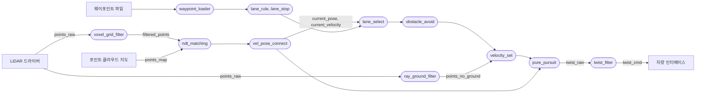

*그림 14. 실차 자율주행에 필요한 노드의 연결*

그림 14에서 둥근 상자는 노드, 사각형은 데이터나 장치이며, 화살표 위의 이름은 토픽이다. 위쪽 줄이 위치 인식, 가운데가 임무 계획과 동작 계획, 아래가 장애물 정지의 흐름이며, 모든 흐름이 마지막에 하나의 속도 명령 `twist_cmd`로 모인다.

### 3.2 데이터 기록과 재생

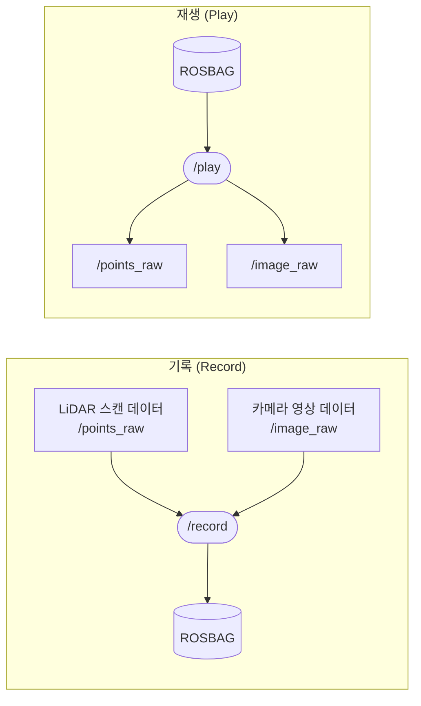

*그림 15. 토픽을 백 파일로 기록하고 다시 토픽으로 재생하는 구조*

기록 노드는 토픽으로 발행되는 데이터를 구독하여 백 파일에 저장하고, 재생 노드는 백 파일에 기록된 데이터를 원래의 토픽으로 다시 발행한다. 재생된 데이터는 실제 센서가 발행할 때와 똑같이 그 토픽을 구독하여 얻으므로, 위치 인식이나 지도 작성 노드는 데이터가 실제 센서에서 오는지 백 파일에서 오는지 구별할 필요가 없다.

Runtime Manager로 데이터를 기록하는 순서는 다음과 같다.

1. **Autoware 실행:** Autoware.ai의 초기 버전에서는 `cd ~/Autoware/ros/`로 이동한 뒤 `./run`을 실행하여 Runtime Manager를 띄운다. colcon으로 빌드하는 Autoware.ai 1.14.0에서는 작업 공간의 `install/setup.bash`를 불러온 뒤 `roslaunch runtime_manager runtime_manager.launch`로 띄운다 [13].
2. **노드 실행:** 기록할 토픽을 발행하는 노드의 체크 상자를 선택한다. 예를 들어 Sensing 탭에서 LiDAR(Velodyne HDL-32e)를 선택하면 `/points_raw`가 발행된다.
3. **ROSBAG 기록:** (A) [ROSBAG] 버튼을 눌러 대화 상자를 띄운다. (B) [Ref] 버튼을 눌러 저장할 백 파일의 이름을 정한다. (C) [Refresh] 버튼을 눌러 토픽 목록을 갱신한다. (D) 기록할 토픽의 체크 상자를 선택한다. (E) [Start] 버튼을 눌러 기록을 시작한다. (F) [Stop] 버튼을 눌러 기록을 끝낸다.

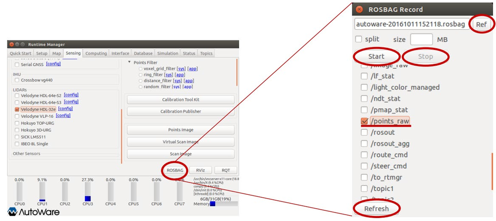

*그림 16. Sensing 탭에서 LiDAR를 켜고 ROSBAG Record 대화 상자에서 기록할 토픽을 고르는 화면*

대화 상자의 [split]을 선택하고 크기(MB)를 적으면 기록 파일을 그 크기마다 나누어 저장한다. 1.4절에서 본 것처럼 포인트 클라우드 데이터는 몇 분 만에 수 GB가 되므로 파일을 나누어 두면 다루기 쉽다.

기록한 백 파일은 Simulation 탭에서 재생한다(그림 3).

1. (A) [Simulation] 탭을 연다. (B) [Ref] 버튼을 눌러 재생할 백 파일을 고른다.
2. (C) [Play] 버튼을 눌러 백 파일의 내용을 재생한다. 이때 ROS 매개변수 `/use_sim_time`이 자동으로 `true`가 된다.
3. (D) [Pause] 버튼으로 재생을 잠시 멈추거나 다시 시작한다.
4. (E) [Stop] 버튼을 눌러 재생을 멈춘다. 이때 `/use_sim_time`이 자동으로 `false`가 된다.

> **핵심:** ROS 노드는 보통 컴퓨터의 현재 시각을 ROS 시간으로 쓴다. 그런데 2015년에 기록한 데이터를 지금 재생하면 메시지의 타임스탬프와 현재 시각이 몇 년씩 어긋나, 시간을 비교하는 노드(좌표 변환 `tf`, 위치 인식)가 데이터를 오래된 것으로 보고 버린다. `/use_sim_time`을 `true`로 하면 노드들은 컴퓨터 시각 대신 재생기가 `/clock` 토픽으로 발행하는 기록 당시의 시각을 ROS 시간으로 쓴다 [14]. 그래서 재생하는 동안에는 `true`, 실제 센서를 쓸 때는 `false`여야 한다.

같은 작업은 명령행 도구로도 할 수 있다 [4].

```bash
rosbag record -O drive.bag /points_raw /image_raw   # 두 토픽을 drive.bag에 기록한다 (Ctrl+C로 끝낸다)
rosbag info drive.bag                               # 기록 시간, 메시지 수, 토픽 목록을 출력한다
rosparam set use_sim_time true                      # 노드들이 /clock의 시각을 쓰게 한다
rosbag play --clock drive.bag                       # 기록 당시의 시각을 /clock으로 발행하며 재생한다
```

### 3.3 NDT 스캔 매칭의 원리

3D 지도 작성(3.4절)과 위치 인식(3.6절)은 모두 두 포인트 클라우드를 겹치도록 맞추는 **스캔 매칭(scan matching)**, 곧 **정합(registration)** 을 바탕으로 한다. 두 포인트 클라우드를 가장 잘 겹치게 하는 회전과 평행 이동을 찾으면, 그것이 두 포인트 클라우드를 측정한 센서 사이의 상대 위치와 방향이 된다. Autoware는 정합 방법으로 **NDT(normal distributions transform)** 를 쓴다 [15], [16].

NDT는 기준 포인트 클라우드(지도)을 같은 크기의 격자 칸(셀)으로 나누고, 각 칸에 들어 있는 점들을 하나의 **정규 분포(normal distribution)** 로 요약한다. 칸 안의 점 $`\mathbf{x}_1, \ldots, \mathbf{x}_n`$의 평균 $\mathbf{q}$와 공분산 $\Sigma$는 다음과 같다(Biber와 Strasser의 정의를 따라 $n$으로 나눈다).

```math
\mathbf{q} = \frac{1}{n}\sum_{i=1}^{n}\mathbf{x}_i, \qquad \Sigma = \frac{1}{n}\sum_{i=1}^{n}(\mathbf{x}_i-\mathbf{q})(\mathbf{x}_i-\mathbf{q})^{\top}
```

새로 측정한 점 $\mathbf{x}'$가 이 칸의 분포에 얼마나 잘 맞는지는 다음 값으로 잰다. 점이 평균에 가까울수록 값이 1에 가깝고, 같은 거리만큼 벗어나더라도 점들이 넓게 퍼져 있는 방향(분산이 큰 방향)으로 벗어나면 값이 덜 줄어든다.

```math
p(\mathbf{x}') = \exp\left(-\frac{(\mathbf{x}'-\mathbf{q})^{\top}\Sigma^{-1}(\mathbf{x}'-\mathbf{q})}{2}\right)
```

새 포인트 클라우드의 각 점 $`\mathbf{x}_k`$를 후보 자세 $\mathbf{p}$(2차원이면 $x, y$ 이동과 회전각, 3차원이면 세 축의 이동과 회전)로 옮긴 점을 $`T(\mathbf{p}, \mathbf{x}_k)`$라 하고, 그 점이 떨어진 칸의 평균과 공분산을 $`\mathbf{q}_k, \Sigma_k`$라 하면, 자세 $\mathbf{p}$의 점수는 모든 점의 값을 더한 것이다.

```math
\text{score}(\mathbf{p}) = \sum_{k} \exp\left(-\frac{(T(\mathbf{p},\mathbf{x}_k)-\mathbf{q}_k)^{\top}\Sigma_k^{-1}(T(\mathbf{p},\mathbf{x}_k)-\mathbf{q}_k)}{2}\right)
```

NDT는 이 점수를 가장 크게 하는 자세 $\mathbf{p}$를 뉴턴 방법 같은 최적화로 찾는다. 점 하나하나의 짝을 찾는 대신 칸마다 미리 계산한 분포를 쓰므로 계산이 빠르고, 점수가 자세에 대해 매끄럽게 변하므로 미분을 이용한 최적화가 가능하다.

**예제.** 2차원에서 한 칸에 지도 점 $(0, 0), (2, 0), (0, 2), (2, 2)$가 있다고 하자.

1. 평균은 $`\mathbf{q} = \frac{1}{4}(0+2+0+2,\ 0+0+2+2) = (1, 1)`$이다.
2. 평균에서의 편차는 $(-1, -1), (1, -1), (-1, 1), (1, 1)$이다. 각 편차 $\mathbf{d}$의 외적 $\mathbf{d}\mathbf{d}^{\top}$는 차례로 $`\begin{pmatrix}1&1\\1&1\end{pmatrix}, \begin{pmatrix}1&-1\\-1&1\end{pmatrix}, \begin{pmatrix}1&-1\\-1&1\end{pmatrix}, \begin{pmatrix}1&1\\1&1\end{pmatrix}`$이고, 합은 $`\begin{pmatrix}4&0\\0&4\end{pmatrix}`$이므로 $`\Sigma = \frac{1}{4}\begin{pmatrix}4&0\\0&4\end{pmatrix} = I`$(단위 행렬)이다.
3. $\Sigma^{-1} = I$이므로 $p(\mathbf{x}') = \exp(-\lVert\mathbf{x}'-\mathbf{q}\rVert^2/2)$이다. 점 $(1, 1)$은 $\exp(0) = 1$, 점 $(2, 1)$은 $\exp(-1/2) \approx 0.6065$, 점 $(3, 1)$은 $\exp(-2) \approx 0.1353$이다. 평균에서 멀어질수록 값이 빠르게 작아진다.
4. 이제 센서 좌표로 $(-0.5, 0)$과 $(0.5, 0)$에 있는 두 점으로 이루어진 새 포인트 클라우드를 회전 없이 평행 이동 $\mathbf{t}$만큼 옮겨 맞춘다고 하자. 단순화를 위해 옮긴 점은 칸의 경계와 관계없이 모두 이 칸의 분포로 평가한다고 가정한다.

| 이동 $\mathbf{t}$ | 옮긴 두 점 | 두 점의 값 | 점수 |
|:-----|:-----|:-----|:-----|
| $(1, 1)$ | $(0.5, 1), (1.5, 1)$ | $0.8825, 0.8825$ | $1.7650$ |
| $(2, 1)$ | $(1.5, 1), (2.5, 1)$ | $0.8825, 0.3247$ | $1.2071$ |
| $(0, 1)$ | $(-0.5, 1), (0.5, 1)$ | $0.3247, 0.8825$ | $1.2071$ |
| $(1, 0)$ | $(0.5, 0), (1.5, 0)$ | $0.5353, 0.5353$ | $1.0705$ |

*표 10. NDT 예제에서 이동량별 점수*

예를 들어 $\mathbf{t} = (1, 1)$일 때 두 점은 평균 $(1, 1)$에서 각각 0.5만큼 떨어지므로 값은 $\exp(-0.25/2) = \exp(-0.125) \approx 0.8825$이고, 점수는 $2 \times 0.8825 = 1.7650$이다. 네 후보 가운데 $\mathbf{t} = (1, 1)$의 점수가 가장 크므로, 새 포인트 클라우드를 측정한 센서는 지도 기준으로 $(1, 1)$만큼 옮겨진 곳에 있다고 판단한다. 실제 NDT는 이처럼 후보를 몇 개 비교하는 대신, 점수의 기울기와 곡률을 계산하여 가장 높은 곳으로 자세를 반복해서 옮긴다.

> **[확률및통계]** 다변량 정규 분포의 확률 밀도는 $\exp\left(-\frac{1}{2}(\mathbf{x}-\boldsymbol{\mu})^{\top}\Sigma^{-1}(\mathbf{x}-\boldsymbol{\mu})\right)$에 비례한다. 지수 안의 $(\mathbf{x}-\boldsymbol{\mu})^{\top}\Sigma^{-1}(\mathbf{x}-\boldsymbol{\mu})$를 **마할라노비스 거리(Mahalanobis distance)** 의 제곱이라 하며, 분포가 넓게 퍼진 방향으로의 차이는 작게, 좁은 방향으로의 차이는 크게 센다. NDT의 점수는 정규화 상수를 뺀 이 밀도를 모든 점에 대해 더한 것이다.

> **주의:** 칸 안의 점이 너무 적거나 한 직선 위에 늘어서 있으면 공분산 행렬의 역행렬이 없거나 매우 불안정해진다. 그래서 NDT 구현은 점이 일정 개수(Biber와 Strasser는 3개)보다 적은 칸을 쓰지 않거나, 너무 작은 고윳값을 키워 공분산을 보정한다 [15]. 칸의 크기(해상도)는 정확도와 계산량을 함께 정하는 중요한 매개변수이다.

### 3.4 3D 지도 작성

LiDAR로 3D 지도를 만드는 원리는 다음과 같다. 지금까지의 스캔으로 쌓은 지도와 새로 들어온 스캔을 NDT로 맞추어 두 스캔 사이의 LiDAR의 상대 위치를 계산하고, 그 위치를 이용해 새 스캔을 3D 지도에 더한다. 이를 스캔마다 되풀이하면 지도가 점점 넓어진다.

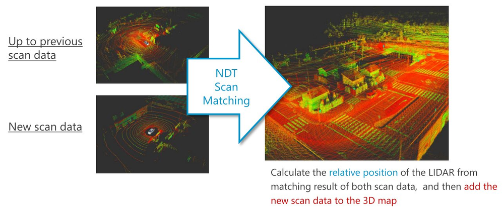

*그림 17. 이전까지의 스캔 데이터와 새 스캔 데이터를 NDT로 맞추어 3D 지도에 더하는 과정*

이 과정은 여러 장의 사진을 겹치는 부분끼리 맞추어 한 장의 파노라마 사진으로 잇는 것과 같다. 사진의 겹치는 부분을 찾아 어긋난 위치를 계산하고 이어 붙이듯이, 스캔의 겹치는 부분을 맞추어 LiDAR가 움직인 양을 계산하고 스캔을 이어 붙인다.

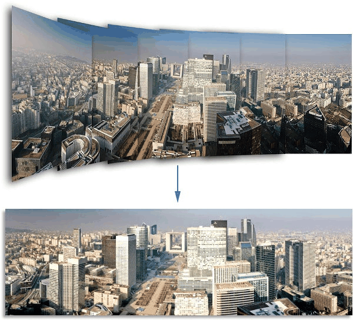

*그림 18. 여러 장의 사진을 겹치는 부분끼리 맞추어 이은 파노라마 사진*

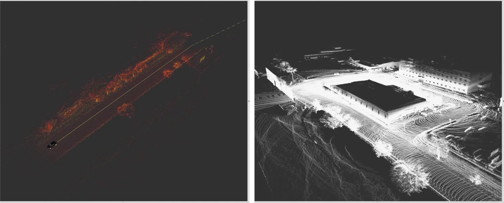

*그림 19. 차량이 주행하는 동안 포인트 클라우드가 쌓여 가는 지도 작성 화면과 완성된 포인트 클라우드 지도*

그림 19의 왼쪽은 지도를 만드는 동안의 RViz 화면으로, 차량이 도로를 따라 움직이며 주변의 포인트 클라우드가 차례로 쌓인다. 오른쪽은 완성된 지도를 RViz에서 비스듬히 내려다본 모습으로, 건물과 도로 경계, 나무가 점으로 드러난다.

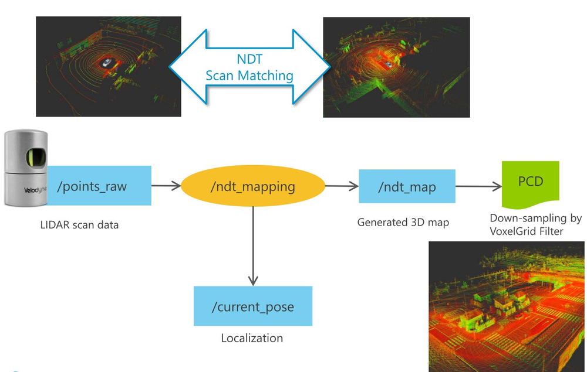

*그림 20. NDT 매핑 노드의 입력과 출력*

Autoware의 지도 작성 노드 `ndt_mapping`은 Velodyne LiDAR의 스캔 데이터 `/points_raw`를 받아 지금까지 만든 지도 `/ndt_map`을 발행한다. 지도를 만드는 동안 계산되는 현재 위치는 `/current_pose`로 발행되므로, 지도 작성과 위치 인식이 동시에 이루어진다. 완성한 지도는 **VoxelGrid 필터**로 점을 줄여 **PCD(point cloud data)** 파일로 저장한다.

> **용어 정의:** **복셀 격자 필터(voxel grid filter)** 는 공간을 한 변이 정해진 길이(leaf size, 예: 0.2 m)인 정육면체 칸(복셀)으로 나누고, 각 칸에 든 점들을 그 무게중심 하나로 바꾸는 필터이다. 점의 분포 모양은 유지하면서 점의 수를 크게 줄인다. **PCD**는 Point Cloud Library(PCL)가 정한 포인트 클라우드 파일 형식이다.

지도 작성의 권장 절차는 다음과 같다.

1. **기록 후 지도 작성:** 주행하면서 바로 지도를 만들기보다, ROSBAG으로 LiDAR 데이터(`/points_raw`)를 먼저 기록한 뒤 재생하며 지도를 만드는 것을 권장한다. 지도 작성은 계산량이 커서 주행 중에 실시간으로 처리하지 못할 수 있고, 기록해 두면 설정을 바꾸어 몇 번이든 다시 만들 수 있기 때문이다.
2. **approximate_ndt_mapping 사용:** 지도가 넓어질수록 `ndt_mapping`이 맞추어야 할 지도가 커져 계산 시간과 메모리가 늘어난다. `approximate_ndt_mapping`은 지도를 일정 크기의 **부분 지도(submap)** 로 나누어 만들고 차례로 파일로 저장하므로, 넓은 지역의 대용량 지도에 알맞다.

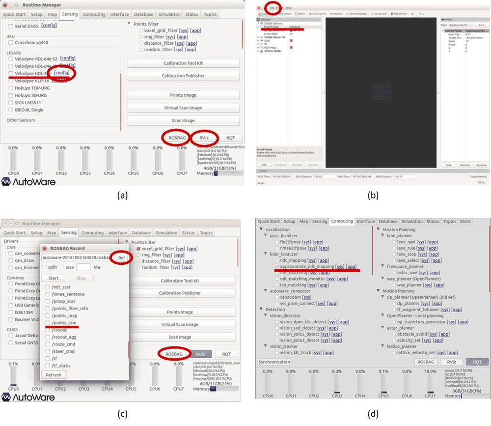

*그림 21. LiDAR 설정, RViz 실행, 데이터 기록, approximate_ndt_mapping 선택 화면*

그림 21의 (a)는 Sensing 탭에서 LiDAR(Velodyne HDL-32e)의 설정([config])을 열고 [ROSBAG]과 [RViz] 버튼을 누르는 화면, (b)는 RViz를 띄운 화면, (c)는 ROSBAG Record 대화 상자에서 `/points_raw`를 골라 기록하는 화면, (d)는 Computing 탭의 Localization 아래 `lidar_localizer`에서 `approximate_ndt_mapping`을 선택하는 화면이다. 이때의 노드 연결은 다음과 같다.

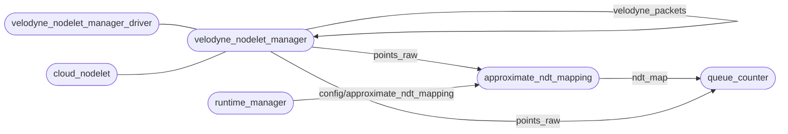

*그림 22. approximate_ndt_mapping을 실행할 때의 노드 연결*

Velodyne 드라이버는 하나의 관리자 프로세스(`velodyne_nodelet_manager`) 안에서 여러 **노드릿(nodelet)** 으로 동작한다. 드라이버 노드릿이 LiDAR의 원시 패킷 `velodyne_packets`를 발행하면, 같은 프로세스 안의 `cloud_nodelet`이 이를 포인트 클라우드 `points_raw`로 바꾼다. `approximate_ndt_mapping`은 `points_raw`와 Runtime Manager가 보낸 설정 `config/approximate_ndt_mapping`을 받아 지도 `ndt_map`을 발행하고, `queue_counter`는 처리를 기다리는 메시지 수를 세어 지도 작성이 데이터를 따라가고 있는지 보여 준다.

> **용어 정의:** **노드릿(nodelet)** 은 여러 노드를 한 프로세스 안에서 실행하여, 노드 사이의 메시지를 네트워크로 직렬화하지 않고 메모리의 포인터로 넘기게 하는 ROS 기능이다. 포인트 클라우드처럼 큰 데이터를 주고받을 때 복사 비용을 없앤다.

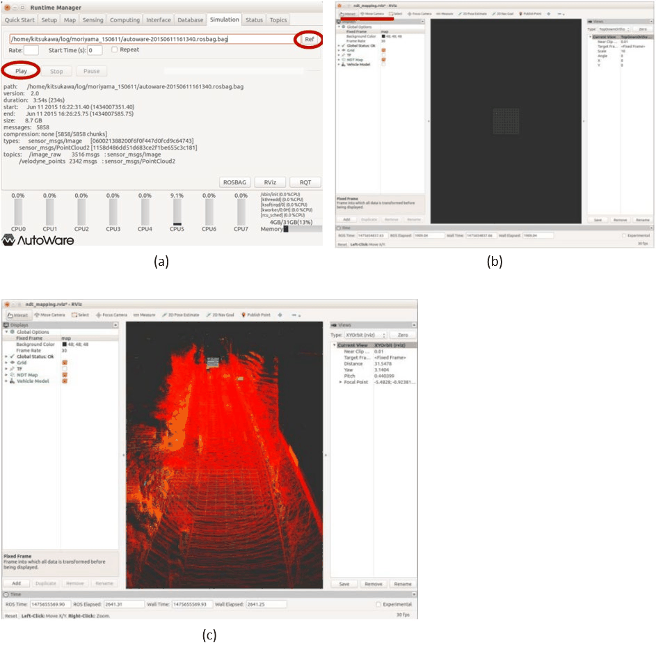

*그림 23. 백 파일 재생, RViz 화면, 지도 작성 결과*

기록한 데이터로 지도를 만드는 순서는 그림 23과 같다. (a) Simulation 탭에서 백 파일을 골라 [Play]로 재생하고, (b) RViz를 띄우면, (c) 재생이 진행되는 동안 지도가 쌓여 가는 모습이 보인다. 지도 작성이 끝나면 다음을 확인한다.

- **부분 지도 파일:** `approximate_ndt_mapping`이 저장한 부분 지도 파일(submap)이 `~/.ros` 폴더에 생겼는지 확인한다. `roslaunch`로 실행한 노드는 따로 정하지 않으면 `~/.ros`를 작업 디렉토리로 쓰므로, 상대 경로로 저장한 파일이 이 폴더에 생긴다.
- **RViz에서 확인:** 만든 지도를 RViz에서 불러와 건물과 도로가 겹치거나 휘지 않고 바르게 이어졌는지 확인한다.

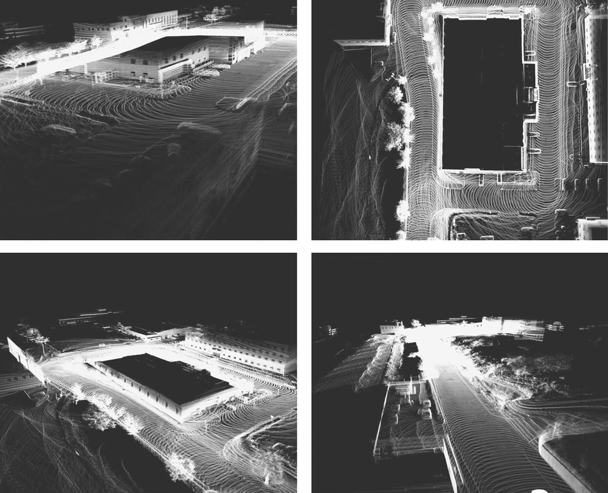

*그림 24. 완성된 3D 포인트 클라우드 지도를 여러 방향에서 본 모습*

그림 24는 완성된 지도를 비스듬한 방향과 위에서 본 모습이다. 가운데의 큰 건물과 둘레의 도로, 주차된 차량, 나무가 점으로 나타나 있다.

### 3.5 벡터 지도 작성

포인트 클라우드 지도는 위치 인식에는 충분하지만, 어디가 차선이고 어디서 멈추어야 하는지는 담고 있지 않다. **벡터 지도(vector map)** 는 차선, 정지선, 횡단보도, 신호등 같은 도로 요소를 점, 선, 면의 좌표로 표현한 지도이다. Autoware는 벡터 지도의 차선과 정지선 정보로 경로를 만들고 차량 제어 등에 다양하게 쓰므로, 벡터 지도를 쓰는 것을 권장한다.

TIER IV가 제공하는 웹 도구 MapTools의 **VectorMapper**를 쓰면, 포인트 클라우드 지도를 올리고 그 위에 사용자가 원하는 벡터 지도를 일부 만들 수 있다 [17]. VectorMapper는 Autoware가 쓰는 ADAS 지도 형식과 호환되는 벡터 지도를 빠르게 만드는 도구이며, 그 출력은 원래의 ADAS 지도 데이터에 비하면 제한적이다. VectorMapper가 만드는 ADAS 지도 파일은 다음과 같다.

| 파일 | 담는 정보 |
|:-----|:-----|
| `point.csv` | 지도의 모든 요소가 참조하는 점의 좌표 |
| `vector.csv` | 점과 방향 각도로 정한 벡터 (신호등이 향하는 방향 등) |
| `line.csv` | 두 점을 잇는 선분 |
| `area.csv` | 선으로 둘러싼 영역 |
| `node.csv` | 차선이 이어지는 지점(노드) |
| `lane.csv` | 두 노드를 잇는 차선 구간과 그 연결 관계 |
| `dtlane.csv` | 차선 구간의 자세한 형상 (방향, 곡률 등) |
| `stopline.csv` | 정지선 |
| `crosswalk.csv` | 횡단보도 |
| `signaldata.csv` | 신호등 |
| `idx.csv` | 지도 파일의 색인 |

*표 11. VectorMapper가 만드는 ADAS 지도 파일*

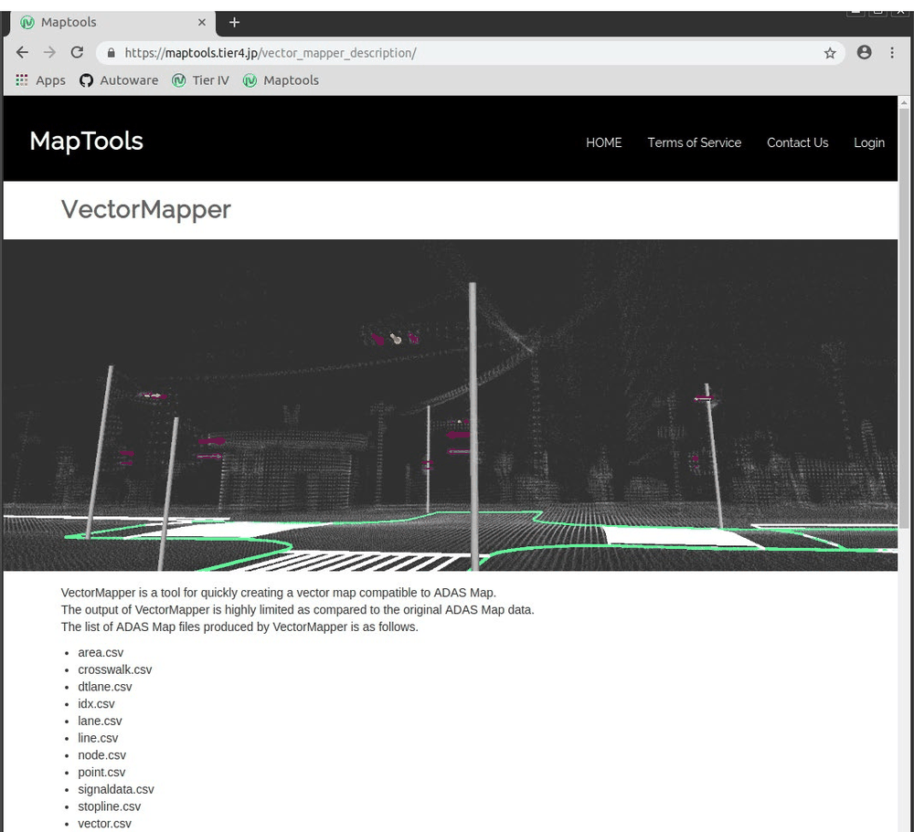

*그림 25. TIER IV MapTools의 VectorMapper 화면*

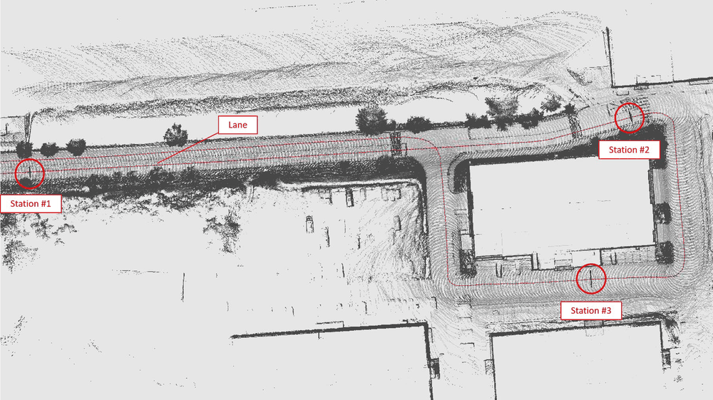

*그림 26. 포인트 클라우드 지도 위에 그린 차선과 정류장*

그림 26은 그림 24의 지도를 위에서 본 모습에 VectorMapper로 차선(Lane)과 정류장(Station #1\~#3)의 정지선을 그린 예이다. 빨간 선이 건물을 한 바퀴 도는 차선이고, 원으로 표시한 세 곳이 차량이 멈출 정류장이다. 차량은 이 차선을 따라 경로를 만들고, 정지선이 있는 정류장에서 멈춘다.

### 3.6 NDT 매칭을 이용한 위치 인식

지도가 준비되면 주행 중의 위치 인식은 지도 데이터와 스캔 데이터를 NDT로 맞추는 것으로 이루어진다. 지도와 스캔이 가장 잘 맞는 정보로부터 차량의 위치와 진행 방향을 추정한다. 3.4절의 지도 작성과 달리 기준이 되는 지도는 고정되어 있고, 새 스캔을 지도에 더하지 않는다.

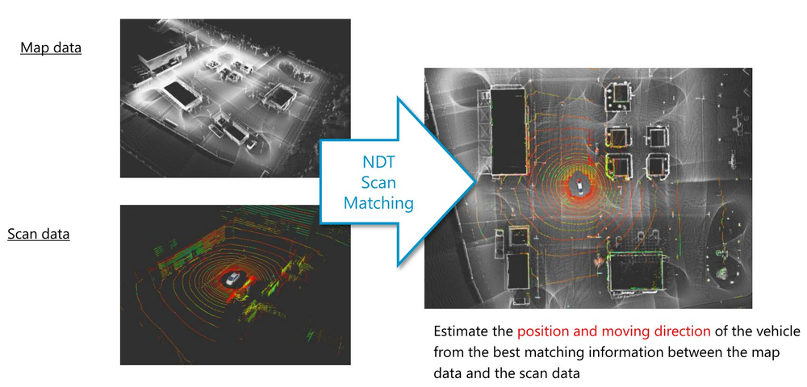

*그림 27. 지도 데이터와 스캔 데이터를 NDT로 맞추어 차량의 위치와 진행 방향을 추정하는 과정*

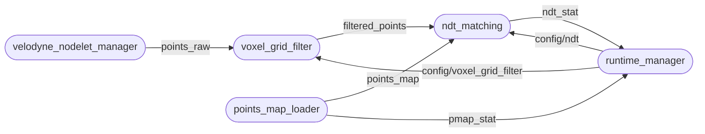

*그림 28. NDT 매칭으로 위치를 인식할 때의 노드 연결*

1. `points_map_loader`가 PCD 지도 파일을 읽어 `points_map`으로 발행하고, 지도를 다 읽었는지를 `pmap_stat`으로 알린다.
2. LiDAR 드라이버가 발행한 `points_raw`를 `voxel_grid_filter`가 줄여 `filtered_points`로 발행한다. 점 수를 줄이면 NDT의 계산이 빨라져 매 스캔을 제시간에 처리할 수 있다.
3. `ndt_matching`이 `filtered_points`를 `points_map`과 맞추어 차량의 위치를 구하고, 매칭 상태를 `ndt_stat`으로 Runtime Manager에 알린다.
4. Runtime Manager는 사용자가 정한 필터 크기와 NDT 매개변수를 `config/voxel_grid_filter`, `config/ndt` 토픽으로 각 노드에 보낸다.

> **주의:** NDT 매칭은 최적화로 출발점에서 가장 가까운 점수 봉우리를 찾으므로, 출발점이 실제 위치에서 너무 멀면 실제 위치가 아닌 다른 곳의 봉우리(지역 최적해)로 수렴할 수 있다. 그래서 처음 시작할 때는 GNSS나 RViz에서 지정한 초기 위치가 필요하고, 그 뒤로는 직전 위치를 다음 매칭의 출발점으로 쓴다. 위치 인식의 세부 설정과 실습은 3주차와 9주차에서 다룬다.

---

<br>

## 개념 적용

| 상황 | 결과와 이유 |
|:-----|:------------|
| 실제 도로에서 기록한 백 파일을 재생하는데 `/use_sim_time`을 `false`로 둔다. | **위치 인식이나 좌표 변환이 데이터를 버리거나 경고를 낸다.** 노드들이 현재 컴퓨터 시각을 쓰므로 기록 당시의 타임스탬프가 너무 오래된 것으로 보이기 때문이다. |
| LiDAR 10 Hz 포인트 클라우드를 30분 동안 기록하려 한다. 포인트 클라우드 하나가 약 1.77 MB이다. | **약 32 GB가 필요하다.** $10 \times 60 \times 30 = 18000$개의 포인트 클라우드에 1.77 MB를 곱하면 약 31.9 GB($3.19 \times 10^{10}$바이트)이다. |
| 카메라를 USB 카메라에서 Point Grey 카메라로 바꾼다. | **검출 노드는 고칠 필요가 없다.** 두 드라이버 모두 같은 토픽 `image_raw`에 같은 메시지 형식으로 발행하기 때문이다. |
| `ray_ground_filter` 없이 `velocity_set`이 원시 포인트 클라우드를 장애물 판단에 쓴다. | **차량이 출발하지 못하거나 자주 멈출 수 있다.** 높이 범위로 걸러지지 않는 도로면의 점(경사로, 차체의 기울어짐, 낮게 잡은 높이 범위)이 장애물로 잡힐 수 있기 때문이다(3주차 5.3절). |
| `CMakeLists.txt`의 `target_link_libraries`에 `add_executable`과 다른 대상 이름을 적는다. | **CMake 설정 단계에서 오류가 난다.** 존재하지 않는 대상에 라이브러리를 링크하려 하기 때문이다. |
| 예제 노드에 `ros::spin()`을 빼고 빌드하여 실행한다. | **노드가 곧바로 끝나고 아무것도 발행하지 않는다.** 콜백 함수를 부를 반복이 없어 `main`이 바로 반환되기 때문이다. |
| 넓은 공단 전체의 지도를 한 번에 `ndt_mapping`으로 만든다. | **갈수록 느려지고 메모리가 부족해질 수 있다.** 지도가 커질수록 매칭 대상과 메모리가 늘어나므로 부분 지도로 나누는 `approximate_ndt_mapping`이 알맞다. |
| 포인트 클라우드 지도만 있고 벡터 지도가 없는 상태로 신호등이 있는 교차로를 주행한다. | **정지선에서 멈추는 계획을 세울 수 없다.** 정지선과 신호등의 위치는 벡터 지도에 담기기 때문이다. |

*표 12. Autoware의 기록, 노드 개발, 지도와 관련된 상황별 결과와 그 이유*

**T/F 점검:**

| 문장 | 판단과 근거 |
|:-----|:------------|
| rosbag으로 재생한 토픽은 실제 센서의 토픽과 다른 이름으로 발행된다. | **F.** 기록할 때의 토픽 이름 그대로 다시 발행되므로 구독하는 노드는 구별할 필요가 없다. |
| 노드 그래프에서 타원은 노드, 사각형은 토픽이다. | **T.** 화살표는 발행과 구독의 방향을 나타낸다. |
| 실행 파일 이름과 `ros::init`에 준 노드 이름은 반드시 같아야 한다. | **F.** `rosrun`은 실행 파일 이름으로 프로그램을 찾고, 노드는 `ros::init`의 이름으로 등록된다. |
| `std::string::size()`는 UTF-8 한글 문자열의 글자 수를 돌려준다. | **F.** 바이트 수를 돌려주므로 `"안녕"`은 6이다. |
| NDT는 지도의 칸마다 점들을 정규 분포로 요약하여 정합한다. | **T.** 칸마다 평균과 공분산을 미리 계산해 두고 점수를 더한다. |
| 지도 작성(ndt_mapping)과 위치 인식(ndt_matching)은 모두 새 스캔을 지도에 더한다. | **F.** 지도 작성만 새 스캔을 지도에 더하고, 위치 인식은 고정된 지도에 스캔을 맞추기만 한다. |
| 복셀 격자 필터는 점의 분포 모양을 유지하면서 점의 수를 줄인다. | **T.** 복셀마다 점들을 무게중심 하나로 바꾼다. |

---

<br>

## 요약

| 개념 | 핵심 요약 |
|:--------|:------------|
| Autoware | 나고야 대학교가 개발한 ROS 기반 오픈 소스 자율주행 소프트웨어로, 하드웨어, 운영체제, ROS 위의 응용 계층이다. |
| rosbag | 토픽 메시지를 타임스탬프와 함께 `.bag` 파일에 기록하고 같은 토픽으로 재생하여, 실제 센서 없이 반복해서 개발하고 디버깅하게 한다. |
| 인식, 판단, 조작 | 센서로 물체와 자기 위치를 인식하고, 지도와 규칙으로 주행 행동을 판단하고, 가속, 제동, 조향 명령으로 조작한다. |
| Runtime Manager | 탭별로 노드를 켜고 끄며 매개변수, 기록과 재생, RViz와 rqt 실행을 관리하는 Autoware의 GUI이다. |
| 노드 그래프 | 타원은 노드, 사각형은 토픽이며, 데이터 흐름을 한눈에 보여 주어 디버깅에 쓰인다. |
| 센서 융합 | 카메라의 물체 종류 정보와 LiDAR의 거리 정보를 합쳐 물체를 검출한다. |
| 경로 계획 흐름 | 웨이포인트, 교통 규칙(lane_rule, lane_stop), 차선 선택(lane_select), 속도 계획(velocity_set), 경로 추종(pure_pursuit)을 거쳐 속도 명령이 된다. |
| Autoware 패키지 | `package.xml`과 `CMakeLists.txt`를 갖추고, 노드마다 같은 이름의 디렉토리에 소스를 둔다. `catkin_create_pkg`로 만든다. |
| ROS 노드 작성 | `ros::init`, `NodeHandle`, `advertise`, `subscribe`, 콜백 함수, `ros::spin`으로 구독한 메시지를 처리하여 발행한다. |
| 노드 빌드 | `add_executable`과 `target_link_libraries`를 추가하고 Release 모드로 빌드한다. |
| 실차 필수 노드 | TF, 지도, 웨이포인트, LiDAR, voxel_grid_filter, ndt_matching, vel_pose_connect, 임무 계획 노드, pure_pursuit, twist_filter, 차량 인터페이스이다. |
| use_sim_time | 재생할 때 `true`로 하여 노드들이 `/clock`의 기록 당시 시각을 ROS 시간으로 쓰게 한다. |
| NDT | 기준 포인트 클라우드를 칸마다 정규 분포로 요약하고, 새 포인트 클라우드의 점들이 분포에 맞는 정도의 합을 최대로 하는 자세를 찾는 정합 방법이다. |
| 3D 지도 작성 | 새 스캔을 지금까지의 지도와 NDT로 맞추어 더하는 과정을 되풀이하며, 대용량 지도에는 approximate_ndt_mapping이 알맞다. |
| 벡터 지도 | 차선, 정지선, 신호등을 점, 선, 면으로 표현한 지도로, 경로 생성과 정지에 쓰이며 VectorMapper로 만들 수 있다. |
| NDT 매칭 위치 인식 | 복셀 격자 필터로 줄인 스캔을 고정된 지도와 NDT로 맞추어 차량의 위치와 진행 방향을 구한다. |

---

<br>

## 점검 문제

1. **계층 구조:** Autoware의 네 계층을 아래에서부터 쓰고, 각 계층이 하는 일을 한 문장씩 설명하라.

   <details>
   <summary>정답</summary>

   하드웨어 계층은 CPU, GPU로 계산하고 카메라, GNSS, LiDAR로 주변과 위치를 측정한다. 호스트 운영체제 계층(Linux, eMCOS 등)은 하드웨어를 관리하고 프로세스를 실행한다. 미들웨어 계층(ROS)은 노드 사이의 메시지 전달, 기록과 재생, 시각화 도구를 제공한다. 응용 계층(Autoware)은 위치 인식, 물체 검출, 경로 계획, 차량 제어 같은 자율주행 기능을 ROS 노드로 구현한다.

   </details>

2. **백 파일 정보:** 어떤 백 파일의 정보가 `duration: 120s`, `/points_raw 1200 msgs`, `/imu_raw 12000 msgs`, `size: 2.0 GB`이다. 두 토픽의 발행 주기와 포인트 클라우드 하나의 대략적인 크기를 구하라. IMU 메시지의 크기는 무시한다.

   <details>
   <summary>정답</summary>

   `/points_raw`는 $1200 / 120 = 10$ Hz, `/imu_raw`는 $12000 / 120 = 100$ Hz이다. `rosbag info`의 2.0 GB는 $2.0 \times 1024^3 \approx 2.15 \times 10^9$바이트이고, 파일 크기를 포인트 클라우드가 거의 모두 차지하므로 포인트 클라우드 하나는 $2.15 \times 10^9 / 1200 \approx 1.79 \times 10^6$바이트, 곧 약 1.79 MB이다.

   </details>

3. **use_sim_time:** 백 파일을 재생할 때 `/use_sim_time`을 `true`로 해야 하는 이유와, 실제 차량을 운행할 때 `false`로 되돌려야 하는 이유를 설명하라.

   <details>
   <summary>정답</summary>

   재생하는 데이터의 타임스탬프는 기록 당시의 시각이므로, 노드가 현재 컴퓨터 시각을 쓰면 데이터가 매우 오래된 것으로 보여 좌표 변환과 위치 인식이 데이터를 버린다. `true`로 하면 노드들이 재생기가 `/clock`으로 발행하는 기록 당시의 시각을 쓰므로 시간이 맞는다. 실제 차량을 운행할 때는 `/clock`을 발행하는 재생기가 없으므로 `true`로 두면 ROS 시간이 흐르지 않아 노드가 멈추거나 잘못 동작하며, 센서 데이터의 타임스탬프인 현재 시각을 쓰도록 `false`로 해야 한다.

   </details>

4. **센서 융합:** 그림 5의 검출 흐름에서 카메라와 LiDAR의 결과를 합치는 노드 두 개를 쓰고, 합치는 이유를 설명하라.

   <details>
   <summary>정답</summary>

   `range_fusion`은 카메라가 검출한 물체 영역에 LiDAR 점을 영상에 투영한 정보로 거리를 붙이고, `obj_fusion`은 카메라 검출 결과 `obj_label`과 LiDAR 군집 결과 `points_obj`를 합쳐 물체의 위치 `obj_pose`를 낸다. 카메라는 물체의 종류를 잘 알아보지만 거리를 직접 재지 못하고, LiDAR는 거리를 정확히 재지만 종류를 알아보기 어려우므로 두 결과를 합쳐 서로의 약점을 보완한다.

   </details>

5. **경로 계획 흐름:** 웨이포인트 파일에서 차량의 속도 명령 `twist_cmd`가 나오기까지 거치는 노드를 순서대로 쓰고, 신호등이 빨간색일 때 어느 노드가 어떻게 반응하는지 설명하라.

   <details>
   <summary>정답</summary>

   `waypoint_loader` → `lane_rule` → `lane_stop` → `lane_select` → `obstacle_avoid` → `velocity_set` → `pure_pursuit` → `twist_filter`를 거쳐 `twist_cmd`가 나온다. 그림 7의 구성에서는 `twist_filter` 대신 `collision_avoid`가 마지막 단계를 맡는다. `lane_rule`은 정지선 정보로 신호가 초록일 때의 웨이포인트와 빨강일 때 정지선에서 멈추도록 속도를 줄인 웨이포인트를 함께 만들고, `lane_stop`이 신호등 상태가 빨강이면 정지용 웨이포인트를 골라 발행하므로 차량이 정지선 앞에서 멈춘다.

   </details>

6. **예제 노드 수정:** 2.3절의 노드를 고쳐, 받은 문자열의 길이에 2를 곱한 값을 `mypubval2` 토픽에 발행하려면 어느 줄을 어떻게 바꾸어야 하는가?

   <details>
   <summary>정답</summary>

   `pmsg.data = smsg.data.size();`를 `pmsg.data = smsg.data.size() * 2;`로 바꾸고, `n.advertise<std_msgs::Int32>("mypubval", 10)`의 토픽 이름을 `"mypubval2"`로 바꾼다. 메시지 형식은 그대로 `std_msgs/Int32`이므로 헤더와 CMake 설정은 고칠 필요가 없고, 다시 빌드하면 된다.

   </details>

7. **CMake 설정:** `nodes/my_filter/my_filter.cpp`에 있는 노드를 실행 파일 `my_filter`로 빌드하려면 `CMakeLists.txt`에 어떤 두 줄을 더해야 하는가?

   <details>
   <summary>정답</summary>

   `add_executable(my_filter nodes/my_filter/my_filter.cpp)`와 `target_link_libraries(my_filter ${catkin_LIBRARIES})`를 더한다. 첫 줄은 소스 파일로 실행 파일 대상을 만들고, 둘째 줄은 같은 이름의 대상에 ROS 라이브러리를 링크한다.

   </details>

8. **지면 제거:** 장애물 앞에서 멈추는 기능에 `ray_ground_filter`가 필요한 이유를 설명하라.

   <details>
   <summary>정답</summary>

   LiDAR 포인트 클라우드에는 장애물뿐 아니라 도로면에서 반사된 점이 많이 들어 있다. 지면 점을 지우지 않으면 `velocity_set`이 차량 앞의 도로면을 장애물로 보고 계속 멈추게 되므로, 지면 점을 걸러 낸 `points_no_ground`만 장애물 판단에 써야 한다.

   </details>

9. **NDT 계산:** 한 칸에 지도 점 $(1, 0), (3, 0), (1, 2), (3, 2)$가 있다. 이 칸의 평균과 공분산을 구하고, 점 $(2, 2)$의 값 $p(\mathbf{x}')$를 구하라.

   <details>
   <summary>정답</summary>

   평균은 $\mathbf{q} = (2, 1)$이다. 편차는 $(-1, -1), (1, -1), (-1, 1), (1, 1)$로 3.3절의 예제와 같으므로 $\Sigma = I$이다. 점 $(2, 2)$의 편차는 $(0, 1)$이고 $\lVert\mathbf{d}\rVert^2 = 1$이므로 $p = \exp(-1/2) \approx 0.6065$이다.

   </details>

10. **지도 작성과 위치 인식:** `ndt_mapping`과 `ndt_matching`의 공통점과 차이점을 입력, 출력, 지도의 변화 관점에서 설명하라.

    <details>
    <summary>정답</summary>

    두 노드 모두 LiDAR 스캔을 NDT로 기준 포인트 클라우드와 맞추어 차량의 위치를 구한다는 점이 같다. `ndt_mapping`은 기준 포인트 클라우드가 지금까지 만든 지도이고, 맞춘 스캔을 지도에 더하여 지도 `ndt_map`을 키워 가며 현재 위치도 낸다. `ndt_matching`은 미리 만든 고정 지도 `points_map`을 기준으로 하고, 스캔을 지도에 더하지 않고 차량의 위치만 낸다.

    </details>

11. **벡터 지도의 필요성:** 포인트 클라우드 지도만으로 위치 인식은 되는데도 벡터 지도가 필요한 이유를 설명하라.

    <details>
    <summary>정답</summary>

    포인트 클라우드 지도는 주변 구조물의 3차원 점만 담고 있어 위치를 맞추는 데는 충분하지만, 어디가 차선이고 어디에 정지선과 신호등이 있는지는 알려 주지 않는다. Autoware는 벡터 지도의 차선으로 경로를 만들고, 정지선과 신호등 정보로 멈출 곳을 정하므로 실제 도로와 정류장을 주행하려면 벡터 지도가 필요하다.

    </details>

---

<br>

## 참고 문헌

1. S. Kato, E. Takeuchi, Y. Ishiguro, Y. Ninomiya, K. Takeda, and T. Hamada, "An open approach to autonomous vehicles," *IEEE Micro*, vol. 35, no. 6, pp. 60-68, 2015.
2. Apex.AI, "Announcing the Autoware Foundation," Dec. 9, 2018. https://www.apex.ai/post/announcing-the-autoware-foundation
3. Autoware Foundation, "Autoware." https://www.autoware.org
4. ROS Wiki, "rosbag." https://wiki.ros.org/rosbag
5. Autoware Foundation, "Autoware.ai." https://github.com/autowarefoundation/autoware_ai
6. ROS, "tools/rosbag/src/rosbag/bag.py," ros_comm repository (melodic-devel branch), GitHub. https://github.com/ros/ros_comm/blob/melodic-devel/tools/rosbag/src/rosbag/bag.py
7. P. F. Felzenszwalb, R. B. Girshick, D. McAllester, and D. Ramanan, "Object detection with discriminatively trained part-based models," *IEEE Trans. Pattern Anal. Mach. Intell.*, vol. 32, no. 9, pp. 1627-1645, 2010.
8. R. C. Coulter, "Implementation of the pure pursuit path tracking algorithm," Robotics Institute, Carnegie Mellon Univ., Pittsburgh, PA, USA, Tech. Rep. CMU-RI-TR-92-01, 1992.
9. ROS Wiki, "catkin/package.xml." https://wiki.ros.org/catkin/package.xml
10. ROS Wiki, "catkin/CMakeLists.txt." https://wiki.ros.org/catkin/CMakeLists.txt
11. ROS Wiki, "Writing a Simple Publisher and Subscriber (C++)." https://wiki.ros.org/ROS/Tutorials/WritingPublisherSubscriber%28c%2B%2B%29
12. ROS Enhancement Proposals, "REP 3: Target Platforms." https://www.ros.org/reps/rep-0003.html
13. Autoware Foundation, "ROSBAG Demo," Autoware.ai documentation. https://github.com/autowarefoundation/autoware_ai_documentation/wiki/ROSBAG-Demo
14. ROS Wiki, "Clock." https://wiki.ros.org/Clock
15. P. Biber and W. Strasser, "The normal distributions transform: A new approach to laser scan matching," in *Proc. IEEE/RSJ Int. Conf. Intelligent Robots and Systems (IROS)*, 2003, pp. 2743-2748.
16. M. Magnusson, "The three-dimensional normal-distributions transform: An efficient representation for registration, surface analysis, and loop detection," Ph.D. dissertation, Örebro Univ., Örebro, Sweden, 2009.
17. TIER IV, "MapTools." https://tools.tier4.jp
