# Week 2 Lecture — Core Technologies of Open-Source Mobile Robots

[Repository Guide](../../README.md) | [English](Concepts_Lecture.md) | [한국어](Concepts_Lecture.ko.md)

> **Last Updated:** 2026-11-04

> **Learning Objectives:**
> 1. Explain, as a layered structure, that Autoware is open-source autonomous driving software running on ROS, and describe its recognition, judgment, and operation functions and its user interfaces
> 2. Explain how rosbag records and plays back topics and the role of the `/use_sim_time` parameter
> 3. Distinguish nodes from topics in Autoware's node graphs and follow the data flow from the sensor drivers to the vehicle commands
> 4. Create a package that meets the package conditions of ROS and Autoware, and write and build a node that subscribes to and publishes topics
> 5. Explain, by function, the minimal node configuration needed to operate a real car
> 6. Explain how a 3D map is built by NDT scan matching, how a vector map is added, and how the vehicle is localized by NDT matching

---

## Table of Contents

- [1. Composition of Autoware](#1-composition-of-autoware)
  - [1.1 Autoware and ROS](#11-autoware-and-ros)
  - [1.2 rosbag](#12-rosbag)
  - [1.3 Functions Provided by Autoware](#13-functions-provided-by-autoware)
  - [1.4 User Interfaces](#14-user-interfaces)
  - [1.5 Reading Node Graphs](#15-reading-node-graphs)
  - [1.6 Node Configuration for Perception and Localization](#16-node-configuration-for-perception-and-localization)
  - [1.7 Node Configuration for Path Planning and Maps](#17-node-configuration-for-path-planning-and-maps)
  - [1.8 Node Configuration for Sensor Drivers and the Vehicle Interface](#18-node-configuration-for-sensor-drivers-and-the-vehicle-interface)
- [2. Developing ROS Nodes for Autoware](#2-developing-ros-nodes-for-autoware)
  - [2.1 Development Procedure](#21-development-procedure)
  - [2.2 Creating a Package](#22-creating-a-package)
  - [2.3 Writing a Node](#23-writing-a-node)
  - [2.4 Building a Node](#24-building-a-node)
  - [2.5 Checking the Node's Operation](#25-checking-the-nodes-operation)
- [3. Technical Components of Autoware](#3-technical-components-of-autoware)
  - [3.1 Node Configuration for Operating a Real Car](#31-node-configuration-for-operating-a-real-car)
  - [3.2 Data Recording and Playback](#32-data-recording-and-playback)
  - [3.3 Principle of NDT Scan Matching](#33-principle-of-ndt-scan-matching)
  - [3.4 Building a 3D Map](#34-building-a-3d-map)
  - [3.5 Building a Vector Map](#35-building-a-vector-map)
  - [3.6 Localization by NDT Matching](#36-localization-by-ndt-matching)
- [Concept Applications](#concept-applications)
- [Summary](#summary)
- [Self-Check Questions](#self-check-questions)
- [References](#references)

---

<br>

## 1. Composition of Autoware

### 1.1 Autoware and ROS

As seen in Section 3 of Week 1, the most fundamental technology in ROS is message communication between nodes. Nodes register their information with the master and then exchange topics and services directly using the connection information received from the master. The autonomous driving software Autoware is a large ROS system built on this structure, in which a great many nodes are connected by topics.

> **Definition:** **Autoware** is open-source autonomous driving software based on ROS. It was developed by Nagoya University in Japan for autonomous driving research and development and released on GitHub in 2015 [1]. Development was later led by TIER IV, a company founded by Shinpei Kato, who started Autoware, and it is now maintained by the Autoware Foundation, a non-profit organization founded in December 2018 jointly by TIER IV and others [2].

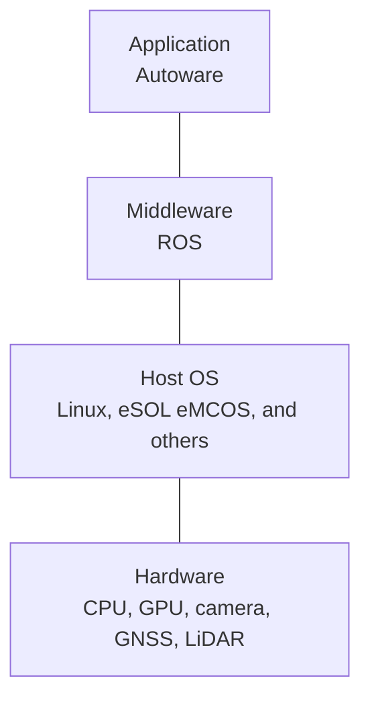

*Figure 1. Software layer structure of Autoware*

Autoware consists of four layers.

- **Application layer:** Autoware implements autonomous driving functions such as localization, object detection, path planning, and vehicle control as ROS nodes.
- **Middleware layer:** ROS provides message passing between nodes, recording and playback, and visualization tools.
- **Host OS layer:** Linux (Ubuntu) is mainly used, and for embedded vehicle use a real-time operating system for many-core processors, such as eSOL's eMCOS, can also be used. A **real-time operating system (RTOS)** is an operating system focused on guaranteeing that tasks finish within fixed time limits.
- **Hardware layer:** CPUs and GPUs for computation, cameras that sense the surroundings, **GNSS (global navigation satellite system)** receivers that measure position from satellite signals, and **LiDAR (light detection and ranging)** sensors that measure distance from the return time of emitted laser light. GPUs process heavy computations in parallel, such as deep-learning-based object detection on camera images.

> **Note:** In this unit, Autoware means Autoware.ai, based on ROS 1 (version 1.14.0 in this course). Development of Autoware.ai has ended, and the Autoware Foundation is developing Autoware redesigned on ROS 2 (Autoware Universe) [3]. The structure that divides functions into nodes and topics and the principles of localization and path planning are common to both versions.

### 1.2 rosbag

In ROS, all the messages of topics can be logged together with time information (timestamps) to a `.bag` file called **rosbag** [4]. The logged messages can be published again and viewed in RViz, the 3D visualization tool of ROS. In robotics it is often difficult to analyze the interactions of several sensors at once, and rosbag enables efficient analysis and debugging of the system. Also, the logged messages can be replayed any number of times, allowing developers to debug their systems without the actual sensors.

The reasons rosbag is especially important for autonomous driving development are as follows.

1. **Reproducibility:** The same situation in real road driving cannot be recreated. Data recorded once is replayed in the same order and at the same intervals any number of times, so after an algorithm is changed, results can be compared on the same input.
2. **Safety and cost:** Development can be done on a desktop computer without moving the vehicle and sensors every time.
3. **Offline processing:** As in Section 3.4, only the data is recorded while driving, and heavy computations such as map building can be done later while replaying the recording.

### 1.3 Functions Provided by Autoware

Autoware provides the following functions.

- **Localization:** Estimates the vehicle's current position and heading on the map.
- **Object detection:** Finds surrounding objects such as vehicles, pedestrians, and traffic lights with cameras and LiDAR.
- **Driving control:** Computes acceleration, braking, and steering to follow the path.
- **3D map generation and sharing:** Builds 3D maps from LiDAR data and shares them among vehicles.

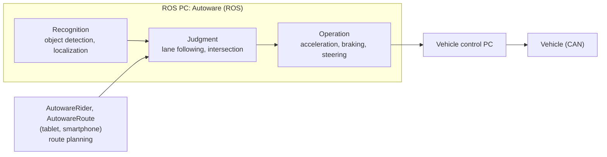

*Figure 2. Recognition, judgment, and operation flow of Autoware and external devices*

Inside the ROS PC running Autoware, processing flows through three stages. The **recognition** stage detects surrounding objects and estimates the vehicle's own position from sensor data. The **judgment** stage decides driving behavior, such as following the lane or stopping at an intersection, based on the recognition results and the map. The **operation** stage turns that behavior into acceleration, braking, and steering commands. The route to the destination is planned in a tablet or smartphone app (AutowareRider, AutowareRoute) and passed to the judgment stage. The operation commands reach the vehicle through the vehicle control PC over the in-vehicle network **CAN (controller area network)**. CAN is covered in Weeks 13-14.

### 1.4 User Interfaces

The user interfaces available in Autoware are as follows.

| Interface | Role |
|:-----|:-----|
| Runtime Manager | A GUI application for controlling Autoware. It starts and stops nodes, sets parameters, and records and plays back data |
| RViz | Visualizes in 3D the various functions of Autoware, such as localization, object detection, path planning, and path following, in an integrated manner |
| AutowareRider | A tablet application for setting and generating a route plan and turning autonomous driving mode on |
| Other interfaces | The 3D map being used can be visualized on in-vehicle displays and devices such as Oculus |

*Table 1. User interfaces of Autoware*

Runtime Manager consists of tabs by function. In each tab the nodes of that function are started and stopped with check boxes, and the buttons at the bottom open recording (ROSBAG), RViz, and rqt. The very bottom of the window shows the usage of each CPU core and the memory usage [5].

| Tab | What it does |
|:-----|:-----|
| Quick Start | Specifies the launch files for map, sensing, localization, detection, mission planning, and motion planning and runs them all at once |
| Setup | Sets the positional relation (TF) between the vehicle reference frame and the sensor frame, and the vehicle model |
| Map | Loads the point cloud map, the vector map, and the TF of the map frame |
| Sensing | Runs sensor drivers and point cloud filters |
| Computing | Runs localization, detection, path planning, and path following nodes |
| Interface | Sets up the connection with the vehicle |
| Database | Works with a map database |
| Simulation | Plays back bag files |
| Status, Topics | Shows the running state and logs, and the topics being published |

*Table 2. Tabs of Runtime Manager*

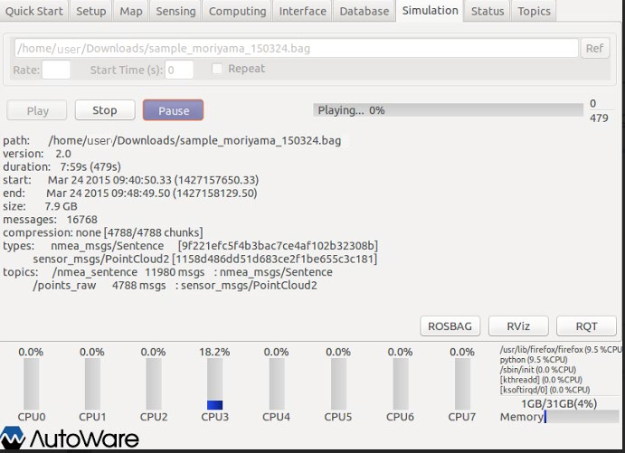

*Figure 3. Simulation tab of Runtime Manager with a sample bag file loaded*

Figure 3 shows Autoware's demo data `sample_moriyama_150324.bag` loaded into the Simulation tab. The middle of the tab prints the information of the bag file, which means the following.

| Field | Value | Meaning |
|:-----|:-----|:-----|
| `version` | 2.0 | Version of the bag file format |
| `duration` | 7:59s (479s) | Recording time. From the start time 09:40:50.33 to the end time 09:48:49.50 is 479.17 seconds |
| `start`, `end` | Mar 24 2015 09:40:50.33 (1427157650.33), etc. | Times of the first and last messages. The number in parentheses is seconds counted from January 1, 1970 (Unix time) |
| `size` | 7.9 GB | File size |
| `messages` | 16768 | Total number of messages |
| `compression` | none [4788/4788 chunks] | Means the data is not compressed |
| `types` | `nmea_msgs/Sentence`, `sensor_msgs/PointCloud2` | Recorded message types and their hash values |
| `topics` | `/nmea_sentence` 11980 msgs, `/points_raw` 4788 msgs | Number of messages and type of each topic |

*Table 3. Fields of the bag file information*

This information alone is enough to compute properties of the sensors.

- The total number of messages is $11980 + 4788 = 16768$, equal to `messages`.
- The publishing rate of the LiDAR point cloud topic `/points_raw` is $4788 / 479.17 \approx 9.99$, that is, about 10 Hz. It means the LiDAR rotates 10 times per second and publishes one point cloud per revolution.
- The sentence topic of the GNSS receiver, `/nmea_sentence`, was published at $11980 / 479.17 \approx 25.0$, that is, about 25 Hz.
- NMEA sentences are short strings of tens of bytes, so most of the file size is point clouds. `rosbag info` shows sizes in units of 1024, so 7.9 GB is $7.9 \times 1024^3 \approx 8.48 \times 10^9$ bytes [6]. The size of one point cloud is therefore $8.48 \times 10^9 / 4788 \approx 1.77 \times 10^6$ bytes, that is, about 1.77 MB. The fact that eight minutes of recording needs 7.9 GB shows that ample storage must be prepared when recording LiDAR data.

> **Definition:** An **NMEA sentence** is a string of the NMEA 0183 standard that GNSS receivers use to output position, time, and satellite information; it begins with `$`, as in `$GPGGA,...`, and separates fields with commas. A **point cloud** is a set of 3D points $(x, y, z)$ measured by a LiDAR, exchanged in ROS as `sensor_msgs/PointCloud2` messages.

### 1.5 Reading Node Graphs

The functions of Autoware are realized by many nodes connected by topics. The figures below show these connections as node graphs. In the figures of this section, **ellipses are nodes** and **gray rectangles are topics**, and arrows show the direction in which a node publishes to or subscribes to a topic. In the rqt_graph of Figure 4, a rectangular frame with the same name as a node marks the namespace enclosing that node.

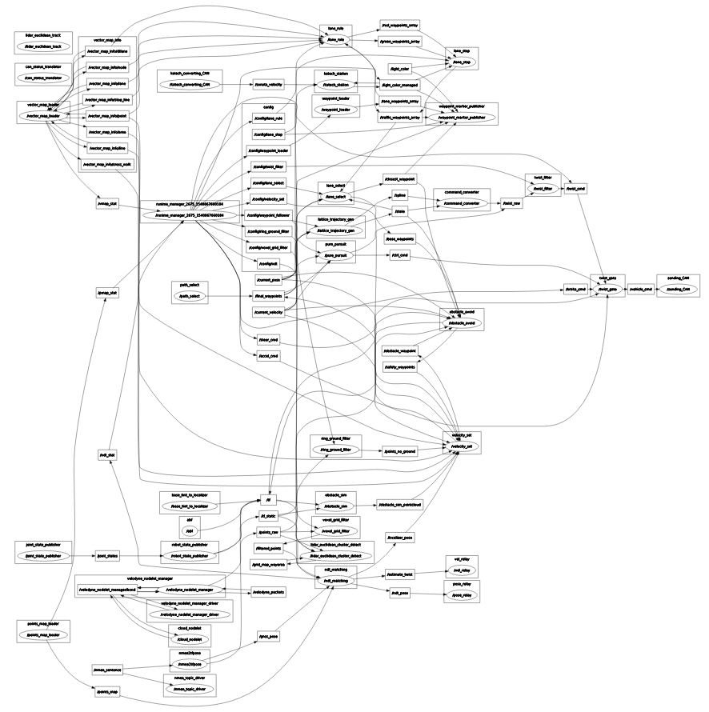

*Figure 4. Node graph of the whole running Autoware*

Figure 4 is a drawing, made with `rqt_graph`, of Autoware actually performing autonomous driving. There are so many nodes and topics that the labels are hard to read one by one, but the overall flow starts from the sensor drivers (Velodyne LiDAR, GNSS) and map loaders at the lower left, passes through localization (`ndt_matching`) and the path planning nodes (`lane_rule`, `lane_select`, `velocity_set`, `pure_pursuit`, and others) in the middle, and ends at the velocity command processing (`twist_filter`, `twist_gate`) and, on the right, the node that receives the vehicle command `vehicle_cmd` and sends CAN commands to the vehicle (`sending_CAN`). Because a node graph shows the data flow of a system at a glance like this, it is used in debugging to find which topic is not being published when the system stops. Sections 1.6-1.8 read the graphs divided by function in turn.

### 1.6 Node Configuration for Perception and Localization

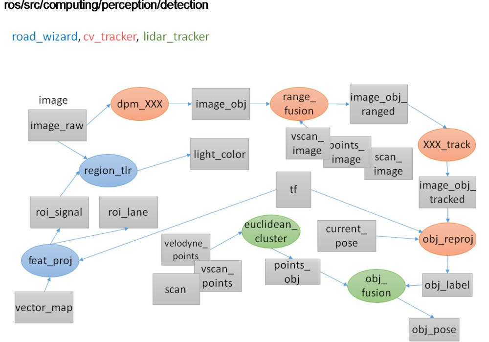

*Figure 5. Node graph of object detection and traffic light recognition*

Figure 5 is the node graph of the detection packages in `ros/src/computing/perception/detection`. There are three flows.

| Flow | Package | Flow of nodes and topics | What it does |
|:-----|:-----|:-----|:-----|
| Camera object detection | `cv_tracker` | `image_raw` → `dpm_XXX` → `image_obj` → `range_fusion` → `image_obj_ranged` → `XXX_track` → `image_obj_tracked` → `obj_reproj` → `obj_label` | Finds vehicles or pedestrians in images (`dpm_XXX`, where XXX is the detection target), attaches distances using `vscan_image`, `points_image`, and `scan_image`, which are LiDAR points projected onto the image (`range_fusion`), tracks the same object across frames (`XXX_track`), and recovers 3D positions using the vehicle position (`current_pose`) and the coordinate transforms (`tf`) (`obj_reproj`) |
| LiDAR object detection | `lidar_tracker` | `velodyne_points`, `vscan_points`, `scan` → `euclidean_cluster` → `points_obj` → `obj_fusion` → `obj_pose` | Groups nearby points of the point cloud into object candidates (`euclidean_cluster`) and combines them with the camera detection result `obj_label` to output object positions (`obj_fusion`) |
| Traffic light recognition | `road_wizard` | `vector_map`, `tf` → `feat_proj` → `roi_signal` → `region_tlr` → `light_color` | Projects the traffic light positions stored in the vector map onto the camera image to define the region of interest (ROI) where a traffic light will appear (`feat_proj`, which also outputs the lane ROI `roi_lane`), and recognizes the signal color in that region of the camera image `image_raw` (`region_tlr`) |

*Table 4. Three flows of the detection node graph*

> **Definition:** A **DPM (deformable part model)** detects objects by representing an object as its overall shape and the arrangement of several parts (for example, a person's head, arms, and legs), allowing the positions of the parts to deform to some extent [7]. **Euclidean clustering** groups points whose mutual distances are below a set threshold into the same cluster, dividing the point cloud on the road into objects such as vehicles and pedestrians.

A camera recognizes the kind of an object well but cannot measure distance directly, while a LiDAR measures distance accurately but has difficulty recognizing the kind of object. So **sensor fusion**, which combines the results of the two sensors, is used. `range_fusion` and `obj_fusion` play this role. The map is used in traffic light recognition for the same reason. Instead of searching the whole image for small traffic lights, knowing in advance from the map where a traffic light will be means only a narrow region needs to be examined, which is fast and produces few false detections.

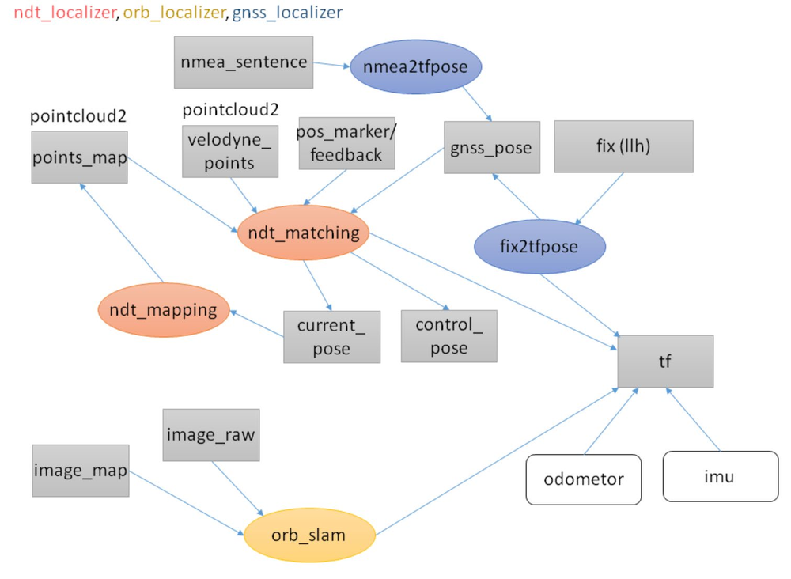

*Figure 6. Node graph of localization*

Figure 6 is the node graph of three localization methods.

| Method | Package | Input | Output |
|:-----|:-----|:-----|:-----|
| NDT matching of LiDAR point clouds against a 3D map | `ndt_localizer` (`ndt_matching`, `ndt_mapping`) | Map point cloud `points_map`, LiDAR point cloud `velodyne_points`, position given with a marker in RViz `pos_marker/feedback`, GNSS position `gnss_pose` | Vehicle position `current_pose`, position for control `control_pose`, coordinate transforms `tf` |
| Camera image based SLAM | `orb_localizer` (`orb_slam`) | Camera image `image_raw`, image map `image_map` | Coordinate transforms `tf` |
| GNSS | `gnss_localizer` (`nmea2tfpose`, `fix2tfpose`) | NMEA sentences `nmea_sentence`, position in latitude, longitude, height (llh) format `fix` | GNSS position `gnss_pose`, coordinate transforms `tf` |

*Table 5. Nodes, inputs, and outputs of each localization method*

`ndt_matching` obtains the vehicle position by fitting the LiDAR point cloud to a prebuilt 3D map (Section 3.6), and it uses the GNSS position or a position specified in RViz as the initial position from which to start fitting. `ndt_mapping`, conversely, builds the map `points_map` by stitching point clouds together when there is no map (Section 3.4). Information from wheel odometry (`odometer`) and the inertial measurement unit (`imu`) also enters through `tf` to help position estimation.

> **Definition:** **Odometry** estimates position by measuring the vehicle's own motion, such as the number of wheel revolutions, and accumulating the distance and direction traveled. It is accurate over short times, but its error keeps accumulating. An **IMU (inertial measurement unit)** is a sensor that measures acceleration and angular velocity.

### 1.7 Node Configuration for Path Planning and Maps

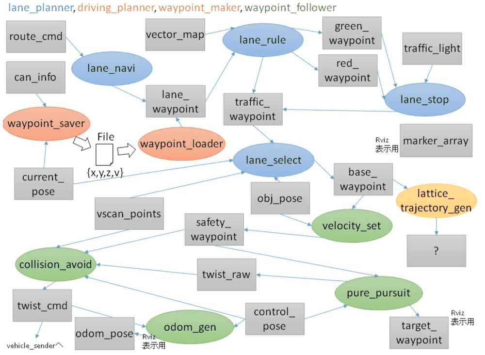

*Figure 7. Node graph of path planning and path following*

Figure 7 is the node graph of the lane planning (`lane_planner`), driving planning (`driving_planner`), waypoint generation (`waypoint_maker`), and waypoint following (`waypoint_follower`) packages. The Japanese "Rviz 表示用" in the figure means "for RViz display," and "vehicle_senderへ" means "to vehicle_sender"; the `odom_pose`, `target_waypoint`, and `marker_array` in the figure are such outputs for RViz display. A **waypoint** is a point on the path the vehicle will pass, holding a position and the target speed at that point. Data flows in the following order.

| Stage | Node | Input | Output and what it does |
|:-----|:-----|:-----|:-----|
| Making the path | `waypoint_saver` | `current_pose`, `can_info` | While a person drives, saves the vehicle's position and speed to a file in the format $\lbrace x, y, z, v\rbrace$ |
| | `waypoint_loader` | Saved file | Publishes the waypoints in the file as `lane_waypoint` |
| | `lane_navi` | `route_cmd`, vector map | Builds the route to the destination on the lanes of the vector map and publishes it as `lane_waypoint` |
| Applying traffic rules | `lane_rule` | `lane_waypoint`, `vector_map` | Adjusts waypoint speeds with map information such as stop lines, producing `green_waypoint` for a green light and `red_waypoint` for a red light |
| | `lane_stop` | `green_waypoint`, `red_waypoint`, `traffic_light` | Chooses one of the two according to the traffic light state and publishes it as `traffic_waypoint` |
| Lane selection | `lane_select` | `traffic_waypoint`, `current_pose`, and others | Chooses the waypoints of the lane matching the current position and publishes them as `base_waypoint` |
| Velocity planning | `velocity_set` | `base_waypoint`, `vscan_points`, `obj_pose` | Modifies speeds so that the vehicle slows down or stops when there is an obstacle ahead, and publishes the result as `safety_waypoint` |
| Path following | `pure_pursuit` | `safety_waypoint`, `control_pose` | Computes the linear and angular velocities that follow a target point on the path and publishes them as `twist_raw`, and outputs the target point being followed as `target_waypoint` for RViz display |
| Final check | `collision_avoid` | `twist_raw`, `safety_waypoint`, `vscan_points`, and others | Publishes, as `twist_cmd`, the velocity command after a last check for collision risk; this command goes to `vehicle_sender` |
| Visualization | `odom_gen` | `twist_cmd`, `control_pose` | Computes the vehicle position from the velocity commands and outputs `odom_pose` for RViz display |

*Table 6. Data flow of the path planning and following nodes*

`lattice_trajectory_gen` is a node that generates lattice-shaped candidate trajectories from `base_waypoint`; its output left as "?" means it is a function at the development stage whose output topic was not yet decided. The `pure_pursuit` algorithm picks a point on the path a certain distance ahead of the vehicle as the target and steers to follow the arc passing through that point [8]; it is covered in detail in Week 3.

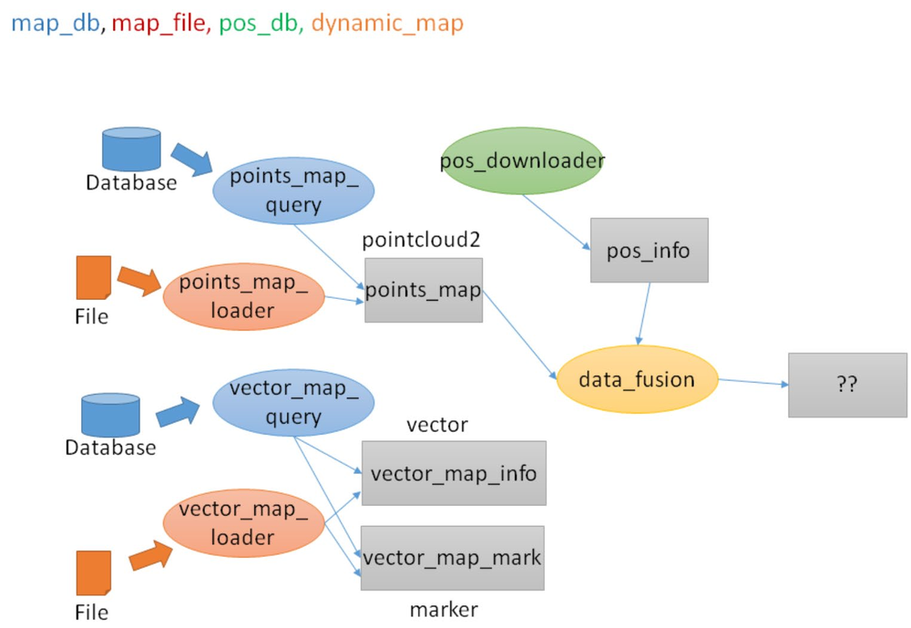

*Figure 8. Node graph of map management*

Figure 8 is the node graph of the packages that load maps (`map_db`, `map_file`) and the packages that share other vehicles' positions (`pos_db`, `dynamic_map`). The point cloud map is published on the `points_map` (PointCloud2) topic by `points_map_query`, which reads from a database, or by `points_map_loader`, which reads from files. The vector map is likewise read by `vector_map_query` or `vector_map_loader` and published as the map element information `vector_map_info` and the RViz display markers `vector_map_mark`. `pos_downloader` downloads other vehicles' positions `pos_info` from a server, and `data_fusion` combines them with the map to build a **dynamic map** that reflects the surrounding situation. The output "??" means a function not yet decided.

### 1.8 Node Configuration for Sensor Drivers and the Vehicle Interface

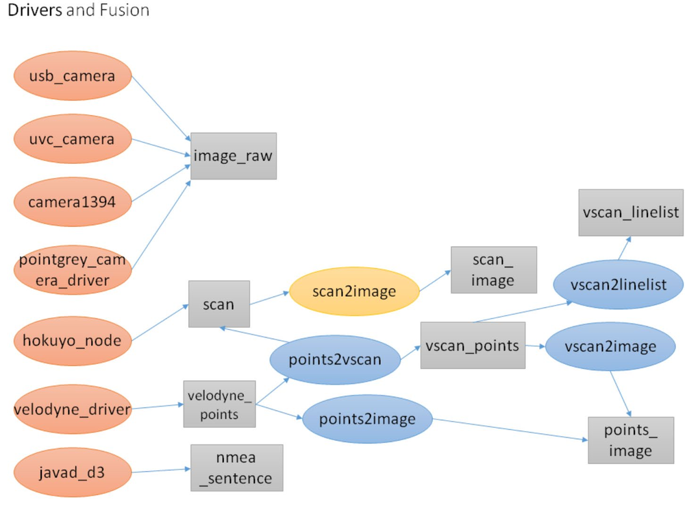

*Figure 9. Node graph of sensor drivers and sensor data conversion*

The orange ellipses on the left of Figure 9 are sensor driver nodes, and the blue and yellow ellipses are nodes that convert sensor data into other forms.

| Node | Sensor or input | Output topic |
|:-----|:-----|:-----|
| `usb_camera`, `uvc_camera`, `camera1394`, `pointgrey_camera_driver` | USB, UVC, and IEEE 1394 cameras and Point Grey cameras | `image_raw` |
| `hokuyo_node` | Hokuyo 2D laser scanner | `scan` |
| `velodyne_driver` | Velodyne 3D LiDAR | `velodyne_points` |
| `javad_d3` | JAVAD GNSS receiver | `nmea_sentence` |
| `scan2image` | `scan` | `scan_image` (2D scan projected onto the image) |
| `points2vscan` | `velodyne_points` | `vscan_points`, `scan` (virtual scan) |
| `vscan2image`, `vscan2linelist` | `vscan_points` | `points_image`, `vscan_linelist` |
| `points2image` | `velodyne_points` | `points_image` (point cloud projected onto the image) |

*Table 7. Sensor driver and data conversion nodes*

Sensors of the same kind publish on the same topic name (`image_raw`) with the same message type even if their drivers differ, so the detection nodes downstream need not change when the camera is replaced. This is the benefit of standard messages seen in Week 1. A **virtual scan (vscan)** reduces a 3D point cloud to the form of a 2D scan that keeps, for each horizontal angle, only the distance to the nearest obstacle; it keeps the information needed for obstacle decisions while greatly reducing computation. Projecting a point cloud onto an image requires **calibration**, which determines in advance the relative position between the camera and the LiDAR and the intrinsic parameters of the camera.

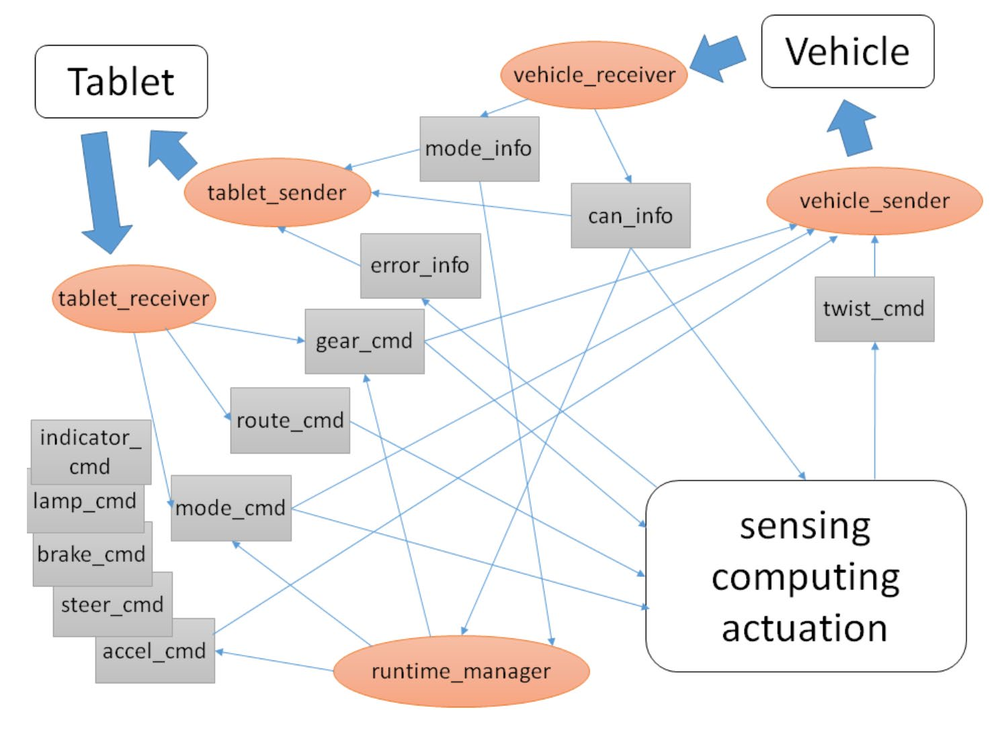

*Figure 10. Node graph of the interface between the tablet, the vehicle, and Autoware*

Figure 10 is the graph of the nodes through which Autoware exchanges information with the tablet and the vehicle. The thick blue arrows are communication with devices outside Autoware.

- **Commands from the tablet:** `tablet_receiver` receives the tablet's input and publishes it as the gear command `gear_cmd`, the route command `route_cmd`, and the driving mode command `mode_cmd`.
- **Commands from Runtime Manager:** `runtime_manager` publishes the commands for manual operation `accel_cmd`, `brake_cmd`, `steer_cmd`, `lamp_cmd`, and `indicator_cmd`, as well as `gear_cmd` and `mode_cmd`.
- **Information from the vehicle:** `vehicle_receiver` receives the vehicle's state and publishes it as the driving mode `mode_info` and the CAN information `can_info` (speed, steering angle, and so on), which are used by the sensing, computing, and actuation nodes, by `runtime_manager`, and by `tablet_sender`.
- **Commands to the vehicle:** `vehicle_sender` collects the velocity command `twist_cmd` made by the sensing, computing, and actuation nodes and the various other commands, and sends them to the vehicle.
- **Information to the tablet:** `tablet_sender` sends `mode_info`, `can_info`, and the error information `error_info` to the tablet.

---

<br>

## 2. Developing ROS Nodes for Autoware

### 2.1 Development Procedure

A ROS node usable in Autoware is developed in the following four steps.

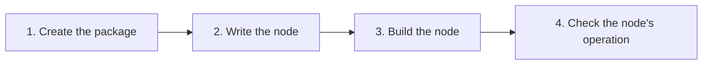

*Figure 11. Development procedure of a ROS node for Autoware*

The procedure in this section follows the catkin workspace and `ros/src` directory structure used in early versions of Autoware.ai. Autoware.ai 1.14.0, used in this course, builds the same packages with colcon, and that procedure is covered in Weeks 5 and 14.

### 2.2 Creating a Package

In ROS, a package must meet the following conditions.

- The file `package.xml`, which contains the package information, is in the directory.
- The configuration file `CMakeLists.txt` of the build system CMake (<http://www.cmake.org/>) is in the directory.
- One directory holds only one package.

In Autoware, the following conditions must be met in addition to the above.

- The package directory is created directly under the `packages` directory below a directory that indicates the functional category, such as `ros/src/sensing/fusion`.
- A directory with the same name as the node is created, and the node's source code is placed inside it.
- Message files are placed in the `msg` directory.
- If there are libraries shared by several nodes, their source code is placed in directories such as `lib` or `include`.

```text
ros/src/<category>/.../packages/<package_name>/
    package.xml
    CMakeLists.txt
    nodes/
        <node_name_1>/
            <node_name_1>.cpp
        <node_name_2>/
            <node_name_2>.cpp
        ...
    include/
        (library header files)
    lib/
        (library source files)

ros/src/msgs/<message_package>/
    msg/
        <message_name_1>.msg
```

*Figure 12. Directory structure of an Autoware package*

A package is created with the `catkin_create_pkg` command. Its form is `catkin_create_pkg <package name> <dependency 1> <dependency 2> ...`, and the dependencies listed are packages such as `roscpp`, the C++ client library, `std_msgs`, which holds the basic message types, and `autoware_msgs`, which holds Autoware's message definitions. In Autoware, move to the `packages` directory and run the following.

```bash
cd ros/src/<category>/packages/
catkin_create_pkg katech_test_pkg roscpp std_msgs autoware_msgs
ls -F katech_test_pkg/
```

```text
Successfully created files in /home/<user>/Autoware/ros/src/<category>/packages/katech_test_pkg. Please adjust the values in package.xml.
CMakeLists.txt  include/  package.xml  src/
```

`catkin_create_pkg` creates the package directory together with `CMakeLists.txt`, `package.xml`, `include/` for header files, and `src/` for source files. Next, the two configuration files are edited to suit the package.

- **`package.xml`:** The **manifest**, which records project management information such as the package name, version, description, maintainer, and license, together with the dependencies [9].
- **`CMakeLists.txt`:** The CMake build script that states what to build and in what order [10].

The core content of the `package.xml` created by the command above is as follows (with the explanatory comments removed).

```xml
<?xml version="1.0"?>
<package format="2">
  <name>katech_test_pkg</name>
  <version>0.0.0</version>
  <description>The katech_test_pkg package</description>
  <maintainer email="user@todo.todo">user</maintainer>
  <license>TODO</license>
  <buildtool_depend>catkin</buildtool_depend>
  <depend>roscpp</depend>
  <depend>std_msgs</depend>
  <depend>autoware_msgs</depend>
</package>
```

`<buildtool_depend>` means catkin is used as the build tool, and `<depend>` lists a package needed both at build time and at run time. `catkin_create_pkg` writes these separately as build (`build_depend`), export (`build_export_depend`), and execution (`exec_depend`) dependencies, but the meaning is the same. For a package to be published, `description`, `maintainer`, and `license` are changed to real values.

### 2.3 Writing a Node

The node is written in C++ in this example, and it can also be written in Python. The steps are as follows.

1. In Autoware's structure the sources go under `nodes/`, so delete the unnecessary folders (`include`, `src`, and so on) created by `catkin_create_pkg`.
2. Create the `nodes/test_node/` directory and create the node file with the command `gedit test_node.cpp`.
3. Write the source code in the created node file.

The following node subscribes to the string topic `mysubstr` and publishes the length of the received string on the integer topic `mypubval`.

```cpp
#include "ros/ros.h"
#include "std_msgs/String.h"
#include "std_msgs/Int32.h"

static ros::Publisher pub;

static void sub_callback(const std_msgs::String& smsg)
{
    std_msgs::Int32 pmsg;

    pmsg.data = smsg.data.size();

    pub.publish(pmsg);
}

int main(int argc, char *argv[])
{
    ros::init(argc, argv, "mynode");
    ros::NodeHandle n;

    pub = n.advertise<std_msgs::Int32>("mypubval", 10);

    ros::Subscriber sub = n.subscribe("mysubstr", 10, sub_callback);

    ros::spin();

    return 0;
}
```

Line by line, the code works as follows [11].

- **`#include "ros/ros.h"`:** Includes the header that declares the basic features of roscpp, such as `ros::init`, `ros::NodeHandle`, and `ros::spin`.
- **`#include "std_msgs/String.h"`, `"std_msgs/Int32.h"`:** Headers that make the message types `std_msgs/String` (a single string field `data`) and `std_msgs/Int32` (a single 32-bit integer field `data`) usable as C++ structures. They are generated automatically from the `.msg` files at build time.
- **`static ros::Publisher pub;`:** Keeps the publisher object as a global variable, because it is created in `main` and used in the callback function. `static` makes this name visible only inside this file.
- **`static void sub_callback(const std_msgs::String& smsg)`:** The **callback function** that roscpp calls each time a message arrives on the `mysubstr` topic. It takes the received message by constant reference so that the message is not copied.
- **`std_msgs::Int32 pmsg;`:** Creates the message to publish.
- **`pmsg.data = smsg.data.size();`:** Puts the length of the received string (`std::string`) into the integer field. `size()` returns the number of bytes, not the number of characters.
- **`pub.publish(pmsg);`:** Publishes the message on the `mypubval` topic.
- **`ros::init(argc, argv, "mynode");`:** Initializes ROS and sets the name of this node to `mynode`. It passes `argc` and `argv` so that names and topics can be changed with command-line arguments.
- **`ros::NodeHandle n;`:** Creates a node handle. When the first node handle is created, the node registers with the master, and publishers and subscribers are created through this handle afterward.
- **`n.advertise<std_msgs::Int32>("mypubval", 10)`:** Tells the master that the node will publish `std_msgs/Int32` messages on the `mypubval` topic and returns a publisher. 10 is the size of the queue that holds messages not yet sent.
- **`n.subscribe("mysubstr", 10, sub_callback)`:** Subscribes to the `mysubstr` topic and registers `sub_callback` to be called when a message arrives. 10 is the size of the queue that holds messages not yet processed; when the queue is full, the oldest messages are discarded first. The subscription ends when the returned `sub` object is destroyed, so it is kept in a variable.
- **`ros::spin();`:** Waits until the node shuts down, calling the callback function for each arriving message. Without this call, the callback function is never executed.

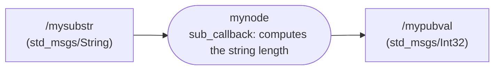

*Figure 13. Topics subscribed to and published by the example node mynode*

> **[Computer Programming]** A callback function is a function handed over to other code so that the other code calls it on one's behalf when a certain event occurs. The `sub_callback` passed to `n.subscribe` is stored as a function pointer and called when `ros::spin` detects the arrival of a message. Nowhere does the developer call `sub_callback` directly.

### 2.4 Building a Node

Before building, edit `CMakeLists.txt`.

1. Autoware specifies C++ compile options, so add `set(CMAKE_CXX_FLAGS "-std=c++0x -O2 -Wall ${CMAKE_CXX_FLAGS}")`.
2. To indicate that the source code is in `nodes/test_node/test_node.cpp`, add `add_executable(test_node nodes/test_node/test_node.cpp)`.
3. To use the common ROS libraries, add `target_link_libraries(test_node ${catkin_LIBRARIES})`.

The whole `CMakeLists.txt` reflecting these changes is as follows.

```cmake
cmake_minimum_required(VERSION 2.8.3)
project(katech_test_pkg)

set(CMAKE_CXX_FLAGS "-std=c++0x -O2 -Wall ${CMAKE_CXX_FLAGS}")

find_package(catkin REQUIRED COMPONENTS
  roscpp
  std_msgs
  autoware_msgs
)

catkin_package()

include_directories(
  ${catkin_INCLUDE_DIRS}
)

add_executable(test_node nodes/test_node/test_node.cpp)
target_link_libraries(test_node
  ${catkin_LIBRARIES}
)
```

| Command | Meaning |
|:-----|:-----|
| `cmake_minimum_required`, `project` | Sets the minimum required CMake version and the project (package) name |
| `set(CMAKE_CXX_FLAGS ...)` | Sets the C++ compile options. `-std=c++0x` means to use the C++11 standard (the pre-standardization name of C++11), `-O2` is the optimization level, and `-Wall` means to print most warnings |
| `find_package(catkin REQUIRED COMPONENTS ...)` | Finds catkin and the dependencies, collecting their header paths into `catkin_INCLUDE_DIRS` and their libraries into `catkin_LIBRARIES` |
| `catkin_package()` | Registers this package as a catkin package so that other packages can use it |
| `include_directories(...)` | Adds paths in which to look for headers at compile time |
| `add_executable(test_node source)` | Builds the executable `test_node` from the source file |
| `target_link_libraries(test_node ...)` | Links the ROS libraries to the executable `test_node`. The first argument must match the target name of `add_executable` |

*Table 8. Main commands in CMakeLists.txt*

The executable name (`test_node`) and the node name (`mynode`, given to `ros::init`) can differ. `rosrun` finds the program by its executable name, and the running program registers with the master under the node name `mynode`.

> **Note:** ROS Melodic takes C++14 as its reference language [12]. The node above builds with `-std=c++0x` (C++11), but including headers from Melodic libraries that use C++14 features can cause errors, so `-std=c++14` is the safer choice on Melodic.

After editing, move to Autoware's `ros` directory and run the build script.

```bash
cd ~/Autoware/ros
./catkin_make_release                        # build all of Autoware in Release mode
catkin_make -DCMAKE_BUILD_TYPE=Release       # rebuild only the changed parts to save time
```

Building with `catkin_make_release` every time takes a long time, so after changing a node, `catkin_make -DCMAKE_BUILD_TYPE=Release` can build only the changed parts and save time. `CMAKE_BUILD_TYPE=Release` means to build with optimization enabled instead of debugging information. Autonomous driving nodes process large data such as point clouds in real time, so an unoptimized build may be too slow.

### 2.5 Checking the Node's Operation

The built node is checked as follows. Run each command in a different terminal; the master (`roscore`) must already be running.

```bash
source ~/Autoware/ros/devel/setup.bash                      # load the environment of the built workspace
rosrun katech_test_pkg test_node                            # terminal 1: run the node
rostopic echo /mypubval                                     # terminal 2: print the published integers
rostopic pub -1 /mysubstr std_msgs/String "data: 'hello'"   # terminal 3: publish a string message once
```

When `"hello"` is published in terminal 3, the node's callback function is called and publishes the length 5, and terminal 2 prints the following.

```text
data: 5
---
```

`size()` counts bytes, so sending the Korean string `"안녕"`, which uses 3 bytes per character in UTF-8, prints 6 rather than 2. Running `rostopic pub` without the `-1` option keeps its node alive after the message is sent, and opening `rqt_graph` meanwhile shows the connection from a `/rostopic_...` node through `/mysubstr` to `/mynode`, and then through `/mypubval` to the `rostopic echo` node.

---

<br>

## 3. Technical Components of Autoware

### 3.1 Node Configuration for Operating a Real Car

Autonomous driving with a real vehicle requires the following nodes and data.

| Category | Component | What it does |
|:-----|:-----|:-----|
| Data | TF | The positional relations between the map frame and the vehicle and sensor frames. Where the LiDAR is mounted on the vehicle is also recorded here |
| | Point cloud map | The 3D map (PCD file) used for localization |
| | Waypoints | A file holding the path to follow |
| Sensing | LiDAR | The LiDAR driver publishes the point cloud `points_raw` |
| Localization | `voxel_grid_filter` | Reduces the number of points in the point cloud to reduce the computation of localization |
| | `ndt_matching` | Fits the point cloud to the map to obtain the vehicle position |
| Connector | `vel_pose_connect` | Connects the localization result to the vehicle's current position `current_pose` and current velocity `current_velocity` topics used by the path planning nodes |
| Mission planning | `waypoint_loader` | Reads the waypoint file and publishes it |
| | `lane_rule`, `lane_stop`, `lane_select` | Apply traffic rules and signals and choose the waypoints of the lane to follow |
| | `obstacle_avoid` | Needed as a link that passes the waypoints on to the next node even when the avoidance function is not used |
| | `velocity_set` | Sets the speeds of the waypoints considering obstacles and stop lines |
| Motion planning | `pure_pursuit` | Computes the velocity command `twist_raw` that follows the waypoints |
| | `twist_filter` | Smooths the velocity command, applies limits such as lateral acceleration, and publishes it as `twist_cmd` |
| Actuation | Vehicle interface | Turns `twist_cmd` into the vehicle's acceleration, braking, and steering commands. It differs for each car type |

*Table 9. Nodes and data essential for operating a real car*

To add functions to this, the following are also needed.

- **Stopping in front of obstacles:** `ray_ground_filter` (or `ring_ground_filter`), which removes the ground from the point cloud, is needed. Without removing the ground points, the road itself is detected as an obstacle. `ray_ground_filter` distinguishes ground points by examining the height change and slope between neighboring points along each direction (ray) extending outward from the sensor, and `velocity_set` uses the non-ground points `points_no_ground` for obstacle decisions.
- **Real roads and stations (traffic lights):** A vector map holding the positions of lanes, stop lines, and traffic lights is needed (Section 3.5).

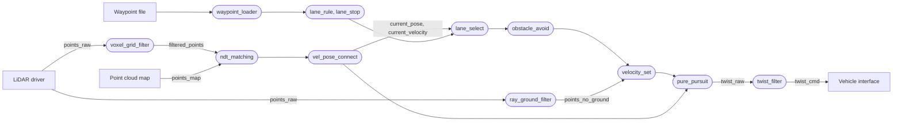

*Figure 14. Connections of the nodes needed for autonomous driving of a real car*

In Figure 14, rounded boxes are nodes, rectangles are data or devices, and the names on arrows are topics. The top row is the localization flow, the middle is mission and motion planning, and the bottom is the obstacle-stop flow; all flows finally converge into a single velocity command `twist_cmd`.

### 3.2 Data Recording and Playback

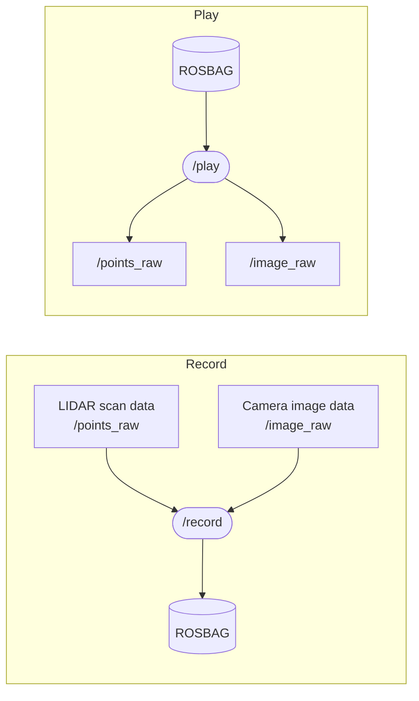

*Figure 15. Structure that records topics to a bag file and plays them back as topics*

The recording node subscribes to the data being published on topics and saves it to a bag file, and the playback node publishes the data recorded in the bag file again on the original topics. The replayed data is obtained by subscribing to those topics exactly as when a real sensor publishes them, so localization and mapping nodes need not distinguish whether the data comes from a real sensor or from a bag file.

The procedure for recording data with Runtime Manager is as follows.

1. **Launch Autoware:** In early versions of Autoware.ai, move with `cd ~/Autoware/ros/` and run `./run` to open Runtime Manager. In Autoware.ai 1.14.0, built with colcon, load the workspace's `install/setup.bash` and then open it with `roslaunch runtime_manager runtime_manager.launch` [13].
2. **Launch nodes:** Check the boxes of the nodes that publish the topics to be recorded. For example, selecting the LiDAR (Velodyne HDL-32e) in the Sensing tab publishes `/points_raw`.
3. **ROSBAG recording:** (A) Click the [ROSBAG] button to display the dialog. (B) Click the [Ref] button and specify the filename of the bag to be saved. (C) Click the [Refresh] button to update the topic list. (D) Check the boxes of the topics to be recorded. (E) Click the [Start] button to start recording. (F) Click the [Stop] button to end the recording.

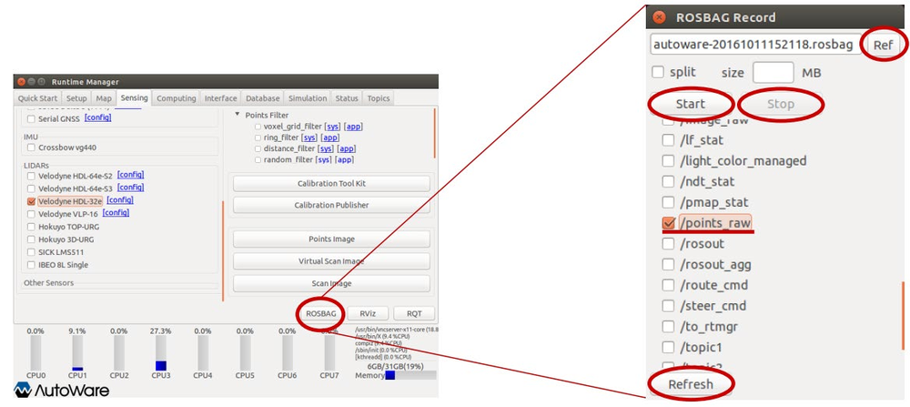

*Figure 16. Turning on the LiDAR in the Sensing tab and choosing the topics to record in the ROSBAG Record dialog*

Checking [split] in the dialog and entering a size (MB) saves the recording split into files of that size. As seen in Section 1.4, point cloud data grows to several GB in a few minutes, so splitting the files makes them easier to handle.

A recorded bag file is played back in the Simulation tab (Figure 3).

1. (A) Open the [Simulation] tab. (B) Click the [Ref] button and choose the bag file to play.
2. (C) Click the [Play] button to play back the contents of the bag file. At this point the ROS parameter `/use_sim_time` is set to `true` automatically.
3. (D) Use the [Pause] button to pause or resume the playback.
4. (E) Click the [Stop] button to stop the playback. At this point `/use_sim_time` is set to `false` automatically.

> **Key Point:** ROS nodes normally use the computer's current time as ROS time. But if data recorded in 2015 is played back now, the messages' timestamps and the current time differ by years, and nodes that compare times (coordinate transforms `tf`, localization) regard the data as stale and discard it. With `/use_sim_time` set to `true`, nodes use as ROS time the time of the recording, published by the player on the `/clock` topic, instead of the computer's time [14]. So it must be `true` during playback and `false` when real sensors are used.

The same work can be done with the command-line tools [4].

```bash
rosbag record -O drive.bag /points_raw /image_raw   # record the two topics to drive.bag (stop with Ctrl+C)
rosbag info drive.bag                               # print the recording time, message counts, and topic list
rosparam set use_sim_time true                      # make nodes use the time from /clock
rosbag play --clock drive.bag                       # play back while publishing the recording time on /clock
```

### 3.3 Principle of NDT Scan Matching

Both building a 3D map (Section 3.4) and localization (Section 3.6) rest on **scan matching**, or **registration**, which aligns two point clouds so that they overlap. Finding the rotation and translation that best overlap two point clouds gives the relative position and orientation between the sensors that measured them. Autoware uses the **NDT (normal distributions transform)** as its registration method [15], [16].

NDT divides the reference point cloud (the map) into grid cells of equal size and summarizes the points in each cell as one **normal distribution**. The mean $\mathbf{q}$ and covariance $\Sigma$ of the points $\mathbf{x}_1, \ldots, \mathbf{x}_n$ in a cell are as follows (dividing by $n$, following the definition of Biber and Strasser).

$$\mathbf{q} = \frac{1}{n}\sum_{i=1}^{n}\mathbf{x}_i, \qquad \Sigma = \frac{1}{n}\sum_{i=1}^{n}(\mathbf{x}_i-\mathbf{q})(\mathbf{x}_i-\mathbf{q})^{\top}$$

How well a newly measured point $\mathbf{x}'$ fits the distribution of this cell is measured by the following value. The closer the point is to the mean, the closer the value is to 1, and for the same distance from the mean, the value decreases less when the point deviates in a direction in which the points are widely spread (a direction of large variance).

$$p(\mathbf{x}') = \exp\left(-\frac{(\mathbf{x}'-\mathbf{q})^{\top}\Sigma^{-1}(\mathbf{x}'-\mathbf{q})}{2}\right)$$

Let $T(\mathbf{p}, \mathbf{x}_k)$ be each point $\mathbf{x}_k$ of the new point cloud moved by a candidate pose $\mathbf{p}$ (translations in $x, y$ and a rotation angle in 2D; translations and rotations about three axes in 3D), and let $\mathbf{q}_k, \Sigma_k$ be the mean and covariance of the cell into which that point falls; then the score of pose $\mathbf{p}$ is the sum of the values of all points.

$$\text{score}(\mathbf{p}) = \sum_{k} \exp\left(-\frac{(T(\mathbf{p},\mathbf{x}_k)-\mathbf{q}_k)^{\top}\Sigma_k^{-1}(T(\mathbf{p},\mathbf{x}_k)-\mathbf{q}_k)}{2}\right)$$

NDT finds the pose $\mathbf{p}$ that maximizes this score by optimization such as Newton's method. Instead of finding a partner for each individual point, it uses distributions precomputed per cell, so the computation is fast, and because the score changes smoothly with the pose, derivative-based optimization is possible.

**Example.** In 2D, let a cell contain the map points $(0, 0), (2, 0), (0, 2), (2, 2)$.

1. The mean is $\mathbf{q} = \frac{1}{4}(0+2+0+2,\ 0+0+2+2) = (1, 1)$.
2. The deviations from the mean are $(-1, -1), (1, -1), (-1, 1), (1, 1)$. The outer products $\mathbf{d}\mathbf{d}^{\top}$ of the deviations $\mathbf{d}$ are, in order, $\begin{pmatrix}1&1\\1&1\end{pmatrix}, \begin{pmatrix}1&-1\\-1&1\end{pmatrix}, \begin{pmatrix}1&-1\\-1&1\end{pmatrix}, \begin{pmatrix}1&1\\1&1\end{pmatrix}$, and their sum is $\begin{pmatrix}4&0\\0&4\end{pmatrix}$, so $\Sigma = \frac{1}{4}\begin{pmatrix}4&0\\0&4\end{pmatrix} = I$ (the identity matrix).
3. Since $\Sigma^{-1} = I$, $p(\mathbf{x}') = \exp(-\lVert\mathbf{x}'-\mathbf{q}\rVert^2/2)$. The point $(1, 1)$ gives $\exp(0) = 1$, the point $(2, 1)$ gives $\exp(-1/2) \approx 0.6065$, and the point $(3, 1)$ gives $\exp(-2) \approx 0.1353$. The value drops quickly with distance from the mean.
4. Now let a new point cloud consist of two points at $(-0.5, 0)$ and $(0.5, 0)$ in sensor coordinates, and let it be fitted by a translation $\mathbf{t}$ only, without rotation. For simplicity, assume that every moved point is evaluated with the distribution of this cell regardless of the cell boundary.

| Translation $\mathbf{t}$ | The two moved points | Values of the two points | Score |
|:-----|:-----|:-----|:-----|
| $(1, 1)$ | $(0.5, 1), (1.5, 1)$ | $0.8825, 0.8825$ | $1.7650$ |
| $(2, 1)$ | $(1.5, 1), (2.5, 1)$ | $0.8825, 0.3247$ | $1.2071$ |
| $(0, 1)$ | $(-0.5, 1), (0.5, 1)$ | $0.3247, 0.8825$ | $1.2071$ |
| $(1, 0)$ | $(0.5, 0), (1.5, 0)$ | $0.5353, 0.5353$ | $1.0705$ |

*Table 10. Scores for each translation in the NDT example*

For example, with $\mathbf{t} = (1, 1)$ the two points are each 0.5 away from the mean $(1, 1)$, so each value is $\exp(-0.25/2) = \exp(-0.125) \approx 0.8825$, and the score is $2 \times 0.8825 = 1.7650$. Among the four candidates, $\mathbf{t} = (1, 1)$ has the highest score, so the sensor that measured the new point cloud is judged to be at a position shifted by $(1, 1)$ relative to the map. Instead of comparing a few candidates like this, real NDT computes the gradient and curvature of the score and repeatedly moves the pose toward the highest point.

> **[Probability and Statistics]** The probability density of a multivariate normal distribution is proportional to $\exp\left(-\frac{1}{2}(\mathbf{x}-\boldsymbol{\mu})^{\top}\Sigma^{-1}(\mathbf{x}-\boldsymbol{\mu})\right)$. The quantity $(\mathbf{x}-\boldsymbol{\mu})^{\top}\Sigma^{-1}(\mathbf{x}-\boldsymbol{\mu})$ in the exponent is the square of the **Mahalanobis distance**, which counts differences along directions in which the distribution is widely spread as small and differences along narrow directions as large. The NDT score is the sum of this density, without its normalizing constant, over all points.

> **Caution:** If a cell contains too few points or its points lie on a straight line, the covariance matrix has no inverse or becomes very unstable. So NDT implementations skip cells with fewer than a certain number of points (three in Biber and Strasser) or correct the covariance by enlarging eigenvalues that are too small [15]. The cell size (resolution) is an important parameter that determines both accuracy and computation.

### 3.4 Building a 3D Map

The principle of building a 3D map with a LiDAR is as follows. The map accumulated from the scans so far and the newly arrived scan are fitted with NDT to compute the relative position of the LiDAR between the two scans, and that position is used to add the new scan to the 3D map. Repeating this for every scan gradually extends the map.

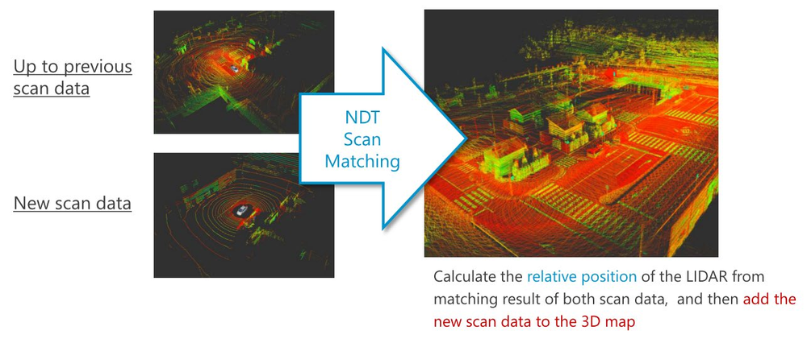

*Figure 17. Fitting the scan data so far and the new scan data with NDT and adding it to the 3D map*

This process is like joining several photographs into one panoramic photograph by matching their overlapping parts. Just as one finds the overlapping parts of the photographs, computes how far they are offset, and joins them, one fits the overlapping parts of the scans, computes how far the LiDAR moved, and joins the scans.

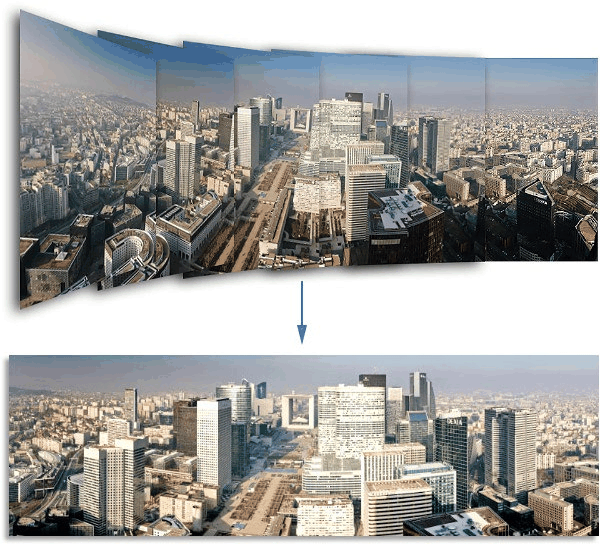

*Figure 18. A panoramic photograph made by matching several photographs at their overlapping parts*

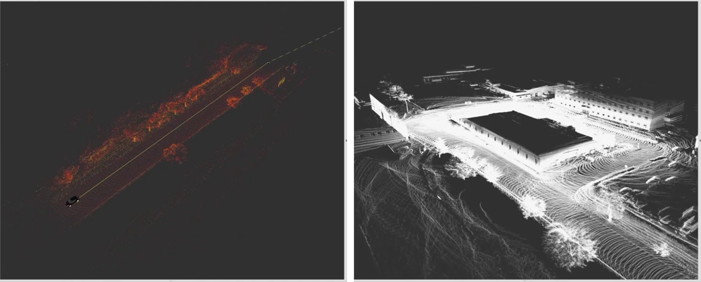

*Figure 19. Mapping view in which the point cloud accumulates as the vehicle drives, and the completed point cloud map*

The left side of Figure 19 is the RViz view during mapping, in which the surrounding point cloud accumulates in turn as the vehicle moves along the road. The right side is the completed map viewed obliquely from above in RViz, in which buildings, road edges, and trees appear as points.

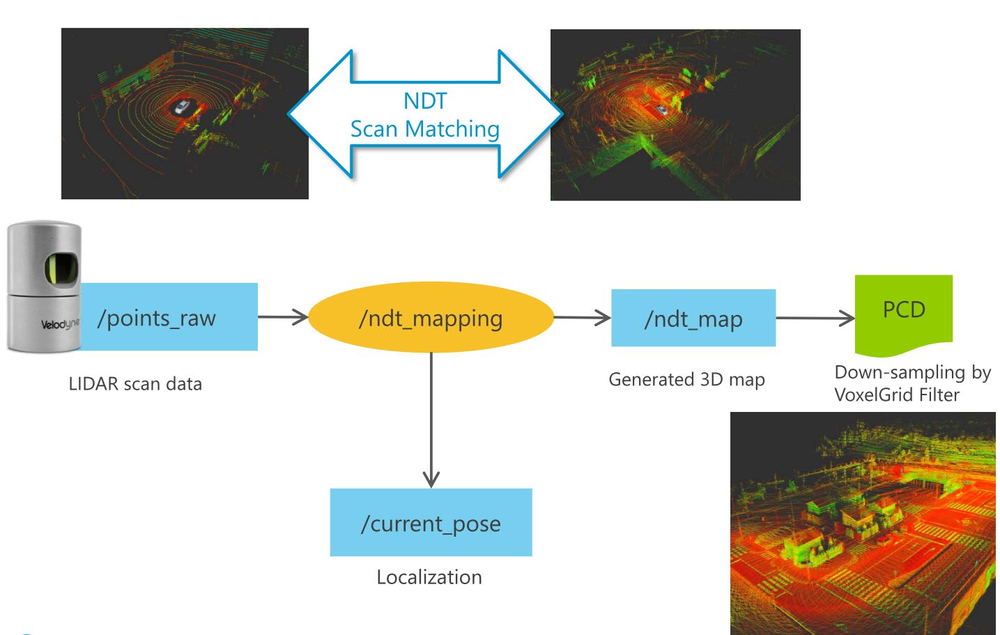

*Figure 20. Inputs and outputs of the NDT mapping node*

Autoware's mapping node `ndt_mapping` receives the Velodyne LiDAR scan data `/points_raw` and publishes the map built so far, `/ndt_map`. The current position computed while building the map is published as `/current_pose`, so mapping and localization happen at the same time. The completed map is reduced with a **VoxelGrid filter** and saved as a **PCD (point cloud data)** file.

> **Definition:** A **voxel grid filter** divides space into cubic cells (voxels) whose side has a set length (leaf size, for example 0.2 m) and replaces the points in each cell with their single centroid. It greatly reduces the number of points while keeping the shape of their distribution. **PCD** is the point cloud file format defined by the Point Cloud Library (PCL).

The recommended mapping procedure is as follows.

1. **Record first, then map:** Rather than building the map directly while driving, it is recommended to first record the LiDAR data (`/points_raw`) with ROSBAG and then build the map while replaying it. Mapping is computationally heavy and may not keep up in real time while driving, and with a recording the map can be rebuilt any number of times with different settings.
2. **Use approximate_ndt_mapping:** As the map grows, the map that `ndt_mapping` must fit against grows, increasing computation time and memory. `approximate_ndt_mapping` builds the map as **submaps** of a fixed size and saves them to files in turn, which suits large maps of wide areas.

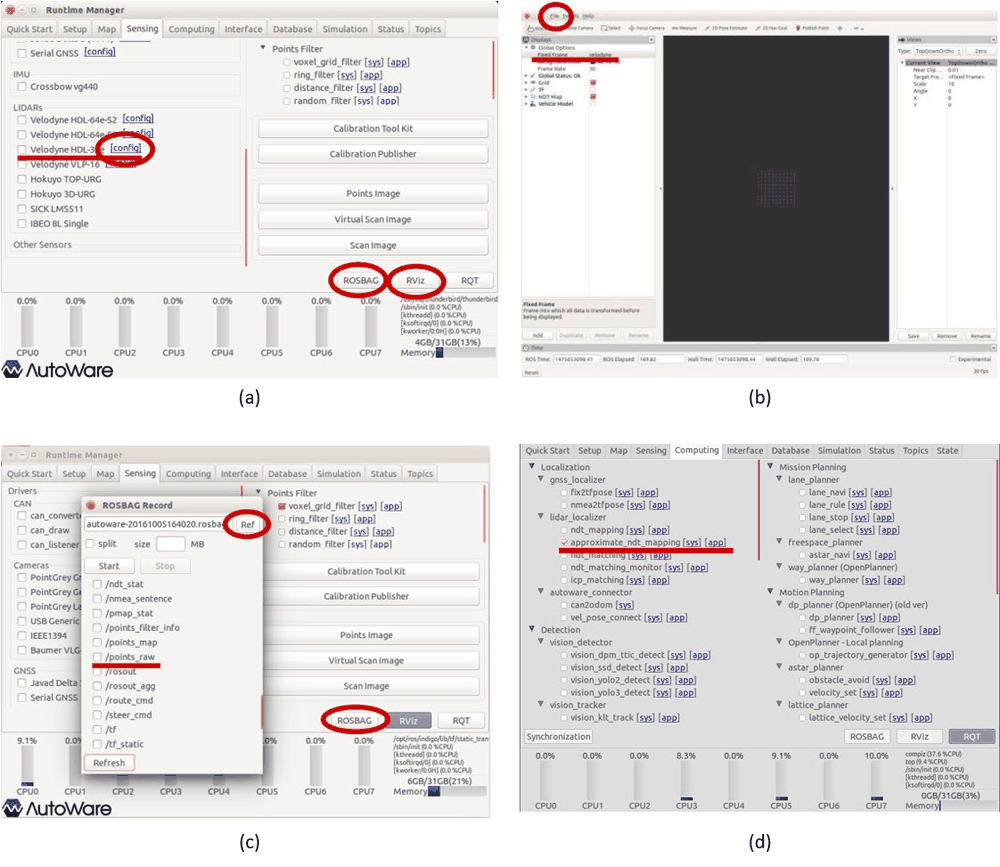

*Figure 21. Screens for LiDAR configuration, launching RViz, data recording, and selecting approximate_ndt_mapping*

In Figure 21, (a) is the screen that opens the LiDAR (Velodyne HDL-32e) settings ([config]) in the Sensing tab and clicks the [ROSBAG] and [RViz] buttons, (b) is the screen with RViz open, (c) is the screen that selects and records `/points_raw` in the ROSBAG Record dialog, and (d) is the screen that selects `approximate_ndt_mapping` under `lidar_localizer` in the Localization section of the Computing tab. The node connections at this point are as follows.

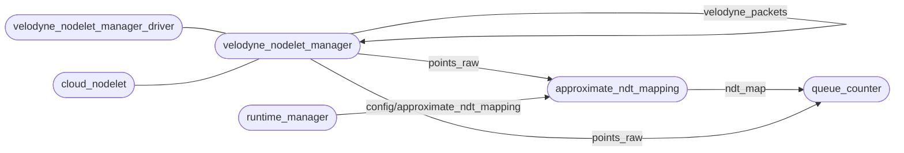

*Figure 22. Node connections when running approximate_ndt_mapping*

The Velodyne driver runs as several **nodelets** inside one manager process (`velodyne_nodelet_manager`). When the driver nodelet publishes the LiDAR's raw packets `velodyne_packets`, `cloud_nodelet` in the same process converts them into the point cloud `points_raw`. `approximate_ndt_mapping` receives `points_raw` and the settings `config/approximate_ndt_mapping` sent by Runtime Manager and publishes the map `ndt_map`, and `queue_counter` counts the messages waiting to be processed to show whether mapping is keeping up with the data.

> **Definition:** A **nodelet** is a ROS feature that runs several nodes inside one process so that messages between them are passed as pointers in memory instead of being serialized over the network. It removes the cost of copying when large data such as point clouds is exchanged.

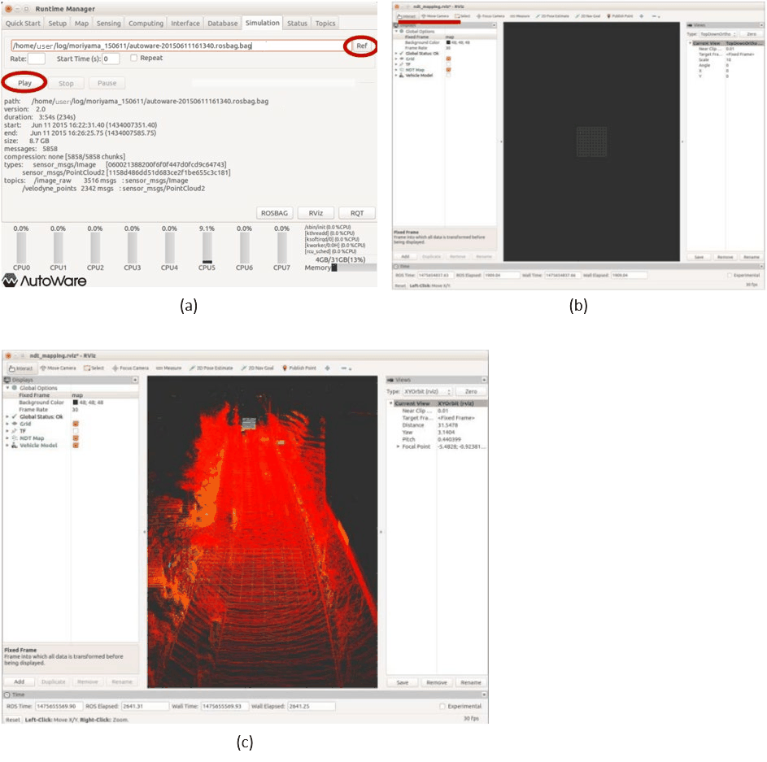

*Figure 23. Bag playback, the RViz view, and the mapping result*

The procedure for building a map from recorded data is shown in Figure 23. (a) Choose the bag file in the Simulation tab and play it with [Play], and (b) open RViz; (c) while the playback proceeds, the map can be seen accumulating. When mapping is finished, check the following.

- **Submap files:** Check that the submap files saved by `approximate_ndt_mapping` have appeared in the `~/.ros` folder. Nodes started with `roslaunch` use `~/.ros` as their working directory unless specified otherwise, so files saved with relative paths appear in this folder.
- **Check in RViz:** Load the built map in RViz and check that buildings and roads join correctly without overlapping or bending.

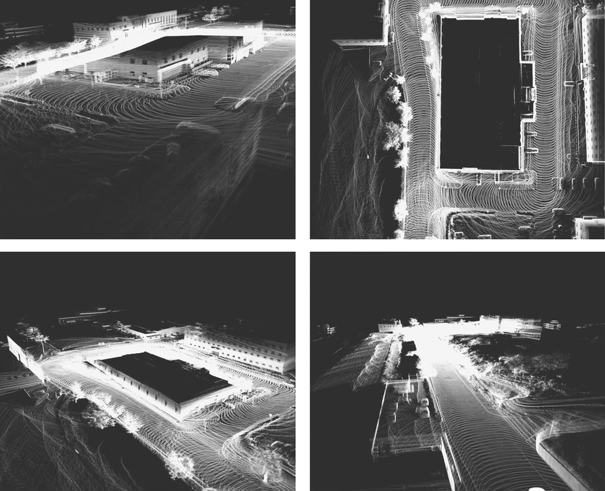

*Figure 24. The completed 3D point cloud map viewed from several directions*

Figure 24 shows the completed map viewed obliquely and from above. The large building in the middle, the surrounding roads, parked vehicles, and trees appear as points.

### 3.5 Building a Vector Map

A point cloud map is sufficient for localization, but it does not record where the lanes are or where to stop. A **vector map** represents road elements such as lanes, stop lines, crosswalks, and traffic lights as coordinates of points, lines, and areas. Autoware generates paths from the lane and stop line information of the vector map and uses it in many ways, including vehicle control, so using a vector map is recommended.

With **VectorMapper** of MapTools, a web tool provided by TIER IV, one can upload a point cloud map and partly build a vector map of one's own on top of it [17]. VectorMapper is a tool for quickly creating a vector map compatible with the ADAS map format used by Autoware, and its output is limited compared with original ADAS map data. The ADAS map files produced by VectorMapper are as follows.

| File | Information held |
|:-----|:-----|
| `point.csv` | Coordinates of the points referenced by every map element |
| `vector.csv` | Vectors defined by a point and a direction angle (such as the direction a traffic light faces) |
| `line.csv` | Line segments joining two points |
| `area.csv` | Areas enclosed by lines |
| `node.csv` | Points where lanes connect (nodes) |
| `lane.csv` | Lane segments joining two nodes and their connections |
| `dtlane.csv` | Detailed shape of lane segments (direction, curvature, and so on) |
| `stopline.csv` | Stop lines |
| `crosswalk.csv` | Crosswalks |
| `signaldata.csv` | Traffic lights |
| `idx.csv` | Index of the map files |

*Table 11. ADAS map files produced by VectorMapper*

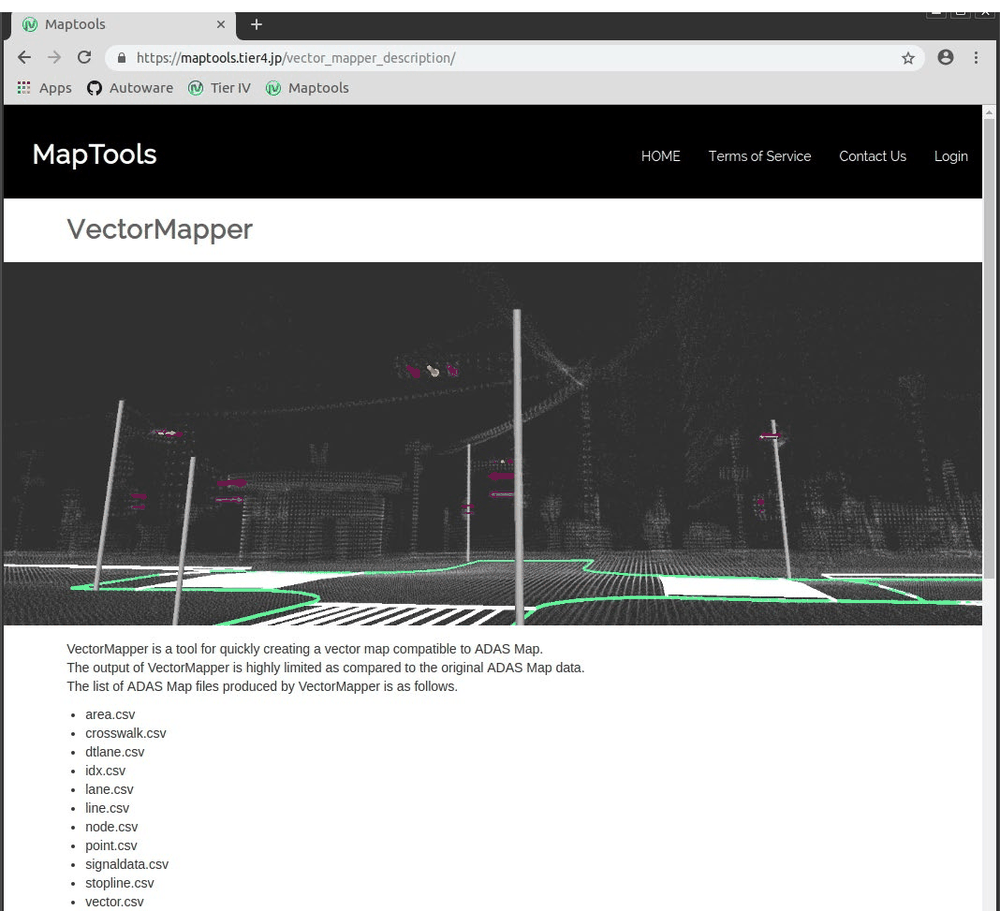

*Figure 25. The VectorMapper screen of TIER IV MapTools*

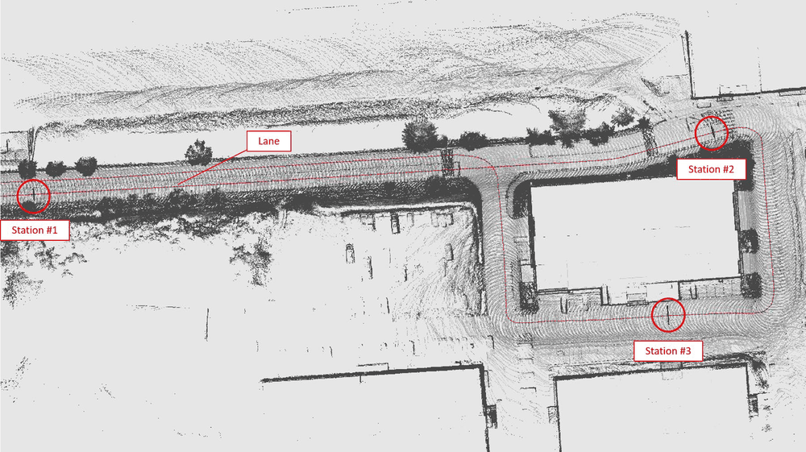

*Figure 26. A lane and stations drawn on a point cloud map*

Figure 26 is an example in which a lane (Lane) and the stop lines of stations (Station #1-#3) are drawn with VectorMapper on the top view of the map of Figure 24. The red line is the lane that circles the building, and the three circled places are the stations where the vehicle will stop. The vehicle builds its path along this lane and stops at the stations that have stop lines.

### 3.6 Localization by NDT Matching

Once the map is ready, localization while driving consists of fitting the scan data to the map data with NDT. The vehicle's position and heading are estimated from the information where the map and the scan match best. Unlike mapping in Section 3.4, the reference map is fixed, and new scans are not added to it.

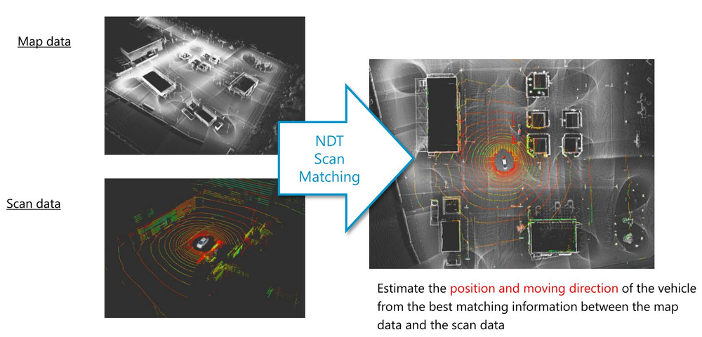

*Figure 27. Estimating the vehicle's position and heading by fitting the scan data to the map data with NDT*

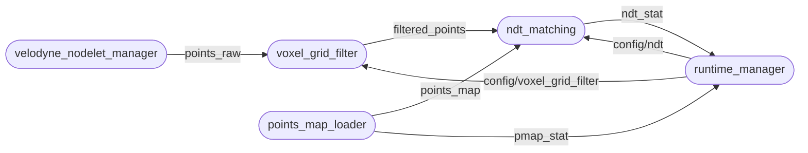

*Figure 28. Node connections for localization by NDT matching*

1. `points_map_loader` reads the PCD map files, publishes them as `points_map`, and reports through `pmap_stat` whether the whole map has been loaded.
2. `voxel_grid_filter` reduces the `points_raw` published by the LiDAR driver and publishes it as `filtered_points`. Reducing the number of points speeds up the NDT computation so that every scan can be processed in time.
3. `ndt_matching` fits `filtered_points` to `points_map` to obtain the vehicle position and reports the matching state to Runtime Manager through `ndt_stat`.
4. Runtime Manager sends the filter size and NDT parameters set by the user to each node through the `config/voxel_grid_filter` and `config/ndt` topics.

> **Caution:** NDT matching finds, by optimization, the score peak nearest to its starting point, so if the starting point is too far from the actual position, it may converge to a peak at some other place that is not the actual position (a local optimum). So at startup an initial position from GNSS or specified in RViz is needed, and afterward the previous position is used as the starting point of the next matching. The detailed settings and practice of localization are covered in Weeks 3 and 9.

---

<br>

## Concept Applications

| Situation | Result and reason |
|:-----|:------------|
| Play back a bag file recorded on a real road with `/use_sim_time` left `false`. | **Localization or coordinate transforms discard the data or print warnings.** Nodes use the current computer time, so the timestamps of the recording look far too old. |
| Record 10 Hz LiDAR point clouds for 30 minutes, with each point cloud about 1.77 MB. | **About 32 GB is needed.** $10 \times 60 \times 30 = 18000$ point clouds multiplied by 1.77 MB gives about 31.9 GB ($3.19 \times 10^{10}$ bytes). |
| Replace a USB camera with a Point Grey camera. | **The detection nodes need no change.** Both drivers publish on the same topic `image_raw` with the same message type. |
| `velocity_set` uses the raw point cloud for obstacle decisions without `ray_ground_filter`. | **The vehicle may fail to start or stop frequently.** Road points not removed by the height window (on slopes, with body pitch, or with a low Detection Height Bottom) can be counted as obstacles (Week 3, Section 5.3). |
| Write a target name different from that of `add_executable` in `target_link_libraries` of `CMakeLists.txt`. | **An error occurs at the CMake configuration step.** It tries to link libraries to a target that does not exist. |
| Build and run the example node without `ros::spin()`. | **The node ends immediately and publishes nothing.** There is no loop to call the callback function, so `main` returns at once. |
| Build the map of an entire large industrial complex in one go with `ndt_mapping`. | **It may get slower and slower and run out of memory.** As the map grows, the matching target and memory grow, so `approximate_ndt_mapping`, which divides the map into submaps, is suitable. |
| Drive through an intersection with traffic lights with only a point cloud map and no vector map. | **A plan to stop at the stop line cannot be made.** The positions of stop lines and traffic lights are held in the vector map. |

*Table 12. Results and reasons for situations involving Autoware recording, node development, and maps*

**True/False Check:**

| Statement | Judgment and Reason |
|:-----|:------------|
| Topics played back with rosbag are published under names different from those of the real sensor topics. | **F.** They are published again with the same topic names as when recorded, so subscribing nodes need not distinguish them. |
| In a node graph, ellipses are nodes and rectangles are topics. | **T.** Arrows show the direction of publishing and subscribing. |
| The executable name and the node name given to `ros::init` must be the same. | **F.** `rosrun` finds the program by its executable name, and the node registers under the name given to `ros::init`. |
| `std::string::size()` returns the number of characters of a UTF-8 Korean string. | **F.** It returns the number of bytes, so `"안녕"` gives 6. |
| NDT performs registration by summarizing the points of each map cell as a normal distribution. | **T.** It precomputes the mean and covariance of each cell and sums the scores. |
| Both mapping (ndt_mapping) and localization (ndt_matching) add new scans to the map. | **F.** Only mapping adds new scans to the map; localization only fits scans to the fixed map. |
| A voxel grid filter reduces the number of points while keeping the shape of their distribution. | **T.** It replaces the points of each voxel with their single centroid. |

---

<br>

## Summary

| Concept | Key Summary |
|:--------|:------------|
| Autoware | ROS-based open-source autonomous driving software developed by Nagoya University; the application layer on top of hardware, an operating system, and ROS. |
| rosbag | Records topic messages with timestamps to `.bag` files and plays them back on the same topics, allowing repeated development and debugging without real sensors. |
| Recognition, judgment, operation | Recognizes objects and the vehicle's own position with sensors, judges driving behavior with the map and rules, and operates with acceleration, braking, and steering commands. |
| Runtime Manager | Autoware's GUI that starts and stops nodes by tab and manages parameters, recording and playback, and launching RViz and rqt. |
| Node graph | Ellipses are nodes and rectangles are topics; it shows the data flow at a glance and is used for debugging. |
| Sensor fusion | Combines the object-kind information of cameras with the distance information of LiDAR to detect objects. |
| Path planning flow | Waypoints become velocity commands through traffic rules (lane_rule, lane_stop), lane selection (lane_select), velocity planning (velocity_set), and path following (pure_pursuit). |
| Autoware package | Has `package.xml` and `CMakeLists.txt` and places each node's source in a directory with the node's name. It is created with `catkin_create_pkg`. |
| Writing a ROS node | Processes subscribed messages and publishes results with `ros::init`, `NodeHandle`, `advertise`, `subscribe`, a callback function, and `ros::spin`. |
| Building a node | Adds `add_executable` and `target_link_libraries` and builds in Release mode. |
| Essential nodes for a real car | TF, map, waypoints, LiDAR, voxel_grid_filter, ndt_matching, vel_pose_connect, the mission planning nodes, pure_pursuit, twist_filter, and the vehicle interface. |
| use_sim_time | Set to `true` during playback so that nodes use the recording time from `/clock` as ROS time. |
| NDT | A registration method that summarizes the reference point cloud as a normal distribution per cell and finds the pose maximizing the sum of how well the new points fit the distributions. |
| Building a 3D map | Repeats fitting each new scan to the map so far with NDT and adding it; approximate_ndt_mapping suits large maps. |
| Vector map | A map representing lanes, stop lines, and traffic lights as points, lines, and areas, used for path generation and stopping; it can be built with VectorMapper. |
| Localization by NDT matching | Fits the scan reduced by a voxel grid filter to the fixed map with NDT to obtain the vehicle's position and heading. |

---

<br>

## Self-Check Questions

1. **Layer structure:** Write the four layers of Autoware from the bottom, and explain what each layer does in one sentence.

   <details>
   <summary>Answer</summary>

   The hardware layer computes with CPUs and GPUs and measures the surroundings and position with cameras, GNSS, and LiDAR. The host OS layer (Linux, eMCOS, and others) manages the hardware and runs processes. The middleware layer (ROS) provides message passing between nodes, recording and playback, and visualization tools. The application layer (Autoware) implements autonomous driving functions such as localization, object detection, path planning, and vehicle control as ROS nodes.

   </details>

2. **Bag file information:** A bag file's information is `duration: 120s`, `/points_raw 1200 msgs`, `/imu_raw 12000 msgs`, `size: 2.0 GB`. Find the publishing rates of the two topics and the approximate size of one point cloud. Ignore the size of the IMU messages.

   <details>
   <summary>Answer</summary>

   `/points_raw` is $1200 / 120 = 10$ Hz, and `/imu_raw` is $12000 / 120 = 100$ Hz. The 2.0 GB of `rosbag info` is $2.0 \times 1024^3 \approx 2.15 \times 10^9$ bytes, and the point clouds take up almost the whole file size, so one point cloud is $2.15 \times 10^9 / 1200 \approx 1.79 \times 10^6$ bytes, that is, about 1.79 MB.

   </details>

3. **use_sim_time:** Explain why `/use_sim_time` must be set to `true` when playing back a bag file, and why it must be set back to `false` when operating a real vehicle.

   <details>
   <summary>Answer</summary>

   The timestamps of the replayed data are the times of the recording, so if nodes use the current computer time, the data looks very old and the coordinate transforms and localization discard it. With `true`, nodes use the recording time published by the player on `/clock`, so the times agree. When operating a real vehicle there is no player publishing `/clock`, so leaving it `true` stops ROS time from advancing and the nodes stall or misbehave; it must be `false` so that the current time, which is the timestamp of the sensor data, is used.

   </details>

4. **Sensor fusion:** Name the two nodes in the detection flow of Figure 5 that combine camera and LiDAR results, and explain why they are combined.

   <details>
   <summary>Answer</summary>

   `range_fusion` attaches distances to the object regions detected by the camera using LiDAR points projected onto the image, and `obj_fusion` combines the camera detection result `obj_label` with the LiDAR clustering result `points_obj` to output the object positions `obj_pose`. A camera recognizes the kind of an object well but cannot measure distance directly, while a LiDAR measures distance accurately but has difficulty recognizing the kind, so the two results are combined to cover each other's weaknesses.

   </details>

5. **Path planning flow:** List in order the nodes passed from the waypoint file to the vehicle's velocity command `twist_cmd`, and explain which node reacts and how when the traffic light is red.

   <details>
   <summary>Answer</summary>

   `twist_cmd` comes out through `waypoint_loader` → `lane_rule` → `lane_stop` → `lane_select` → `obstacle_avoid` → `velocity_set` → `pure_pursuit` → `twist_filter`. In the configuration of Figure 7, `collision_avoid` takes the last stage instead of `twist_filter`. `lane_rule` uses stop line information to make both the waypoints for a green light and the waypoints with speeds reduced to stop at the stop line for a red light, and when the traffic light state is red, `lane_stop` chooses and publishes the stopping waypoints, so the vehicle stops before the stop line.

   </details>

6. **Modifying the example node:** To modify the node of Section 2.3 so that it publishes twice the length of the received string on the `mypubval2` topic, which lines must be changed and how?

   <details>
   <summary>Answer</summary>

   Change `pmsg.data = smsg.data.size();` to `pmsg.data = smsg.data.size() * 2;`, and change the topic name in `n.advertise<std_msgs::Int32>("mypubval", 10)` to `"mypubval2"`. The message type stays `std_msgs/Int32`, so the headers and CMake settings need no change; rebuilding is enough.

   </details>

7. **CMake settings:** Which two lines must be added to `CMakeLists.txt` to build the node in `nodes/my_filter/my_filter.cpp` as the executable `my_filter`?

   <details>
   <summary>Answer</summary>

   Add `add_executable(my_filter nodes/my_filter/my_filter.cpp)` and `target_link_libraries(my_filter ${catkin_LIBRARIES})`. The first line creates an executable target from the source file, and the second links the ROS libraries to the target of the same name.

   </details>

8. **Ground removal:** Explain why `ray_ground_filter` is needed for the function of stopping in front of obstacles.

   <details>
   <summary>Answer</summary>

   A LiDAR point cloud contains many points reflected from the road surface as well as obstacles. Without removing the ground points, `velocity_set` regards the road surface in front of the vehicle as an obstacle and keeps stopping, so only `points_no_ground`, with the ground points filtered out, must be used for obstacle decisions.

   </details>

9. **NDT computation:** A cell contains the map points $(1, 0), (3, 0), (1, 2), (3, 2)$. Find the mean and covariance of this cell, and find the value $p(\mathbf{x}')$ of the point $(2, 2)$.

   <details>
   <summary>Answer</summary>

   The mean is $\mathbf{q} = (2, 1)$. The deviations are $(-1, -1), (1, -1), (-1, 1), (1, 1)$, the same as in the example of Section 3.3, so $\Sigma = I$. The deviation of the point $(2, 2)$ is $(0, 1)$ and $\lVert\mathbf{d}\rVert^2 = 1$, so $p = \exp(-1/2) \approx 0.6065$.

   </details>

10. **Mapping and localization:** Explain the similarities and differences between `ndt_mapping` and `ndt_matching` in terms of input, output, and changes to the map.

    <details>
    <summary>Answer</summary>

    Both nodes fit LiDAR scans to a reference point cloud with NDT to obtain the vehicle position. In `ndt_mapping` the reference point cloud is the map built so far; it adds each fitted scan to the map, growing the map `ndt_map`, and also outputs the current position. `ndt_matching` takes the prebuilt fixed map `points_map` as the reference and outputs only the vehicle position without adding scans to the map.

    </details>

11. **Need for a vector map:** Explain why a vector map is needed even though localization works with a point cloud map alone.

    <details>
    <summary>Answer</summary>

    A point cloud map holds only the 3D points of the surrounding structures, which is enough for fitting the position, but it does not tell where the lanes are or where the stop lines and traffic lights are. Autoware builds paths from the lanes of the vector map and decides where to stop from the stop line and traffic light information, so a vector map is needed to drive real roads and stations.

    </details>

---

<br>

## References

1. S. Kato, E. Takeuchi, Y. Ishiguro, Y. Ninomiya, K. Takeda, and T. Hamada, "An open approach to autonomous vehicles," *IEEE Micro*, vol. 35, no. 6, pp. 60-68, 2015.
2. Apex.AI, "Announcing the Autoware Foundation," Dec. 9, 2018. https://www.apex.ai/post/announcing-the-autoware-foundation
3. Autoware Foundation, "Autoware." https://www.autoware.org
4. ROS Wiki, "rosbag." https://wiki.ros.org/rosbag
5. Autoware Foundation, "Autoware.ai." https://github.com/autowarefoundation/autoware_ai
6. ROS, "tools/rosbag/src/rosbag/bag.py," ros_comm repository (melodic-devel branch), GitHub. https://github.com/ros/ros_comm/blob/melodic-devel/tools/rosbag/src/rosbag/bag.py
7. P. F. Felzenszwalb, R. B. Girshick, D. McAllester, and D. Ramanan, "Object detection with discriminatively trained part-based models," *IEEE Trans. Pattern Anal. Mach. Intell.*, vol. 32, no. 9, pp. 1627-1645, 2010.
8. R. C. Coulter, "Implementation of the pure pursuit path tracking algorithm," Robotics Institute, Carnegie Mellon Univ., Pittsburgh, PA, USA, Tech. Rep. CMU-RI-TR-92-01, 1992.
9. ROS Wiki, "catkin/package.xml." https://wiki.ros.org/catkin/package.xml
10. ROS Wiki, "catkin/CMakeLists.txt." https://wiki.ros.org/catkin/CMakeLists.txt
11. ROS Wiki, "Writing a Simple Publisher and Subscriber (C++)." https://wiki.ros.org/ROS/Tutorials/WritingPublisherSubscriber%28c%2B%2B%29
12. ROS Enhancement Proposals, "REP 3: Target Platforms." https://www.ros.org/reps/rep-0003.html
13. Autoware Foundation, "ROSBAG Demo," Autoware.ai documentation. https://github.com/autowarefoundation/autoware_ai_documentation/wiki/ROSBAG-Demo
14. ROS Wiki, "Clock." https://wiki.ros.org/Clock
15. P. Biber and W. Strasser, "The normal distributions transform: A new approach to laser scan matching," in *Proc. IEEE/RSJ Int. Conf. Intelligent Robots and Systems (IROS)*, 2003, pp. 2743-2748.
16. M. Magnusson, "The three-dimensional normal-distributions transform: An efficient representation for registration, surface analysis, and loop detection," Ph.D. dissertation, Örebro Univ., Örebro, Sweden, 2009.
17. TIER IV, "MapTools." https://tools.tier4.jp
