# 3주차 이론 — Autoware의 위치 인식과 경로 계획

[레포지토리 안내](../../README.ko.md) | [English](Concepts_Lecture.md) | [한국어](Concepts_Lecture.ko.md)

> **최종 수정일:** 2026-11-04

> **학습 목표:**
> 1. 위치 인식 문제를 정의하고, NDT 정합이 셀마다의 정규 분포, 점수 함수, 뉴턴 방법으로 스캔을 지도에 맞추는 원리를 수식으로 설명할 수 있다
> 2. Autoware의 NDT 매칭 위치 인식을 이루는 노드와 토픽을 설명하고, ndt_matching의 매개변수가 NDT 수식의 어느 부분에 해당하는지 설명할 수 있다
> 3. 벡터 지도를 이용한 경로 생성과 경로 계획 노드(lane_rule, lane_stop, lane_select, velocity_set, path_select)의 역할과 실행 순서를 설명할 수 있다
> 4. pure pursuit의 곡률 공식을 유도하고, 목표점이 주어지면 곡률, 회전 반경, 각속도, 조향각, 횡방향 가속도를 계산할 수 있다
> 5. Autoware를 실제 차량에 적용한 시스템의 구성, 개발 결과, 남은 과제를 설명할 수 있다
> 6. Ubuntu 18.04를 USB 메모리나 VirtualBox 가상 머신으로 설치할 수 있다

---

## 목차

- [1. Autoware 자율주행 소프트웨어의 흐름](#1-autoware-자율주행-소프트웨어의-흐름)
- [2. 위치 인식과 NDT 정합](#2-위치-인식과-ndt-정합)
  - [2.1 위치 인식 문제](#21-위치-인식-문제)
  - [2.2 스캔 정합](#22-스캔-정합)
  - [2.3 NDT 표현: 셀마다의 정규 분포](#23-ndt-표현-셀마다의-정규-분포)
  - [2.4 정합 점수와 뉴턴 방법](#24-정합-점수와-뉴턴-방법)
  - [2.5 3차원 NDT와 실제 구현](#25-3차원-ndt와-실제-구현)
  - [2.6 NDT 매핑](#26-ndt-매핑)
- [3. Autoware의 NDT 매칭 위치 인식](#3-autoware의-ndt-매칭-위치-인식)
  - [3.1 노드 구성과 데이터 흐름](#31-노드-구성과-데이터-흐름)
  - [3.2 Runtime Manager에서의 실행 절차](#32-runtime-manager에서의-실행-절차)
  - [3.3 rqt_graph로 본 노드 연결](#33-rqt_graph로-본-노드-연결)
- [4. 경로 생성](#4-경로-생성)
  - [4.1 벡터 지도 방식과 주행 기록 방식](#41-벡터-지도-방식과-주행-기록-방식)
  - [4.2 waypoint_clicker로 경로 만들기](#42-waypoint_clicker로-경로-만들기)
- [5. 경로 계획](#5-경로-계획)
  - [5.1 경로 계획의 역할](#51-경로-계획의-역할)
  - [5.2 노드와 데이터 흐름](#52-노드와-데이터-흐름)
  - [5.3 실행 순서와 노드 설정](#53-실행-순서와-노드-설정)
- [6. 경로 추종과 차량 제어](#6-경로-추종과-차량-제어)
  - [6.1 pure_pursuit와 twist_filter](#61-pure_pursuit와-twist_filter)
  - [6.2 pure pursuit의 기하학](#62-pure-pursuit의-기하학)
  - [6.3 계산 예](#63-계산-예)
  - [6.4 목표점과 전방 주시 거리의 선택](#64-목표점과-전방-주시-거리의-선택)
  - [6.5 twist_filter와 횡방향 가속도 제한](#65-twist_filter와-횡방향-가속도-제한)
  - [6.6 실행 절차](#66-실행-절차)
- [7. 실차 적용 사례: 쏘나타 기반 자율주행 시스템](#7-실차-적용-사례-쏘나타-기반-자율주행-시스템)
  - [7.1 차량 구성과 주행 시험](#71-차량-구성과-주행-시험)
  - [7.2 정류장 정차](#72-정류장-정차)
  - [7.3 LiDAR 기반 장애물 인식과 회피](#73-lidar-기반-장애물-인식과-회피)
  - [7.4 개발 내용과 결론](#74-개발-내용과-결론)
  - [7.5 활용 사례](#75-활용-사례)
- [8. Ubuntu 18.04 설치](#8-ubuntu-1804-설치)
  - [8.1 설치 방식 고르기](#81-설치-방식-고르기)
  - [8.2 설치 이미지 내려받기](#82-설치-이미지-내려받기)
  - [8.3 USB 메모리로 설치하기](#83-usb-메모리로-설치하기)
  - [8.4 VirtualBox 가상 머신 만들기](#84-virtualbox-가상-머신-만들기)
  - [8.5 가상 머신에 Ubuntu 설치하기](#85-가상-머신에-ubuntu-설치하기)
  - [8.6 자주 생기는 문제](#86-자주-생기는-문제)
- [개념 적용](#개념-적용)
- [요약](#요약)
- [점검 문제](#점검-문제)
- [참고 문헌](#참고-문헌)

---

<br>

## 1. Autoware 자율주행 소프트웨어의 흐름

**Autoware**는 ROS 위에서 동작하는 오픈 소스 자율주행 소프트웨어이다. Autoware로 자율주행 소프트웨어를 개발하는 과정은 다음 아홉 단계로 정리할 수 있다.

| 단계 | 내용 | 다루는 단원 |
|:-----|:-----|:-----|
| 1. ROS 개념 및 소개 | ROS의 노드, 토픽, 마스터 같은 기본 개념 | 1주차 |
| 2. ROS 개발 환경 및 방법 | ROS 설치와 개발 도구 | 1주차, 4주차 |
| 3. Autoware 구성 | Autoware의 기능과 사용자 인터페이스 | 2주차 |
| 4. ROS Autoware Node 개발 | Autoware 패키지 구조와 노드 개발 순서 | 2주차, 5주차 |
| 5. Data Recording | rosbag을 이용한 센서 데이터 기록과 재생 | 2주차 |
| 6. 3D/Vector Map building | 포인트 클라우드 지도와 벡터 지도 작성 | 2주차, 9주차 |
| 7. Path Generation & Path Planning | 위치 인식을 바탕으로 경로를 만들고 계획하기 | 3주차, 10주차 |
| 8. Path Following and Vehicle Control | 경로를 따라가는 속도와 각속도 명령 만들기 | 3주차, 11\~12주차 |
| 9. System Interface | 실제 차량과 Autoware 연결 | 3주차, 14주차 |

*표 1. Autoware를 이용한 자율주행 소프트웨어 개발 단계*

이 단원은 2주차에서 만든 지도 위에서 차량의 현재 위치를 알아내는 위치 인식으로 시작하여, 갈 길을 만드는 경로 생성과 경로 계획, 그 길을 따라가는 경로 추종과 차량 제어를 거쳐, 이 모든 기능을 실제 차량에 연결한 사례로 마친다. 마지막 절은 이후 실습의 바탕이 되는 Ubuntu 18.04 설치를 다룬다.

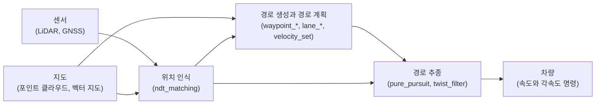

*그림 1. 이 단원에서 다루는 자율주행 소프트웨어의 처리 흐름*

---

<br>

## 2. 위치 인식과 NDT 정합

### 2.1 위치 인식 문제

> **용어 정의:** **위치 인식(localization)** 은 주어진 지도 안에서 차량이나 로봇의 현재 포즈를 추정하는 일이다. **포즈(pose)** 는 위치와 방향을 함께 나타낸 것으로, 3차원에서는 위치 $(x, y, z)$와 방향(roll, pitch, yaw)의 6개 값, 평면에서는 $(x, y, \theta)$의 3개 값으로 나타낸다.

roll, pitch, yaw는 각각 차량의 앞뒤 축, 좌우 축, 위아래 축을 중심으로 한 회전각이다. 평면을 달리는 차량에서는 진행 방향을 나타내는 yaw가 가장 중요하다.

GNSS(위성 항법 시스템) 수신기만으로도 위치를 알 수 있지만, 위성 신호가 건물이나 터널에 가려지면 오차가 커지거나 위치를 잃는다(GNSS의 오차 요인은 13주차에서 다룬다). 그래서 자율주행차는 LiDAR 같은 거리 센서로 주변을 측정하고, 그 측정을 미리 만든 지도와 비교하여 위치를 알아낸다.

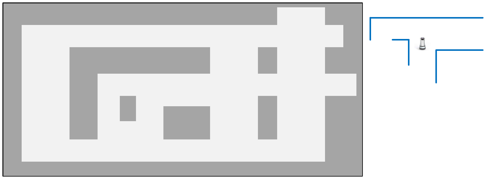

*그림 2. 격자 지도와 로봇이 측정한 주변 벽의 모양*

그림 2의 왼쪽은 회색 벽과 흰 통로로 이루어진 지도이고, 오른쪽은 로봇이 자기 주변에서 측정한 벽의 모양이다. 로봇은 자신이 지도의 어디에 있는지 모르지만, 측정한 벽 모양이 지도의 어느 부분과 겹치는지를 찾으면 자신의 위치와 방향을 알 수 있다. 위치 인식은 이렇게 측정한 모양을 지도의 어디에 어떤 각도로 놓아야 가장 잘 맞는지를 찾는 문제이다.

### 2.2 스캔 정합

> **용어 정의:** **스캔(scan)** 은 LiDAR가 한 바퀴 회전하며 측정한 점들의 집합이고, **포인트 클라우드(point cloud)** 는 이처럼 3차원 좌표를 가진 점들의 집합이다. **정합(registration)** 은 두 포인트 클라우드가 가장 잘 겹치도록 하는 좌표 변환(회전과 평행 이동)을 찾는 일이며, 스캔을 지도에 정합하는 일을 **스캔 정합(scan matching)** 이라고 한다.

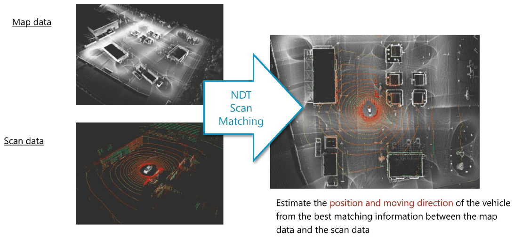

*그림 3. 지도 데이터와 스캔 데이터를 NDT로 정합하여 차량의 위치와 진행 방향을 추정하는 과정*

그림 3의 지도 데이터(Map data)는 2주차에서 만든 넓은 영역의 포인트 클라우드 지도이고, 스캔 데이터(Scan data)는 차량의 LiDAR가 지금 측정한 한 장의 스캔이다. 스캔은 LiDAR를 원점으로 한 센서 좌표계로 표현되어 있으므로, 스캔을 지도 좌표계로 옮기는 변환을 찾으면 그 변환이 곧 지도 안에서 LiDAR의 포즈가 된다. 오른쪽 그림은 정합이 끝난 뒤 스캔(색이 있는 점)이 지도(흰 점) 위에 겹쳐진 모습이며, 가장 잘 맞는 정합 결과로부터 차량의 위치와 진행 방향을 추정한다.

스캔 정합의 대표적인 방법으로 ICP(iterative closest point)와 NDT가 있다. ICP는 반복할 때마다 스캔의 각 점에 가장 가까운 지도 점을 찾아 대응시키고, 대응점 사이의 거리를 줄이는 변환을 구한다. **NDT(normal distributions transform)** 는 지도를 작은 셀로 나누고 셀마다 점들의 분포를 정규 분포로 요약해 두므로, 점과 점의 대응을 찾을 필요가 없고 점수 함수를 미분하여 최적화할 수 있다 [1]. Autoware의 위치 인식 노드 ndt_matching이 이 방법을 쓴다.

### 2.3 NDT 표현: 셀마다의 정규 분포

NDT는 지도의 점들을 다음과 같이 요약한다 [1].

1. 공간을 한 변의 길이가 일정한 셀(cell)로 나눈다. 이 길이를 **해상도(resolution)** 라고 한다. 3차원에서는 셀을 **복셀(voxel)** 이라고도 부른다.
2. 각 셀에 들어 있는 점 $\mathbf{x}_1, \dots, \mathbf{x}_n$의 평균 벡터와 공분산 행렬을 구한다. 점이 너무 적은 셀은 분포를 믿을 수 없으므로 쓰지 않는다(Biber와 Strasser는 점이 3개 미만인 셀을 버린다).
3. 그 셀 안의 한 위치 $\mathbf{x}$에서 점이 측정될 가능성을 평균과 공분산으로 정한 정규 분포로 모델링한다.

$$
\boldsymbol{\mu} = \frac{1}{n} \sum_{i=1}^{n} \mathbf{x}_i, \qquad
\Sigma = \frac{1}{n} \sum_{i=1}^{n} (\mathbf{x}_i - \boldsymbol{\mu})(\mathbf{x}_i - \boldsymbol{\mu})^{T}
$$

$$
p(\mathbf{x}) \propto \exp\left( -\frac{1}{2} (\mathbf{x} - \boldsymbol{\mu})^{T} \Sigma^{-1} (\mathbf{x} - \boldsymbol{\mu}) \right)
$$

> **[확률및통계]** 다변량 정규 분포의 밀도는 $\exp$ 안의 이차 형식 $(\mathbf{x} - \boldsymbol{\mu})^{T} \Sigma^{-1} (\mathbf{x} - \boldsymbol{\mu})$으로 정해진다. 이 값의 제곱근을 **마할라노비스 거리(Mahalanobis distance)** 라고 하며, 점들이 넓게 퍼진 방향으로는 같은 거리라도 작게, 좁게 모인 방향으로는 크게 잰다. 공분산 행렬의 고유벡터는 분포가 퍼진 방향, 고윳값은 그 방향의 분산이다.

> **[선형대수학]** 행이 $(a, b)$, $(b, d)$인 2×2 대칭 행렬의 역행렬은 행이 $(d, -b)$, $(-b, a)$인 행렬을 행렬식 $ad - b^2$으로 나눈 것이다. 행렬식이 0에 가까우면 역행렬의 원소가 매우 커진다.

이렇게 하면 지도 전체가 셀마다 매끄러운 정규 분포 함수의 모음으로 바뀐다. 점 하나하나를 저장하는 대신 셀마다 평균과 공분산만 저장하므로 메모리가 줄고, 함수가 미분 가능하므로 다음 절의 최적화를 쓸 수 있다.

**계산 예: 한 셀의 정규 분포.** 벽을 따라 측정된 네 점 $(1, 0)$, $(2, 0.2)$, $(3, 0)$, $(4, 0.2)$가 한 셀에 들어 있다고 하자(단위는 m).

- 평균은 $\boldsymbol{\mu} = \left( \frac{1+2+3+4}{4}, \frac{0+0.2+0+0.2}{4} \right) = (2.5, 0.1)$이다.
- 평균을 뺀 편차는 $(-1.5, -0.1)$, $(-0.5, 0.1)$, $(0.5, -0.1)$, $(1.5, 0.1)$이다.
- $x$ 방향 분산은 $(2.25 + 0.25 + 0.25 + 2.25)/4 = 1.25$, $y$ 방향 분산은 $(0.01 \times 4)/4 = 0.01$, 공분산은 $(0.15 - 0.05 - 0.05 + 0.15)/4 = 0.05$이다.

$$
\Sigma = \begin{pmatrix} 1.25 & 0.05 \\ 0.05 & 0.01 \end{pmatrix}, \qquad
\det \Sigma = 1.25 \times 0.01 - 0.05^2 = 0.01, \qquad
\Sigma^{-1} = \frac{1}{0.01} \begin{pmatrix} 0.01 & -0.05 \\ -0.05 & 1.25 \end{pmatrix} = \begin{pmatrix} 1 & -5 \\ -5 & 125 \end{pmatrix}
$$

이제 이 셀에 놓인 세 위치에서 $\exp(-\frac{1}{2} \mathbf{q}^{T} \Sigma^{-1} \mathbf{q})$를 계산한다. 여기서 $\mathbf{q} = \mathbf{x} - \boldsymbol{\mu}$이고, $\mathbf{q} = (q_x, q_y)$이면 $\mathbf{q}^{T} \Sigma^{-1} \mathbf{q} = q_x^2 - 10 q_x q_y + 125 q_y^2$이다.

| 위치 $\mathbf{x}$ | $\mathbf{q} = \mathbf{x} - \boldsymbol{\mu}$ | $\mathbf{q}^{T} \Sigma^{-1} \mathbf{q}$ | $\exp(-\frac{1}{2} \mathbf{q}^{T} \Sigma^{-1} \mathbf{q})$ |
|:-----|:-----|:-----|:-----|
| $(2.5, 0.1)$ (평균) | $(0, 0)$ | $0$ | $1.000$ |
| $(2.6, 0.1)$ (벽을 따라 0.1 m) | $(0.1, 0)$ | $0.01$ | $0.995$ |
| $(2.5, 0.2)$ (벽에 수직으로 0.1 m) | $(0, 0.1)$ | $1.25$ | $0.535$ |

*표 2. 한 셀의 정규 분포로 계산한 세 위치의 점수*

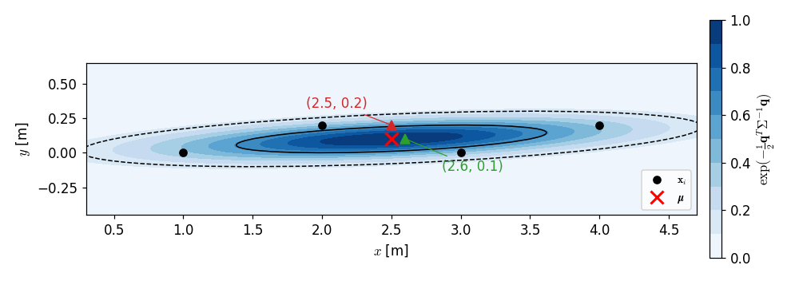

*그림 4. 네 점으로 만든 셀의 정규 분포와 세 위치의 점수*

그림 4의 검은 점은 셀의 네 점, 빨간 X는 평균, 실선과 점선 타원은 마할라노비스 거리가 1과 2인 경계이며, 색이 진할수록 점수가 높다. 같은 0.1 m를 벗어나도 벽을 따라 움직인 점은 점수가 거의 줄지 않고(0.995), 벽에 수직으로 움직인 점은 크게 줄어든다(0.535). 즉 NDT는 표면의 모양을 기억하여, 점이 표면에서 벗어난 정도를 방향에 따라 다르게 평가한다.

> **주의:** 셀의 점들이 거의 한 직선(3차원에서는 한 평면) 위에 놓이면 공분산 행렬의 고윳값 하나가 0에 가까워져 행렬식이 0에 가깝고, 역행렬의 원소가 지나치게 커진다. 그래서 실제 구현은 가장 작은 고윳값이 가장 큰 고윳값의 일정 비율보다 작아지지 않도록 공분산 행렬을 보정한다 [2].

### 2.4 정합 점수와 뉴턴 방법

평면에서 스캔을 옮기는 변환은 평행 이동 $(t_x, t_y)$와 회전각 $\phi$의 세 매개변수 $\mathbf{p} = (t_x, t_y, \phi)$로 나타낸다. 스캔의 점 $\mathbf{x} = (x, y)$는 다음과 같이 지도 좌표계의 점 $\mathbf{x}'$로 옮겨진다.

$$
\mathbf{x}' = T(\mathbf{p}, \mathbf{x}) = \begin{pmatrix} \cos\phi & -\sin\phi \\ \sin\phi & \cos\phi \end{pmatrix} \begin{pmatrix} x \\ y \end{pmatrix} + \begin{pmatrix} t_x \\ t_y \end{pmatrix}
$$

옮겨진 점 $\mathbf{x}_i'$마다 그 점이 들어간 셀의 평균 $\boldsymbol{\mu}_i$와 공분산 $\Sigma_i$로 정규 분포 값을 구하고, 모든 점에 대해 더한 것이 그 변환의 **점수(score)** 이다 [1].

$$
\text{score}(\mathbf{p}) = \sum_{i} \exp\left( -\frac{1}{2} \mathbf{q}_i^{T} \Sigma_i^{-1} \mathbf{q}_i \right), \qquad \mathbf{q}_i = T(\mathbf{p}, \mathbf{x}_i) - \boldsymbol{\mu}_i
$$

점수가 클수록 스캔의 점들이 지도의 표면 위에 잘 놓인 것이다. 최적화는 보통 최소화 문제로 쓰므로 $s(\mathbf{p}) = -\text{score}(\mathbf{p})$를 최소화한다. NDT는 이 문제를 **뉴턴 방법(Newton's method)** 으로 푼다. 현재 추정값 $\mathbf{p}$에서 $s$의 기울기 $\mathbf{g}$와 헤세 행렬 $H$를 구하고, 연립 방정식을 풀어 갱신량 $\Delta\mathbf{p}$를 얻는다.

$$
H \, \Delta\mathbf{p} = -\mathbf{g}, \qquad \mathbf{p} \leftarrow \mathbf{p} + \Delta\mathbf{p}
$$

> **[미적분학]** 뉴턴 방법은 현재 점 근처에서 함수를 이차 함수 $s(\mathbf{p} + \Delta\mathbf{p}) \approx s(\mathbf{p}) + \mathbf{g}^{T} \Delta\mathbf{p} + \frac{1}{2} \Delta\mathbf{p}^{T} H \Delta\mathbf{p}$로 근사하고, 이 이차 함수의 최솟값으로 한 번에 옮겨 간다. 이차 함수를 $\Delta\mathbf{p}$로 미분하여 0으로 두면 $\mathbf{g} + H \Delta\mathbf{p} = \mathbf{0}$이 된다. $H$가 양의 정부호일 때만 이 점이 최솟값이다.

점 하나의 항 $s = -\exp(-\frac{1}{2} \mathbf{q}^{T} \Sigma^{-1} \mathbf{q})$를 매개변수 $p_i$로 미분하면 연쇄 법칙에 따라 다음을 얻는다. 여기서 $f = \exp(-\frac{1}{2} \mathbf{q}^{T} \Sigma^{-1} \mathbf{q})$이다.

$$
g_i = \frac{\partial s}{\partial p_i} = \left( \mathbf{q}^{T} \Sigma^{-1} \frac{\partial \mathbf{q}}{\partial p_i} \right) f
$$

$$
H_{ij} = \frac{\partial^2 s}{\partial p_i \partial p_j} = f \left( -\left( \mathbf{q}^{T} \Sigma^{-1} \frac{\partial \mathbf{q}}{\partial p_i} \right) \left( \mathbf{q}^{T} \Sigma^{-1} \frac{\partial \mathbf{q}}{\partial p_j} \right) + \frac{\partial \mathbf{q}}{\partial p_j}^{T} \Sigma^{-1} \frac{\partial \mathbf{q}}{\partial p_i} + \mathbf{q}^{T} \Sigma^{-1} \frac{\partial^2 \mathbf{q}}{\partial p_i \partial p_j} \right)
$$

전체 기울기와 헤세 행렬은 스캔의 모든 점에 대해 이 값을 더한 것이다. 변환식을 미분하면 $\mathbf{q}$의 편미분은 다음과 같다. 두 번 미분하여 0이 아닌 것은 $\phi$로 두 번 미분한 항 하나뿐이다.

$$
\frac{\partial \mathbf{q}}{\partial t_x} = \begin{pmatrix} 1 \\ 0 \end{pmatrix}, \qquad
\frac{\partial \mathbf{q}}{\partial t_y} = \begin{pmatrix} 0 \\ 1 \end{pmatrix}, \qquad
\frac{\partial \mathbf{q}}{\partial \phi} = \begin{pmatrix} -x \sin\phi - y \cos\phi \\ x \cos\phi - y \sin\phi \end{pmatrix}, \qquad
\frac{\partial^2 \mathbf{q}}{\partial \phi^2} = \begin{pmatrix} -x \cos\phi + y \sin\phi \\ -x \sin\phi - y \cos\phi \end{pmatrix}
$$

NDT 정합 전체의 흐름은 다음과 같다.

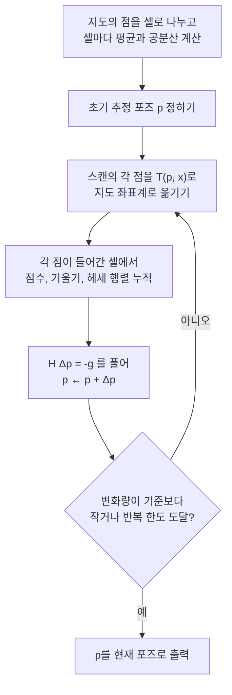

*그림 5. NDT 정합 알고리즘의 흐름*

**계산 예 1: 기울기.** 표 2의 셀만 있는 지도에서, 스캔의 한 점 $\mathbf{x} = (2.5, 0.2)$를 초기 추정 $\mathbf{p} = (0, 0, 0)$으로 옮기면 $\mathbf{x}' = (2.5, 0.2)$이다.

- $\mathbf{q} = (2.5, 0.2) - (2.5, 0.1) = (0, 0.1)$이고, $\Sigma^{-1} \mathbf{q} = (1 \times 0 - 5 \times 0.1, \; -5 \times 0 + 125 \times 0.1) = (-0.5, 12.5)$이다.
- $\mathbf{q}^{T} \Sigma^{-1} \mathbf{q} = 0 \times (-0.5) + 0.1 \times 12.5 = 1.25$이므로 $f = e^{-0.625} = 0.5353$이다.
- $\phi = 0$에서 $\frac{\partial \mathbf{q}}{\partial \phi} = (-y, x) = (-0.2, 2.5)$이다.
- 따라서 $g_{t_x} = (-0.5)(0.5353) = -0.268$, $g_{t_y} = (12.5)(0.5353) = 6.691$, $g_{\phi} = \big( (-0.5)(-0.2) + (12.5)(2.5) \big)(0.5353) = 31.35 \times 0.5353 = 16.78$이다.

$s$를 줄이는 방향은 $-\mathbf{g} = (0.268, -6.691, -16.78)$이다. $t_y$를 줄이면 위로 0.1 m 벗어난 점이 평균 쪽으로 내려오고, $\phi$를 음수로 하면(시계 방향 회전) 원점에서 2.5 m 떨어진 이 점도 아래로 내려온다. $t_x$ 성분이 0이 아닌 까닭은 셀의 분포가 약간 기울어져 있어($\Sigma$의 비대각 원소 0.05) $x$와 $y$의 오차가 서로 연관되기 때문이다.

**계산 예 2: 뉴턴 방법의 반복.** 점 하나로는 세 매개변수를 모두 정할 수 없으므로, $t_x = \phi = 0$으로 두고 $t_y$만 움직이는 경우를 본다. 스캔의 점이 $(2.5, 0.15)$이면 $\mathbf{q} = (0, q_y)$, $q_y = 0.05 + t_y$이고, 비대각 항이 사라져 $\mathbf{q}^{T} \Sigma^{-1} \mathbf{q} = 125 q_y^2$이다. 이때 위 식은 다음과 같이 줄어든다.

$$
f = e^{-62.5 q_y^2}, \qquad g = 125 \, q_y \, f, \qquad H = 125 \, f \, (1 - 125 q_y^2), \qquad \Delta t_y = -\frac{g}{H}
$$

| 반복 | $t_y$ | $q_y$ | $f$ | $g$ | $H$ | $\Delta t_y$ |
|:-----|:-----|:-----|:-----|:-----|:-----|:-----|
| 0 | $0$ | $0.0500$ | $0.8553$ | $5.346$ | $73.51$ | $-0.0727$ |
| 1 | $-0.0727$ | $-0.0227$ | $0.9682$ | $-2.751$ | $113.2$ | $+0.0243$ |
| 2 | $-0.0484$ | $0.0016$ | $0.9998$ | $0.196$ | $124.9$ | $-0.0016$ |
| 3 | $-0.0500$ | $0.0000$ | $1.0000$ | $0.000$ | $125.0$ | $0.0000$ |

*표 3. $t_y$ 하나만 움직일 때 뉴턴 방법의 반복*

세 번 만에 $t_y = -0.05$로 수렴하여 점이 셀의 평균 높이 $y = 0.1$에 놓인다. 반복할수록 $q_y$가 $0.05 \to -0.0227 \to 0.0016$으로 빠르게 줄어드는데, 이는 최솟값 근처에서 뉴턴 방법이 보이는 빠른(이차) 수렴이다.

> **주의:** 뉴턴 방법은 헤세 행렬이 양의 정부호일 때만 내려가는 방향을 준다. 계산 예 2에서 $H = 125 f (1 - 125 q_y^2)$는 $\vert q_y \vert > 1/\sqrt{125} \approx 0.089$ m이면 음수가 된다. 예를 들어 점이 $(2.5, 0.2)$에 있어 $q_y = 0.1$이면 $g = 6.691$, $H = -16.73$이므로 $\Delta t_y = +0.40$이 되어 점이 평균에서 오히려 멀어진다. 그래서 실제 구현은 헤세 행렬에 $\lambda I$를 더해 양의 정부호로 만들거나, 선 탐색(line search)으로 걸음의 방향과 크기를 확인한다 [2]. 또한 점수 함수는 평균에서 멀어질수록 평평해지므로, 정합을 시작하는 초기 추정이 참값에 충분히 가까워야 한다.

### 2.5 3차원 NDT와 실제 구현

3차원에서는 변환의 매개변수가 평행 이동 $(t_x, t_y, t_z)$와 세 회전각(roll, pitch, yaw)의 6개로 늘고, 셀은 정육면체 복셀이 된다. Magnusson은 이 3차원 NDT를 정리하면서, 지도에 없는 물체에서 온 점(이상점, outlier)이 점수를 지배하지 않도록 정규 분포에 균일 분포를 섞은 모델을 쓰고, 이를 다시 가우스 함수로 근사한 점수 함수를 제안하였다 [2].

$$
s(\mathbf{p}) = \sum_{k} d_1 \exp\left( -\frac{d_2}{2} \mathbf{q}_k^{T} \Sigma_k^{-1} \mathbf{q}_k \right)
$$

여기서 $d_1$, $d_2$는 이상점의 비율과 셀 크기에서 정해지는 상수이고 $d_1 < 0$이므로, 각 항은 2차원의 $s = -\text{score}$처럼 음수이다. 이 점수는 2차원의 경우와 같은 꼴이므로 기울기와 헤세 행렬도 같은 방식으로 구하고, 뉴턴 방향으로 움직일 걸음의 크기는 선 탐색으로 정한다. 오픈 소스 포인트 클라우드 라이브러리 PCL(Point Cloud Library)이 이 방법을 구현하며 선 탐색에는 More-Thuente 방법을 쓰고 [3], Autoware의 ndt_matching은 PCL의 구현이나 이를 고친 구현을 골라 쓴다 [4].

| 매개변수 | PCL의 이름 | 의미 |
|:-----|:-----|:-----|
| Resolution | `setResolution` | 셀(복셀) 한 변의 길이 (m) |
| Step Size | `setStepSize` | 선 탐색이 한 번에 움직일 수 있는 최대 걸음 크기 |
| Trans EPS | `setTransformationEpsilon` | 연속한 두 반복 사이의 변환 변화량이 이 값보다 작으면 수렴으로 보고 멈춘다 |
| Max Iterations | `setMaximumIterations` | 수렴하지 않아도 멈추는 최대 반복 횟수 |

*표 4. NDT 정합의 주요 매개변수*

해상도는 정합의 성질을 크게 바꾼다. 셀이 크면 셀 하나가 넓은 영역을 덮으므로 점수 함수가 완만해져 초기 추정이 다소 멀어도 수렴하지만, 표면의 세부 모양이 뭉개져 정확도가 떨어진다. 셀이 작으면 세부 모양을 잘 나타내지만 초기 추정이 참값에 가까워야 하고 셀 수가 늘어 메모리를 많이 쓴다.

### 2.6 NDT 매핑

같은 정합으로 지도를 만들 수도 있다. **NDT 매핑(NDT mapping)** 은 첫 스캔을 지도로 삼고, 새 스캔이 들어올 때마다 그 스캔을 지금까지 쌓은 지도에 NDT로 정합한 뒤, 정합된 스캔을 지도에 더하는 일을 반복한다. Autoware에서는 ndt_mapping 노드(와 계산을 줄인 approximate_ndt_mapping)가 이 일을 하며, 2주차의 지도 작성과 9주차의 실습이 이 노드를 쓴다. 스캔을 이어 붙일 때마다 작은 정합 오차가 쌓이므로, 넓은 영역을 매핑할수록 지도가 조금씩 휘거나 어긋날 수 있다.

---

<br>

## 3. Autoware의 NDT 매칭 위치 인식

### 3.1 노드 구성과 데이터 흐름

Autoware에서 NDT 매칭 위치 인식은 다음 노드들이 토픽으로 데이터를 주고받으며 이루어진다. 노드는 ROS에서 한 가지 일을 하는 실행 단위이고, 토픽은 노드 사이에 메시지를 전달하는 이름 붙은 통로이다(1주차와 4주차 참고).

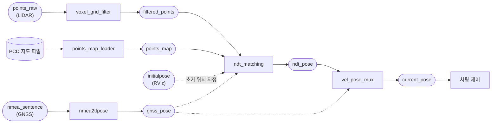

*그림 6. NDT 매칭 위치 인식의 노드와 토픽 (사각형은 노드, 둥근 상자는 토픽)*

| 노드 | 하는 일 |
|:-----|:-----|
| points_map_loader | PCD 형식의 지도 파일을 읽어 `points_map` 토픽으로 발행한다 |
| voxel_grid_filter | 정합에 쓸 점의 수를 줄이기 위해 스캔 데이터를 다운샘플링한다 |
| ndt_matching | 3차원 지도와 스캔 데이터를 NDT로 정합하여 포즈를 추정하고 `ndt_pose`로 발행한다 |
| nmea2tfpose | NMEA 형식의 GNSS 위치 정보를 지도 좌표계의 $(x, y, z)$ 포즈로 바꾼다 |
| vel_pose_mux | 차량 제어에 쓸 위치와 방향을 정하여 `current_pose`로 발행한다 |

*표 5. NDT 매칭 위치 인식을 이루는 노드*

> **용어 정의:** **PCD(point cloud data)** 는 PCL이 쓰는 포인트 클라우드 파일 형식이다. **NMEA 문장(NMEA sentence)** 은 GNSS 수신기가 위도, 경도, 시각 같은 정보를 내보내는 표준 텍스트 형식이다. **다운샘플링(downsampling)** 은 데이터의 점 수를 줄이는 일이며, **복셀 그리드 필터(voxel grid filter)** 는 공간을 일정한 크기(leaf size)의 복셀로 나누고 복셀마다 들어 있는 점들을 하나의 대표점(무게 중심)으로 바꾸어 점 수를 줄인다.

다운샘플링은 두 가지 이유로 필요하다. 첫째, 정합의 계산량은 스캔의 점 수에 비례하므로 점을 줄이면 한 스캔을 더 빨리 처리할 수 있다. 둘째, LiDAR는 가까운 곳을 촘촘하게, 먼 곳을 성기게 측정하므로, 복셀마다 점을 하나로 줄이면 공간 전체에 점이 고르게 퍼져 가까운 물체가 점수를 지배하지 않는다.

`current_pose`는 위치 $(x, y, z)$와 방향(roll, pitch, yaw)을 담으며, 이후의 경로 계획과 경로 추종 노드가 모두 이 토픽을 받는다. 초기 위치는 RViz에서 사용자가 지정하거나(`initialpose`) GNSS 위치(`gnss_pose`)로 정한다. 2.4절에서 본 것처럼 NDT는 초기 추정 근처에서만 수렴하므로, 처음 한 번은 참값에 가까운 초기 위치가 필요하다.

### 3.2 Runtime Manager에서의 실행 절차

**Runtime Manager**는 Autoware의 노드를 탭과 체크 상자로 실행하고 설정하는 그래픽 도구이다. 위치 인식은 다음 순서로 실행한다.

1. **LiDAR TF 설정과 차량 모델 불러오기.** Setup 탭에서 Localizer로 Velodyne을 고르고, Baselink to Localizer의 TF 값(예: $x = 1.2$, $y = 0$, $z = 2.0$, yaw, pitch, roll은 모두 0)을 입력한 뒤 TF 버튼을 누른다. Vehicle Model 버튼은 RViz에 표시할 차량 모델을 불러온다.
2. **3차원 포인트 클라우드 지도 불러오기.** Map 탭의 Point Cloud에 PCD 파일들을 지정하고, TF에 지도 좌표계의 관계를 정의한 launch 파일(`tf.launch`)을 지정한다.
3. **다운샘플링한 스캔 데이터 전달.** Sensing 탭의 Points Filter에서 voxel_grid_filter를 켜고, [app] 대화 상자에서 Voxel Leaf Size(예시 값 2)를 정한다.
4. **ndt_matching 실행.** Computing 탭의 Localization에서 ndt_matching을 켜고, [app] 대화 상자에서 초기 위치와 매개변수를 정한다(아래 표 6).
5. **RViz로 실시간 위치 인식 확인.** Simulation 탭에서 rosbag 파일을 지정하여 재생(Play)하고, RViz에서 지도 위에 차량이 표시되며 움직이는지 확인한다.

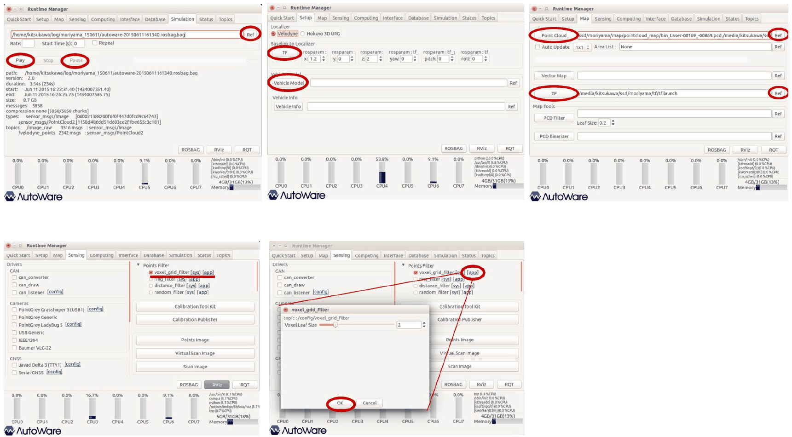

*그림 7. Runtime Manager의 rosbag, TF, 지도, voxel_grid_filter 설정*

> **용어 정의:** **TF(transform)** 는 ROS에서 좌표계 사이의 상대 위치와 방향을 관리하는 방식이다. 차량에는 차량 기준점의 좌표계 `base_link`와 LiDAR의 좌표계(localizer)가 따로 있으며, Baselink to Localizer 값은 차량 기준점에서 본 LiDAR의 장착 위치와 방향이다.

NDT 정합이 직접 구하는 것은 지도 안에서 LiDAR의 포즈이다. 예시처럼 LiDAR가 차량 기준점보다 앞쪽으로 1.2 m, 위쪽으로 2.0 m에 달려 있으면, LiDAR의 포즈에서 이 오프셋을 되돌려야 차량 기준점의 포즈가 된다. 이 값이 틀리면 지도 위에서 차량이 실제보다 앞이나 위에 그려지고, 이후의 경로 추종도 틀어진다.

그림 7의 Simulation 탭은 재생할 rosbag의 정보를 보여 준다. 예시 파일은 Autoware가 배포하는 Moriyama(일본 나고야) 주행 데이터로, 길이 234초, 크기 8.7 GB이며, 카메라 영상 `/image_raw`(`sensor_msgs/Image`) 3516개와 LiDAR 포인트 클라우드 `/velodyne_points`(`sensor_msgs/PointCloud2`) 2342개를 담고 있다. 2342 / 234 ≈ 10이므로 LiDAR는 1초에 약 10번 스캔을 만들고, 3516 / 234 ≈ 15이므로 카메라는 약 15 Hz로 영상을 기록하였다. 위치 인식은 이 10 Hz의 스캔마다 한 번씩 정합을 수행한다.

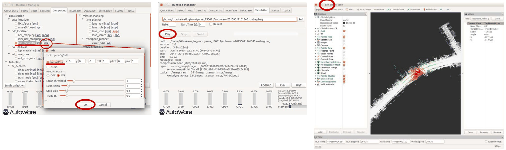

*그림 8. ndt_matching 설정, rosbag 재생, RViz에 표시된 위치 인식 결과*

| 항목 | 예시 값 | 의미 |
|:-----|:-----|:-----|
| Initial Pos / GNSS | Initial Pos, 모두 0 | 첫 정합의 초기 포즈를 직접 입력한 값 $(x, y, z, \text{roll}, \text{pitch}, \text{yaw})$로 할지 GNSS 위치로 할지 고른다 |
| Predict Pose | ON | 직전 스캔들 사이의 움직임으로 다음 포즈를 예측하여 다음 정합의 초기 추정으로 쓴다 |
| Resolution | 1 | NDT 셀 한 변의 길이 (m) |
| Step Size | 0.1 | 선 탐색의 최대 걸음 크기 |
| Trans EPS | 0.01 | 수렴 판정에 쓰는 변환 변화량의 기준 |

*표 6. ndt_matching 대화 상자의 주요 항목*

대화 상자에는 이 밖에 Error Threshold 항목(예시 값 1)도 있다. Predict Pose를 켜면, 차량이 직전과 비슷하게 움직인다고 보고 예측한 포즈에서 정합을 시작하므로, 빠르게 달릴 때에도 초기 추정이 참값에 가까워져 반복 횟수가 줄고 수렴에 실패할 위험이 낮아진다. 그림 8의 RViz 화면에서 흰 점은 포인트 클라우드 지도이고, 지도 가운데의 색 있는 점들이 정합된 현재 스캔이다.

### 3.3 rqt_graph로 본 노드 연결

rqt_graph는 실행 중인 노드와 토픽의 연결을 그래프로 그려 주는 도구이다(4주차 참고). 위치 인식을 실행했을 때의 그래프를 정리하면 다음과 같다.

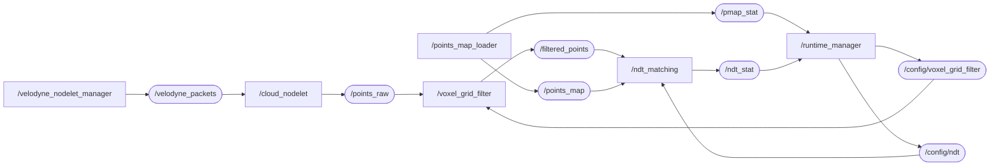

*그림 9. 위치 인식을 실행했을 때의 노드 그래프*

Velodyne 드라이버(`velodyne_nodelet_manager`)가 LiDAR의 원시 패킷을 `/velodyne_packets`로 내보내면, `cloud_nodelet`이 이를 포인트 클라우드 `/points_raw`로 바꾼다. Runtime Manager의 대화 상자에서 바꾼 설정은 `/config/voxel_grid_filter`와 `/config/ndt` 토픽으로 각 노드에 전달되고, 지도 로딩 상태(`/pmap_stat`)와 정합 상태(`/ndt_stat`)는 다시 Runtime Manager로 돌아와 화면에 표시된다. 이처럼 설정 변경도 토픽으로 전달되므로, 노드를 다시 시작하지 않고 실행 중에 매개변수를 바꿀 수 있다.

---

<br>

## 4. 경로 생성

### 4.1 벡터 지도 방식과 주행 기록 방식

위치 인식으로 지금 어디에 있는지 알게 되면, 다음은 어디로 갈지 정해야 한다. Autoware에서 자율주행 경로를 만드는 방법은 두 가지이다.

| 방법 | 원리 | 특징 |
|:-----|:-----|:-----|
| 벡터 지도 방식 | 벡터 지도의 차선 정보 위에서 출발점과 도착점을 골라 경로를 계산한다 | 속도 프로파일을 유연하게 바꿀 수 있고, 장애물 회피와 차선 변경 같은 기능으로 확장하기 쉽다 |
| 주행 기록 방식 | 사람이 운전하며 rosbag으로 기록한 주행 궤적을 그대로 경로로 쓴다 | 만들기 쉽지만 기록한 궤적과 속도에 묶인다 |

*표 7. Autoware에서 경로를 만드는 두 방법*

유연한 속도 프로파일 변경과 이후의 장애물 회피, 차선 변경 같은 활용을 위해 벡터 지도 방식을 권장한다.

> **용어 정의:** **벡터 지도(vector map)** 는 도로를 점과 선 같은 기하 요소로 표현하고, 차선, 정지선, 횡단보도, 신호등 같은 의미 정보와 요소 사이의 연결 관계를 함께 담은 지도이다. 포인트 클라우드 지도가 주변 물체의 표면을 측정한 그대로 담는다면, 벡터 지도는 차량이 어느 차선을 따라 어떻게 달려야 하는지를 담는다. **웨이포인트(waypoint)** 는 경로를 이루는 점 하나로, 위치와 방향, 그 점에서의 목표 속도를 담는다.

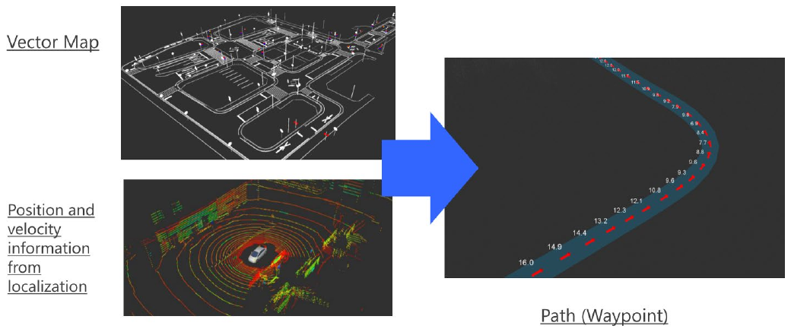

*그림 10. 벡터 지도와 위치 인식 결과로부터 웨이포인트 경로를 만드는 과정*

그림 10의 오른쪽은 만들어진 경로로, 점마다 붙은 숫자가 그 웨이포인트의 목표 속도이다. 경로 생성에는 벡터 지도와 함께 위치 인식이 제공하는 현재 위치와 속도 정보가 쓰인다.

### 4.2 waypoint_clicker로 경로 만들기

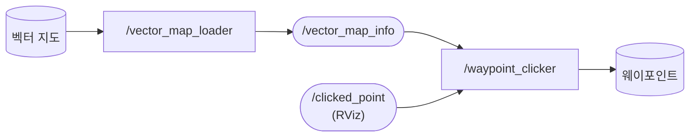

*그림 11. 벡터 지도를 이용한 경로 생성의 노드 구성*

vector_map_loader가 벡터 지도 파일을 읽어 `/vector_map_info` 토픽들로 발행하고, waypoint_clicker는 RViz에서 사용자가 클릭한 점(`/clicked_point`)을 받아 벡터 지도의 차선을 따라 두 점을 잇는 경로를 계산한다. 절차는 다음과 같다.

1. **벡터 지도 불러오기.** Runtime Manager의 Map 탭에서 Vector Map에 벡터 지도 파일(CSV 파일들)을 지정한다.
2. **TF 지정.** 같은 탭의 TF에 벡터 지도의 위치를 나타내는 launch 파일을 지정한다.
3. **RViz 실행.** RViz 버튼으로 RViz를 연다.
4. **waypoint_clicker 실행.** Computing 탭의 waypoint_maker 아래에서 waypoint_clicker를 켠다.
5. **RViz의 Publish Point로 경로 만들기.**
   - RViz에서 노란색 점(벡터 지도의 차선 점)을 확인한다.
   - 도구 막대의 Publish Point를 고른 뒤 노란색 점 하나를 클릭하여 시작점을 정한다.
   - 다시 Publish Point를 고르고 다른 점을 클릭하여 끝점을 정한다.
   - 두 점 사이에 경로가 만들어졌는지(노란색 실선) 확인한다.

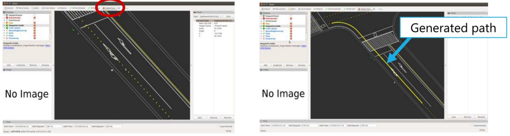

*그림 12. RViz에서 시작점과 끝점을 클릭하여 만든 경로*

그림 12의 왼쪽은 도구 막대에서 Publish Point를 고른 상태이고, 오른쪽은 만들어진 경로(Generated path)이다. 만든 경로는 waypoint_saver로 파일에 저장해 두고, 경로 계획 단계에서 waypoint_loader로 다시 불러온다.

---

<br>

## 5. 경로 계획

### 5.1 경로 계획의 역할

경로 생성이 만든 웨이포인트는 기하학적인 길일 뿐이다. 경로 계획은 이 길을 실제로 달릴 수 있게 다듬는다.

- 저장된 경로를 불러와 경로 계획에 사용한다.
- 최적화된 기준 속도(reference velocity)를 경로에 부여한다.
- Replanning_mode를 사용하면 커브 같은 구간의 속도를 다시 정할 수 있다.

### 5.2 노드와 데이터 흐름

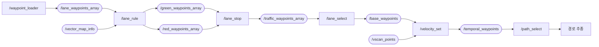

*그림 13. 경로 계획 노드와 토픽의 흐름 (일부 토픽은 생략)*

| 노드 | 하는 일 |
|:-----|:-----|
| waypoint_loader | 저장된 경로 파일을 읽어 `/lane_waypoints_array`로 발행한다 |
| lane_rule | 벡터 지도 정보로 경로를 최적화하고, 녹색 신호용과 적색 신호용 웨이포인트를 따로 만든다 |
| lane_stop | 신호등 인식 결과를 받아 녹색 신호용과 적색 신호용 경로 가운데 하나를 고른다 |
| lane_select | 여러 차선의 경로 가운데 주행할 차선을 골라 `/base_waypoints`로 발행한다 |
| velocity_set | 센서 정보로 경로 위의 물체를 감지한 결과에 따라 목표 속도를 정한다 |
| path_select | 경로 추종에 넘길 최종 경로를 고른다 |

*표 8. 경로 계획 노드의 역할*

적색 신호용 웨이포인트는 정지선 앞에서 속도가 0으로 줄어드는 경로이고, 녹색 신호용 웨이포인트는 정지선을 그대로 지나가는 경로이다. 두 경로를 미리 만들어 두면 신호가 바뀌었을 때 lane_stop이 경로만 바꾸어 고르면 되므로 빠르게 대응할 수 있다. velocity_set이 쓰는 `/vscan_points`는 LiDAR 포인트 클라우드에서 장애물 후보를 뽑아낸 점들이다.

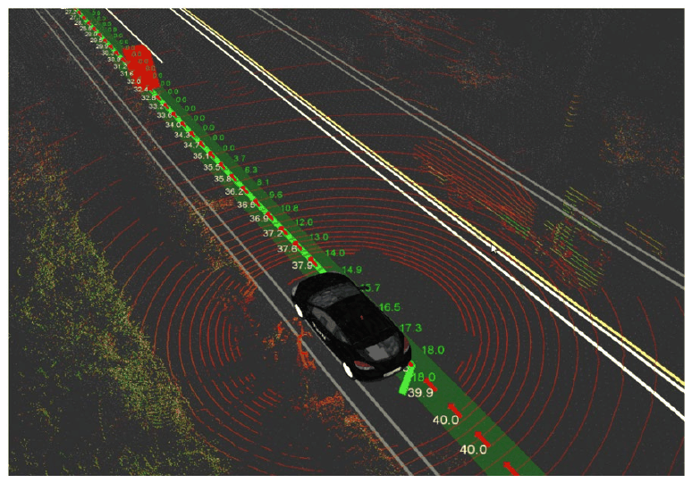

*그림 14. RViz에 표시된 경로 계획 결과와 웨이포인트별 목표 속도*

### 5.3 실행 순서와 노드 설정

경로 계획은 다음 순서로 실행한다. 앞 노드의 출력 토픽을 뒤 노드가 받으므로 순서를 지켜야 한다.

1. vel_pose_mux를 실행한다(위치 인식 결과를 `current_pose`로 내보낸다).
2. waypoint_loader로 경로를 불러온다.
3. lane_rule을 실행한다.
4. lane_stop을 실행한다.
5. lane_select를 실행한다.
6. velocity_set을 실행한다.
7. path_select를 실행한다.
8. RViz에서 경로를 확인한다.

각 노드의 [app] 대화 상자에서 정하는 주요 값은 다음과 같다.

| 노드 | 항목 | 예시 값 | 의미 |
|:-----|:-----|:-----|:-----|
| lane_rule | Acceleration | 1 m/s² | 정지선 앞에서 감속하는 속도 프로파일을 만들 때 쓰는 가속도 |
| lane_rule | Number of Zeros Ahead, Behind | 10, 10 | 정지선 앞뒤로 목표 속도를 0으로 둘 웨이포인트의 수 |
| lane_stop | Red Light, Green Light | 버튼 | 신호 상태를 손으로 지정한다. Use traffic light recognition result를 켜면 신호등 인식 결과를 쓴다 |
| velocity_set | Others Distance | 15 m | 감지한 장애물 앞에서 멈출 거리 |
| velocity_set | Detection Range | 1.3 m | 경로 양옆으로 장애물을 찾는 범위 |
| velocity_set | Points Threshold | 10 | 범위 안의 점이 이 수보다 많으면 장애물로 판단한다 |
| velocity_set | Detection Height Top, Bottom | 0.1 m, -1.8 m | 장애물로 볼 점의 높이 범위 (LiDAR 기준) |
| velocity_set | Deceleration | 1 m/s² | 장애물 앞에서 멈출 때의 감속도 |
| velocity_set | Velocity Change Limit | 15 km/h | 목표 속도를 한 번에 바꿀 수 있는 최대 폭 |

*표 9. 경로 계획 노드의 주요 설정*

velocity_set의 장애물 판단은 단순한 규칙이다. 경로 위 앞쪽의 웨이포인트마다 Detection Range 안, 그리고 Detection Height Bottom과 Top 사이에 있는 LiDAR 점의 수를 세어 Points Threshold보다 많으면 그 자리에 장애물이 있다고 본다. 그러면 장애물보다 Others Distance만큼 앞의 웨이포인트에서 멈추도록, Deceleration의 감속도로 줄어드는 목표 속도를 그 앞 웨이포인트들에 다시 매긴다. 예시처럼 LiDAR가 지면에서 약 2 m 높이에 달려 있으면 높이 범위의 위쪽 끝(0.1 m)은 LiDAR보다 조금 높고 아래쪽 끝(-1.8 m)은 지면보다 조금 위이므로, 지면의 점과 높은 곳의 표지판이나 나뭇가지는 장애물로 세지 않는다.

> **참고:** 감속도 $a$로 속도 $v$에서 멈추는 데 필요한 거리는 $v^2 / (2a)$이다. 예를 들어 $v = 10$ km/h $\approx 2.78$ m/s, $a = 1$ m/s²이면 $2.78^2 / 2 \approx 3.9$ m가 필요하다. 감속을 시작하는 웨이포인트는 정지 지점보다 적어도 이만큼 앞에 있어야 한다.

---

<br>

## 6. 경로 추종과 차량 제어

### 6.1 pure_pursuit와 twist_filter

경로 계획이 정한 최종 경로를 실제로 따라가게 하는 노드는 pure_pursuit와 twist_filter이다.

- **pure_pursuit:** 현재 위치와 목표점(target point)으로 최적의 회전 반경을 계산하고, 현재 속도와 목표점의 위치, 속도를 고려하여 각속도를 정한다.
- **twist_filter:** 횡방향 가속도를 고려하여 최종 속도와 각속도 값을 계산한다.
- 이들 노드가 계산한 값을 차량에 전달한다.

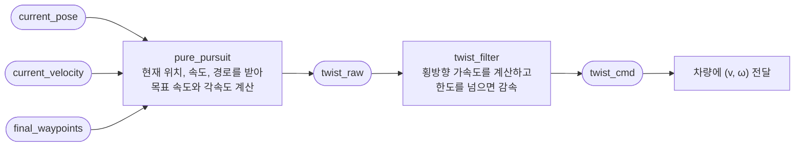

*그림 15. 경로 추종 노드와 토픽의 흐름*

> **용어 정의:** **트위스트(twist)** 는 ROS에서 물체의 속도를 나타내는 메시지로, 선속도와 각속도를 담는다. 평면을 달리는 차량에서는 진행 방향의 선속도 $v$(`linear.x`)와 위에서 본 회전 각속도 $\omega$(`angular.z`)만 쓴다.

### 6.2 pure pursuit의 기하학

**Pure pursuit**는 경로 위에서 차량보다 일정 거리 앞에 있는 점을 목표점으로 잡고, 그 점에 닿는 원호를 따라 달리도록 곡률을 정하는 경로 추종 방법이다 [5]. 목표점은 매 주기 새로 잡히므로, 차량은 경로 위를 앞서 달리는 점을 계속 쫓아가게 된다. 이 이름은 앞서 가는 대상을 그대로 겨냥하여 쫓는 추적 방식(pure pursuit)에서 왔다.

> **용어 정의:** **곡률(curvature)** $\kappa$는 경로가 휘는 정도로, 반지름 $R$인 원의 곡률은 $\kappa = 1/R$이다. **전방 주시 거리(lookahead distance)** $l$은 차량에서 목표점까지의 거리이다.

차량에 붙은 좌표계를 쓴다. 원점은 차량의 기준점(보통 뒷바퀴 축의 가운데), $x$축은 차량의 진행 방향, $y$축은 왼쪽이다. 목표점의 좌표를 $(x_t, y_t)$라 하면 $x_t^2 + y_t^2 = l^2$이다. 차량이 지금 향한 방향($x$축)에 접하면서 원점과 목표점을 모두 지나는 원을 찾는다.

1. 원이 원점에서 $x$축에 접하므로 원의 중심은 $y$축 위에 있다. 중심을 $C = (0, R)$이라 한다($R > 0$이면 왼쪽으로 도는 원).
2. 목표점도 원 위에 있으므로 중심까지의 거리가 $R$이다: $x_t^2 + (y_t - R)^2 = R^2$.
3. 전개하면 $x_t^2 + y_t^2 - 2 y_t R + R^2 = R^2$이므로 $l^2 - 2 y_t R = 0$이다.

$$
R = \frac{l^2}{2 y_t}, \qquad \kappa = \frac{1}{R} = \frac{2 y_t}{l^2}
$$

목표점이 진행 방향과 이루는 각을 $\alpha$라 하면 $y_t = l \sin\alpha$이므로 같은 식을 $\kappa = 2 \sin\alpha / l$로도 쓸 수 있다. $y_t > 0$(목표점이 왼쪽)이면 $\kappa > 0$으로 왼쪽으로, $y_t < 0$이면 오른쪽으로 돈다. $y_t = 0$이면 곡률이 0, 즉 직진이다.

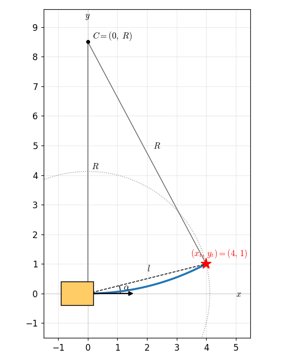

*그림 16. pure pursuit의 기하학: 목표점을 지나는 원호와 곡률 중심*

곡률을 얻으면 차량에 줄 명령으로 바꾼다. 선속도 $v$로 곡률 $\kappa$인 원을 따라 달리면 각속도는 $\omega = v \kappa$이다. 조향각으로 바꿀 때는 앞바퀴만 조향하는 자전거 모델(12주차)에서 축간거리 $L$에 대해 $\delta = \arctan(L \kappa)$를 쓴다.

### 6.3 계산 예

차량 좌표계에서 목표점이 $(x_t, y_t) = (4.0, 1.0)$ m이고, 차량이 $v = 5$ m/s(18 km/h)로 달리며, 축간거리가 $L = 2.8$ m라 하자.

1. 전방 주시 거리: $l^2 = 4.0^2 + 1.0^2 = 17$, $l = \sqrt{17} \approx 4.123$ m.
2. 곡률과 반경: $\kappa = 2 \times 1.0 / 17 \approx 0.1176$ m⁻¹, $R = 17 / 2 = 8.5$ m. 원의 중심은 차량 왼쪽 8.5 m의 $(0, 8.5)$이다.
3. 각을 이용한 확인: $\alpha = \arctan(1.0 / 4.0) \approx 14.04^\circ$, $\sin\alpha \approx 0.2425$이므로 $2 \times 0.2425 / 4.123 \approx 0.1176$ m⁻¹으로 같다.
4. 각속도: $\omega = v \kappa = 5 \times 0.1176 \approx 0.588$ rad/s(약 $33.7^\circ$/s), 왼쪽으로 돈다.
5. 조향각: $\delta = \arctan(2.8 \times 0.1176) = \arctan(0.329) \approx 18.2^\circ$.
6. 횡방향 가속도: $a_y = v^2 \kappa = 25 \times 0.1176 \approx 2.94$ m/s².

pure_pursuit 노드가 발행하는 `twist_raw`에는 $v = 5$ m/s와 $\omega = 0.588$ rad/s가 담긴다.

### 6.4 목표점과 전방 주시 거리의 선택

Autoware의 pure_pursuit는 경로의 웨이포인트를 차례로 보며 현재 위치에서 전방 주시 거리보다 멀리 있는 첫 웨이포인트를 목표점으로 잡는다. Linear Interpolate를 켜면, 그 웨이포인트와 바로 앞 웨이포인트를 잇는 선분이 반지름 $l$인 원과 만나는 점을 계산하여 목표점으로 쓴다. 웨이포인트 사이가 멀어도 목표점이 정확히 거리 $l$에 놓이므로 곡률 계산이 매끄러워진다 [6].

전방 주시 거리는 두 가지 방식으로 정한다. Dialog 모드에서는 대화 상자에 입력한 고정 속도와 고정 전방 주시 거리를 쓴다. Waypoint 모드에서는 속도를 웨이포인트의 목표 속도에서 가져오고, 전방 주시 거리를 현재 속도에 비례하게 정한다 [6].

$$
l = \begin{cases} l_{\min} & (r \, v < l_{\min}) \\ \min(r \, v, \; 10 v) & (\text{otherwise}) \end{cases}
$$

여기서 $r$은 lookahead_ratio, $l_{\min}$은 minimum_lookahead_distance, $v$는 현재 속도(m/s)이다. 예시 설정 $r = 2$, $l_{\min} = 4$ m에서는 다음과 같다.

| 현재 속도 | $r v$ | 전방 주시 거리 $l$ |
|:-----|:-----|:-----|
| 1 m/s (3.6 km/h) | 2 m | 4 m (최솟값 적용) |
| 2.78 m/s (10 km/h) | 5.56 m | 5.56 m |
| 5 m/s (18 km/h) | 10 m | 10 m |

*표 10. 예시 설정에서 속도에 따른 전방 주시 거리*

속도에 비례하게 정하는 까닭은 전방 주시 거리가 추종 성능을 크게 좌우하기 때문이다 [5].

- **짧으면** 목표점이 가까워 경로를 바짝 따르지만, 경로에서 조금만 벗어나도 큰 곡률로 급하게 꺾으므로 차량이 경로 양옆으로 흔들리기(진동) 쉽다.
- **길면** 움직임이 부드럽고 안정적이지만, 곡선 구간에서 목표점이 커브 안쪽으로 당겨져 코너를 안쪽으로 질러가고(corner cutting), 경로로 돌아오는 데 오래 걸린다.

빠를수록 같은 곡률 변화가 더 큰 횡방향 가속도를 만들므로, 속도가 높을 때 전방 주시 거리를 늘리면 안정성을 얻는다.

### 6.5 twist_filter와 횡방향 가속도 제한

곡률 $\kappa$인 원을 속도 $v$로 달리는 차량은 원의 중심 쪽으로 $a_y = v^2 \kappa = v \omega$의 횡방향 가속도(구심 가속도)를 받는다. 이 값이 크면 승객이 불편하고, 타이어의 마찰 한계를 넘으면 차량이 미끄러진다. twist_filter는 pure_pursuit가 낸 목표 속도와 각속도로 횡방향 가속도를 계산하여, 정한 한도(lateral_accel_limit)를 넘으면 목표 속도를 줄인다. 곡률을 유지하며 한도 $a_{\max}$를 지키려면 속도가 다음을 만족해야 한다.

$$
v^2 \kappa \le a_{\max} \quad \Longrightarrow \quad v \le \sqrt{\frac{a_{\max}}{\kappa}}
$$

6.3절의 목표점($\kappa = 0.1176$ m⁻¹)에서 한도가 예시 설정의 $a_{\max} = 5$ m/s²이면, $v = 5$ m/s의 $a_y = 2.94$ m/s²는 한도 안이므로 그대로 통과한다. 같은 곡선을 $v = 8$ m/s로 달리려 하면 $a_y = 64 \times 0.1176 \approx 7.53$ m/s²로 한도를 넘으므로, 속도를 $\sqrt{5 / 0.1176} \approx 6.52$ m/s(약 23.5 km/h) 이하로 줄여야 한다.

### 6.6 실행 절차

경로 추종은 다음 순서로 실행한다.

1. Computing 탭의 waypoint_follower 아래에서 pure_pursuit의 [app] 대화 상자를 열어 세부 설정을 한 뒤 실행한다.
2. twist_filter의 [app] 대화 상자에서 세부 설정을 한 뒤 실행한다.
3. RViz에서 속도와 커브 목표값이 생성되는지 확인한다.

| 노드 | 항목 | 예시 값 | 의미 |
|:-----|:-----|:-----|:-----|
| pure_pursuit | Waypoint / Dialog | Waypoint | 속도와 전방 주시 거리를 웨이포인트와 현재 속도로 정할지, 대화 상자의 고정값(Velocity 10 km/h, Lookahead Distance 4 m)으로 정할지 고른다 |
| pure_pursuit | lookahead_ratio | 2 | 현재 속도(m/s)에 곱해 전방 주시 거리를 정하는 비율 |
| pure_pursuit | minimum_lookahead_distance | 4 m | 전방 주시 거리의 최솟값 |
| pure_pursuit | displacement_threshold, relative_angle_threshold | 0, 0 | 차량이 이미 경로를 잘 따르고 있다고 판단할 위치 편차와 각도 편차의 기준 |
| pure_pursuit | Linear Interpolate | 켬 | 웨이포인트 사이를 보간하여 목표점을 정확히 거리 $l$에 둔다 |
| twist_filter | lateral_accel_limit | 5 m/s² | 횡방향 가속도의 한도 |

*표 11. 경로 추종 노드의 주요 설정*

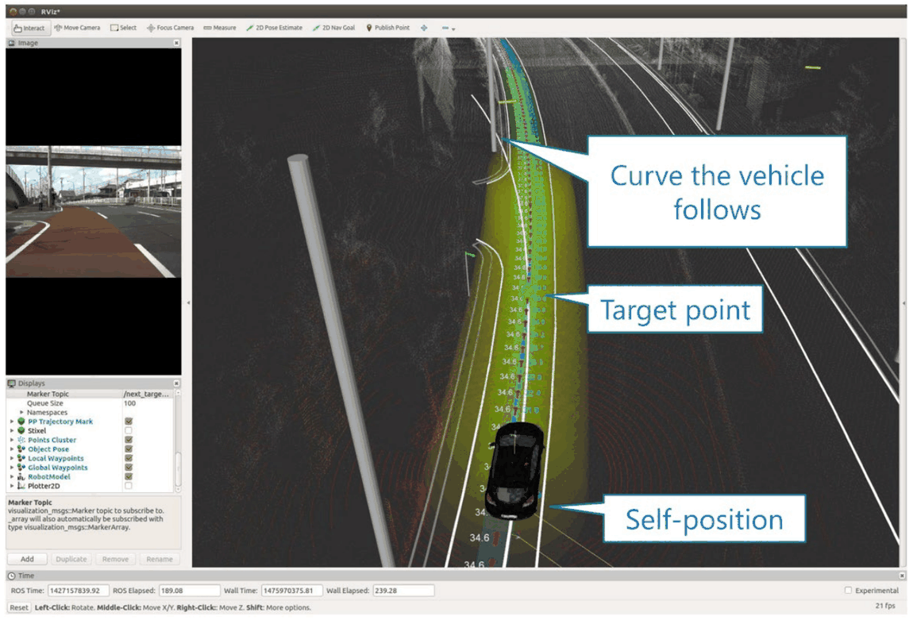

*그림 17. RViz에 표시된 경로 추종: 차량이 따라갈 곡선, 목표점, 자기 위치*

그림 17에서 Self-position은 위치 인식이 추정한 차량의 현재 위치이고, Target point는 전방 주시 거리만큼 앞의 목표점이며, 그 둘을 잇는 초록색 곡선(Curve the vehicle follows)이 pure pursuit가 계산한 원호이다. 경로를 따라 표시된 숫자는 웨이포인트의 목표 속도이다. 센서 드라이버부터 위치 인식, 경로 계획, 경로 추종까지 모두 실행한 뒤 rqt_graph를 열면, 수십 개의 노드가 토픽으로 얽힌 큰 그래프가 나타난다. 그래프가 복잡해도 데이터는 그림 1의 순서, 즉 센서와 지도에서 위치 인식, 경로 계획, 경로 추종을 거쳐 차량으로 흐른다.

---

<br>

## 7. 실차 적용 사례: 쏘나타 기반 자율주행 시스템

### 7.1 차량 구성과 주행 시험

앞 절의 기능을 실제 차량에 적용한 사례이다. 현대 쏘나타(LF)에 Velodyne 16채널 LiDAR(Hi-Res 모델)와 GNSS 센서를 설치하고 Autoware로 자율주행을 완료하였다.

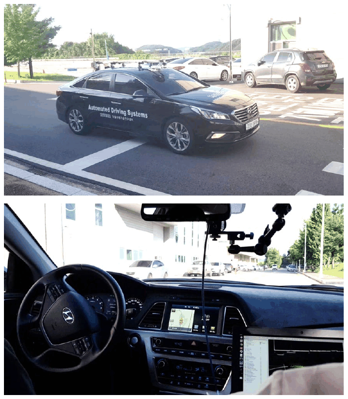

*그림 18. LiDAR와 GNSS를 설치한 시험 차량과 차량 내부의 제어용 컴퓨터*

- 직선 구간, 곡선 구간, 내리막길 등에서 성능을 확인하였다.
- 최대 속도는 직선 구간 10 km/h, 급커브 구간 3 km/h로 설정하였다.
- 장애물 회피와 정류장(station) 정차 시험을 수행하였다.

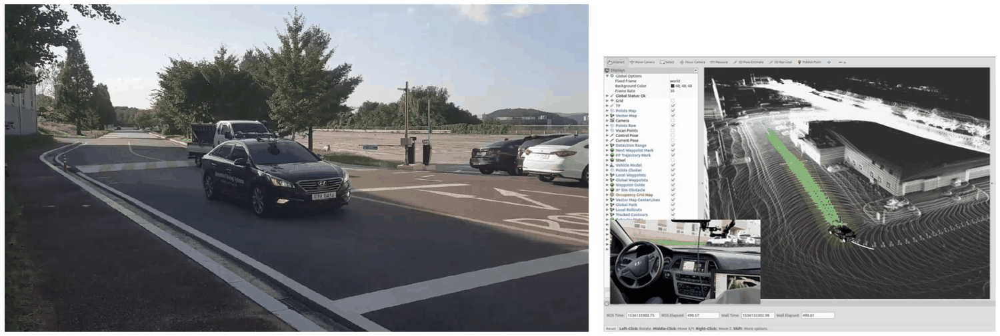

*그림 19. 시험 차량의 주행 모습과 같은 시점의 RViz 화면*

### 7.2 정류장 정차

정류장 정차는 Autoware의 신호(Traffic Signal)와 정지선(Stop Line) 기능을 활용하여 구현하였다. Runtime Manager에 station 노드와 CAN 송수신 노드를 추가하고, station 노드가 차량 속도와 벡터 지도의 정지선까지의 거리 같은 정보를 받는다. 정류장 위치를 정지선으로 두면 적색 신호일 때 lane_stop이 정지선 앞에서 멈추는 경로를 고르므로 차량이 정류장에 선다. 정차 후 출발할 때 station 노드가 신호를 녹색으로 바꾸면 차량이 다시 출발한다. 새 기능을 처음부터 만들지 않고 기존 신호 처리 경로를 재사용한 설계이다.

### 7.3 LiDAR 기반 장애물 인식과 회피

- LiDAR에서 얻은 포인트 클라우드에서 ring_ground_filter로 지면 부분을 제거한다.
- LiDAR의 euclidean cluster detect 노드로 남은 점들을 가까운 점끼리 묶어(군집화) 장애물을 인식하고 추적한다.
- A\* planner와 Open planner 등을 활용하여 장애물과의 충돌을 회피한다.
- 이후 장애물 능동 회피와 차선 변경 같은 차량 거동 제어에 활용한다.

> **용어 정의:** **유클리드 군집화(Euclidean clustering)** 는 서로 일정 거리 안에 있는 점들을 같은 물체로 묶는 방법이다. 지면 점을 먼저 지우지 않으면 모든 물체가 지면을 통해 하나로 이어지므로, 지면 제거가 군집화보다 먼저 와야 한다.

A\*와 Hybrid A\* 같은 경로 탐색 알고리즘은 10주차에서 다룬다.

### 7.4 개발 내용과 결론

| 분야 | 개발 내용 |
|:-----|:-----|
| 위치 인식 | GNSS 인터페이스와 GNSS 기반 위치 인식 구현, LiDAR 기반 위치 인식 구현 |
| 차량 통신과 제어 | CAN 기반 PC와 차량 사이의 통신 ROS 노드 구현, PC와 차량 사이의 속도와 조향 수동 제어 시험 완료 |
| 지도 | LiDAR 기반 포인트 클라우드 매핑 완료, 벡터 지도 작성과 시험 |
| 경로 | 경로 생성과 경로 계획의 시뮬레이션과 실차 적용, 경로 추종 구현 뒤 시뮬레이션과 실차 적용 |
| 시험 | 기관 부지 안 실주행 차량 시험 완료, 정류장 구현과 정차 시험 완료, 장애물 인식 알고리즘 시험 완료 |

*표 12. 실차 적용 사례의 개발 내용*

결론은 다음과 같다.

- Autoware를 활용하여 자율주행이 가능함을 확인하였다.
- ROS 기반으로 소프트웨어를 개발하므로 유연하게 변형할 수 있다.
- 속도와 제동 거리 같은 각종 제어 매개변수를 최적화하기 쉽다.
- 대용량 지도를 만든 뒤의 시험이 필요하다.
- 카메라와의 센서 융합을 이용한 정밀한 장애물 검출이 필요하다.
- 대용량 지도의 로딩과 실시간성을 보장하기 위해 고성능 PC를 이용한 구현이 요구된다.

CAN 통신과 Autoware의 CAN 노드는 13\~14주차에서 다룬다.

### 7.5 활용 사례

이 기술은 캠퍼스 안의 무인 셔틀, 자율주행 배송 로봇, 퍼스널 모빌리티에 활용할 수 있다.

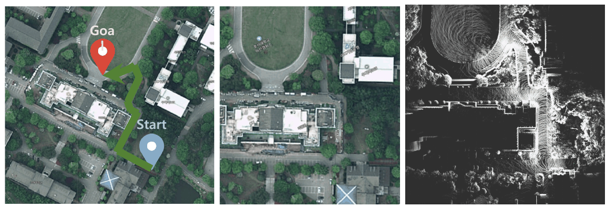

*그림 20. 캠퍼스 무인 셔틀의 출발점과 도착점을 표시한 위성 지도와 같은 영역의 포인트 클라우드 지도*

그림 20의 왼쪽 위성 지도에는 출발점(Start)에서 도착점(Goal)까지의 주행 경로가 초록색으로 표시되어 있고, 오른쪽은 같은 영역을 LiDAR로 매핑한 포인트 클라우드 지도이다. 실제 서비스 영역마다 이처럼 지도를 먼저 만들고, 그 위에서 이 단원의 위치 인식, 경로 계획, 경로 추종을 수행한다.

---

<br>

## 8. Ubuntu 18.04 설치

이후의 ROS와 Autoware 실습은 Ubuntu 18.04 LTS(코드명 Bionic Beaver)에서 진행한다. ROS 1의 배포판은 특정 Ubuntu 버전에 맞추어 만들어지며, 실습에 쓰는 ROS Melodic과 Autoware.ai 1.14.0이 Ubuntu 18.04를 대상으로 한다(4주차 참고).

> **용어 정의:** **LTS(long term support)** 는 장기 지원 버전으로, Ubuntu의 LTS 버전은 5년 동안 표준 보안 업데이트를 받는다 [7]. **ISO 이미지(ISO image)** 는 설치 디스크의 내용을 파일 하나에 담은 것이다.

> **주의:** Ubuntu 18.04의 표준 지원은 2023년에 끝났고 [7], ROS Melodic도 2023년에 지원이 끝났다 [8]. 이 환경은 실습 자료와 같은 버전을 재현하기 위한 것이며, 인터넷에 직접 연결되는 장비에 오래 쓰기에는 보안 업데이트가 부족하다.

### 8.1 설치 방식 고르기

| 방식 | 장점 | 단점 |
|:-----|:-----|:-----|
| USB 메모리로 PC에 직접 설치 | 컴퓨터 성능을 모두 쓰고, GPU와 LiDAR 같은 장치를 직접 연결하기 쉽다 | 디스크 분할을 잘못하면 기존 운영 체제와 자료를 잃을 수 있다 |
| 가상 머신에 설치 | 기존 운영 체제(Windows 등) 안에서 안전하게 쓰고, 상태를 통째로 저장하거나 지울 수 있다 | 메모리와 CPU를 나누어 쓰므로 느리고, GPU와 센서 연결이 제한된다 |

*표 13. Ubuntu 설치 방식의 비교*

실제 차량이나 센서를 다루는 개발 PC에는 직접 설치가 알맞고, 처음 배우며 명령과 도구를 익히는 데에는 가상 머신이 편리하다.

### 8.2 설치 이미지 내려받기

1. `http://releases.ubuntu.com/18.04/`에서 개발 환경에 맞는 버전을 내려받는다. 일반적인 64비트 PC에서는 데스크톱용 `ubuntu-18.04.6-desktop-amd64.iso`를 고른다. 18.04.6은 18.04의 마지막 갱신판이고, amd64는 64비트 x86 프로세서(Intel과 AMD)를 뜻한다.
2. 같은 페이지의 `SHA256SUMS` 파일로 내려받은 파일이 손상되지 않았는지 확인할 수 있다. Ubuntu나 macOS의 터미널에서는 다음 명령으로 해시를 계산하여 `SHA256SUMS`의 값과 비교한다.

```bash
sha256sum ubuntu-18.04.6-desktop-amd64.iso    # Ubuntu
shasum -a 256 ubuntu-18.04.6-desktop-amd64.iso    # macOS
```

두 값이 다르면 파일이 중간에 손상된 것이므로 다시 내려받는다.

### 8.3 USB 메모리로 설치하기

1. Ubuntu 공식 튜토리얼(Windows에서 부팅 가능한 USB 메모리 만들기)을 따라 Rufus 같은 도구로 ISO 이미지를 USB 메모리에 기록한다 [9]. 이때 USB 메모리의 기존 자료는 모두 지워진다.
2. 컴퓨터를 다시 켜면서 부팅 메뉴(제조사에 따라 F12, F11, Esc 등)를 열어 USB 메모리로 부팅한다.
3. 설치 화면이 나오면 8.5절과 같은 순서로 설치한다.
4. 설치 언어는 영어로 하고, 필요하면 설치 뒤에 한글 입력을 추가한다(4주차 1.3절). 한국어로 설치하면 홈 폴더 아래의 기본 폴더 이름(문서, 다운로드 등)이 한국어로 만들어져 터미널에서 경로를 입력하기 불편하고, 오류 메시지도 한국어로 나와 검색하기 어렵다.

### 8.4 VirtualBox 가상 머신 만들기

**가상 머신(virtual machine)** 은 실제 컴퓨터(호스트) 안에서 소프트웨어로 흉내 낸 또 하나의 컴퓨터(게스트)이다. 가상 머신 소프트웨어로는 VMware와 Oracle VirtualBox 등이 있으며, 여기서는 무료인 VirtualBox를 쓴다.

1. 8.2절에서 ISO 이미지를 내려받는다.
2. `https://www.virtualbox.org`에서 VirtualBox를 내려받아 설치한다.
3. VirtualBox 관리자에서 새로 만들기(New)를 눌러 가상 머신을 만든다.

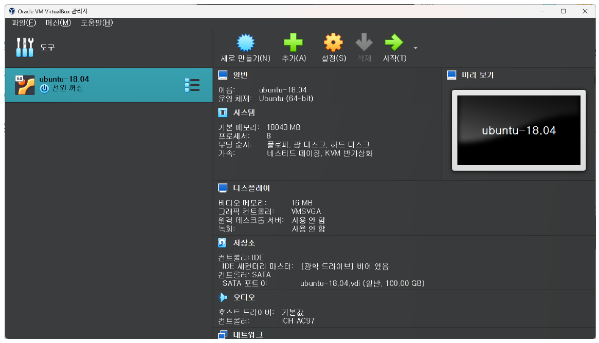

*그림 21. VirtualBox 관리자와 만들어 둔 Ubuntu 18.04 가상 머신*

그림 21의 `ubuntu-18.04` 가상 머신은 메모리 18043 MB, 프로세서 8개, 가상 디스크 100 GB로 설정되어 있다. Autoware처럼 큰 소프트웨어를 빌드하려면 이처럼 메모리, 프로세서, 디스크를 넉넉히 할당하는 편이 안전하다.

4. 가상 머신을 설정한다. 설정은 다음 화면을 차례로 거친다.

**이름과 운영 체제.** 이름(예: Test), 저장 폴더, 종류(Linux), 버전(Ubuntu 18.04 LTS (Bionic Beaver) (64-bit))을 고른다.

**메모리와 프로세서.** 기본 메모리(예: 2048 MB)와 프로세서 수(예: 1개)를 정한다. 막대의 초록 구간 안에서 고르면 호스트가 쓸 자원이 남는다.

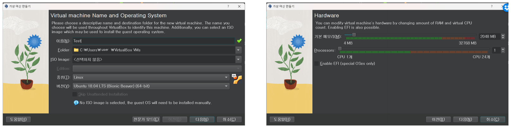

*그림 22. 가상 머신의 이름, 운영 체제, 메모리, 프로세서 설정*

**가상 하드 디스크.** Create a Virtual Hard Disk Now를 고르고 크기(예: 25 GB)를 정한다. Pre-allocate Full Size를 끄면 디스크 파일이 실제로 쓴 만큼만 커지는 동적 할당이 된다.

**설정 확인.** Summary 화면에서 이름, 운영 체제, 메모리 2048 MB, 프로세서 1개, 디스크 25 GB를 확인하고 Finish를 누른다.

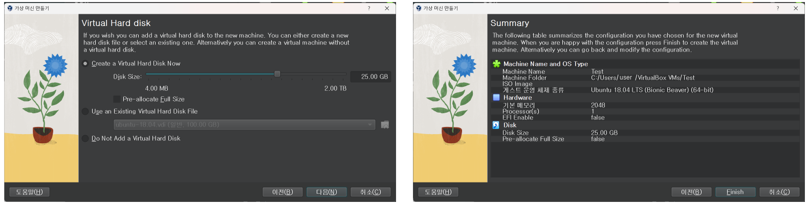

*그림 23. 가상 하드 디스크 설정과 최종 설정 확인 화면*

**설치 이미지 연결.** 만들어진 가상 머신을 확인한 뒤 설정(Settings)의 저장소(Storage)에서 비어 있는 광학 드라이브를 고르고, 내려받은 ISO 파일을 연결한다. 가상 머신은 이 ISO를 설치 DVD처럼 읽어 부팅한다.

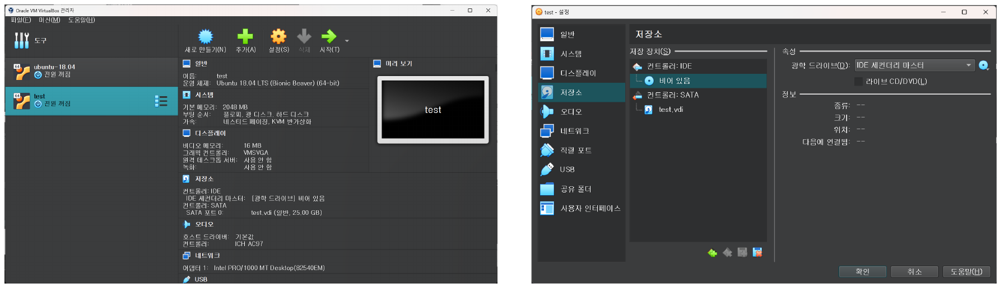

*그림 24. 만들어진 가상 머신과 저장소 설정에서 ISO 이미지를 연결하는 화면*

> **참고:** 25 GB 디스크는 Ubuntu를 설치하고 익히기에는 충분하지만, ROS와 Autoware의 소스 코드와 빌드 결과까지 담기에는 빠듯하다. 디스크 크기는 나중에 늘리기 번거로우므로 처음부터 여유 있게 정한다.

### 8.5 가상 머신에 Ubuntu 설치하기

가상 머신을 시작하면(Start) Ubuntu 설치 프로그램이 실행된다.

1. **Welcome:** 왼쪽 목록에서 English를 고르고 Install Ubuntu를 누른다. Try Ubuntu는 디스크를 바꾸지 않고 ISO에서 바로 Ubuntu를 실행해 보는 기능이다.
2. **Keyboard layout:** English (US)를 고른다.

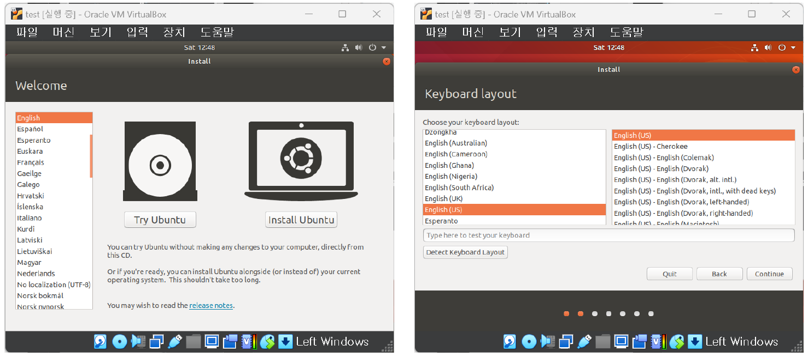

*그림 25. 설치 언어 선택 화면과 키보드 배치 선택 화면*

3. **Updates and other software:** Normal installation을 고르고, 설치 중 업데이트 내려받기(Download updates while installing Ubuntu)와 그래픽, Wi-Fi 장치, 추가 미디어 형식을 위한 서드 파티 소프트웨어 설치를 선택한다.
4. **Installation type:** Erase disk and install Ubuntu를 고르고 Install Now를 누른다. 가상 머신에서는 지워지는 것이 가상 디스크뿐이므로 안전하다. 실제 PC에서 이 항목을 고르면 디스크의 기존 운영 체제와 자료가 모두 지워지므로, Windows와 함께 쓰려면 Install Ubuntu alongside 항목이나 Something else(직접 분할)를 고른다.

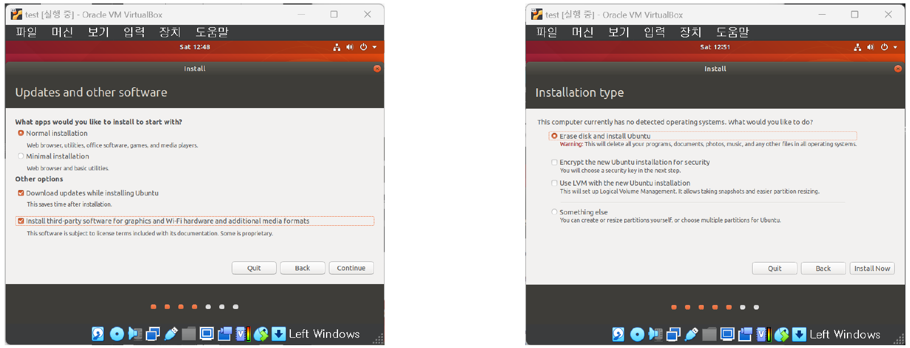

*그림 26. 업데이트와 추가 소프트웨어 선택 화면과 설치 형식 선택 화면*

5. **Where are you:** 지도에서 시간대를 정한다(예: Seoul).
6. **Who are you:** 사용자 이름, 컴퓨터 이름, 로그인 이름(username), 비밀번호를 입력한다. 로그인 이름은 홈 폴더 이름(`/home/로그인 이름`)이 되므로 영문 소문자로 짧게 정한다. 이 비밀번호는 이후 `sudo` 명령에도 쓰인다.

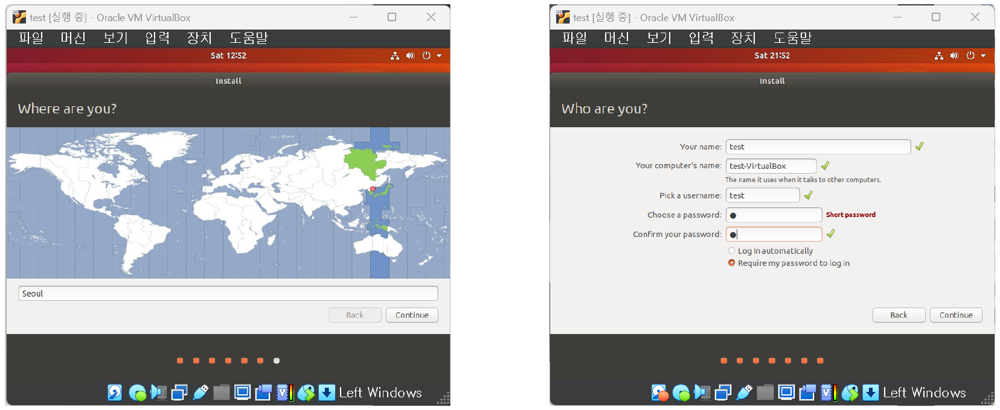

*그림 27. 시간대 선택 화면과 사용자 정보 입력 화면*

7. **설치 진행:** 파일 복사가 끝나면 다시 시작(Restart Now)을 누른다. 다시 시작하면서 설치 매체를 빼라는 안내가 나오면 Enter를 누른다(VirtualBox는 ISO 연결을 자동으로 풀어 준다).

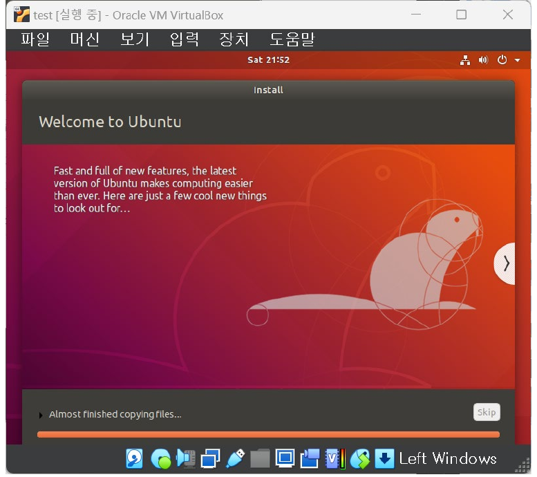

*그림 28. Ubuntu 설치가 진행되는 화면*

설치가 끝나면 4주차의 순서에 따라 패키지를 업데이트하고 개발 환경과 ROS를 설치한다.

### 8.6 자주 생기는 문제

| 증상 | 원인과 해결 |
|:-----|:-----|
| 가상 머신을 시작하면 VT-x 또는 AMD-V 관련 오류가 난다 | 64비트 게스트를 실행하려면 CPU의 하드웨어 가상화 기능이 켜져 있어야 한다. BIOS/UEFI 설정에서 Intel VT-x 또는 AMD-V(SVM)를 켠다 |
| 버전 목록에 64-bit 항목이 없다 | 위와 같은 원인이다. 하드웨어 가상화를 켠다 |
| USB 메모리로 부팅되지 않는다 | BIOS/UEFI의 부팅 순서에서 USB를 앞에 두거나 부팅 메뉴에서 USB를 직접 고른다. USB에 ISO를 기록할 때 쓴 도구의 설정(GPT와 UEFI, MBR과 BIOS)이 컴퓨터의 부팅 방식과 맞는지 확인한다 |
| 가상 머신의 화면이 작게 고정되고 창 크기를 바꿔도 따라오지 않는다 | VirtualBox 게스트 확장(Guest Additions)을 설치하면 화면 크기 조절과 클립보드 공유가 동작한다 |
| 설치나 빌드가 지나치게 느리거나 멈춘다 | 가상 머신에 할당한 메모리와 프로세서가 부족하다. 가상 머신을 끄고 설정에서 늘린다 |

*표 14. Ubuntu 설치에서 자주 생기는 문제와 해결*

---

<br>

## 개념 적용

| 상황 | 알맞은 대응과 이유 |
|:-----|:-----|
| 도심의 높은 건물 사이에서 GNSS 위치가 수 m씩 튄다. | **NDT 매칭 위치 인식.** LiDAR 스캔을 포인트 클라우드 지도에 정합하므로 위성 신호가 가려져도 포즈를 추정할 수 있다. GNSS는 초기 위치를 정하는 데에만 쓴다. |
| rosbag을 재생했는데 RViz에서 차량이 지도와 어긋난 곳에 놓이고 움직이지 않는다. | **초기 위치 지정.** NDT는 초기 추정 근처에서만 수렴하므로, RViz의 2D Pose Estimate나 Initial Pos 값으로 실제 위치에 가까운 초기 포즈를 준다. |
| 정합이 느려 10 Hz 스캔을 따라가지 못한다. | **voxel_grid_filter의 Leaf Size를 키우거나 NDT 해상도를 조정한다.** 정합 계산량은 스캔의 점 수에 비례한다. |
| 차량이 직선 경로에서 좌우로 흔들린다. | **lookahead_ratio나 minimum_lookahead_distance를 키운다.** 전방 주시 거리가 짧으면 작은 오차에도 큰 곡률로 꺾어 진동한다. |
| 급커브에서 차량이 커브 안쪽을 질러간다. | **전방 주시 거리를 줄이거나 커브 구간의 속도를 낮춘다.** 목표점이 멀면 원호가 커브 안쪽을 지난다. |
| 정류장에서 멈췄다가 다시 출발해야 한다. | **정지선과 신호를 이용한 station 노드.** 적색 신호에서 lane_stop이 정지 경로를 고르고, 출발 시 신호를 녹색으로 바꾼다. |
| ROS 실습용 Ubuntu를 Windows 노트북에서 바로 써 보고 싶다. | **VirtualBox 가상 머신.** 기존 운영 체제를 건드리지 않고 설치할 수 있다. |

*표 15. 상황별로 알맞은 대응과 그 이유*

**T/F 점검:**

| 문장 | 판단과 근거 |
|:-----|:------------|
| NDT는 스캔의 각 점에 가장 가까운 지도 점을 찾아 대응시킨다. | **F.** 그것은 ICP의 방식이다. NDT는 셀마다의 정규 분포로 점수를 계산하므로 점 대응을 찾지 않는다. |
| 벽을 따라 움직인 점과 벽에 수직으로 움직인 점은 같은 거리라도 NDT 점수가 다르다. | **T.** 공분산이 벽 방향으로 길게 퍼져 있으므로 벽에 수직인 방향의 이탈을 더 크게 벌한다. |
| 뉴턴 방법은 어떤 초기 추정에서 시작해도 점수를 높이는 방향으로 움직인다. | **F.** 헤세 행렬이 양의 정부호가 아니면 반대 방향으로 갈 수 있으므로 구현은 헤세 행렬을 보정하거나 선 탐색을 쓴다. |
| NDT의 Resolution을 키우면 초기 추정 오차에 더 강해지지만 정확도는 떨어질 수 있다. | **T.** 셀이 크면 점수 함수가 완만해져 수렴 범위가 넓어지지만 표면의 세부 모양이 뭉개진다. |
| pure pursuit에서 목표점이 차량의 바로 앞($y_t = 0$)에 있으면 곡률은 0이다. | **T.** $\kappa = 2 y_t / l^2 = 0$이므로 직진한다. |
| 같은 곡률에서 속도를 두 배로 하면 횡방향 가속도도 두 배가 된다. | **F.** $a_y = v^2 \kappa$이므로 네 배가 된다. |
| VirtualBox에서 Erase disk and install Ubuntu를 고르면 호스트의 Windows가 지워진다. | **F.** 가상 머신 안의 가상 디스크만 지워진다. |

---

<br>

## 요약

| 개념 | 핵심 요약 |
|:--------|:------------|
| 위치 인식 | 지도 안에서 차량의 포즈(위치와 방향)를 추정하는 일이다. 3차원에서는 $(x, y, z)$와 roll, pitch, yaw의 6개 값이다. |
| 스캔 정합 | 현재 스캔을 지도에 가장 잘 겹치게 하는 변환을 찾는 일이며, 그 변환이 지도 안에서 센서의 포즈이다. |
| NDT 표현 | 공간을 셀로 나누고 셀마다 점들의 평균과 공분산으로 정규 분포를 만든다. 점 대응 없이 미분 가능한 점수 함수를 얻는다. |
| NDT 점수와 최적화 | 옮긴 스캔 점마다 $\exp(-\frac{1}{2} \mathbf{q}^{T} \Sigma^{-1} \mathbf{q})$를 더한 점수를 뉴턴 방법 $H \Delta\mathbf{p} = -\mathbf{g}$로 최대화한다. 초기 추정이 참값에 가까워야 한다. |
| 3차원 NDT | 6개 매개변수를 추정하며, 이상점에 강한 점수 함수와 선 탐색을 쓴다. Resolution, Step Size, Trans EPS가 주요 매개변수이다. |
| NDT 매핑 | 새 스캔을 쌓아 온 지도에 정합하여 더하는 일을 반복해 지도를 만든다. 오차가 누적될 수 있다. |
| Autoware 위치 인식 | voxel_grid_filter가 스캔을 줄이고, ndt_matching이 points_map_loader의 지도에 정합하며, vel_pose_mux가 `current_pose`를 낸다. TF로 LiDAR 포즈를 차량 포즈로 바꾼다. |
| 경로 생성 | 벡터 지도 위에서 waypoint_clicker로 시작점과 끝점을 골라 웨이포인트 경로를 만든다. 주행 기록 방식보다 확장성이 좋다. |
| 경로 계획 | lane_rule, lane_stop, lane_select, velocity_set, path_select가 차례로 속도를 매기고 신호, 차선, 장애물을 반영한다. |
| pure pursuit | 전방 주시 거리 $l$의 목표점 $(x_t, y_t)$를 지나는 원호의 곡률 $\kappa = 2 y_t / l^2$를 구하고 $\omega = v \kappa$를 낸다. |
| 전방 주시 거리 | 짧으면 진동하고 길면 코너를 질러간다. Autoware는 현재 속도에 lookahead_ratio를 곱하고 최솟값으로 제한한다. |
| twist_filter | 횡방향 가속도 $a_y = v^2 \kappa$가 한도를 넘으면 목표 속도를 $\sqrt{a_{\max} / \kappa}$ 이하로 줄인다. |
| 실차 적용 | 쏘나타에 LiDAR와 GNSS를 달아 위치 인식, 경로 계획, 경로 추종, 정류장 정차, 장애물 인식을 시험하였다. 대용량 지도와 센서 융합이 과제로 남았다. |
| Ubuntu 18.04 설치 | ISO를 내려받아 USB 메모리나 VirtualBox 가상 머신으로 설치한다. 영어로 설치하고 자원을 넉넉히 할당한다. |

---

<br>

## 점검 문제

1. **위치 인식과 스캔 정합:** 스캔 정합으로 구한 변환이 왜 지도 안에서의 센서 포즈가 되는지 설명하고, 차량 기준점의 포즈를 얻으려면 무엇이 더 필요한지 쓰라.

   <details>
   <summary>정답</summary>

   스캔은 LiDAR를 원점으로 한 센서 좌표계로 표현되어 있으므로, 스캔을 지도 좌표계로 옮겨 지도와 겹치게 하는 변환은 센서 좌표계의 원점과 축을 지도 좌표계 안에 놓는 변환, 즉 지도 안에서 센서의 위치와 방향이다. 차량 기준점의 포즈를 얻으려면 차량 기준점(`base_link`)에서 LiDAR까지의 장착 위치와 방향(Baselink to Localizer TF)을 알고, 이 오프셋을 되돌려야 한다.

   </details>

2. **NDT 셀 계산:** 한 셀에 점 $(0, 0)$, $(2, 0)$, $(0, 2)$, $(2, 2)$가 있다. 평균 벡터와 공분산 행렬($n$으로 나눔)을 구하고, 위치 $(2, 1)$에서 $\exp(-\frac{1}{2} \mathbf{q}^{T} \Sigma^{-1} \mathbf{q})$를 계산하라.

   <details>
   <summary>정답</summary>

   평균은 $(1, 1)$이다. 편차는 $(\pm 1, \pm 1)$의 네 조합이므로 $x$, $y$ 분산은 각각 $4/4 = 1$이고 공분산은 $(1 - 1 - 1 + 1)/4 = 0$이다. 따라서 $\Sigma = I$, $\Sigma^{-1} = I$이다. $\mathbf{q} = (2, 1) - (1, 1) = (1, 0)$이므로 $\mathbf{q}^{T} \Sigma^{-1} \mathbf{q} = 1$, 점수는 $e^{-0.5} \approx 0.607$이다. 분포가 둥글어 방향에 따른 차이가 없다.

   </details>

3. **기울기의 방향:** 2.4절의 계산 예 1에서 $g_{\phi} > 0$이다. 회전각 $\phi$를 어느 쪽으로 바꾸어야 점수가 높아지는지, 그 이유를 점의 위치로 설명하라.

   <details>
   <summary>정답</summary>

   $s = -\text{score}$를 줄이는 방향은 $-g_{\phi} < 0$이므로 $\phi$를 음수 쪽(시계 방향)으로 바꾼다. 점 $(2.5, 0.2)$는 셀 평균보다 0.1 m 위에 있는데, 원점을 중심으로 시계 방향으로 돌리면 원점에서 오른쪽으로 2.5 m 떨어진 이 점의 $y$ 좌표가 줄어 평균 높이에 가까워진다. 이 점에서 $\partial \mathbf{q} / \partial \phi = (-0.2, 2.5)$로 $y$ 성분이 크다는 것이 이를 보여 준다.

   </details>

4. **뉴턴 방법의 실패:** 2.4절의 $t_y$만 움직이는 예에서 점이 $(2.5, 0.2)$에 있으면 뉴턴 방법이 왜 실패하는지 계산으로 보이고, 실제 구현이 이를 어떻게 피하는지 쓰라.

   <details>
   <summary>정답</summary>

   $q_y = 0.1$이므로 $f = e^{-62.5 \times 0.01} = 0.535$, $g = 125 \times 0.1 \times 0.535 = 6.69$, $H = 125 \times 0.535 \times (1 - 1.25) = -16.7$이다. $H < 0$이므로 $\Delta t_y = -g / H = +0.40$이 되어 점이 평균에서 멀어진다. 점수 함수가 $\vert q_y \vert > 1/\sqrt{125}$에서 위로 볼록하기 때문이다. 실제 구현은 헤세 행렬에 $\lambda I$를 더해 양의 정부호로 만들거나 선 탐색으로 점수가 실제로 좋아지는 걸음만 받아들이며, Predict Pose처럼 좋은 초기 추정을 주어 이런 영역에서 시작하지 않게 한다.

   </details>

5. **Autoware 위치 인식 구성:** voxel_grid_filter를 쓰지 않고 `/points_raw`를 바로 ndt_matching에 넣으면 어떤 문제가 생길 수 있는지 두 가지 쓰라.

   <details>
   <summary>정답</summary>

   첫째, 스캔의 점 수가 많아 정합 계산량이 커지므로 10 Hz로 들어오는 스캔마다 정합을 끝내지 못할 수 있다. 둘째, LiDAR는 가까운 곳을 촘촘히 측정하므로 가까운 물체의 점이 점수를 지배하여, 공간 전체의 구조가 고르게 반영되지 않고 정합이 치우칠 수 있다.

   </details>

6. **경로 계획 노드:** 적색 신호용과 녹색 신호용 웨이포인트를 lane_rule이 미리 따로 만들어 두는 이유를 lane_stop의 역할과 함께 설명하라.

   <details>
   <summary>정답</summary>

   적색 신호용 웨이포인트는 정지선 앞에서 속도가 0으로 줄어드는 경로이고 녹색 신호용은 그대로 지나는 경로이다. 두 경로를 미리 만들어 두면 신호가 바뀔 때 lane_stop이 신호등 인식 결과(또는 수동 지정)에 따라 둘 중 하나를 고르기만 하면 되므로, 속도 프로파일을 다시 계산하지 않고 즉시 대응할 수 있다.

   </details>

7. **pure pursuit 계산:** 차량 좌표계에서 목표점이 $(6, -2)$ m이고 차량이 $v = 4$ m/s로 달린다. 곡률, 회전 반경, 회전 방향, 각속도, 횡방향 가속도를 구하라.

   <details>
   <summary>정답</summary>

   $l^2 = 36 + 4 = 40$이므로 $\kappa = 2 \times (-2) / 40 = -0.1$ m⁻¹, $R = \vert 1/\kappa \vert = 10$ m이다. 곡률이 음수이므로 오른쪽으로 돈다. 각속도는 $\omega = v \kappa = 4 \times (-0.1) = -0.4$ rad/s이고, 횡방향 가속도의 크기는 $v^2 \vert \kappa \vert = 16 \times 0.1 = 1.6$ m/s²이다.

   </details>

8. **전방 주시 거리:** lookahead_ratio가 2, minimum_lookahead_distance가 4 m일 때 1 m/s와 3 m/s에서의 전방 주시 거리를 구하고, 이 값을 너무 작게 정하면 어떤 현상이 생기는지 쓰라.

   <details>
   <summary>정답</summary>

   1 m/s에서는 $2 \times 1 = 2$ m가 최솟값보다 작으므로 4 m, 3 m/s에서는 $2 \times 3 = 6$ m이다. 전방 주시 거리가 너무 짧으면 목표점이 가까워 경로에서 조금만 벗어나도 곡률이 크게 바뀌므로 차량이 경로 양옆으로 흔들리는 진동이 생긴다.

   </details>

9. **횡방향 가속도 제한:** 반지름 20 m인 커브를 lateral_accel_limit 5 m/s²로 달릴 때 twist_filter가 허용하는 최대 속도를 m/s와 km/h로 구하라.

   <details>
   <summary>정답</summary>

   $\kappa = 1/20 = 0.05$ m⁻¹이므로 $v \le \sqrt{5 / 0.05} = \sqrt{100} = 10$ m/s, 즉 36 km/h이다.

   </details>

10. **실차 적용의 과제:** 실차 적용 사례의 결론에서 남은 과제 세 가지를 쓰고, 각각이 왜 필요한지 이 단원의 내용으로 설명하라.

   <details>
   <summary>정답</summary>

   대용량 지도를 만든 뒤의 시험, 카메라 융합을 이용한 정밀한 장애물 검출, 대용량 지도 로딩과 실시간성을 위한 고성능 PC이다. NDT 매핑은 넓은 영역에서 오차가 누적될 수 있으므로 큰 지도에서 위치 인식이 유지되는지 시험해야 하고, LiDAR 군집화만으로는 물체의 종류를 알기 어려우므로 카메라와의 융합이 필요하다. 또 지도가 커지면 points_map_loader가 올릴 셀이 늘고 정합은 10 Hz 스캔마다 끝나야 하므로 계산 성능이 더 필요하다.

   </details>

11. **Ubuntu 설치:** Windows가 설치된 노트북에 실제 차량용 개발 환경을 직접 설치하려 한다. 설치 형식에서 Erase disk and install Ubuntu를 고르면 안 되는 이유와 대신 고를 항목을 쓰고, 설치 언어를 영어로 하는 이유를 쓰라.

   <details>
   <summary>정답</summary>

   실제 PC에서 Erase disk and install Ubuntu를 고르면 디스크의 Windows와 자료가 모두 지워진다. Windows를 남기려면 Install Ubuntu alongside 항목이나 Something else로 직접 분할을 정한다. 영어로 설치하면 홈 폴더 아래 기본 폴더 이름이 영어로 만들어져 터미널에서 경로를 다루기 쉽고, 오류 메시지를 영어로 검색할 수 있다.

   </details>

---

<br>

## 참고 문헌

1. P. Biber and W. Straßer, "The normal distributions transform: A new approach to laser scan matching," in *Proc. IEEE/RSJ Int. Conf. Intell. Robots Syst. (IROS)*, Las Vegas, NV, USA, 2003, vol. 3, pp. 2743-2748.
2. M. Magnusson, "The three-dimensional normal-distributions transform: An efficient representation for registration, surface analysis, and loop detection," Ph.D. dissertation, Örebro Univ., Örebro, Sweden, 2009.
3. Point Cloud Library, "How to use Normal Distributions Transform," PCL Tutorials. https://pcl.readthedocs.io/projects/tutorials/en/latest/normal_distributions_transform.html
4. Autoware Foundation, "core_perception: lidar_localizer (ndt_matching)," GitHub repository, Autoware.ai. https://github.com/Autoware-AI/core_perception
5. R. C. Coulter, "Implementation of the pure pursuit path tracking algorithm," Robotics Inst., Carnegie Mellon Univ., Pittsburgh, PA, USA, Tech. Rep. CMU-RI-TR-92-01, 1992.
6. Autoware Foundation, "core_planning: pure_pursuit," GitHub repository, Autoware.ai. https://github.com/Autoware-AI/core_planning
7. Canonical, "Ubuntu release cycle." https://ubuntu.com/about/release-cycle
8. Open Robotics, "Distributions," ROS Wiki. https://wiki.ros.org/Distributions
9. Canonical, "Create a bootable USB stick on Windows," Ubuntu Tutorials. https://ubuntu.com/tutorials/create-a-usb-stick-on-windows
