# Week 3 Lecture — Localization and Path Planning in Autoware

[Repository Guide](../../README.md) | [English](Concepts_Lecture.md) | [한국어](Concepts_Lecture.ko.md)

> **Last Updated:** 2026-11-04

> **Learning Objectives:**
> 1. Define the localization problem and explain with equations how NDT registration aligns a scan to a map using per-cell normal distributions, a score function, and Newton's method
> 2. Explain the nodes and topics that make up NDT matching localization in Autoware, and explain which part of the NDT equations each ndt_matching parameter corresponds to
> 3. Explain path generation on a vector map and the roles and launch order of the path planning nodes (lane_rule, lane_stop, lane_select, velocity_set, path_select)
> 4. Derive the pure pursuit curvature formula and, given a target point, compute the curvature, turning radius, angular velocity, steering angle, and lateral acceleration
> 5. Explain the configuration, development results, and remaining tasks of a system that applied Autoware to a real vehicle
> 6. Install Ubuntu 18.04 from a USB stick or in a VirtualBox virtual machine

---

## Table of Contents

- [1. The Flow of Autoware Autonomous Driving Software](#1-the-flow-of-autoware-autonomous-driving-software)
- [2. Localization and NDT Registration](#2-localization-and-ndt-registration)
  - [2.1 The Localization Problem](#21-the-localization-problem)
  - [2.2 Scan Matching](#22-scan-matching)
  - [2.3 The NDT Representation: A Normal Distribution per Cell](#23-the-ndt-representation-a-normal-distribution-per-cell)
  - [2.4 The Registration Score and Newton's Method](#24-the-registration-score-and-newtons-method)
  - [2.5 3D NDT and Practical Implementations](#25-3d-ndt-and-practical-implementations)
  - [2.6 NDT Mapping](#26-ndt-mapping)
- [3. NDT Matching Localization in Autoware](#3-ndt-matching-localization-in-autoware)
  - [3.1 Node Composition and Data Flow](#31-node-composition-and-data-flow)
  - [3.2 Launch Procedure in the Runtime Manager](#32-launch-procedure-in-the-runtime-manager)
  - [3.3 Node Connections Seen in rqt_graph](#33-node-connections-seen-in-rqt_graph)
- [4. Path Generation](#4-path-generation)
  - [4.1 The Vector Map Method and the Driving Record Method](#41-the-vector-map-method-and-the-driving-record-method)
  - [4.2 Creating a Path with waypoint_clicker](#42-creating-a-path-with-waypoint_clicker)
- [5. Path Planning](#5-path-planning)
  - [5.1 The Role of Path Planning](#51-the-role-of-path-planning)
  - [5.2 Nodes and Data Flow](#52-nodes-and-data-flow)
  - [5.3 Launch Order and Node Settings](#53-launch-order-and-node-settings)
- [6. Path Following and Vehicle Control](#6-path-following-and-vehicle-control)
  - [6.1 pure_pursuit and twist_filter](#61-pure_pursuit-and-twist_filter)
  - [6.2 The Geometry of Pure Pursuit](#62-the-geometry-of-pure-pursuit)
  - [6.3 Worked Example](#63-worked-example)
  - [6.4 Choosing the Target Point and the Lookahead Distance](#64-choosing-the-target-point-and-the-lookahead-distance)
  - [6.5 twist_filter and the Lateral Acceleration Limit](#65-twist_filter-and-the-lateral-acceleration-limit)
  - [6.6 Launch Procedure](#66-launch-procedure)
- [7. Real Vehicle Case Study: An Autonomous Driving System Based on a Sonata](#7-real-vehicle-case-study-an-autonomous-driving-system-based-on-a-sonata)
  - [7.1 Vehicle Configuration and Driving Tests](#71-vehicle-configuration-and-driving-tests)
  - [7.2 Station Stops](#72-station-stops)
  - [7.3 LiDAR-Based Obstacle Recognition and Avoidance](#73-lidar-based-obstacle-recognition-and-avoidance)
  - [7.4 Development Work and Conclusions](#74-development-work-and-conclusions)
  - [7.5 Use Cases](#75-use-cases)
- [8. Installing Ubuntu 18.04](#8-installing-ubuntu-1804)
  - [8.1 Choosing an Installation Method](#81-choosing-an-installation-method)
  - [8.2 Downloading the Installation Image](#82-downloading-the-installation-image)
  - [8.3 Installing from a USB Stick](#83-installing-from-a-usb-stick)
  - [8.4 Creating a VirtualBox Virtual Machine](#84-creating-a-virtualbox-virtual-machine)
  - [8.5 Installing Ubuntu in the Virtual Machine](#85-installing-ubuntu-in-the-virtual-machine)
  - [8.6 Common Problems](#86-common-problems)
- [Concept Applications](#concept-applications)
- [Summary](#summary)
- [Self-Check Questions](#self-check-questions)
- [References](#references)

---

<br>

## 1. The Flow of Autoware Autonomous Driving Software

**Autoware** is open-source autonomous driving software that runs on ROS. Developing autonomous driving software with Autoware can be organized into the following nine stages.

| Stage | Content | Covered in |
|:-----|:-----|:-----|
| 1. ROS concepts and introduction | Basic ROS concepts such as nodes, topics, and the master | Week 1 |
| 2. ROS development environment and methods | Installing ROS and development tools | Weeks 1, 4 |
| 3. Autoware composition | Functions and user interfaces of Autoware | Week 2 |
| 4. ROS Autoware node development | The Autoware package structure and node development procedure | Weeks 2, 5 |
| 5. Data recording | Recording and playing back sensor data with rosbag | Week 2 |
| 6. 3D/vector map building | Building point cloud maps and vector maps | Weeks 2, 9 |
| 7. Path generation and path planning | Generating and planning a path based on localization | Weeks 3, 10 |
| 8. Path following and vehicle control | Producing velocity and angular velocity commands that follow the path | Weeks 3, 11-12 |
| 9. System interface | Connecting Autoware to a real vehicle | Weeks 3, 14 |

*Table 1. Stages of autonomous driving software development with Autoware*

This unit starts with localization, which finds the current position of the vehicle on the map built in Week 2. It then goes through path generation and path planning, which produce the route to drive, and path following and vehicle control, which drive along that route, and ends with a case that connected all of these functions to a real vehicle. The last section covers the installation of Ubuntu 18.04, which underlies the later practice sessions.

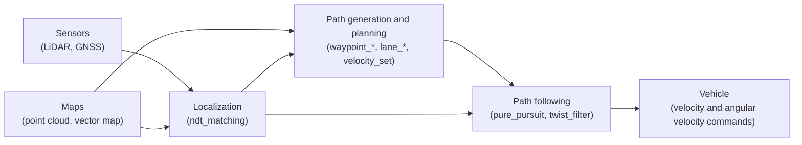

*Figure 1. Processing flow of the autonomous driving software covered in this unit*

---

<br>

## 2. Localization and NDT Registration

### 2.1 The Localization Problem

> **Definition:** **Localization** is estimating the current pose of a vehicle or robot within a given map. A **pose** combines position and orientation: in 3D it has six values, the position $(x, y, z)$ and the orientation (roll, pitch, yaw), and on a plane it has three values $(x, y, \theta)$.

Roll, pitch, and yaw are the rotation angles about the vehicle's longitudinal, lateral, and vertical axes. For a vehicle driving on a plane, yaw, which gives the heading, matters most.

A GNSS (global navigation satellite system) receiver alone can give a position, but when buildings or tunnels block the satellite signals the error grows or the position is lost (Week 13 covers GNSS error sources). Autonomous vehicles therefore measure their surroundings with a range sensor such as a LiDAR and compare the measurement with a map built in advance to find their position.

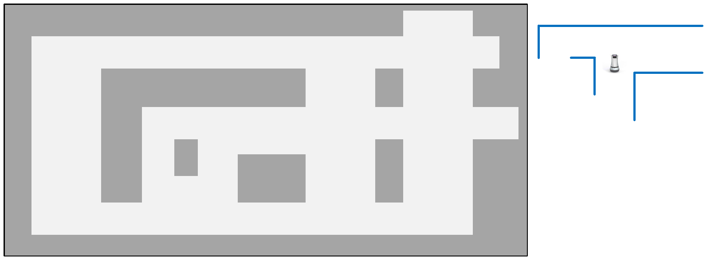

*Figure 2. A grid map and the shape of the surrounding walls measured by a robot*

The left side of Figure 2 is a map of gray walls and white corridors, and the right side is the shape of the walls the robot measured around itself. The robot does not know where it is on the map, but by finding which part of the map the measured wall shape overlaps, it can find its position and heading. Localization is thus the problem of finding where on the map, and at what angle, the measured shape fits best.

### 2.2 Scan Matching

> **Definition:** A **scan** is the set of points a LiDAR measures in one revolution, and a **point cloud** is such a set of points with 3D coordinates. **Registration** is finding the coordinate transformation (rotation and translation) that makes two point clouds overlap best, and registering a scan to a map is called **scan matching**.

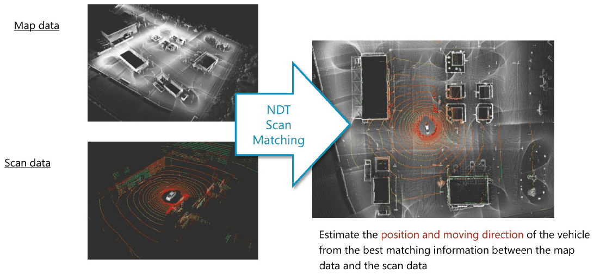

*Figure 3. Estimating the position and moving direction of the vehicle by registering scan data to map data with NDT*

The map data in Figure 3 is the wide-area point cloud map built in Week 2, and the scan data is one scan the vehicle's LiDAR has just measured. The scan is expressed in the sensor frame with the LiDAR at the origin, so the transformation that moves the scan into the map frame is exactly the pose of the LiDAR in the map. The picture on the right shows the scan (colored points) overlaid on the map (white points) after registration, and the position and moving direction of the vehicle are estimated from the best matching result.

Two representative scan matching methods are ICP (iterative closest point) and NDT. In every iteration, ICP pairs each scan point with the nearest map point and computes the transformation that reduces the distances between the pairs. The **NDT (normal distributions transform)** divides the map into small cells and summarizes the distribution of the points in each cell as a normal distribution, so it needs no point-to-point correspondences and can be optimized by differentiating a score function [1]. Autoware's localization node ndt_matching uses this method.

### 2.3 The NDT Representation: A Normal Distribution per Cell

NDT summarizes the points of the map as follows [1].

1. Divide space into cells of a fixed edge length. This length is called the **resolution**. In 3D, a cell is also called a **voxel**.
2. Compute the mean vector and covariance matrix of the points $\mathbf{x}_1, \dots, \mathbf{x}_n$ in each cell. Cells with too few points do not give a reliable distribution and are not used (Biber and Strasser discard cells with fewer than three points).
3. Model the likelihood of measuring a point at a location $\mathbf{x}$ in that cell by the normal distribution given by the mean and covariance.

$$
\boldsymbol{\mu} = \frac{1}{n} \sum_{i=1}^{n} \mathbf{x}_i, \qquad
\Sigma = \frac{1}{n} \sum_{i=1}^{n} (\mathbf{x}_i - \boldsymbol{\mu})(\mathbf{x}_i - \boldsymbol{\mu})^{T}
$$

$$
p(\mathbf{x}) \propto \exp\left( -\frac{1}{2} (\mathbf{x} - \boldsymbol{\mu})^{T} \Sigma^{-1} (\mathbf{x} - \boldsymbol{\mu}) \right)
$$

> **[Probability and Statistics]** The density of a multivariate normal distribution is determined by the quadratic form $(\mathbf{x} - \boldsymbol{\mu})^{T} \Sigma^{-1} (\mathbf{x} - \boldsymbol{\mu})$ inside the $\exp$. Its square root is the **Mahalanobis distance**, which measures the same displacement as small along directions in which the points are widely spread and as large along directions in which they are tightly packed. The eigenvectors of the covariance matrix are the directions of spread, and the eigenvalues are the variances along those directions.

> **[Linear Algebra]** The inverse of the 2×2 symmetric matrix with rows $(a, b)$ and $(b, d)$ is the matrix with rows $(d, -b)$ and $(-b, a)$ divided by the determinant $ad - b^2$. When the determinant is close to 0, the entries of the inverse become very large.

In this way the whole map becomes a collection of smooth normal distribution functions, one per cell. Storing only a mean and a covariance per cell instead of every point saves memory, and because the function is differentiable, the optimization of the next section can be used.

**Worked example: the normal distribution of one cell.** Suppose a cell contains four points measured along a wall: $(1, 0)$, $(2, 0.2)$, $(3, 0)$, $(4, 0.2)$ (in meters).

- The mean is $\boldsymbol{\mu} = \left( \frac{1+2+3+4}{4}, \frac{0+0.2+0+0.2}{4} \right) = (2.5, 0.1)$.
- The deviations from the mean are $(-1.5, -0.1)$, $(-0.5, 0.1)$, $(0.5, -0.1)$, $(1.5, 0.1)$.
- The variance in $x$ is $(2.25 + 0.25 + 0.25 + 2.25)/4 = 1.25$, the variance in $y$ is $(0.01 \times 4)/4 = 0.01$, and the covariance is $(0.15 - 0.05 - 0.05 + 0.15)/4 = 0.05$.

$$
\Sigma = \begin{pmatrix} 1.25 & 0.05 \\ 0.05 & 0.01 \end{pmatrix}, \qquad
\det \Sigma = 1.25 \times 0.01 - 0.05^2 = 0.01, \qquad
\Sigma^{-1} = \frac{1}{0.01} \begin{pmatrix} 0.01 & -0.05 \\ -0.05 & 1.25 \end{pmatrix} = \begin{pmatrix} 1 & -5 \\ -5 & 125 \end{pmatrix}
$$

Now compute $\exp(-\frac{1}{2} \mathbf{q}^{T} \Sigma^{-1} \mathbf{q})$ at three locations in this cell. Here $\mathbf{q} = \mathbf{x} - \boldsymbol{\mu}$, and if $\mathbf{q} = (q_x, q_y)$ then $\mathbf{q}^{T} \Sigma^{-1} \mathbf{q} = q_x^2 - 10 q_x q_y + 125 q_y^2$.

| Location $\mathbf{x}$ | $\mathbf{q} = \mathbf{x} - \boldsymbol{\mu}$ | $\mathbf{q}^{T} \Sigma^{-1} \mathbf{q}$ | $\exp(-\frac{1}{2} \mathbf{q}^{T} \Sigma^{-1} \mathbf{q})$ |
|:-----|:-----|:-----|:-----|
| $(2.5, 0.1)$ (mean) | $(0, 0)$ | $0$ | $1.000$ |
| $(2.6, 0.1)$ (0.1 m along the wall) | $(0.1, 0)$ | $0.01$ | $0.995$ |
| $(2.5, 0.2)$ (0.1 m perpendicular to the wall) | $(0, 0.1)$ | $1.25$ | $0.535$ |

*Table 2. Scores of three locations computed with the normal distribution of one cell*

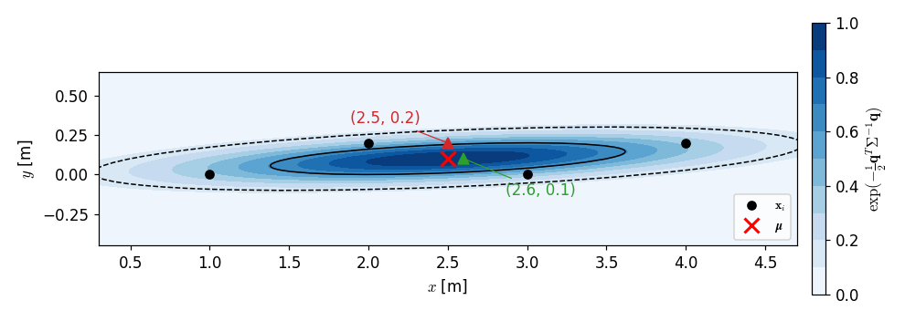

*Figure 4. The normal distribution of a cell built from four points and the scores of three locations*

In Figure 4 the black dots are the four points of the cell, the red X is the mean, the solid and dashed ellipses are the boundaries of Mahalanobis distance 1 and 2, and darker colors mean higher scores. Both test points are 0.1 m off, yet the point moved along the wall barely loses score (0.995), while the point moved perpendicular to the wall loses much (0.535). NDT thus remembers the shape of the surface and judges how far a point strays from the surface differently depending on the direction.

> **Caution:** If the points of a cell lie almost on a line (on a plane in 3D), one eigenvalue of the covariance matrix approaches 0, the determinant approaches 0, and the entries of the inverse become excessively large. Real implementations therefore correct the covariance matrix so that the smallest eigenvalue does not fall below a fixed fraction of the largest one [2].

### 2.4 The Registration Score and Newton's Method

On a plane, the transformation that moves a scan is described by three parameters $\mathbf{p} = (t_x, t_y, \phi)$: a translation $(t_x, t_y)$ and a rotation angle $\phi$. A scan point $\mathbf{x} = (x, y)$ is moved to the point $\mathbf{x}'$ in the map frame as follows.

$$
\mathbf{x}' = T(\mathbf{p}, \mathbf{x}) = \begin{pmatrix} \cos\phi & -\sin\phi \\ \sin\phi & \cos\phi \end{pmatrix} \begin{pmatrix} x \\ y \end{pmatrix} + \begin{pmatrix} t_x \\ t_y \end{pmatrix}
$$

For each moved point $\mathbf{x}_i'$, evaluate the normal distribution with the mean $\boldsymbol{\mu}_i$ and covariance $\Sigma_i$ of the cell the point falls into; the sum over all points is the **score** of the transformation [1].

$$
\text{score}(\mathbf{p}) = \sum_{i} \exp\left( -\frac{1}{2} \mathbf{q}_i^{T} \Sigma_i^{-1} \mathbf{q}_i \right), \qquad \mathbf{q}_i = T(\mathbf{p}, \mathbf{x}_i) - \boldsymbol{\mu}_i
$$

A larger score means the scan points lie better on the surfaces of the map. Optimization is usually written as minimization, so $s(\mathbf{p}) = -\text{score}(\mathbf{p})$ is minimized. NDT solves this problem with **Newton's method**. At the current estimate $\mathbf{p}$, it computes the gradient $\mathbf{g}$ and the Hessian $H$ of $s$, and solves a linear system for the update $\Delta\mathbf{p}$.

$$
H \, \Delta\mathbf{p} = -\mathbf{g}, \qquad \mathbf{p} \leftarrow \mathbf{p} + \Delta\mathbf{p}
$$

> **[Calculus]** Newton's method approximates the function near the current point by the quadratic $s(\mathbf{p} + \Delta\mathbf{p}) \approx s(\mathbf{p}) + \mathbf{g}^{T} \Delta\mathbf{p} + \frac{1}{2} \Delta\mathbf{p}^{T} H \Delta\mathbf{p}$ and jumps to the minimum of this quadratic in one step. Differentiating the quadratic with respect to $\Delta\mathbf{p}$ and setting it to 0 gives $\mathbf{g} + H \Delta\mathbf{p} = \mathbf{0}$. This point is a minimum only when $H$ is positive definite.

Differentiating the term of one point, $s = -\exp(-\frac{1}{2} \mathbf{q}^{T} \Sigma^{-1} \mathbf{q})$, with respect to a parameter $p_i$ gives the following by the chain rule, where $f = \exp(-\frac{1}{2} \mathbf{q}^{T} \Sigma^{-1} \mathbf{q})$.

$$
g_i = \frac{\partial s}{\partial p_i} = \left( \mathbf{q}^{T} \Sigma^{-1} \frac{\partial \mathbf{q}}{\partial p_i} \right) f
$$

$$
H_{ij} = \frac{\partial^2 s}{\partial p_i \partial p_j} = f \left( -\left( \mathbf{q}^{T} \Sigma^{-1} \frac{\partial \mathbf{q}}{\partial p_i} \right) \left( \mathbf{q}^{T} \Sigma^{-1} \frac{\partial \mathbf{q}}{\partial p_j} \right) + \frac{\partial \mathbf{q}}{\partial p_j}^{T} \Sigma^{-1} \frac{\partial \mathbf{q}}{\partial p_i} + \mathbf{q}^{T} \Sigma^{-1} \frac{\partial^2 \mathbf{q}}{\partial p_i \partial p_j} \right)
$$

The total gradient and Hessian are the sums of these values over all scan points. Differentiating the transformation gives the partial derivatives of $\mathbf{q}$ below. Among the second derivatives, only the one taken twice with respect to $\phi$ is nonzero.

$$
\frac{\partial \mathbf{q}}{\partial t_x} = \begin{pmatrix} 1 \\ 0 \end{pmatrix}, \qquad
\frac{\partial \mathbf{q}}{\partial t_y} = \begin{pmatrix} 0 \\ 1 \end{pmatrix}, \qquad
\frac{\partial \mathbf{q}}{\partial \phi} = \begin{pmatrix} -x \sin\phi - y \cos\phi \\ x \cos\phi - y \sin\phi \end{pmatrix}, \qquad
\frac{\partial^2 \mathbf{q}}{\partial \phi^2} = \begin{pmatrix} -x \cos\phi + y \sin\phi \\ -x \sin\phi - y \cos\phi \end{pmatrix}
$$

The whole NDT registration proceeds as follows.

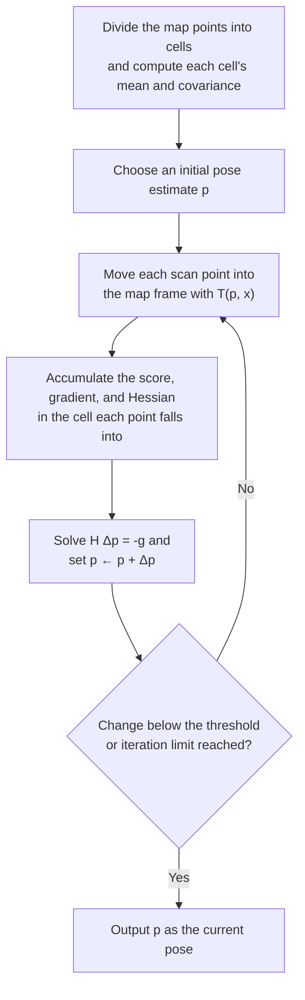

*Figure 5. Flow of the NDT registration algorithm*

**Worked example 1: the gradient.** On a map that has only the cell of Table 2, a scan point $\mathbf{x} = (2.5, 0.2)$ moved with the initial estimate $\mathbf{p} = (0, 0, 0)$ gives $\mathbf{x}' = (2.5, 0.2)$.

- $\mathbf{q} = (2.5, 0.2) - (2.5, 0.1) = (0, 0.1)$, and $\Sigma^{-1} \mathbf{q} = (1 \times 0 - 5 \times 0.1, \; -5 \times 0 + 125 \times 0.1) = (-0.5, 12.5)$.
- $\mathbf{q}^{T} \Sigma^{-1} \mathbf{q} = 0 \times (-0.5) + 0.1 \times 12.5 = 1.25$, so $f = e^{-0.625} = 0.5353$.
- At $\phi = 0$, $\frac{\partial \mathbf{q}}{\partial \phi} = (-y, x) = (-0.2, 2.5)$.
- Therefore $g_{t_x} = (-0.5)(0.5353) = -0.268$, $g_{t_y} = (12.5)(0.5353) = 6.691$, and $g_{\phi} = \big( (-0.5)(-0.2) + (12.5)(2.5) \big)(0.5353) = 31.35 \times 0.5353 = 16.78$.

The direction that decreases $s$ is $-\mathbf{g} = (0.268, -6.691, -16.78)$. Decreasing $t_y$ brings the point, which is 0.1 m too high, down toward the mean, and making $\phi$ negative (a clockwise rotation) also lowers this point, which is 2.5 m from the origin. The $t_x$ component is nonzero because the distribution of the cell is slightly tilted (the off-diagonal entry 0.05 of $\Sigma$), so errors in $x$ and $y$ are correlated.

**Worked example 2: Newton iterations.** One point cannot determine all three parameters, so fix $t_x = \phi = 0$ and let only $t_y$ move. If the scan point is $(2.5, 0.15)$, then $\mathbf{q} = (0, q_y)$ with $q_y = 0.05 + t_y$, the off-diagonal term vanishes, and $\mathbf{q}^{T} \Sigma^{-1} \mathbf{q} = 125 q_y^2$. The equations above reduce to the following.

$$
f = e^{-62.5 q_y^2}, \qquad g = 125 \, q_y \, f, \qquad H = 125 \, f \, (1 - 125 q_y^2), \qquad \Delta t_y = -\frac{g}{H}
$$

| Iteration | $t_y$ | $q_y$ | $f$ | $g$ | $H$ | $\Delta t_y$ |
|:-----|:-----|:-----|:-----|:-----|:-----|:-----|
| 0 | $0$ | $0.0500$ | $0.8553$ | $5.346$ | $73.51$ | $-0.0727$ |
| 1 | $-0.0727$ | $-0.0227$ | $0.9682$ | $-2.751$ | $113.2$ | $+0.0243$ |
| 2 | $-0.0484$ | $0.0016$ | $0.9998$ | $0.196$ | $124.9$ | $-0.0016$ |
| 3 | $-0.0500$ | $0.0000$ | $1.0000$ | $0.000$ | $125.0$ | $0.0000$ |

*Table 3. Newton iterations when only $t_y$ moves*

The method converges to $t_y = -0.05$ in three iterations, placing the point at the mean height $y = 0.1$ of the cell. With each iteration $q_y$ shrinks rapidly, $0.05 \to -0.0227 \to 0.0016$, which is the fast (quadratic) convergence Newton's method shows near a minimum.

> **Caution:** Newton's method gives a descent direction only when the Hessian is positive definite. In worked example 2, $H = 125 f (1 - 125 q_y^2)$ becomes negative when $\vert q_y \vert > 1/\sqrt{125} \approx 0.089$ m. For example, if the point is at $(2.5, 0.2)$ so that $q_y = 0.1$, then $g = 6.691$ and $H = -16.73$, so $\Delta t_y = +0.40$ and the point moves away from the mean. Real implementations therefore add $\lambda I$ to the Hessian to make it positive definite, or check the direction and size of the step with a line search [2]. Moreover, the score function flattens out away from the mean, so the initial estimate that starts the registration must be close enough to the true value.

### 2.5 3D NDT and Practical Implementations

In 3D the transformation has six parameters, the translation $(t_x, t_y, t_z)$ and three rotation angles (roll, pitch, yaw), and the cells become cubic voxels. In his treatment of 3D NDT, Magnusson used a model that mixes a uniform distribution into the normal distribution so that points from objects absent from the map (outliers) do not dominate the score, and proposed a score function that approximates this model again by a Gaussian function [2].

$$
s(\mathbf{p}) = \sum_{k} d_1 \exp\left( -\frac{d_2}{2} \mathbf{q}_k^{T} \Sigma_k^{-1} \mathbf{q}_k \right)
$$

Here $d_1$ and $d_2$ are constants determined by the outlier ratio and the cell size, and since $d_1 < 0$, each term is negative like the 2D $s = -\text{score}$. This score has the same form as in 2D, so the gradient and Hessian are computed in the same way, and the length of the step along the Newton direction is decided by a line search. The open-source PCL (Point Cloud Library) implements this method and uses the More-Thuente method for the line search [3], and Autoware's ndt_matching chooses between the PCL implementation and modified versions of it [4].

| Parameter | Name in PCL | Meaning |
|:-----|:-----|:-----|
| Resolution | `setResolution` | Edge length of a cell (voxel) (m) |
| Step Size | `setStepSize` | Maximum step length the line search may take at once |
| Trans EPS | `setTransformationEpsilon` | Stop as converged when the change of the transformation between two consecutive iterations is smaller than this value |
| Max Iterations | `setMaximumIterations` | Maximum number of iterations after which the search stops even without convergence |

*Table 4. Main parameters of NDT registration*

The resolution changes the behavior of registration considerably. With large cells, one cell covers a wide area, so the score function is gentle and converges even from a somewhat distant initial estimate, but the fine shape of surfaces is blurred and accuracy drops. With small cells, fine shapes are represented well, but the initial estimate must be close to the true value, and the larger number of cells uses more memory.

### 2.6 NDT Mapping

The same registration can also build a map. **NDT mapping** takes the first scan as the map, and for every new scan it registers the scan to the map accumulated so far with NDT and adds the registered scan to the map, repeating this process. In Autoware the ndt_mapping node (and approximate_ndt_mapping, which reduces computation) does this, and the map building of Week 2 and the practice of Week 9 use this node. Each time a scan is attached, a small registration error accumulates, so the larger the mapped area, the more the map may gradually bend or misalign.

---

<br>

## 3. NDT Matching Localization in Autoware

### 3.1 Node Composition and Data Flow

In Autoware, NDT matching localization is carried out by the following nodes exchanging data over topics. A node is an executable unit in ROS that does one task, and a topic is a named channel that carries messages between nodes (see Weeks 1 and 4).

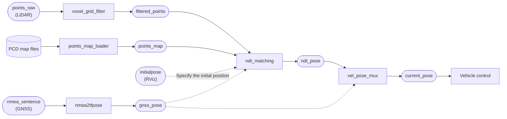

*Figure 6. Nodes and topics of NDT matching localization (rectangles are nodes, rounded boxes are topics)*

| Node | Task |
|:-----|:-----|
| points_map_loader | Reads map files in PCD format and publishes them on the `points_map` topic |
| voxel_grid_filter | Downsamples the scan data to reduce the number of points used for registration |
| ndt_matching | Registers the scan data to the 3D map with NDT, estimates the pose, and publishes it as `ndt_pose` |
| nmea2tfpose | Converts GNSS position information in NMEA format into an $(x, y, z)$ pose in the map frame |
| vel_pose_mux | Decides the position and orientation used for vehicle control and publishes them as `current_pose` |

*Table 5. Nodes that make up NDT matching localization*

> **Definition:** **PCD (point cloud data)** is the point cloud file format used by PCL. An **NMEA sentence** is the standard text format in which a GNSS receiver outputs information such as latitude, longitude, and time. **Downsampling** reduces the number of points in data, and a **voxel grid filter** divides space into voxels of a fixed size (the leaf size) and replaces the points in each voxel by one representative point (their centroid) to reduce the number of points.

Downsampling is needed for two reasons. First, the cost of registration is proportional to the number of scan points, so fewer points let each scan be processed faster. Second, a LiDAR measures nearby areas densely and distant areas sparsely, so reducing each voxel to one point spreads the points evenly over space and keeps nearby objects from dominating the score.

`current_pose` carries the position $(x, y, z)$ and the orientation (roll, pitch, yaw), and all later path planning and path following nodes subscribe to this topic. The initial position is either specified by the user in RViz (`initialpose`) or taken from the GNSS position (`gnss_pose`). As seen in Section 2.4, NDT converges only near the initial estimate, so an initial position close to the true value is needed once at the start.

### 3.2 Launch Procedure in the Runtime Manager

The **Runtime Manager** is a graphical tool for launching and configuring Autoware nodes with tabs and check boxes. Localization is launched in the following order.

1. **Set the LiDAR TF and load the vehicle model.** In the Setup tab, choose Velodyne as the Localizer, enter the Baselink to Localizer TF values (for example $x = 1.2$, $y = 0$, $z = 2.0$, and yaw, pitch, and roll all 0), and press the TF button. The Vehicle Model button loads the vehicle model displayed in RViz.
2. **Load the 3D point cloud map.** In the Map tab, specify the PCD files in Point Cloud, and specify in TF the launch file (`tf.launch`) that defines the relation of the map frames.
3. **Pass the downsampled scan data.** In Points Filter of the Sensing tab, turn on voxel_grid_filter and set the Voxel Leaf Size (example value 2) in its [app] dialog.
4. **Run ndt_matching.** In Localization of the Computing tab, turn on ndt_matching and set the initial position and parameters in its [app] dialog (Table 6 below).
5. **Check real-time localization in RViz.** In the Simulation tab, specify a rosbag file and play it (Play), and check in RViz that the vehicle appears on the map and moves.

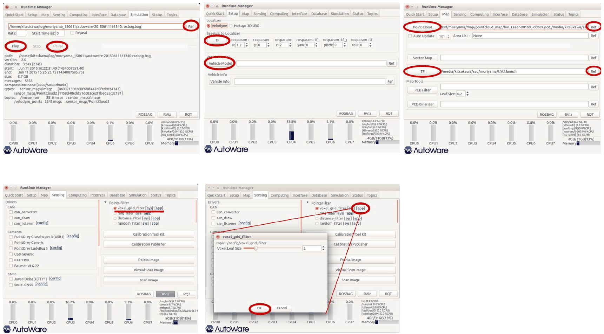

*Figure 7. Runtime Manager settings for the rosbag, TF, map, and voxel_grid_filter*

> **Definition:** **TF (transform)** is the ROS mechanism that manages the relative positions and orientations between coordinate frames. A vehicle has a frame for its reference point, `base_link`, and a separate frame for the LiDAR (the localizer), and the Baselink to Localizer values are the mounting position and orientation of the LiDAR seen from the vehicle's reference point.

What NDT registration directly computes is the pose of the LiDAR in the map. If, as in the example, the LiDAR is mounted 1.2 m ahead of and 2.0 m above the vehicle's reference point, this offset must be undone from the LiDAR pose to obtain the pose of the vehicle's reference point. If these values are wrong, the vehicle is drawn ahead of or above its true place on the map, and the later path following goes wrong as well.

The Simulation tab in Figure 7 shows information about the rosbag to be played. The example file is the Moriyama (Nagoya, Japan) driving data distributed with Autoware; it is 234 seconds long and 8.7 GB in size, and contains 3516 camera images on `/image_raw` (`sensor_msgs/Image`) and 2342 LiDAR point clouds on `/velodyne_points` (`sensor_msgs/PointCloud2`). Since 2342 / 234 ≈ 10, the LiDAR produces about 10 scans per second, and since 3516 / 234 ≈ 15, the camera recorded images at about 15 Hz. Localization performs one registration for each of these 10 Hz scans.

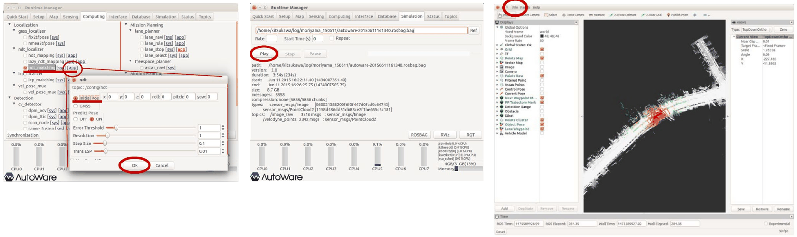

*Figure 8. ndt_matching settings, rosbag playback, and the localization result shown in RViz*

| Item | Example value | Meaning |
|:-----|:-----|:-----|
| Initial Pos / GNSS | Initial Pos, all 0 | Chooses whether the initial pose of the first registration is the entered values $(x, y, z, \text{roll}, \text{pitch}, \text{yaw})$ or the GNSS position |
| Predict Pose | ON | Predicts the next pose from the motion between the preceding scans and uses it as the initial estimate of the next registration |
| Resolution | 1 | Edge length of an NDT cell (m) |
| Step Size | 0.1 | Maximum step length of the line search |
| Trans EPS | 0.01 | Threshold on the change of the transformation used to judge convergence |

*Table 6. Main items of the ndt_matching dialog*

The dialog also has an Error Threshold item (example value 1). With Predict Pose on, registration starts from a pose predicted by assuming that the vehicle keeps moving as it just did, so even at high speed the initial estimate stays close to the true value, the number of iterations falls, and the risk of failing to converge drops. In the RViz view of Figure 8, the white points are the point cloud map, and the colored points in the middle of the map are the registered current scan.

### 3.3 Node Connections Seen in rqt_graph

rqt_graph is a tool that draws the connections between running nodes and topics as a graph (see Week 4). The graph when localization is running can be summarized as follows.

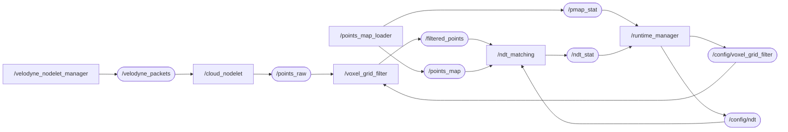

*Figure 9. Node graph when localization is running*

When the Velodyne driver (`velodyne_nodelet_manager`) outputs the raw LiDAR packets on `/velodyne_packets`, `cloud_nodelet` converts them into the point cloud `/points_raw`. Settings changed in the Runtime Manager dialogs reach each node over the `/config/voxel_grid_filter` and `/config/ndt` topics, and the map loading status (`/pmap_stat`) and registration status (`/ndt_stat`) come back to the Runtime Manager to be displayed. Because setting changes also travel over topics, parameters can be changed at run time without restarting the nodes.

---

<br>

## 4. Path Generation

### 4.1 The Vector Map Method and the Driving Record Method

Once localization tells where the vehicle is now, the next step is deciding where to go. Autoware offers two ways to create an autonomous driving path.

| Method | Principle | Characteristics |
|:-----|:-----|:-----|
| Vector map method | Choose a start and an end point on the lane information of a vector map and compute the path | The velocity profile can be changed flexibly, and the method extends easily to functions such as obstacle avoidance and lane changes |
| Driving record method | Use the trajectory recorded with rosbag while a person drives as the path as it is | Easy to create, but tied to the recorded trajectory and speeds |

*Table 7. Two ways to create a path in Autoware*

For flexible changes of the velocity profile and later uses such as obstacle avoidance and lane changes, the vector map method is recommended.

> **Definition:** A **vector map** represents the road with geometric elements such as points and lines and also holds semantic information such as lanes, stop lines, crosswalks, and traffic lights, together with the connections between elements. Whereas a point cloud map holds the surfaces of surrounding objects as measured, a vector map holds which lane the vehicle should follow and how it should drive. A **waypoint** is one point of a path and holds a position, an orientation, and the target velocity at that point.

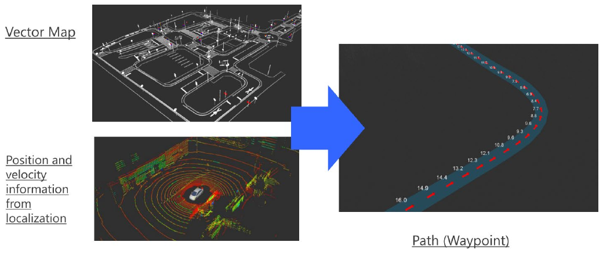

*Figure 10. Creating a waypoint path from a vector map and the localization result*

The right side of Figure 10 is the created path, and the number attached to each point is the target velocity of that waypoint. Path generation uses the current position and velocity information provided by localization together with the vector map.

### 4.2 Creating a Path with waypoint_clicker

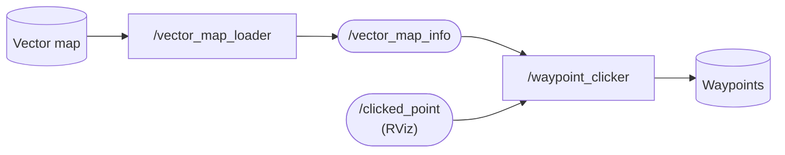

*Figure 11. Node composition of path generation with a vector map*

vector_map_loader reads the vector map files and publishes them on the `/vector_map_info` topics, and waypoint_clicker receives the points the user clicks in RViz (`/clicked_point`) and computes a path that connects two points along the lanes of the vector map. The procedure is as follows.

1. **Load the vector map.** In the Map tab of the Runtime Manager, specify the vector map files (CSV files) in Vector Map.
2. **Specify the TF.** In TF of the same tab, specify the launch file that gives the position of the vector map.
3. **Launch RViz.** Open RViz with the RViz button.
4. **Launch waypoint_clicker.** In the Computing tab, turn on waypoint_clicker under waypoint_maker.
5. **Create the path with Publish Point in RViz.**
   - Check the yellow points (the lane points of the vector map) in RViz.
   - Choose Publish Point on the toolbar and click one yellow point to set the start point.
   - Choose Publish Point again and click another point to set the end point.
   - Check that a path has been created between the two points (a solid yellow line).

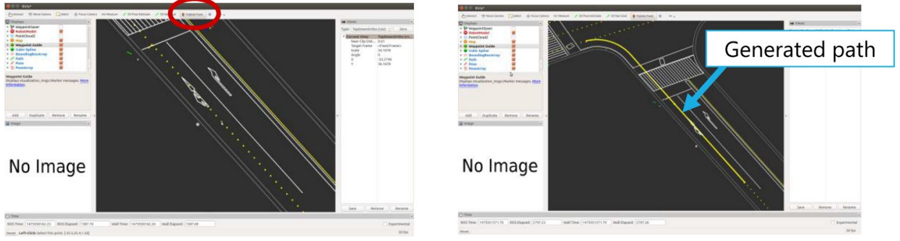

*Figure 12. A path created by clicking a start point and an end point in RViz*

The left side of Figure 12 shows Publish Point chosen on the toolbar, and the right side shows the created path (Generated path). The created path is saved to a file with waypoint_saver and loaded again with waypoint_loader in the path planning stage.

---

<br>

## 5. Path Planning

### 5.1 The Role of Path Planning

The waypoints made by path generation are only a geometric route. Path planning refines this route so that the vehicle can actually drive it.

- It loads a saved path and uses it for path planning.
- It assigns optimized reference velocities to the path.
- With Replanning_mode, the velocities of sections such as curves can be redefined.

### 5.2 Nodes and Data Flow

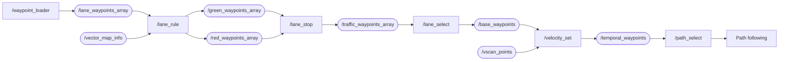

*Figure 13. Flow of the path planning nodes and topics (some topics omitted)*

| Node | Task |
|:-----|:-----|
| waypoint_loader | Reads a saved path file and publishes it on `/lane_waypoints_array` |
| lane_rule | Optimizes the path with vector map information and creates separate waypoints for green and red lights |
| lane_stop | Receives traffic light recognition results and chooses either the green-light path or the red-light path |
| lane_select | Chooses the lane to drive among the paths of several lanes and publishes it on `/base_waypoints` |
| velocity_set | Decides the target velocity from the results of detecting objects on the path with sensor information |
| path_select | Chooses the final path handed to path following |

*Table 8. Roles of the path planning nodes*

The red-light waypoints form a path whose velocity drops to 0 before the stop line, and the green-light waypoints form a path that passes the stop line. With both paths prepared in advance, lane_stop only needs to switch the chosen path when the light changes, so the response is fast. The `/vscan_points` used by velocity_set are points extracted from the LiDAR point cloud as obstacle candidates.

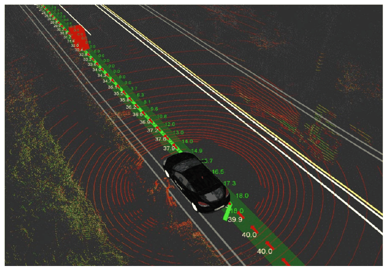

*Figure 14. Path planning result shown in RViz with the target velocity of each waypoint*

### 5.3 Launch Order and Node Settings

Path planning is launched in the following order. Each node subscribes to the output topic of the node before it, so the order must be kept.

1. Launch vel_pose_mux (it outputs the localization result as `current_pose`).
2. Load the path with waypoint_loader.
3. Launch lane_rule.
4. Launch lane_stop.
5. Launch lane_select.
6. Launch velocity_set.
7. Launch path_select.
8. Check the path in RViz.

The main values set in the [app] dialog of each node are as follows.

| Node | Item | Example value | Meaning |
|:-----|:-----|:-----|:-----|
| lane_rule | Acceleration | 1 m/s² | Acceleration used to build the velocity profile that decelerates before a stop line |
| lane_rule | Number of Zeros Ahead, Behind | 10, 10 | Number of waypoints before and after a stop line whose target velocity is set to 0 |
| lane_stop | Red Light, Green Light | Buttons | Set the light state by hand. Turning on Use traffic light recognition result uses the traffic light recognition result |
| velocity_set | Others Distance | 15 m | Distance at which to stop in front of a detected obstacle |
| velocity_set | Detection Range | 1.3 m | Range on both sides of the path in which obstacles are searched for |
| velocity_set | Points Threshold | 10 | Points within the range are judged an obstacle when there are more than this many |
| velocity_set | Detection Height Top, Bottom | 0.1 m, -1.8 m | Height range of points regarded as obstacles (relative to the LiDAR) |
| velocity_set | Deceleration | 1 m/s² | Deceleration used when stopping in front of an obstacle |
| velocity_set | Velocity Change Limit | 15 km/h | Maximum amount by which the target velocity may change at once |

*Table 9. Main settings of the path planning nodes*

The obstacle judgment of velocity_set is a simple rule. For each waypoint ahead on the path, it counts the LiDAR points within the Detection Range and between Detection Height Bottom and Top, and if there are more than Points Threshold of them, it considers an obstacle to be there. It then reassigns to the waypoints before that point target velocities that drop at the Deceleration rate, so that the vehicle stops at the waypoint Others Distance ahead of the obstacle. With the LiDAR mounted about 2 m above the ground as in the example, the top of the height range (0.1 m) is slightly above the LiDAR and the bottom (-1.8 m) is slightly above the ground, so ground points and high signs or branches are not counted as obstacles.

> **Note:** The distance needed to stop from velocity $v$ at deceleration $a$ is $v^2 / (2a)$. For example, with $v = 10$ km/h $\approx 2.78$ m/s and $a = 1$ m/s², $2.78^2 / 2 \approx 3.9$ m is needed. The waypoint where deceleration starts must be at least this far ahead of the stopping point.

---

<br>

## 6. Path Following and Vehicle Control

### 6.1 pure_pursuit and twist_filter

The nodes that make the vehicle actually follow the final path decided by path planning are pure_pursuit and twist_filter.

- **pure_pursuit:** Computes the optimal turning radius from the current position and the target point, and decides the angular velocity considering the current velocity and the position and velocity of the target point.
- **twist_filter:** Computes the final velocity and angular velocity values considering the lateral acceleration.
- The values computed by these nodes are passed to the vehicle.

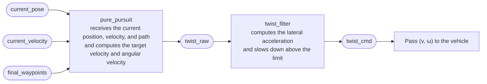

*Figure 15. Flow of the path following nodes and topics*

> **Definition:** A **twist** is the ROS message that describes the velocity of a body and holds a linear velocity and an angular velocity. For a vehicle driving on a plane, only the linear velocity $v$ along the heading (`linear.x`) and the angular velocity $\omega$ of rotation seen from above (`angular.z`) are used.

### 6.2 The Geometry of Pure Pursuit

**Pure pursuit** is a path following method that takes as the target point a point on the path a fixed distance ahead of the vehicle and sets the curvature so that the vehicle drives along the arc that reaches that point [5]. The target point is chosen anew every cycle, so the vehicle keeps chasing a point that runs ahead of it on the path. The name comes from the pursuit strategy of aiming straight at a target moving ahead (pure pursuit).

> **Definition:** The **curvature** $\kappa$ measures how much a path bends; a circle of radius $R$ has curvature $\kappa = 1/R$. The **lookahead distance** $l$ is the distance from the vehicle to the target point.

Use the frame attached to the vehicle: the origin is the vehicle's reference point (usually the center of the rear axle), the $x$ axis is the heading, and the $y$ axis points left. If the target point has coordinates $(x_t, y_t)$, then $x_t^2 + y_t^2 = l^2$. Find the circle that is tangent to the current heading (the $x$ axis) and passes through both the origin and the target point.

1. The circle is tangent to the $x$ axis at the origin, so its center lies on the $y$ axis. Let the center be $C = (0, R)$ ($R > 0$ is a circle turning left).
2. The target point is also on the circle, so its distance from the center is $R$: $x_t^2 + (y_t - R)^2 = R^2$.
3. Expanding gives $x_t^2 + y_t^2 - 2 y_t R + R^2 = R^2$, so $l^2 - 2 y_t R = 0$.

$$
R = \frac{l^2}{2 y_t}, \qquad \kappa = \frac{1}{R} = \frac{2 y_t}{l^2}
$$

If $\alpha$ is the angle between the heading and the direction to the target point, then $y_t = l \sin\alpha$, so the same formula can be written $\kappa = 2 \sin\alpha / l$. If $y_t > 0$ (target on the left), $\kappa > 0$ and the vehicle turns left; if $y_t < 0$, it turns right. If $y_t = 0$, the curvature is 0, that is, the vehicle goes straight.

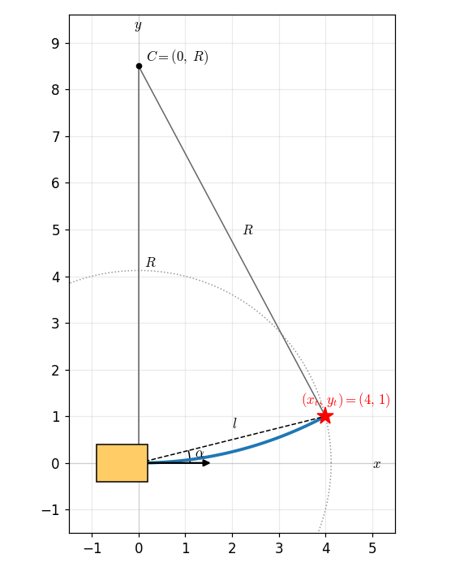

*Figure 16. The geometry of pure pursuit: the arc through the target point and the center of curvature*

Once the curvature is known, it is turned into a command for the vehicle. Driving along a circle of curvature $\kappa$ at linear velocity $v$ gives the angular velocity $\omega = v \kappa$. To convert to a steering angle, the bicycle model in which only the front wheel steers (Week 12) gives $\delta = \arctan(L \kappa)$ for a wheelbase $L$.

### 6.3 Worked Example

Suppose that in the vehicle frame the target point is $(x_t, y_t) = (4.0, 1.0)$ m, the vehicle drives at $v = 5$ m/s (18 km/h), and the wheelbase is $L = 2.8$ m.

1. Lookahead distance: $l^2 = 4.0^2 + 1.0^2 = 17$, $l = \sqrt{17} \approx 4.123$ m.
2. Curvature and radius: $\kappa = 2 \times 1.0 / 17 \approx 0.1176$ m⁻¹, $R = 17 / 2 = 8.5$ m. The center of the circle is $(0, 8.5)$, 8.5 m to the left of the vehicle.
3. Check with the angle: $\alpha = \arctan(1.0 / 4.0) \approx 14.04^\circ$ and $\sin\alpha \approx 0.2425$, so $2 \times 0.2425 / 4.123 \approx 0.1176$ m⁻¹, the same value.
4. Angular velocity: $\omega = v \kappa = 5 \times 0.1176 \approx 0.588$ rad/s (about $33.7^\circ$/s), turning left.
5. Steering angle: $\delta = \arctan(2.8 \times 0.1176) = \arctan(0.329) \approx 18.2^\circ$.
6. Lateral acceleration: $a_y = v^2 \kappa = 25 \times 0.1176 \approx 2.94$ m/s².

The `twist_raw` published by the pure_pursuit node carries $v = 5$ m/s and $\omega = 0.588$ rad/s.

### 6.4 Choosing the Target Point and the Lookahead Distance

Autoware's pure_pursuit scans the waypoints of the path in order and takes as the target point the first waypoint farther from the current position than the lookahead distance. With Linear Interpolate on, it computes the point where the segment between that waypoint and the preceding one meets the circle of radius $l$ and uses it as the target point. Even when waypoints are far apart, the target point then lies exactly at distance $l$, which makes the curvature computation smooth [6].

The lookahead distance is set in one of two ways. In Dialog mode, the fixed velocity and fixed lookahead distance entered in the dialog are used. In Waypoint mode, the velocity is taken from the target velocities of the waypoints, and the lookahead distance is set in proportion to the current velocity [6].

$$
l = \begin{cases} l_{\min} & (r \, v < l_{\min}) \\ \min(r \, v, \; 10 v) & (\text{otherwise}) \end{cases}
$$

Here $r$ is lookahead_ratio, $l_{\min}$ is minimum_lookahead_distance, and $v$ is the current velocity (m/s). With the example settings $r = 2$ and $l_{\min} = 4$ m, the values are as follows.

| Current velocity | $r v$ | Lookahead distance $l$ |
|:-----|:-----|:-----|
| 1 m/s (3.6 km/h) | 2 m | 4 m (minimum applied) |
| 2.78 m/s (10 km/h) | 5.56 m | 5.56 m |
| 5 m/s (18 km/h) | 10 m | 10 m |

*Table 10. Lookahead distance by velocity under the example settings*

The distance is set in proportion to the velocity because the lookahead distance strongly affects tracking performance [5].

- **If it is short,** the target point is close and the vehicle follows the path tightly, but even a small deviation from the path makes it turn sharply with a large curvature, so the vehicle easily sways from side to side (oscillation).
- **If it is long,** the motion is smooth and stable, but on curves the target point is pulled toward the inside of the bend, so the vehicle cuts the corner and takes long to return to the path.

At higher speed the same change of curvature produces a larger lateral acceleration, so lengthening the lookahead distance at high speed gains stability.

### 6.5 twist_filter and the Lateral Acceleration Limit

A vehicle driving at velocity $v$ on a circle of curvature $\kappa$ experiences a lateral (centripetal) acceleration $a_y = v^2 \kappa = v \omega$ toward the center of the circle. When this value is large the passengers are uncomfortable, and when it exceeds the friction limit of the tires the vehicle skids. twist_filter computes the lateral acceleration from the target velocity and angular velocity output by pure_pursuit and reduces the target velocity when it exceeds the set limit (lateral_accel_limit). To keep the limit $a_{\max}$ while holding the curvature, the velocity must satisfy the following.

$$
v^2 \kappa \le a_{\max} \quad \Longrightarrow \quad v \le \sqrt{\frac{a_{\max}}{\kappa}}
$$

For the target point of Section 6.3 ($\kappa = 0.1176$ m⁻¹) with the example limit $a_{\max} = 5$ m/s², $a_y = 2.94$ m/s² at $v = 5$ m/s is within the limit and passes unchanged. Driving the same curve at $v = 8$ m/s would give $a_y = 64 \times 0.1176 \approx 7.53$ m/s², above the limit, so the velocity must be reduced to at most $\sqrt{5 / 0.1176} \approx 6.52$ m/s (about 23.5 km/h).

### 6.6 Launch Procedure

Path following is launched in the following order.

1. Under waypoint_follower in the Computing tab, open the [app] dialog of pure_pursuit, set the details, and launch it.
2. Set the details in the [app] dialog of twist_filter and launch it.
3. Check in RViz that velocity and curve targets are generated.

| Node | Item | Example value | Meaning |
|:-----|:-----|:-----|:-----|
| pure_pursuit | Waypoint / Dialog | Waypoint | Chooses whether the velocity and lookahead distance come from the waypoints and the current velocity or from the fixed values in the dialog (Velocity 10 km/h, Lookahead Distance 4 m) |
| pure_pursuit | lookahead_ratio | 2 | Ratio multiplied by the current velocity (m/s) to set the lookahead distance |
| pure_pursuit | minimum_lookahead_distance | 4 m | Minimum lookahead distance |
| pure_pursuit | displacement_threshold, relative_angle_threshold | 0, 0 | Thresholds on the position deviation and angle deviation for judging that the vehicle is already following the path well |
| pure_pursuit | Linear Interpolate | On | Interpolates between waypoints to place the target point exactly at distance $l$ |
| twist_filter | lateral_accel_limit | 5 m/s² | Limit on the lateral acceleration |

*Table 11. Main settings of the path following nodes*

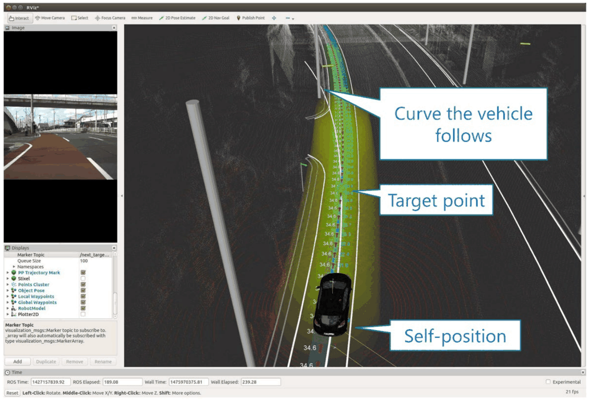

*Figure 17. Path following shown in RViz: the curve the vehicle follows, the target point, and the self-position*

In Figure 17, Self-position is the current position of the vehicle estimated by localization, Target point is the target point one lookahead distance ahead, and the green curve joining them (Curve the vehicle follows) is the arc computed by pure pursuit. The numbers along the path are the target velocities of the waypoints. After launching everything from the sensor drivers through localization, path planning, and path following, opening rqt_graph shows a large graph of dozens of nodes tangled by topics. However complex the graph, the data flows in the order of Figure 1: from the sensors and maps through localization, path planning, and path following to the vehicle.

---

<br>

## 7. Real Vehicle Case Study: An Autonomous Driving System Based on a Sonata

### 7.1 Vehicle Configuration and Driving Tests

This is a case that applied the functions of the previous sections to a real vehicle. A Velodyne 16-channel LiDAR (Hi-Res model) and a GNSS sensor were installed on a Hyundai Sonata (LF), and autonomous driving with Autoware was completed.

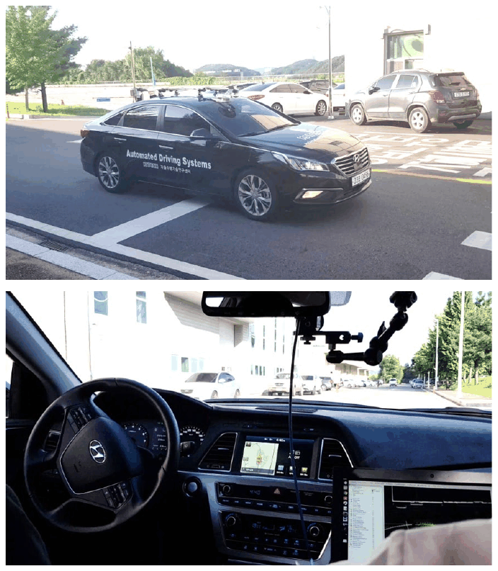

*Figure 18. The test vehicle with LiDAR and GNSS installed and the control computer inside the vehicle*

- Performance was checked on straight sections, curved sections, downhill roads, and so on.
- The maximum speed was set to 10 km/h on straight sections and 3 km/h on sharp curves.
- Obstacle avoidance and station stop tests were performed.

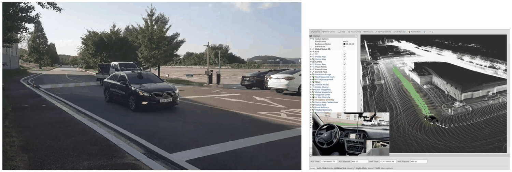

*Figure 19. The test vehicle driving and the RViz view at the same moment*

### 7.2 Station Stops

Station stops were implemented with Autoware's Traffic Signal and Stop Line functions. A station node and CAN send and receive nodes were added to the Runtime Manager, and the station node receives information such as the vehicle speed and the distance to a stop line in the vector map. With the station placed as a stop line, lane_stop chooses the path that stops before the stop line while the light is red, so the vehicle stops at the station. When it is time to depart after the stop, the station node changes the light to green and the vehicle starts again. The design reuses the existing traffic light handling instead of building a new function from scratch.

### 7.3 LiDAR-Based Obstacle Recognition and Avoidance

- Ground points are removed from the point cloud obtained from the LiDAR with ring_ground_filter.
- The LiDAR euclidean cluster detect node groups the remaining points with their near neighbors (clustering) to recognize and track obstacles.
- Collision avoidance is implemented with A\* planner, Open planner, and similar planners.
- The results are to be used for vehicle behavior control such as active obstacle avoidance and lane changes.

> **Definition:** **Euclidean clustering** groups points that lie within a fixed distance of each other into the same object. If ground points are not removed first, every object is joined into one through the ground, so ground removal must come before clustering.

Path search algorithms such as A\* and Hybrid A\* are covered in Week 10.

### 7.4 Development Work and Conclusions

| Area | Development work |
|:-----|:-----|
| Localization | Implemented the GNSS interface and GNSS-based localization, implemented LiDAR-based localization |
| Vehicle communication and control | Implemented a CAN-based ROS node for communication between the PC and the vehicle, completed manual speed and steering control tests between the PC and the vehicle |
| Maps | Completed LiDAR-based point cloud mapping, built and tested a vector map |
| Paths | Applied path generation and path planning in simulation and on the real vehicle, implemented path following and applied it in simulation and on the real vehicle |
| Tests | Completed real driving tests on the institution's grounds, implemented stations and completed stop tests, completed tests of the obstacle recognition algorithm |

*Table 12. Development work of the real vehicle case*

The conclusions are as follows.

- Autonomous driving with Autoware was confirmed to be feasible.
- Because the software is developed on ROS, it can be modified flexibly.
- Control parameters such as speed and braking distance are easy to optimize.
- Tests after building a large-scale map are needed.
- Precise obstacle detection through sensor fusion with cameras is needed.
- An implementation on a high-performance PC is required to load large maps and guarantee real-time operation.

CAN communication and the Autoware CAN node are covered in Weeks 13-14.

### 7.5 Use Cases

This technology can be used for unmanned shuttles on campus, autonomous delivery robots, and personal mobility.

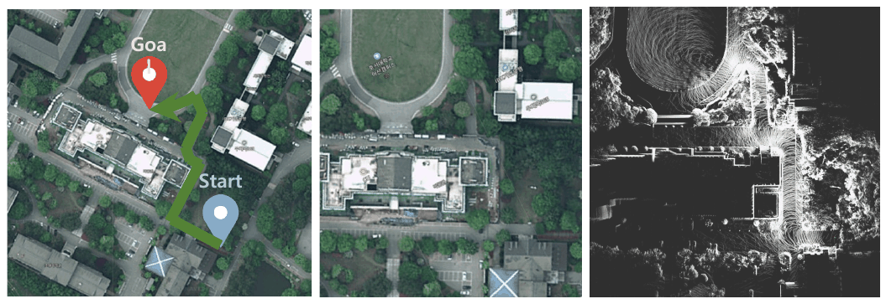

*Figure 20. A satellite map marking the start and goal of a campus unmanned shuttle and the point cloud map of the same area*

The satellite map on the left of Figure 20 shows in green the driving route from the start (Start) to the goal (Goal), and the right side is the point cloud map of the same area built with a LiDAR. For each real service area, a map is built first in this way, and the localization, path planning, and path following of this unit are performed on it.

---

<br>

## 8. Installing Ubuntu 18.04

The later ROS and Autoware practice uses Ubuntu 18.04 LTS (code name Bionic Beaver). Each ROS 1 distribution is built for a specific Ubuntu version, and the ROS Melodic and Autoware.ai 1.14.0 used in the practice target Ubuntu 18.04 (see Week 4).

> **Definition:** **LTS (long term support)** marks a long-term support release; Ubuntu LTS releases receive standard security updates for five years [7]. An **ISO image** is a single file that holds the contents of an installation disc.

> **Caution:** Standard support for Ubuntu 18.04 ended in 2023 [7], and support for ROS Melodic also ended in 2023 [8]. This environment reproduces the versions of the course materials, and it lacks the security updates needed for long-term use on machines directly connected to the internet.

### 8.1 Choosing an Installation Method

| Method | Advantages | Disadvantages |
|:-----|:-----|:-----|
| Install directly on a PC from a USB stick | Uses the full performance of the computer and makes it easy to connect devices such as GPUs and LiDARs directly | A mistake in disk partitioning can destroy the existing operating system and data |
| Install in a virtual machine | Runs safely inside the existing operating system (Windows and so on), and its whole state can be saved or deleted | Shares memory and CPU, so it is slower, and GPU and sensor connections are limited |

*Table 13. Comparison of Ubuntu installation methods*

A direct installation suits a development PC that handles real vehicles or sensors, and a virtual machine is convenient for learning the commands and tools for the first time.

### 8.2 Downloading the Installation Image

1. Download the version that suits the development environment from `http://releases.ubuntu.com/18.04/`. For an ordinary 64-bit PC, choose the desktop image `ubuntu-18.04.6-desktop-amd64.iso`. 18.04.6 is the last point release of 18.04, and amd64 means 64-bit x86 processors (Intel and AMD).
2. The `SHA256SUMS` file on the same page can be used to check that the downloaded file is not corrupted. In an Ubuntu or macOS terminal, compute the hash with the following commands and compare it with the value in `SHA256SUMS`.

```bash
sha256sum ubuntu-18.04.6-desktop-amd64.iso    # Ubuntu
shasum -a 256 ubuntu-18.04.6-desktop-amd64.iso    # macOS
```

If the two values differ, the file was corrupted on the way, so download it again.

### 8.3 Installing from a USB Stick

1. Follow the official Ubuntu tutorial (creating a bootable USB stick on Windows) and write the ISO image to a USB stick with a tool such as Rufus [9]. All existing data on the USB stick is erased.
2. Restart the computer, open the boot menu (F12, F11, Esc, and so on, depending on the manufacturer), and boot from the USB stick.
3. When the installer appears, install in the same order as Section 8.5.
4. Install in English and add Korean input after installation if needed (Week 4, Section 1.3). Installing in Korean creates the default folders under the home folder (Documents, Downloads, and so on) with Korean names, which makes typing paths in the terminal inconvenient, and error messages also appear in Korean, which makes them hard to search.

### 8.4 Creating a VirtualBox Virtual Machine

A **virtual machine** is another computer (the guest) emulated in software inside a real computer (the host). Virtual machine software includes VMware and Oracle VirtualBox; here the free VirtualBox is used.

1. Download the ISO image as in Section 8.2.
2. Download VirtualBox from `https://www.virtualbox.org` and install it.
3. Press New in the VirtualBox Manager to create a virtual machine.

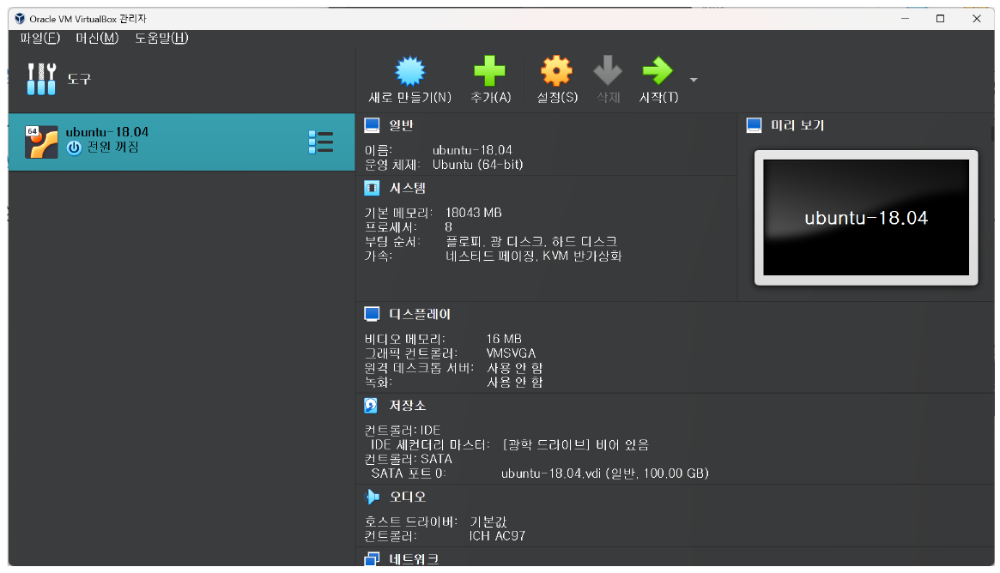

*Figure 21. The VirtualBox Manager and a previously created Ubuntu 18.04 virtual machine*

The `ubuntu-18.04` virtual machine in Figure 21 is set up with 18043 MB of memory, 8 processors, and a 100 GB virtual disk. To build large software such as Autoware, it is safer to allocate generous memory, processors, and disk like this.

4. Configure the virtual machine. The configuration goes through the following screens in order.

**Name and operating system.** Choose a name (for example Test), a folder, the type (Linux), and the version (Ubuntu 18.04 LTS (Bionic Beaver) (64-bit)).

**Memory and processors.** Set the base memory (for example 2048 MB) and the number of processors (for example 1). Choosing within the green part of each slider leaves resources for the host.

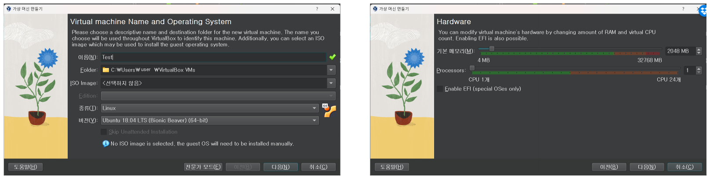

*Figure 22. Name, operating system, memory, and processor settings of the virtual machine*

**Virtual hard disk.** Choose Create a Virtual Hard Disk Now and set the size (for example 25 GB). With Pre-allocate Full Size off, the disk is dynamically allocated: the disk file grows only as much as is actually used.

**Review the settings.** On the Summary screen, check the name, the operating system, 2048 MB of memory, 1 processor, and a 25 GB disk, and press Finish.

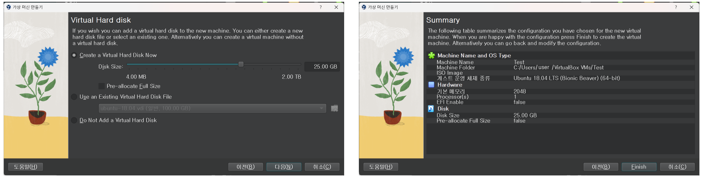

*Figure 23. Virtual hard disk settings and the final summary screen*

**Attach the installation image.** After checking the created virtual machine, choose the empty optical drive in Storage under Settings and attach the downloaded ISO file. The virtual machine reads this ISO like an installation DVD and boots from it.

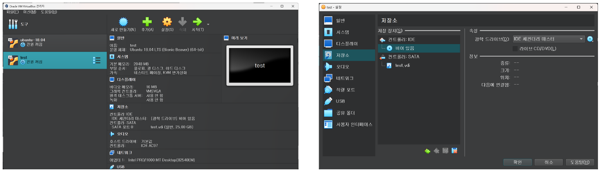

*Figure 24. The created virtual machine and the storage settings screen for attaching the ISO image*

> **Note:** A 25 GB disk is enough to install and learn Ubuntu, but it is tight for also holding the ROS and Autoware source code and build outputs. Enlarging a disk later is cumbersome, so give it room from the start.

### 8.5 Installing Ubuntu in the Virtual Machine

Starting the virtual machine (Start) runs the Ubuntu installer.

1. **Welcome:** Choose English in the list on the left and press Install Ubuntu. Try Ubuntu runs Ubuntu directly from the ISO without changing the disk.
2. **Keyboard layout:** Choose English (US).

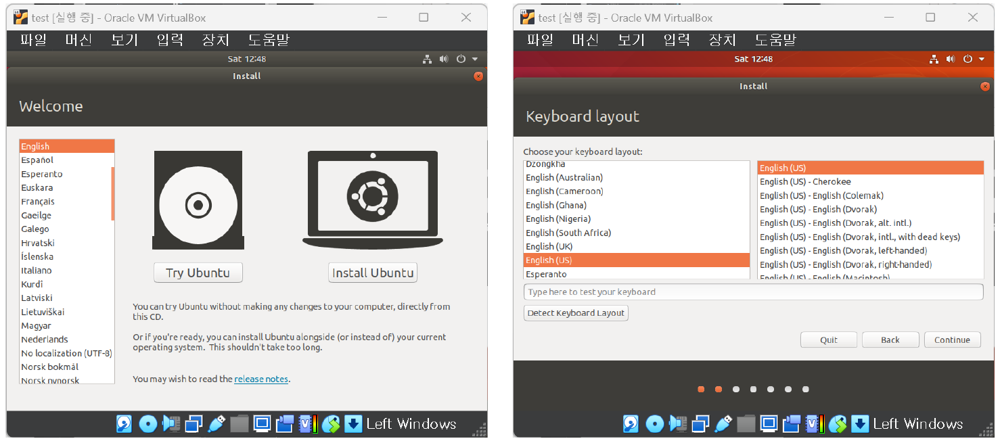

*Figure 25. The installation language screen and the keyboard layout screen*

3. **Updates and other software:** Choose Normal installation, and select Download updates while installing Ubuntu and the installation of third-party software for graphics and Wi-Fi hardware and additional media formats.
4. **Installation type:** Choose Erase disk and install Ubuntu and press Install Now. In a virtual machine only the virtual disk is erased, so this is safe. On a real PC this option erases the existing operating system and all data on the disk, so to keep Windows, choose the Install Ubuntu alongside option or Something else (manual partitioning).

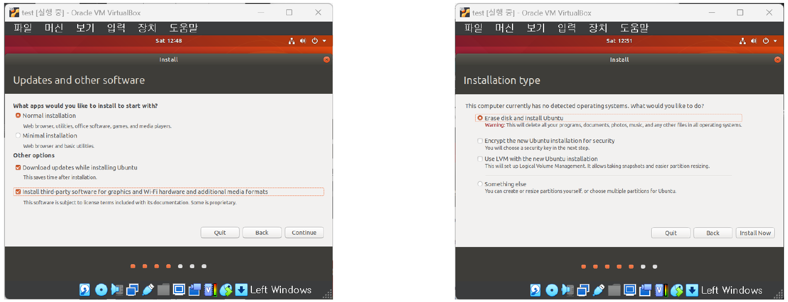

*Figure 26. The updates and other software screen and the installation type screen*

5. **Where are you:** Set the time zone on the map (for example Seoul).
6. **Who are you:** Enter your name, the computer's name, the username, and a password. The username becomes the name of the home folder (`/home/username`), so keep it short in lowercase English letters. This password is also used later for `sudo` commands.

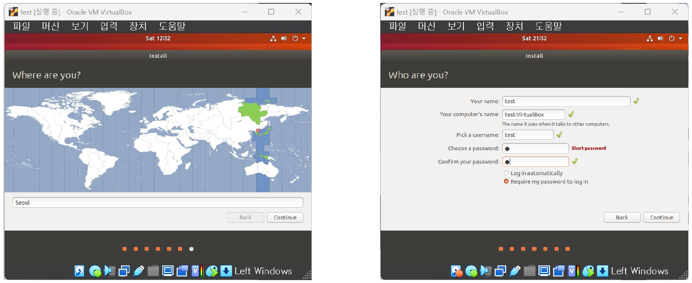

*Figure 27. The time zone screen and the user information screen*

7. **Installation progress:** When copying the files is finished, press Restart Now. If a message asks to remove the installation medium during the restart, press Enter (VirtualBox detaches the ISO automatically).

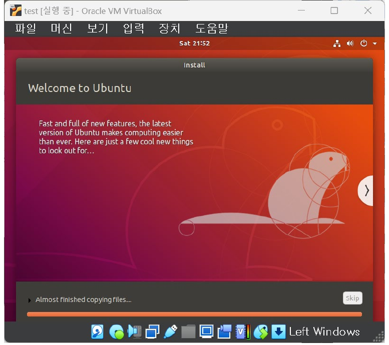

*Figure 28. The screen of the Ubuntu installation in progress*

After the installation, update the packages and install the development environment and ROS following the order of Week 4.

### 8.6 Common Problems

| Symptom | Cause and fix |
|:-----|:-----|
| Starting the virtual machine gives an error about VT-x or AMD-V | Running a 64-bit guest requires the CPU's hardware virtualization feature to be enabled. Turn on Intel VT-x or AMD-V (SVM) in the BIOS/UEFI settings |
| The version list has no 64-bit entries | Same cause as above. Turn on hardware virtualization |
| The computer does not boot from the USB stick | Put USB first in the BIOS/UEFI boot order or choose the USB stick directly in the boot menu. Check that the settings of the tool used to write the ISO (GPT with UEFI, MBR with BIOS) match the computer's boot mode |
| The virtual machine's screen stays small and does not follow when the window is resized | Installing the VirtualBox Guest Additions enables screen resizing and clipboard sharing |
| Installation or building is extremely slow or freezes | The memory and processors assigned to the virtual machine are insufficient. Shut down the virtual machine and increase them in the settings |

*Table 14. Common problems in installing Ubuntu and their fixes*

---

<br>

## Concept Applications

| Situation | Appropriate response and reason |
|:-----|:-----|
| Among tall downtown buildings, the GNSS position jumps by several meters. | **NDT matching localization.** It registers LiDAR scans to a point cloud map, so it can estimate the pose even when satellite signals are blocked. GNSS is used only to set the initial position. |
| After starting rosbag playback, the vehicle in RViz sits at a place that does not match the map and does not move. | **Specify the initial position.** NDT converges only near the initial estimate, so give an initial pose close to the actual position with 2D Pose Estimate in RViz or the Initial Pos values. |
| Registration is too slow to keep up with 10 Hz scans. | **Increase the Leaf Size of voxel_grid_filter or adjust the NDT resolution.** The cost of registration is proportional to the number of scan points. |
| The vehicle sways from side to side on a straight path. | **Increase lookahead_ratio or minimum_lookahead_distance.** With a short lookahead distance, even a small error makes the vehicle turn with a large curvature and oscillate. |
| On a sharp curve the vehicle cuts across the inside of the bend. | **Shorten the lookahead distance or lower the speed on the curve.** When the target point is far, the arc passes inside the bend. |
| The vehicle must stop at a station and then start again. | **A station node using stop lines and traffic lights.** While the light is red, lane_stop chooses the stopping path, and the light is changed to green at departure. |
| You want to try Ubuntu for ROS practice right away on a Windows laptop. | **A VirtualBox virtual machine.** It can be installed without touching the existing operating system. |

*Table 15. Appropriate responses to situations and their reasons*

**True/False Check:**

| Statement | Judgment and reason |
|:-----|:------------|
| NDT pairs each scan point with the nearest map point. | **F.** That is how ICP works. NDT computes the score with per-cell normal distributions and does not look for point correspondences. |
| A point moved along a wall and a point moved perpendicular to the wall by the same distance get different NDT scores. | **T.** The covariance is spread along the wall, so deviations perpendicular to the wall are penalized more. |
| Newton's method moves in a direction that increases the score from any initial estimate. | **F.** If the Hessian is not positive definite it can go the opposite way, so implementations correct the Hessian or use a line search. |
| Increasing the NDT Resolution makes it more robust to initial estimate errors but can lower accuracy. | **T.** Large cells make the score function gentle and widen the convergence region but blur the fine shape of surfaces. |
| In pure pursuit, if the target point is straight ahead of the vehicle ($y_t = 0$), the curvature is 0. | **T.** $\kappa = 2 y_t / l^2 = 0$, so the vehicle goes straight. |
| Doubling the velocity at the same curvature doubles the lateral acceleration. | **F.** $a_y = v^2 \kappa$, so it quadruples. |
| Choosing Erase disk and install Ubuntu in VirtualBox erases the host's Windows. | **F.** Only the virtual disk inside the virtual machine is erased. |

---

<br>

## Summary

| Concept | Key Summary |
|:--------|:------------|
| Localization | Estimating the pose (position and orientation) of a vehicle within a map. In 3D it has six values: $(x, y, z)$ and roll, pitch, yaw. |
| Scan matching | Finding the transformation that makes the current scan overlap the map best; that transformation is the pose of the sensor in the map. |
| NDT representation | Divides space into cells and builds a normal distribution per cell from the mean and covariance of its points. It gives a differentiable score function without point correspondences. |
| NDT score and optimization | Maximizes the sum of $\exp(-\frac{1}{2} \mathbf{q}^{T} \Sigma^{-1} \mathbf{q})$ over the moved scan points with Newton's method $H \Delta\mathbf{p} = -\mathbf{g}$. The initial estimate must be close to the true value. |
| 3D NDT | Estimates six parameters and uses an outlier-robust score function and a line search. Resolution, Step Size, and Trans EPS are the main parameters. |
| NDT mapping | Builds a map by repeatedly registering each new scan to the accumulated map and adding it. Errors can accumulate. |
| Autoware localization | voxel_grid_filter reduces the scan, ndt_matching registers it to the map from points_map_loader, and vel_pose_mux outputs `current_pose`. TF converts the LiDAR pose into the vehicle pose. |
| Path generation | Creates a waypoint path by choosing a start and an end point on a vector map with waypoint_clicker. It extends better than the driving record method. |
| Path planning | lane_rule, lane_stop, lane_select, velocity_set, and path_select in turn assign velocities and reflect traffic lights, lanes, and obstacles. |
| Pure pursuit | Computes the curvature $\kappa = 2 y_t / l^2$ of the arc through the target point $(x_t, y_t)$ at lookahead distance $l$ and outputs $\omega = v \kappa$. |
| Lookahead distance | Too short causes oscillation, too long cuts corners. Autoware multiplies the current velocity by lookahead_ratio and bounds it below by a minimum. |
| twist_filter | When the lateral acceleration $a_y = v^2 \kappa$ exceeds the limit, it reduces the target velocity to at most $\sqrt{a_{\max} / \kappa}$. |
| Real vehicle application | A Sonata with a LiDAR and GNSS was used to test localization, path planning, path following, station stops, and obstacle recognition. Large maps and sensor fusion remain as tasks. |
| Installing Ubuntu 18.04 | Download the ISO and install from a USB stick or in a VirtualBox virtual machine. Install in English and allocate generous resources. |

---

<br>

## Self-Check Questions

1. **Localization and scan matching:** Explain why the transformation found by scan matching is the pose of the sensor in the map, and state what else is needed to obtain the pose of the vehicle's reference point.

   <details>
   <summary>Answer</summary>

   The scan is expressed in the sensor frame with the LiDAR at the origin, so the transformation that moves the scan into the map frame to overlap the map places the origin and axes of the sensor frame in the map frame; that is, it is the position and orientation of the sensor in the map. To obtain the pose of the vehicle's reference point, the mounting position and orientation of the LiDAR relative to the vehicle's reference point (`base_link`), the Baselink to Localizer TF, must be known and this offset undone.

   </details>

2. **NDT cell computation:** A cell contains the points $(0, 0)$, $(2, 0)$, $(0, 2)$, $(2, 2)$. Compute the mean vector and the covariance matrix (dividing by $n$), and compute $\exp(-\frac{1}{2} \mathbf{q}^{T} \Sigma^{-1} \mathbf{q})$ at the location $(2, 1)$.

   <details>
   <summary>Answer</summary>

   The mean is $(1, 1)$. The deviations are the four combinations of $(\pm 1, \pm 1)$, so the variances in $x$ and $y$ are each $4/4 = 1$ and the covariance is $(1 - 1 - 1 + 1)/4 = 0$. Hence $\Sigma = I$ and $\Sigma^{-1} = I$. Since $\mathbf{q} = (2, 1) - (1, 1) = (1, 0)$, $\mathbf{q}^{T} \Sigma^{-1} \mathbf{q} = 1$ and the score is $e^{-0.5} \approx 0.607$. The distribution is round, so there is no difference by direction.

   </details>

3. **Direction of the gradient:** In worked example 1 of Section 2.4, $g_{\phi} > 0$. Which way should the rotation angle $\phi$ change to raise the score? Explain using the location of the point.

   <details>
   <summary>Answer</summary>

   The direction that decreases $s = -\text{score}$ is $-g_{\phi} < 0$, so $\phi$ changes toward negative values (clockwise). The point $(2.5, 0.2)$ is 0.1 m above the cell mean, and a clockwise rotation about the origin lowers the $y$ coordinate of this point, which lies 2.5 m to the right of the origin, bringing it closer to the mean height. At this point $\partial \mathbf{q} / \partial \phi = (-0.2, 2.5)$, whose large $y$ component shows this.

   </details>

4. **Failure of Newton's method:** In the example of Section 2.4 where only $t_y$ moves, show by computation why Newton's method fails when the point is at $(2.5, 0.2)$, and state how real implementations avoid this.

   <details>
   <summary>Answer</summary>

   Since $q_y = 0.1$, $f = e^{-62.5 \times 0.01} = 0.535$, $g = 125 \times 0.1 \times 0.535 = 6.69$, and $H = 125 \times 0.535 \times (1 - 1.25) = -16.7$. Because $H < 0$, $\Delta t_y = -g / H = +0.40$, and the point moves away from the mean. This happens because the score function is concave for $\vert q_y \vert > 1/\sqrt{125}$. Real implementations add $\lambda I$ to the Hessian to make it positive definite, or accept only steps that actually improve the score through a line search, and they supply a good initial estimate, as Predict Pose does, so that the search does not start in such a region.

   </details>

5. **Autoware localization setup:** State two problems that can arise if `/points_raw` is fed directly into ndt_matching without voxel_grid_filter.

   <details>
   <summary>Answer</summary>

   First, the large number of scan points makes registration expensive, so it may not finish for every scan arriving at 10 Hz. Second, a LiDAR measures nearby areas densely, so the points of nearby objects dominate the score, the structure of the whole space is not reflected evenly, and the registration can be biased.

   </details>

6. **Path planning nodes:** Explain, together with the role of lane_stop, why lane_rule prepares separate waypoints for red and green lights in advance.

   <details>
   <summary>Answer</summary>

   The red-light waypoints form a path whose velocity drops to 0 before the stop line, and the green-light waypoints form a path that passes through. With both paths prepared, lane_stop only has to choose one of them according to the traffic light recognition result (or a manual setting) when the light changes, so it can respond immediately without recomputing the velocity profile.

   </details>

7. **Pure pursuit computation:** In the vehicle frame the target point is $(6, -2)$ m and the vehicle drives at $v = 4$ m/s. Find the curvature, turning radius, turning direction, angular velocity, and lateral acceleration.

   <details>
   <summary>Answer</summary>

   $l^2 = 36 + 4 = 40$, so $\kappa = 2 \times (-2) / 40 = -0.1$ m⁻¹ and $R = \vert 1/\kappa \vert = 10$ m. The curvature is negative, so the vehicle turns right. The angular velocity is $\omega = v \kappa = 4 \times (-0.1) = -0.4$ rad/s, and the magnitude of the lateral acceleration is $v^2 \vert \kappa \vert = 16 \times 0.1 = 1.6$ m/s².

   </details>

8. **Lookahead distance:** With lookahead_ratio 2 and minimum_lookahead_distance 4 m, find the lookahead distance at 1 m/s and at 3 m/s, and state what happens if this value is set too small.

   <details>
   <summary>Answer</summary>

   At 1 m/s, $2 \times 1 = 2$ m is below the minimum, so it is 4 m; at 3 m/s it is $2 \times 3 = 6$ m. If the lookahead distance is too short, the target point is close, so even a small deviation from the path changes the curvature greatly, and the vehicle oscillates from side to side across the path.

   </details>

9. **Lateral acceleration limit:** Find, in m/s and km/h, the maximum velocity twist_filter allows on a curve of radius 20 m with lateral_accel_limit 5 m/s².

   <details>
   <summary>Answer</summary>

   $\kappa = 1/20 = 0.05$ m⁻¹, so $v \le \sqrt{5 / 0.05} = \sqrt{100} = 10$ m/s, that is, 36 km/h.

   </details>

10. **Tasks of the real vehicle application:** State the three remaining tasks in the conclusions of the real vehicle case, and explain why each is needed using the content of this unit.

   <details>
   <summary>Answer</summary>

   They are tests after building a large-scale map, precise obstacle detection through camera fusion, and a high-performance PC for loading large maps in real time. NDT mapping can accumulate errors over a wide area, so it must be tested whether localization holds on a large map; LiDAR clustering alone hardly tells the type of an object, so fusion with cameras is needed. Also, as the map grows, points_map_loader loads more cells while registration must still finish for every 10 Hz scan, so more computing performance is needed.

   </details>

11. **Installing Ubuntu:** You want to install a development environment for a real vehicle directly on a laptop that has Windows installed. Explain why you must not choose Erase disk and install Ubuntu as the installation type and what to choose instead, and explain why you install in English.

   <details>
   <summary>Answer</summary>

   On a real PC, Erase disk and install Ubuntu erases Windows and all data on the disk. To keep Windows, choose the Install Ubuntu alongside option or set up the partitions manually with Something else. Installing in English creates the default folders under the home folder with English names, which makes handling paths in the terminal easy, and lets you search error messages in English.

   </details>

---

<br>

## References

1. P. Biber and W. Straßer, "The normal distributions transform: A new approach to laser scan matching," in *Proc. IEEE/RSJ Int. Conf. Intell. Robots Syst. (IROS)*, Las Vegas, NV, USA, 2003, vol. 3, pp. 2743-2748.
2. M. Magnusson, "The three-dimensional normal-distributions transform: An efficient representation for registration, surface analysis, and loop detection," Ph.D. dissertation, Örebro Univ., Örebro, Sweden, 2009.
3. Point Cloud Library, "How to use Normal Distributions Transform," PCL Tutorials. https://pcl.readthedocs.io/projects/tutorials/en/latest/normal_distributions_transform.html
4. Autoware Foundation, "core_perception: lidar_localizer (ndt_matching)," GitHub repository, Autoware.ai. https://github.com/Autoware-AI/core_perception
5. R. C. Coulter, "Implementation of the pure pursuit path tracking algorithm," Robotics Inst., Carnegie Mellon Univ., Pittsburgh, PA, USA, Tech. Rep. CMU-RI-TR-92-01, 1992.
6. Autoware Foundation, "core_planning: pure_pursuit," GitHub repository, Autoware.ai. https://github.com/Autoware-AI/core_planning
7. Canonical, "Ubuntu release cycle." https://ubuntu.com/about/release-cycle
8. Open Robotics, "Distributions," ROS Wiki. https://wiki.ros.org/Distributions
9. Canonical, "Create a bootable USB stick on Windows," Ubuntu Tutorials. https://ubuntu.com/tutorials/create-a-usb-stick-on-windows
