# 4주차 이론 — 리눅스, ROS, Autoware 설치

[레포지토리 안내](../../README.ko.md) | [English](Concepts_Lecture.md) | [한국어](Concepts_Lecture.ko.md)

> **최종 수정일:** 2026-11-04

> **학습 목표:**
> 1. 패키지 관리자 APT가 저장소, 패키지 목록, `sudo` 권한으로 소프트웨어를 갱신하고 설치하는 원리를 설명하고, Ubuntu 설치 직후의 초기 설정을 할 수 있다
> 2. VS Code와 Eclipse 같은 통합 개발 환경을 설치하고 ROS 개발에 맞게 설정할 수 있다
> 3. ROS Melodic을 저장소 등록부터 rosdep 초기화까지 설치하고, 각 명령이 하는 일과 `source`, `.bashrc`로 하는 환경 설정의 의미를 설명할 수 있다
> 4. turtlesim, rqt_graph, 명령줄 도구로 노드, 토픽, 메시지의 관계를 확인하고, `ROS_MASTER_URI`와 `ROS_HOSTNAME`으로 여러 PC의 ROS 네트워크를 설정할 수 있다
> 5. Qt 5.12.12와 Autoware.ai 1.14.0을 설치하고 빌드하여 Runtime Manager를 실행하며, Velodyne 드라이버와 Kvaser CANlib를 설치할 수 있다
> 6. 설치 과정에서 자주 생기는 오류 메시지를 읽고 원인을 찾아 해결할 수 있다

---

## 목차

- [1. Ubuntu 설치 후 초기 설정](#1-ubuntu-설치-후-초기-설정)
  - [1.1 터미널 사용하기](#11-터미널-사용하기)
  - [1.2 패키지 목록 갱신과 업그레이드](#12-패키지-목록-갱신과-업그레이드)
  - [1.3 한글 입력 설정 (선택)](#13-한글-입력-설정-선택)
  - [1.4 데스크톱 작업 공간 (선택)](#14-데스크톱-작업-공간-선택)
- [2. 개발 환경(IDE) 설치](#2-개발-환경ide-설치)
  - [2.1 ROS 개발에 쓰는 IDE](#21-ros-개발에-쓰는-ide)
  - [2.2 VS Code 설치와 확장](#22-vs-code-설치와-확장)
  - [2.3 Eclipse 설치와 설정](#23-eclipse-설치와-설정)
  - [2.4 Qt Creator](#24-qt-creator)
- [3. ROS Melodic 설치](#3-ros-melodic-설치)
  - [3.1 설치할 배포판 확인](#31-설치할-배포판-확인)
  - [3.2 ROS 저장소 등록](#32-ros-저장소-등록)
  - [3.3 서명 키 등록](#33-서명-키-등록)
  - [3.4 ROS 패키지 설치](#34-ros-패키지-설치)
  - [3.5 환경 설정](#35-환경-설정)
  - [3.6 빌드 도구 설치와 rosdep 초기화](#36-빌드-도구-설치와-rosdep-초기화)
  - [3.7 설치 스크립트를 이용한 간단 설치](#37-설치-스크립트를-이용한-간단-설치)
- [4. turtlesim으로 ROS 동작 확인](#4-turtlesim으로-ros-동작-확인)
  - [4.1 마스터, 노드, 토픽](#41-마스터-노드-토픽)
  - [4.2 turtlesim 실행](#42-turtlesim-실행)
  - [4.3 rqt_graph로 노드 그래프 보기](#43-rqt_graph로-노드-그래프-보기)
  - [4.4 명령줄 도구로 확인하기](#44-명령줄-도구로-확인하기)
  - [4.5 노드 종료와 작업 공간의 환경 설정](#45-노드-종료와-작업-공간의-환경-설정)
- [5. ROS 네트워크 설정](#5-ros-네트워크-설정)
  - [5.1 .bashrc 파일](#51-bashrc-파일)
  - [5.2 ROS_MASTER_URI와 ROS_HOSTNAME](#52-ros_master_uri와-ros_hostname)
  - [5.3 여러 PC에서 ROS 실행하기](#53-여러-pc에서-ros-실행하기)
- [6. Autoware 설치](#6-autoware-설치)
  - [6.1 Autoware 버전과 요구 환경](#61-autoware-버전과-요구-환경)
  - [6.2 Qt 5.12.12 설치](#62-qt-51212-설치)
  - [6.3 git 설치](#63-git-설치)
  - [6.4 Autoware.ai 1.14.0 소스 빌드](#64-autowareai-1140-소스-빌드)
  - [6.5 Runtime Manager 실행](#65-runtime-manager-실행)
  - [6.6 Velodyne 드라이버 설치 (선택)](#66-velodyne-드라이버-설치-선택)
  - [6.7 Kvaser CANlib 설치 (선택)](#67-kvaser-canlib-설치-선택)
- [개념 적용](#개념-적용)
- [요약](#요약)
- [점검 문제](#점검-문제)
- [참고 문헌](#참고-문헌)

---

<br>

## 1. Ubuntu 설치 후 초기 설정

이 단원은 3주차에서 설치한 Ubuntu 18.04 위에 이동 로봇 소프트웨어 개발 환경을 차례로 쌓는다. 아래 층이 준비되어야 위 층을 설치할 수 있으므로 순서를 지켜야 한다. 이 단원에서는 리눅스와 ROS의 설치를 확인하고, turtlesim으로 ROS의 실행을 시험하며, 개발 환경(VS Code)을 준비한다. 이어지는 ROS의 구조(작업 공간과 패키지), Hello World 노드 작성, 노드 사이의 메시지 송수신은 5\~6주차에서 다룬다.

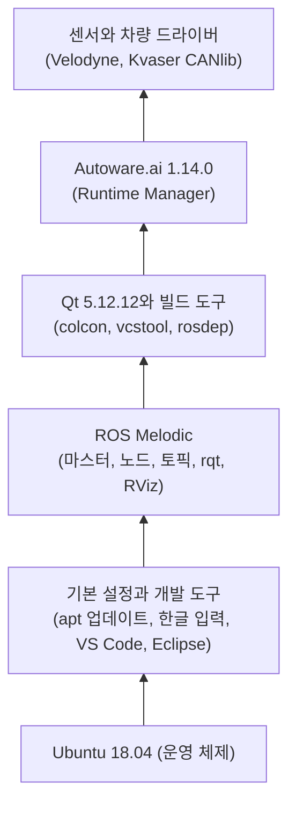

*그림 1. 이 단원에서 설치하는 소프트웨어의 층*

### 1.1 터미널 사용하기

설치의 대부분은 **터미널(terminal)** 에 명령을 입력하여 진행한다. 터미널은 글자로 명령을 입력하고 결과를 글자로 받는 창이다.

| 동작 | 단축키 |
|:-----|:-----|
| 터미널 열기 | Ctrl + Alt + T |
| 터미널 안에서 복사 | Ctrl + Shift + C |
| 터미널 안에 붙여 넣기 | Ctrl + Shift + V |
| 실행 중인 프로그램 끝내기 | Ctrl + C |

*표 1. 터미널의 기본 단축키*

터미널에서 복사와 붙여 넣기에 Shift를 더하는 까닭은 Ctrl + C가 이미 실행 중인 프로그램에 중단 신호를 보내는 데 쓰이기 때문이다. 터미널의 입력 줄은 `사용자@컴퓨터:~$` 꼴로 표시되며, `~`는 홈 폴더(`/home/사용자`), 끝의 `$`는 일반 사용자 권한으로 명령을 받는다는 뜻이다. 이 단원의 코드 블록에서 `#` 뒤의 글은 설명을 위한 주석이므로 입력하지 않아도 된다.

### 1.2 패키지 목록 갱신과 업그레이드

> **용어 정의:** **패키지(package)** 는 프로그램과 그 설정 파일을 설치하기 좋게 묶은 것이고, **패키지 관리자(package manager)** 는 패키지를 내려받아 설치하고, 갱신하고, 지우는 프로그램이다. Ubuntu의 패키지 관리자는 **APT**이며, 패키지를 내려받는 서버를 **저장소(repository)** 라고 한다. **`sudo`** 는 뒤의 명령을 관리자(root) 권한으로 실행하며, 처음 실행할 때 로그인 비밀번호를 묻는다. 비밀번호를 입력하는 동안 화면에는 아무것도 표시되지 않는다.

Ubuntu를 설치한 직후에는 터미널을 열어 다음 두 명령을 실행한다.

```bash
sudo apt-get update     # 사용할 수 있는 패키지와 버전의 목록을 갱신한다
sudo apt-get upgrade    # 갱신한 목록에서 찾은 최신 버전으로 설치된 패키지를 올린다
```

`apt-get update`는 소프트웨어를 바꾸지 않는다. `/etc/apt/sources.list`와 `/etc/apt/sources.list.d/` 아래 파일에 적힌 저장소에서 패키지 목록(어떤 패키지의 어떤 버전이 있는지)만 새로 받아, 최신 버전이 있는지 확인하는 과정이다. 실제로 패키지를 새 버전으로 바꾸는 것은 `apt-get upgrade`이다. 목록이 오래되면 `upgrade`도 새 버전을 알지 못하므로 두 명령은 항상 이 순서로 실행한다. `apt`는 `apt-get`을 사람이 쓰기 편하게 다듬은 명령이며, 이 단원의 설치에서는 둘을 같은 뜻으로 쓴다.

`update`가 정상이면 다음과 비슷한 출력이 나오고, `upgrade`는 올릴 패키지 목록을 보여 준 뒤 `Do you want to continue? [Y/n]`라고 물으므로 Y를 입력한다.

```text
Hit:1 http://kr.archive.ubuntu.com/ubuntu bionic InRelease
Get:2 http://kr.archive.ubuntu.com/ubuntu bionic-updates InRelease [88.7 kB]
...
Reading package lists... Done
```

| 오류 메시지 | 원인과 해결 |
|:-----|:-----|
| `E: Could not open lock file /var/lib/apt/lists/lock - open (13: Permission denied)` | `sudo` 없이 실행하였다. 명령 앞에 `sudo`를 붙인다 |
| `E: Could not get lock /var/lib/dpkg/lock-frontend - open (11: Resource temporarily unavailable)` | 다른 APT 작업(자동 업데이트, 소프트웨어 업데이터 등)이 실행 중이다. 그 작업이 끝날 때까지 기다린다. 잠금 파일을 지우면 패키지 데이터베이스가 손상될 수 있다 |
| `Temporary failure resolving 'kr.archive.ubuntu.com'` | 인터넷에 연결되지 않았다. 네트워크 연결(가상 머신이면 네트워크 어댑터 설정)을 확인한다 |

*표 2. 패키지 갱신에서 자주 생기는 오류*

### 1.3 한글 입력 설정 (선택)

3주차에서 권장한 대로 영어로 설치한 경우, 한글 입력은 다음과 같이 추가한다.

1. Settings → Region & Language → Manage Installed Languages를 연다. 언어 지원이 완전히 설치되지 않았다는 창이 나오면 Install을 누르고, Install/Remove Languages에서 Korean을 골라 적용한다.
2. 컴퓨터를 다시 시작한다.

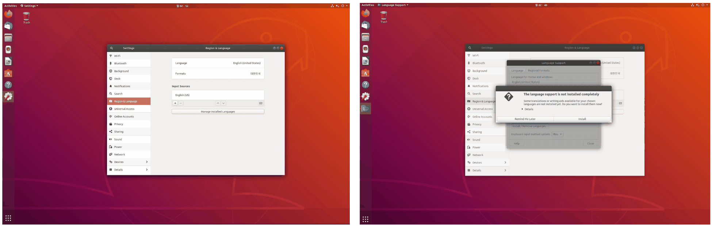

*그림 2. 언어 지원 설치 화면*

3. 터미널에 `ibus-setup`을 입력하여 IBus 설정 창을 연다.
4. Input Method 탭에서 Add를 눌러 Korean → Hangul을 추가한다.
5. Settings → Region & Language의 Input Sources에서 +를 눌러 Korean (Hangul)을 추가한다.
6. 빠르게 한글과 영어를 바꾸기 위한 단축키를 설정한다(예: Hangul 입력기의 설정에서 전환 키 지정).

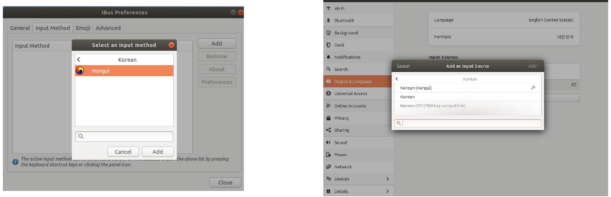

*그림 3. IBus에 Hangul 입력기를 추가하는 화면과 입력 소스에 Korean (Hangul)을 추가하는 화면*

> **용어 정의:** **IBus(Intelligent Input Bus)** 는 키보드 입력을 한글이나 일본어처럼 조합이 필요한 글자로 바꾸어 주는 입력기 프레임워크이다. Hangul은 IBus 위에서 동작하는 한글 입력기이다.

### 1.4 데스크톱 작업 공간 (선택)

**데스크톱 작업 공간(workspace)** 은 화면을 여러 개의 가상 화면으로 나누어 쓰는 기능이다. ROS를 실습하면 마스터, 여러 노드, RViz, 편집기처럼 창이 많아지므로, 작업 공간마다 창을 나누어 두면 편하다.

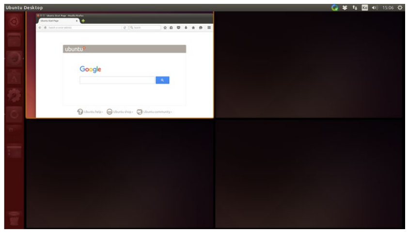

*그림 4. 네 개의 데스크톱 작업 공간으로 나눈 화면*

| 단축키 | 동작 |
|:-----|:-----|
| Ctrl + Alt + ↑ / ↓ | 다른 작업 공간으로 이동한다 |
| Shift + Ctrl + Alt + ↑ / ↓ | 지금 작업하는 창을 다른 작업 공간으로 옮긴다 |
| Super(Windows 키) + W | 모든 작업 공간의 창을 펼쳐 보인다 |
| Super + D | 모든 창을 최소화한다. 다시 누르면 모든 창이 돌아온다 |
| Super + S | 모든 작업 공간을 한 화면에 표시한다 |

*표 3. 데스크톱 작업 공간의 단축키*

> **참고:** 데스크톱 환경의 버전에 따라 단축키가 다를 수 있다. Settings → Devices → Keyboard에서 지금 쓰는 단축키를 확인하고 바꿀 수 있다.

---

<br>

## 2. 개발 환경(IDE) 설치

### 2.1 ROS 개발에 쓰는 IDE

**IDE(integrated development environment, 통합 개발 환경)** 는 코드 편집, 빌드, 디버깅을 한 프로그램에서 할 수 있게 한 도구이다. 초기 ROS 개발자들은 대부분 Eclipse를 썼지만, 최근에는 Eclipse가 실행할 때 자원을 많이 써 개발 효율이 떨어지는 면이 있고 다른 IDE들이 ROS에 편리한 확장 기능을 제공하므로, 각자의 개발 성향에 맞는 IDE를 쓰는 경향이 늘고 있다. Eclipse 대신 많이 쓰는 IDE로 Qt Creator와 Visual Studio Code가 있다. 이 단원은 Visual Studio Code를 기본으로 하고, Eclipse는 2.3절에서 다룬다.

### 2.2 VS Code 설치와 확장

1. `https://code.visualstudio.com/`에서 Linux용 `.deb` 파일을 내려받는다.
2. Downloads 폴더에서 `code_1.XXXXXXXXX.deb` 파일을 두 번 클릭하면 Ubuntu Software Center가 실행되며, Install을 눌러 설치한다. 터미널에서는 다음 명령으로도 설치할 수 있다.

```bash
cd ~/Downloads
sudo apt install ./code_*.deb    # ./ 는 저장소가 아니라 지금 폴더의 파일을 설치하라는 뜻이다
```

3. VS Code가 실행되는지 확인한 뒤 File → Preferences → Extensions(Ctrl + Shift + X)로 이동하여 다음 확장을 검색해 설치한다.

| 확장 | 하는 일 |
|:-----|:-----|
| C/C++ | C와 C++의 문법 강조, 코드 자동 완성(IntelliSense), 디버깅을 지원한다 |
| C++ Intellisense | 소스 코드의 기호를 색인하여 C++ 코드의 자동 완성과 정의 찾기를 돕는다 |
| ROS | ROS 작업 공간을 인식하고, launch 파일과 메시지 파일 편집, ROS 명령 실행을 돕는다 |
| XML Tools | `package.xml`이나 launch 파일 같은 XML 파일의 서식을 정리하고 검사한다 |

*표 4. ROS 개발을 위해 설치하는 VS Code 확장*

터미널에서 폴더로 이동한 뒤 `code .`을 입력하면 그 폴더를 VS Code로 연다. `.`은 지금 폴더를 뜻한다.

### 2.3 Eclipse 설치와 설정

Eclipse는 Java로 만든 IDE이므로 먼저 Java 실행 환경(JDK)이 필요하다. 설치 방법은 최신 버전을 직접 받는 수동 설치와 APT를 쓰는 자동 설치가 있다. 자동 설치는 편하지만 저장소에 있는 오래된 버전이 설치될 수 있으므로, 최신 버전이 필요하면 수동 설치를 권한다.

**수동 설치.** JDK를 설치하고 Eclipse 설치 프로그램을 내려받는다.

```bash
sudo apt-get install default-jdk    # Ubuntu 기본 버전의 Java 개발 도구(JDK)를 설치한다
```

1. `https://www.eclipse.org/downloads/packages/installer`에서 Linux 64비트용 설치 프로그램 `eclipse-inst-linux64.tar.gz`를 내려받는다.
2. 내려받은 파일의 압축을 풀고, `eclipse-installer` 폴더 안의 `eclipse-inst` 파일을 실행한다.
3. 목록에서 Eclipse IDE for C/C++ Developers를 골라 설치한다.
4. C++ 예제 코드(hello world)를 실행하여 확인한다.

```bash
cd ~/Downloads
tar xzf eclipse-inst-linux64.tar.gz    # x: 풀기, z: gzip 압축, f: 파일 이름 지정
./eclipse-installer/eclipse-inst       # 설치 프로그램 실행
```

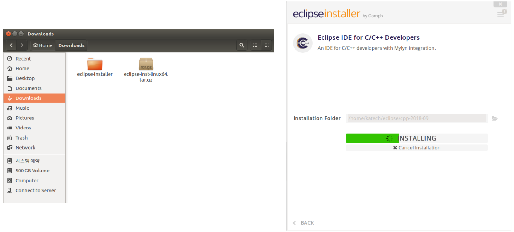

*그림 5. 내려받은 Eclipse 설치 프로그램과 Eclipse IDE for C/C++ Developers를 설치하는 화면*

**런처에 등록하기.** 수동으로 설치하면 프로그램 검색에서 Eclipse 아이콘이 제대로 보이지 않을 수 있다. 다음 명령으로 바탕 화면 항목 파일을 만들고 아래 내용을 입력해 저장하면 해결된다.

```bash
sudo gedit /usr/share/applications/eclipse.desktop
```

```ini
[Desktop Entry]
Encoding=UTF-8
Name=Eclipse
Comment=Eclipse IDE
Exec=/home/user/eclipse/cpp-2018-09/eclipse/eclipse
Icon=/home/user/eclipse/cpp-2018-09/eclipse/icon.xpm
Terminal=false
Type=Application
Categories=GNOME;Application;Development;
StartupNotify=true
```

`user` 자리에는 자신의 사용자 이름을 쓰고, `cpp-2018-09`처럼 버전에 따라 달라지는 설치 경로는 실제로 설치된 경로를 확인하여 고친다. `Exec`는 실행할 파일, `Icon`은 아이콘 파일, `Terminal=false`는 터미널 창 없이 실행한다는 뜻이고, `Categories`는 프로그램 목록에서 어느 분류에 보일지 정한다.

**자동 설치.**

```bash
sudo apt-get install default-jdk     # 1. Java 개발 도구 설치
sudo apt-get install eclipse         # 2. Eclipse 설치
sudo -s                              # 3. 관리자 셸로 전환 (끝낼 때는 exit)
sudo apt-get install build-essential # gcc, g++, make 같은 C/C++ 빌드 도구 설치
sudo apt-get install eclipse-cdt     # Eclipse의 C/C++ 개발 도구(CDT) 설치
```

`sudo -s`는 관리자 권한의 셸을 열므로, 그 안에서는 `sudo`를 붙이지 않아도 관리자 권한으로 실행된다. 관리자 셸에서 실수로 파일을 지우면 시스템이 손상될 수 있으므로 설치가 끝나면 `exit`로 나온다.

**자동 설치 뒤의 설정.** Window → Preferences → C/C++ → New C/C++ Project Wizard → Makefile Project에서 다음과 같이 설정한다.

- **Binary Parsers:** Elf Parser를 고른다. ELF는 리눅스 실행 파일의 형식이며, 바이너리 파서는 빌드된 실행 파일을 읽어 프로젝트 탐색기에 바이너리와 기호를 보여 준다.

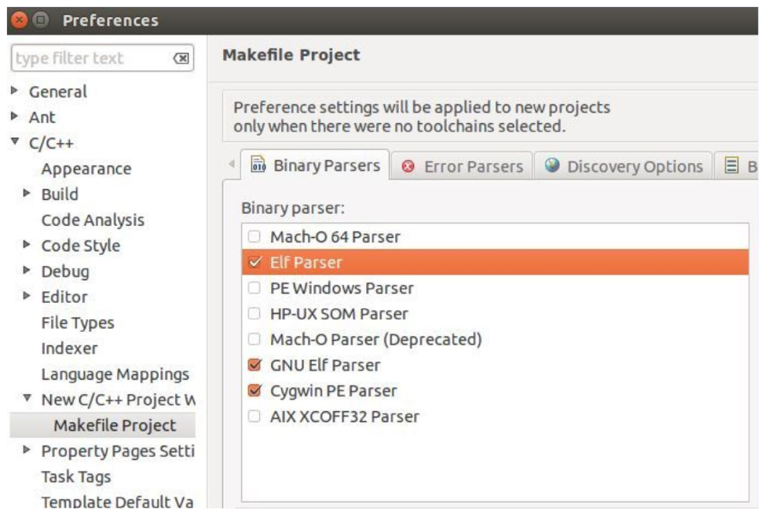

*그림 6. Makefile Project의 Binary Parsers에서 Elf Parser를 고른 화면*

- **Error Parsers:** 모든 항목이 체크되어 있는지 확인한다. 오류 파서는 컴파일러와 링커의 출력에서 오류와 경고를 찾아 Problems 창과 코드의 해당 줄에 표시한다.
- **Behaviour:** Build on resource save (Auto build)를 체크한다. 파일을 저장할 때마다 자동으로 빌드하여 오류를 바로 확인할 수 있다.

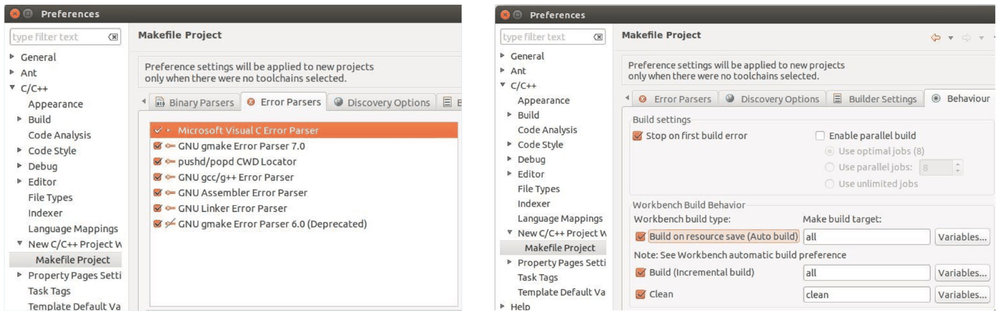

*그림 7. Error Parsers의 체크 항목과 Behaviour의 자동 빌드 설정*

**예제 실행.** File → New → C++ Project에서 Executable 아래의 Hello World C++ Project를 고르고 Toolchain으로 Linux GCC를 고르면 다음 코드가 만들어진다. 빌드(Ctrl + B)한 뒤 실행하면 Console 창에 `!!!Hello World!!!`가 출력된다.

```cpp
#include <iostream>
using namespace std;

int main() {
	cout << "!!!Hello World!!!" << endl; // prints !!!Hello World!!!
	return 0;
}
```

- `#include <iostream>`: 표준 입출력 스트림(`cout` 등)을 선언한 헤더를 포함한다.
- `using namespace std;`: `std::cout` 대신 `cout`처럼 표준 라이브러리의 이름을 짧게 쓸 수 있게 한다.
- `int main()`: 프로그램이 시작하는 함수이다.
- `cout << "!!!Hello World!!!" << endl;`: 문자열을 표준 출력에 쓰고, `endl`로 줄을 바꾸며 출력 버퍼를 비운다.
- `return 0;`: 프로그램이 정상적으로 끝났음을 운영 체제에 알린다.

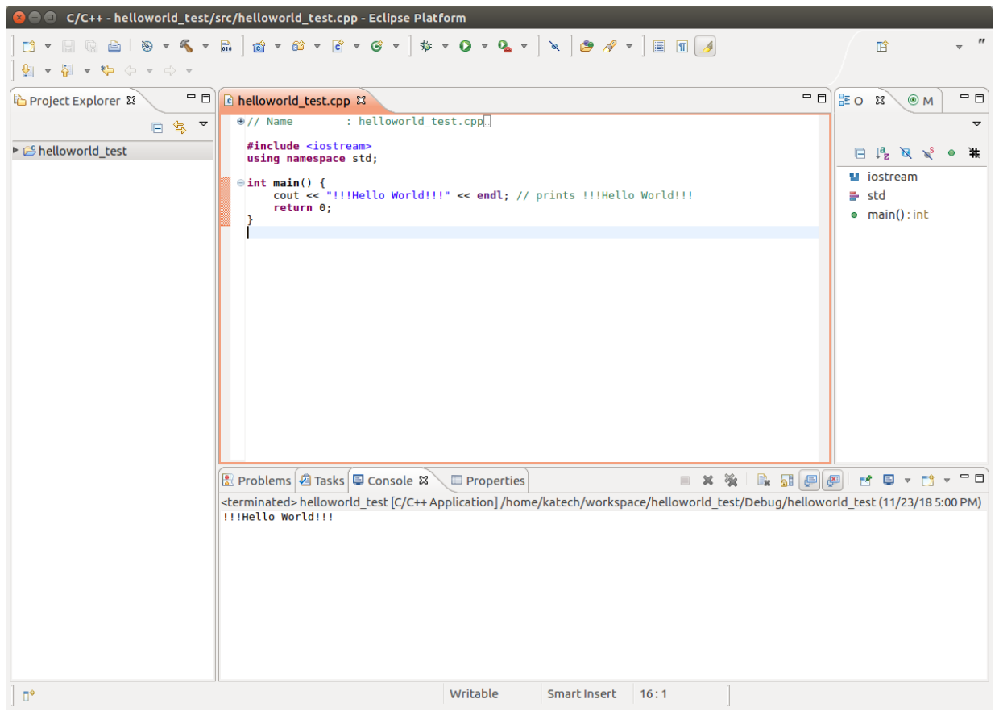

*그림 8. Eclipse에서 hello world 예제를 빌드하고 실행한 결과*

### 2.4 Qt Creator

Qt Creator는 GUI 라이브러리 Qt의 IDE로, 6.2절에서 Qt를 설치할 때 함께 설치된다. CMake 프로젝트를 열 수 있으므로 CMake로 빌드하는 ROS 패키지도 편집할 수 있다.

---

<br>

## 3. ROS Melodic 설치

### 3.1 설치할 배포판 확인

ROS 1은 대략 해마다 **배포판(distribution)** 을 내며, 각 배포판은 특정 Ubuntu 버전에 맞추어 만들어진다. Ubuntu 18.04(코드명 bionic)에 맞는 배포판은 ROS Melodic Morenia이다. 이 절의 명령은 ROS Wiki의 Melodic 설치 안내를 따른다 [1].

| Ubuntu | ROS 배포판 |
|:-----|:-----|
| 14.04 (trusty) | Indigo |
| 16.04 (xenial) | Kinetic |
| 18.04 (bionic) | Melodic |

*표 5. Ubuntu 버전과 ROS 배포판의 대응*

> **주의:** ROS Melodic은 2023년에 지원이 끝났다 [2]. 패키지는 여전히 설치할 수 있지만 새 업데이트는 나오지 않으며, 3.6절처럼 일부 도구는 지원이 끝난 배포판을 따로 지정해야 한다.

### 3.2 ROS 저장소 등록

ROS 패키지는 Ubuntu 기본 저장소가 아니라 ROS의 저장소에 있으므로, 먼저 APT에 그 저장소를 알려 준다.

```bash
sudo sh -c 'echo "deb http://packages.ros.org/ros/ubuntu $(lsb_release -sc) main" > /etc/apt/sources.list.d/ros-latest.list'
```

- `lsb_release -sc`는 Ubuntu의 코드명을 출력하며, `$(...)`는 그 출력으로 자리를 바꾼다. Ubuntu 18.04에서는 `bionic`이 된다.
- `echo "deb ..."`는 저장소 한 줄을 출력하고, `>`는 그 출력을 파일 `/etc/apt/sources.list.d/ros-latest.list`에 쓴다.
- `/etc` 아래에 파일을 쓰려면 관리자 권한이 필요하다. `sudo echo ... > 파일`로 쓰면 `echo`만 관리자 권한으로 실행되고 파일에 쓰는 일(`>`)은 일반 사용자 권한의 셸이 하므로 실패한다. 그래서 `sudo sh -c '...'`로 명령 전체를 관리자 권한의 셸에서 실행한다.

등록되었는지는 다음 명령으로 확인한다.

```bash
cat /etc/apt/sources.list.d/ros-latest.list
```

```text
deb http://packages.ros.org/ros/ubuntu bionic main
```

### 3.3 서명 키 등록

APT는 내려받은 패키지가 저장소 주인이 만든 것인지를 **서명 키(signing key)** 로 확인한다. ROS 저장소의 공개 키를 등록한다.

```bash
sudo apt install curl    # 웹 주소의 내용을 내려받는 도구
curl -s https://raw.githubusercontent.com/ros/rosdistro/master/ros.asc | sudo apt-key add -
```

`curl -s`는 진행 표시 없이 키 파일을 내려받아 출력하고, `|`(파이프)는 그 출력을 다음 명령의 입력으로 넘긴다. `apt-key add -`의 `-`는 키를 파일이 아니라 표준 입력에서 읽으라는 뜻이다. 성공하면 `OK`가 출력된다.

> **주의:** 저장소의 키는 바뀌거나 만료될 수 있다. 이후 `sudo apt update`에서 `NO_PUBKEY`나 `EXPKEYSIG`가 포함된 오류가 나오면 등록한 키가 맞지 않는 것이므로, ROS Wiki의 설치 안내에서 현재의 키 등록 방법을 확인한다 [1].

### 3.4 ROS 패키지 설치

```bash
sudo apt update                           # 새로 등록한 ROS 저장소의 패키지 목록을 받는다
sudo apt install ros-melodic-desktop-full # ROS Melodic 전체 설치
```

ROS 패키지 이름은 `ros-<배포판>-<패키지>` 꼴이다. `desktop-full`은 ROS의 핵심(마스터, 통신 라이브러리, 빌드 도구), rqt와 RViz 같은 시각화 도구, 로봇 공통 라이브러리, 2D와 3D 시뮬레이터, 인식 관련 패키지를 모두 포함하는 가장 큰 묶음이다. 내려받을 양이 많아 시간이 걸린다. 설치된 파일은 `/opt/ros/melodic/` 아래에 놓인다.

| 오류 메시지 | 원인과 해결 |
|:-----|:-----|
| `E: Unable to locate package ros-melodic-desktop-full` | 저장소가 등록되지 않았거나 `sudo apt update`를 하지 않았다. 또는 Ubuntu가 18.04가 아니다. 3.2절을 다시 확인하고 `lsb_release -sc`가 `bionic`인지 본다 |
| `The following signatures couldn't be verified because the public key is not available: NO_PUBKEY ...` | 서명 키가 없거나 바뀌었다. 3.3절의 주의 상자를 따른다 |

*표 6. ROS 패키지 설치에서 자주 생기는 오류*

### 3.5 환경 설정

ROS 명령을 쓰려면 터미널마다 ROS의 환경 변수를 설정해야 한다.

```bash
echo "source /opt/ros/melodic/setup.bash" >> ~/.bashrc   # 새 터미널마다 실행될 설정 파일에 한 줄 추가
source ~/.bashrc                                          # 지금 터미널에도 바로 적용
```

> **용어 정의:** **환경 변수(environment variable)** 는 셸과 그 셸에서 실행되는 프로그램이 함께 보는 이름과 값의 쌍이다. `/opt/ros/melodic/setup.bash`는 `ROS_DISTRO`, `ROS_PACKAGE_PATH`, `PATH`, `PYTHONPATH`, `CMAKE_PREFIX_PATH` 같은 환경 변수를 ROS에 맞게 설정하는 스크립트이다. **`source`** 는 스크립트를 새 셸이 아니라 지금 셸에서 실행하여, 스크립트가 바꾼 환경 변수가 지금 셸에 남게 한다.

`~/.bashrc`는 새 터미널을 열 때마다 자동으로 실행되는 설정 파일이므로, 여기에 `source` 줄을 넣어 두면 터미널마다 직접 입력할 필요가 없다. `>>`는 파일 끝에 덧붙이고 `>`는 파일을 덮어쓰므로, 여기서 `>`를 쓰면 `.bashrc`의 기존 내용이 모두 사라진다. 설정이 적용되었는지는 다음과 같이 확인한다.

```bash
echo $ROS_DISTRO
```

```text
melodic
```

### 3.6 빌드 도구 설치와 rosdep 초기화

ROS 패키지를 직접 만들고 빌드하는 데 필요한 도구를 설치하고, rosdep을 초기화한다.

```bash
sudo apt install python-rosdep python-rosinstall python-rosinstall-generator python-wstool build-essential
sudo apt install python-rosdep   # 앞 줄에서 이미 설치했으면 최신 버전이라는 메시지만 나온다
sudo rosdep init
rosdep update                    # 앞에 sudo를 붙이면 안 된다
```

| 도구 | 하는 일 |
|:-----|:-----|
| rosdep | ROS 패키지가 필요로 하는 시스템 패키지(라이브러리 등)를 찾아 설치한다 |
| rosinstall, rosinstall-generator, wstool | 여러 ROS 패키지의 소스 코드를 작업 공간으로 한꺼번에 내려받고 관리한다 |
| build-essential | gcc, g++, make 같은 C/C++ 컴파일러와 빌드 도구 |

*표 7. ROS 패키지 개발을 위해 설치하는 도구*

`sudo rosdep init`은 시스템 전체가 쓰는 rosdep 설정 파일을 `/etc` 아래에 만들므로 관리자 권한이 필요하다. 성공하면 다음과 같이 출력된다.

```text
Wrote /etc/ros/rosdep/sources.list.d/20-default.list
Recommended: please run

	rosdep update
```

`rosdep update`는 의존성 정보를 내려받아 사용자의 홈 폴더(`~/.ros/rosdep/`)에 캐시로 저장한다. 앞에 `sudo`를 붙이면 이 캐시가 관리자 소유로 만들어져, 이후 일반 사용자로 rosdep을 쓸 때 권한 오류가 난다. 실수로 `sudo`를 붙였으면 rosdep이 안내하는 대로 `sudo rosdep fix-permissions`를 실행한 뒤 `sudo` 없이 다시 `rosdep update`를 실행한다.

> **주의:** 최신 rosdep은 지원이 끝난 배포판의 정보를 기본으로 내려받지 않는다. Melodic처럼 지원이 끝난 배포판을 쓰면 `rosdep update`에 `--include-eol-distros` 옵션을 붙여야 6.4절의 `rosdep install`이 Melodic 패키지를 찾을 수 있다 [3].

```bash
rosdep update --include-eol-distros
```

| 오류 메시지 | 원인과 해결 |
|:-----|:-----|
| `ERROR: default sources list file already exists` | `sudo rosdep init`을 이미 한 번 실행하였다. 다시 할 필요 없이 `rosdep update`만 실행한다 |
| `Warning: running 'rosdep update' as root is not recommended.` | `rosdep update`에 `sudo`를 붙였다. `sudo rosdep fix-permissions` 뒤 `sudo` 없이 다시 실행한다 |
| `ERROR: cannot download default sources list from: ...` | 인터넷 연결이나 GitHub 접속에 문제가 있다. 연결을 확인하고 다시 실행한다 |

*표 8. rosdep 초기화에서 자주 생기는 오류*

### 3.7 설치 스크립트를 이용한 간단 설치

3.2\~3.6절의 과정을 한 번에 실행하는 설치 스크립트를 쓸 수도 있다 [4]. 먼저 패키지를 갱신한 뒤 두 방법 가운데 하나로 실행한다.

```bash
sudo apt-get update
sudo apt-get upgrade
```

**방법 1: 스크립트를 내려받아 실행한다.**

```bash
wget https://raw.githubusercontent.com/orocapangyo/meetup/master/190830/install_ros_melodic.sh && chmod 755 ./install_ros_melodic.sh && bash ./install_ros_melodic.sh
source .bashrc
```

**방법 2: 미리 받아 둔 스크립트를 실행한다.** `install_ros_melodic.sh`를 홈 폴더에 저장하고 홈 폴더에 파일이 있는지 확인한 뒤 실행한다.

```bash
cd ~
chmod 755 install_ros_melodic.sh   # 실행 권한이 없으면 먼저 준다
./install_ros_melodic.sh
source .bashrc
```

- `wget 주소`는 주소의 파일을 지금 폴더에 내려받는다.
- `&&`는 앞 명령이 성공했을 때만 뒤 명령을 실행한다. 내려받기에 실패하면 이후 명령은 실행되지 않는다.
- `chmod 755`는 파일 권한을 소유자는 읽기, 쓰기, 실행(7), 그룹과 다른 사용자는 읽기와 실행(5)으로 바꾼다. 셸 스크립트를 `./파일`로 실행하려면 실행 권한이 있어야 한다.
- `bash ./파일`은 실행 권한과 관계없이 bash로 스크립트를 실행한다.

이 스크립트는 Enter 입력을 기다린 뒤 다음 일을 차례로 한다. 패키지를 갱신하고, 시간 동기화 도구와 빌드 도구를 설치하고, ROS 저장소와 키를 등록하고, `ros-melodic-desktop-full`과 모든 rqt 플러그인을 설치하고, rosdep을 초기화한다. 이어서 `~/catkin_ws` 작업 공간을 만들어 `catkin_make`로 빌드를 시험하고, 5.1절의 별칭과 환경 설정을 `.bashrc`에 추가한다. 스크립트는 관리자 권한으로 여러 명령을 실행하므로, 인터넷에서 받은 스크립트는 실행하기 전에 내용을 열어 무엇을 하는지 확인하는 습관이 필요하다.

---

<br>

## 4. turtlesim으로 ROS 동작 확인

### 4.1 마스터, 노드, 토픽

ROS 프로그램은 여러 **노드(node)** 가 메시지를 주고받으며 동작한다. 1주차에서 다룬 것처럼 **마스터(master)** 는 노드들의 이름과 주소를 관리하는 중개자이며, 노드는 시작할 때 XMLRPC로 마스터에 자신을 등록하고 필요한 상대 노드의 주소를 조회한다. 실제 메시지는 마스터를 거치지 않고 노드와 노드가 TCPROS로 직접 주고받는다.

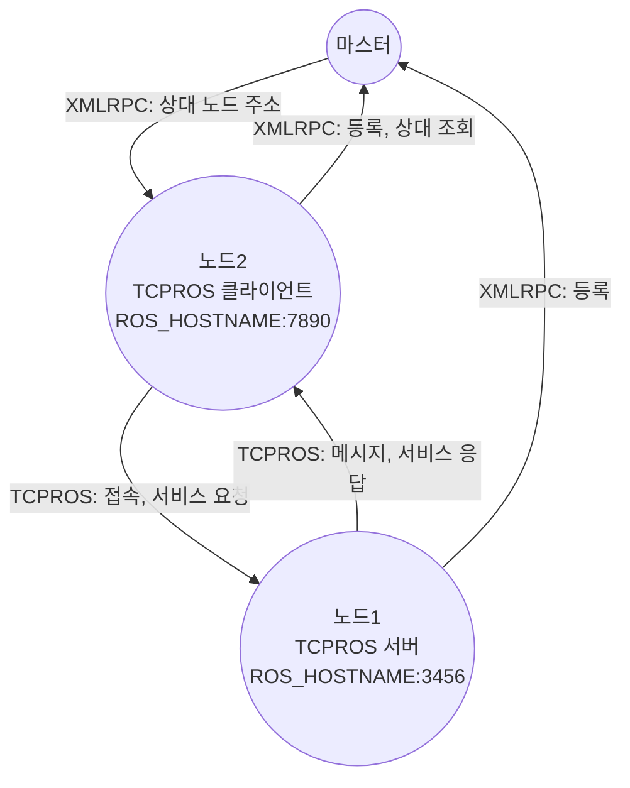

*그림 9. 마스터와 두 노드 사이의 통신*

> **용어 정의:** **토픽(topic)** 은 메시지가 오가는 이름 붙은 통로이다. 토픽에 메시지를 보내는 노드를 **퍼블리셔(publisher)**, 받는 노드를 **서브스크라이버(subscriber)** 라고 한다. **메시지(message)** 는 정해진 형식(필드의 이름과 자료형)을 가진 자료이다. **서비스(service)** 는 요청을 보내면 응답을 한 번 돌려받는 일대일 통신이다.

그림 9의 `ROS_HOSTNAME:3456`처럼 각 노드는 자신의 호스트 이름과 포트 번호로 접속을 받는다. 그래서 5절에서 설정할 `ROS_HOSTNAME`이 틀리면, 마스터에 등록은 되어도 다른 노드가 그 노드에 접속하지 못한다.

### 4.2 turtlesim 실행

**turtlesim**은 거북이 한 마리가 움직이는 2D 시뮬레이터로, ROS가 제대로 설치되었는지 확인하고 노드와 토픽을 익히는 데 쓰는 패키지이다. 터미널 세 개를 열어 다음 명령을 하나씩 실행한다.

```bash
roscore                                   # 터미널 1: 마스터 실행
```

```bash
rosrun turtlesim turtlesim_node           # 터미널 2: 거북이 시뮬레이터 노드 실행
```

```bash
rosrun turtlesim turtle_teleop_key        # 터미널 3: 키보드 조종 노드 실행
```

- `roscore`는 마스터, 매개변수 서버, 로그를 모으는 `rosout` 노드를 함께 실행한다. 다른 노드보다 먼저 실행해야 한다.
- `rosrun <패키지> <실행 파일>`은 패키지 안의 실행 파일 하나를 노드로 실행한다.

`roscore`가 정상이면 마지막 부분에 다음과 비슷한 줄이 나온다(`ubuntu`는 컴퓨터 이름, 숫자는 실행할 때마다 다르다).

```text
started roslaunch server http://ubuntu:36451/
...
auto-starting new master
process[master]: started with pid [12360]
ROS_MASTER_URI=http://ubuntu:11311/
...
started core service [/rosout]
```

`turtlesim_node`를 실행하면 파란 창 가운데에 거북이가 나타나고 터미널에는 다음과 같은 줄이 출력된다(두 번째 대괄호 안의 숫자는 출력 시각이다).

```text
[ INFO] [1711612800.123456789]: Starting turtlesim with node name /turtlesim
[ INFO] [1711612800.130000000]: Spawning turtle [turtle1] at x=[5.544445], y=[5.544445], theta=[0.000000]
```

`turtle_teleop_key`를 실행한 터미널을 클릭하여 키보드 입력을 받게 한 뒤 방향키를 누르면 거북이가 움직이고, 지나간 자리에 선이 그려진다.

```text
Reading from keyboard
---------------------------
Use arrow keys to move the turtle.
```

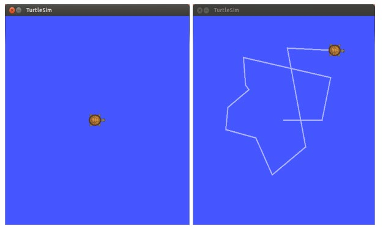

*그림 10. 처음 실행한 turtlesim 창과 방향키로 거북이를 움직인 뒤의 창*

| 증상 | 원인과 해결 |
|:-----|:-----|
| `[ERROR] ... [registerPublisher] Failed to contact master at [localhost:11311].  Retrying...` | 마스터가 실행되지 않았다. 다른 터미널에서 `roscore`를 먼저 실행한다 |
| `Command 'rosrun' not found` 또는 `rosrun: command not found` | 그 터미널에 ROS 환경이 설정되지 않았다. 3.5절의 `.bashrc` 설정을 확인하고 새 터미널을 열거나 `source ~/.bashrc`를 실행한다 |
| `[rospack] Error: package 'turtlesim' not found` | ROS 환경이 설정되지 않았거나 turtlesim이 설치되지 않았다. 환경을 확인하고, 필요하면 `sudo apt install ros-melodic-turtlesim`으로 설치한다 |
| 방향키를 눌러도 거북이가 움직이지 않는다 | 키보드 입력이 `turtle_teleop_key`의 터미널로 가지 않는다. 그 터미널 창을 클릭한 뒤 방향키를 누른다 |

*표 9. turtlesim 실행에서 자주 생기는 문제*

### 4.3 rqt_graph로 노드 그래프 보기

**rqt**는 ROS의 GUI 도구 모음이고, **rqt_graph**는 그 가운데 실행 중인 노드와 토픽의 연결을 그래프로 보여 주는 도구이다. 네 번째 터미널에서 다음 중 하나를 실행한다.

```bash
rqt_graph
```

```bash
rqt    # 메뉴에서 Plugins → Introspection → Node Graph를 고른다
```

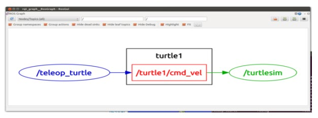

*그림 11. turtlesim을 실행했을 때 rqt_graph가 보여 주는 노드 그래프*

그림 11에서 타원은 노드, 사각형은 토픽이다. 키보드 조종 노드 `/teleop_turtle`이 토픽 `/turtle1/cmd_vel`에 메시지를 발행하고, 시뮬레이터 노드 `/turtlesim`이 그 토픽을 구독한다. `turtle1` 상자는 토픽 이름의 앞부분(이름 공간)이 같은 토픽들을 묶은 것이다. 두 노드는 서로를 모르고 토픽 이름만 알기 때문에, 키보드 노드 대신 자율주행 알고리즘 노드가 같은 토픽에 발행해도 거북이는 똑같이 움직인다. 이처럼 노드를 토픽으로 느슨하게 연결하는 구조가 ROS의 핵심이다.

### 4.4 명령줄 도구로 확인하기

같은 내용을 명령줄 도구로도 확인할 수 있다 [5].

```bash
rosnode list                       # 실행 중인 노드 목록
rostopic list                      # 현재 존재하는 토픽 목록
rostopic info /turtle1/cmd_vel     # 토픽의 메시지 형식, 퍼블리셔, 서브스크라이버
rosmsg show geometry_msgs/Twist    # 메시지 형식의 필드 구조
rostopic echo /turtle1/cmd_vel     # 토픽에 오가는 메시지를 실시간으로 출력
```

`rosnode list`와 `rostopic list`의 출력은 다음과 같다.

```text
/rosout
/teleop_turtle
/turtlesim
```

```text
/rosout
/rosout_agg
/turtle1/cmd_vel
/turtle1/color_sensor
/turtle1/pose
```

`rostopic info`는 이 토픽의 메시지 형식이 `geometry_msgs/Twist`이고, 퍼블리셔가 `/teleop_turtle`, 서브스크라이버가 `/turtlesim`임을 보여 주며, `rosmsg show`는 그 형식의 구조를 보여 준다.

```text
Type: geometry_msgs/Twist

Publishers:
 * /teleop_turtle (http://ubuntu:43215/)

Subscribers:
 * /turtlesim (http://ubuntu:41237/)
```

```text
geometry_msgs/Vector3 linear
  float64 x
  float64 y
  float64 z
geometry_msgs/Vector3 angular
  float64 x
  float64 y
  float64 z
```

`rostopic echo`를 켜 둔 채 `turtle_teleop_key`의 터미널에서 위쪽 방향키를 한 번 누르면 다음 메시지가 출력된다. 진행 방향의 선속도 `linear.x`가 2.0 m/s이고 나머지는 0이다. 왼쪽 방향키를 누르면 반대로 각속도 `angular.z`가 2.0 rad/s가 된다.

```text
linear:
  x: 2.0
  y: 0.0
  z: 0.0
angular:
  x: 0.0
  y: 0.0
  z: 0.0
---
```

`Twist`는 3주차의 pure_pursuit와 twist_filter가 차량에 속도 명령을 보낼 때 쓰는 것과 같은 형식이다. 평면을 움직이는 거북이와 차량은 모두 `linear.x`(선속도 $v$)와 `angular.z`(각속도 $\omega$) 두 값으로 움직임을 지시받는다.

### 4.5 노드 종료와 작업 공간의 환경 설정

실행 중인 노드는 그 터미널에서 Ctrl + C를 눌러 끝낸다. 마스터(`roscore`)를 먼저 끝내면 실행 중인 노드들이 새 연결을 맺거나 마스터에 정보를 묻지 못하므로, 보통 노드들을 먼저 끝내고 마지막에 마스터를 끝낸다.

직접 만든 ROS 패키지는 **catkin 작업 공간(catkin workspace)** 에서 빌드하며(5주차), 빌드한 뒤에는 작업 공간 폴더에서 다음 명령으로 그 작업 공간의 환경을 지금 터미널에 더해야 ROS가 새 패키지를 찾는다.

```bash
. devel/setup.bash    # source devel/setup.bash 와 같다
```

`.`은 `source`와 같은 명령이다. `/opt/ros/melodic/setup.bash`가 설치된 ROS 패키지의 환경을 설정한다면, 작업 공간의 `devel/setup.bash`는 그 위에 직접 빌드한 패키지의 경로를 더한다.

---

<br>

## 5. ROS 네트워크 설정

### 5.1 .bashrc 파일

`.bashrc`는 홈 폴더에 있는 숨김 파일이다. 이름이 `.`으로 시작하는 파일은 기본으로 보이지 않으므로, 파일 관리자(Files)에서는 Ctrl + H로 숨김 파일을 보이게 한 뒤 두 번 클릭하여 열고, 터미널에서는 다음과 같이 연다.

```bash
gedit ~/.bashrc
```

3.7절의 설치 스크립트를 실행한 경우 `.bashrc`의 끝에 다음 줄들이 추가되어 있다.

```bash
alias eb='nano ~/.bashrc'
alias sb='source ~/.bashrc'
alias gs='git status'
alias gp='git pull'
alias cw='cd ~/catkin_ws'
alias cs='cd ~/catkin_ws/src'
alias cm='cd ~/catkin_ws && catkin_make'
source /opt/ros/melodic/setup.bash
source ~/catkin_ws/devel/setup.bash
export ROS_MASTER_URI=http://localhost:11311
export ROS_HOSTNAME=localhost
```

| 줄 | 의미 |
|:-----|:-----|
| `alias eb='nano ~/.bashrc'` | `eb`를 입력하면 편집기 nano로 `.bashrc`를 연다 |
| `alias sb='source ~/.bashrc'` | `sb`로 바꾼 설정을 지금 터미널에 다시 적용한다 |
| `alias gs`, `alias gp` | `git status`, `git pull`의 줄임 |
| `alias cw`, `alias cs` | catkin 작업 공간과 그 `src` 폴더로 이동한다 |
| `alias cm` | 작업 공간으로 이동하여 `catkin_make`로 빌드한다 |
| `source /opt/ros/melodic/setup.bash` | 설치된 ROS의 환경을 설정한다 |
| `source ~/catkin_ws/devel/setup.bash` | 직접 빌드한 패키지의 환경을 더한다 |
| `export ROS_MASTER_URI=...` | 접속할 마스터의 주소를 정한다 (5.2절) |
| `export ROS_HOSTNAME=...` | 이 PC의 노드가 다른 노드에게 알릴 자신의 주소를 정한다 (5.2절) |

*표 10. `.bashrc`에 추가되는 별칭과 ROS 설정*

`alias 이름='명령'`은 긴 명령에 짧은 별명을 붙이고, `export`는 환경 변수를 정하여 이 셸에서 실행하는 프로그램에 전달한다.

> **참고:** 설치 스크립트를 두 번 실행하면 같은 줄이 `.bashrc`에 두 번 추가된다. 동작에는 문제가 없지만 읽기 어려우므로 한 벌만 남긴다. 다른 배포판(예: Kinetic)을 쓰던 PC에서는 `source /opt/ros/kinetic/setup.bash` 같은 줄이 남아 있을 수 있는데, 두 배포판의 `setup.bash`를 함께 실행하면 뒤의 설정이 앞의 설정을 덮어써 혼란이 생기므로 쓰는 배포판의 줄만 남긴다. GPU 연산용 CUDA를 설치한 PC에는 `PATH`와 `LD_LIBRARY_PATH`에 CUDA 경로를 더하는 줄도 있다.

### 5.2 ROS_MASTER_URI와 ROS_HOSTNAME

ROS 노드가 서로 통신하려면 두 환경 변수를 알맞게 정해야 한다 [6].

- **`ROS_MASTER_URI`:** `roscore`가 실행되고 있는 PC(마스터)의 주소이다. 형식은 `http://<IP 주소>:11311`이며, 11311은 마스터의 기본 포트이다.
- **`ROS_HOSTNAME`:** 노드가 실행되는 PC 자신의 주소이다. 노드는 마스터에 등록할 때 이 주소를 알리고, 다른 노드는 이 주소로 접속해 온다.

혼자 한 PC에서 실습할 때는 둘 다 `localhost`(자기 자신)로 두면 된다. 여러 PC가 함께 동작하려면 `localhost` 대신 실제 IP 주소를 쓴다.

```bash
export ROS_HOSTNAME=192.168.0.105    # 192.168.0.105 대신 자신의 IP 주소를 쓴다
```

자신의 IP 주소는 `ifconfig`로 확인한다. Ubuntu 18.04에 이 명령이 없으면 `sudo apt install net-tools`로 설치하거나, 같은 정보를 보여 주는 `ip addr` 또는 `hostname -I`를 쓴다.

```bash
ifconfig
```

```text
enp0s3: flags=4163<UP,BROADCAST,RUNNING,MULTICAST>  mtu 1500
        inet 192.168.0.105  netmask 255.255.255.0  broadcast 192.168.0.255
        ...
```

`inet` 뒤의 `192.168.0.105`가 이 PC의 IP 주소이다. `lo`라는 이름의 항목에 나오는 `127.0.0.1`은 자기 자신을 가리키는 주소(`localhost`)이므로 다른 PC에 알려 줄 주소가 아니다.

### 5.3 여러 PC에서 ROS 실행하기

예를 들어 차량의 PC A(192.168.0.105)에서 마스터와 센서 노드를 실행하고, 노트북 B(192.168.0.110)에서 RViz로 결과를 보려면 다음과 같이 정한다.

| PC | `ROS_MASTER_URI` | `ROS_HOSTNAME` |
|:-----|:-----|:-----|
| A (마스터를 실행하는 PC) | `http://192.168.0.105:11311` | `192.168.0.105` |
| B (다른 PC) | `http://192.168.0.105:11311` | `192.168.0.110` |

*표 11. 두 PC에서 ROS를 함께 쓸 때의 환경 변수*

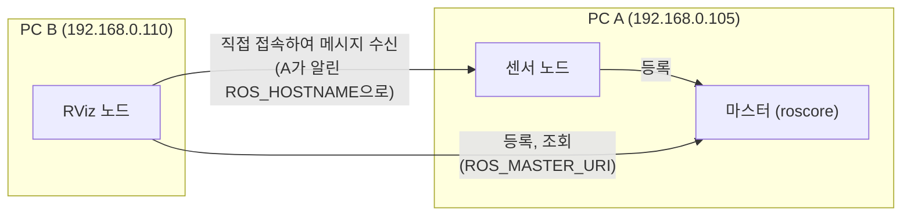

*그림 12. 두 PC에 나누어 실행한 ROS 노드의 연결*

두 PC 모두 `ROS_MASTER_URI`는 A를 가리키고, `ROS_HOSTNAME`은 각자 자신의 주소이다. `.bashrc`에 PC별 설정을 주석(`#`)으로 써 두고, 상황에 따라 주석을 바꾸어 쓰면 편하다. 고친 뒤에는 `source ~/.bashrc`를 실행하거나 새 터미널을 열어야 적용된다.

```bash
#export ROS_MASTER_URI=http://192.168.0.105:11311
#export ROS_HOSTNAME=192.168.0.105
```

> **주의:** 가장 흔한 실수는 B에서 `ROS_HOSTNAME`을 `localhost`로 둔 채 실행하는 것이다. 그러면 `rostopic list`에는 토픽이 보이지만, A의 노드가 B의 노드에 접속하려 할 때 `localhost`, 즉 A 자신에게 접속하게 되어 메시지가 오가지 않는다. 마스터는 주소만 중개하고 메시지는 노드끼리 직접 주고받기 때문이다. 방화벽이 노드의 포트를 막아도 같은 증상이 나타난다.

---

<br>

## 6. Autoware 설치

### 6.1 Autoware 버전과 요구 환경

**Autoware.ai**는 ROS 1을 기반으로 한 오픈 소스 자율주행 소프트웨어로, 실습은 1.14.0판을 쓴다. 이후 Autoware의 개발은 ROS 2 기반으로 옮겨 갔다. Autoware.ai의 소스 코드 빌드 안내는 Autoware Foundation의 문서에 있다 [7]. 버전마다 지원하는 Ubuntu가 다르다.

| Autoware 버전 | Ubuntu 14.04 | Ubuntu 16.04 | Ubuntu 18.04 |
|:-----|:-----|:-----|:-----|
| v1.14.0 | | | ✓ |
| v1.13.0 | | | ✓ |
| v1.12.0 | | ✓ | ✓ |
| v1.11.1 | | ✓ | |
| v1.11.0 | | ✓ | |
| v1.10.0 | | ✓ | |
| v1.9.1 | ✓ | ✓ | |
| v1.9.0 | ✓ | ✓ | |

*표 12. Autoware 버전별 지원 Ubuntu*

| 구성 요소 | Ubuntu 14.04 | Ubuntu 16.04 | Ubuntu 18.04 |
|:-----|:-----|:-----|:-----|
| ROS | Indigo | Kinetic | Melodic |
| Qt | 4.8.6 이상 | 5.2.1 이상 | 5.9.5 이상 |
| CUDA (선택) | 8.0GA | 9.0 | 10.0 |
| FlyCapture2 (선택) | | | |
| Armadillo (선택) | | | |

*표 13. Ubuntu 버전별 Autoware 요구 환경*

Ubuntu 18.04에서 Autoware 1.14.0을 쓰려면 ROS Melodic과 Qt 5.9.5 이상이 필요하다. CUDA는 GPU로 딥러닝 기반 인식 노드 같은 일부 기능을 가속할 때만 필요하며, 실습은 CUDA 없이 빌드한다. FlyCapture2는 특정 카메라의 드라이버, Armadillo는 선형대수 라이브러리로, 해당 기능을 쓸 때만 필요하다.

### 6.2 Qt 5.12.12 설치

**Qt**는 C++로 GUI 프로그램을 만드는 라이브러리이며, Autoware의 일부 도구가 쓴다. Ubuntu 18.04의 저장소에 있는 Qt는 5.9.5이지만, 실습은 5.12.12판을 홈 폴더에 따로 설치한다.

1. `https://download.qt.io/archive/qt/5.12/5.12.12/`에서 5.12 버전의 설치 파일을 내려받는다. 필요한 파일을 미리 모두 담은 오프라인 설치 파일 `qt-opensource-linux-x64-5.12.12.run`을 받아 설치하는 것을 권장하며, 내려받기가 느리면 미러 사이트(`https://download.qt.io/static/mirrorlist/`)를 이용한다.
2. 다음 명령을 차례로 실행한다.

```bash
sudo apt-get update
sudo apt-get install build-essential          # C/C++ 컴파일러와 빌드 도구
cd Downloads                                  # 설치 파일을 내려받은 폴더로 이동
chmod +x qt-opensource-linux-x64-5.12.12.run  # 실행 권한을 준다
./qt-opensource-linux-x64-5.12.12.run         # 설치 프로그램 실행
```

3. 설치 프로그램이 실행되면 Welcome, Open Source Obligations, Setup, Installation Folder, Select Components, License Agreement, Ready to Install 단계를 차례로 진행한다. Installation Folder는 기본값(`/home/사용자/Qt5.12.12`)으로 둔다. 다음 단계의 경로 설정이 이 위치를 전제로 한다.

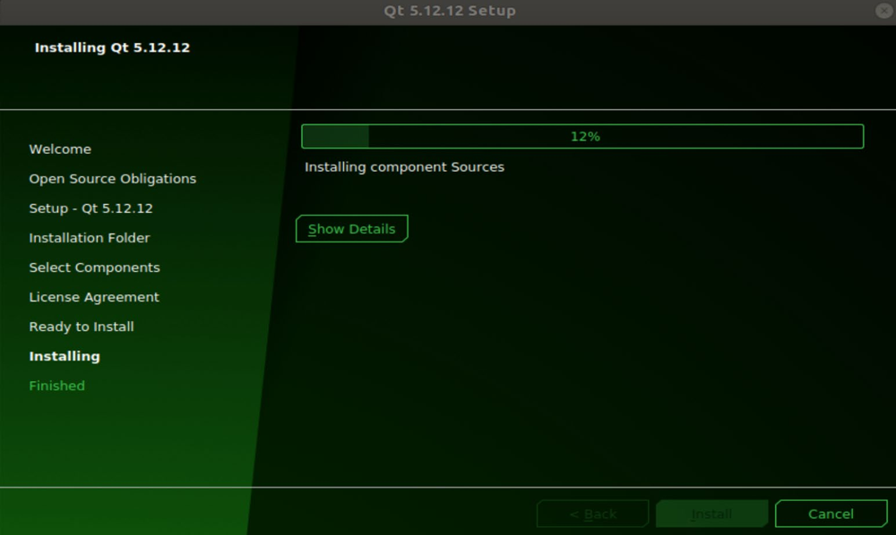

*그림 13. Qt 5.12.12 설치 프로그램이 구성 요소를 설치하는 화면*

4. **Qt 활성화.** `.bashrc` 파일의 마지막에 다음 한 줄을 추가한다.

```bash
export PATH=$HOME/Qt5.12.12/5.12.12/gcc_64/bin:$HOME/Qt5.12.12/Tools/QtCreator/bin:$PATH
```

`$HOME`은 홈 폴더(`/home/사용자`)를 뜻하는 환경 변수이다. **`PATH`** 는 명령을 입력했을 때 실행 파일을 찾을 폴더들을 `:`로 이은 목록이며, 셸은 왼쪽 폴더부터 차례로 찾는다. Qt 5.12.12의 `bin` 폴더를 기존 `$PATH`의 앞에 두었으므로, 시스템의 Qt 5.9.5보다 새로 설치한 Qt의 `qmake`가 먼저 실행된다. 두 번째 폴더는 Qt Creator의 실행 파일이 있는 곳이다.

5. **Qt 버전 확인.**

```bash
source ~/.bashrc
qmake -version
```

```text
QMake version 3.1
Using Qt version 5.12.12 in /home/user/Qt5.12.12/5.12.12/gcc_64/lib
```

`Using Qt version 5.9.5 in /usr/lib/x86_64-linux-gnu`처럼 5.9.5가 나오면 `PATH` 설정이 적용되지 않은 것이므로, 추가한 줄의 경로와 `source ~/.bashrc` 실행 여부를 확인한다. `qmake: command not found`가 나오면 경로에 오타가 있거나 Qt가 다른 폴더에 설치된 것이다.

### 6.3 git 설치

**git**은 소스 코드의 변경 이력을 관리하는 도구로, GitHub에 있는 소스 코드를 내려받는 데 필요하다. Autoware와 Velodyne 드라이버의 소스를 받으려면 반드시 설치한다.

```bash
sudo apt-get install git
```

`git --version`으로 설치를 확인한다. `sudo` 없이 실행하면 1.2절의 `Permission denied` 오류가 난다.

### 6.4 Autoware.ai 1.14.0 소스 빌드

Autoware는 여러 저장소에 나뉜 수백 개의 패키지로 이루어져 있으므로, 소스를 한꺼번에 받고 의존성을 설치한 뒤 빌드한다. 다음 명령을 순서대로 터미널에서 실행한다.


*그림 14. Autoware.ai 소스 빌드의 단계*

**1단계: 시스템 의존성 설치.**

```bash
sudo apt update
sudo apt install -y python-catkin-pkg python-rosdep ros-$ROS_DISTRO-catkin
sudo apt install -y python3-pip python3-colcon-common-extensions python3-setuptools python3-vcstool
pip3 install -U setuptools
```

- `-y`는 설치 중의 확인 질문에 모두 yes로 답한다.
- `$ROS_DISTRO`는 3.5절의 환경 설정이 정한 환경 변수로 `melodic`이 되므로, `ros-$ROS_DISTRO-catkin`은 `ros-melodic-catkin`이다. ROS 환경이 설정되지 않은 터미널에서는 이 값이 비어 `ros--catkin`이라는 없는 패키지를 찾게 된다.
- **colcon**은 여러 패키지를 의존 순서에 맞추어 한꺼번에 빌드하는 도구이고, **vcstool**(`vcs` 명령)은 여러 저장소를 목록 파일 하나로 한꺼번에 내려받는 도구이다.
- `pip3 install -U setuptools`는 Python 3의 패키지 설치 도구 setuptools를 최신 버전으로 올린다.

**2단계: 작업 공간 만들기와 소스 받기.**

```bash
mkdir -p autoware.ai/src
cd autoware.ai
wget -O autoware.ai.repos https://raw.githubusercontent.com/Autoware-AI/autoware.ai/1.14.0/autoware.ai.repos
vcs import src < autoware.ai.repos
```

- `mkdir -p`는 중간 폴더까지 한 번에 만든다. `autoware.ai`가 작업 공간이고, 소스는 그 안의 `src`에 놓인다.
- `wget -O 파일 이름 주소`는 주소의 내용을 지정한 이름으로 저장한다. `autoware.ai.repos`는 Autoware를 이루는 저장소들의 주소와 버전(1.14.0)을 적은 목록이다.
- `vcs import src < autoware.ai.repos`는 목록의 저장소를 모두 `src` 아래로 내려받는다. `<`는 파일의 내용을 명령의 입력으로 넘긴다.

> **참고:** `Autoware-AI/autoware.ai` 저장소는 이후 옮겨져 위 주소는 더 이상 파일을 내주지 않으며, `wget`이 `404 Not Found`로 실패한다. 같은 1.14.0 목록 파일은 현재 `autowarefoundation/autoware_ai` 저장소에 있으므로 다음 명령으로 받는다 [7].

```bash
wget -O autoware.ai.repos https://raw.githubusercontent.com/autowarefoundation/autoware_ai/1.14.0/autoware.ai.repos
```

**3단계: 패키지 의존성 설치.**

```bash
rosdep update
rosdep install -y --from-paths src --ignore-src --rosdistro $ROS_DISTRO
```

- `--from-paths src`는 `src` 아래의 모든 패키지가 `package.xml`에 적은 의존성을 모은다.
- `--ignore-src`는 그 의존성 가운데 `src`에 소스로 이미 있는 패키지는 설치하지 않는다.
- `--rosdistro $ROS_DISTRO`는 의존성을 Melodic의 패키지 이름으로 풀도록 지정한다. 3.6절의 주의 상자처럼 `rosdep update --include-eol-distros`를 하지 않았으면 이 단계에서 의존성을 찾지 못한다는 오류가 날 수 있다.

**4단계: 빌드.** CUDA 없이 빌드할 때는 다음 명령을 쓴다.

```bash
colcon build --cmake-args -DCMAKE_BUILD_TYPE=Release
```

`--cmake-args -DCMAKE_BUILD_TYPE=Release`는 각 패키지의 CMake에 최적화된 릴리스 빌드를 하도록 전달한다. 빌드에는 컴퓨터 성능에 따라 수십 분에서 몇 시간이 걸리며, 끝나면 작업 공간에 `build`(중간 결과), `install`(실행에 쓰는 결과), `log`(빌드 기록) 폴더가 생기고 마지막에 `Summary: ... packages finished` 줄이 출력된다. CUDA를 설치하고 GPU 가속을 쓰려면 `AUTOWARE_COMPILE_WITH_CUDA=1 colcon build --cmake-args -DCMAKE_BUILD_TYPE=Release`로 빌드한다 [7].

| 증상 | 원인과 해결 |
|:-----|:-----|
| `E: Unable to locate package ros--catkin` | ROS 환경이 설정되지 않아 `$ROS_DISTRO`가 비었다. `source /opt/ros/melodic/setup.bash` 뒤 다시 실행한다 |
| `vcs: command not found` | python3-vcstool이 설치되지 않았다. 1단계를 다시 실행한다 |
| `ERROR: the following packages/stacks could not have their rosdep keys resolved` | rosdep 정보가 없거나 오래되었다. `rosdep update --include-eol-distros` 뒤 다시 실행한다 |
| `c++: internal compiler error: Killed (program cc1plus)` | 여러 패키지를 동시에 컴파일하다 메모리가 모자라 컴파일러가 강제로 종료되었다. `colcon build --parallel-workers 1 --cmake-args -DCMAKE_BUILD_TYPE=Release`처럼 동시에 빌드할 패키지 수를 줄이거나, 가상 머신의 메모리를 늘린다 |
| 특정 패키지가 `Failed`로 끝난다 | `log/latest_build/<패키지 이름>/stderr.log`에서 첫 번째 오류를 찾는다. 빠진 라이브러리가 원인이면 3단계를 다시 실행한다 |

*표 14. Autoware 빌드에서 자주 생기는 문제*

### 6.5 Runtime Manager 실행

```bash
cd autoware.ai
source install/setup.bash
roslaunch runtime_manager runtime_manager.launch
```

- `source install/setup.bash`는 colcon이 빌드한 Autoware 패키지의 환경을 지금 터미널에 더한다. 새 터미널을 열 때마다 다시 실행해야 한다.
- **`roslaunch`** 는 launch 파일에 적힌 여러 노드를 한 번에 실행하며, 마스터가 실행 중이 아니면 마스터도 함께 실행한다. `runtime_manager.launch`는 3주차에서 쓴 Runtime Manager 창을 띄운다.

정상이면 Quick Start, Setup, Map, Sensing, Computing, Interface, Database, Simulation, Status, Topics 탭이 있는 Runtime Manager 창이 나타난다(3주차의 그림 7과 그림 8 참고). `[runtime_manager.launch] is neither a launch file in package [runtime_manager] nor is [runtime_manager] a launch file name` 같은 오류가 나오면 `source install/setup.bash`를 하지 않은 것이다.

### 6.6 Velodyne 드라이버 설치 (선택)

실제 Velodyne LiDAR를 연결할 때 필요한 ROS 드라이버이다. `https://github.com/ros-drivers/velodyne`에서 소스 코드를 가져와 빌드하는 방법은 다음과 같으며, 순서대로 터미널에서 실행한다.

```bash
sudo apt-get install libpcap-dev git
mkdir -p ~/ros_drivers/src
cd ~/ros_drivers/src
catkin_init_workspace
git clone https://github.com/ros-drivers/velodyne.git
cd ~/ros_drivers
catkin_make
source devel/setup.bash
```

- `libpcap-dev`는 네트워크 패킷을 캡처하는 라이브러리이다. Velodyne LiDAR는 측정값을 이더넷 UDP 패킷으로 보내며, 드라이버는 이 라이브러리로 기록해 둔 패킷 파일(pcap)도 읽는다.
- `~/ros_drivers`가 catkin 작업 공간이고, `catkin_init_workspace`는 `src` 폴더에 작업 공간의 최상위 `CMakeLists.txt`를 만든다.
- `git clone 주소`는 저장소 전체를 지금 폴더에 복제한다.
- `catkin_make`는 작업 공간의 모든 패키지를 빌드하여 `build`와 `devel` 폴더를 만들고, `source devel/setup.bash`는 빌드한 드라이버를 지금 터미널의 ROS 환경에 더한다.

> **참고:** `ros-drivers/velodyne` 저장소의 기본 브랜치는 현재 ROS 2용(`ros2`)이므로, 브랜치를 지정하지 않고 복제하면 `catkin_make`가 ROS 2 패키지를 빌드하지 못해 실패한다. ROS Melodic에서는 다음과 같이 Melodic용 브랜치를 지정하여 복제한다.

```bash
git clone -b melodic-devel https://github.com/ros-drivers/velodyne.git
```

### 6.7 Kvaser CANlib 설치 (선택)

**CANlib**는 Kvaser사의 CAN 인터페이스 장치를 쓰기 위한 리눅스 드라이버와 라이브러리이다. 차량과 PC가 CAN 버스로 통신할 때 필요하며, CAN 통신은 13\~14주차에서 다룬다.

1. Kvaser 사이트(`http://www.kvaser.com/downloads/`)에서 Kvaser LINUX Driver and SDK를 눌러 `linuxcan.tar.gz`를 내려받는다.
2. 압축을 풀고 설치한다.

```bash
tar xzf linuxcan.tar.gz    # 압축 풀기
cd linuxcan
make                       # 드라이버와 라이브러리 빌드
sudo make install          # 시스템에 설치 (관리자 권한 필요)
```

`make`는 리눅스 커널 모듈인 드라이버를 빌드하므로 지금 쓰는 커널의 헤더 파일이 필요하다. 헤더가 없다는 오류가 나면 `sudo apt-get install linux-headers-$(uname -r)`로 설치한 뒤 다시 실행한다. `$(uname -r)`은 지금 실행 중인 커널의 버전으로 바뀐다.

---

<br>

## 개념 적용

| 상황 | 알맞은 대응과 이유 |
|:-----|:-----|
| `sudo apt install ros-melodic-desktop-full`이 패키지를 찾지 못한다. | **저장소 등록과 목록 갱신을 확인한다.** ROS 패키지는 ROS 저장소에만 있으므로 `ros-latest.list`가 있고 `sudo apt update`를 한 뒤여야 찾을 수 있다. |
| 새 터미널을 열 때마다 `rosrun`을 찾지 못한다. | **`.bashrc`에 `source /opt/ros/melodic/setup.bash`를 추가한다.** 환경 설정은 터미널마다 따로이므로 새 터미널마다 자동으로 실행되게 한다. |
| 키보드 노드 대신 직접 만든 노드로 거북이를 움직이고 싶다. | **`/turtle1/cmd_vel` 토픽에 `geometry_msgs/Twist`를 발행한다.** turtlesim은 토픽 이름과 메시지 형식만 맞으면 누가 보냈는지 상관하지 않는다. |
| 다른 PC에서 토픽 목록은 보이는데 메시지가 오지 않는다. | **각 PC의 `ROS_HOSTNAME`을 자신의 IP 주소로 정한다.** 노드는 서로가 알린 주소로 직접 접속한다. |
| `qmake -version`이 5.9.5를 보여 준다. | **`PATH`에서 Qt 5.12.12의 `bin`이 앞에 오도록 설정하고 `source ~/.bashrc`를 실행한다.** 셸은 `PATH`의 왼쪽 폴더부터 찾는다. |
| 가상 머신에서 Autoware 빌드 중 컴파일러가 `Killed`로 끝난다. | **`--parallel-workers 1`로 동시 빌드를 줄이거나 메모리를 늘린다.** 동시에 컴파일하는 패키지가 많을수록 메모리를 많이 쓴다. |

*표 15. 상황별로 알맞은 대응과 그 이유*

**T/F 점검:**

| 문장 | 판단과 근거 |
|:-----|:------------|
| `sudo apt-get update`는 설치된 프로그램을 최신 버전으로 바꾼다. | **F.** 패키지 목록만 갱신한다. 실제로 바꾸는 것은 `upgrade`이다. |
| `echo "..." > ~/.bashrc`로 ROS 설정을 추가해도 된다. | **F.** `>`는 파일을 덮어쓰므로 기존 내용이 사라진다. `>>`로 덧붙여야 한다. |
| `rosdep update`는 관리자 권한으로 실행해야 한다. | **F.** 캐시를 홈 폴더에 만들므로 `sudo` 없이 실행한다. 관리자 권한이 필요한 것은 `rosdep init`이다. |
| 마스터를 끝내도 이미 연결된 노드 사이의 메시지는 한동안 계속 오갈 수 있다. | **T.** 메시지는 노드끼리 직접 주고받으므로 마스터는 연결을 맺을 때만 필요하다. 다만 새 연결은 맺을 수 없다. |
| 한 PC에서만 실습하면 `ROS_HOSTNAME=localhost`로 충분하다. | **T.** 모든 노드가 같은 PC에 있으므로 자기 자신의 주소로 접속할 수 있다. |
| `colcon build`가 끝나면 새 터미널에서도 바로 Autoware 노드를 실행할 수 있다. | **F.** 터미널마다 `source install/setup.bash`로 환경을 더해야 한다. |

---

<br>

## 요약

| 개념 | 핵심 요약 |
|:--------|:------------|
| APT와 저장소 | `apt-get update`는 저장소의 패키지 목록을 갱신하고, `upgrade`는 설치된 패키지를 새 버전으로 바꾼다. 시스템을 바꾸는 명령은 `sudo`로 실행한다. |
| 초기 설정 | 영어로 설치한 뒤 IBus와 Hangul로 한글 입력을 추가하고, 데스크톱 작업 공간으로 여러 창을 나누어 쓴다. |
| IDE | VS Code에 C/C++, C++ Intellisense, ROS, XML Tools 확장을 설치한다. Eclipse는 JDK와 CDT가 필요하며 수동 설치가 최신 버전을 준다. Qt Creator는 Qt와 함께 설치된다. |
| ROS 저장소와 키 | `ros-latest.list`에 ROS 저장소를 등록하고 서명 키를 추가한 뒤 `ros-melodic-desktop-full`을 설치한다. 파일 쓰기에 관리자 권한이 필요하므로 `sudo sh -c`를 쓴다. |
| 환경 설정 | `setup.bash`는 ROS 환경 변수를 설정하며, `.bashrc`에 `source` 줄을 덧붙여(`>>`) 터미널마다 자동으로 적용한다. |
| rosdep | `sudo rosdep init`은 시스템 설정을 만들고, `rosdep update`는 `sudo` 없이 캐시를 받는다. 지원이 끝난 Melodic에는 `--include-eol-distros`가 필요하다. |
| turtlesim | `roscore`, `turtlesim_node`, `turtle_teleop_key`를 실행하면 `/teleop_turtle`이 `/turtle1/cmd_vel`에 `Twist`를 발행하고 `/turtlesim`이 구독한다. |
| rqt_graph와 명령줄 도구 | rqt_graph는 노드(타원)와 토픽(사각형)의 연결을 그리고, `rosnode`, `rostopic`, `rosmsg`는 같은 정보를 글자로 보여 준다. |
| ROS 네트워크 | `ROS_MASTER_URI`는 마스터의 주소, `ROS_HOSTNAME`은 노드가 실행되는 PC 자신의 주소이다. 여러 PC에서는 실제 IP 주소를 쓴다. |
| Qt 5.12.12 | 오프라인 설치 파일로 홈 폴더에 설치하고 `PATH`의 앞에 Qt의 `bin`을 더한 뒤 `qmake -version`으로 확인한다. |
| Autoware.ai 1.14.0 | 의존성 설치, `vcs import`로 소스 받기, `rosdep install`, `colcon build`, `source install/setup.bash`, `roslaunch runtime_manager runtime_manager.launch`의 순서로 설치하고 실행한다. |
| 드라이버 | Velodyne 드라이버는 catkin 작업 공간에서 Melodic용 브랜치를 빌드하고, Kvaser CANlib는 `make`와 `sudo make install`로 설치한다. |

---

<br>

## 점검 문제

1. **update와 upgrade:** `sudo apt-get upgrade`만 실행하고 `update`를 하지 않으면 어떤 일이 생길 수 있는지 설명하라.

   <details>
   <summary>정답</summary>

   `upgrade`는 이미 받아 둔 패키지 목록을 기준으로 새 버전을 찾는다. `update`를 하지 않으면 목록이 오래되어 저장소에 나온 새 버전을 알지 못하므로, 올려야 할 패키지가 있어도 올리지 않거나 이미 저장소에서 사라진 버전을 받으려다 실패할 수 있다.

   </details>

2. **sudo와 리다이렉션:** `sudo echo "deb http://packages.ros.org/ros/ubuntu bionic main" > /etc/apt/sources.list.d/ros-latest.list`가 실패하는 이유와 바른 명령을 쓰라.

   <details>
   <summary>정답</summary>

   리다이렉션 `>`는 `sudo`가 실행되기 전에 지금 셸(일반 사용자 권한)이 처리하므로, `/etc` 아래 파일을 여는 단계에서 `Permission denied`로 실패한다. 관리자 권한은 `echo`에만 적용된다. 명령 전체를 관리자 권한의 셸에서 실행해야 하므로 `sudo sh -c 'echo "deb http://packages.ros.org/ros/ubuntu $(lsb_release -sc) main" > /etc/apt/sources.list.d/ros-latest.list'`로 쓴다.

   </details>

3. **source의 의미:** `bash /opt/ros/melodic/setup.bash`로 실행하면 왜 지금 터미널에서 `rosrun`을 쓸 수 없는가?

   <details>
   <summary>정답</summary>

   `bash 스크립트`는 새 셸(자식 프로세스)을 만들어 그 안에서 스크립트를 실행하므로, 스크립트가 설정한 환경 변수는 그 자식 셸이 끝날 때 함께 사라지고 지금 셸에는 남지 않는다. `source`(또는 `.`)는 지금 셸에서 스크립트를 실행하므로 설정이 지금 셸에 남는다.

   </details>

4. **rosdep:** `sudo rosdep init`에는 `sudo`가 필요하고 `rosdep update`에는 붙이면 안 되는 이유를 각각 쓰라.

   <details>
   <summary>정답</summary>

   `rosdep init`은 시스템 전체가 쓰는 설정 파일 `/etc/ros/rosdep/sources.list.d/20-default.list`를 만들므로 관리자 권한이 필요하다. `rosdep update`는 의존성 정보를 사용자 홈 폴더의 `~/.ros/rosdep/`에 캐시로 저장하는데, `sudo`로 실행하면 이 캐시가 관리자 소유가 되어 이후 일반 사용자로 rosdep을 쓸 때 권한 오류가 난다.

   </details>

5. **turtlesim의 토픽:** turtlesim에서 왼쪽 방향키를 한 번 눌렀을 때 `/turtle1/cmd_vel`에 실리는 메시지의 `linear.x`와 `angular.z` 값을 쓰고, 이 메시지를 보낸 노드와 받은 노드를 쓰라.

   <details>
   <summary>정답</summary>

   `linear.x`는 0.0, `angular.z`는 2.0이다(왼쪽으로 제자리 회전). 메시지를 보낸 노드는 `/teleop_turtle`(퍼블리셔), 받은 노드는 `/turtlesim`(서브스크라이버)이다.

   </details>

6. **ROS 네트워크:** PC A(192.168.0.105)에서 `roscore`를 실행하고 PC B(192.168.0.110)에서 노드를 실행한다. B의 `.bashrc`에 쓸 두 줄을 쓰고, B의 `ROS_HOSTNAME`을 `localhost`로 두면 어떤 증상이 생기는지 설명하라.

   <details>
   <summary>정답</summary>

   `export ROS_MASTER_URI=http://192.168.0.105:11311`과 `export ROS_HOSTNAME=192.168.0.110`이다. `ROS_HOSTNAME`이 `localhost`이면 B의 노드가 마스터에 자신의 주소를 `localhost`로 등록하므로, A의 노드가 B의 노드에 접속하려 할 때 A 자신에게 접속하게 된다. 그래서 `rostopic list`로 토픽은 보이지만 실제 메시지는 오가지 않는다.

   </details>

7. **PATH의 순서:** `.bashrc`에 `export PATH=$PATH:$HOME/Qt5.12.12/5.12.12/gcc_64/bin`처럼 Qt 경로를 뒤에 붙이면 `qmake -version`의 결과가 어떻게 되는지 설명하라. 시스템에 Qt 5.9.5의 `qmake`가 있다고 한다.

   <details>
   <summary>정답</summary>

   셸은 `PATH`의 왼쪽 폴더부터 실행 파일을 찾으므로, 앞쪽의 시스템 폴더에 있는 Qt 5.9.5의 `qmake`가 먼저 발견되어 실행된다. 그래서 `Using Qt version 5.9.5`가 출력된다. Qt 5.12.12를 쓰려면 Qt의 `bin` 폴더를 `$PATH`의 앞에 두어야 한다.

   </details>

8. **rosdep install의 옵션:** `rosdep install -y --from-paths src --ignore-src --rosdistro $ROS_DISTRO`에서 `--ignore-src`를 빼면 어떤 문제가 생길 수 있는지 쓰라.

   <details>
   <summary>정답</summary>

   `src`에 소스로 받아 둔 Autoware 패키지들도 의존성으로 간주되어, rosdep이 같은 이름의 바이너리 패키지를 APT로 설치하려 한다. 그런 패키지가 없으면 키를 풀지 못한다는 오류가 나고, 있으면 직접 빌드할 소스와 별도로 다른 버전이 시스템에 설치되어 어느 쪽이 쓰일지 혼란이 생긴다.

   </details>

9. **빌드 실패 진단:** 메모리가 4 GB인 가상 머신에서 `colcon build`가 `c++: internal compiler error: Killed (program cc1plus)`로 실패하였다. 원인과 해결 방법 두 가지를 쓰라.

   <details>
   <summary>정답</summary>

   여러 패키지를 동시에 컴파일하면서 메모리가 모자라 운영 체제가 컴파일러 프로세스를 강제로 종료한 것이다. `colcon build --parallel-workers 1 --cmake-args -DCMAKE_BUILD_TYPE=Release`처럼 동시에 빌드하는 패키지 수를 줄이거나, 가상 머신을 끄고 할당 메모리를 늘린 뒤 다시 빌드한다.

   </details>

10. **Velodyne 드라이버:** 브랜치를 지정하지 않고 `git clone https://github.com/ros-drivers/velodyne.git`으로 받은 뒤 `catkin_make`가 실패하였다. 원인과 해결 방법을 쓰라.

   <details>
   <summary>정답</summary>

   이 저장소의 기본 브랜치가 ROS 2용(`ros2`)이므로 ROS 1의 catkin으로는 빌드할 수 없다. `src`의 `velodyne` 폴더를 지우고 `git clone -b melodic-devel https://github.com/ros-drivers/velodyne.git`으로 Melodic용 브랜치를 받은 뒤 다시 `catkin_make`를 실행한다.

   </details>

---

<br>

## 참고 문헌

1. Open Robotics, "Ubuntu install of ROS Melodic," ROS Wiki. https://wiki.ros.org/melodic/Installation/Ubuntu
2. Open Robotics, "Distributions," ROS Wiki. https://wiki.ros.org/Distributions
3. Open Robotics, "rosdep," GitHub repository ros-infrastructure/rosdep. https://github.com/ros-infrastructure/rosdep
4. ROBOTIS, "install_ros_melodic.sh," GitHub repository orocapangyo/meetup. https://github.com/orocapangyo/meetup/blob/master/190830/install_ros_melodic.sh
5. Open Robotics, "Understanding ROS Topics," ROS Wiki Tutorials. https://wiki.ros.org/ROS/Tutorials/UnderstandingTopics
6. Open Robotics, "Running ROS across multiple machines," ROS Wiki Tutorials. https://wiki.ros.org/ROS/Tutorials/MultipleMachines
7. Autoware Foundation, "Source Build," Autoware.ai Documentation Wiki. https://github.com/autowarefoundation/autoware_ai_documentation/wiki/Source-Build
