# Week 4 Lecture — Installing Linux, ROS, and Autoware

[Repository Guide](../../README.md) | [English](Concepts_Lecture.md) | [한국어](Concepts_Lecture.ko.md)

> **Last Updated:** 2026-11-04

> **Learning Objectives:**
> 1. Explain how the package manager APT updates and installs software through repositories, package lists, and `sudo` privileges, and perform the initial setup right after installing Ubuntu
> 2. Install integrated development environments such as VS Code and Eclipse and configure them for ROS development
> 3. Install ROS Melodic from registering the repository through initializing rosdep, and explain what each command does and what the environment setup with `source` and `.bashrc` means
> 4. Examine the relations between nodes, topics, and messages with turtlesim, rqt_graph, and command-line tools, and set up a multi-PC ROS network with `ROS_MASTER_URI` and `ROS_HOSTNAME`
> 5. Install and build Qt 5.12.12 and Autoware.ai 1.14.0, launch the Runtime Manager, and install the Velodyne driver and Kvaser CANlib
> 6. Read the error messages that commonly appear during installation, find their causes, and fix them

---

## Table of Contents

- [1. Initial Setup After Installing Ubuntu](#1-initial-setup-after-installing-ubuntu)
  - [1.1 Using the Terminal](#11-using-the-terminal)
  - [1.2 Updating the Package List and Upgrading](#12-updating-the-package-list-and-upgrading)
  - [1.3 Setting Up Korean Input (Optional)](#13-setting-up-korean-input-optional)
  - [1.4 Desktop Workspaces (Optional)](#14-desktop-workspaces-optional)
- [2. Installing Development Environments (IDEs)](#2-installing-development-environments-ides)
  - [2.1 IDEs Used for ROS Development](#21-ides-used-for-ros-development)
  - [2.2 Installing VS Code and Its Extensions](#22-installing-vs-code-and-its-extensions)
  - [2.3 Installing and Configuring Eclipse](#23-installing-and-configuring-eclipse)
  - [2.4 Qt Creator](#24-qt-creator)
- [3. Installing ROS Melodic](#3-installing-ros-melodic)
  - [3.1 Checking the Distribution to Install](#31-checking-the-distribution-to-install)
  - [3.2 Registering the ROS Repository](#32-registering-the-ros-repository)
  - [3.3 Registering the Signing Key](#33-registering-the-signing-key)
  - [3.4 Installing the ROS Packages](#34-installing-the-ros-packages)
  - [3.5 Environment Setup](#35-environment-setup)
  - [3.6 Installing Build Tools and Initializing rosdep](#36-installing-build-tools-and-initializing-rosdep)
  - [3.7 Quick Installation with an Installation Script](#37-quick-installation-with-an-installation-script)
- [4. Checking ROS with turtlesim](#4-checking-ros-with-turtlesim)
  - [4.1 Master, Nodes, and Topics](#41-master-nodes-and-topics)
  - [4.2 Running turtlesim](#42-running-turtlesim)
  - [4.3 Viewing the Node Graph with rqt_graph](#43-viewing-the-node-graph-with-rqt_graph)
  - [4.4 Checking with Command-Line Tools](#44-checking-with-command-line-tools)
  - [4.5 Stopping Nodes and Setting Up a Workspace Environment](#45-stopping-nodes-and-setting-up-a-workspace-environment)
- [5. ROS Network Setup](#5-ros-network-setup)
  - [5.1 The .bashrc File](#51-the-bashrc-file)
  - [5.2 ROS_MASTER_URI and ROS_HOSTNAME](#52-ros_master_uri-and-ros_hostname)
  - [5.3 Running ROS on Several PCs](#53-running-ros-on-several-pcs)
- [6. Installing Autoware](#6-installing-autoware)
  - [6.1 Autoware Versions and Requirements](#61-autoware-versions-and-requirements)
  - [6.2 Installing Qt 5.12.12](#62-installing-qt-51212)
  - [6.3 Installing git](#63-installing-git)
  - [6.4 Building Autoware.ai 1.14.0 from Source](#64-building-autowareai-1140-from-source)
  - [6.5 Launching the Runtime Manager](#65-launching-the-runtime-manager)
  - [6.6 Installing the Velodyne Driver (Optional)](#66-installing-the-velodyne-driver-optional)
  - [6.7 Installing Kvaser CANlib (Optional)](#67-installing-kvaser-canlib-optional)
- [Concept Applications](#concept-applications)
- [Summary](#summary)
- [Self-Check Questions](#self-check-questions)
- [References](#references)

---

<br>

## 1. Initial Setup After Installing Ubuntu

This unit builds up a mobile robot software development environment layer by layer on the Ubuntu 18.04 installed in Week 3. A layer can be installed only after the layers below it are ready, so the order must be kept. This unit checks the installation of Linux and ROS, tests running ROS with turtlesim, and prepares the development environment (VS Code). The following topics, the structure of ROS (workspaces and packages), writing a Hello World node, and message passing between nodes, are covered in Weeks 5-6.

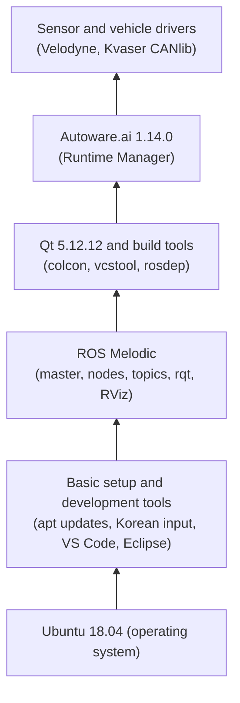

*Figure 1. Layers of software installed in this unit*

### 1.1 Using the Terminal

Most of the installation is done by typing commands in a **terminal**. A terminal is a window in which commands are entered as text and results come back as text.

| Action | Shortcut |
|:-----|:-----|
| Open a terminal | Ctrl + Alt + T |
| Copy inside the terminal | Ctrl + Shift + C |
| Paste into the terminal | Ctrl + Shift + V |
| Stop the running program | Ctrl + C |

*Table 1. Basic terminal shortcuts*

Copy and paste in the terminal add Shift because Ctrl + C already sends an interrupt signal to the running program. The terminal's input line is shown in the form `user@computer:~$`, where `~` is the home folder (`/home/user`) and the final `$` means that commands are accepted with ordinary user privileges. In the code blocks of this unit, text after `#` is a comment for explanation and need not be typed.

### 1.2 Updating the Package List and Upgrading

> **Definition:** A **package** bundles a program and its configuration files in a form convenient to install, and a **package manager** is the program that downloads, installs, updates, and removes packages. Ubuntu's package manager is **APT**, and a server from which packages are downloaded is called a **repository**. **`sudo`** runs the following command with administrator (root) privileges and asks for the login password the first time. Nothing is shown on the screen while the password is typed.

Right after installing Ubuntu, open a terminal and run the following two commands.

```bash
sudo apt-get update     # refresh the list of available packages and versions
sudo apt-get upgrade    # raise installed packages to the newest versions found in the refreshed list
```

`apt-get update` does not change any software. It only fetches the package lists (which versions of which packages exist) anew from the repositories written in `/etc/apt/sources.list` and the files under `/etc/apt/sources.list.d/`, to check whether newer versions exist. It is `apt-get upgrade` that actually replaces packages with newer versions. If the list is stale, `upgrade` does not know about new versions either, so the two commands are always run in this order. `apt` is a refinement of `apt-get` that is more convenient for people to use, and the installations in this unit treat the two as equivalent.

When `update` works, output similar to the following appears, and `upgrade` shows the list of packages to upgrade and then asks `Do you want to continue? [Y/n]`, to which you answer Y.

```text
Hit:1 http://kr.archive.ubuntu.com/ubuntu bionic InRelease
Get:2 http://kr.archive.ubuntu.com/ubuntu bionic-updates InRelease [88.7 kB]
...
Reading package lists... Done
```

| Error message | Cause and fix |
|:-----|:-----|
| `E: Could not open lock file /var/lib/apt/lists/lock - open (13: Permission denied)` | The command was run without `sudo`. Put `sudo` in front of it |
| `E: Could not get lock /var/lib/dpkg/lock-frontend - open (11: Resource temporarily unavailable)` | Another APT job (automatic updates, Software Updater, and so on) is running. Wait until it finishes. Deleting the lock files can corrupt the package database |
| `Temporary failure resolving 'kr.archive.ubuntu.com'` | There is no internet connection. Check the network connection (for a virtual machine, the network adapter settings) |

*Table 2. Common errors in updating packages*

### 1.3 Setting Up Korean Input (Optional)

If Ubuntu was installed in English as recommended in Week 3, Korean input is added as follows.

1. Open Settings → Region & Language → Manage Installed Languages. If a window says the language support is not installed completely, press Install, then choose Korean in Install/Remove Languages and apply.
2. Restart the computer.

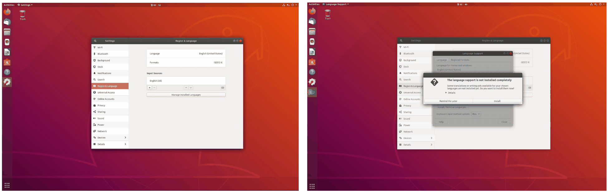

*Figure 2. The language support installation screen*

3. Type `ibus-setup` in a terminal to open the IBus settings window.
4. In the Input Method tab, press Add and add Korean → Hangul.
5. In Input Sources of Settings → Region & Language, press + and add Korean (Hangul).
6. Set a shortcut for quickly switching between Korean and English (for example, set the toggle key in the settings of the Hangul input method).

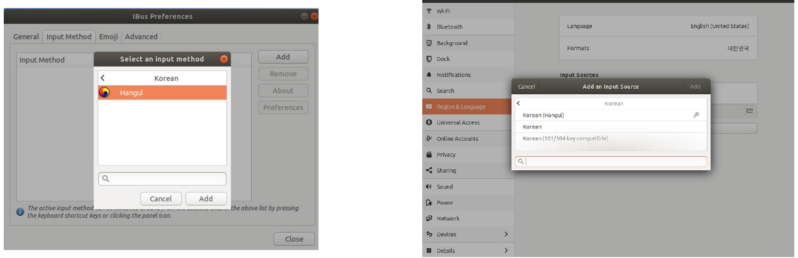

*Figure 3. Adding the Hangul input method to IBus and adding Korean (Hangul) to the input sources*

> **Definition:** **IBus (Intelligent Input Bus)** is an input method framework that turns keyboard input into characters that need composition, such as Korean or Japanese. Hangul is the Korean input method that runs on IBus.

### 1.4 Desktop Workspaces (Optional)

**Desktop workspaces** split the screen into several virtual screens. ROS practice involves many windows, such as the master, several nodes, RViz, and an editor, so spreading the windows over workspaces is convenient.

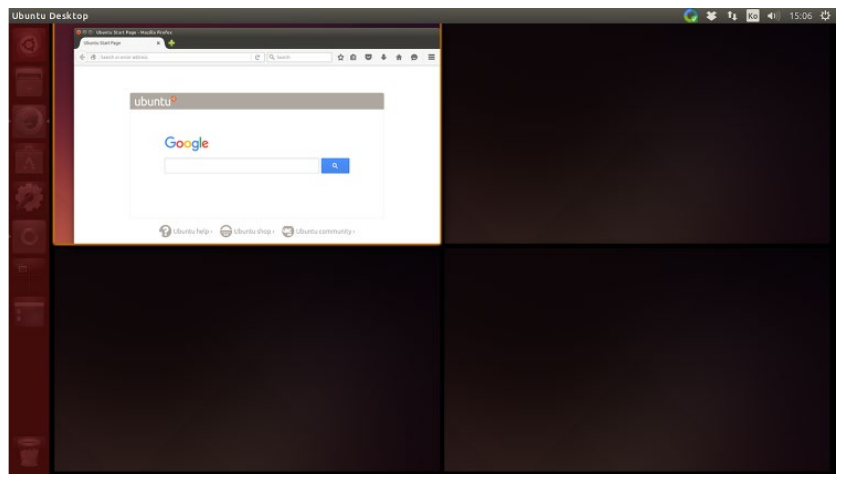

*Figure 4. A screen divided into four desktop workspaces*

| Shortcut | Action |
|:-----|:-----|
| Ctrl + Alt + ↑ / ↓ | Move to another workspace |
| Shift + Ctrl + Alt + ↑ / ↓ | Move the current window to another workspace |
| Super (Windows key) + W | Spread out the windows of all workspaces |
| Super + D | Minimize all windows. Pressing it again restores them |
| Super + S | Show all workspaces on one screen |

*Table 3. Desktop workspace shortcuts*

> **Note:** Shortcuts can differ with the version of the desktop environment. The shortcuts in use can be checked and changed in Settings → Devices → Keyboard.

---

<br>

## 2. Installing Development Environments (IDEs)

### 2.1 IDEs Used for ROS Development

An **IDE (integrated development environment)** is a tool that lets you edit, build, and debug code in one program. Early ROS developers mostly used Eclipse, but Eclipse now uses many resources when running, which can lower development efficiency, and other IDEs provide extensions convenient for ROS, so more and more developers use whichever IDE suits their style. IDEs often used instead of Eclipse are Qt Creator and Visual Studio Code. This unit uses Visual Studio Code by default and covers Eclipse in Section 2.3.

### 2.2 Installing VS Code and Its Extensions

1. Download the `.deb` file for Linux from `https://code.visualstudio.com/`.
2. Double-click the `code_1.XXXXXXXXX.deb` file in the Downloads folder to start the Ubuntu Software Center, and press Install. It can also be installed from a terminal with the following commands.

```bash
cd ~/Downloads
sudo apt install ./code_*.deb    # ./ tells apt to install the file in this folder, not one from a repository
```

3. After checking that VS Code runs, go to File → Preferences → Extensions (Ctrl + Shift + X) and search for and install the following extensions.

| Extension | What it does |
|:-----|:-----|
| C/C++ | Supports syntax highlighting, code completion (IntelliSense), and debugging for C and C++ |
| C++ Intellisense | Indexes the symbols of the source code to help with code completion and go-to-definition for C++ |
| ROS | Recognizes ROS workspaces and helps with editing launch files and message files and with running ROS commands |
| XML Tools | Formats and checks XML files such as `package.xml` and launch files |

*Table 4. VS Code extensions installed for ROS development*

Moving to a folder in a terminal and typing `code .` opens that folder in VS Code. `.` means the current folder.

### 2.3 Installing and Configuring Eclipse

Eclipse is an IDE written in Java, so the Java Development Kit (JDK, which includes the Java runtime environment) must be installed first. It can be installed manually by downloading the latest version or automatically with APT. The automatic installation is convenient but may install an old version that is in the repository, so if the latest version is needed, the manual installation is recommended.

**Manual installation.** Install the JDK and download the Eclipse installer.

```bash
sudo apt-get install default-jdk    # install the Java development kit (JDK) of Ubuntu's default version
```

1. Download the Linux 64-bit installer `eclipse-inst-linux64.tar.gz` from `https://www.eclipse.org/downloads/packages/installer`.
2. Extract the downloaded file and run the `eclipse-inst` file in the `eclipse-installer` folder.
3. Choose Eclipse IDE for C/C++ Developers in the list and install it.
4. Run a C++ sample (hello world) to check the installation.

```bash
cd ~/Downloads
tar xzf eclipse-inst-linux64.tar.gz    # x: extract, z: gzip compression, f: file name follows
./eclipse-installer/eclipse-inst       # run the installer
```

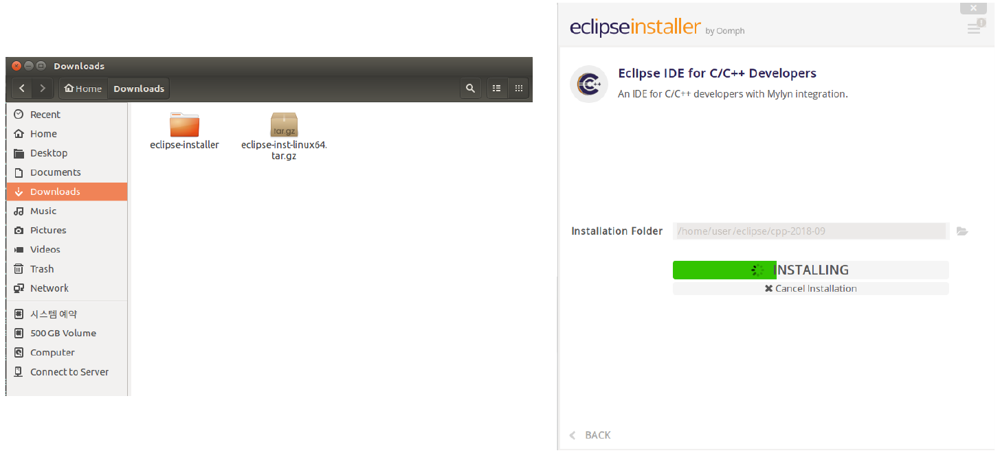

*Figure 5. The downloaded Eclipse installer and the installation of Eclipse IDE for C/C++ Developers*

**Registering in the launcher.** After a manual installation, the Eclipse icon may not appear properly in the application search. Creating a desktop entry file with the following command and saving the content below fixes this.

```bash
sudo gedit /usr/share/applications/eclipse.desktop
```

```ini
[Desktop Entry]
Encoding=UTF-8
Name=Eclipse
Comment=Eclipse IDE
Exec=/home/user/eclipse/cpp-2018-09/eclipse/eclipse
Icon=/home/user/eclipse/cpp-2018-09/eclipse/icon.xpm
Terminal=false
Type=Application
Categories=GNOME;Application;Development;
StartupNotify=true
```

Replace `user` with your own user name, and correct installation paths that depend on the version, such as `cpp-2018-09`, after checking where Eclipse was actually installed. `Exec` is the file to run, `Icon` is the icon file, `Terminal=false` means running without a terminal window, and `Categories` decides the category in which the program appears in the application list.

**Automatic installation.**

```bash
sudo apt-get install default-jdk     # 1. install the Java development kit
sudo apt-get install eclipse         # 2. install Eclipse
sudo -s                              # 3. switch to an administrator shell (leave with exit)
sudo apt-get install build-essential # install C/C++ build tools such as gcc, g++, and make
sudo apt-get install eclipse-cdt     # install the C/C++ Development Tooling (CDT) of Eclipse
```

`sudo -s` opens a shell with administrator privileges, so inside it commands run as administrator even without `sudo`. Deleting files by mistake in an administrator shell can damage the system, so leave it with `exit` when the installation is done.

**Configuration after the automatic installation.** In Window → Preferences → C/C++ → New C/C++ Project Wizard → Makefile Project, configure the following.

- **Binary Parsers:** Check Elf Parser (in Figure 6, GNU Elf Parser and Cygwin PE Parser are also checked). ELF is the format of Linux executables, and a binary parser reads the built executable to show binaries and symbols in the project explorer.

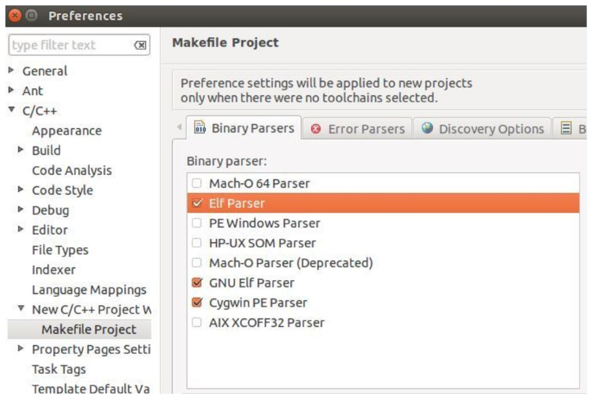

*Figure 6. Elf Parser chosen in the Binary Parsers of Makefile Project*

- **Error Parsers:** Check that all items are checked. Error parsers find errors and warnings in the output of the compiler and linker and show them in the Problems view and on the corresponding lines of code.
- **Behaviour:** Check Build on resource save (Auto build). The project is built automatically every time a file is saved, so errors can be seen right away.

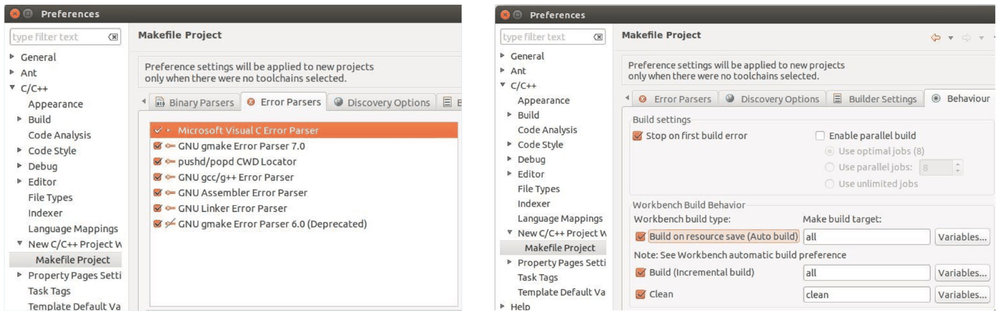

*Figure 7. The checked items of Error Parsers and the automatic build setting in Behaviour*

**Running the sample.** In File → New → C++ Project, choosing Hello World C++ Project under Executable and Linux GCC as the toolchain creates the following code. Building it (Ctrl + B) and running it prints `!!!Hello World!!!` in the Console view.

```cpp
#include <iostream>
using namespace std;

int main() {
	cout << "!!!Hello World!!!" << endl; // prints !!!Hello World!!!
	return 0;
}
```

- `#include <iostream>`: Includes the header that declares the standard input and output streams (`cout` and others).
- `using namespace std;`: Lets the names of the standard library be written briefly, as `cout` instead of `std::cout`.
- `int main()`: The function where the program starts.
- `cout << "!!!Hello World!!!" << endl;`: Writes the string to standard output, and `endl` ends the line and flushes the output buffer.
- `return 0;`: Tells the operating system that the program ended normally.

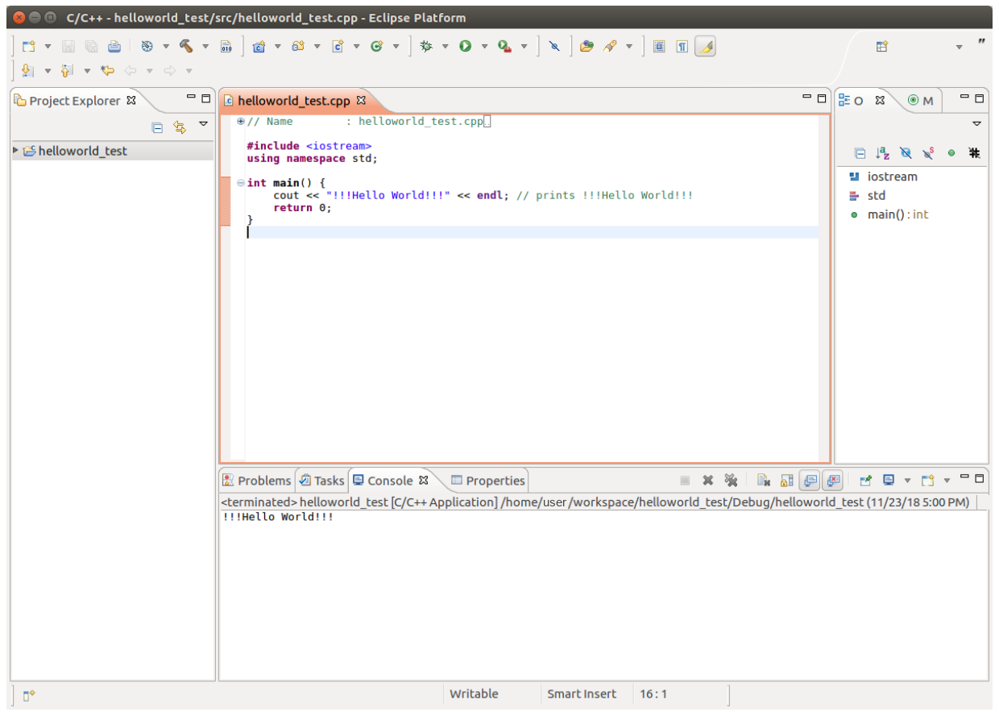

*Figure 8. The result of building and running the hello world sample in Eclipse*

### 2.4 Qt Creator

Qt Creator is the IDE of the GUI library Qt and is installed together with Qt in Section 6.2. It can open CMake projects, so it can also edit ROS packages built with CMake.

---

<br>

## 3. Installing ROS Melodic

### 3.1 Checking the Distribution to Install

ROS 1 released a **distribution** roughly every year up to its last distribution, Noetic (2020), and each distribution was built for a specific Ubuntu version. The distribution for Ubuntu 18.04 (code name bionic) is ROS Melodic Morenia. The commands of this section follow the Melodic installation guide of the ROS Wiki [1].

| Ubuntu | ROS distribution |
|:-----|:-----|
| 14.04 (trusty) | Indigo |
| 16.04 (xenial) | Kinetic |
| 18.04 (bionic) | Melodic |

*Table 5. Correspondence between Ubuntu versions and ROS distributions*

> **Caution:** Support for ROS Melodic ended in June 2023, and support for ROS 1 as a whole ended with the end of support for Noetic in May 2025 [2]. Its packages can still be installed, but no new updates are released, and some tools must be told explicitly to include end-of-life distributions, as in Section 3.6.

### 3.2 Registering the ROS Repository

ROS packages are not in Ubuntu's default repositories but in the ROS repository, so first tell APT about that repository.

```bash
sudo sh -c 'echo "deb http://packages.ros.org/ros/ubuntu $(lsb_release -sc) main" > /etc/apt/sources.list.d/ros-latest.list'
```

- `lsb_release -sc` prints the code name of Ubuntu, and `$(...)` is replaced by that output. On Ubuntu 18.04 it becomes `bionic`.
- `echo "deb ..."` prints one repository line, and `>` writes that output to the file `/etc/apt/sources.list.d/ros-latest.list`.
- Writing a file under `/etc` requires administrator privileges. Writing `sudo echo ... > file` fails because only `echo` runs as administrator, while writing to the file (`>`) is done by the shell with ordinary user privileges. Therefore `sudo sh -c '...'` runs the whole command in a shell with administrator privileges.

Check the registration with the following command.

```bash
cat /etc/apt/sources.list.d/ros-latest.list
```

```text
deb http://packages.ros.org/ros/ubuntu bionic main
```

### 3.3 Registering the Signing Key

APT checks with a **signing key** that a downloaded package was made by the owner of the repository. Register the public key of the ROS repository.

```bash
sudo apt install curl    # a tool that downloads the content of a web address
curl -s https://raw.githubusercontent.com/ros/rosdistro/master/ros.asc | sudo apt-key add -
```

`curl -s` downloads and prints the key file without a progress display, and `|` (a pipe) passes that output as the input of the next command. The `-` in `apt-key add -` means reading the key from standard input instead of a file. On success, `OK` is printed.

> **Caution:** Repository keys can change or expire. If a later `sudo apt update` gives an error containing `NO_PUBKEY` or `EXPKEYSIG`, the registered key does not match, so check the current key registration procedure in the installation guide of the ROS Wiki [1].

### 3.4 Installing the ROS Packages

```bash
sudo apt update                           # fetch the package list of the newly registered ROS repository
sudo apt install ros-melodic-desktop-full # full installation of ROS Melodic
```

ROS package names have the form `ros-<distribution>-<package>`. `desktop-full` is the largest bundle and includes the ROS core (master, communication libraries, build tools), visualization tools such as rqt and RViz, generic robot libraries, 2D and 3D simulators, and perception packages. The download is large and takes time. The installed files are placed under `/opt/ros/melodic/`.

| Error message | Cause and fix |
|:-----|:-----|
| `E: Unable to locate package ros-melodic-desktop-full` | The repository is not registered, or `sudo apt update` was not run, or Ubuntu is not 18.04. Recheck Section 3.2 and see that `lsb_release -sc` prints `bionic` |
| `The following signatures couldn't be verified because the public key is not available: NO_PUBKEY ...` | The signing key is missing or has changed. Follow the caution box of Section 3.3 |

*Table 6. Common errors in installing the ROS packages*

### 3.5 Environment Setup

To use ROS commands, the ROS environment variables must be set in every terminal.

```bash
echo "source /opt/ros/melodic/setup.bash" >> ~/.bashrc   # append a line to the configuration file run for every new terminal
source ~/.bashrc                                          # apply it to the current terminal right away
```

> **Definition:** An **environment variable** is a name-value pair shared by a shell and the programs run from it. `/opt/ros/melodic/setup.bash` is a script that sets environment variables such as `ROS_DISTRO`, `ROS_PACKAGE_PATH`, `PATH`, `PYTHONPATH`, and `CMAKE_PREFIX_PATH` for ROS. **`source`** runs a script in the current shell instead of a new one, so the environment variables the script changes remain in the current shell.

`~/.bashrc` is a configuration file that runs automatically every time a new terminal opens, so with the `source` line in it there is no need to type the line in each terminal. `>>` appends to the end of a file while `>` overwrites it, so using `>` here would erase everything already in `.bashrc`. Check that the setting has taken effect as follows.

```bash
echo $ROS_DISTRO
```

```text
melodic
```

### 3.6 Installing Build Tools and Initializing rosdep

Install the tools needed to create and build ROS packages yourself, and initialize rosdep.

```bash
sudo apt install python-rosdep python-rosinstall python-rosinstall-generator python-wstool build-essential
sudo apt install python-rosdep   # if already installed by the previous line, only a newest-version message appears
sudo rosdep init
rosdep update                    # must not be prefixed with sudo
```

| Tool | What it does |
|:-----|:-----|
| rosdep | Finds and installs the system packages (libraries and so on) that ROS packages need |
| rosinstall, rosinstall-generator, wstool | Download and manage the source code of many ROS packages in a workspace at once |
| build-essential | C/C++ compilers and build tools such as gcc, g++, and make |

*Table 7. Tools installed for ROS package development*

`sudo rosdep init` creates the system-wide rosdep configuration file under `/etc`, so it needs administrator privileges. On success it prints the following.

```text
Wrote /etc/ros/rosdep/sources.list.d/20-default.list
Recommended: please run

	rosdep update
```

`rosdep update` downloads dependency information and stores it as a cache in the user's home folder (`~/.ros/rosdep/`). With `sudo` in front, this cache is created owned by the administrator, and later uses of rosdep as an ordinary user fail with permission errors. If `sudo` was added by mistake, run `sudo rosdep fix-permissions` as rosdep suggests and then run `rosdep update` again without `sudo`.

> **Caution:** Recent versions of rosdep do not download information about end-of-life distributions by default. With an end-of-life distribution such as Melodic, `rosdep update` needs the `--include-eol-distros` option so that `rosdep install` in Section 6.4 can find Melodic packages [3].

```bash
rosdep update --include-eol-distros
```

| Error message | Cause and fix |
|:-----|:-----|
| `ERROR: default sources list file already exists` | `sudo rosdep init` has already been run once. There is no need to repeat it; just run `rosdep update` |
| `Warning: running 'rosdep update' as root is not recommended.` | `rosdep update` was run with `sudo`. Run `sudo rosdep fix-permissions` and then run it again without `sudo` |
| `ERROR: cannot download default sources list from: ...` | There is a problem with the internet connection or access to GitHub. Check the connection and run it again |

*Table 8. Common errors in initializing rosdep*

### 3.7 Quick Installation with an Installation Script

An installation script that runs the steps of Sections 3.2-3.6 at once can also be used [4]. First update the packages, then run it in one of two ways.

```bash
sudo apt-get update
sudo apt-get upgrade
```

**Method 1: download the script and run it.**

```bash
wget https://raw.githubusercontent.com/orocapangyo/meetup/master/190830/install_ros_melodic.sh && chmod 755 ./install_ros_melodic.sh && bash ./install_ros_melodic.sh
source .bashrc
```

**Method 2: run a script downloaded beforehand.** Save `install_ros_melodic.sh` in the home folder, check that the file is there, and run it.

```bash
cd ~
chmod 755 install_ros_melodic.sh   # first give execute permission if it is missing
./install_ros_melodic.sh
source .bashrc
```

- `wget address` downloads the file at the address into the current folder.
- `&&` runs the next command only if the previous one succeeded. If the download fails, the later commands are not run.
- `chmod 755` sets the file permissions to read, write, and execute (7) for the owner and read and execute (5) for the group and other users. A shell script needs execute permission to be run as `./file`.
- `bash ./file` runs the script with bash regardless of execute permission.

The script waits for Enter and then does the following in order. It updates the packages, installs a time synchronization tool and build tools, registers the ROS repository and key, installs `ros-melodic-desktop-full` and all rqt plugins, and initializes rosdep. It then creates the `~/catkin_ws` workspace, tests a build with `catkin_make`, and appends the aliases and environment settings of Section 5.1 to `.bashrc`. The script runs many commands with administrator privileges, so it is a good habit to open a script downloaded from the internet and check what it does before running it.

---

<br>

## 4. Checking ROS with turtlesim

### 4.1 Master, Nodes, and Topics

A ROS program works by several **nodes** exchanging messages. As covered in Week 1, the **master** is the broker that manages the names and addresses of nodes; when a node starts, it registers itself with the master over XMLRPC and looks up the addresses of the nodes it needs. The actual messages do not pass through the master; nodes exchange them directly over TCPROS.

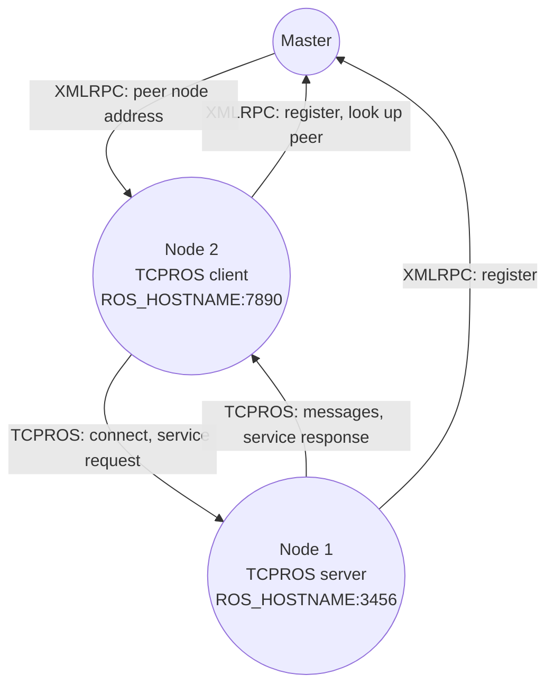

*Figure 9. Communication between the master and two nodes*

> **Definition:** A **topic** is a named channel over which messages travel. A node that sends messages to a topic is a **publisher**, and a node that receives them is a **subscriber**. A **message** is data with a fixed format (the names and types of its fields). A **service** is one-to-one communication in which a request receives exactly one response.

As with `ROS_HOSTNAME:3456` in Figure 9, each node accepts connections at its own host name and port number. Therefore, if the `ROS_HOSTNAME` set in Section 5 is wrong, the node is registered with the master but other nodes cannot connect to it.

### 4.2 Running turtlesim

**turtlesim** is a 2D simulator in which a turtle moves around, a package used to check that ROS is installed correctly and to learn about nodes and topics. Open three terminals and run one of the following commands in each.

```bash
roscore                                   # terminal 1: run the master
```

```bash
rosrun turtlesim turtlesim_node           # terminal 2: run the turtle simulator node
```

```bash
rosrun turtlesim turtle_teleop_key        # terminal 3: run the keyboard teleoperation node
```

- `roscore` runs the master, the parameter server, and the `rosout` node that collects logs. It must be run before the other nodes.
- `rosrun <package> <executable>` runs one executable in a package as a node.

When `roscore` works, lines similar to the following appear at the end (`ubuntu` is the computer name, and the numbers differ on every run).

```text
started roslaunch server http://ubuntu:36451/
...
auto-starting new master
process[master]: started with pid [12360]
ROS_MASTER_URI=http://ubuntu:11311/
...
started core service [/rosout]
```

Running `turtlesim_node` shows a turtle in the middle of a blue window and prints lines like the following in the terminal (the number in the second pair of brackets is the time of output).

```text
[ INFO] [1711612800.123456789]: Starting turtlesim with node name /turtlesim
[ INFO] [1711612800.130000000]: Spawning turtle [turtle1] at x=[5.544445], y=[5.544445], theta=[0.000000]
```

Click the terminal running `turtle_teleop_key` so that it receives the keyboard input, then press the arrow keys; the turtle moves and draws a line where it passes.

```text
Reading from keyboard
---------------------------
Use arrow keys to move the turtle. 'q' to quit.
```

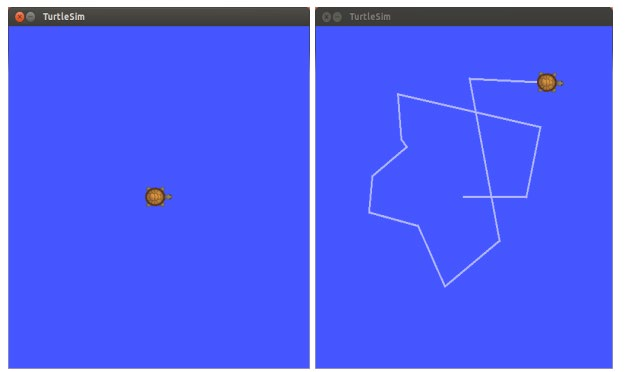

*Figure 10. The turtlesim window right after launch and after moving the turtle with the arrow keys*

| Symptom | Cause and fix |
|:-----|:-----|
| `[ERROR] ... [registerPublisher] Failed to contact master at [localhost:11311].  Retrying...` | The master is not running. Run `roscore` first in another terminal |
| `Command 'rosrun' not found` or `rosrun: command not found` | The ROS environment is not set in that terminal. Check the `.bashrc` setting of Section 3.5 and open a new terminal or run `source ~/.bashrc` |
| `[rospack] Error: package 'turtlesim' not found` | The ROS environment is not set, or turtlesim is not installed. Check the environment and, if needed, install it with `sudo apt install ros-melodic-turtlesim` |
| The turtle does not move when the arrow keys are pressed | Keyboard input is not going to the terminal of `turtle_teleop_key`. Click that terminal window and press the arrow keys |

*Table 9. Common problems in running turtlesim*

### 4.3 Viewing the Node Graph with rqt_graph

**rqt** is a collection of ROS GUI tools, and **rqt_graph** is the one among them that shows the connections between running nodes and topics as a graph. In a fourth terminal, run one of the following.

```bash
rqt_graph
```

```bash
rqt    # choose Plugins → Introspection → Node Graph in the menu
```

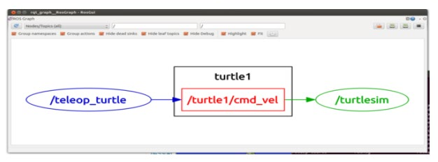

*Figure 11. The node graph shown by rqt_graph while turtlesim is running*

In Figure 11, ellipses are nodes and rectangles are topics. The keyboard teleoperation node `/teleop_turtle` publishes messages on the topic `/turtle1/cmd_vel`, and the simulator node `/turtlesim` subscribes to that topic. The `turtle1` box groups the topics whose names share the same prefix (namespace). The two nodes do not know each other and know only the topic name, so if an autonomous driving algorithm node published on the same topic instead of the keyboard node, the turtle would move in the same way. This structure of loosely connecting nodes through topics is the core of ROS.

### 4.4 Checking with Command-Line Tools

The same information can be checked with command-line tools [5].

```bash
rosnode list                       # list of running nodes
rostopic list                      # list of existing topics
rostopic info /turtle1/cmd_vel     # message type, publishers, and subscribers of the topic
rosmsg show geometry_msgs/Twist    # field structure of the message type
rostopic echo /turtle1/cmd_vel     # print the messages on the topic in real time
```

The outputs of `rosnode list` and `rostopic list` are as follows.

```text
/rosout
/teleop_turtle
/turtlesim
```

```text
/rosout
/rosout_agg
/turtle1/cmd_vel
/turtle1/color_sensor
/turtle1/pose
```

`rostopic info` shows that the message type of this topic is `geometry_msgs/Twist`, that the publisher is `/teleop_turtle`, and that the subscriber is `/turtlesim`, and `rosmsg show` shows the structure of that type.

```text
Type: geometry_msgs/Twist

Publishers:
 * /teleop_turtle (http://ubuntu:43215/)

Subscribers:
 * /turtlesim (http://ubuntu:41237/)
```

```text
geometry_msgs/Vector3 linear
  float64 x
  float64 y
  float64 z
geometry_msgs/Vector3 angular
  float64 x
  float64 y
  float64 z
```

With `rostopic echo` running, pressing the up arrow key once in the terminal of `turtle_teleop_key` prints the following message. The linear velocity along the heading, `linear.x`, is 2.0 m/s and the rest are 0. Pressing the left arrow key instead makes the angular velocity `angular.z` 2.0 rad/s.

```text
linear:
  x: 2.0
  y: 0.0
  z: 0.0
angular:
  x: 0.0
  y: 0.0
  z: 0.0
---
```

The type of the velocity commands that pure_pursuit and twist_filter in Week 3 exchange (`twist_raw`, `twist_cmd`), `geometry_msgs/TwistStamped`, is this `Twist` with an added `header` that carries the time and the coordinate frame. Both the turtle moving on a plane and the vehicle are told how to move with two values, `linear.x` (linear velocity $v$) and `angular.z` (angular velocity $\omega$).

### 4.5 Stopping Nodes and Setting Up a Workspace Environment

A running node is stopped by pressing Ctrl + C in its terminal. If the master (`roscore`) is stopped first, the running nodes can no longer make new connections or query the master, so the nodes are usually stopped first and the master last.

ROS packages you write yourself are built in a **catkin workspace** (Week 5), and after building, the environment of that workspace must be added to the current terminal with the following command in the workspace folder so that ROS can find the new packages.

```bash
. devel/setup.bash    # same as source devel/setup.bash
```

`.` is the same command as `source`. While `/opt/ros/melodic/setup.bash` sets up the environment of the installed ROS packages, the workspace's `devel/setup.bash` adds the paths of the packages you built on top of it.

---

<br>

## 5. ROS Network Setup

### 5.1 The .bashrc File

`.bashrc` is a hidden file in the home folder. Files whose names start with `.` are not shown by default, so in the file manager (Files), press Ctrl + H to show hidden files and double-click it to open it, or open it in a terminal as follows.

```bash
gedit ~/.bashrc
```

If the installation script of Section 3.7 was run, the following lines have been appended to the end of `.bashrc`.

```bash
alias eb='nano ~/.bashrc'
alias sb='source ~/.bashrc'
alias gs='git status'
alias gp='git pull'
alias cw='cd ~/catkin_ws'
alias cs='cd ~/catkin_ws/src'
alias cm='cd ~/catkin_ws && catkin_make'
source /opt/ros/melodic/setup.bash
source ~/catkin_ws/devel/setup.bash
export ROS_MASTER_URI=http://localhost:11311
export ROS_HOSTNAME=localhost
```

| Line | Meaning |
|:-----|:-----|
| `alias eb='nano ~/.bashrc'` | Typing `eb` opens `.bashrc` in the editor nano |
| `alias sb='source ~/.bashrc'` | `sb` reapplies the changed settings to the current terminal |
| `alias gs`, `alias gp` | Short for `git status` and `git pull` |
| `alias cw`, `alias cs` | Move to the catkin workspace and its `src` folder |
| `alias cm` | Move to the workspace and build it with `catkin_make` |
| `source /opt/ros/melodic/setup.bash` | Sets up the environment of the installed ROS |
| `source ~/catkin_ws/devel/setup.bash` | Adds the environment of the packages you built |
| `export ROS_MASTER_URI=...` | Sets the address of the master to connect to (Section 5.2) |
| `export ROS_HOSTNAME=...` | Sets the address that nodes on this PC announce to other nodes (Section 5.2) |

*Table 10. Aliases and ROS settings appended to `.bashrc`*

`alias name='command'` gives a long command a short nickname, and `export` sets an environment variable and passes it to the programs run from this shell.

> **Note:** Running the installation script twice appends the same lines to `.bashrc` twice. This does no harm to operation but is hard to read, so keep only one set. On a PC that used another distribution (for example Kinetic), a line such as `source /opt/ros/kinetic/setup.bash` may remain; running the `setup.bash` of two distributions together lets the later settings overwrite the earlier ones and causes confusion, so keep only the lines of the distribution in use. A PC with CUDA installed for GPU computing also has lines that add CUDA paths to `PATH` and `LD_LIBRARY_PATH`.

### 5.2 ROS_MASTER_URI and ROS_HOSTNAME

For ROS nodes to communicate with each other, two environment variables must be set appropriately [6].

- **`ROS_MASTER_URI`:** The address of the PC on which `roscore` is running (the master). Its form is `http://<IP address>:11311`, where 11311 is the default port of the master.
- **`ROS_HOSTNAME`:** The address of the PC on which a node runs. A node announces this address when it registers with the master, and other nodes connect to it at this address.

When practicing alone on one PC, both can be left as `localhost` (the PC itself). For several PCs to work together, use real IP addresses instead of `localhost`.

```bash
export ROS_HOSTNAME=192.168.0.105    # write your own IP address instead of 192.168.0.105
```

Check your IP address with `ifconfig`. If Ubuntu 18.04 does not have this command, install it with `sudo apt install net-tools`, or use `ip addr` or `hostname -I`, which show the same information.

```bash
ifconfig
```

```text
enp0s3: flags=4163<UP,BROADCAST,RUNNING,MULTICAST>  mtu 1500
        inet 192.168.0.105  netmask 255.255.255.0  broadcast 192.168.0.255
        ...
```

The `192.168.0.105` after `inet` is the IP address of this PC. The `127.0.0.1` in the entry named `lo` is the address that refers to the PC itself (`localhost`), so it is not an address to give to other PCs.

### 5.3 Running ROS on Several PCs

For example, to run the master and sensor nodes on the vehicle's PC A (192.168.0.105) and view the results in RViz on laptop B (192.168.0.110), set the variables as follows.

| PC | `ROS_MASTER_URI` | `ROS_HOSTNAME` |
|:-----|:-----|:-----|
| A (PC running the master) | `http://192.168.0.105:11311` | `192.168.0.105` |
| B (other PC) | `http://192.168.0.105:11311` | `192.168.0.110` |

*Table 11. Environment variables for using ROS on two PCs together*

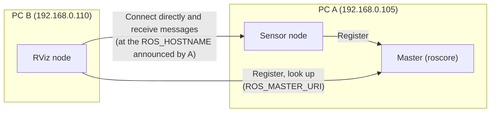

*Figure 12. Connections of ROS nodes run on two PCs*

On both PCs `ROS_MASTER_URI` points to A, and `ROS_HOSTNAME` is each PC's own address. It is convenient to write the per-PC settings in `.bashrc` as comments (`#`) and switch the comments as the situation requires. After editing, run `source ~/.bashrc` or open a new terminal for the change to take effect.

```bash
#export ROS_MASTER_URI=http://192.168.0.105:11311
#export ROS_HOSTNAME=192.168.0.105
```

> **Caution:** The most common mistake is running B with `ROS_HOSTNAME` left as `localhost`. Then `rostopic list` shows the topics, but when a node on A tries to connect to a node on B, it connects to `localhost`, that is, to A itself, and no messages flow. This is because the master only brokers addresses while messages travel directly between nodes. A firewall blocking the nodes' ports causes the same symptom.

---

<br>

## 6. Installing Autoware

### 6.1 Autoware Versions and Requirements

**Autoware.ai** is open-source autonomous driving software based on ROS 1, and this unit installs version 1.14.0. Later development of Autoware moved to ROS 2. The source build guide for Autoware.ai is in the documentation of the Autoware Foundation [7]. Each version supports different Ubuntu releases.

| Autoware version | Ubuntu 14.04 | Ubuntu 16.04 | Ubuntu 18.04 |
|:-----|:-----|:-----|:-----|
| v1.14.0 | | | ✓ |
| v1.13.0 | | | ✓ |
| v1.12.0 | | ✓ | ✓ |
| v1.11.1 | | ✓ | |
| v1.11.0 | | ✓ | |
| v1.10.0 | | ✓ | |
| v1.9.1 | ✓ | ✓ | |
| v1.9.0 | ✓ | ✓ | |

*Table 12. Ubuntu releases supported by each Autoware version*

| Component | Ubuntu 14.04 | Ubuntu 16.04 | Ubuntu 18.04 |
|:-----|:-----|:-----|:-----|
| ROS | Indigo | Kinetic | Melodic |
| Qt | 4.8.6 or higher | 5.2.1 or higher | 5.9.5 or higher |
| CUDA (optional) | 8.0GA | 9.0 | 10.0 |
| FlyCapture2 (optional) | | | |
| Armadillo (optional) | | | |

*Table 13. Autoware requirements by Ubuntu version*

Using Autoware 1.14.0 on Ubuntu 18.04 requires ROS Melodic and Qt 5.9.5 or higher. CUDA is needed only to accelerate some functions, such as deep-learning-based perception nodes, on a GPU, and the installation in this unit builds without CUDA. FlyCapture2 is a driver for particular cameras and Armadillo is a linear algebra library; each is needed only when the corresponding function is used.

### 6.2 Installing Qt 5.12.12

**Qt** is a library for building GUI programs in C++, and some Autoware tools use it. The Qt in the Ubuntu 18.04 repository is 5.9.5, but this unit installs version 5.12.12 separately in the home folder.

1. Download the installer of version 5.12 from `https://download.qt.io/archive/qt/5.12/5.12.12/`. Downloading and installing the offline installer `qt-opensource-linux-x64-5.12.12.run`, which already contains all the needed files, is recommended; if the download is slow, use a mirror site (`https://download.qt.io/static/mirrorlist/`).
2. Run the following commands in order.

```bash
sudo apt-get update
sudo apt-get install build-essential          # C/C++ compilers and build tools
cd Downloads                                  # move to the folder where the installer was downloaded
chmod +x qt-opensource-linux-x64-5.12.12.run  # give it execute permission
./qt-opensource-linux-x64-5.12.12.run         # run the installer
```

3. When the installer starts, go through the Welcome, Open Source Obligations, Setup, Installation Folder, Select Components, License Agreement, and Ready to Install steps in order. Leave the Installation Folder at its default (`/home/user/Qt5.12.12`), since the path setting of the next step assumes this location.

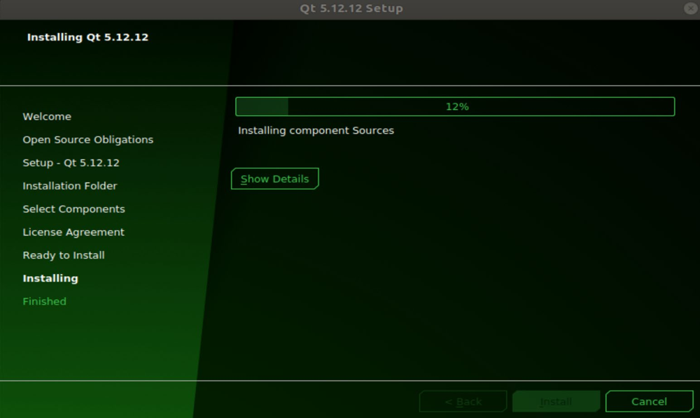

*Figure 13. The Qt 5.12.12 installer installing components*

4. **Activate Qt.** Add the following line at the end of the `.bashrc` file.

```bash
export PATH=$HOME/Qt5.12.12/5.12.12/gcc_64/bin:$HOME/Qt5.12.12/Tools/QtCreator/bin:$PATH
```

`$HOME` is the environment variable for the home folder (`/home/user`). **`PATH`** is the list of folders, joined by `:`, in which executables are searched for when a command is typed, and the shell searches them from the left. Because the `bin` folder of Qt 5.12.12 is placed before the existing `$PATH`, the `qmake` of the newly installed Qt runs before the system's Qt 5.9.5. The second folder holds the Qt Creator executable.

5. **Check the Qt version.**

```bash
source ~/.bashrc
qmake -version
```

```text
QMake version 3.1
Using Qt version 5.12.12 in /home/user/Qt5.12.12/5.12.12/gcc_64/lib
```

If 5.9.5 appears, as in `Using Qt version 5.9.5 in /usr/lib/x86_64-linux-gnu`, the `PATH` setting has not taken effect, so check the paths in the added line and whether `source ~/.bashrc` was run. If `qmake: command not found` appears, the path has a typo or Qt was installed in another folder.

### 6.3 Installing git

**git** is a tool that manages the change history of source code and is needed to download source code from GitHub. Be sure to install it to obtain the sources of Autoware and the Velodyne driver.

```bash
sudo apt-get install git
```

Check the installation with `git --version`. Running the command without `sudo` gives a `Permission denied` error of the same kind as in Section 1.2 (`/var/lib/dpkg/lock-frontend`).

### 6.4 Building Autoware.ai 1.14.0 from Source

Autoware consists of hundreds of packages spread over several repositories, so the sources are fetched at once, the dependencies are installed, and then everything is built. Run the following commands in a terminal in order.

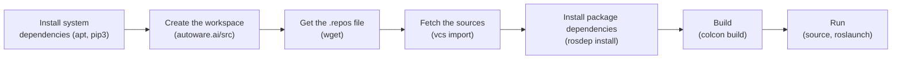

*Figure 14. Steps of building Autoware.ai from source*

**Step 1: install the system dependencies.**

```bash
sudo apt update
sudo apt install -y python-catkin-pkg python-rosdep ros-$ROS_DISTRO-catkin
sudo apt install -y python3-pip python3-colcon-common-extensions python3-setuptools python3-vcstool
pip3 install -U setuptools
```

- `-y` answers yes to all confirmation questions during installation.
- `$ROS_DISTRO` is the environment variable set by the environment setup of Section 3.5 and becomes `melodic`, so `ros-$ROS_DISTRO-catkin` is `ros-melodic-catkin`. In a terminal without the ROS environment, this value is empty and the nonexistent package `ros--catkin` is looked for.
- **colcon** is a tool that builds many packages at once in their dependency order, and **vcstool** (the `vcs` command) is a tool that downloads many repositories at once from a single list file.
- `pip3 install -U setuptools` upgrades setuptools, the package installation tool of Python 3, to the latest version.

**Step 2: create the workspace and fetch the sources.**

```bash
mkdir -p autoware.ai/src
cd autoware.ai
wget -O autoware.ai.repos https://raw.githubusercontent.com/Autoware-AI/autoware.ai/1.14.0/autoware.ai.repos
vcs import src < autoware.ai.repos
```

- `mkdir -p` creates the intermediate folders at once. `autoware.ai` is the workspace, and the sources go into its `src`.
- `wget -O filename address` saves the content at the address under the given name. `autoware.ai.repos` is a list of the addresses and versions (1.14.0) of the repositories that make up Autoware.
- `vcs import src < autoware.ai.repos` downloads all repositories in the list under `src`. `<` passes the content of a file as the input of a command.

> **Note:** The `Autoware-AI/autoware.ai` repository has since been moved, so the address above no longer serves the file and `wget` fails with `404 Not Found`. The same 1.14.0 list file is now in the `autowarefoundation/autoware_ai` repository, so fetch it with the following command [7].

```bash
wget -O autoware.ai.repos https://raw.githubusercontent.com/autowarefoundation/autoware_ai/1.14.0/autoware.ai.repos
```

**Step 3: install the package dependencies.**

```bash
rosdep update
rosdep install -y --from-paths src --ignore-src --rosdistro $ROS_DISTRO
```

- `--from-paths src` collects the dependencies that all packages under `src` declare in their `package.xml`.
- `--ignore-src` does not install those dependencies that already exist as sources in `src`.
- `--rosdistro $ROS_DISTRO` specifies that dependencies be resolved to the package names of Melodic. Without `rosdep update --include-eol-distros`, as in the caution box of Section 3.6, this step can fail with an error that the dependencies cannot be found.

**Step 4: build.** To build without CUDA, use the following command.

```bash
colcon build --cmake-args -DCMAKE_BUILD_TYPE=Release
```

`--cmake-args -DCMAKE_BUILD_TYPE=Release` tells the CMake of each package to make an optimized release build. Depending on the computer, the build takes from tens of minutes to several hours; when it finishes, the folders `build` (intermediate results), `install` (results used for running), and `log` (build records) appear in the workspace, and a final `Summary: ... packages finished` line is printed. To install CUDA and use GPU acceleration, build with `AUTOWARE_COMPILE_WITH_CUDA=1 colcon build --cmake-args -DCMAKE_BUILD_TYPE=Release` [7].

| Symptom | Cause and fix |
|:-----|:-----|
| `E: Unable to locate package ros--catkin` | The ROS environment is not set, so `$ROS_DISTRO` is empty. Run `source /opt/ros/melodic/setup.bash` and try again |
| `vcs: command not found` | python3-vcstool is not installed. Run step 1 again |
| `ERROR: the following packages/stacks could not have their rosdep keys resolved` | The rosdep information is missing or stale. Run `rosdep update --include-eol-distros` and try again |
| `c++: internal compiler error: Killed (program cc1plus)` | Compiling many packages at the same time ran out of memory and the compiler was killed. Reduce the number of packages built at once, as in `colcon build --parallel-workers 1 --cmake-args -DCMAKE_BUILD_TYPE=Release`, or increase the memory of the virtual machine |
| A particular package ends with `Failed` | Find the first error in `log/latest_build/<package name>/stderr.log`. If a missing library is the cause, run step 3 again |

*Table 14. Common problems in building Autoware*

### 6.5 Launching the Runtime Manager

```bash
cd autoware.ai
source install/setup.bash
roslaunch runtime_manager runtime_manager.launch
```

- `source install/setup.bash` adds the environment of the Autoware packages built by colcon to the current terminal. It must be run again every time a new terminal is opened.
- **`roslaunch`** runs the several nodes written in a launch file at once and also starts the master if it is not running. `runtime_manager.launch` opens the Runtime Manager window used in Week 3.

If everything is fine, the Runtime Manager window appears with the tabs Quick Start, Setup, Map, Sensing, Computing, Interface, Database, Simulation, Status, and Topics (see Figures 7 and 8 of Week 3). An error such as `[runtime_manager.launch] is neither a launch file in package [runtime_manager] nor is [runtime_manager] a launch file name` means that `source install/setup.bash` was not run.

### 6.6 Installing the Velodyne Driver (Optional)

This is the ROS driver needed to connect a real Velodyne LiDAR. The source code is taken from `https://github.com/ros-drivers/velodyne` and built as follows; run the commands in a terminal in order.

```bash
sudo apt-get install libpcap-dev git
mkdir -p ~/ros_drivers/src
cd ~/ros_drivers/src
catkin_init_workspace
git clone https://github.com/ros-drivers/velodyne.git
cd ~/ros_drivers
catkin_make
source devel/setup.bash
```

- `libpcap-dev` is a library for capturing network packets. A Velodyne LiDAR sends its measurements as Ethernet UDP packets, and the driver also uses this library to read recorded packet files (pcap).
- `~/ros_drivers` is the catkin workspace, and `catkin_init_workspace` creates the workspace's top-level `CMakeLists.txt` in the `src` folder.
- `git clone address` copies the whole repository into the current folder.
- `catkin_make` builds all packages in the workspace and creates the `build` and `devel` folders, and `source devel/setup.bash` adds the built driver to the ROS environment of the current terminal.

> **Note:** The default branch of the `ros-drivers/velodyne` repository is now the one for ROS 2 (`ros2`), so cloning without specifying a branch makes `catkin_make` fail because it cannot build ROS 2 packages. On ROS Melodic, clone the Melodic branch explicitly as follows.

```bash
git clone -b melodic-devel https://github.com/ros-drivers/velodyne.git
```

### 6.7 Installing Kvaser CANlib (Optional)

**CANlib** is the Linux driver and library for using Kvaser CAN interface devices. It is needed when the vehicle and the PC communicate over a CAN bus, and CAN communication is covered in Weeks 13-14.

1. On the Kvaser site (`http://www.kvaser.com/downloads/`), click Kvaser LINUX Driver and SDK to download `linuxcan.tar.gz`.
2. Extract it and install it.

```bash
tar xzf linuxcan.tar.gz    # extract
cd linuxcan
make                       # build the driver and library
sudo make install          # install into the system (requires administrator privileges)
```

`make` builds the driver, which is a Linux kernel module, so the header files of the running kernel are needed. If an error says the headers are missing, install them with `sudo apt-get install linux-headers-$(uname -r)` and run it again. `$(uname -r)` is replaced by the version of the running kernel.

---

<br>

## Concept Applications

| Situation | Appropriate response and reason |
|:-----|:-----|
| `sudo apt install ros-melodic-desktop-full` cannot find the package. | **Check the repository registration and the list update.** ROS packages are only in the ROS repository, so they can be found only after `ros-latest.list` exists and `sudo apt update` has been run. |
| Every new terminal fails to find `rosrun`. | **Add `source /opt/ros/melodic/setup.bash` to `.bashrc`.** The environment is set per terminal, so make it run automatically for every new terminal. |
| You want to move the turtle with your own node instead of the keyboard node. | **Publish `geometry_msgs/Twist` on the `/turtle1/cmd_vel` topic.** turtlesim does not care who sent a message as long as the topic name and message type match. |
| Another PC sees the topic list but receives no messages. | **Set each PC's `ROS_HOSTNAME` to its own IP address.** Nodes connect to each other directly at the addresses they announced. |
| `qmake -version` shows 5.9.5. | **Set `PATH` so that the `bin` of Qt 5.12.12 comes first and run `source ~/.bashrc`.** The shell searches the folders of `PATH` from the left. |
| While building Autoware in a virtual machine, the compiler ends with `Killed`. | **Reduce simultaneous builds with `--parallel-workers 1` or increase the memory.** The more packages are compiled at once, the more memory is used. |

*Table 15. Appropriate responses to situations and their reasons*

**True/False Check:**

| Statement | Judgment and Reason |
|:-----|:------------|
| `sudo apt-get update` replaces installed programs with their newest versions. | **F.** It only refreshes the package lists. It is `upgrade` that replaces them. |
| ROS settings may be added with `echo "..." > ~/.bashrc`. | **F.** `>` overwrites the file, so the existing content is lost. It must be appended with `>>`. |
| `rosdep update` must be run with administrator privileges. | **F.** It creates its cache in the home folder, so it is run without `sudo`. It is `rosdep init` that needs administrator privileges. |
| Even after the master is stopped, messages between already connected nodes can keep flowing for a while. | **T.** Messages travel directly between nodes, so the master is needed only to establish connections. New connections, however, cannot be made. |
| When practicing on a single PC, `ROS_HOSTNAME=localhost` is enough. | **T.** All nodes are on the same PC, so they can connect at the PC's own address. |
| After `colcon build` finishes, Autoware nodes can be run right away in a new terminal. | **F.** Each terminal must add the environment with `source install/setup.bash`. |

---

<br>

## Summary

| Concept | Key Summary |
|:--------|:------------|
| APT and repositories | `apt-get update` refreshes the package lists of the repositories, and `upgrade` replaces installed packages with new versions. Commands that change the system are run with `sudo`. |
| Initial setup | After installing in English, add Korean input with IBus and Hangul, and spread windows over desktop workspaces. |
| IDEs | Install the C/C++, C++ Intellisense, ROS, and XML Tools extensions in VS Code. Eclipse needs the JDK and CDT, and the manual installation gives the latest version. Qt Creator is installed together with Qt. |
| ROS repository and key | Register the ROS repository in `ros-latest.list`, add the signing key, and install `ros-melodic-desktop-full`. Writing the file needs administrator privileges, so `sudo sh -c` is used. |
| Environment setup | `setup.bash` sets the ROS environment variables, and appending (`>>`) a `source` line to `.bashrc` applies it automatically in every terminal. |
| rosdep | `sudo rosdep init` creates the system configuration, and `rosdep update` fetches the cache without `sudo`. End-of-life Melodic needs `--include-eol-distros`. |
| turtlesim | Running `roscore`, `turtlesim_node`, and `turtle_teleop_key` makes `/teleop_turtle` publish `Twist` on `/turtle1/cmd_vel` and `/turtlesim` subscribe to it. |
| rqt_graph and command-line tools | rqt_graph draws the connections between nodes (ellipses) and topics (rectangles), and `rosnode`, `rostopic`, and `rosmsg` show the same information as text. |
| ROS network | `ROS_MASTER_URI` is the address of the master, and `ROS_HOSTNAME` is the address of the PC on which a node runs. With several PCs, real IP addresses are used. |
| Qt 5.12.12 | Install it in the home folder with the offline installer, put Qt's `bin` at the front of `PATH`, and check with `qmake -version`. |
| Autoware.ai 1.14.0 | Install and run it in the order: dependencies, `vcs import` of the sources, `rosdep install`, `colcon build`, `source install/setup.bash`, `roslaunch runtime_manager runtime_manager.launch`. |
| Drivers | Build the Melodic branch of the Velodyne driver in a catkin workspace, and install Kvaser CANlib with `make` and `sudo make install`. |

---

<br>

## Self-Check Questions

1. **update and upgrade:** Explain what can happen if only `sudo apt-get upgrade` is run without `update`.

   <details>
   <summary>Answer</summary>

   `upgrade` looks for new versions based on the package lists already downloaded. Without `update`, the lists are stale and do not know about new versions released in the repository, so packages that should be upgraded may not be, or the download may fail when it tries to fetch a version already removed from the repository.

   </details>

2. **sudo and redirection:** Explain why `sudo echo "deb http://packages.ros.org/ros/ubuntu bionic main" > /etc/apt/sources.list.d/ros-latest.list` fails, and write the correct command.

   <details>
   <summary>Answer</summary>

   The redirection `>` is processed by the current shell (with ordinary user privileges) before `sudo` runs, so opening the file under `/etc` fails with `Permission denied`. The administrator privileges apply only to `echo`. The whole command must run in a shell with administrator privileges, so write `sudo sh -c 'echo "deb http://packages.ros.org/ros/ubuntu $(lsb_release -sc) main" > /etc/apt/sources.list.d/ros-latest.list'`.

   </details>

3. **The meaning of source:** Why can `rosrun` not be used in the current terminal after running `bash /opt/ros/melodic/setup.bash`?

   <details>
   <summary>Answer</summary>

   `bash script` creates a new shell (a child process) and runs the script inside it, so the environment variables set by the script disappear when the child shell ends and do not remain in the current shell. `source` (or `.`) runs the script in the current shell, so the settings remain there.

   </details>

4. **rosdep:** State why `sudo rosdep init` needs `sudo` and why `rosdep update` must not have it.

   <details>
   <summary>Answer</summary>

   `rosdep init` creates the system-wide configuration file `/etc/ros/rosdep/sources.list.d/20-default.list`, so it needs administrator privileges. `rosdep update` stores the dependency information as a cache in `~/.ros/rosdep/` in the user's home folder; run with `sudo`, this cache becomes owned by the administrator, and later uses of rosdep as an ordinary user fail with permission errors.

   </details>

5. **turtlesim topics:** Give the values of `linear.x` and `angular.z` in the message carried on `/turtle1/cmd_vel` when the left arrow key is pressed once in turtlesim, and name the node that sent the message and the node that received it.

   <details>
   <summary>Answer</summary>

   `linear.x` is 0.0 and `angular.z` is 2.0 (rotating left in place). The node that sent the message is `/teleop_turtle` (the publisher), and the node that received it is `/turtlesim` (the subscriber).

   </details>

6. **ROS network:** `roscore` runs on PC A (192.168.0.105) and a node runs on PC B (192.168.0.110). Write the two lines for B's `.bashrc`, and explain the symptom if B's `ROS_HOSTNAME` is left as `localhost`.

   <details>
   <summary>Answer</summary>

   The lines are `export ROS_MASTER_URI=http://192.168.0.105:11311` and `export ROS_HOSTNAME=192.168.0.110`. If `ROS_HOSTNAME` is `localhost`, B's node registers its address with the master as `localhost`, so when a node on A tries to connect to B's node, it connects to A itself. As a result, `rostopic list` shows the topics, but no actual messages flow.

   </details>

7. **Order in PATH:** Explain what `qmake -version` shows if the Qt path is appended at the end in `.bashrc`, as in `export PATH=$PATH:$HOME/Qt5.12.12/5.12.12/gcc_64/bin`. Assume the system has the `qmake` of Qt 5.9.5.

   <details>
   <summary>Answer</summary>

   The shell searches the folders of `PATH` from the left, so the `qmake` of Qt 5.9.5 in a system folder near the front is found and run first. Therefore `Using Qt version 5.9.5` is printed. To use Qt 5.12.12, the `bin` folder of Qt must be placed before `$PATH`.

   </details>

8. **Options of rosdep install:** State what problem can arise if `--ignore-src` is removed from `rosdep install -y --from-paths src --ignore-src --rosdistro $ROS_DISTRO`.

   <details>
   <summary>Answer</summary>

   The Autoware packages fetched as sources in `src` are also treated as dependencies, so rosdep tries to install binary packages with the same names through APT. If no such packages exist, an error says the keys cannot be resolved; if they do exist, a different version is installed in the system apart from the sources you build, causing confusion about which one is used.

   </details>

9. **Diagnosing a build failure:** In a virtual machine with 4 GB of memory, `colcon build` failed with `c++: internal compiler error: Killed (program cc1plus)`. State the cause and two ways to fix it.

   <details>
   <summary>Answer</summary>

   While several packages were being compiled at the same time, memory ran out and the operating system forcibly killed the compiler process. Reduce the number of packages built at once, as in `colcon build --parallel-workers 1 --cmake-args -DCMAKE_BUILD_TYPE=Release`, or shut down the virtual machine, increase its assigned memory, and build again.

   </details>

10. **Velodyne driver:** After fetching the driver with `git clone https://github.com/ros-drivers/velodyne.git` without specifying a branch, `catkin_make` failed. State the cause and the fix.

    <details>
    <summary>Answer</summary>

    The default branch of this repository is the one for ROS 2 (`ros2`), which cannot be built with the ROS 1 catkin. Delete the `velodyne` folder in `src`, fetch the Melodic branch with `git clone -b melodic-devel https://github.com/ros-drivers/velodyne.git`, and run `catkin_make` again.

    </details>

---

<br>

## References

1. Open Robotics, "Ubuntu install of ROS Melodic," ROS Wiki. https://wiki.ros.org/melodic/Installation/Ubuntu
2. Open Robotics, "Distributions," ROS Wiki. https://wiki.ros.org/Distributions
3. Open Robotics, "rosdep command reference," rosdep Documentation. https://docs.ros.org/en/independent/api/rosdep/html/commands.html
4. ROBOTIS, "install_ros_melodic.sh," GitHub repository orocapangyo/meetup. https://github.com/orocapangyo/meetup/blob/master/190830/install_ros_melodic.sh
5. Open Robotics, "Understanding ROS Topics," ROS Wiki Tutorials. https://wiki.ros.org/ROS/Tutorials/UnderstandingTopics
6. Open Robotics, "Running ROS across multiple machines," ROS Wiki Tutorials. https://wiki.ros.org/ROS/Tutorials/MultipleMachines
7. Autoware Foundation, "Source Build," Autoware.ai Documentation Wiki. https://github.com/autowarefoundation/autoware_ai_documentation/wiki/Source-Build
