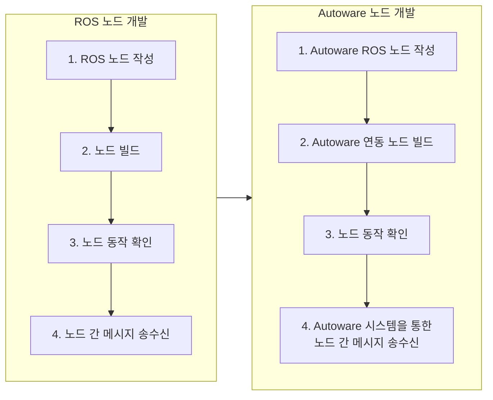
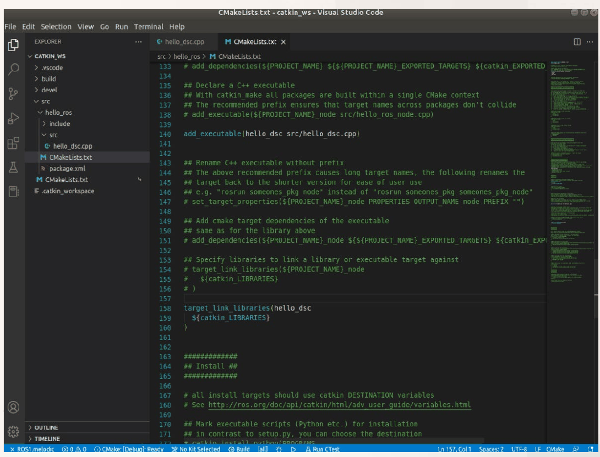
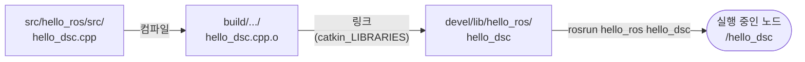
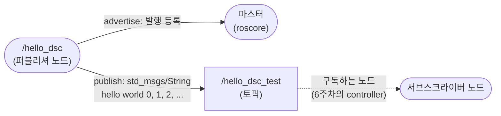

# 5주차 이론 — ROS Autoware 노드 개발

[레포지토리 안내](../../README.ko.md) | [English](Concepts_Lecture.md) | [한국어](Concepts_Lecture.ko.md)

> **최종 수정일:** 2026-11-04

> **학습 목표:**
> 1. Qt 5.12.12를 설치하고 Autoware.ai 1.14.0의 소스 코드를 받아 colcon으로 빌드하고 실행하는 절차와 각 명령의 역할을 설명할 수 있다
> 2. catkin 작업 공간을 만들고 소스 공간, 빌드 공간, 개발 공간과 `setup.bash`의 역할을 설명할 수 있다
> 3. `catkin_create_pkg`로 패키지를 만들고, `package.xml`의 의존성 태그와 `CMakeLists.txt`의 `add_executable`, `target_link_libraries`가 하는 일을 설명할 수 있다
> 4. `hello_dsc` 노드의 각 줄(헤더, `ros::init`, `ros::NodeHandle`, `ros::ok`, 메시지, `ROS_INFO`, `usleep`)이 하는 일을 설명할 수 있다
> 5. `advertise`와 `publish`로 토픽을 발행하는 노드를 작성하고 `catkin_make`, `roscore`, `rosrun`으로 빌드하고 실행할 수 있다
> 6. 빈 소스 파일을 빌드할 때 나는 링크 오류의 원인과, `usleep`과 `ros::Rate`로 반복 주기를 정하는 방식의 차이를 설명할 수 있다

---

## 목차

- [1. Qt와 Autoware.ai의 설치와 빌드](#1-qt와-autowareai의-설치와-빌드)
  - [1.1 설치 순서와 준비 사항](#11-설치-순서와-준비-사항)
  - [1.2 설치 절차의 요약](#12-설치-절차의-요약)
- [2. ROS 노드 개발의 순서](#2-ros-노드-개발의-순서)
- [3. catkin 작업 공간과 패키지](#3-catkin-작업-공간과-패키지)
  - [3.1 작업 공간 만들기](#31-작업-공간-만들기)
  - [3.2 작업 공간의 세 공간과 환경 설정](#32-작업-공간의-세-공간과-환경-설정)
  - [3.3 패키지 만들기](#33-패키지-만들기)
  - [3.4 package.xml](#34-packagexml)
  - [3.5 CMakeLists.txt](#35-cmakeliststxt)
  - [3.6 VS Code에서 작업 공간 열기](#36-vs-code에서-작업-공간-열기)
- [4. hello_dsc 노드의 작성과 실행](#4-hello_dsc-노드의-작성과-실행)
  - [4.1 빈 소스 파일과 첫 빌드 오류](#41-빈-소스-파일과-첫-빌드-오류)
  - [4.2 코드 입력과 빌드](#42-코드-입력과-빌드)
  - [4.3 노드 실행](#43-노드-실행)
- [5. hello_dsc 코드 분석](#5-hello_dsc-코드-분석)
  - [5.1 헤더 파일](#51-헤더-파일)
  - [5.2 main 함수와 명령행 인자](#52-main-함수와-명령행-인자)
  - [5.3 노드 초기화: ros::init](#53-노드-초기화-rosinit)
  - [5.4 노드 핸들: ros::NodeHandle](#54-노드-핸들-rosnodehandle)
  - [5.5 반복 조건: ros::ok](#55-반복-조건-rosok)
  - [5.6 메시지 선언과 데이터 입력](#56-메시지-선언과-데이터-입력)
  - [5.7 화면 출력: ROS_INFO](#57-화면-출력-ros_info)
  - [5.8 대기: usleep](#58-대기-usleep)
- [6. 퍼블리셔로 완성한 hello_dsc](#6-퍼블리셔로-완성한-hello_dsc)
  - [6.1 전체 코드](#61-전체-코드)
  - [6.2 더해진 줄의 의미](#62-더해진-줄의-의미)
  - [6.3 발행 확인](#63-발행-확인)
  - [6.4 반복 주기와 ros::Rate](#64-반복-주기와-rosrate)
- [개념 적용](#개념-적용)
- [요약](#요약)
- [점검 문제](#점검-문제)
- [참고 문헌](#참고-문헌)

---

<br>

## 1. Qt와 Autoware.ai의 설치와 빌드

### 1.1 설치 순서와 준비 사항

Autoware.ai는 ROS 1 위에서 동작하는 오픈 소스 자율주행 소프트웨어이며(2주차), 1.14.0 버전은 Ubuntu 18.04와 ROS Melodic 환경에서 소스 코드를 내려받아 직접 빌드한다. 설치는 다음 순서로 진행하며, 각 단계의 자세한 명령과 설명은 표에 적은 곳에 있다.

| 단계 | 내용 | 다루는 곳 |
|:-----|:-----|:-----|
| 1 | 리눅스(Ubuntu 18.04) 설치 확인 | 3주차 |
| 2 | ROS Melodic 설치 확인 | 4주차 |
| 3 | turtlesim을 이용한 ROS 실행 테스트 | 1주차, 4주차 |
| 4 | 설치 스크립트를 이용한 ROS 설치 | 4주차 |
| 5 | Qt 설치 | 4주차 6.2절 |
| 6 | Autoware 설치 | 4주차 6.3\~6.4절 |
| 7 | Autoware 실행 | 4주차 6.5절 |

*표 1. Autoware.ai를 쓰기까지의 설치 순서*

Autoware.ai의 소스 빌드 문서는 Ubuntu 18.04에서 ROS Melodic, Qt 5.9.5 이상을 요구하고, GPU 가속을 쓰려면 CUDA 10.0을 선택적으로 요구한다 [1]. Autoware.ai에는 RViz 플러그인처럼 Qt 라이브러리로 화면을 그리는 패키지가 들어 있으므로 Qt가 필요하며, 4주차 6.2절의 설치 안내는 장기 지원(LTS) 버전인 Qt 5.12.12를 따로 설치한다.

> **용어 정의:** **Qt**는 C++로 그래픽 사용자 인터페이스(GUI) 프로그램을 만드는 크로스 플랫폼 프레임워크이다. ROS의 RViz와 rqt도 Qt로 만들어졌다. **qmake**는 Qt 프로젝트의 빌드 파일을 만드는 도구이고, **Qt Creator**는 Qt 개발용 통합 개발 환경(IDE)이다.

### 1.2 설치 절차의 요약

설치 명령 전체와 각 명령의 의미, 빌드에서 자주 생기는 문제와 해결 방법은 4주차 6.2\~6.5절에 정리되어 있다. 노드 개발에 앞서 알아야 할 흐름은 다음과 같다.

1. **Qt 5.12.12 설치:** 오프라인 설치 파일 `qt-opensource-linux-x64-5.12.12.run`에 `chmod +x`로 실행 권한을 주어 실행하고, 설치 폴더는 기본값인 홈 폴더 아래의 `Qt5.12.12`로 둔다. 구성 요소 가운데 데스크톱용 64비트 GCC 빌드(`gcc_64`)와 Qt Creator가 설치되어야 다음 단계의 경로가 실제로 존재한다.
2. **Qt 경로 등록:** `.bashrc`의 끝에 `export PATH=$HOME/Qt5.12.12/5.12.12/gcc_64/bin:$HOME/Qt5.12.12/Tools/QtCreator/bin:$PATH`를 한 줄로 적고, `source ~/.bashrc`로 현재 터미널에 반영한 뒤 `qmake -version`으로 Qt 5.12.12가 쓰이는지 확인한다. Qt의 `bin` 폴더를 `PATH`의 앞에 두었으므로, ROS와 함께 설치된 시스템의 Qt 5.9.5보다 새로 설치한 Qt가 먼저 찾아진다.
3. **소스 받기:** colcon, vcstool, rosdep 같은 빌드 도구를 설치하고, 작업 공간 `autoware.ai`와 그 안의 `src`를 만든 뒤, 1.14.0 버전의 저장소 목록 파일 `autoware.ai.repos`를 내려받아 `vcs import src < autoware.ai.repos`로 목록의 저장소를 모두 `src` 아래에 받는다.
4. **의존성 설치와 빌드:** `rosdep install -y --from-paths src --ignore-src --rosdistro $ROS_DISTRO`로 `src`의 패키지들이 `package.xml`에 적은 시스템 의존성을 설치하고, `colcon build --cmake-args -DCMAKE_BUILD_TYPE=Release`로 패키지들을 의존 순서대로 빌드한다. `rosdep install`은 `src`에 받은 `package.xml`을 읽어 동작하므로 소스를 먼저 받아야 한다.
5. **실행:** `source install/setup.bash`로 빌드한 패키지들을 현재 터미널의 ROS 환경에 더한 뒤 `roslaunch runtime_manager runtime_manager.launch`로 Autoware의 GUI인 Runtime Manager를 띄운다(2주차). `roslaunch`는 마스터가 실행 중이 아니면 마스터를 먼저 실행한다.

> **참고:** Autoware.ai의 패키지는 catkin 패키지이지만 빌드 도구로는 `catkin_make` 대신 colcon을 쓴다. `catkin_make`(3절)는 작업 공간 전체를 하나의 CMake 프로젝트로 묶어 빌드하고 결과를 `devel` 폴더에 두는 반면, colcon은 패키지마다 따로 빌드하여 결과를 `install` 폴더에 모은다. 그래서 Autoware를 실행할 때는 `install/setup.bash`를 불러온다.

> **핵심:** Autoware.ai 1.14.0의 설치는 Qt 경로 등록, 도구 설치, `vcs import`로 소스 받기, `rosdep install`로 의존성 설치, `colcon build`로 빌드, `install/setup.bash`를 불러와 `roslaunch`로 실행하는 순서이다. 환경 변수를 바꾸는 `export`와 `source`는 그 터미널에만 적용되므로, 매번 필요한 설정은 `.bashrc`에 적어 둔다.

---

<br>

## 2. ROS 노드 개발의 순서

5주차부터 7주차까지는 Autoware에서 쓸 수 있는 ROS 노드를 직접 개발하는 과정을 다룬다. 개발은 먼저 일반적인 ROS 노드로 작성, 빌드, 동작 확인, 메시지 송수신을 익히고, 같은 순서를 Autoware와 연동되는 노드에 적용한다.



*그림 1. ROS 노드에서 Autoware 노드로 이어지는 개발 순서*

이 단원은 왼쪽의 1\~3단계, 곧 노드를 작성하고 빌드하여 동작을 확인하는 과정을 다룬다. 4단계의 메시지 송수신과 그 응용은 6주차와 7주차에서, Autoware와 연동되는 노드는 14주차에서 다룬다. Autoware의 노드도 ROS 노드이므로 이 과정에서 익히는 작업 공간, 패키지, 노드의 구조는 그대로 쓰인다.

---

<br>

## 3. catkin 작업 공간과 패키지

### 3.1 작업 공간 만들기

**작업 공간(workspace)** 은 ROS 패키지(노드)를 두고 빌드하는 폴더이다. 관례적으로 홈 폴더 아래에 `catkin_ws`라는 이름으로 만든다. 새 작업 공간은 다음 명령으로 만든다.

```bash
mkdir -p ~/catkin_ws/src
cd ~/catkin_ws/src
catkin_init_workspace
cd ~/catkin_ws
catkin_make
source ~/catkin_ws/devel/setup.bash
echo "source ~/catkin_ws/devel/setup.bash" >> ~/.bashrc
```

- **`mkdir -p ~/catkin_ws/src`:** 작업 공간과 그 안의 소스 폴더 `src`를 만든다. `~`는 홈 폴더를 뜻한다.
- **`catkin_init_workspace`:** `src` 폴더 안에 `CMakeLists.txt`를 만든다. 이 파일은 catkin이 제공하는 최상위 CMake 스크립트(`/opt/ros/melodic/share/catkin/cmake/toplevel.cmake`)를 가리키는 심볼릭 링크로, `src` 아래의 모든 패키지를 하나의 CMake 프로젝트로 묶는 역할을 한다.
- **`catkin_make`:** 작업 공간을 빌드한다. 안에서 CMake로 빌드 파일을 만든 뒤 `make`를 실행하며, 이때 `build`와 `devel` 폴더가 생긴다. 아직 패키지가 없어도 실행하여 작업 공간의 기본 구조와 환경 설정 스크립트를 만들어 둔다.
- **`source ~/catkin_ws/devel/setup.bash`:** 이 작업 공간을 현재 터미널의 ROS 환경에 등록한다(임시 등록). 터미널을 닫으면 사라진다.
- **`echo "..." >> ~/.bashrc`:** 같은 `source` 명령을 `.bashrc`의 끝에 덧붙인다(영구 등록). `>>`는 파일 끝에 덧붙이는 리다이렉션이며, `>`를 쓰면 `.bashrc`의 기존 내용이 지워지므로 주의한다.

> **참고:** `catkin_make`는 작업 공간의 최상위 폴더(`~/catkin_ws`)에서 실행해야 한다. `src` 폴더 안에서 실행하면 그 폴더를 작업 공간으로 잘못 여겨 오류를 내므로, 위 명령은 `catkin_make` 전에 `cd ~/catkin_ws`로 이동한다. 또한 `src/CMakeLists.txt`가 없으면 `catkin_make`가 이를 자동으로 만들므로 `catkin_init_workspace`는 생략해도 된다 [2].

### 3.2 작업 공간의 세 공간과 환경 설정

catkin 작업 공간은 역할이 다른 폴더, 곧 **공간(space)** 으로 이루어진다 [3]. `catkin_make`를 실행하면 맨 앞에 각 공간의 경로가 출력된다.

| 공간 | 폴더 | 내용 |
|:-----|:-----|:-----|
| 소스 공간(source space) | `src` | 패키지의 소스 코드. 개발자가 직접 작성하고 고치는 유일한 곳이다 |
| 빌드 공간(build space) | `build` | CMake와 `make`가 만드는 중간 파일(오브젝트 파일, Makefile 등) |
| 개발 공간(devel space) | `devel` | 빌드한 실행 파일과 라이브러리, 그리고 환경 설정 스크립트 `setup.bash`. 설치하지 않고 바로 실행해 볼 수 있다 |
| 설치 공간(install space) | `install` | `catkin_make install`을 실행했을 때만 생기며, 배포용으로 설치된 결과를 담는다 |

*표 2. catkin 작업 공간을 이루는 공간*

`devel/setup.bash`를 불러오면 이 작업 공간의 패키지가 환경 변수 `ROS_PACKAGE_PATH` 등에 더해져, `rosrun`과 `roslaunch`가 패키지를 찾을 수 있게 된다. 이 스크립트는 작업 공간을 만들 때 기준이 된 ROS 설치(`/opt/ros/melodic`)의 환경도 함께 불러오며, 작업 공간에 같은 이름의 패키지가 있으면 작업 공간의 것이 우선한다. 이렇게 기존 환경 위에 작업 공간을 덧씌우는 구조를 **오버레이(overlay)** 라 한다 [3].

### 3.3 패키지 만들기

**패키지(package)** 는 노드, 라이브러리, 메시지 정의, 설정 파일을 묶은 ROS 소프트웨어의 기본 단위이며, 작업 공간의 `src` 폴더 아래에 둔다. 하나의 패키지에는 여러 노드가 들어갈 수 있다. `src` 폴더로 이동하여 `catkin_create_pkg`로 패키지를 만든다.

```bash
cd ~/catkin_ws/src
catkin_create_pkg hello_ros std_msgs roscpp rospy
```

명령의 형식은 `catkin_create_pkg <패키지 이름> <의존 패키지 1> <의존 패키지 2> ...`이다. 패키지 이름 `hello_ros` 뒤에 이 패키지가 쓸 패키지를 나열한다.

- **`std_msgs`:** 문자열(`String`), 정수(`Int16`, `Int32`), 실수(`Float64`) 같은 기본 메시지 형식을 정의한 패키지이다.
- **`roscpp`:** C++로 노드를 작성하게 하는 ROS 클라이언트 라이브러리이다.
- **`rospy`:** Python으로 노드를 작성하게 하는 ROS 클라이언트 라이브러리이다.

실행하면 다음과 같이 출력된다.

```text
Created file hello_ros/package.xml
Created file hello_ros/CMakeLists.txt
Created folder hello_ros/include/hello_ros
Created folder hello_ros/src
Successfully created files in /home/mobility/catkin_ws/src/hello_ros. Please adjust the values in package.xml.
```

`catkin_create_pkg`는 패키지 폴더 `hello_ros`와 그 안의 설정 파일 두 개(`package.xml`, `CMakeLists.txt`), 헤더 파일을 둘 `include/hello_ros` 폴더, 소스 파일을 둘 `src` 폴더를 만든다. 여기까지 마친 작업 공간의 구조는 다음과 같다.

```text
catkin_ws/                      작업 공간
├── .catkin_workspace           catkin_make가 만든 작업 공간 표시 파일
├── build/                      빌드 공간
├── devel/                      개발 공간 (setup.bash)
└── src/                        소스 공간
    ├── CMakeLists.txt          catkin의 toplevel.cmake를 가리키는 링크
    └── hello_ros/              패키지
        ├── CMakeLists.txt      패키지의 빌드 규칙
        ├── package.xml         패키지의 정보와 의존성
        ├── include/hello_ros/  헤더 파일
        └── src/                소스 파일 (노드의 .cpp)
```

*그림 2. hello_ros 패키지를 만든 뒤의 catkin 작업 공간 구조*

작업 공간의 `src`(소스 공간)와 패키지 안의 `src`(패키지의 소스 파일 폴더)는 이름이 같지만 다른 폴더이다. 노드의 소스 파일은 패키지 안의 `src`, 곧 `~/catkin_ws/src/hello_ros/src/`에 만든다.

### 3.4 package.xml

`package.xml`은 패키지의 이름, 버전, 설명, 관리자, 라이선스와 의존 패키지를 적는 **매니페스트(manifest)** 이다. 빌드 도구는 이 파일의 의존성을 보고 패키지를 빌드할 순서를 정하고, rosdep은 이 파일을 보고 설치할 시스템 패키지를 찾는다. `catkin_create_pkg`가 만든 파일에서 설명 주석을 걷어 내면 핵심 내용은 다음과 같다.

```xml
<?xml version="1.0"?>
<package format="2">
  <name>hello_ros</name>
  <version>0.0.0</version>
  <description>The hello_ros package</description>
  <maintainer email="mobility@todo.todo">mobility</maintainer>
  <license>TODO</license>

  <buildtool_depend>catkin</buildtool_depend>
  <build_depend>roscpp</build_depend>
  <build_depend>rospy</build_depend>
  <build_depend>std_msgs</build_depend>
  <build_export_depend>roscpp</build_export_depend>
  <build_export_depend>rospy</build_export_depend>
  <build_export_depend>std_msgs</build_export_depend>
  <exec_depend>roscpp</exec_depend>
  <exec_depend>rospy</exec_depend>
  <exec_depend>std_msgs</exec_depend>

  <export>
  </export>
</package>
```

`format="2"`는 매니페스트 형식 2를 쓴다는 뜻이며, 각 의존성 태그의 의미는 다음과 같다 [4].

| 태그 | 의미 |
|:-----|:-----|
| `<buildtool_depend>` | 빌드 과정에서 실행되는 빌드 도구. catkin 패키지는 `catkin`을 적는다 |
| `<build_depend>` | 이 패키지를 컴파일할 때 필요한 패키지(헤더, 라이브러리) |
| `<build_export_depend>` | 이 패키지를 쓰는 다른 패키지가 빌드될 때 함께 필요한 패키지. 이 패키지의 헤더가 다른 패키지의 헤더를 포함할 때 쓴다 |
| `<exec_depend>` | 이 패키지를 실행할 때 필요한 패키지(공유 라이브러리, 실행 파일, Python 모듈 등) |
| `<depend>` | 위의 `build_depend`, `build_export_depend`, `exec_depend`를 한 번에 적는 줄임 표기 |

*표 3. package.xml 형식 2의 의존성 태그*

출력의 마지막 줄 "Please adjust the values in package.xml."은 자동으로 채운 값을 고치라는 안내이다. 관리자 이름과 전자 우편(`mobility`는 리눅스 사용자 이름에서, `todo.todo`는 자리 표시 값으로 채워진다), 라이선스 `TODO`, 설명은 패키지를 공개할 때 실제 값으로 고친다. 의존 패키지를 나중에 더할 때는 이 파일과 3.5절의 `find_package`를 함께 고친다.

### 3.5 CMakeLists.txt

`CMakeLists.txt`는 패키지를 무엇으로 어떻게 빌드할지 적는 CMake 빌드 스크립트이다. `catkin_create_pkg`가 만든 파일은 대부분이 주석(`#`)으로 된 예시이며, 주석을 걷어 낸 뒤 노드 `hello_dsc`를 위한 두 명령을 더하면 다음과 같다. 첫 줄의 최소 CMake 버전은 설치된 catkin 도구의 버전에 따라 다를 수 있다.

```cmake
cmake_minimum_required(VERSION 3.0.2)
project(hello_ros)

find_package(catkin REQUIRED COMPONENTS
  roscpp
  rospy
  std_msgs
)

catkin_package()

include_directories(
  ${catkin_INCLUDE_DIRS}
)

# 빌드 실행 파일명 hello_dsc
add_executable(hello_dsc src/hello_dsc.cpp)

# 라이브러리를 실행 파일에 링크
target_link_libraries(hello_dsc
  ${catkin_LIBRARIES}
)
```

| 명령 | 하는 일 |
|:-----|:-----|
| `cmake_minimum_required(VERSION ...)` | 이 스크립트를 처리하는 데 필요한 CMake의 최소 버전을 정한다 |
| `project(hello_ros)` | 프로젝트 이름을 정한다. catkin 패키지에서는 패키지 이름과 같아야 하며, `${PROJECT_NAME}`으로 다시 쓸 수 있다 |
| `find_package(catkin REQUIRED COMPONENTS ...)` | catkin과 의존 패키지를 찾아, 헤더 경로를 `catkin_INCLUDE_DIRS`에, 라이브러리를 `catkin_LIBRARIES`에 모은다. `REQUIRED`는 찾지 못하면 오류로 멈추라는 뜻이다 |
| `catkin_package()` | 이 패키지를 catkin 패키지로 선언하고, 다른 패키지가 이 패키지를 쓸 때 필요한 정보를 내보낸다. 인자를 비우면 내보낼 헤더와 라이브러리가 없다는 뜻이다 |
| `include_directories(${catkin_INCLUDE_DIRS})` | 컴파일할 때 `ros/ros.h`, `std_msgs/String.h` 같은 헤더를 찾을 경로를 더한다 |
| `add_executable(hello_dsc src/hello_dsc.cpp)` | 소스 파일 `src/hello_dsc.cpp`를 컴파일하여 실행 파일 `hello_dsc`를 만든다. 첫 인자가 실행 파일(빌드 대상)의 이름이다 |
| `target_link_libraries(hello_dsc ${catkin_LIBRARIES})` | 실행 파일 `hello_dsc`에 roscpp 등의 라이브러리를 링크한다. 첫 인자는 `add_executable`의 대상 이름과 같아야 한다 |

*표 4. 패키지 CMakeLists.txt의 주요 명령*

명령의 순서에도 규칙이 있다. `catkin_package()`는 `add_executable`이나 `add_library`로 빌드 대상을 선언하기 전에 불러야 하고 [5], `target_link_libraries`는 그 대상을 만든 `add_executable` 뒤에 와야 한다. 생성된 파일에서는 `## Declare a C++ executable` 주석 아래에 `add_executable`을, `## Specify libraries to link a library or executable target against` 주석 아래에 `target_link_libraries`를 두면 이 순서가 지켜진다.



*그림 3. VS Code에서 CMakeLists.txt에 add_executable과 target_link_libraries를 추가한 모습*

그림 3에서 140번째 줄에 `add_executable(hello_dsc src/hello_dsc.cpp)`가, 158\~160번째 줄에 `target_link_libraries(hello_dsc ${catkin_LIBRARIES})`가 추가되어 있다. 나머지 줄은 `#`으로 시작하는 주석이므로 빌드에 영향을 주지 않는다. 노드를 더 만들 때마다 이 두 명령을 노드마다 하나씩 더한다(6주차).

> **[시스템프로그래밍]** C++ 프로그램은 소스 파일마다 **컴파일(compile)** 하여 오브젝트 파일(`.o`)을 만든 뒤, 오브젝트 파일들과 라이브러리를 **링크(link)** 하여 실행 파일을 만든다. `add_executable`은 무엇을 컴파일하여 어떤 실행 파일을 만들지를, `target_link_libraries`는 링크할 때 어떤 라이브러리를 붙일지를 정한다. `ros::init` 같은 함수의 선언은 헤더에 있지만 실제 구현은 roscpp 라이브러리에 있으므로, 링크를 빼면 "undefined reference" 오류가 난다.

### 3.6 VS Code에서 작업 공간 열기

소스 코드는 Visual Studio Code(4주차에서 설치)로 편집한다. `File > Open Folder`에서 `catkin_ws` 폴더를 선택하면 왼쪽 탐색기(EXPLORER)에 그림 2와 같은 구조가 표시되어, 패키지 구조를 한눈에 확인하고 파일을 만들 수 있다. 탐색기에는 그림 2의 항목 외에 VS Code가 설정을 저장하는 `.vscode` 폴더가 함께 보인다. Microsoft의 ROS 확장(extension)을 설치하면 ROS 환경을 인식하여 헤더 경로 설정과 빌드 명령을 도와준다.

---

<br>

## 4. hello_dsc 노드의 작성과 실행

### 4.1 빈 소스 파일과 첫 빌드 오류

VS Code의 탐색기에서 `hello_ros > src` 폴더에 새 파일 `hello_dsc.cpp`를 만든다. 아직 내용은 비워 두고, 3.5절처럼 `CMakeLists.txt`에 `add_executable`과 `target_link_libraries`를 추가하여 저장한 뒤 작업 공간의 최상위 폴더에서 `catkin_make`를 실행한다. 그러면 다음과 같이 빌드가 실패한다(앞부분은 줄였다).

```text
-- catkin 0.7.29
-- ~~  traversing 1 packages in topological order:
-- ~~  - hello_ros
-- +++ processing catkin package: 'hello_ros'
-- ==> add_subdirectory(hello_ros)
-- Configuring done
-- Generating done
-- Build files have been written to: /home/mobility/catkin_ws/build
#### Running command: "make -j8 -l8" in "/home/mobility/catkin_ws/build"
Scanning dependencies of target hello_dsc
[ 50%] Building CXX object hello_ros/CMakeFiles/hello_dsc.dir/src/hello_dsc.cpp.o
[100%] Linking CXX executable /home/mobility/catkin_ws/devel/lib/hello_ros/hello_dsc
/usr/lib/gcc/x86_64-linux-gnu/7/../../../x86_64-linux-gnu/Scrt1.o: In function `_start':
(.text+0x20): undefined reference to `main'
collect2: error: ld returned 1 exit status
hello_ros/CMakeFiles/hello_dsc.dir/build.make:112: recipe for target '/home/mobility/catkin_ws/devel/lib/hello_ros/hello_dsc' failed
make[2]: *** [/home/mobility/catkin_ws/devel/lib/hello_ros/hello_dsc] Error 1
CMakeFiles/Makefile2:861: recipe for target 'hello_ros/CMakeFiles/hello_dsc.dir/all' failed
make[1]: *** [hello_ros/CMakeFiles/hello_dsc.dir/all] Error 2
Makefile:140: recipe for target 'all' failed
make: *** [all] Error 2
Invoking "make -j8 -l8" failed
```

출력은 크게 두 단계로 나뉜다.

1. **CMake 설정 단계(`--`로 시작하는 줄):** catkin 0.7.29가 `src` 아래의 패키지를 찾아 의존 관계에 맞는 순서(topological order)로 늘어놓는다. 패키지가 `hello_ros` 하나이므로 그것만 처리하고, 빌드 파일을 `build` 폴더에 쓴다.
2. **make 빌드 단계:** `make -j8 -l8`(작업 8개를 동시에 실행하되 시스템 부하가 8을 넘으면 새 작업을 미룬다)이 실행된다. 빈 `hello_dsc.cpp`의 컴파일(`Building CXX object`, 50%)은 성공하지만, 실행 파일을 만드는 링크(`Linking CXX executable`, 100%)에서 실패한다. 링크가 실패하면 그 대상을 빌드하던 하위 make(`make[2]`)부터 `make[1]`, 최상위 `make`까지 차례로 오류를 보고한다.

오류의 원인은 `hello_dsc.cpp`에 `main` 함수가 없다는 것이다. 빈 파일도 올바른 C++ 소스이므로 컴파일은 되지만, 실행 파일에는 프로그램이 시작할 지점이 있어야 한다. 링커(`ld`)는 C 실행 환경의 시작 코드 `Scrt1.o`의 `_start`가 부르는 `main`을 어디에서도 찾지 못해 "undefined reference to `main'"을 보고하고, GCC가 링커를 실행할 때 거치는 보조 프로그램 `collect2`가 이 실패를 `ld returned 1 exit status`로 알린다. 빌드가 실패하면 마지막 줄에 `Invoking "make -j8 -l8" failed`가 출력된다.

> **[시스템프로그래밍]** C와 C++ 프로그램의 실제 시작 지점은 `main`이 아니라 C 런타임의 시작 코드(`crt1.o`, 위치 독립 실행 파일이면 `Scrt1.o`)에 있는 `_start`이다. `_start`는 스택과 인자를 준비하고 C 라이브러리의 초기화 함수를 거쳐 `main`을 호출하며, `main`이 반환한 값을 프로그램의 종료 상태로 쓴다. 그래서 `main`이 없으면 컴파일이 아니라 링크에서 오류가 난다.

### 4.2 코드 입력과 빌드

`hello_dsc.cpp`에 다음 코드를 입력한다. 이 단계의 코드는 토픽을 발행하는 부분을 주석(`//`)으로 막아 두고, 문자열을 만들어 화면에 출력하는 일만 한다. 주석으로 막은 줄은 6절에서 되살려 퍼블리셔를 완성한다.

```cpp
#include "ros/ros.h"
#include "std_msgs/String.h"
#include <sstream>
#include <unistd.h>

int main(int argc, char **argv)
{
    ros::init(argc, argv, "hello_dsc");

    ros::NodeHandle n;
    // ros::Publisher hello_dsc_pub = n.advertise<std_msgs::String>("hello_dsc_test", 1000);

    // int count = 0;

    while (ros::ok())
    {
        std_msgs::String msg;

        std::stringstream ss;
        ss << "hello world ";
        // ss << "hello world " << count;
        msg.data = ss.str();

        ROS_INFO("%s", msg.data.c_str());
        // hello_dsc_pub.publish(msg);

        // count++;

        usleep(1000);
    }

    return 0;
}
```

다시 `catkin_make`를 실행하면 이번에는 빌드가 성공한다.

```text
mobility@mobility-VirtualBox:~$ cd catkin_ws/
mobility@mobility-VirtualBox:~/catkin_ws$ catkin_make
Base path: /home/mobility/catkin_ws
Source space: /home/mobility/catkin_ws/src
Build space: /home/mobility/catkin_ws/build
Devel space: /home/mobility/catkin_ws/devel
Install space: /home/mobility/catkin_ws/install
####
#### Running command: "make cmake_check_build_system" in "/home/mobility/catkin_ws/build"
####
####
#### Running command: "make -j8 -l8" in "/home/mobility/catkin_ws/build"
####
[100%] Built target hello_dsc
```

`catkin_make` 뒤의 다섯 줄은 작업 공간의 기준 경로(Base path)와 3.2절의 네 공간의 경로이다. `make cmake_check_build_system`은 `CMakeLists.txt`가 바뀌었는지 확인하여 필요하면 CMake 설정을 다시 하는 단계이고, 마지막 줄 `[100%] Built target hello_dsc`는 실행 파일이 만들어졌다는 뜻이다. 실행 파일은 개발 공간의 `devel/lib/hello_ros/hello_dsc`에 생긴다.



*그림 4. 소스 파일에서 실행 중인 노드까지의 빌드와 실행 흐름*

### 4.3 노드 실행

노드를 실행하려면 먼저 마스터가 실행되어 있어야 한다. 터미널을 두 개 열고 각각 다음 명령을 실행한다.

```bash
roscore                        # 터미널 1: 마스터를 실행한다
rosrun hello_ros hello_dsc     # 터미널 2: hello_ros 패키지의 hello_dsc 실행 파일을 실행한다
```

`rosrun <패키지> <실행 파일>`은 ROS 환경에 등록된 패키지에서 실행 파일을 찾아 실행한다. 패키지가 어느 폴더에 있는지 몰라도 되며, 이를 위해 3.1절에서 `devel/setup.bash`를 불러 두었다. 터미널 2에는 다음과 같은 출력이 계속 이어진다.

```text
[ INFO] [1676635354.650260414]: hello world
[ INFO] [1676635354.652026319]: hello world
[ INFO] [1676635354.653962375]: hello world
[ INFO] [1676635354.655943763]: hello world
[ INFO] [1676635354.657814676]: hello world
[ INFO] [1676635354.660837478]: hello world
```

각 줄은 메시지의 심각도(`INFO`), 출력한 시각, 메시지 내용으로 이루어진다. 시각은 1970년 1월 1일 0시(UTC)부터 지난 초 수(유닉스 시간)를 나노초 단위까지 나타낸 값이다. 노드를 멈추려면 터미널 2에서 `Ctrl + C`를 누른다.

연속한 두 줄의 시각 차이는 $0.652026319 - 0.650260414 \approx 0.00177$초, 다음은 $0.653962375 - 0.652026319 \approx 0.00194$초처럼 약 1.8\~3 ms이다. 코드는 매번 1 ms(`usleep(1000)`)씩 쉬지만, 문자열을 만들고 터미널에 출력하는 시간이 더해지므로 한 번 반복하는 데 1 ms보다 오래 걸린다. 반복 주기를 정확히 맞추는 방법은 6.4절에서 다룬다.

> **주의:** `roscore`를 실행하지 않고 노드를 실행하면, 노드는 마스터에 등록하지 못해 마스터에 연결할 수 없다는 메시지를 출력하며 연결을 계속 다시 시도한다. 이때 `roscore`를 실행하면 등록을 마치고 동작을 시작한다.

---

<br>

## 5. hello_dsc 코드 분석

이 절은 4.2절의 코드를 위에서부터 한 부분씩 설명한다.

### 5.1 헤더 파일

```cpp
#include "ros/ros.h"
#include "std_msgs/String.h"
#include <sstream>
#include <unistd.h>
```

- **`#include "ros/ros.h"`:** roscpp를 쓰는 데 필요한 기본 헤더를 한꺼번에 포함한다. `ros::init`, `ros::NodeHandle`, `ros::Publisher`, `ros::Subscriber`, `ros::Rate`, `ROS_INFO` 등이 모두 이 헤더로 선언된다.
- **`#include "std_msgs/String.h"`:** 메시지 형식 `std_msgs/String`을 C++ 구조체 `std_msgs::String`으로 쓰게 하는 헤더이다. 이 헤더는 메시지 정의 파일 `String.msg`(내용은 `string data` 한 줄)로부터 자동으로 만들어진 것이다.
- **`#include <sstream>`:** 문자열 스트림 `std::stringstream`을 쓰기 위한 C++ 표준 라이브러리 헤더이다.
- **`#include <unistd.h>`:** 반복 주기를 정하는 `usleep`을 선언한 POSIX 헤더이다(5.8절).

> **[컴퓨터프로그래밍]** `#include "..."`는 현재 파일의 폴더와 빌드 시스템이 지정한 경로(`include_directories`)를 먼저 찾고, `#include <...>`는 컴파일러와 시스템의 표준 헤더 경로를 찾는다. ROS 헤더는 `/opt/ros/melodic/include` 아래에 있으며, CMake의 `include_directories(${catkin_INCLUDE_DIRS})`가 이 경로를 컴파일러에 알려 준다.

### 5.2 main 함수와 명령행 인자

```cpp
int main(int argc, char **argv)
{
    ......
}
```

`main`은 프로그램의 시작점이며, 여기서는 매개변수가 있는 형태를 쓴다. `argc`(argument count)는 명령행 인자의 개수이고, `argv`(argument vector)는 각 인자를 C 문자열로 담은 배열이다. `argv[0]`은 실행한 프로그램의 경로이다. ROS 노드가 이 형태를 쓰는 이유는 실행할 때 명령행으로 준 ROS 전용 인자를 다음 절의 `ros::init`에 넘기기 위해서이다. 예를 들어 다음과 같이 실행하면 코드를 고치지 않고 노드 이름과 토픽 이름을 바꿀 수 있다.

```bash
rosrun hello_ros hello_dsc __name:=hello2                 # 노드 이름을 /hello2로 바꾼다
rosrun hello_ros hello_dsc hello_dsc_test:=my_topic       # 토픽 hello_dsc_test를 my_topic으로 바꾼다(6절)
```

이처럼 `이름:=새 이름` 꼴의 인자로 이름을 바꾸는 것을 **리매핑(remapping)** 이라 한다.

### 5.3 노드 초기화: ros::init

```cpp
ros::init(argc, argv, "hello_dsc");
```

`ros::init`은 ROS를 초기화하고 이 노드의 이름을 정한다. 다른 ROS 기능을 쓰기 전에 반드시 먼저 불러야 한다 [6].

- **`argc`, `argv`:** 명령행 인자를 넘겨 5.2절의 리매핑 인자를 처리하게 한다. `ros::init`은 처리한 ROS 인자를 `argv`에서 지우므로, 그 뒤의 코드는 일반 인자만 보게 된다.
- **`"hello_dsc"`:** 노드 이름이다. 네임스페이스 없는 기본 이름이어야 하며(`/`를 넣을 수 없다), 실행되면 `/hello_dsc`로 마스터에 등록된다. 노드 이름은 ROS 시스템 안에서 하나뿐이어야 하므로, 같은 이름의 노드가 새로 실행되면 먼저 실행 중이던 노드가 종료된다.

노드 이름(`ros::init`의 세 번째 인자)과 실행 파일 이름(`add_executable`의 첫 인자)은 이 예제에서 모두 `hello_dsc`이지만 서로 다른 개념이다. `rosrun`은 실행 파일 이름으로 프로그램을 찾고, rqt 같은 도구에는 노드 이름이 표시된다.

### 5.4 노드 핸들: ros::NodeHandle

```cpp
ros::NodeHandle n;
```

**노드 핸들(node handle)** 은 노드가 ROS 시스템과 통신하는 주된 창구이다. 퍼블리셔와 서브스크라이버를 만들고 매개변수를 읽는 일을 모두 노드 핸들을 통해 한다. 처음 만들어지는 노드 핸들이 노드를 완전히 시작시키고(마스터에 등록하는 등), 마지막 노드 핸들이 소멸할 때 노드가 종료된다 [6]. 그래서 이 줄은 "ROS 시스템 사용을 위한 핸들 선언"이며, 4.3절의 주의 상자처럼 마스터가 없을 때 노드가 기다리는 것도 이 시작 과정 때문이다.

### 5.5 반복 조건: ros::ok

```cpp
while (ros::ok())
{
    ......
}
```

`ros::ok()`는 노드가 계속 동작해도 되는지를 돌려주며, 다음 중 하나가 일어나면 `false`가 된다 [7].

- 터미널에서 `Ctrl + C`를 눌러 SIGINT 시그널을 받았다.
- 같은 이름의 다른 노드가 실행되어 이 노드가 네트워크에서 밀려났다.
- 프로그램의 다른 부분에서 `ros::shutdown()`을 불렀다.
- 모든 `ros::NodeHandle`이 소멸했다.

따라서 이 `while` 반복문은 노드를 종료시키는 일이 생길 때까지 계속 돌고, 종료 요청이 오면 반복을 빠져나와 `return 0;`으로 프로그램을 정상 종료한다. `Ctrl + C`로 노드를 멈출 수 있는 것도 이 조건 덕분이다.

> **참고:** `ros::ok()`는 `roscore`가 실행 중인지를 확인하지 않는다. 노드가 동작하는 도중에 `roscore`를 끄더라도 `ros::ok()`는 `true`를 유지하고 반복도 계속된다. 이미 연결된 노드끼리는 마스터 없이도 직접 통신을 이어 가지만(1주차의 TCPROS), 새로 실행한 노드는 마스터를 찾지 못해 연결되지 않는다. 그러므로 이 반복문을 "roscore가 실행되는 동안 반복한다"로 이해하는 것은 정확하지 않다.

### 5.6 메시지 선언과 데이터 입력

```cpp
std_msgs::String msg;

std::stringstream ss;
ss << "hello world ";
msg.data = ss.str();
```

- **`std_msgs::String msg;`:** 문자열 메시지 객체를 만든다. `String.msg`에 정의된 필드 `string data`는 C++에서 `std::string` 형의 멤버 `data`가 되며, 처음에는 빈 문자열이다.
- **`std::stringstream ss;`:** 메모리 안의 문자열을 대상으로 하는 스트림을 만든다. `std::cout`에 출력하듯이 `<<`로 값을 이어 쓰면 그 내용이 문자열로 쌓인다.
- **`ss << "hello world ";`:** 스트림에 문자열 `"hello world "`를 쓴다. 숫자도 같은 방식으로 이어 쓸 수 있어, 6절에서는 `ss << "hello world " << count;`로 반복 횟수를 붙인다.
- **`msg.data = ss.str();`:** 스트림에 쌓인 내용을 `std::string`으로 꺼내(`str()`) 메시지의 `data` 필드에 넣는다.

메시지와 스트림을 반복문 안에서 선언하므로, 반복할 때마다 새 객체가 만들어지고 이전 반복의 내용이 남지 않는다. 스트림을 반복문 밖에서 한 번만 만들면 `<<`로 쓴 내용이 계속 이어 붙어 문자열이 점점 길어진다.

### 5.7 화면 출력: ROS_INFO

```cpp
ROS_INFO("%s", msg.data.c_str());
```

`ROS_INFO`는 ROS의 로그 출력 기능(rosconsole)이 제공하는 매크로로, C의 `printf`와 같은 형식 문자열을 쓴다 [8]. `%s`는 C 문자열 자리이므로 `std::string`인 `msg.data`를 `c_str()`로 C 문자열(`const char*`)로 바꾸어 넘긴다. `ROS_INFO`가 출력한 메시지는 터미널에 4.3절의 형식으로 표시될 뿐 아니라 로그 토픽 `/rosout`으로도 발행되어, rqt 같은 도구에서 모아 볼 수 있다.

| 매크로 | 심각도 | 쓰임 |
|:-----|:-----|:-----|
| `ROS_DEBUG` | 디버그 | 개발 중에만 보는 상세 정보. 기본 설정에서는 출력되지 않는다 |
| `ROS_INFO` | 정보 | 정상 동작 중에 알릴 정보 |
| `ROS_WARN` | 경고 | 동작은 계속되지만 확인이 필요한 상황 |
| `ROS_ERROR` | 오류 | 일부 기능이 실패한 상황 |
| `ROS_FATAL` | 치명적 오류 | 노드가 더 동작할 수 없는 상황 |

*표 5. rosconsole의 로그 매크로와 심각도*

> **주의:** `ROS_INFO("%s", msg.data)`처럼 `std::string`을 그대로 넘기면 안 된다. 가변 인자 함수에 C++ 클래스 객체를 넘기는 것이므로 컴파일러에 따라 오류나 경고가 나고, 컴파일되더라도 실행 결과는 정의되지 않는다.

### 5.8 대기: usleep

```cpp
usleep(1000);
```

`usleep(n)`은 호출한 스레드를 적어도 $n$ 마이크로초(µs) 동안 멈춘다 [9]. 1 ms는 1000 µs, 1 s는 1000000 µs이므로 `usleep(1000)`은 1 ms, `usleep(1000000)`은 1초를 쉰다. 이 줄이 없으면 반복문이 쉬지 않고 돌아 CPU 코어 하나를 계속 차지하고 터미널에 출력이 쏟아진다.

`usleep`은 POSIX 운영체제의 함수로 헤더 `<unistd.h>`에 선언되어 있으므로 5.1절처럼 이 헤더를 포함한다. 이 줄이 없어도 `ros/ros.h`가 안쪽에서 포함하는 다른 헤더를 통해 선언을 얻어 빌드되는 경우가 있지만, 이는 ROS 헤더의 구현에 기대는 것이므로 직접 포함하는 편이 안전하다. 또한 실제로 멈추는 시간은 시스템의 다른 작업과 타이머의 정밀도 때문에 요청한 값보다 조금 길어질 수 있다 [9].

> **참고:** `usleep`은 POSIX.1-2001에서 쓰지 않을 것을 권하는 함수로 지정되었고 POSIX.1-2008 규격에서는 빠졌다 [9]. 리눅스에서는 여전히 쓸 수 있지만, 표준 C++에서는 `std::this_thread::sleep_for(std::chrono::milliseconds(1))`를, ROS 노드에서는 6.4절의 `ros::Rate`를 쓰는 것이 일반적이다.

---

<br>

## 6. 퍼블리셔로 완성한 hello_dsc

### 6.1 전체 코드

4.2절에서 주석으로 막았던 줄을 되살리면 문자열을 토픽으로 발행하는 퍼블리셔 노드가 완성된다. 이 코드는 [Example_hello_dsc.cpp](Example_hello_dsc.cpp)에 있다.

```cpp
// Node 1

#include "ros/ros.h"
#include "std_msgs/String.h"
#include <sstream>
#include <unistd.h>

int main(int argc, char **argv)
{
    ros::init(argc, argv, "hello_dsc");

    // ROS 시스템 사용을 위한 핸들 선언
    ros::NodeHandle n;
    int count = 0;

    ros::Publisher hello_dsc_pub = n.advertise<std_msgs::String>("hello_dsc_test",1000);

    while (ros::ok())
    {
        // 메시지 선언
        std_msgs::String msg;

        std::stringstream ss;
        ss << "hello world " << count;

        // 메시지에 데이터 입력
        msg.data = ss.str();

        ROS_INFO("%s", msg.data.c_str());

        // 퍼블리시
        // hello_dsc_test라는 토픽 이름으로 데이터 획득 가능
        hello_dsc_pub.publish(msg);

        count++;

        usleep(1000);
    }
    return 0;
}
```

### 6.2 더해진 줄의 의미

5절에서 설명한 줄을 빼면 다음 다섯 곳이 새로 더해졌다.

- **`int count = 0;`:** 몇 번째 메시지인지 세는 정수 변수이다. 반복문 밖에서 한 번만 0으로 초기화한다.
- **`ros::Publisher hello_dsc_pub = n.advertise<std_msgs::String>("hello_dsc_test",1000);`:** 이 노드가 토픽 `hello_dsc_test`에 `std_msgs/String` 형식의 메시지를 발행하겠다고 마스터에 알리고(1주차의 XMLRPC 등록), 그 토픽으로 메시지를 보낼 **퍼블리셔(publisher)** 객체를 돌려받는다. 마스터는 이 토픽을 구독하려는 노드에 퍼블리셔의 주소를 알려 주고, 두 노드는 그 뒤 직접 연결하여 메시지를 주고받는다 [6].
  - **`<std_msgs::String>`:** 템플릿 인자로 메시지 형식을 정한다. 이 퍼블리셔로는 이 형식의 메시지만 보내야 한다.
  - **`"hello_dsc_test"`:** 토픽 이름이다. `/`로 시작하지 않는 이름은 노드의 네임스페이스를 기준으로 풀리므로, 이 예제에서는 `/hello_dsc_test`가 된다.
  - **`1000`:** 발행용 메시지 큐의 크기이다. 메시지를 보내는 속도보다 발행하는 속도가 빠르면 보내지 못한 메시지를 최대 1000개까지 쌓아 두고, 넘치면 가장 오래된 것부터 버린다 [6].
- **`ss << "hello world " << count;`:** 문자열 뒤에 `count`의 값을 붙여 `"hello world 0"`, `"hello world 1"`, ...처럼 메시지마다 다른 내용을 만든다.
- **`hello_dsc_pub.publish(msg);`:** 메시지를 토픽에 발행한다. 그 순간 이 토픽을 구독하고 있는 모든 노드에 메시지가 전달되며, 구독하는 노드가 없으면 메시지는 아무에게도 전달되지 않고 오류도 나지 않는다. 주석의 뜻처럼 다른 노드는 `hello_dsc_test`라는 토픽 이름만 알면 이 데이터를 받을 수 있다.
- **`count++;`:** 다음 메시지를 위해 1을 더한다.

`advertise`가 돌려준 퍼블리셔 객체를 변수에 저장해 두는 데에도 이유가 있다. 퍼블리셔 객체의 복사본이 모두 사라지면 토픽의 발행 등록이 자동으로 취소되므로 [6], 발행하는 동안에는 객체가 살아 있어야 한다.



*그림 5. hello_dsc 노드가 토픽 hello_dsc_test에 메시지를 발행하는 구조*

### 6.3 발행 확인

구독하는 노드를 직접 만들기 전에도 ROS의 명령행 도구로 발행 여부를 확인할 수 있다. `roscore`와 `hello_dsc`를 실행한 상태에서 세 번째 터미널을 열고 다음을 실행한다.

```bash
rostopic list                    # 현재 있는 토픽의 목록을 본다 (/hello_dsc_test가 보여야 한다)
rostopic echo /hello_dsc_test    # 토픽의 메시지를 받아 출력한다
rostopic hz /hello_dsc_test      # 토픽이 초당 몇 번 발행되는지 잰다
```

`rostopic echo`는 받은 메시지를 다음처럼 필드 이름과 값으로 출력하고, 메시지 사이를 `---`로 나눈다. `rostopic`도 하나의 노드로 실행되어 토픽을 구독하므로, 이것으로 메시지가 실제로 다른 노드에 전달된다는 것을 확인할 수 있다.

```text
data: "hello world 1523"
---
data: "hello world 1524"
---
```

### 6.4 반복 주기와 ros::Rate

`usleep(1000)`은 반복문의 몸체가 끝난 뒤에 1 ms를 더 쉬므로, 한 번 반복하는 시간은 "몸체를 실행하는 시간 + 1 ms 이상"이 된다. 몸체에 0.8 ms가 걸리면 주기는 약 1.8 ms가 되어 초당 약 $1 / 0.0018 \approx 556$번 발행되고, 몸체의 시간이 바뀔 때마다 주기도 함께 흔들린다. 4.3절의 출력에서 시각 차이가 1 ms가 아니라 1.8\~3 ms였던 것이 이 때문이다.

ROS는 원하는 주기를 유지하도록 돕는 `ros::Rate`를 제공한다. ROS의 공식 예제는 퍼블리셔를 다음과 같은 형태로 작성한다 [6].

```cpp
ros::Rate loop_rate(10);          // 10 Hz, 곧 0.1초 주기를 목표로 한다

int count = 0;
while (ros::ok())
{
    std_msgs::String msg;
    std::stringstream ss;
    ss << "hello world " << count;
    msg.data = ss.str();

    ROS_INFO("%s", msg.data.c_str());
    chatter_pub.publish(msg);

    ros::spinOnce();              // 도착한 콜백을 처리한다 (6주차)
    loop_rate.sleep();            // 주기를 맞추도록 남은 시간만큼 쉰다
    ++count;
}
```

`ros::Rate loop_rate(10)`은 목표 빈도를 10 Hz로 정하고, `loop_rate.sleep()`은 직전에 `sleep()`을 부른 뒤로 지난 시간을 재어 0.1초에서 그 시간을 뺀 만큼만 쉰다 [10]. 몸체에 0.03초가 걸렸으면 0.07초를 쉬므로, 몸체의 실행 시간이 주기보다 짧은 한 반복 주기는 0.1초로 유지된다. `ros::spinOnce()`는 이 노드에 도착한 메시지의 콜백 함수를 처리하는 함수로 6주차에서 다룬다. 메시지를 받지 않는 노드에서는 할 일이 없지만, 나중에 구독을 더해도 콜백이 실행되도록 넣어 두는 것이 관례이다.

| 항목 | `usleep(n)` | `ros::Rate` |
|:-----|:-----|:-----|
| 지정하는 값 | 매번 쉴 시간($n$ µs) | 반복의 목표 빈도(Hz) |
| 한 번 반복하는 시간 | 몸체 시간 + $n$ µs 이상 | 몸체 시간이 주기보다 짧으면 목표 주기 |
| 몸체 시간이 바뀔 때 | 주기도 함께 바뀌고 오차가 쌓인다 | 쉬는 시간을 줄이거나 늘려 주기를 유지한다 |
| 기준 시계 | 운영체제의 실제 시간 | ROS 시간 (백 파일 재생 같은 시뮬레이션 시간도 따른다) |

*표 6. usleep과 ros::Rate의 비교*

---

<br>

## 개념 적용

| 상황 | 결과와 이유 |
|:-----|:------------|
| 새 터미널을 열었는데 `.bashrc`에 `source ~/catkin_ws/devel/setup.bash`가 없는 상태로 `rosrun hello_ros hello_dsc`를 실행한다. | **패키지 `hello_ros`를 찾지 못한다는 오류가 난다.** 작업 공간이 그 터미널의 ROS 환경에 등록되지 않아 `rosrun`이 패키지를 찾을 수 없기 때문이다. |
| `CMakeLists.txt`에 `add_executable`과 `target_link_libraries`를 모두 적지 않고 `catkin_make`를 실행한 뒤 `rosrun`으로 실행한다. | **빌드는 성공하지만 실행 파일을 찾지 못한다.** 만들 실행 파일이 선언되지 않아 `devel/lib/hello_ros/hello_dsc`가 생기지 않기 때문이다. |
| `target_link_libraries`의 첫 인자를 `hello_dcs`처럼 잘못 적는다. | **CMake 설정 단계에서 오류가 난다.** `add_executable`로 만들지 않은 대상에 라이브러리를 링크하려 하기 때문이다. |
| `hello_dsc`를 실행 중인 상태에서 다른 터미널에서 같은 명령으로 하나 더 실행한다. | **먼저 실행한 노드가 종료된다.** 같은 이름(`/hello_dsc`)의 노드가 새로 등록되면 이전 노드는 네트워크에서 밀려나고 `ros::ok()`가 `false`가 되기 때문이다. `__name:=` 리매핑으로 이름을 바꾸면 둘 다 실행된다. |
| `usleep(1000)`을 `usleep(1000000)`으로 바꾼다. | **약 1초에 한 번 출력되고 발행된다.** 1000000 µs는 1초이며, 몸체의 실행 시간만큼 주기는 1초보다 조금 길어진다. |
| `roscore`를 실행하지 않고 `hello_dsc`를 실행한 뒤 나중에 `roscore`를 실행한다. | **그때부터 노드가 동작한다.** 노드는 마스터에 등록될 때까지 연결을 다시 시도하며 기다리기 때문이다. |
| 퍼블리셔가 초당 약 500번 발행하는데 구독하는 노드가 없다. | **오류 없이 계속 실행된다.** 발행한 메시지는 전달할 대상이 없을 뿐이며, 발행 큐도 보낼 연결이 없으므로 쌓이지 않는다. |

*표 7. 작업 공간, 빌드, 노드 실행과 관련된 상황별 결과와 그 이유*

**T/F 점검:**

| 문장 | 판단과 근거 |
|:-----|:------------|
| `catkin_make`는 작업 공간의 어느 폴더에서 실행해도 된다. | **F.** 작업 공간의 최상위 폴더에서 실행해야 하며, `src` 안에서 실행하면 오류가 난다. |
| `main`이 없는 소스 파일은 컴파일 단계에서 실패한다. | **F.** 컴파일은 성공하고, 시작 코드 `_start`가 부를 `main`을 찾지 못해 링크 단계에서 실패한다. |
| `ros::init`의 세 번째 인자는 노드 이름이며 실행 파일 이름과 달라도 된다. | **T.** `rosrun`은 실행 파일 이름으로 프로그램을 찾고, 노드는 `ros::init`의 이름으로 마스터에 등록된다. |
| `ros::ok()`는 `roscore`가 꺼지면 `false`가 된다. | **F.** `Ctrl + C`, `ros::shutdown()`, 같은 이름의 노드, 모든 노드 핸들의 소멸일 때 `false`가 되며 마스터의 상태와는 무관하다. |
| `advertise`의 두 번째 인자 1000은 초당 발행 횟수이다. | **F.** 보내지 못한 메시지를 쌓아 둘 발행 큐의 크기이다. 발행 빈도는 반복문의 주기가 정한다. |
| `usleep(1000)`을 쓰면 반복문은 정확히 1 ms마다 한 번 돈다. | **F.** 몸체의 실행 시간이 더해지고 대기 시간도 조금 길어질 수 있어 주기는 1 ms보다 길다. |
| `package.xml`의 `<depend>`는 빌드, 빌드 내보내기, 실행 의존성을 한꺼번에 적는 표기이다. | **T.** `build_depend`, `build_export_depend`, `exec_depend`를 모두 적은 것과 같다. |
| colcon으로 빌드한 Autoware.ai는 `devel/setup.bash`를 불러와 실행한다. | **F.** colcon은 결과를 `install` 폴더에 모으므로 `install/setup.bash`를 불러온다. |

---

<br>

## 요약

| 개념 | 핵심 요약 |
|:--------|:------------|
| Qt 설치 | Qt 5.12.12 오프라인 설치 파일에 실행 권한을 주어 설치하고, `.bashrc`에서 `PATH` 앞에 Qt의 `bin` 경로를 붙여 시스템의 Qt보다 먼저 쓰이게 한다. |
| Autoware.ai 빌드 | 도구를 설치하고, `vcs import`로 저장소들을 받고, `rosdep install`로 시스템 의존성을 설치한 뒤 `colcon build`(Release)로 빌드한다. |
| Autoware.ai 실행 | `install/setup.bash`를 불러온 뒤 `roslaunch runtime_manager runtime_manager.launch`로 Runtime Manager를 띄운다. |
| 노드 개발 순서 | ROS 노드를 작성, 빌드, 동작 확인, 메시지 송수신 순으로 익히고 같은 순서를 Autoware 연동 노드에 적용한다. |
| catkin 작업 공간 | `src`(소스), `build`(중간 파일), `devel`(실행 파일과 `setup.bash`) 공간으로 이루어지며 최상위 폴더에서 `catkin_make`로 빌드한다. |
| 환경 등록 | `source devel/setup.bash`는 현재 터미널에만 적용되므로 `.bashrc`에 덧붙여 영구 등록한다. |
| 패키지 | `catkin_create_pkg 이름 의존 패키지...`로 만들며 `package.xml`, `CMakeLists.txt`, `include`, `src`가 생긴다. |
| package.xml | 패키지 정보와 `buildtool_depend`, `build_depend`, `build_export_depend`, `exec_depend` 의존성을 적는 매니페스트이다. |
| CMakeLists.txt | `find_package`로 의존 패키지를 찾고, `add_executable`로 실행 파일을 선언하고, `target_link_libraries`로 `catkin_LIBRARIES`를 링크한다. |
| 링크 오류 | `main`이 없으면 컴파일은 되지만 링크에서 "undefined reference to `main'"이 난다. |
| ros::init | 다른 ROS 기능보다 먼저 불러 명령행의 리매핑을 처리하고 노드 이름을 정한다. |
| ros::NodeHandle | 노드와 ROS 시스템의 통신 창구이며, 첫 핸들이 노드를 시작하고 마지막 핸들의 소멸이 노드를 종료한다. |
| ros::ok | `Ctrl + C`, `ros::shutdown()`, 같은 이름의 노드, 모든 노드 핸들의 소멸 가운데 하나가 일어나면 `false`가 된다. |
| 메시지와 stringstream | `std_msgs::String`의 `data` 필드에 `std::stringstream`으로 만든 문자열을 넣는다. |
| ROS_INFO | `printf` 형식으로 심각도, 시각, 내용을 출력하고 `/rosout`으로도 발행한다. `std::string`은 `c_str()`로 넘긴다. |
| advertise와 publish | `advertise<형식>(토픽, 큐 크기)`로 발행을 등록하여 퍼블리셔를 받고, `publish(msg)`로 구독하는 모든 노드에 메시지를 보낸다. |
| usleep과 ros::Rate | `usleep`은 매번 정해진 시간을 더 쉬어 주기가 몸체 시간만큼 늘어나고, `ros::Rate`는 남은 시간만 쉬어 목표 주기를 유지한다. |

---

<br>

## 점검 문제

1. **Qt 경로:** `.bashrc`에 `export PATH=/home/사용자명/Qt5.12.12/5.12.12/gcc_64/bin/:$PATH`를 적은 뒤, 같은 터미널에서 바로 `qmake -version`을 실행했더니 Qt 5.9.5가 표시되었다. 원인과 해결 방법을 쓰라.

   <details>
   <summary>정답</summary>

   `.bashrc`는 새 터미널을 열 때 실행되므로, 이미 열려 있던 터미널에는 바뀐 `PATH`가 적용되지 않았다. 그래서 ROS와 함께 설치된 시스템의 qmake(Qt 5.9.5)가 쓰였다. `source ~/.bashrc`로 현재 터미널에 설정을 반영하거나 새 터미널을 열면, `PATH`의 맨 앞에 붙은 Qt 5.12.12의 qmake가 먼저 찾아진다.

   </details>

2. **Autoware.ai 빌드 명령:** `vcs import src < autoware.ai.repos`와 `rosdep install -y --from-paths src --ignore-src --rosdistro $ROS_DISTRO`가 각각 하는 일을 설명하고, 두 명령의 순서를 바꿀 수 없는 이유를 쓰라.

   <details>
   <summary>정답</summary>

   `vcs import`는 목록 파일에 적힌 저장소들을 정해진 버전으로 `src` 아래에 내려받는다. `rosdep install`은 `src` 아래 패키지들의 `package.xml`을 읽어, 작업 공간에 소스로 없는 의존성 가운데 아직 설치되지 않은 시스템 패키지를 설치한다. `rosdep install`은 `src`에 있는 `package.xml`을 근거로 동작하므로, 소스를 먼저 받지 않으면 읽을 패키지가 없어 필요한 의존성을 설치하지 못한다.

   </details>

3. **작업 공간의 공간:** catkin 작업 공간의 `src`, `build`, `devel` 폴더에 각각 무엇이 들어 있는지 쓰고, 개발자가 직접 편집하는 폴더는 어느 것인지 밝히라.

   <details>
   <summary>정답</summary>

   `src`(소스 공간)에는 패키지의 소스 코드와 설정 파일이, `build`(빌드 공간)에는 CMake와 `make`가 만든 Makefile과 오브젝트 파일 같은 중간 파일이, `devel`(개발 공간)에는 빌드한 실행 파일과 라이브러리, 환경 설정 스크립트 `setup.bash`가 들어 있다. 개발자가 직접 편집하는 곳은 `src`뿐이며, `build`와 `devel`은 `catkin_make`가 만들어 내므로 지워도 다시 빌드하면 생긴다.

   </details>

4. **CMakeLists.txt 수정:** 같은 패키지에 두 번째 노드 `listener_dsc`(소스 `src/listener_dsc.cpp`)를 더하려 한다. `CMakeLists.txt`에 추가할 명령을 쓰고, 각 명령의 의미를 설명하라.

   <details>
   <summary>정답</summary>

   ```cmake
   add_executable(listener_dsc src/listener_dsc.cpp)
   target_link_libraries(listener_dsc
     ${catkin_LIBRARIES}
   )
   ```

   `add_executable`은 `src/listener_dsc.cpp`를 컴파일하여 실행 파일 `listener_dsc`를 만들라는 선언이고, `target_link_libraries`는 그 실행 파일에 `find_package`로 찾은 roscpp 등의 라이브러리를 링크하라는 선언이다. 두 명령은 `catkin_package()` 뒤에, `add_executable`이 먼저 오도록 둔다. 의존 패키지가 늘지 않았으므로 `find_package`와 `package.xml`은 고칠 필요가 없다.

   </details>

5. **빌드 오류 해석:** 빈 `hello_dsc.cpp`를 빌드했을 때 컴파일 단계(`[ 50%] Building CXX object ...`)는 성공하고 링크 단계에서 "undefined reference to `main'"이 나는 이유를 설명하라.

   <details>
   <summary>정답</summary>

   빈 파일도 문법적으로 올바른 C++ 번역 단위이므로 내용이 없는 오브젝트 파일로 컴파일된다. 그러나 실행 파일을 만들 때 링커는 C 런타임의 시작 코드(`Scrt1.o`)의 `_start`가 호출하는 `main`을 연결해야 하는데, 어떤 오브젝트 파일과 라이브러리에도 `main`의 정의가 없다. 그래서 컴파일이 아니라 링크(`ld`) 단계에서 "undefined reference to `main'"이 나고, `collect2: error: ld returned 1 exit status`로 빌드가 멈춘다.

   </details>

6. **ros::ok의 조건:** `hello_dsc`가 실행 중일 때 다음 각 경우에 반복문이 끝나는지 판단하라. (가) `roscore`를 실행한 터미널에서 `Ctrl + C`를 누른다. (나) `hello_dsc`를 실행한 터미널에서 `Ctrl + C`를 누른다. (다) 다른 터미널에서 `rosrun hello_ros hello_dsc`를 한 번 더 실행한다.

   <details>
   <summary>정답</summary>

   (가) 끝나지 않는다. `ros::ok()`는 마스터의 상태를 확인하지 않으므로 반복과 출력이 계속된다. (나) 끝난다. 노드가 SIGINT를 받아 종료 절차를 밟으면 `ros::ok()`가 `false`가 되어 반복을 빠져나오고 `return 0;`으로 끝난다. (다) 먼저 실행한 노드의 반복문이 끝난다. 같은 이름 `/hello_dsc`의 노드가 새로 등록되면 이전 노드는 밀려나 종료되고, 새로 실행한 노드가 그 이름으로 동작한다.

   </details>

7. **메시지 내용 추적:** 6.1절의 코드에서 세 번째로 발행되는 메시지의 `data` 값을 쓰고, `std::stringstream ss;`를 `while` 반복문 밖(`int count = 0;` 아래)으로 옮기면 세 번째 메시지가 어떻게 바뀌는지 쓰라.

   <details>
   <summary>정답</summary>

   `count`는 0에서 시작하여 발행 뒤에 1씩 늘어나므로 세 번째 메시지는 `count`가 2일 때 만들어진 `"hello world 2"`이다. 스트림을 반복문 밖으로 옮기면 반복할 때마다 내용이 지워지지 않고 이어 쓰이므로, 세 번째 메시지는 `"hello world 0hello world 1hello world 2"`가 된다. 첫 번째는 `"hello world 0"`, 두 번째는 `"hello world 0hello world 1"`이다.

   </details>

8. **반복 주기:** 반복문의 몸체를 실행하는 데 항상 0.4 ms가 걸린다고 하자. (가) `usleep(1000)`을 쓸 때와 (나) `ros::Rate loop_rate(1000)`과 `loop_rate.sleep()`을 쓸 때 초당 발행 횟수를 각각 구하라. 대기 시간이 요청한 값보다 늘어나는 효과는 무시한다.

   <details>
   <summary>정답</summary>

   (가) 한 번 반복하는 시간은 몸체 0.4 ms와 대기 1 ms를 더한 1.4 ms이므로 초당 $1 / 0.0014 \approx 714$번 발행된다. (나) `ros::Rate`는 목표 주기 1 ms에서 몸체 시간 0.4 ms를 뺀 0.6 ms만 쉬므로 주기는 1 ms이고, 초당 1000번 발행된다. 몸체 시간이 1 ms를 넘으면 `ros::Rate`도 목표 주기를 지킬 수 없다.

   </details>

---

<br>

## 참고 문헌

1. Autoware Foundation, "Source Build," Autoware.ai documentation. https://github.com/autowarefoundation/autoware_ai_documentation/wiki/Source-Build
2. ROS Wiki, "Creating a workspace for catkin." https://wiki.ros.org/catkin/Tutorials/create_a_workspace
3. ROS Wiki, "catkin/workspaces." https://wiki.ros.org/catkin/workspaces
4. D. Thomas and J. O'Quin, "REP 140: Package Manifest Format Two Specification," ROS Enhancement Proposals, 2013. https://www.ros.org/reps/rep-0140.html
5. ROS Wiki, "catkin/CMakeLists.txt." https://wiki.ros.org/catkin/CMakeLists.txt
6. ROS Wiki, "Writing a Simple Publisher and Subscriber (C++)." https://wiki.ros.org/ROS/Tutorials/WritingPublisherSubscriber%28c%2B%2B%29
7. ROS Wiki, "roscpp/Overview/Initialization and Shutdown." https://wiki.ros.org/roscpp/Overview/Initialization%20and%20Shutdown
8. ROS Wiki, "rosconsole." https://wiki.ros.org/rosconsole
9. M. Kerrisk, "usleep(3)," Linux manual page. https://man7.org/linux/man-pages/man3/usleep.3.html
10. ROS Wiki, "roscpp/Overview/Time." https://wiki.ros.org/roscpp/Overview/Time
