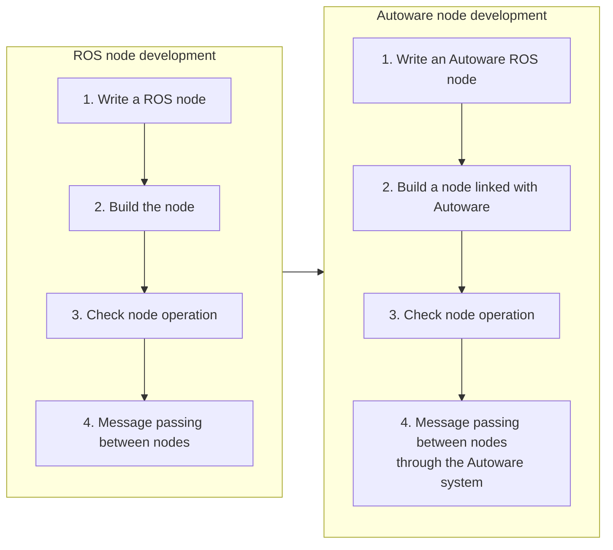
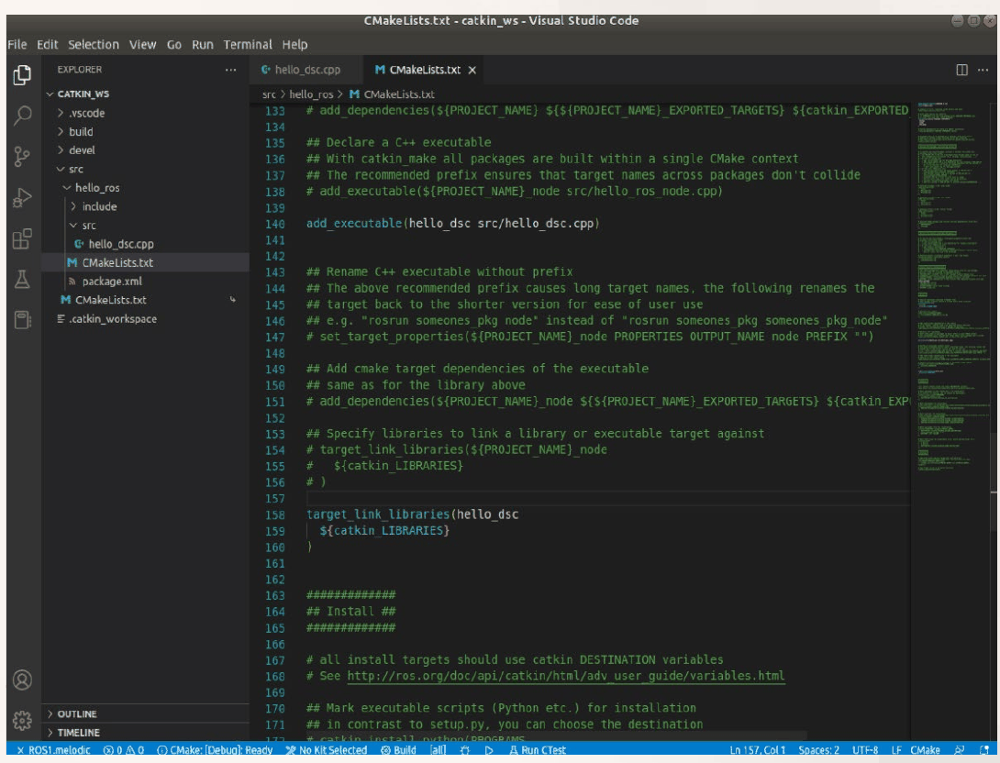
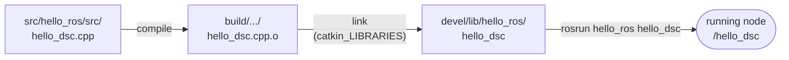
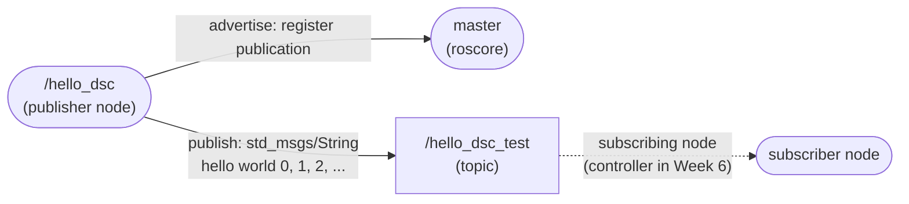

# Week 5 Lecture — ROS Autoware Node Development

[Repository Guide](../../README.md) | [English](Concepts_Lecture.md) | [한국어](Concepts_Lecture.ko.md)

> **Last Updated:** 2026-11-04

> **Learning Objectives:**
> 1. Explain the procedure for installing Qt 5.12.12, fetching the Autoware.ai 1.14.0 sources, building them with colcon, and running them, together with the role of each command
> 2. Create a catkin workspace and explain the roles of the source space, the build space, the devel space, and `setup.bash`
> 3. Create a package with `catkin_create_pkg` and explain the dependency tags of `package.xml` and what `add_executable` and `target_link_libraries` in `CMakeLists.txt` do
> 4. Explain what each line of the `hello_dsc` node does (headers, `ros::init`, `ros::NodeHandle`, `ros::ok`, the message, `ROS_INFO`, `usleep`)
> 5. Write a node that publishes a topic with `advertise` and `publish`, and build and run it with `catkin_make`, `roscore`, and `rosrun`
> 6. Explain the cause of the link error that occurs when an empty source file is built, and the difference between setting the loop period with `usleep` and with `ros::Rate`

---

## Table of Contents

- [1. Installing and Building Qt and Autoware.ai](#1-installing-and-building-qt-and-autowareai)
  - [1.1 Installation Order and Prerequisites](#11-installation-order-and-prerequisites)
  - [1.2 Summary of the Installation Procedure](#12-summary-of-the-installation-procedure)
- [2. The Order of ROS Node Development](#2-the-order-of-ros-node-development)
- [3. The catkin Workspace and Packages](#3-the-catkin-workspace-and-packages)
  - [3.1 Creating a Workspace](#31-creating-a-workspace)
  - [3.2 The Spaces of a Workspace and Environment Setup](#32-the-spaces-of-a-workspace-and-environment-setup)
  - [3.3 Creating a Package](#33-creating-a-package)
  - [3.4 package.xml](#34-packagexml)
  - [3.5 CMakeLists.txt](#35-cmakeliststxt)
  - [3.6 Opening the Workspace in VS Code](#36-opening-the-workspace-in-vs-code)
- [4. Writing and Running the hello_dsc Node](#4-writing-and-running-the-hello_dsc-node)
  - [4.1 An Empty Source File and the First Build Error](#41-an-empty-source-file-and-the-first-build-error)
  - [4.2 Entering the Code and Building](#42-entering-the-code-and-building)
  - [4.3 Running the Node](#43-running-the-node)
- [5. Analysis of the hello_dsc Code](#5-analysis-of-the-hello_dsc-code)
  - [5.1 Header Files](#51-header-files)
  - [5.2 The main Function and Command-Line Arguments](#52-the-main-function-and-command-line-arguments)
  - [5.3 Node Initialization: ros::init](#53-node-initialization-rosinit)
  - [5.4 The Node Handle: ros::NodeHandle](#54-the-node-handle-rosnodehandle)
  - [5.5 The Loop Condition: ros::ok](#55-the-loop-condition-rosok)
  - [5.6 Declaring the Message and Filling in Data](#56-declaring-the-message-and-filling-in-data)
  - [5.7 Screen Output: ROS_INFO](#57-screen-output-ros_info)
  - [5.8 Waiting: usleep](#58-waiting-usleep)
- [6. hello_dsc Completed as a Publisher](#6-hello_dsc-completed-as-a-publisher)
  - [6.1 Complete Code](#61-complete-code)
  - [6.2 Meaning of the Added Lines](#62-meaning-of-the-added-lines)
  - [6.3 Checking the Publication](#63-checking-the-publication)
  - [6.4 Loop Period and ros::Rate](#64-loop-period-and-rosrate)
- [Concept Applications](#concept-applications)
- [Summary](#summary)
- [Self-Check Questions](#self-check-questions)
- [References](#references)

---

<br>

## 1. Installing and Building Qt and Autoware.ai

### 1.1 Installation Order and Prerequisites

Autoware.ai is open-source autonomous driving software that runs on top of ROS 1 (Week 2), and version 1.14.0, which this course uses, is built directly from its downloaded source code on Ubuntu 18.04 with ROS Melodic. The installation proceeds in the following order, and the detailed commands and explanations of each step are in the places listed in the table.

| Step | Content | Covered in |
|:-----|:-----|:-----|
| 1 | Checking the Linux (Ubuntu 18.04) installation | Week 3 |
| 2 | Checking the ROS Melodic installation | Week 4 |
| 3 | Testing ROS with turtlesim | Weeks 1 and 4 |
| 4 | Installing ROS with an installation script | Week 4 |
| 5 | Installing Qt | Week 4, Section 6.2 |
| 6 | Installing Autoware | Week 4, Sections 6.3-6.4 |
| 7 | Running Autoware | Week 4, Section 6.5 |

*Table 1. Installation order up to using Autoware.ai*

The Autoware.ai source build documentation requires ROS Melodic and Qt 5.9.5 or later on Ubuntu 18.04, and optionally CUDA 10.0 for GPU acceleration [1]. Qt is needed because Autoware.ai contains packages, such as RViz plugins, that draw their screens with the Qt library, and this course installs Qt 5.12.12, a long-term support (LTS) release, separately.

> **Definition:** **Qt** is a cross-platform framework for building graphical user interface (GUI) programs in C++. ROS's RViz and rqt are also built with Qt. **qmake** is a tool that generates build files for Qt projects, and **Qt Creator** is the integrated development environment (IDE) for Qt development.

### 1.2 Summary of the Installation Procedure

All installation commands, the meaning of each command, and the common build problems with their solutions are given in Week 4, Sections 6.2-6.5. The flow to know before node development is as follows.

1. **Installing Qt 5.12.12:** Give the offline installer `qt-opensource-linux-x64-5.12.12.run` execute permission with `chmod +x` and run it, leaving the installation folder at its default, `Qt5.12.12` under the home folder. Among the components, the desktop 64-bit GCC build (`gcc_64`) and Qt Creator must be installed so that the paths of the next step actually exist.
2. **Registering the Qt path:** Write `export PATH=$HOME/Qt5.12.12/5.12.12/gcc_64/bin:$HOME/Qt5.12.12/Tools/QtCreator/bin:$PATH` as a single line at the end of `.bashrc`, apply it to the current terminal with `source ~/.bashrc`, and check with `qmake -version` that Qt 5.12.12 is used. Because the Qt `bin` folders are placed at the front of `PATH`, the newly installed Qt is found before the system Qt 5.9.5 installed together with ROS.
3. **Fetching the sources:** Install build tools such as colcon, vcstool, and rosdep, create the workspace `autoware.ai` and its `src` folder, download the repository list file `autoware.ai.repos` of version 1.14.0, and fetch all repositories in the list under `src` with `vcs import src < autoware.ai.repos`.
4. **Installing dependencies and building:** Install the system dependencies that the packages in `src` declare in their `package.xml` with `rosdep install -y --from-paths src --ignore-src --rosdistro $ROS_DISTRO`, and build the packages in dependency order with `colcon build --cmake-args -DCMAKE_BUILD_TYPE=Release`. Because `rosdep install` works by reading the `package.xml` files fetched into `src`, the sources must be fetched first.
5. **Running:** Add the built packages to the ROS environment of the current terminal with `source install/setup.bash`, and then start the Runtime Manager, the Autoware GUI (Week 2), with `roslaunch runtime_manager runtime_manager.launch`. `roslaunch` starts the master first if it is not running.

> **Note:** The Autoware.ai packages are catkin packages, but colcon is used as the build tool instead of `catkin_make`. `catkin_make` (Section 3) builds the whole workspace as one CMake project and places the results in the `devel` folder, whereas colcon builds each package separately and collects the results in the `install` folder. This is why `install/setup.bash` is sourced when running Autoware.

> **Key Point:** Installing Autoware.ai 1.14.0 consists of registering the Qt path, installing the tools, fetching the sources with `vcs import`, installing the dependencies with `rosdep install`, building with `colcon build`, and sourcing `install/setup.bash` before running with `roslaunch`. `export` and `source`, which change environment variables, apply only to their terminal, so settings needed every time are written in `.bashrc`.

---

<br>

## 2. The Order of ROS Node Development

Weeks 5 to 7 cover developing ROS nodes that can be used in Autoware. Development first practices writing, building, checking, and message passing with ordinary ROS nodes, and then applies the same order to nodes that work with Autoware.



*Figure 1. Development order from ROS nodes to Autoware nodes*

This note covers steps 1-3 on the left, that is, writing a node, building it, and checking its operation. Message passing in step 4 and its applications are covered in Weeks 6 and 7, and nodes that work with Autoware are covered in Week 14. Autoware nodes are also ROS nodes, so the structure of workspaces, packages, and nodes learned here applies to them unchanged.

---

<br>

## 3. The catkin Workspace and Packages

### 3.1 Creating a Workspace

A **workspace** is a folder in which ROS packages (nodes) are placed and built. By convention, it is created under the home folder with the name `catkin_ws`. A new workspace is created with the following commands.

```bash
mkdir -p ~/catkin_ws/src
cd ~/catkin_ws/src
catkin_init_workspace
cd ~/catkin_ws
catkin_make
source ~/catkin_ws/devel/setup.bash
echo "source ~/catkin_ws/devel/setup.bash" >> ~/.bashrc
```

- **`mkdir -p ~/catkin_ws/src`:** Creates the workspace and its source folder `src`. `~` denotes the home folder.
- **`catkin_init_workspace`:** Creates `CMakeLists.txt` inside the `src` folder. This file is a symbolic link to the top-level CMake script provided by catkin (`/opt/ros/melodic/share/catkin/cmake/toplevel.cmake`) and serves to bundle all packages under `src` into one CMake project.
- **`catkin_make`:** Builds the workspace. Internally it generates build files with CMake and then runs `make`, which creates the `build` and `devel` folders. It is run even before any package exists, to create the basic structure of the workspace and its environment setup scripts.
- **`source ~/catkin_ws/devel/setup.bash`:** Registers this workspace in the ROS environment of the current terminal (temporary registration). It disappears when the terminal is closed.
- **`echo "..." >> ~/.bashrc`:** Appends the same `source` command to the end of `.bashrc` (permanent registration). `>>` is the redirection that appends to the end of a file; using `>` instead erases the existing contents of `.bashrc`, so care is needed.

> **Note:** `catkin_make` must be run in the top-level folder of the workspace (`~/catkin_ws`). Running it inside the `src` folder mistakes that folder for the workspace and produces an error, so the commands above move with `cd ~/catkin_ws` before `catkin_make`. Also, `catkin_make` creates `src/CMakeLists.txt` automatically if it is missing, so `catkin_init_workspace` may be omitted [2].

### 3.2 The Spaces of a Workspace and Environment Setup

A catkin workspace consists of folders with different roles, called **spaces** [2]. When `catkin_make` runs, the path of each space is printed first.

| Space | Folder | Contents |
|:-----|:-----|:-----|
| Source space | `src` | Source code of the packages. This is the only place the developer writes and modifies directly |
| Build space | `build` | Intermediate files produced by CMake and `make` (object files, Makefiles, and so on) |
| Devel space | `devel` | Built executables and libraries, and the environment setup script `setup.bash`. Results can be run right away without installation |
| Install space | `install` | Created only when `catkin_make install` is run, and holds results installed for distribution |

*Table 2. Spaces that make up a catkin workspace*

Sourcing `devel/setup.bash` adds the packages of this workspace to environment variables such as `ROS_PACKAGE_PATH`, so `rosrun` and `roslaunch` can find them. The script also loads the environment of the ROS installation the workspace was built against (`/opt/ros/melodic`), and if the workspace contains a package with the same name, the one in the workspace takes precedence. This arrangement, in which a workspace is laid over an existing environment, is called an **overlay** [2].

### 3.3 Creating a Package

A **package** is the basic unit of ROS software that bundles nodes, libraries, message definitions, and configuration files, and it is placed under the `src` folder of the workspace. One package can contain several nodes. Move to the `src` folder and create a package with `catkin_create_pkg`.

```bash
cd ~/catkin_ws/src
catkin_create_pkg hello_ros std_msgs roscpp rospy
```

The command has the form `catkin_create_pkg <package name> <dependency 1> <dependency 2> ...`. After the package name `hello_ros`, the packages this package will use are listed.

- **`std_msgs`:** A package that defines basic message types such as strings (`String`), integers (`Int16`, `Int32`), and floating-point numbers (`Float64`).
- **`roscpp`:** The ROS client library for writing nodes in C++.
- **`rospy`:** The ROS client library for writing nodes in Python.

Running it prints the following.

```text
Created file hello_ros/package.xml
Created file hello_ros/CMakeLists.txt
Created folder hello_ros/include/hello_ros
Created folder hello_ros/src
Successfully created files in /home/mobility/catkin_ws/src/hello_ros. Please adjust the values in package.xml.
```

`catkin_create_pkg` creates the package folder `hello_ros`, the two configuration files inside it (`package.xml`, `CMakeLists.txt`), the `include/hello_ros` folder for header files, and the `src` folder for source files. The structure of the workspace at this point is as follows.

```text
catkin_ws/                      workspace
├── .catkin_workspace           workspace marker file created by catkin_make
├── build/                      build space
├── devel/                      devel space (setup.bash)
└── src/                        source space
    ├── CMakeLists.txt          link to catkin's toplevel.cmake
    └── hello_ros/              package
        ├── CMakeLists.txt      build rules of the package
        ├── package.xml         information and dependencies of the package
        ├── include/hello_ros/  header files
        └── src/                source files (.cpp of the nodes)
```

*Figure 2. Structure of the catkin workspace after creating the hello_ros package*

The `src` of the workspace (the source space) and the `src` inside the package (the folder for the package's source files) have the same name but are different folders. Source files of nodes are created in the `src` inside the package, that is, in `~/catkin_ws/src/hello_ros/src/`.

### 3.4 package.xml

`package.xml` is the **manifest** that records the package's name, version, description, maintainer, license, and dependencies. Build tools use the dependencies in this file to decide the order in which packages are built, and rosdep uses this file to find the system packages to install. With the explanatory comments removed, the essential content of the file created by `catkin_create_pkg` is as follows.

```xml
<?xml version="1.0"?>
<package format="2">
  <name>hello_ros</name>
  <version>0.0.0</version>
  <description>The hello_ros package</description>
  <maintainer email="mobility@todo.todo">mobility</maintainer>
  <license>TODO</license>

  <buildtool_depend>catkin</buildtool_depend>
  <build_depend>roscpp</build_depend>
  <build_depend>rospy</build_depend>
  <build_depend>std_msgs</build_depend>
  <build_export_depend>roscpp</build_export_depend>
  <build_export_depend>rospy</build_export_depend>
  <build_export_depend>std_msgs</build_export_depend>
  <exec_depend>roscpp</exec_depend>
  <exec_depend>rospy</exec_depend>
  <exec_depend>std_msgs</exec_depend>

  <export>
  </export>
</package>
```

`format="2"` means that manifest format 2 is used, and the dependency tags mean the following [3].

| Tag | Meaning |
|:-----|:-----|
| `<buildtool_depend>` | A build tool that runs during the build. A catkin package lists `catkin` |
| `<build_depend>` | A package needed to compile this package (headers, libraries) |
| `<build_export_depend>` | A package that is also needed when other packages that use this package are built. Used when a header of this package includes a header of another package |
| `<exec_depend>` | A package needed to run this package (shared libraries, executables, Python modules, and so on) |
| `<depend>` | Shorthand that lists `build_depend`, `build_export_depend`, and `exec_depend` above at once |

*Table 3. Dependency tags of package.xml format 2*

The last line of the output, "Please adjust the values in package.xml.", asks the user to correct the automatically filled values. The maintainer name and e-mail address (`mobility` is taken from the Linux user name and `todo.todo` is a placeholder), the license `TODO`, and the description are corrected to real values when the package is published. When a dependency is added later, this file and `find_package` in Section 3.5 are modified together.

### 3.5 CMakeLists.txt

`CMakeLists.txt` is the CMake build script that states from what and how the package is built. The file created by `catkin_create_pkg` consists mostly of examples written as comments (`#`); removing the comments and adding the two commands for the node `hello_dsc` gives the following. The minimum CMake version on the first line may differ depending on the version of the installed catkin tools.

```cmake
cmake_minimum_required(VERSION 3.0.2)
project(hello_ros)

find_package(catkin REQUIRED COMPONENTS
  roscpp
  rospy
  std_msgs
)

catkin_package()

include_directories(
  ${catkin_INCLUDE_DIRS}
)

# Name of the executable to build: hello_dsc
add_executable(hello_dsc src/hello_dsc.cpp)

# Link the libraries to the executable
target_link_libraries(hello_dsc
  ${catkin_LIBRARIES}
)
```

| Command | What it does |
|:-----|:-----|
| `cmake_minimum_required(VERSION ...)` | Sets the minimum CMake version needed to process this script |
| `project(hello_ros)` | Sets the project name. In a catkin package it must equal the package name, and it can be reused as `${PROJECT_NAME}` |
| `find_package(catkin REQUIRED COMPONENTS ...)` | Finds catkin and the dependency packages and collects their header paths in `catkin_INCLUDE_DIRS` and their libraries in `catkin_LIBRARIES`. `REQUIRED` means stopping with an error if they are not found |
| `catkin_package()` | Declares this package as a catkin package and exports the information other packages need to use it. Empty arguments mean that there are no headers or libraries to export |
| `include_directories(${catkin_INCLUDE_DIRS})` | Adds the paths in which headers such as `ros/ros.h` and `std_msgs/String.h` are searched during compilation |
| `add_executable(hello_dsc src/hello_dsc.cpp)` | Compiles the source file `src/hello_dsc.cpp` to build the executable `hello_dsc`. The first argument is the name of the executable (the build target) |
| `target_link_libraries(hello_dsc ${catkin_LIBRARIES})` | Links libraries such as roscpp to the executable `hello_dsc`. The first argument must match the target name of `add_executable` |

*Table 4. Main commands of a package CMakeLists.txt*

The order of the commands also follows rules. `catkin_package()` must be called before build targets are declared with `add_executable` or `add_library` [4], and `target_link_libraries` must come after the `add_executable` that created its target. In the generated file, this order is kept by placing `add_executable` below the comment `## Declare a C++ executable` and `target_link_libraries` below the comment `## Specify libraries to link a library or executable target against`.



*Figure 3. add_executable and target_link_libraries added to CMakeLists.txt in VS Code*

In Figure 3, `add_executable(hello_dsc src/hello_dsc.cpp)` has been added on line 140 and `target_link_libraries(hello_dsc ${catkin_LIBRARIES})` on lines 158-160. The remaining lines are comments beginning with `#`, so they do not affect the build. Each time another node is created, these two commands are added once per node (Week 6).

> **[Computer Programming]** A C++ program is built by **compiling** each source file into an object file (`.o`) and then **linking** the object files and libraries into an executable. `add_executable` decides what is compiled into which executable, and `target_link_libraries` decides which libraries are attached at link time. The declarations of functions such as `ros::init` are in the headers, but their implementations are in the roscpp library, so leaving out the link step causes "undefined reference" errors.

### 3.6 Opening the Workspace in VS Code

The source code is edited with Visual Studio Code (installed in Week 4). Choosing the `catkin_ws` folder in `File > Open Folder` shows the structure of Figure 2 in the Explorer on the left, so the package structure can be checked at a glance and files can be created. Besides the items in Figure 2, the Explorer also shows the `.vscode` folder in which VS Code stores its settings. Installing Microsoft's ROS extension makes VS Code recognize the ROS environment and helps with header path settings and build commands.

---

<br>

## 4. Writing and Running the hello_dsc Node

### 4.1 An Empty Source File and the First Build Error

In the VS Code Explorer, create a new file `hello_dsc.cpp` in the `hello_ros > src` folder. Leave it empty for now, add `add_executable` and `target_link_libraries` to `CMakeLists.txt` as in Section 3.5, save, and run `catkin_make` in the top-level folder of the workspace. The build then fails as follows (the beginning is shortened).

```text
-- catkin 0.7.29
-- ~~  traversing 1 packages in topological order:
-- ~~  - hello_ros
-- +++ processing catkin package: 'hello_ros'
-- ==> add_subdirectory(hello_ros)
-- Configuring done
-- Generating done
-- Build files have been written to: /home/mobility/catkin_ws/build
#### Running command: "make -j8 -l8" in "/home/mobility/catkin_ws/build"
Scanning dependencies of target hello_dsc
[ 50%] Building CXX object hello_ros/CMakeFiles/hello_dsc.dir/src/hello_dsc.cpp.o
[100%] Linking CXX executable /home/mobility/catkin_ws/devel/lib/hello_ros/hello_dsc
/usr/lib/gcc/x86_64-linux-gnu/7/../../../x86_64-linux-gnu/Scrt1.o: In function `_start':
(.text+0x20): undefined reference to `main'
collect2: error: ld returned 1 exit status
make[2]: *** [/home/mobility/catkin_ws/devel/lib/hello_ros/hello_dsc] Error 1
make: *** [all] Error 2
Invoking "make -j8 -l8" failed
```

The output divides into two main stages.

1. **CMake configuration stage (lines beginning with `--`):** catkin 0.7.29 finds the packages under `src` and arranges them in an order consistent with their dependencies (topological order). There is only one package, `hello_ros`, so only it is processed, and the build files are written to the `build` folder.
2. **make build stage:** `make -j8 -l8` runs (eight jobs at the same time, postponing new jobs while the system load exceeds 8). Compiling the empty `hello_dsc.cpp` (`Building CXX object`, 50%) succeeds, but linking, which produces the executable (`Linking CXX executable`, 100%), fails.

The cause of the error is that `hello_dsc.cpp` has no `main` function. An empty file is still valid C++ source, so it compiles, but an executable needs a point at which the program starts. The linker (`ld`; `collect2` is the step in which GCC calls the linker) cannot find the `main` called by `_start` in `Scrt1.o`, the startup code of the C runtime environment, and reports "undefined reference to `main'". When the build fails, the last line prints `Invoking "make -j8 -l8" failed`.

> **[Systems Programming]** The real starting point of a C or C++ program is not `main` but `_start` in the startup code of the C runtime (`crt1.o`, or `Scrt1.o` for a position-independent executable). `_start` prepares the stack and arguments, calls `main` through the initialization function of the C library, and uses the value returned by `main` as the exit status of the program. This is why a missing `main` causes an error at link time rather than at compile time.

### 4.2 Entering the Code and Building

Enter the following code into `hello_dsc.cpp`. The code at this stage keeps the topic publishing part disabled with comments (`//`) and only builds a string and prints it on the screen. The commented-out lines are restored in Section 6 to complete the publisher.

```cpp
#include "ros/ros.h"
#include "std_msgs/String.h"
#include <sstream>
#include <unistd.h>

int main(int argc, char **argv)
{
    ros::init(argc, argv, "hello_dsc");

    ros::NodeHandle n;
    // ros::Publisher hello_dsc_pub = n.advertise<std_msgs::String>("hello_dsc_test", 1000);

    // int count = 0;

    while (ros::ok())
    {
        std_msgs::String msg;

        std::stringstream ss;
        ss << "hello world ";
        // ss << "hello world " << count;
        msg.data = ss.str();

        ROS_INFO("%s", msg.data.c_str());
        // hello_dsc_pub.publish(msg);

        // count++;

        usleep(1000);
    }

    return 0;
}
```

Running `catkin_make` again, the build now succeeds.

```text
mobility@mobility-VirtualBox:~$ cd catkin_ws/
mobility@mobility-VirtualBox:~/catkin_ws$ catkin_make
Base path: /home/mobility/catkin_ws
Source space: /home/mobility/catkin_ws/src
Build space: /home/mobility/catkin_ws/build
Devel space: /home/mobility/catkin_ws/devel
Install space: /home/mobility/catkin_ws/install
####
#### Running command: "make cmake_check_build_system" in "/home/mobility/catkin_ws/build"
####
####
#### Running command: "make -j8 -l8" in "/home/mobility/catkin_ws/build"
####
[100%] Built target hello_dsc
```

The first five lines are the paths of the spaces of Section 3.2. `make cmake_check_build_system` is the step that checks whether `CMakeLists.txt` has changed and reconfigures CMake if necessary, and the last line, `[100%] Built target hello_dsc`, means that the executable has been built. The executable is created at `devel/lib/hello_ros/hello_dsc` in the devel space.



*Figure 4. Build and run flow from a source file to a running node*

### 4.3 Running the Node

To run a node, the master must already be running. Open two terminals and run the following commands, one in each.

```bash
roscore                        # Terminal 1: start the master
rosrun hello_ros hello_dsc     # Terminal 2: run the executable hello_dsc of the package hello_ros
```

`rosrun <package> <executable>` finds an executable in a package registered in the ROS environment and runs it. There is no need to know which folder the package is in; this is why `devel/setup.bash` was sourced in Section 3.1. Terminal 2 keeps printing output such as the following.

```text
[ INFO] [1676635354.650260414]: hello world
[ INFO] [1676635354.652026319]: hello world
[ INFO] [1676635354.653962375]: hello world
[ INFO] [1676635354.655943763]: hello world
[ INFO] [1676635354.657814676]: hello world
[ INFO] [1676635354.660837478]: hello world
```

Each line consists of the severity of the message (`INFO`), the time of output, and the message content. The time is the number of seconds elapsed since 00:00 on January 1, 1970 (UTC), known as Unix time, given down to nanoseconds. To stop the node, press `Ctrl + C` in terminal 2.

The time difference between two consecutive lines is about 1.8-3 ms, for example $0.652026319 - 0.650260414 \approx 0.00177$ s and then $0.653962375 - 0.652026319 \approx 0.00194$ s. The code rests for 1 ms (`usleep(1000)`) each time, but the time to build the string and print it to the terminal is added, so one iteration takes longer than 1 ms. A way to keep the loop period accurate is covered in Section 6.4.

> **Caution:** If a node is run without running `roscore`, the node cannot register with the master, prints a message saying that it cannot connect to the master, and keeps retrying the connection. If `roscore` is started at that point, the node completes its registration and begins to operate.

---

<br>

## 5. Analysis of the hello_dsc Code

This section explains the code of Section 4.2 part by part from the top.

### 5.1 Header Files

```cpp
#include "ros/ros.h"
#include "std_msgs/String.h"
#include <sstream>
#include <unistd.h>
```

- **`#include "ros/ros.h"`:** Includes at once the basic headers needed to use roscpp. `ros::init`, `ros::NodeHandle`, `ros::Publisher`, `ros::Subscriber`, `ros::Rate`, `ROS_INFO`, and others are all declared through this header.
- **`#include "std_msgs/String.h"`:** The header that makes the message type `std_msgs/String` usable as the C++ struct `std_msgs::String`. This header was generated automatically from the message definition file `String.msg` (whose content is the single line `string data`).
- **`#include <sstream>`:** The C++ standard library header for the string stream `std::stringstream`.
- **`#include <unistd.h>`:** The POSIX header that declares `usleep`, which sets the loop period (Section 5.8).

> **[Computer Programming]** `#include "..."` first searches the folder of the current file and the paths specified by the build system (`include_directories`), while `#include <...>` searches the standard header paths of the compiler and the system. The ROS headers are under `/opt/ros/melodic/include`, and `include_directories(${catkin_INCLUDE_DIRS})` in CMake tells the compiler this path.

### 5.2 The main Function and Command-Line Arguments

```cpp
int main(int argc, char **argv)
{
    ......
}
```

`main` is the starting point of the program, and here the form with parameters is used. `argc` (argument count) is the number of command-line arguments, and `argv` (argument vector) is an array holding each argument as a C string. `argv[0]` is the path of the program that was run. ROS nodes use this form so that the ROS-specific arguments given on the command line can be passed to `ros::init` in the next section. For example, running the node as follows changes the node name and the topic name without modifying the code.

```bash
rosrun hello_ros hello_dsc __name:=hello2                 # changes the node name to /hello2
rosrun hello_ros hello_dsc hello_dsc_test:=my_topic       # changes the topic hello_dsc_test to my_topic (Section 6)
```

Changing a name with an argument of the form `name:=new_name` in this way is called **remapping**.

### 5.3 Node Initialization: ros::init

```cpp
ros::init(argc, argv, "hello_dsc");
```

`ros::init` initializes ROS and sets the name of this node. It must be called before any other ROS feature is used [5].

- **`argc`, `argv`:** Passing the command-line arguments lets it process the remapping arguments of Section 5.2. `ros::init` removes the ROS arguments it processed from `argv`, so the code after it sees only ordinary arguments.
- **`"hello_dsc"`:** The node name. It must be a base name without a namespace (it cannot contain `/`), and once running, the node is registered with the master as `/hello_dsc`. A node name must be unique within the ROS system, so if a new node with the same name starts, the node that was already running is shut down.

The node name (the third argument of `ros::init`) and the executable name (the first argument of `add_executable`) are both `hello_dsc` in this example, but they are different concepts. `rosrun` finds the program by the executable name, while tools such as rqt display the node name.

### 5.4 The Node Handle: ros::NodeHandle

```cpp
ros::NodeHandle n;
```

The **node handle** is the main access point through which a node communicates with the ROS system. Creating publishers and subscribers and reading parameters are all done through the node handle. The first node handle created fully starts the node (registering it with the master and so on), and the node shuts down when the last node handle is destroyed [5]. This line is therefore the "declaration of the handle for using the ROS system", and the waiting of the node when there is no master, as in the caution box of Section 4.3, is also due to this startup process.

### 5.5 The Loop Condition: ros::ok

```cpp
while (ros::ok())
{
    ......
}
```

`ros::ok()` returns whether the node may keep running, and becomes `false` when one of the following happens [6].

- A SIGINT signal was received because `Ctrl + C` was pressed in the terminal.
- Another node with the same name started, and this node was kicked off the network.
- `ros::shutdown()` was called by another part of the program.
- All `ros::NodeHandle` objects have been destroyed.

This `while` loop therefore keeps running until something shuts the node down, and when a shutdown request arrives it leaves the loop and ends the program normally with `return 0;`. Being able to stop the node with `Ctrl + C` is also due to this condition.

> **Note:** `ros::ok()` does not check whether `roscore` is running. Even if `roscore` is stopped while the node is running, `ros::ok()` stays `true` and the loop continues. Nodes that are already connected keep communicating directly without the master (TCPROS in Week 1), but a newly started node cannot find the master and does not get connected. Understanding this loop as "repeating while roscore is running" is therefore not accurate.

### 5.6 Declaring the Message and Filling in Data

```cpp
std_msgs::String msg;

std::stringstream ss;
ss << "hello world ";
msg.data = ss.str();
```

- **`std_msgs::String msg;`:** Creates a string message object. The field `string data` defined in `String.msg` becomes the member `data` of type `std::string` in C++, and it is initially an empty string.
- **`std::stringstream ss;`:** Creates a stream whose target is a string in memory. Writing values with `<<`, as when printing to `std::cout`, accumulates the content as a string.
- **`ss << "hello world ";`:** Writes the string `"hello world "` to the stream. Numbers can be appended the same way, so Section 6 appends the iteration count with `ss << "hello world " << count;`.
- **`msg.data = ss.str();`:** Takes the accumulated content of the stream out as a `std::string` (`str()`) and puts it into the `data` field of the message.

Because the message and the stream are declared inside the loop, new objects are created in every iteration and nothing from the previous iteration remains. If the stream were created only once outside the loop, the content written with `<<` would keep being appended and the string would grow longer and longer.

### 5.7 Screen Output: ROS_INFO

```cpp
ROS_INFO("%s", msg.data.c_str());
```

`ROS_INFO` is a macro provided by the ROS logging facility (rosconsole) and uses the same format string as C's `printf` [7]. `%s` is a placeholder for a C string, so `msg.data`, a `std::string`, is converted to a C string (`const char*`) with `c_str()` before being passed. A message printed by `ROS_INFO` is not only shown in the terminal in the format of Section 4.3 but also published to the log topic `/rosout`, so it can be collected and viewed in tools such as rqt.

| Macro | Severity | Use |
|:-----|:-----|:-----|
| `ROS_DEBUG` | Debug | Detailed information viewed only during development. Not printed with the default settings |
| `ROS_INFO` | Info | Information to report during normal operation |
| `ROS_WARN` | Warning | Operation continues, but the situation needs checking |
| `ROS_ERROR` | Error | Some function has failed |
| `ROS_FATAL` | Fatal | The node cannot continue to operate |

*Table 5. Logging macros and severities of rosconsole*

> **Caution:** Do not pass a `std::string` directly, as in `ROS_INFO("%s", msg.data)`. This passes a C++ class object to a variadic function, so depending on the compiler an error or a warning results, and even if it compiles, the behavior at run time is undefined.

### 5.8 Waiting: usleep

```cpp
usleep(1000);
```

`usleep(n)` suspends the calling thread for at least $n$ microseconds (µs) [8]. Since 1 ms is 1000 µs and 1 s is 1000000 µs, `usleep(1000)` rests for 1 ms and `usleep(1000000)` for 1 second. Without this line, the loop would run without rest, keep one CPU core busy, and flood the terminal with output.

`usleep` is a function of POSIX operating systems declared in the header `<unistd.h>`, so this header is included as in Section 5.1. Without that line the code may still build because the declaration arrives through other headers that `ros/ros.h` includes internally, but this relies on the implementation of the ROS headers, so including `<unistd.h>` directly is safer. Also, the actual suspension can be slightly longer than requested because of other activity in the system and the precision of timers [8].

> **Note:** POSIX.1-2001 marked `usleep` as a function that should no longer be used, and the POSIX.1-2008 specification removed it [8]. It is still available on Linux, but standard C++ code commonly uses `std::this_thread::sleep_for(std::chrono::milliseconds(1))`, and ROS nodes commonly use `ros::Rate` from Section 6.4.

---

<br>

## 6. hello_dsc Completed as a Publisher

### 6.1 Complete Code

Restoring the lines commented out in Section 4.2 completes a publisher node that publishes a string as a topic. This code is in [Example_hello_dsc.cpp](Example_hello_dsc.cpp).

```cpp
// Node 1

#include "ros/ros.h"
#include "std_msgs/String.h"
#include <sstream>
#include <unistd.h>

int main(int argc, char **argv)
{
    ros::init(argc, argv, "hello_dsc");

    // Declare the handle for using the ROS system
    ros::NodeHandle n;
    int count = 0;

    ros::Publisher hello_dsc_pub = n.advertise<std_msgs::String>("hello_dsc_test",1000);

    while (ros::ok())
    {
        // Declare the message
        std_msgs::String msg;

        std::stringstream ss;
        ss << "hello world " << count;

        // Put data into the message
        msg.data = ss.str();

        ROS_INFO("%s", msg.data.c_str());

        // Publish
        // The data can be obtained under the topic name hello_dsc_test
        hello_dsc_pub.publish(msg);

        count++;

        usleep(1000);
    }
    return 0;
}
```

### 6.2 Meaning of the Added Lines

Apart from the lines explained in Section 5, the following five places are new.

- **`int count = 0;`:** An integer variable that counts which message is being sent. It is initialized to 0 only once, outside the loop.
- **`ros::Publisher hello_dsc_pub = n.advertise<std_msgs::String>("hello_dsc_test",1000);`:** Tells the master that this node will publish messages of type `std_msgs/String` on the topic `hello_dsc_test` (the XMLRPC registration of Week 1) and receives a **publisher** object for sending messages on that topic. The master gives the publisher's address to nodes that want to subscribe to this topic, and the two nodes then connect directly and exchange messages [5].
  - **`<std_msgs::String>`:** The template argument sets the message type. Only messages of this type may be sent through this publisher.
  - **`"hello_dsc_test"`:** The topic name. A name that does not begin with `/` is resolved relative to the node's namespace, so it becomes `/hello_dsc_test` in this example.
  - **`1000`:** The size of the outgoing message queue. If messages are published faster than they can be sent, up to 1000 unsent messages are buffered, and when the queue overflows the oldest ones are discarded first [5].
- **`ss << "hello world " << count;`:** Appends the value of `count` to the string, making the content different for each message, as in `"hello world 0"`, `"hello world 1"`, ....
- **`hello_dsc_pub.publish(msg);`:** Publishes the message on the topic. At that moment the message is delivered to every node subscribed to this topic; if no node is subscribed, the message is delivered to no one and no error occurs. As the comment says, another node can receive this data by knowing only the topic name `hello_dsc_test`.
- **`count++;`:** Adds 1 for the next message.

There is also a reason to store the publisher object returned by `advertise` in a variable. When all copies of the publisher object are gone, the topic is automatically unadvertised [5], so the object must stay alive while publishing.



*Figure 5. Structure in which the hello_dsc node publishes messages on the topic hello_dsc_test*

### 6.3 Checking the Publication

Even before writing a subscribing node, the ROS command-line tools can check whether messages are being published. With `roscore` and `hello_dsc` running, open a third terminal and run the following.

```bash
rostopic list                    # shows the list of current topics (/hello_dsc_test should appear)
rostopic echo /hello_dsc_test    # receives and prints the messages of the topic
rostopic hz /hello_dsc_test      # measures how many times per second the topic is published
```

`rostopic echo` prints each received message as field names and values, as below, and separates messages with `---`. `rostopic` also runs as a node and subscribes to the topic, so this confirms that the messages are actually delivered to another node.

```text
data: "hello world 1523"
---
data: "hello world 1524"
---
```

### 6.4 Loop Period and ros::Rate

`usleep(1000)` rests an extra 1 ms after the loop body finishes, so one iteration takes "the time to run the body + at least 1 ms". If the body takes 0.8 ms, the period becomes about 1.8 ms and the node publishes about $1 / 0.0018 \approx 556$ times per second, and the period fluctuates whenever the time of the body changes. This is why the time differences in the output of Section 4.3 were 1.8-3 ms rather than 1 ms.

ROS provides `ros::Rate`, which helps keep a desired period. The official ROS example writes a publisher in the following form [5].

```cpp
ros::Rate loop_rate(10);          // aim at 10 Hz, that is, a period of 0.1 s

int count = 0;
while (ros::ok())
{
    std_msgs::String msg;
    std::stringstream ss;
    ss << "hello world " << count;
    msg.data = ss.str();

    ROS_INFO("%s", msg.data.c_str());
    chatter_pub.publish(msg);

    ros::spinOnce();              // processes arrived callbacks (Week 6)
    loop_rate.sleep();            // rests for the remaining time to keep the period
    ++count;
}
```

`ros::Rate loop_rate(10)` sets the target frequency to 10 Hz, and `loop_rate.sleep()` measures the time elapsed since `sleep()` was last called and rests only for 0.1 s minus that time [9]. If the body took 0.03 s, it rests for 0.07 s, so as long as the body runs for less than the period, the loop period is kept at 0.1 s. `ros::spinOnce()` is a function that processes the callback functions for messages that have arrived at this node and is covered in Week 6. It has nothing to do in a node that receives no messages, but by convention it is included so that callbacks run if a subscription is added later.

| Item | `usleep(n)` | `ros::Rate` |
|:-----|:-----|:-----|
| Value specified | Time to rest each time ($n$ µs) | Target frequency of the loop (Hz) |
| Time of one iteration | Body time + at least $n$ µs | The target period if the body time is shorter than the period |
| When the body time changes | The period changes too and errors accumulate | The rest time is shortened or lengthened to keep the period |
| Reference clock | Real time of the operating system | ROS time (also follows simulated time, such as during bag playback) |

*Table 6. Comparison of usleep and ros::Rate*

---

<br>

## Concept Applications

| Situation | Result and Reason |
|:-----|:------------|
| In a new terminal whose `.bashrc` does not contain `source ~/catkin_ws/devel/setup.bash`, `rosrun hello_ros hello_dsc` is run. | **An error says that the package `hello_ros` cannot be found.** The workspace is not registered in the ROS environment of that terminal, so `rosrun` cannot find the package. |
| `catkin_make` is run with neither `add_executable` nor `target_link_libraries` in `CMakeLists.txt`, and the node is then run with `rosrun`. | **The build succeeds, but the executable cannot be found.** No executable to build is declared, so `devel/lib/hello_ros/hello_dsc` is never created. |
| The first argument of `target_link_libraries` is mistyped as `hello_dcs`. | **An error occurs in the CMake configuration stage.** It tries to link libraries to a target that was not created by `add_executable`. |
| While `hello_dsc` is running, another copy is started with the same command in another terminal. | **The node started first shuts down.** When a new node with the same name (`/hello_dsc`) registers, the previous node is kicked off the network and `ros::ok()` becomes `false`. Changing the name with the `__name:=` remapping lets both run. |
| `usleep(1000)` is changed to `usleep(1000000)`. | **Output and publication happen about once per second.** 1000000 µs is 1 second, and the period becomes slightly longer than 1 second by the running time of the body. |
| `hello_dsc` is run without `roscore`, and `roscore` is started later. | **The node starts operating from that moment.** The node waits, retrying the connection, until it is registered with the master. |
| A publisher publishes about 500 times per second, but no node subscribes. | **It keeps running without errors.** The published messages simply have no recipient, and the outgoing queue does not fill because there is no connection to send to. |

*Table 7. Results and reasons for situations involving the workspace, builds, and running nodes*

**True/False Check:**

| Statement | Judgment and Reason |
|:-----|:------------|
| `catkin_make` may be run in any folder of the workspace. | **F.** It must be run in the top-level folder of the workspace; running it inside `src` produces an error. |
| A source file without `main` fails at the compile stage. | **F.** Compilation succeeds, and the build fails at the link stage because the `main` to be called by the startup code `_start` cannot be found. |
| The third argument of `ros::init` is the node name and may differ from the executable name. | **T.** `rosrun` finds the program by the executable name, and the node registers with the master under the name given to `ros::init`. |
| `ros::ok()` becomes `false` when `roscore` is stopped. | **F.** It becomes `false` on `Ctrl + C`, `ros::shutdown()`, a node with the same name, or the destruction of all node handles, and is unrelated to the state of the master. |
| The second argument of `advertise`, 1000, is the number of publications per second. | **F.** It is the size of the outgoing queue that buffers unsent messages. The publication frequency is set by the period of the loop. |
| With `usleep(1000)`, the loop runs exactly once every 1 ms. | **F.** The running time of the body is added and the wait can also be slightly longer, so the period is longer than 1 ms. |
| `<depend>` in `package.xml` is a notation that lists build, build export, and execution dependencies at once. | **T.** It is equivalent to listing `build_depend`, `build_export_depend`, and `exec_depend` all together. |
| Autoware.ai built with colcon is run after sourcing `devel/setup.bash`. | **F.** colcon collects the results in the `install` folder, so `install/setup.bash` is sourced. |

---

<br>

## Summary

| Concept | Key Summary |
|:--------|:------------|
| Installing Qt | The Qt 5.12.12 offline installer is given execute permission and run, and the `bin` paths of Qt are prepended to `PATH` in `.bashrc` so they take precedence over the system Qt. |
| Building Autoware.ai | The tools are installed, the repositories are fetched with `vcs import`, the system dependencies are installed with `rosdep install`, and the workspace is built with `colcon build` (Release). |
| Running Autoware.ai | After sourcing `install/setup.bash`, the Runtime Manager is brought up with `roslaunch runtime_manager runtime_manager.launch`. |
| Node development order | Writing, building, checking, and message passing are practiced with ROS nodes in this order, and the same order is applied to nodes linked with Autoware. |
| catkin workspace | It consists of the `src` (sources), `build` (intermediate files), and `devel` (executables and `setup.bash`) spaces and is built with `catkin_make` in the top-level folder. |
| Environment registration | `source devel/setup.bash` applies only to the current terminal, so it is appended to `.bashrc` for permanent registration. |
| Package | It is created with `catkin_create_pkg name dependencies...`, which produces `package.xml`, `CMakeLists.txt`, `include`, and `src`. |
| package.xml | The manifest that records package information and the dependencies `buildtool_depend`, `build_depend`, `build_export_depend`, and `exec_depend`. |
| CMakeLists.txt | It finds dependencies with `find_package`, declares executables with `add_executable`, and links `catkin_LIBRARIES` with `target_link_libraries`. |
| Link error | Without `main`, compilation succeeds but linking fails with "undefined reference to `main'". |
| ros::init | It is called before any other ROS feature to process command-line remappings and set the node name. |
| ros::NodeHandle | The node's access point to the ROS system; the first handle starts the node and the destruction of the last handle shuts it down. |
| ros::ok | It becomes `false` when `Ctrl + C`, `ros::shutdown()`, a node with the same name, or the destruction of all node handles occurs. |
| Message and stringstream | A string built with `std::stringstream` is put into the `data` field of `std_msgs::String`. |
| ROS_INFO | It prints the severity, time, and content in `printf` format and also publishes to `/rosout`. A `std::string` is passed with `c_str()`. |
| advertise and publish | `advertise<type>(topic, queue size)` registers a publication and returns a publisher, and `publish(msg)` sends the message to every subscribing node. |
| usleep and ros::Rate | `usleep` adds a fixed rest each time, so the period grows by the body time, while `ros::Rate` rests only for the remaining time and keeps the target period. |

---

<br>

## Self-Check Questions

1. **Qt path:** After writing `export PATH=/home/username/Qt5.12.12/5.12.12/gcc_64/bin/:$PATH` in `.bashrc`, `qmake -version` was run immediately in the same terminal, and Qt 5.9.5 was shown. Give the cause and the fix.

   <details>
   <summary>Answer</summary>

   `.bashrc` runs when a new terminal is opened, so the changed `PATH` was not applied to the terminal that was already open. As a result, the system qmake (Qt 5.9.5) installed with ROS was used. Applying the setting to the current terminal with `source ~/.bashrc`, or opening a new terminal, makes the shell find the qmake of Qt 5.12.12 first, because its path is at the front of `PATH`.

   </details>

2. **Autoware.ai build commands:** Explain what `vcs import src < autoware.ai.repos` and `rosdep install -y --from-paths src --ignore-src --rosdistro $ROS_DISTRO` each do, and why the order of the two commands cannot be swapped.

   <details>
   <summary>Answer</summary>

   `vcs import` downloads the repositories listed in the list file under `src` at the specified versions. `rosdep install` reads the `package.xml` of the packages under `src` and installs the system packages, among the dependencies not present as sources in the workspace, that are not yet installed. `rosdep install` works from the `package.xml` files in `src`, so if the sources are not fetched first, there are no packages to read and the necessary dependencies cannot be installed.

   </details>

3. **Spaces of a workspace:** State what the `src`, `build`, and `devel` folders of a catkin workspace each contain, and identify which folder the developer edits directly.

   <details>
   <summary>Answer</summary>

   `src` (the source space) contains the source code and configuration files of the packages, `build` (the build space) contains intermediate files produced by CMake and `make` such as Makefiles and object files, and `devel` (the devel space) contains the built executables and libraries and the environment setup script `setup.bash`. Only `src` is edited directly by the developer; `build` and `devel` are produced by `catkin_make`, so they reappear after rebuilding even if deleted.

   </details>

4. **Modifying CMakeLists.txt:** A second node `listener_dsc` (source `src/listener_dsc.cpp`) is to be added to the same package. Write the commands to add to `CMakeLists.txt` and explain the meaning of each.

   <details>
   <summary>Answer</summary>

   ```cmake
   add_executable(listener_dsc src/listener_dsc.cpp)
   target_link_libraries(listener_dsc
     ${catkin_LIBRARIES}
   )
   ```

   `add_executable` declares that `src/listener_dsc.cpp` is compiled into the executable `listener_dsc`, and `target_link_libraries` declares that libraries such as roscpp found by `find_package` are linked to that executable. Both commands are placed after `catkin_package()`, with `add_executable` first. No dependency was added, so `find_package` and `package.xml` need no change.

   </details>

5. **Interpreting the build error:** Explain why, when the empty `hello_dsc.cpp` was built, the compile stage (`[ 50%] Building CXX object ...`) succeeded and the link stage reported "undefined reference to `main'".

   <details>
   <summary>Answer</summary>

   An empty file is still a syntactically valid C++ translation unit, so it compiles into an object file with no content. When building the executable, however, the linker must connect the `main` called by `_start` in the C runtime startup code (`Scrt1.o`), and no object file or library contains a definition of `main`. The error "undefined reference to `main'" therefore occurs at the link (`ld`) stage rather than at compilation, and the build stops with `collect2: error: ld returned 1 exit status`.

   </details>

6. **Conditions of ros::ok:** While `hello_dsc` is running, decide whether the loop ends in each case. (a) `Ctrl + C` is pressed in the terminal running `roscore`. (b) `Ctrl + C` is pressed in the terminal running `hello_dsc`. (c) `rosrun hello_ros hello_dsc` is run once more in another terminal.

   <details>
   <summary>Answer</summary>

   (a) It does not end. `ros::ok()` does not check the state of the master, so the loop and the output continue. (b) It ends. When the node receives SIGINT and goes through its shutdown procedure, `ros::ok()` becomes `false`, the loop exits, and the program ends with `return 0;`. (c) The loop of the node started first ends. When a new node with the same name `/hello_dsc` registers, the previous node is kicked off and shut down, and the newly started node runs under that name.

   </details>

7. **Tracing message content:** In the code of Section 6.1, give the `data` value of the third published message, and state how the third message changes if `std::stringstream ss;` is moved outside the `while` loop (below `int count = 0;`).

   <details>
   <summary>Answer</summary>

   `count` starts at 0 and increases by 1 after each publication, so the third message is `"hello world 2"`, built when `count` is 2. If the stream is moved outside the loop, its content is not cleared between iterations but keeps being appended, so the third message becomes `"hello world 0hello world 1hello world 2"`. The first is `"hello world 0"` and the second is `"hello world 0hello world 1"`.

   </details>

8. **Loop period:** Suppose the loop body always takes 0.4 ms to run. Find the number of publications per second (a) with `usleep(1000)` and (b) with `ros::Rate loop_rate(1000)` and `loop_rate.sleep()`. Ignore the effect of waits lasting longer than requested.

   <details>
   <summary>Answer</summary>

   (a) One iteration takes the body's 0.4 ms plus the 1 ms wait, 1.4 ms in total, so the node publishes $1 / 0.0014 \approx 714$ times per second. (b) `ros::Rate` rests only 0.6 ms, the target period of 1 ms minus the body time of 0.4 ms, so the period is 1 ms and the node publishes 1000 times per second. If the body time exceeds 1 ms, `ros::Rate` cannot keep the target period either.

   </details>

---

<br>

## References

1. Autoware Foundation, "Source Build," Autoware.ai documentation. https://github.com/autowarefoundation/autoware_ai_documentation/wiki/Source-Build
2. ROS Wiki, "catkin/workspaces." https://wiki.ros.org/catkin/workspaces
3. D. Thomas and J. O'Quin, "REP 140: Package Manifest Format Two Specification," ROS Enhancement Proposals, 2013. https://www.ros.org/reps/rep-0140.html
4. ROS Wiki, "catkin/CMakeLists.txt." https://wiki.ros.org/catkin/CMakeLists.txt
5. ROS Wiki, "Writing a Simple Publisher and Subscriber (C++)." https://wiki.ros.org/ROS/Tutorials/WritingPublisherSubscriber%28c%2B%2B%29
6. ROS Wiki, "roscpp/Overview/Initialization and Shutdown." https://wiki.ros.org/roscpp/Overview/Initialization%20and%20Shutdown
7. ROS Wiki, "rosconsole." https://wiki.ros.org/rosconsole
8. M. Kerrisk, "usleep(3)," Linux manual page. https://man7.org/linux/man-pages/man3/usleep.3.html
9. ROS Wiki, "roscpp/Overview/Time." https://wiki.ros.org/roscpp/Overview/Time
