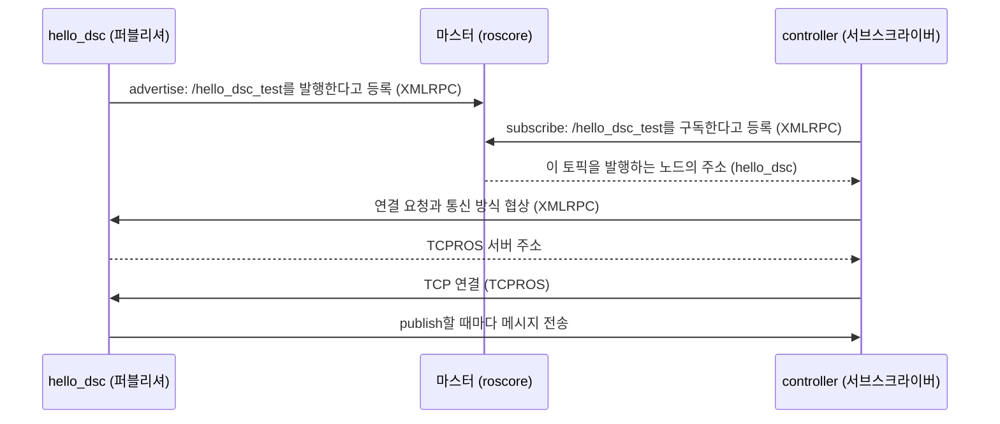
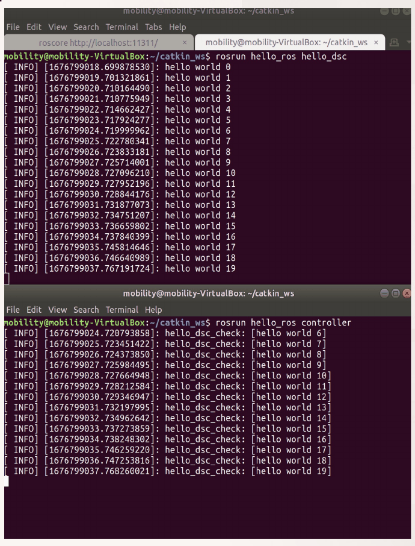
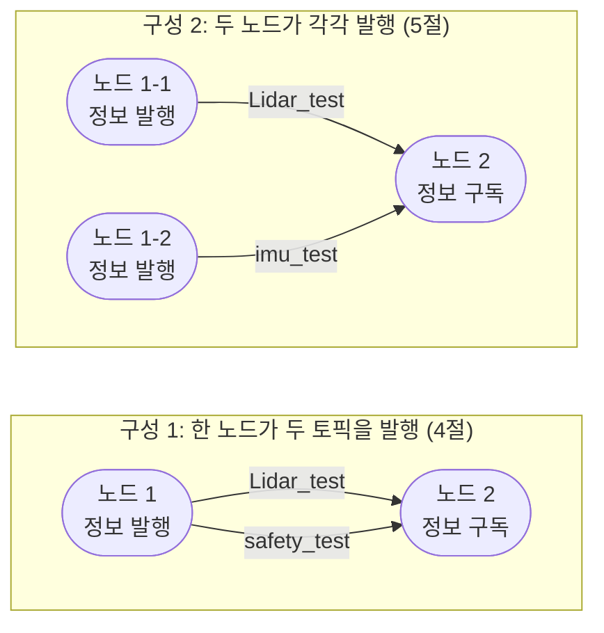
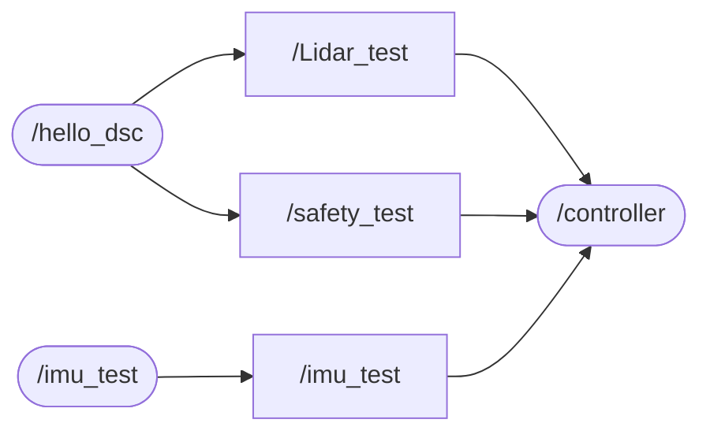

# 6주차 이론 — ROS 노드 간 메시지 송수신

[레포지토리 안내](../../README.ko.md) | [English](Concepts_Lecture.md) | [한국어](Concepts_Lecture.ko.md)

> **최종 수정일:** 2026-11-04

> **학습 목표:**
> 1. 퍼블리셔 노드와 서브스크라이버 노드가 토픽 이름으로 연결되어 메시지를 주고받는 구조와 그 과정에서 마스터가 하는 일을 설명할 수 있다
> 2. `subscribe`, 콜백 함수, `ros::spin`으로 메시지를 받는 `controller` 노드의 각 줄이 하는 일을 설명할 수 있다
> 3. 서브스크라이버 큐와 콜백 큐를 거쳐 콜백 함수가 실행되는 과정과 `ros::spin`, `ros::spinOnce`의 차이를 설명할 수 있다
> 4. `std_msgs::String`, `std_msgs::Int16` 같은 메시지 형식을 골라 한 노드에서 여러 토픽을 발행하고 구독하는 코드를 작성할 수 있다
> 5. 여러 퍼블리셔 노드와 하나의 서브스크라이버 노드로 이루어진 시스템을 빌드하고 실행하여, 주기가 다른 메시지가 섞여 도착하는 출력을 해석할 수 있다
> 6. `rostopic`과 `rqt_graph`로 노드와 토픽의 연결 상태를 확인할 수 있다

---

## 목차

- [1. 노드 간 메시지 송수신의 구조](#1-노드-간-메시지-송수신의-구조)
  - [1.1 개발의 순서](#11-개발의-순서)
  - [1.2 퍼블리셔와 서브스크라이버](#12-퍼블리셔와-서브스크라이버)
  - [1.3 연결이 만들어지는 과정](#13-연결이-만들어지는-과정)
- [2. 송신 노드 hello_dsc](#2-송신-노드-hello_dsc)
- [3. 수신 노드 controller](#3-수신-노드-controller)
  - [3.1 소스 파일과 CMakeLists.txt](#31-소스-파일과-cmakeliststxt)
  - [3.2 controller 코드](#32-controller-코드)
  - [3.3 줄 단위 분석](#33-줄-단위-분석)
  - [3.4 콜백 함수와 콜백 큐](#34-콜백-함수와-콜백-큐)
  - [3.5 ros::spin과 ros::spinOnce](#35-rosspin과-rosspinonce)
  - [3.6 빌드와 실행](#36-빌드와-실행)
- [4. 두 토픽의 송수신](#4-두-토픽의-송수신)
  - [4.1 두 가지 응용 구성](#41-두-가지-응용-구성)
  - [4.2 메시지 형식](#42-메시지-형식)
  - [4.3 송신 노드 수정](#43-송신-노드-수정)
  - [4.4 수신 노드 수정](#44-수신-노드-수정)
  - [4.5 실행 결과](#45-실행-결과)
- [5. 세 노드로 확장한 응용](#5-세-노드로-확장한-응용)
  - [5.1 송신 노드 imu_test](#51-송신-노드-imu_test)
  - [5.2 세 토픽을 받는 controller](#52-세-토픽을-받는-controller)
  - [5.3 실행 결과와 주기](#53-실행-결과와-주기)
  - [5.4 명령행 도구와 rqt_graph로 확인하기](#54-명령행-도구와-rqt_graph로-확인하기)
- [개념 적용](#개념-적용)
- [요약](#요약)
- [점검 문제](#점검-문제)
- [참고 문헌](#참고-문헌)

---

<br>

## 1. 노드 간 메시지 송수신의 구조

### 1.1 개발의 순서

5주차에서는 ROS 노드를 작성하고, 빌드하고, 동작을 확인하는 1\~3단계를 다루었다. 이 단원은 그 다음 단계인 노드 간 메시지 송수신과 그 응용을 다룬다.

| 단계 | ROS 노드 개발 | Autoware 노드 개발 |
|:-----|:-----|:-----|
| 1 | ROS 노드 작성 | Autoware ROS 노드 작성 |
| 2 | 노드 빌드 | Autoware 연동 노드 빌드 |
| 3 | 노드 동작 확인 | 노드 동작 확인 |
| 4 | **노드 간 메시지 송수신** (2절, 3절) | Autoware 시스템을 통한 노드 간 메시지 송수신 |
| 5 | **노드 간 메시지 송수신 응용** (4절, 5절) | |

*표 1. 노드 개발의 순서와 이 단원이 다루는 단계*

### 1.2 퍼블리셔와 서브스크라이버

노드 간 메시지 송수신의 가장 단순한 형태는 메시지를 보내는 노드 하나와 받는 노드 하나로 이루어진다. 5주차에서 만든 `hello_dsc`가 메시지를 보내는 **송신 노드(노드 1)**, 이 단원에서 새로 만드는 `controller`가 메시지를 받는 **수신 노드(노드 2)** 이다.


*그림 1. 송신 노드와 수신 노드가 토픽으로 연결된 구조*

송신 노드는 토픽에 메시지를 **발행(publish)** 하고, 수신 노드는 같은 토픽을 **구독(subscribe)** 하여 메시지를 받는다. 두 노드는 서로의 이름이나 주소를 알 필요 없이 토픽 이름(`hello_dsc_test`)과 메시지 형식(`std_msgs/String`)만 맞추면 된다. 그래서 송신 노드를 같은 토픽을 발행하는 다른 노드(예: 실제 센서 드라이버나 백 파일 재생)로 바꾸어도 수신 노드는 고칠 필요가 없다. 이처럼 노드 사이의 결합이 느슨한 것이 토픽 통신의 큰 장점이다(1주차).

### 1.3 연결이 만들어지는 과정

두 노드가 메시지를 주고받기까지 마스터는 서로를 소개하는 역할만 하고, 메시지 자체는 노드끼리 직접 주고받는다. 1주차 3.3절의 여덟 단계를 이 예제에 맞추어 줄이면 다음과 같다.



*그림 2. hello_dsc와 controller 사이에 토픽 연결이 만들어지는 과정*

연결이 만들어진 뒤에 발행된 메시지만 수신 노드에 전달된다. 연결되기 전에 발행된 메시지는 어디에도 저장되지 않으므로, 수신 노드를 송신 노드보다 늦게 실행하면 그 사이의 메시지는 받지 못한다(3.6절).

---

<br>

## 2. 송신 노드 hello_dsc

송신 노드는 5주차 6절에서 완성한 `hello_dsc`를 그대로 쓴다. 코드는 [5주차의 Example_hello_dsc.cpp](../Week05_ROS-Autoware-Node-Development/Example_hello_dsc.cpp)에 있으며, 메시지를 보내는 데 핵심이 되는 줄은 다음 네 가지이다.

```cpp
ros::NodeHandle n;                                                   // ROS 시스템 사용을 위한 핸들 선언
ros::Publisher hello_dsc_pub = n.advertise<std_msgs::String>("hello_dsc_test", 1000);
std_msgs::String msg;                                                // 메시지 선언
msg.data = ss.str();                                                 // 메시지에 데이터 입력
hello_dsc_pub.publish(msg);                                          // 발행
```

- **노드 핸들 선언:** `ros::NodeHandle n;`으로 노드를 ROS 시스템에 연결하고 퍼블리셔를 만들 창구를 얻는다.
- **퍼블리셔 선언:** `advertise<std_msgs::String>("hello_dsc_test", 1000)`으로 토픽 `hello_dsc_test`에 문자열 메시지를 발행하겠다고 마스터에 등록한다.
- **메시지 선언과 데이터 입력:** `std_msgs::String` 객체를 만들고 `data` 필드에 `"hello world 0"`, `"hello world 1"`, ...을 넣는다.
- **발행:** `publish(msg)`를 부르면 `hello_dsc_test`라는 토픽 이름으로 구독하는 모든 노드가 데이터를 얻을 수 있다.

각 줄의 자세한 의미는 5주차 5절과 6절에서 설명했다.

---

<br>

## 3. 수신 노드 controller

### 3.1 소스 파일과 CMakeLists.txt

수신 노드는 송신 노드와 같은 패키지 `hello_ros`에 만든다. VS Code의 탐색기에서 `hello_ros > src` 폴더에 새 파일 `controller.cpp`를 만들고, 패키지의 `CMakeLists.txt`에 다음 내용을 추가한다.

```cmake
# 빌드 실행 파일명 controller
add_executable(controller src/controller.cpp)

# 라이브러리를 실행 파일에 링크
target_link_libraries(controller
  ${catkin_LIBRARIES}
)
```

5주차 3.5절에서 `hello_dsc`에 했던 것과 같은 작업이다. 한 패키지에 노드가 여러 개이면 노드마다 `add_executable`과 `target_link_libraries`를 하나씩 두며, 이 시점의 `CMakeLists.txt`에는 `add_executable`이 두 개(`hello_dsc`, `controller`), `target_link_libraries`가 두 개 있다. `controller`도 `roscpp`와 `std_msgs`만 쓰므로 `find_package`와 `package.xml`은 고칠 필요가 없다.

### 3.2 controller 코드

`controller.cpp`에 다음 코드를 입력한다. 이 코드는 [Example_controller.cpp](Example_controller.cpp)에 있다. 맨 앞의 주석은 이 노드를 빌드하기 위해 3.1절의 내용을 `CMakeLists.txt`에 추가해야 한다는 메모이다.

```cpp
// Node 2

// [CMakeLists.txt 파일에 아래 내용 추가]
// add_executable(controller src/controller.cpp)
// target_link_libraries(controller
//    ${catkin_LIBRARIES}
// )

#include "ros/ros.h"
#include "std_msgs/String.h"

void SensorCallback(const std_msgs::String::ConstPtr& msg)
{
    ROS_INFO("hello_dsc_check: [%s]", msg->data.c_str());
}

int main(int argc, char **argv)
{
    ros::init(argc, argv, "controller");

    ros::NodeHandle n;
    ros::Subscriber sub = n.subscribe("hello_dsc_test", 1000, SensorCallback);
    ros::spin();

    return 0;
}
```

### 3.3 줄 단위 분석

- **`#include "ros/ros.h"`, `#include "std_msgs/String.h"`:** roscpp의 기본 기능과 메시지 형식 `std_msgs/String`을 쓰기 위한 헤더이다. 송신 노드와 같은 메시지 형식을 받으므로 같은 메시지 헤더를 포함한다. 수신 노드는 문자열 스트림을 쓰지 않으므로 `<sstream>`은 필요 없다.
- **`void SensorCallback(const std_msgs::String::ConstPtr& msg)`:** 토픽에 메시지가 도착할 때마다 roscpp가 호출하는 **콜백 함수(callback function)** 를 정의한다. 개발자가 이 함수를 직접 호출하는 곳은 없으며, 아래의 `subscribe`에 함수 이름을 넘겨 등록해 두면 메시지가 올 때 ROS가 대신 호출한다. 이름은 자유롭게 정할 수 있고 반환형은 `void`이다.
  - **`std_msgs::String::ConstPtr`:** 받은 메시지를 가리키는 스마트 포인터 형식으로, 메시지를 고칠 수 없는 `boost::shared_ptr<const std_msgs::String>`과 같다. 메시지를 복사하지 않고 포인터로 넘겨받으므로 큰 메시지(포인트 클라우드 등)도 빠르게 전달된다.
  - **`const ...&`:** 포인터 객체 자체도 복사하지 않도록 상수 참조로 받는다.
- **`ROS_INFO("hello_dsc_check: [%s]", msg->data.c_str());`:** 받은 메시지의 `data` 필드를 출력한다. `msg`는 포인터이므로 멤버에 `.`이 아니라 `->`로 접근하고, `std::string`을 `%s`에 넘기기 위해 `c_str()`로 C 문자열로 바꾼다(5주차 5.7절). 받은 내용 앞에 `hello_dsc_check:`를 붙여 어느 토픽에서 온 메시지인지 구별한다.
- **`ros::init(argc, argv, "controller");`:** ROS를 초기화하고 노드 이름을 `controller`로 정한다. 송신 노드(`hello_dsc`)와 이름이 달라야 두 노드가 함께 실행된다.
- **`ros::NodeHandle n;`:** 노드 핸들을 만들어 노드를 시작한다.
- **`ros::Subscriber sub = n.subscribe("hello_dsc_test", 1000, SensorCallback);`:** 토픽 `hello_dsc_test`를 구독하고, 메시지가 오면 `SensorCallback`을 부르도록 등록한다 [1].
  - **`"hello_dsc_test"`:** 구독할 토픽 이름이다. 송신 노드의 `advertise`에 준 이름과 글자까지 같아야 한다.
  - **`1000`:** 서브스크라이버 큐의 크기이다. 메시지가 처리되는 속도보다 빨리 도착하면 처리하지 못한 메시지를 최대 1000개까지 쌓아 두고, 넘치면 가장 오래된 것부터 버린다 [1].
  - **`SensorCallback`:** 메시지가 도착할 때 부를 콜백 함수이다. 메시지 형식은 콜백 함수의 매개변수 형식(`std_msgs::String`)에서 정해지므로, `advertise`와 달리 템플릿 인자를 적지 않는다.
  - **`ros::Subscriber sub`:** `subscribe`가 돌려준 서브스크라이버 객체이다. 이 객체의 복사본이 모두 사라지면 구독이 자동으로 취소되므로 [1], 변수에 저장해 두어야 한다.
- **`ros::spin();`:** 노드가 종료될 때까지 반환하지 않고, 도착한 메시지마다 콜백 함수를 호출한다. 이 줄이 없으면 `main`이 바로 끝나 노드가 종료되고, 콜백 함수는 한 번도 실행되지 않는다(3.5절).
- **`return 0;`:** `Ctrl + C` 등으로 노드가 종료되어 `ros::spin()`이 반환하면 프로그램을 끝낸다.

> **참고:** 콜백 함수의 매개변수는 `const std_msgs::String& msg`처럼 메시지의 상수 참조로 받아도 된다(2주차의 예제). 이때는 포인터가 아니므로 `msg.data`로 접근한다. 두 형태 모두 메시지를 복사하지 않는다.

### 3.4 콜백 함수와 콜백 큐

`subscribe`로 등록한 콜백 함수는 메시지가 도착한 바로 그 순간이 아니라, 노드가 콜백을 처리할 기회를 줄 때 실행된다. roscpp 안에서는 다음과 같은 과정을 거친다 [2].


*그림 3. 도착한 메시지가 콜백 함수로 처리되는 과정*

1. roscpp가 내부적으로 쓰는 네트워크 스레드가 TCPROS 연결에서 메시지를 받아, 서브스크라이버 큐에 넣는다.
2. 처리할 메시지가 있다는 사실이 노드의 **전역 콜백 큐(global callback queue)** 에 등록된다.
3. `ros::spin()`이 실행되는 스레드(여기서는 `main` 스레드)가 콜백 큐에서 하나씩 꺼내 해당 콜백 함수를 호출한다.

roscpp는 네트워크 처리를 위해 내부적으로 스레드를 쓰지만, 사용자의 콜백 함수는 `ros::spin()`을 부른 스레드에서만 실행된다 [2]. 따라서 이 예제의 콜백 함수들은 `main` 스레드에서 한 번에 하나씩, 도착 순서대로 실행된다. 콜백 함수 하나가 오래 걸리면 그동안 다른 콜백은 기다리고, 그 사이에 도착한 메시지가 큐 크기를 넘으면 오래된 메시지가 버려진다. 콜백 함수는 받은 데이터를 저장하거나 짧게 처리하고 곧바로 끝내는 것이 좋다.

### 3.5 ros::spin과 ros::spinOnce

콜백 큐를 처리하는 함수는 두 가지이다 [2].

| 함수 | 동작 | 알맞은 경우 |
|:-----|:-----|:-----|
| `ros::spin()` | 노드가 종료될 때까지(`Ctrl + C`, `ros::shutdown()` 등) 반환하지 않고, 콜백이 들어오는 대로 계속 처리한다 | 받은 메시지에 반응하는 일만 하는 노드(`controller`) |
| `ros::spinOnce()` | 호출한 시점에 큐에 쌓여 있는 콜백만 처리하고 바로 반환한다 | 자신의 반복문으로 주기적인 일(발행, 계산)을 하면서 메시지도 받는 노드 |

*표 2. ros::spin과 ros::spinOnce의 비교*

`controller`는 메시지를 받아 출력하는 일만 하므로 `ros::spin()`으로 충분하다. 반면 메시지를 받으면서 일정한 주기로 무언가를 발행해야 하는 노드는 `ros::spin()`에서 빠져나올 수 없으므로, 다음처럼 반복문 안에서 `ros::spinOnce()`를 부른다.

```cpp
ros::Rate loop_rate(10);              // 10 Hz
while (ros::ok())
{
    // 주기적으로 할 일 (계산, 발행)
    ros::spinOnce();                  // 그동안 도착한 메시지의 콜백을 처리한다
    loop_rate.sleep();                // 다음 주기까지 쉰다
}
```

`ros::spin()`은 개념적으로 "`ros::ok()`인 동안 `ros::spinOnce()`를 되풀이하며 콜백을 기다리는 것"과 같다. `ros::spinOnce()`를 쓰는 반복문은 콜백이 반복의 주기에 맞추어 한꺼번에 처리되므로, 이 예에서는 메시지가 도착한 뒤 콜백이 실행되기까지 최대 한 주기(0.1초)가 걸릴 수 있다. 여러 주기의 일을 한 노드에서 하는 방법은 7주차에서 다룬다.

### 3.6 빌드와 실행

작업 공간의 최상위 폴더에서 `catkin_make`를 실행하여 정상적으로 빌드되는지 확인한 뒤, 서로 다른 터미널 창에서 다음 명령을 실행한다.

```bash
roscore                          # 터미널 1: 마스터
rosrun hello_ros hello_dsc       # 터미널 2: 송신 노드
rosrun hello_ros controller      # 터미널 3: 수신 노드
```



*그림 4. hello_dsc의 출력(위)과 controller의 출력(아래)*

그림 4의 위쪽 터미널은 송신 노드가 `hello world 0`부터 `hello world 19`까지 발행하며 출력한 내용이고, 아래쪽 터미널은 수신 노드가 콜백 함수에서 출력한 `hello_dsc_check: [hello world 6]`부터 `[hello world 19]`까지이다. 출력의 시각 간격이 약 1초이므로, 그림 4는 송신 노드의 대기 시간을 `usleep(1000000)`으로 바꾸어 1초마다 발행하게 한 실행의 결과이다. 출력에서 다음을 읽을 수 있다.

- **늦게 실행한 수신 노드는 이전 메시지를 받지 못한다.** `controller`는 `hello world 6`부터 받았다. `hello world 0`\~`5`는 `controller`가 실행되어 연결이 만들어지기 전에 발행되었으므로 전달될 곳이 없었다(1.3절).
- **연결된 뒤에는 메시지를 빠짐없이 받는다.** 6부터 19까지 번호가 하나도 빠지지 않았다.
- **전달 지연은 1 ms보다 짧다.** 송신 노드가 발행 직전에 `hello world 6`을 출력한 시각은 1676799024.719999962초, 수신 노드의 콜백이 이를 출력한 시각은 1676799024.720793858초이다. 차이는 $0.720793858 - 0.719999962 = 0.000793896$초, 약 0.79 ms로, 같은 컴퓨터 안의 두 프로세스가 TCP로 메시지를 주고받고 콜백을 실행하기까지 걸린 시간이다.

> **주의:** 수신 노드가 시작하기 전에 발행된 메시지까지 받아야 한다면 퍼블리셔를 래치(latch) 모드로 만들 수 있다. `advertise`의 세 번째 인자를 `true`로 주면 마지막으로 발행한 메시지 하나를 보관했다가 새로 연결된 서브스크라이버에 보내 준다 [3]. 지도처럼 한 번만 발행하는 데이터에 쓰이며, 센서 데이터처럼 계속 바뀌는 데이터에는 쓰지 않는다.

---

<br>

## 4. 두 토픽의 송수신

### 4.1 두 가지 응용 구성

메시지 송수신을 응용하면 한 노드가 여러 토픽을 보내거나, 여러 노드가 한 노드로 메시지를 보낼 수 있다. 이 단원은 다음 두 구성을 차례로 만든다.



*그림 5. 노드 간 메시지 송수신의 두 가지 응용 구성*

구성 1은 하나의 센서 노드가 측정값(`Lidar_test`)과 안전 상태(`safety_test`)를 서로 다른 토픽으로 보내는 상황을, 구성 2는 LiDAR와 IMU처럼 서로 다른 센서의 드라이버 노드가 각자의 토픽으로 데이터를 보내고 제어 노드 하나가 이를 모두 받는 상황을 흉내 낸 것이다. 실제 자율주행 시스템의 노드 그래프(2주차)도 이런 구성이 여러 겹으로 이어진 것이다.

### 4.2 메시지 형식

구성 1의 `safety_test`는 0과 1의 정수를 보내므로 새 메시지 형식 `std_msgs/Int16`을 쓴다. `std_msgs` 패키지는 ROS의 기본 자료형마다 그 값을 감싼 메시지 형식을 하나씩 두며, 이 형식들은 모두 이름이 `data`인 필드 하나만 갖는다 [4]. 이 밖에 빈 신호를 보내는 `Empty`와 배열을 담는 `Float64MultiArray` 같은 MultiArray 형식도 이 패키지에 있다.

| 메시지 형식 | 필드 정의 | C++의 `data` 형 | 값의 범위나 예 |
|:-----|:-----|:-----|:-----|
| `std_msgs/Bool` | `bool data` | `uint8_t` | 0(거짓), 1(참) |
| `std_msgs/Int16` | `int16 data` | `int16_t` | $-32768$ \~ $32767$ |
| `std_msgs/Int32` | `int32 data` | `int32_t` | $-2^{31}$ \~ $2^{31}-1$ |
| `std_msgs/Float64` | `float64 data` | `double` | 배정밀도 실수 |
| `std_msgs/String` | `string data` | `std::string` | `"Lidar data 3"` |

*표 3. std_msgs의 대표적인 메시지 형식*

`.msg` 파일의 기본형은 정해진 C++ 형으로 바뀐다 [5]. 예를 들어 `int16`은 부호 있는 16비트 정수 `int16_t`, `string`은 `std::string`이 된다. 메시지 형식마다 헤더가 따로 있으므로, `std_msgs/Int16`을 쓰려면 `#include "std_msgs/Int16.h"`를 더한다.

> **참고:** `std_msgs`의 기본 메시지는 예제와 간단한 실험에는 편리하지만, 값의 의미(단위, 좌표계, 측정 시각)를 담지 못하므로 실제 시스템에서는 의미가 드러나는 메시지 형식을 쓰는 것이 권장된다 [4]. 실제 LiDAR 드라이버는 포인트 클라우드를 `sensor_msgs/PointCloud2`로, IMU 드라이버는 가속도와 각속도를 `sensor_msgs/Imu`로 발행하며, 이 메시지들에는 측정 시각과 좌표계를 담는 `header` 필드가 있다.

### 4.3 송신 노드 수정

송신 노드 `hello_dsc.cpp`를 두 토픽을 보낼 수 있도록 다음과 같이 고친다.

```cpp
#include "ros/ros.h"
#include "std_msgs/String.h"
#include "std_msgs/Int16.h"
#include <sstream>
#include <unistd.h>

int main(int argc, char **argv)
{
    ros::init(argc, argv, "hello_dsc");

    ros::NodeHandle n1;
    ros::NodeHandle n2;
    ros::Publisher hello_dsc_pub1 =
        n1.advertise<std_msgs::String>("Lidar_test", 1000);
    ros::Publisher hello_dsc_pub2 =
        n2.advertise<std_msgs::Int16>("safety_test", 1000);

    int count = 0;
    int16_t true_false_test = 0;

    while (ros::ok())
    {
        std_msgs::String msg;
        std_msgs::Int16 msg_safety;

        std::stringstream ss;

        ss << "Lidar data " << count;
        msg.data = ss.str();

        msg_safety.data = true_false_test;

        ROS_INFO("%s", msg.data.c_str());
        ROS_INFO("%d", msg_safety.data);

        hello_dsc_pub1.publish(msg);
        hello_dsc_pub2.publish(msg_safety);

        count++;
        if (true_false_test == 0)
            true_false_test = 1;
        else if (true_false_test == 1)
            true_false_test = 0;
        usleep(1000000);
    }

    return 0;
}
```

5주차의 `hello_dsc`에서 바뀐 부분은 다음과 같다.

- **`#include "std_msgs/Int16.h"`:** 정수 메시지 형식 `std_msgs::Int16`을 쓰기 위해 헤더를 더한다.
- **`ros::NodeHandle n1;`, `ros::NodeHandle n2;`:** 노드 핸들을 두 개 만들고 퍼블리셔를 하나씩 만든다. 두 핸들은 같은 노드 `/hello_dsc`에 속하므로 노드가 두 개가 되는 것은 아니다.
- **`hello_dsc_pub1 = n1.advertise<std_msgs::String>("Lidar_test", 1000);`:** 토픽 이름을 `Lidar_test`로 바꾼 문자열 퍼블리셔이다.
- **`hello_dsc_pub2 = n2.advertise<std_msgs::Int16>("safety_test", 1000);`:** `safety_test` 송신을 위한 퍼블리셔 선언이다. 템플릿 인자가 `std_msgs::Int16`이므로 이 퍼블리셔로는 정수 메시지만 보낸다.
- **`int16_t true_false_test = 0;`:** 안전 상태를 흉내 내는 값으로, 0과 1을 번갈아 가진다. 메시지 필드와 같은 형(`int16_t`)으로 선언한다.
- **`std_msgs::Int16 msg_safety;`:** `safety_test` 송신 메시지를 선언한다.
- **`ss << "Lidar data " << count;`:** 문자열 내용을 `"Lidar data 0"`, `"Lidar data 1"`, ...로 바꾼다.
- **`msg_safety.data = true_false_test;`:** 정수 메시지의 `data` 필드에 현재 안전 상태를 넣는다.
- **`ROS_INFO("%d", msg_safety.data);`:** 정수를 출력한다. `int16_t` 값은 가변 인자로 넘겨질 때 `int`로 승격되므로 `%d`로 출력할 수 있다.
- **`hello_dsc_pub2.publish(msg_safety);`:** `safety_test` 송신 메시지를 발행한다. 두 `publish`는 같은 반복 안에 있으므로 두 토픽은 같은 주기로 발행된다.
- **`if ... else if ...`:** `true_false_test`가 0이면 1로, 1이면 0으로 바꾸어 매 반복마다 값을 뒤집는다. `true_false_test = 1 - true_false_test;` 한 줄로도 같은 동작을 쓸 수 있다.
- **`usleep(1000000);`:** 1초를 쉬므로 두 토픽 모두 약 1 Hz로 발행된다.

> **참고:** 한 노드에서 여러 토픽을 발행할 때 노드 핸들을 토픽마다 만들 필요는 없다. `n1.advertise`를 두 번 불러 퍼블리셔 두 개를 만들어도 동작은 같으며, 7주차의 노드는 핸들 하나(`n1`)로 퍼블리셔 세 개를 만든다. 노드 핸들을 여러 개 두는 것은 핸들마다 다른 네임스페이스나 콜백 큐를 지정할 때 쓸모가 있다.

### 4.4 수신 노드 수정

수신 노드 `controller.cpp`를 두 토픽을 받을 수 있도록 다음과 같이 고친다.

```cpp
#include "ros/ros.h"
#include "std_msgs/String.h"
#include "std_msgs/Int16.h"

void SensorCallback(const std_msgs::String::ConstPtr& msg)
{
    ROS_INFO("hello_dsc_check: [%s]", msg->data.c_str());
}

void SensorSafetyCallback(const std_msgs::Int16::ConstPtr& msg)
{
    ROS_INFO("hello_dsc_check: [%d]", msg->data);
}

int main(int argc, char **argv)
{
    ros::init(argc, argv, "controller");

    ros::NodeHandle n;
    ros::Subscriber sub_lidar = n.subscribe("Lidar_test", 1000,
        SensorCallback);
    ros::Subscriber sub_safety = n.subscribe("safety_test", 1000,
        SensorSafetyCallback);

    ros::spin();

    return 0;
}
```

- **`#include "std_msgs/Int16.h"`:** 정수 메시지를 받기 위해 헤더를 더한다.
- **`void SensorSafetyCallback(const std_msgs::Int16::ConstPtr& msg)`:** `safety_test` 메시지를 받았을 때 실행되는 콜백 함수를 정의한다. 매개변수 형식이 `std_msgs::Int16::ConstPtr`이므로 이 콜백은 정수 메시지를 받고, `msg->data`는 `int16_t`이므로 `%d`로 출력한다.
- **`sub_lidar = n.subscribe("Lidar_test", 1000, SensorCallback);`:** 문자열 토픽 `Lidar_test`를 구독하고 기존의 `SensorCallback`에 연결한다.
- **`sub_safety = n.subscribe("safety_test", 1000, SensorSafetyCallback);`:** ROS 서브스크라이버 선언이다. 정수 토픽 `safety_test`를 구독하고 `SensorSafetyCallback`에 연결한다. 두 서브스크라이버 객체는 서로 다른 변수에 저장해 둔다.
- **`ros::spin();`:** 하나의 `ros::spin()`이 두 서브스크라이버의 콜백을 모두 처리한다. 토픽마다 `spin`을 따로 부를 필요는 없다.

토픽과 콜백 함수는 메시지 형식으로 짝이 맞아야 한다. `safety_test`(`std_msgs/Int16`)를 `SensorCallback`(`std_msgs::String`)에 연결하면 빌드는 되지만, 연결을 맺을 때 메시지 형식이 다르다는 오류가 나고 메시지는 전달되지 않는다. ROS는 연결 헤더에 담긴 메시지 형식의 이름과 해시값을 비교하여 이를 확인한다(1주차).

### 4.5 실행 결과

빌드한 뒤 세 터미널에서 `roscore`, `rosrun hello_ros hello_dsc`, `rosrun hello_ros controller`를 실행한다. 송신 노드는 매초 두 줄씩 출력한다.

```text
[ INFO] [1676809357.531430481]: Lidar data 4
[ INFO] [1676809357.531488334]: 0
[ INFO] [1676809358.531842959]: Lidar data 5
[ INFO] [1676809358.531885515]: 1
[ INFO] [1676809359.533415490]: Lidar data 6
[ INFO] [1676809359.533452536]: 0
```

수신 노드의 출력은 다음과 같다.

```text
[ INFO] [1676809355.505842662]: hello_dsc_check: [0]
[ INFO] [1676809356.519877655]: hello_dsc_check: [Lidar data 3]
[ INFO] [1676809356.519903527]: hello_dsc_check: [1]
[ INFO] [1676809357.531706063]: hello_dsc_check: [Lidar data 4]
[ INFO] [1676809357.531730594]: hello_dsc_check: [0]
[ INFO] [1676809358.532078640]: hello_dsc_check: [Lidar data 5]
[ INFO] [1676809358.532103169]: hello_dsc_check: [1]
```

- **두 콜백이 번갈아 실행된다.** 매초 `Lidar data n`과 0 또는 1이 차례로 도착하여, `SensorCallback`과 `SensorSafetyCallback`이 번갈아 호출된다. 두 콜백이 같은 접두어 `hello_dsc_check:`를 쓰므로 대괄호 안의 내용으로 어느 토픽인지 구별한다. 5.2절에서는 접두어를 토픽마다 다르게 바꾼다.
- **값이 짝을 이룬다.** `Lidar data` 번호가 짝수일 때 안전 상태는 0, 홀수일 때 1이다. `count`와 `true_false_test`가 같은 반복에서 함께 바뀌기 때문이다.
- **토픽마다 연결이 따로 만들어진다.** 수신 노드의 첫 줄은 1676809355.5초의 `safety_test` 메시지 0이고, 그 직후의 `Lidar data 3`은 1초 뒤에 도착했다. 같은 반복에서 발행된 `Lidar data 2`는 받지 못한 것이다. 연결은 토픽마다 따로 만들어지므로 수신 노드가 막 시작했을 때는 한 토픽이 다른 토픽보다 먼저 연결될 수 있다.

---

<br>

## 5. 세 노드로 확장한 응용

### 5.1 송신 노드 imu_test

구성 2(그림 5)를 만들기 위해, IMU 데이터를 흉내 내는 송신 노드 1-2를 새로 만든다. `hello_ros > src` 폴더에 `imu_test.cpp`를 만들고 `CMakeLists.txt`에 다음 내용을 추가한다.

```cmake
# 빌드 실행 파일명 imu_test
add_executable(imu_test src/imu_test.cpp)

# 라이브러리를 실행 파일에 링크
target_link_libraries(imu_test
  ${catkin_LIBRARIES}
)
```

이제 패키지에는 `hello_dsc`, `controller`, `imu_test` 세 실행 파일이 있다. `imu_test.cpp`의 내용은 다음과 같다.

```cpp
#include "ros/ros.h"
#include "std_msgs/String.h"
#include <sstream>
#include <unistd.h>

int main(int argc, char **argv)
{
    ros::init(argc, argv, "imu_test");

    ros::NodeHandle n;
    ros::Publisher imu_test_pub =
        n.advertise<std_msgs::String>("imu_test", 1000);

    int count = 0;

    while (ros::ok())
    {
        std_msgs::String msg;
        std::stringstream ss;

        ss << "imu data " << count;
        msg.data = ss.str();

        ROS_INFO("%s", msg.data.c_str());
        imu_test_pub.publish(msg);

        count++;

        usleep(100000);
    }

    return 0;
}
```

구조는 5주차의 `hello_dsc`와 같고, 다음이 다르다.

- **`ros::init(argc, argv, "imu_test");`:** 노드 이름을 `imu_test`로 정한다. 이미 실행 중인 `hello_dsc`, `controller`와 이름이 겹치지 않아야 한다.
- **`imu_test_pub = n.advertise<std_msgs::String>("imu_test", 1000);`:** `imu_test` 송신을 위한 퍼블리셔 선언이다. 노드 이름과 토픽 이름이 모두 `imu_test`이지만, 노드와 토픽은 서로 다른 대상이므로 이름이 같아도 된다.
- **`ss << "imu data " << count;`:** `"imu data 0"`, `"imu data 1"`, ...을 만든다.
- **`imu_test_pub.publish(msg);`:** `imu_test` 송신 메시지를 발행한다.
- **`usleep(100000);`:** 0.1초(100000 µs)를 쉬므로 약 10 Hz로 발행한다. `hello_dsc`(1 Hz)보다 10배 자주 보낸다. 실제 IMU는 LiDAR보다 훨씬 자주 측정값을 내므로 이를 흉내 낸 것이다.

### 5.2 세 토픽을 받는 controller

수신 노드 `controller.cpp`를 세 토픽을 받을 수 있도록 다음과 같이 고친다.

```cpp
#include "ros/ros.h"
#include "std_msgs/String.h"
#include "std_msgs/Int16.h"

void SensorCallback(const std_msgs::String::ConstPtr& msg)
{
    ROS_INFO("hello_dsc_check: [%s]", msg->data.c_str());
}

void SensorSafetyCallback(const std_msgs::Int16::ConstPtr& msg)
{
    ROS_INFO("safety_check: [%d]", msg->data);
}

void ImuCallback(const std_msgs::String::ConstPtr& msg)
{
    ROS_INFO("imu_check: [%s]", msg->data.c_str());
}

int main(int argc, char **argv)
{
    ros::init(argc, argv, "controller");

    ros::NodeHandle n;
    ros::Subscriber sub_lidar = n.subscribe("Lidar_test", 1000, SensorCallback);
    ros::Subscriber sub_safety = n.subscribe("safety_test", 1000,
        SensorSafetyCallback);
    ros::Subscriber sub_imu = n.subscribe("imu_test", 1000, ImuCallback);

    ros::spin();

    return 0;
}
```

- **`SensorSafetyCallback`의 출력:** 접두어를 `safety_check:`로 바꾸어 안전 상태 메시지를 다른 메시지와 구별한다.
- **`void ImuCallback(const std_msgs::String::ConstPtr& msg)`:** `imu_test` 메시지를 받았을 때 실행되는 콜백 함수를 정의한다. 메시지 형식은 `Lidar_test`와 같은 문자열이지만 콜백 함수를 따로 두어 `imu_check:`로 출력한다.
- **`sub_imu = n.subscribe("imu_test", 1000, ImuCallback);`:** `imu_test` 수신을 위한 ROS 서브스크라이버 선언이다.

`controller`는 송신 노드가 하나(`hello_dsc`)인지 둘(`hello_dsc`, `imu_test`)인지 알지 못하고 알 필요도 없다. 구독하는 토픽 이름만 알면 되며, 어느 노드가 그 토픽을 발행하는지는 마스터가 연결해 준다.

### 5.3 실행 결과와 주기

빌드한 뒤 네 터미널에서 다음을 실행한다.

```bash
roscore                          # 터미널 1
rosrun hello_ros hello_dsc       # 터미널 2: Lidar_test, safety_test (1 Hz)
rosrun hello_ros imu_test        # 터미널 3: imu_test (10 Hz)
rosrun hello_ros controller      # 터미널 4: 세 토픽 구독
```

`imu_test`는 약 0.1초 간격으로 출력한다.

```text
[ INFO] [1676810884.515791575]: imu data 181
[ INFO] [1676810884.617098883]: imu data 182
[ INFO] [1676810884.719162529]: imu data 183
[ INFO] [1676810884.819338097]: imu data 184
```

`controller`에는 세 토픽의 메시지가 도착한 순서대로 섞여 출력된다.

```text
[ INFO] [1676810884.719355120]: imu_check: [imu data 183]
[ INFO] [1676810884.803159199]: hello_dsc_check: [Lidar data 46]
[ INFO] [1676810884.803206209]: safety_check: [0]
[ INFO] [1676810884.819570030]: imu_check: [imu data 184]
[ INFO] [1676810884.920033099]: imu_check: [imu data 185]
[ INFO] [1676810885.023910785]: imu_check: [imu data 186]
[ INFO] [1676810885.125039243]: imu_check: [imu data 187]
[ INFO] [1676810885.226550576]: imu_check: [imu data 188]
[ INFO] [1676810885.328236101]: imu_check: [imu data 189]
[ INFO] [1676810885.429915319]: imu_check: [imu data 190]
[ INFO] [1676810885.530026331]: imu_check: [imu data 191]
[ INFO] [1676810885.630379132]: imu_check: [imu data 192]
[ INFO] [1676810885.730968719]: imu_check: [imu data 193]
[ INFO] [1676810885.803975592]: hello_dsc_check: [Lidar data 47]
[ INFO] [1676810885.804026535]: safety_check: [1]
```

- **주기의 비가 출력에 나타난다.** `Lidar data 46`(884.803초)과 `Lidar data 47`(885.804초) 사이에 `imu data 184`부터 `193`까지 10개가 도착했다. `imu_test`가 `hello_dsc`보다 10배 자주 발행하기 때문이다.
- **실제 주기는 목표보다 조금 길다.** `imu data 181`에서 `182`까지 $0.617098883 - 0.515791575 \approx 0.1013$초가 걸렸다. `usleep(100000)`의 0.1초에 반복 몸체의 실행 시간이 더해졌기 때문이다(5주차 6.4절). 같은 이유로 `Lidar data 46`과 `47`의 수신 간격도 $885.803975592 - 884.803159199 \approx 1.0008$초로 1초보다 약 0.8 ms 길다.
- **콜백은 도착 순서대로 하나씩 실행된다.** 서로 다른 노드에서 온 메시지라도 하나의 콜백 큐에 들어가 `main` 스레드에서 차례로 처리되므로, 출력 줄이 서로 섞이거나 겹치지 않는다(3.4절).

### 5.4 명령행 도구와 rqt_graph로 확인하기

노드와 토픽의 연결 상태는 ROS의 명령행 도구와 GUI 도구로 확인할 수 있다 [6][7].

| 명령 | 확인하는 내용 |
|:-----|:-----|
| `rosnode list` | 실행 중인 노드의 목록 (`/controller`, `/hello_dsc`, `/imu_test`, `/rosout`) |
| `rostopic list` | 현재 있는 토픽의 목록 (`/Lidar_test`, `/safety_test`, `/imu_test`, `/rosout` 등) |
| `rostopic info /imu_test` | 토픽의 메시지 형식, 발행하는 노드와 구독하는 노드 |
| `rostopic echo /safety_test` | 토픽에 오가는 메시지의 내용 |
| `rostopic hz /imu_test` | 토픽이 실제로 발행되는 평균 빈도와 주기의 최솟값, 최댓값 |
| `rqt_graph` | 노드와 토픽의 연결을 그래프로 표시 |

*표 4. 노드와 토픽의 연결을 확인하는 명령*

`rqt_graph`를 실행하면 이 시스템은 다음과 같이 표시된다. `rqt_graph`에서는 노드가 타원, 토픽이 사각형으로 그려지고 화살표는 메시지가 흐르는 방향을 나타낸다.



*그림 6. 세 노드로 확장한 시스템의 노드 그래프*

`rostopic hz /imu_test`를 실행하면 평균 빈도는 5.3절의 주기 0.1013초에 해당하는 약 $1 / 0.1013 \approx 9.87$ Hz처럼 10 Hz보다 조금 낮게 나온다. 이처럼 명령행 도구로 각 토픽의 실제 빈도와 연결 상태를 확인하면, 토픽 이름의 오타나 메시지 형식의 불일치처럼 출력만으로는 찾기 어려운 문제를 빨리 발견할 수 있다.

---

<br>

## 개념 적용

| 상황 | 결과와 이유 |
|:-----|:------------|
| `controller`의 `subscribe`에 토픽 이름을 `"hello_dsc_Test"`로 적는다. | **빌드와 실행은 되지만 아무 메시지도 받지 못한다.** 토픽 이름은 대소문자를 구별하므로 `hello_dsc_test`와 다른 토픽을 구독한 것이며, 그 토픽을 발행하는 노드가 없다. |
| `controller`에서 `ros::spin();`을 지운다. | **노드가 시작하자마자 끝나고 아무것도 출력하지 않는다.** 콜백을 처리할 반복이 없어 `main`이 바로 반환되기 때문이다. |
| `subscribe`의 반환값을 변수에 저장하지 않고 `n.subscribe("hello_dsc_test", 1000, SensorCallback);`으로만 쓴다. | **구독이 곧바로 취소되어 메시지를 받지 못한다.** 반환된 서브스크라이버 객체가 그 문장이 끝날 때 사라지면서 구독도 취소되기 때문이다. |
| `controller`를 실행한 뒤 10초가 지나서 `hello_dsc`를 실행한다. | **연결이 만들어진 뒤에 발행된 메시지를 모두 받는다.** 수신 노드가 먼저 기다리고 있으면 마스터가 새 퍼블리셔를 알려 주는 즉시 연결되므로 놓치는 메시지가 거의 없다. 다만 `advertise` 직후에 발행된 첫 메시지는 연결이 만들어지기 전이어서 빠질 수 있다. |
| 1 Hz 퍼블리셔 두 개와 10 Hz 퍼블리셔 하나의 메시지를 모두 받는다. | **`controller`는 1초에 약 12개의 콜백을 실행한다.** $1 + 1 + 10 = 12$이며, 모두 하나의 콜백 큐에서 차례로 실행된다. |
| `SensorCallback` 안에서 1초가 걸리는 계산을 한다. | **`imu_check` 출력이 늦어지고 몰려서 나온다.** 콜백이 한 스레드에서 차례로 실행되므로 그동안 도착한 `imu_test` 메시지 약 10개가 큐에서 기다리기 때문이다. |
| `safety_test`를 `subscribe`하면서 콜백으로 `SensorCallback`(`std_msgs::String`)을 준다. | **메시지가 전달되지 않고 형식 불일치 오류가 출력된다.** 퍼블리셔의 `std_msgs/Int16`과 서브스크라이버의 `std_msgs/String`의 해시값이 달라 연결이 거부되기 때문이다. |

*표 5. 토픽 송수신과 관련된 상황별 결과와 그 이유*

**T/F 점검:**

| 문장 | 판단과 근거 |
|:-----|:------------|
| 수신 노드는 송신 노드의 노드 이름을 알아야 메시지를 받을 수 있다. | **F.** 토픽 이름과 메시지 형식만 맞으면 되며, 어느 노드가 발행하는지는 마스터가 알려 준다. |
| 메시지는 마스터를 거쳐 수신 노드에 전달된다. | **F.** 마스터는 연결 정보만 중개하고, 메시지는 송신 노드와 수신 노드 사이의 TCPROS 연결로 직접 전달된다. |
| `subscribe`의 큐 크기를 넘으면 가장 최근 메시지가 버려진다. | **F.** 가장 오래된 메시지부터 버려진다. |
| 콜백 함수는 `ros::spin()`이나 `ros::spinOnce()`를 부른 스레드에서 실행된다. | **T.** roscpp의 내부 스레드는 메시지를 받아 큐에 넣을 뿐이고, 사용자의 콜백은 큐를 처리하는 스레드에서 실행된다. |
| 한 노드에서 두 토픽을 발행하려면 노드 핸들이 두 개 있어야 한다. | **F.** 하나의 노드 핸들로 퍼블리셔를 여러 개 만들 수 있다. |
| `ros::spinOnce()`는 노드가 종료될 때까지 반환하지 않는다. | **F.** 호출한 시점에 쌓인 콜백만 처리하고 바로 반환한다. 종료될 때까지 반환하지 않는 것은 `ros::spin()`이다. |
| 같은 이름의 노드와 토픽이 함께 있을 수 있다. | **T.** `imu_test`처럼 노드 `/imu_test`와 토픽 `/imu_test`는 서로 다른 대상이다. |

---

<br>

## 요약

| 개념 | 핵심 요약 |
|:--------|:------------|
| 송신 노드와 수신 노드 | 송신 노드는 토픽에 메시지를 발행하고 수신 노드는 같은 토픽을 구독하며, 둘은 토픽 이름과 메시지 형식만 맞춘다. |
| 연결 과정 | 마스터가 XMLRPC로 퍼블리셔와 서브스크라이버를 소개하면 두 노드가 TCPROS로 직접 연결하며, 연결 전에 발행된 메시지는 전달되지 않는다. |
| 노드 추가 | 같은 패키지에 소스 파일을 만들고 `CMakeLists.txt`에 노드마다 `add_executable`과 `target_link_libraries`를 하나씩 더한다. |
| subscribe | `n.subscribe(토픽, 큐 크기, 콜백)`으로 구독을 등록하고, 돌려받은 `ros::Subscriber` 객체를 저장해 두어야 구독이 유지된다. |
| 콜백 함수 | 메시지가 도착하면 ROS가 대신 호출하는 함수로, `const 형식::ConstPtr& msg`로 받아 `msg->data`로 읽는다. |
| 콜백 큐 | 내부 스레드가 받은 메시지는 서브스크라이버 큐와 전역 콜백 큐를 거쳐, `spin`을 부른 스레드에서 도착 순서대로 처리된다. |
| ros::spin과 ros::spinOnce | `spin`은 종료될 때까지 콜백을 계속 처리하고, `spinOnce`는 쌓인 콜백만 처리하고 반환하여 주기적인 반복문 안에서 쓴다. |
| std_msgs | 기본 자료형마다 `data` 필드 하나를 가진 메시지 형식이며, `int16`은 `int16_t`, `string`은 `std::string`이 된다. |
| 여러 토픽 발행 | 퍼블리셔를 토픽마다 만들어 같은 반복 안에서 `publish`하면 두 토픽이 같은 주기로 발행된다. |
| 여러 토픽 구독 | 토픽마다 서브스크라이버와 콜백을 두며, 하나의 `ros::spin()`이 모든 콜백을 처리한다. |
| 여러 송신 노드 | 수신 노드는 토픽 이름만 알고 송신 노드의 수를 알 필요가 없으며, 주기가 다른 메시지가 도착 순서대로 섞여 처리된다. |
| 확인 도구 | `rosnode list`, `rostopic list`, `info`, `echo`, `hz`와 `rqt_graph`로 노드, 토픽, 빈도, 연결을 확인한다. |

---

<br>

## 점검 문제

1. **역할 구분:** 3절의 시스템에서 노드, 토픽, 메시지 형식, 콜백 함수에 해당하는 이름을 각각 쓰라.

   <details>
   <summary>정답</summary>

   노드는 `/hello_dsc`(송신)와 `/controller`(수신)이고, 토픽은 `/hello_dsc_test`, 메시지 형식은 `std_msgs/String`이다. 콜백 함수는 `controller`의 `SensorCallback`이며, `/hello_dsc_test`에 메시지가 도착할 때마다 호출된다.

   </details>

2. **subscribe의 인자:** `n.subscribe("hello_dsc_test", 1000, SensorCallback)`의 세 인자가 각각 무엇을 뜻하는지 쓰고, `advertise`와 달리 템플릿 인자로 메시지 형식을 적지 않아도 되는 이유를 설명하라.

   <details>
   <summary>정답</summary>

   첫 인자는 구독할 토픽 이름, 둘째 인자는 처리하지 못한 메시지를 쌓아 둘 서브스크라이버 큐의 크기(넘치면 오래된 것부터 버린다), 셋째 인자는 메시지가 도착할 때 호출할 콜백 함수이다. 콜백 함수의 매개변수 형식 `const std_msgs::String::ConstPtr&`에서 메시지 형식을 알 수 있으므로 컴파일러가 템플릿 인자를 추론한다.

   </details>

3. **spin의 필요성:** `controller`에서 `ros::spin();`을 지우면 어떤 일이 생기는지 설명하고, 메시지를 받으면서 0.1초마다 다른 토픽을 발행해야 하는 노드에서는 무엇을 써야 하는지 코드의 뼈대로 답하라.

   <details>
   <summary>정답</summary>

   콜백 큐를 처리할 반복이 없어 `main`이 곧바로 `return 0;`에 이르고 노드가 종료되므로 콜백 함수는 한 번도 실행되지 않는다. 주기적으로 발행하면서 메시지도 받으려면 `ros::spinOnce()`와 `ros::Rate`를 쓴다.

   ```cpp
   ros::Rate loop_rate(10);
   while (ros::ok())
   {
       pub.publish(out_msg);
       ros::spinOnce();
       loop_rate.sleep();
   }
   ```

   </details>

4. **늦게 시작한 수신 노드:** 송신 노드가 1초마다 `hello world n`을 발행하고 있을 때, 송신 노드가 시작하고 6.3초 뒤에 수신 노드를 실행했다. 수신 노드가 받는 첫 메시지의 번호를 추정하고 그 이유를 설명하라. 첫 메시지는 송신 노드가 시작한 직후(0초)에 발행되고 연결에는 0.1초가 걸린다고 가정한다.

   <details>
   <summary>정답</summary>

   메시지 $n$은 약 $n$초에 발행되므로 0\~6초에 `hello world 0`\~`6`이 발행된다. 수신 노드는 6.3초에 시작하여 6.4초 무렵 연결되므로, 그 뒤에 처음 발행되는 7초의 `hello world 7`을 첫 메시지로 받는다. 연결 전에 발행된 메시지는 어디에도 보관되지 않기 때문이다.

   </details>

5. **두 토픽 송신:** 4.3절의 송신 노드에서 `true_false_test`를 고치는 `if ... else if ...` 문을 지우면 수신 노드의 출력이 어떻게 바뀌는지 쓰라.

   <details>
   <summary>정답</summary>

   `true_false_test`가 처음 값 0에서 바뀌지 않으므로 `safety_test`로 항상 0이 발행된다. 수신 노드에는 매초 `hello_dsc_check: [Lidar data n]`(`n`은 1씩 증가)과 `hello_dsc_check: [0]`이 번갈아 출력된다.

   </details>

6. **도착 순서 해석:** 5.3절의 출력에서 1초 동안 `controller`가 실행한 콜백은 모두 몇 번인지 각 토픽의 발행 빈도로 계산하고, 출력에서 `imu_check`가 `hello_dsc_check` 사이에 10개씩 끼어 있는 이유를 설명하라.

   <details>
   <summary>정답</summary>

   `Lidar_test`와 `safety_test`가 각각 약 1 Hz, `imu_test`가 약 10 Hz이므로 1초에 약 $1 + 1 + 10 = 12$번의 콜백이 실행된다. `hello_dsc`의 한 주기(약 1초) 동안 `imu_test`가 약 0.1초마다 10번 발행하므로, 연속한 두 `hello_dsc_check` 사이에 `imu_check`가 10개 출력된다. 실제 주기가 0.1초보다 조금 길어 구간에 따라 9개가 될 수도 있다.

   </details>

7. **메시지 형식 선택:** 차량의 현재 속도(m/s, 소수점 포함)와 비상 정지 여부를 다른 노드에 보내려 한다. `std_msgs`에서 알맞은 형식을 각각 고르고, 실제 시스템에서 더 나은 선택이 무엇인지 설명하라.

   <details>
   <summary>정답</summary>

   속도는 실수이므로 `std_msgs/Float64`(C++에서 `double`), 비상 정지 여부는 참과 거짓이므로 `std_msgs/Bool`이 알맞다. 다만 `std_msgs`의 형식은 단위, 측정 시각, 좌표계 같은 의미를 담지 못하므로, 실제 시스템에서는 속도를 `header`가 있는 `geometry_msgs/TwistStamped` 같은 표준 메시지로 보내거나 의미를 드러내는 사용자 정의 메시지를 만드는 것이 좋다.

   </details>

---

<br>

## 참고 문헌

1. ROS Wiki, "Writing a Simple Publisher and Subscriber (C++)." https://wiki.ros.org/ROS/Tutorials/WritingPublisherSubscriber%28c%2B%2B%29
2. ROS Wiki, "roscpp/Overview/Callbacks and Spinning." https://wiki.ros.org/roscpp/Overview/Callbacks%20and%20Spinning
3. ROS Wiki, "roscpp/Overview/Publishers and Subscribers." https://wiki.ros.org/roscpp/Overview/Publishers%20and%20Subscribers
4. ROS Wiki, "std_msgs." https://wiki.ros.org/std_msgs
5. ROS Wiki, "msg." https://wiki.ros.org/msg
6. ROS Wiki, "rostopic." https://wiki.ros.org/rostopic
7. ROS Wiki, "rqt_graph." https://wiki.ros.org/rqt_graph
