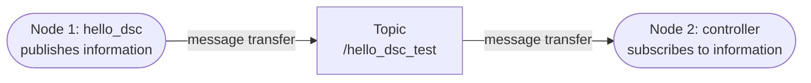
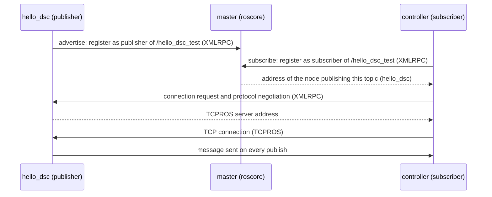
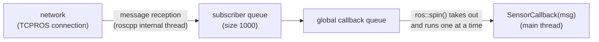
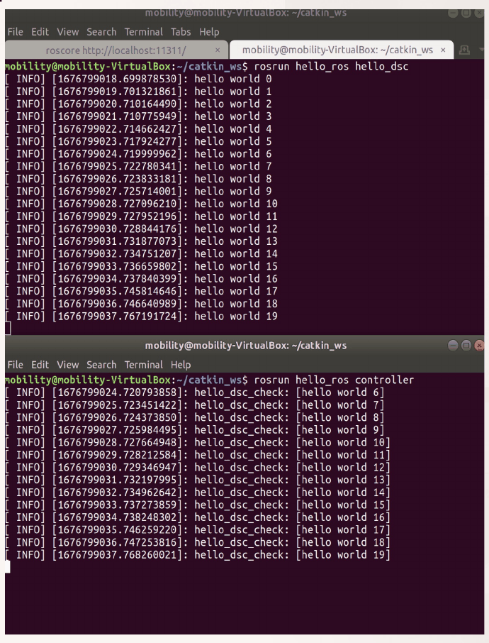
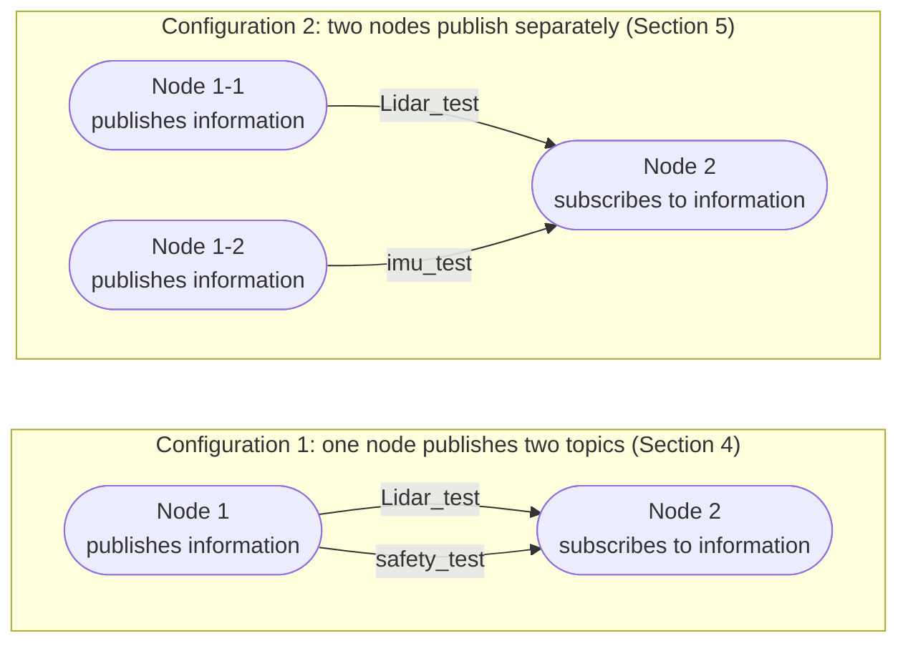
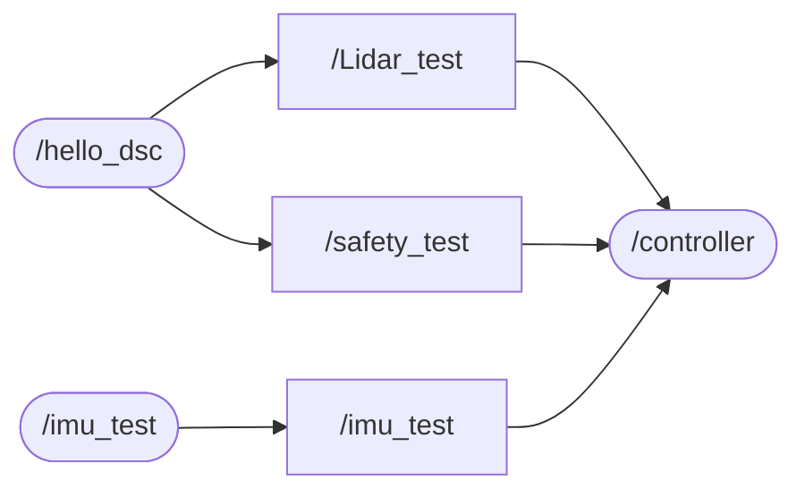

# Week 6 Lecture — Message Passing Between ROS Nodes

[Repository Guide](../../README.md) | [English](Concepts_Lecture.md) | [한국어](Concepts_Lecture.ko.md)

> **Last Updated:** 2026-11-04

> **Learning Objectives:**
> 1. Explain the structure in which publisher and subscriber nodes are connected by a topic name to exchange messages, and what the master does in the process
> 2. Explain what each line of the `controller` node, which receives messages with `subscribe`, a callback function, and `ros::spin`, does
> 3. Explain how a callback function is executed through the subscriber queue and the callback queue, and the difference between `ros::spin` and `ros::spinOnce`
> 4. Choose message types such as `std_msgs::String` and `std_msgs::Int16` and write code that publishes and subscribes to several topics in one node
> 5. Build and run a system of several publisher nodes and one subscriber node, and interpret output in which messages with different periods arrive interleaved
> 6. Check the connections between nodes and topics with `rostopic` and `rqt_graph`

---

## Table of Contents

- [1. Structure of Message Passing Between Nodes](#1-structure-of-message-passing-between-nodes)
  - [1.1 Order of Development](#11-order-of-development)
  - [1.2 Publishers and Subscribers](#12-publishers-and-subscribers)
  - [1.3 How a Connection Is Established](#13-how-a-connection-is-established)
- [2. The Sender Node hello_dsc](#2-the-sender-node-hello_dsc)
- [3. The Receiver Node controller](#3-the-receiver-node-controller)
  - [3.1 Source File and CMakeLists.txt](#31-source-file-and-cmakeliststxt)
  - [3.2 The controller Code](#32-the-controller-code)
  - [3.3 Line-by-Line Analysis](#33-line-by-line-analysis)
  - [3.4 Callback Functions and the Callback Queue](#34-callback-functions-and-the-callback-queue)
  - [3.5 ros::spin and ros::spinOnce](#35-rosspin-and-rosspinonce)
  - [3.6 Building and Running](#36-building-and-running)
- [4. Sending and Receiving Two Topics](#4-sending-and-receiving-two-topics)
  - [4.1 Two Application Configurations](#41-two-application-configurations)
  - [4.2 Message Types](#42-message-types)
  - [4.3 Modifying the Sender Node](#43-modifying-the-sender-node)
  - [4.4 Modifying the Receiver Node](#44-modifying-the-receiver-node)
  - [4.5 Results](#45-results)
- [5. An Application Extended to Three Nodes](#5-an-application-extended-to-three-nodes)
  - [5.1 The Sender Node imu_test](#51-the-sender-node-imu_test)
  - [5.2 A controller That Receives Three Topics](#52-a-controller-that-receives-three-topics)
  - [5.3 Results and Periods](#53-results-and-periods)
  - [5.4 Checking with Command-Line Tools and rqt_graph](#54-checking-with-command-line-tools-and-rqt_graph)
- [Concept Applications](#concept-applications)
- [Summary](#summary)
- [Self-Check Questions](#self-check-questions)
- [References](#references)

---

<br>

## 1. Structure of Message Passing Between Nodes

### 1.1 Order of Development

Week 5 covered steps 1-3: writing a ROS node, building it, and checking its operation. This unit covers the next steps, message passing between nodes and its applications.

| Step | ROS node development | Autoware node development |
|:-----|:-----|:-----|
| 1 | Write a ROS node | Write an Autoware ROS node |
| 2 | Build the node | Build a node linked with Autoware |
| 3 | Check node operation | Check node operation |
| 4 | **Message passing between nodes** (Sections 2 and 3) | Message passing between nodes through the Autoware system |
| 5 | **Applications of message passing between nodes** (Sections 4 and 5) | |

*Table 1. Order of node development and the steps covered in this unit*

### 1.2 Publishers and Subscribers

The simplest form of message passing between nodes consists of one node that sends messages and one node that receives them. `hello_dsc`, built in Week 5, is the **sender node (node 1)** that sends messages, and `controller`, newly built in this unit, is the **receiver node (node 2)** that receives them.



*Figure 1. Structure in which a sender node and a receiver node are connected by a topic*

The sender node **publishes** messages on a topic, and the receiver node **subscribes** to the same topic to receive them. The two nodes need not know each other's names or addresses; they only have to agree on the topic name (`hello_dsc_test`) and the message type (`std_msgs/String`). Therefore, even if the sender node is replaced with another node publishing the same topic (for example, a real sensor driver or bag playback), the receiver node needs no change. This loose coupling between nodes is a major advantage of topic communication (Week 1).

### 1.3 How a Connection Is Established

Until two nodes exchange messages, the master only introduces them to each other, and the messages themselves are exchanged directly between the nodes. The eight steps of Week 1, Section 3.3, shortened for this example, are as follows.



*Figure 2. Process in which a topic connection is established between hello_dsc and controller*

Only messages published after the connection is established are delivered to the receiver node. Messages published before the connection are not stored anywhere, so if the receiver node is started later than the sender node, the messages in between are not received (Section 3.6).

---

<br>

## 2. The Sender Node hello_dsc

The sender node is `hello_dsc` as completed in Week 5, Section 6, without change. The code is in [Example_hello_dsc.cpp of Week 5](../Week05_ROS-Autoware-Node-Development/Example_hello_dsc.cpp), and the four key points for sending messages are the following.

```cpp
ros::NodeHandle n;                                                   // declare the handle for using the ROS system
ros::Publisher hello_dsc_pub = n.advertise<std_msgs::String>("hello_dsc_test", 1000);
std_msgs::String msg;                                                // declare the message
msg.data = ss.str();                                                 // put data into the message
hello_dsc_pub.publish(msg);                                          // publish
```

- **Declaring the node handle:** `ros::NodeHandle n;` connects the node to the ROS system and provides the access point for creating publishers.
- **Declaring the publisher:** `advertise<std_msgs::String>("hello_dsc_test", 1000)` registers with the master that string messages will be published on the topic `hello_dsc_test`.
- **Declaring the message and filling in data:** A `std_msgs::String` object is created and `"hello world 0"`, `"hello world 1"`, ... are put into its `data` field.
- **Publishing:** When `publish(msg)` is called, every node subscribed under the topic name `hello_dsc_test` can obtain the data.

The detailed meaning of each line was explained in Week 5, Sections 5 and 6.

---

<br>

## 3. The Receiver Node controller

### 3.1 Source File and CMakeLists.txt

The receiver node is created in the same package, `hello_ros`, as the sender node. In the VS Code Explorer, create a new file `controller.cpp` in the `hello_ros > src` folder and add the following to the package's `CMakeLists.txt`.

```cmake
# Name of the executable to build: controller
add_executable(controller src/controller.cpp)

# Link the libraries to the executable
target_link_libraries(controller
  ${catkin_LIBRARIES}
)
```

This is the same work as was done for `hello_dsc` in Week 5, Section 3.5. When a package has several nodes, each node gets one `add_executable` and one `target_link_libraries`, so `CMakeLists.txt` now has two `add_executable` commands (`hello_dsc`, `controller`) and two `target_link_libraries` commands. `controller` also uses only `roscpp` and `std_msgs`, so `find_package` and `package.xml` need no change.

### 3.2 The controller Code

Enter the following code in `controller.cpp`. This code is in [Example_controller.cpp](Example_controller.cpp). The comment at the top is a reminder that the content of Section 3.1 must be added to `CMakeLists.txt` to build this node.

```cpp
// Node 2

// [Add the following to CMakeLists.txt]
// add_executable(controller src/controller.cpp)
// target_link_libraries(controller
//    ${catkin_LIBRARIES}
// )

#include "ros/ros.h"
#include "std_msgs/String.h"

void SensorCallback(const std_msgs::String::ConstPtr& msg)
{
    ROS_INFO("hello_dsc_check: [%s]", msg->data.c_str());
}

int main(int argc, char **argv)
{
    ros::init(argc, argv, "controller");

    ros::NodeHandle n;
    ros::Subscriber sub = n.subscribe("hello_dsc_test", 1000, SensorCallback);
    ros::spin();

    return 0;
}
```

### 3.3 Line-by-Line Analysis

- **`#include "ros/ros.h"`, `#include "std_msgs/String.h"`:** Headers for the basic features of roscpp and the message type `std_msgs/String`. The node receives the same message type as the sender node, so it includes the same message header. The receiver node does not use string streams, so `<sstream>` is not needed.
- **`void SensorCallback(const std_msgs::String::ConstPtr& msg)`:** Defines the **callback function** that roscpp calls every time a message arrives on the topic. The developer never calls this function directly; once its name is passed to `subscribe` below and registered, ROS calls it when a message arrives. Its name can be chosen freely, and its return type is `void`.
  - **`std_msgs::String::ConstPtr`:** A smart pointer type pointing to the received message, equivalent to `boost::shared_ptr<const std_msgs::String>`, through which the message cannot be modified. The message is handed over by pointer instead of being copied, so even large messages (point clouds and so on) are delivered quickly.
  - **`const ...&`:** The pointer object itself is taken by constant reference so that it is not copied either.
- **`ROS_INFO("hello_dsc_check: [%s]", msg->data.c_str());`:** Prints the `data` field of the received message. Since `msg` is a pointer, its member is accessed with `->` rather than `.`, and the `std::string` is converted to a C string with `c_str()` to be passed to `%s` (Week 5, Section 5.7). The prefix `hello_dsc_check:` in front of the received content identifies which topic the message came from.
- **`ros::init(argc, argv, "controller");`:** Initializes ROS and sets the node name to `controller`. Its name must differ from that of the sender node (`hello_dsc`) for the two nodes to run together.
- **`ros::NodeHandle n;`:** Creates a node handle and starts the node.
- **`ros::Subscriber sub = n.subscribe("hello_dsc_test", 1000, SensorCallback);`:** Subscribes to the topic `hello_dsc_test` and registers `SensorCallback` to be called when a message arrives [1].
  - **`"hello_dsc_test"`:** The name of the topic to subscribe to. It must match, character for character, the name given to `advertise` in the sender node.
  - **`1000`:** The size of the subscriber queue. If messages arrive faster than they are processed, up to 1000 unprocessed messages are buffered, and when the queue overflows the oldest ones are discarded first [1].
  - **`SensorCallback`:** The callback function to call when a message arrives. The message type is determined from the parameter type of the callback function (`std_msgs::String`), so unlike `advertise`, no template argument is written.
  - **`ros::Subscriber sub`:** The subscriber object returned by `subscribe`. When all copies of this object are gone, the subscription is automatically cancelled [1], so it must be stored in a variable.
- **`ros::spin();`:** Does not return until the node shuts down, and calls the callback function for each arriving message. Without this line, `main` would end immediately, the node would shut down, and the callback function would never run (Section 3.5).
- **`return 0;`:** Ends the program when the node is shut down, for example with `Ctrl + C`, and `ros::spin()` returns.

> **Note:** The parameter of a callback function may also be a constant reference to the message, as in `const std_msgs::String& msg` (the example of Week 2). In that case it is not a pointer, so it is accessed as `msg.data`. Neither form copies the message.

### 3.4 Callback Functions and the Callback Queue

A callback function registered with `subscribe` is executed not at the very moment a message arrives but when the node gives callbacks a chance to be processed. Inside roscpp the following process takes place [2].



*Figure 3. Process in which an arriving message is handled by the callback function*

1. A network thread used internally by roscpp receives the message from the TCPROS connection and puts it into the subscriber queue.
2. The fact that there is a message to process is registered in the node's **global callback queue**.
3. The thread running `ros::spin()` (here, the `main` thread) takes items from the callback queue one at a time and calls the corresponding callback function.

roscpp uses threads internally for network handling, but user callback functions run only in the thread that called `ros::spin()` [2]. The callback functions of this example therefore run in the `main` thread one at a time, in order of arrival. If one callback function takes a long time, the other callbacks wait in the meantime, and if the messages arriving during that time exceed the queue size, the old ones are discarded. A callback function should store the received data or process it briefly and then return at once.

### 3.5 ros::spin and ros::spinOnce

There are two functions that process the callback queue [2].

| Function | Behavior | Suitable case |
|:-----|:-----|:-----|
| `ros::spin()` | Does not return until the node shuts down (`Ctrl + C`, `ros::shutdown()`, and so on), and keeps processing callbacks as they come in | A node that only reacts to received messages (`controller`) |
| `ros::spinOnce()` | Processes only the callbacks queued at the time of the call and returns immediately | A node that does periodic work (publishing, computing) in its own loop while also receiving messages |

*Table 2. Comparison of ros::spin and ros::spinOnce*

`controller` only receives and prints messages, so `ros::spin()` is sufficient. A node that must publish something at a fixed period while receiving messages, however, cannot stay inside `ros::spin()`, so it calls `ros::spinOnce()` inside a loop as follows.

```cpp
ros::Rate loop_rate(10);              // 10 Hz
while (ros::ok())
{
    // periodic work (computation, publishing)
    ros::spinOnce();                  // processes the callbacks of messages that arrived meanwhile
    loop_rate.sleep();                // rests until the next period
}
```

Conceptually, `ros::spin()` is equivalent to "repeating `ros::spinOnce()` and waiting for callbacks while `ros::ok()`". In a loop that uses `ros::spinOnce()`, callbacks are processed in batches at the loop period, so in this example it can take up to one period (0.1 s) from the arrival of a message until its callback runs. Ways to do work at several periods in one node are covered in Week 7.

### 3.6 Building and Running

Run `catkin_make` in the top-level folder of the workspace to confirm that it builds normally, and then run the following commands in separate terminal windows.

```bash
roscore                          # terminal 1: master
rosrun hello_ros hello_dsc       # terminal 2: sender node
rosrun hello_ros controller      # terminal 3: receiver node
```



*Figure 4. Output of hello_dsc (top) and output of controller (bottom)*

The upper terminal of Figure 4 shows what the sender node printed while publishing `hello world 0` to `hello world 19`, and the lower terminal shows `hello_dsc_check: [hello world 6]` to `[hello world 19]` printed by the receiver node in its callback function. The time intervals in the output are about 1 second, so Figure 4 is the result of a run in which the wait of the sender node was changed to `usleep(1000000)` so that it published every second. The output shows the following.

- **A receiver node started later does not receive earlier messages.** `controller` received from `hello world 6` on. `hello world 0`-`5` were published before `controller` started and the connection was established, so there was nowhere to deliver them (Section 1.3).
- **Once connected, every message is received.** Not a single number from 6 to 19 is missing.
- **The delivery delay is shorter than 1 ms.** The sender node printed `hello world 6` just before publishing it at 1676799024.719999962 s, and the callback of the receiver node printed it at 1676799024.720793858 s. The difference is $0.720793858 - 0.719999962 = 0.000793896$ s, about 0.79 ms, which is the time for two processes on the same computer to exchange the message over TCP and run the callback.

> **Caution:** If a receiver node must also get messages published before it started, the publisher can be put in latched mode. Giving `true` as the third argument of `advertise` keeps the last published message and sends it to newly connected subscribers [3]. This is used for data published only once, such as maps, and not for continuously changing data such as sensor data.

---

<br>

## 4. Sending and Receiving Two Topics

### 4.1 Two Application Configurations

As applications of message passing, one node can send several topics, or several nodes can send messages to one node. This unit builds the following two configurations in turn.



*Figure 5. Two application configurations of message passing between nodes*

Configuration 1 imitates a single sensor node that sends a measurement (`Lidar_test`) and a safety state (`safety_test`) on different topics, and configuration 2 imitates driver nodes of different sensors, such as a LiDAR and an IMU, each sending data on its own topic while one control node receives all of it. The node graph of a real autonomous driving system (Week 2) also consists of many layers of such configurations.

### 4.2 Message Types

`safety_test` in configuration 1 sends the integers 0 and 1, so it uses a new message type, `std_msgs/Int16`. The `std_msgs` package defines, for each basic ROS data type, one message type that wraps a value of that type, and each of these types has only a single field named `data` [4]. The package also contains `Empty`, which sends an empty signal, and MultiArray types such as `Float64MultiArray`, which hold arrays.

| Message type | Field definition | C++ type of `data` | Range or example |
|:-----|:-----|:-----|:-----|
| `std_msgs/Bool` | `bool data` | `uint8_t` | 0 (false), 1 (true) |
| `std_msgs/Int16` | `int16 data` | `int16_t` | $-32768$ - $32767$ |
| `std_msgs/Int32` | `int32 data` | `int32_t` | $-2^{31}$ - $2^{31}-1$ |
| `std_msgs/Float64` | `float64 data` | `double` | double-precision real number |
| `std_msgs/String` | `string data` | `std::string` | `"Lidar data 3"` |

*Table 3. Representative message types of std_msgs*

The primitive types of `.msg` files are mapped to fixed C++ types [5]. For example, `int16` becomes the signed 16-bit integer `int16_t`, and `string` becomes `std::string`. Each message type has its own header, so `#include "std_msgs/Int16.h"` is added to use `std_msgs/Int16`.

> **Note:** The basic messages of `std_msgs` are convenient for examples and simple experiments, but they cannot carry the meaning of a value (unit, coordinate frame, measurement time), so real systems are advised to use message types whose meaning is explicit [4]. A real LiDAR driver publishes point clouds as `sensor_msgs/PointCloud2`, and an IMU driver publishes acceleration and angular velocity as `sensor_msgs/Imu`; these messages have a `header` field that carries the measurement time and the coordinate frame.

### 4.3 Modifying the Sender Node

Modify the sender node `hello_dsc.cpp` as follows so that it can send two topics.

```cpp
#include "ros/ros.h"
#include "std_msgs/String.h"
#include "std_msgs/Int16.h"
#include <sstream>
#include <unistd.h>

int main(int argc, char **argv)
{
    ros::init(argc, argv, "hello_dsc");

    ros::NodeHandle n1;
    ros::NodeHandle n2;
    ros::Publisher hello_dsc_pub1 =
        n1.advertise<std_msgs::String>("Lidar_test", 1000);
    ros::Publisher hello_dsc_pub2 =
        n2.advertise<std_msgs::Int16>("safety_test", 1000);

    int count = 0;
    int16_t true_false_test = 0;

    while (ros::ok())
    {
        std_msgs::String msg;
        std_msgs::Int16 msg_safety;

        std::stringstream ss;

        ss << "Lidar data " << count;
        msg.data = ss.str();

        msg_safety.data = true_false_test;

        ROS_INFO("%s", msg.data.c_str());
        ROS_INFO("%d", msg_safety.data);

        hello_dsc_pub1.publish(msg);
        hello_dsc_pub2.publish(msg_safety);

        count++;
        if (true_false_test == 0)
            true_false_test = 1;
        else if (true_false_test == 1)
            true_false_test = 0;
        usleep(1000000);
    }

    return 0;
}
```

The parts changed from `hello_dsc` of Week 5 are as follows.

- **`#include "std_msgs/Int16.h"`:** Adds the header for the integer message type `std_msgs::Int16`.
- **`ros::NodeHandle n1;`, `ros::NodeHandle n2;`:** Creates two node handles and one publisher from each. Both handles belong to the same node `/hello_dsc`, so this does not make two nodes.
- **`hello_dsc_pub1 = n1.advertise<std_msgs::String>("Lidar_test", 1000);`:** A string publisher whose topic name is changed to `Lidar_test`.
- **`hello_dsc_pub2 = n2.advertise<std_msgs::Int16>("safety_test", 1000);`:** Declares the publisher for sending `safety_test`. The template argument is `std_msgs::Int16`, so only integer messages are sent through this publisher.
- **`int16_t true_false_test = 0;`:** A value imitating a safety state, alternating between 0 and 1. It is declared with the same type as the message field (`int16_t`).
- **`std_msgs::Int16 msg_safety;`:** Declares the message for sending `safety_test`.
- **`ss << "Lidar data " << count;`:** Changes the string content to `"Lidar data 0"`, `"Lidar data 1"`, ....
- **`msg_safety.data = true_false_test;`:** Puts the current safety state into the `data` field of the integer message.
- **`ROS_INFO("%d", msg_safety.data);`:** Prints the integer. An `int16_t` value is promoted to `int` when passed as a variadic argument, so it can be printed with `%d`.
- **`hello_dsc_pub2.publish(msg_safety);`:** Publishes the `safety_test` message. Both `publish` calls are in the same loop, so the two topics are published at the same period.
- **`if ... else if ...`:** Changes `true_false_test` from 0 to 1 or from 1 to 0, flipping the value in every iteration. The single line `true_false_test = 1 - true_false_test;` would behave the same.
- **`usleep(1000000);`:** Rests for 1 second, so both topics are published at about 1 Hz.

> **Note:** Publishing several topics from one node does not require a node handle for each topic. Calling `n1.advertise` twice to create two publishers behaves the same, and the node of Week 7 creates three publishers with a single handle (`n1`). Having several node handles is useful when each handle is given a different namespace or callback queue.

### 4.4 Modifying the Receiver Node

Modify the receiver node `controller.cpp` as follows so that it can receive two topics.

```cpp
#include "ros/ros.h"
#include "std_msgs/String.h"
#include "std_msgs/Int16.h"

void SensorCallback(const std_msgs::String::ConstPtr& msg)
{
    ROS_INFO("hello_dsc_check: [%s]", msg->data.c_str());
}

void SensorSafetyCallback(const std_msgs::Int16::ConstPtr& msg)
{
    ROS_INFO("hello_dsc_check: [%d]", msg->data);
}

int main(int argc, char **argv)
{
    ros::init(argc, argv, "controller");

    ros::NodeHandle n;
    ros::Subscriber sub_lidar = n.subscribe("Lidar_test", 1000,
        SensorCallback);
    ros::Subscriber sub_safety = n.subscribe("safety_test", 1000,
        SensorSafetyCallback);

    ros::spin();

    return 0;
}
```

- **`#include "std_msgs/Int16.h"`:** Adds the header for receiving integer messages.
- **`void SensorSafetyCallback(const std_msgs::Int16::ConstPtr& msg)`:** Defines the callback function executed when a `safety_test` message is received. Its parameter type is `std_msgs::Int16::ConstPtr`, so this callback receives integer messages, and since `msg->data` is an `int16_t`, it is printed with `%d`.
- **`sub_lidar = n.subscribe("Lidar_test", 1000, SensorCallback);`:** Subscribes to the string topic `Lidar_test` and connects it to the existing `SensorCallback`.
- **`sub_safety = n.subscribe("safety_test", 1000, SensorSafetyCallback);`:** Declares a ROS subscriber. It subscribes to the integer topic `safety_test` and connects it to `SensorSafetyCallback`. The two subscriber objects are stored in different variables.
- **`ros::spin();`:** A single `ros::spin()` processes the callbacks of both subscribers. There is no need to call `spin` separately for each topic.

Topics and callback functions must match in message type. If `safety_test` (`std_msgs/Int16`) is connected to `SensorCallback` (`std_msgs::String`), the code builds, but an error about mismatched message types occurs when the connection is made, and no messages are delivered. ROS checks this by comparing the message type name and its hash carried in the connection header (Week 1).

### 4.5 Results

After building, run `roscore`, `rosrun hello_ros hello_dsc`, and `rosrun hello_ros controller` in three terminals. The sender node prints two lines every second.

```text
[ INFO] [1676809357.531430481]: Lidar data 4
[ INFO] [1676809357.531488334]: 0
[ INFO] [1676809358.531842959]: Lidar data 5
[ INFO] [1676809358.531885515]: 1
[ INFO] [1676809359.533415490]: Lidar data 6
[ INFO] [1676809359.533452536]: 0
```

The output of the receiver node is as follows.

```text
[ INFO] [1676809355.505842662]: hello_dsc_check: [0]
[ INFO] [1676809356.519877655]: hello_dsc_check: [Lidar data 3]
[ INFO] [1676809356.519903527]: hello_dsc_check: [1]
[ INFO] [1676809357.531706063]: hello_dsc_check: [Lidar data 4]
[ INFO] [1676809357.531730594]: hello_dsc_check: [0]
[ INFO] [1676809358.532078640]: hello_dsc_check: [Lidar data 5]
[ INFO] [1676809358.532103169]: hello_dsc_check: [1]
```

- **The two callbacks run alternately.** Every second, `Lidar data n` and 0 or 1 arrive in turn, so `SensorCallback` and `SensorSafetyCallback` are called alternately. Both callbacks use the same prefix `hello_dsc_check:`, so the topic is identified by the content in brackets. Section 5.2 changes the prefix for each topic.
- **The values come in pairs.** When the `Lidar data` number is even the safety state is 0, and when it is odd the state is 1. This is because `count` and `true_false_test` change together in the same iteration.
- **A separate connection is made for each topic.** The first line of the receiver node is the `safety_test` message 0 at 1676809355.5 s, and the following `Lidar data 3` arrived one second later. `Lidar data 2`, published in the same iteration as that 0, was not received. Connections are made separately for each topic, so right after the receiver node starts, one topic can be connected earlier than another.

---

<br>

## 5. An Application Extended to Three Nodes

### 5.1 The Sender Node imu_test

To build configuration 2 (Figure 5), a new sender node 1-2 that imitates IMU data is created. Create `imu_test.cpp` in the `hello_ros > src` folder and add the following to `CMakeLists.txt`.

```cmake
# Name of the executable to build: imu_test
add_executable(imu_test src/imu_test.cpp)

# Link the libraries to the executable
target_link_libraries(imu_test
  ${catkin_LIBRARIES}
)
```

The package now has three executables: `hello_dsc`, `controller`, and `imu_test`. The content of `imu_test.cpp` is as follows.

```cpp
#include "ros/ros.h"
#include "std_msgs/String.h"
#include <sstream>
#include <unistd.h>

int main(int argc, char **argv)
{
    ros::init(argc, argv, "imu_test");

    ros::NodeHandle n;
    ros::Publisher imu_test_pub =
        n.advertise<std_msgs::String>("imu_test", 1000);

    int count = 0;

    while (ros::ok())
    {
        std_msgs::String msg;
        std::stringstream ss;

        ss << "imu data " << count;
        msg.data = ss.str();

        ROS_INFO("%s", msg.data.c_str());
        imu_test_pub.publish(msg);

        count++;

        usleep(100000);
    }

    return 0;
}
```

Its structure is the same as `hello_dsc` of Week 5, with the following differences.

- **`ros::init(argc, argv, "imu_test");`:** Sets the node name to `imu_test`. It must not clash with the names of the already running `hello_dsc` and `controller`.
- **`imu_test_pub = n.advertise<std_msgs::String>("imu_test", 1000);`:** Declares the publisher for sending `imu_test`. Both the node name and the topic name are `imu_test`, but nodes and topics are different entities, so they may share a name.
- **`ss << "imu data " << count;`:** Builds `"imu data 0"`, `"imu data 1"`, ....
- **`imu_test_pub.publish(msg);`:** Publishes the `imu_test` message.
- **`usleep(100000);`:** Rests for 0.1 s (100000 µs), so it publishes at about 10 Hz, ten times as often as `hello_dsc` (1 Hz). This imitates a real IMU, which produces measurements much more often than a LiDAR.

### 5.2 A controller That Receives Three Topics

Modify the receiver node `controller.cpp` as follows so that it can receive three topics.

```cpp
#include "ros/ros.h"
#include "std_msgs/String.h"
#include "std_msgs/Int16.h"

void SensorCallback(const std_msgs::String::ConstPtr& msg)
{
    ROS_INFO("hello_dsc_check: [%s]", msg->data.c_str());
}

void SensorSafetyCallback(const std_msgs::Int16::ConstPtr& msg)
{
    ROS_INFO("safety_check: [%d]", msg->data);
}

void ImuCallback(const std_msgs::String::ConstPtr& msg)
{
    ROS_INFO("imu_check: [%s]", msg->data.c_str());
}

int main(int argc, char **argv)
{
    ros::init(argc, argv, "controller");

    ros::NodeHandle n;
    ros::Subscriber sub_lidar = n.subscribe("Lidar_test", 1000, SensorCallback);
    ros::Subscriber sub_safety = n.subscribe("safety_test", 1000,
        SensorSafetyCallback);
    ros::Subscriber sub_imu = n.subscribe("imu_test", 1000, ImuCallback);

    ros::spin();

    return 0;
}
```

- **Output of `SensorSafetyCallback`:** The prefix is changed to `safety_check:` to distinguish safety state messages from the others.
- **`void ImuCallback(const std_msgs::String::ConstPtr& msg)`:** Defines the callback function executed when an `imu_test` message is received. The message type is a string, as for `Lidar_test`, but a separate callback function prints it with `imu_check:`.
- **`sub_imu = n.subscribe("imu_test", 1000, ImuCallback);`:** Declares the ROS subscriber for receiving `imu_test`.

`controller` does not know, and need not know, whether there is one sender node (`hello_dsc`) or two (`hello_dsc`, `imu_test`). It only needs the names of the topics it subscribes to, and the master connects it to whichever nodes publish those topics.

### 5.3 Results and Periods

After building, run the following in four terminals.

```bash
roscore                          # terminal 1
rosrun hello_ros hello_dsc       # terminal 2: Lidar_test, safety_test (1 Hz)
rosrun hello_ros imu_test        # terminal 3: imu_test (10 Hz)
rosrun hello_ros controller      # terminal 4: subscribes to three topics
```

`imu_test` prints at intervals of about 0.1 s.

```text
[ INFO] [1676810884.515791575]: imu data 181
[ INFO] [1676810884.617098883]: imu data 182
[ INFO] [1676810884.719162529]: imu data 183
[ INFO] [1676810884.819338097]: imu data 184
```

In `controller`, the messages of the three topics are printed interleaved in order of arrival.

```text
[ INFO] [1676810884.719355120]: imu_check: [imu data 183]
[ INFO] [1676810884.803159199]: hello_dsc_check: [Lidar data 46]
[ INFO] [1676810884.803206209]: safety_check: [0]
[ INFO] [1676810884.819570030]: imu_check: [imu data 184]
[ INFO] [1676810884.920033099]: imu_check: [imu data 185]
[ INFO] [1676810885.023910785]: imu_check: [imu data 186]
[ INFO] [1676810885.125039243]: imu_check: [imu data 187]
[ INFO] [1676810885.226550576]: imu_check: [imu data 188]
[ INFO] [1676810885.328236101]: imu_check: [imu data 189]
[ INFO] [1676810885.429915319]: imu_check: [imu data 190]
[ INFO] [1676810885.530026331]: imu_check: [imu data 191]
[ INFO] [1676810885.630379132]: imu_check: [imu data 192]
[ INFO] [1676810885.730968719]: imu_check: [imu data 193]
[ INFO] [1676810885.803975592]: hello_dsc_check: [Lidar data 47]
[ INFO] [1676810885.804026535]: safety_check: [1]
```

- **The ratio of periods appears in the output.** Between `Lidar data 46` (884.803 s) and `Lidar data 47` (885.804 s), ten messages, `imu data 184` to `193`, arrived. This is because `imu_test` publishes ten times as often as `hello_dsc`.
- **The actual period is slightly longer than the target.** It took $0.617098883 - 0.515791575 \approx 0.1013$ s from `imu data 181` to `182`. This is because the running time of the loop body is added to the 0.1 s of `usleep(100000)` (Week 5, Section 6.4). For the same reason, the reception interval of `Lidar data 46` and `47` is $885.803975592 - 884.803159199 \approx 1.0008$ s, about 0.8 ms longer than 1 second.
- **Callbacks run one at a time in order of arrival.** Even messages from different nodes go into one callback queue and are processed in turn in the `main` thread, so output lines are never mixed or overlapped (Section 3.4).

### 5.4 Checking with Command-Line Tools and rqt_graph

The connections between nodes and topics can be checked with the command-line and GUI tools of ROS [6][7].

| Command | What it shows |
|:-----|:-----|
| `rosnode list` | List of running nodes (`/controller`, `/hello_dsc`, `/imu_test`, `/rosout`) |
| `rostopic list` | List of current topics (`/Lidar_test`, `/safety_test`, `/imu_test`, `/rosout`, and others) |
| `rostopic info /imu_test` | Message type of the topic and the nodes publishing and subscribing to it |
| `rostopic echo /safety_test` | Content of the messages on the topic |
| `rostopic hz /imu_test` | Average frequency at which the topic is actually published, and the minimum and maximum periods |
| `rqt_graph` | Displays the connections between nodes and topics as a graph |

*Table 4. Commands for checking the connections between nodes and topics*

Running `rqt_graph` displays this system as follows. In `rqt_graph`, nodes are drawn as ellipses and topics as rectangles, and the arrows show the direction in which messages flow.



*Figure 6. Node graph of the system extended to three nodes*

Running `rostopic hz /imu_test` gives an average frequency slightly below 10 Hz, such as about $1 / 0.1013 \approx 9.87$ Hz for the period of 0.1013 s in Section 5.3. Checking the actual frequency and connection state of each topic with the command-line tools in this way quickly reveals problems that are hard to find from the output alone, such as a typo in a topic name or a mismatched message type.

---

<br>

## Concept Applications

| Situation | Result and Reason |
|:-----|:------------|
| The topic name in `subscribe` of `controller` is written as `"hello_dsc_Test"`. | **It builds and runs but receives no messages.** Topic names are case-sensitive, so it subscribed to a topic different from `hello_dsc_test`, and no node publishes that topic. |
| `ros::spin();` is removed from `controller`. | **The node ends as soon as it starts and prints nothing.** There is no loop to process callbacks, so `main` returns immediately. |
| The return value of `subscribe` is not stored, and only `n.subscribe("hello_dsc_test", 1000, SensorCallback);` is written. | **The subscription is cancelled at once and no messages are received.** The returned subscriber object disappears at the end of the statement, and the subscription is cancelled with it. |
| `hello_dsc` is started 10 seconds after `controller`. | **Every message published after the connection is established is received.** If the receiver node is already waiting, it connects as soon as the master announces the new publisher, so hardly any message is missed. However, the first message published right after `advertise` may be lost because the connection is not yet established. |
| The messages of two 1 Hz publishers and one 10 Hz publisher are all received. | **`controller` runs about 12 callbacks per second.** $1 + 1 + 10 = 12$, and all of them run in turn from one callback queue. |
| A computation taking 1 second is done inside `SensorCallback`. | **The `imu_check` output is delayed and comes out in bursts.** Callbacks run in turn in one thread, so about ten `imu_test` messages that arrived in the meantime wait in the queue. |
| `safety_test` is subscribed with `SensorCallback` (`std_msgs::String`) as its callback. | **No messages are delivered and a type mismatch error is printed.** The hashes of the publisher's `std_msgs/Int16` and the subscriber's `std_msgs/String` differ, so the connection is refused. |

*Table 5. Results and reasons for situations involving topic communication*

**True/False Check:**

| Statement | Judgment and Reason |
|:-----|:------------|
| A receiver node must know the node name of the sender node to receive messages. | **F.** Only the topic name and the message type must match, and the master tells it which node publishes. |
| Messages are delivered to the receiver node through the master. | **F.** The master only brokers connection information, and messages are delivered directly over the TCPROS connection between the sender and receiver nodes. |
| When the queue size of `subscribe` is exceeded, the most recent message is discarded. | **F.** The oldest messages are discarded first. |
| A callback function runs in the thread that called `ros::spin()` or `ros::spinOnce()`. | **T.** The internal threads of roscpp only receive messages and put them into queues, and user callbacks run in the thread that processes the queue. |
| Publishing two topics from one node requires two node handles. | **F.** Several publishers can be created with a single node handle. |
| `ros::spinOnce()` does not return until the node shuts down. | **F.** It processes only the callbacks queued at the time of the call and returns immediately. The function that does not return until shutdown is `ros::spin()`. |
| A node and a topic with the same name can coexist. | **T.** As with `imu_test`, the node `/imu_test` and the topic `/imu_test` are different entities. |

---

<br>

## Summary

| Concept | Key Summary |
|:--------|:------------|
| Sender and receiver nodes | The sender node publishes messages on a topic and the receiver node subscribes to the same topic; the two only agree on the topic name and the message type. |
| Connection process | The master introduces the publisher and subscriber over XMLRPC, the two nodes connect directly over TCPROS, and messages published before the connection are not delivered. |
| Adding a node | A source file is created in the same package, and one `add_executable` and one `target_link_libraries` per node are added to `CMakeLists.txt`. |
| subscribe | `n.subscribe(topic, queue size, callback)` registers a subscription, and the returned `ros::Subscriber` object must be stored to keep it. |
| Callback function | A function that ROS calls when a message arrives; it takes `const Type::ConstPtr& msg` and reads `msg->data`. |
| Callback queue | Messages received by internal threads pass through the subscriber queue and the global callback queue and are processed in order of arrival in the thread that called `spin`. |
| ros::spin and ros::spinOnce | `spin` keeps processing callbacks until shutdown, and `spinOnce` processes only the queued callbacks and returns, for use inside periodic loops. |
| std_msgs | Message types with a single `data` field for each basic data type; `int16` becomes `int16_t` and `string` becomes `std::string`. |
| Publishing several topics | Creating a publisher per topic and calling `publish` in the same loop publishes the topics at the same period. |
| Subscribing to several topics | Each topic gets a subscriber and a callback, and one `ros::spin()` processes all callbacks. |
| Several sender nodes | The receiver node knows only the topic names and need not know the number of sender nodes; messages with different periods are processed interleaved in order of arrival. |
| Checking tools | `rosnode list`, `rostopic list`, `info`, `echo`, `hz`, and `rqt_graph` check nodes, topics, frequencies, and connections. |

---

<br>

## Self-Check Questions

1. **Identifying roles:** In the system of Section 3, give the names that correspond to the nodes, the topic, the message type, and the callback function.

   <details>
   <summary>Answer</summary>

   The nodes are `/hello_dsc` (sender) and `/controller` (receiver), the topic is `/hello_dsc_test`, and the message type is `std_msgs/String`. The callback function is `SensorCallback` of `controller`, which is called each time a message arrives on `/hello_dsc_test`.

   </details>

2. **Arguments of subscribe:** State what each of the three arguments of `n.subscribe("hello_dsc_test", 1000, SensorCallback)` means, and explain why, unlike `advertise`, the message type need not be written as a template argument.

   <details>
   <summary>Answer</summary>

   The first argument is the name of the topic to subscribe to, the second is the size of the subscriber queue that buffers unprocessed messages (the oldest are discarded first when it overflows), and the third is the callback function to call when a message arrives. The message type can be known from the parameter type of the callback function, `const std_msgs::String::ConstPtr&`, so the compiler deduces the template argument.

   </details>

3. **Need for spin:** Explain what happens if `ros::spin();` is removed from `controller`, and answer with a code skeleton what a node that must publish another topic every 0.1 s while receiving messages should use.

   <details>
   <summary>Answer</summary>

   There is no loop to process the callback queue, so `main` reaches `return 0;` at once and the node shuts down, and the callback function never runs. To publish periodically while also receiving messages, `ros::spinOnce()` and `ros::Rate` are used.

   ```cpp
   ros::Rate loop_rate(10);
   while (ros::ok())
   {
       pub.publish(out_msg);
       ros::spinOnce();
       loop_rate.sleep();
   }
   ```

   </details>

4. **A receiver node started late:** While the sender node publishes `hello world n` every second, the receiver node was started 6.3 seconds after the sender node. Estimate the number of the first message the receiver node receives and explain why. Assume that the first message is published right after the sender node starts (at 0 s) and that connecting takes 0.1 s.

   <details>
   <summary>Answer</summary>

   Message $n$ is published at about $n$ seconds, so `hello world 0`-`6` are published between 0 and 6 s. The receiver node starts at 6.3 s and is connected at about 6.4 s, so the first message it receives is `hello world 7`, published at 7 s, the first one after that. Messages published before the connection are not kept anywhere.

   </details>

5. **Sending two topics:** State how the output of the receiver node changes if the `if ... else if ...` statement that updates `true_false_test` is removed from the sender node of Section 4.3.

   <details>
   <summary>Answer</summary>

   `true_false_test` never changes from its initial value 0, so 0 is always published on `safety_test`. The receiver node prints `hello_dsc_check: [Lidar data n]` (with `n` increasing by 1) and `hello_dsc_check: [0]` alternately every second.

   </details>

6. **Interpreting arrival order:** From the publication frequency of each topic, compute how many callbacks `controller` runs in one second in the output of Section 5.3, and explain why ten `imu_check` lines appear between consecutive `hello_dsc_check` lines.

   <details>
   <summary>Answer</summary>

   `Lidar_test` and `safety_test` are each about 1 Hz and `imu_test` is about 10 Hz, so about $1 + 1 + 10 = 12$ callbacks run per second. During one period of `hello_dsc` (about 1 s), `imu_test` publishes ten times, about every 0.1 s, so ten `imu_check` lines are printed between two consecutive `hello_dsc_check` lines. Because the actual period is slightly longer than 0.1 s, some intervals may contain nine.

   </details>

7. **Choosing message types:** The current speed of a vehicle (m/s, with a fractional part) and whether an emergency stop is active are to be sent to another node. Choose a suitable type from `std_msgs` for each, and explain what would be a better choice in a real system.

   <details>
   <summary>Answer</summary>

   The speed is a real number, so `std_msgs/Float64` (`double` in C++) is suitable, and the emergency stop is true or false, so `std_msgs/Bool` is suitable. However, the `std_msgs` types cannot carry meaning such as units, measurement time, or coordinate frames, so in a real system it is better to send the speed in a standard message with a `header`, such as `geometry_msgs/TwistStamped`, or to define a custom message whose meaning is explicit.

   </details>

---

<br>

## References

1. ROS Wiki, "Writing a Simple Publisher and Subscriber (C++)." https://wiki.ros.org/ROS/Tutorials/WritingPublisherSubscriber%28c%2B%2B%29
2. ROS Wiki, "roscpp/Overview/Callbacks and Spinning." https://wiki.ros.org/roscpp/Overview/Callbacks%20and%20Spinning
3. ROS Wiki, "roscpp/Overview/Publishers and Subscribers." https://wiki.ros.org/roscpp/Overview/Publishers%20and%20Subscribers
4. ROS Wiki, "std_msgs." https://wiki.ros.org/std_msgs
5. ROS Wiki, "msg." https://wiki.ros.org/msg
6. ROS Wiki, "rostopic." https://wiki.ros.org/rostopic
7. ROS Wiki, "rqt_graph." https://wiki.ros.org/rqt_graph
