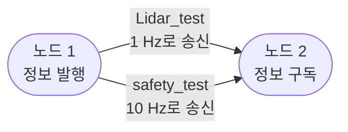
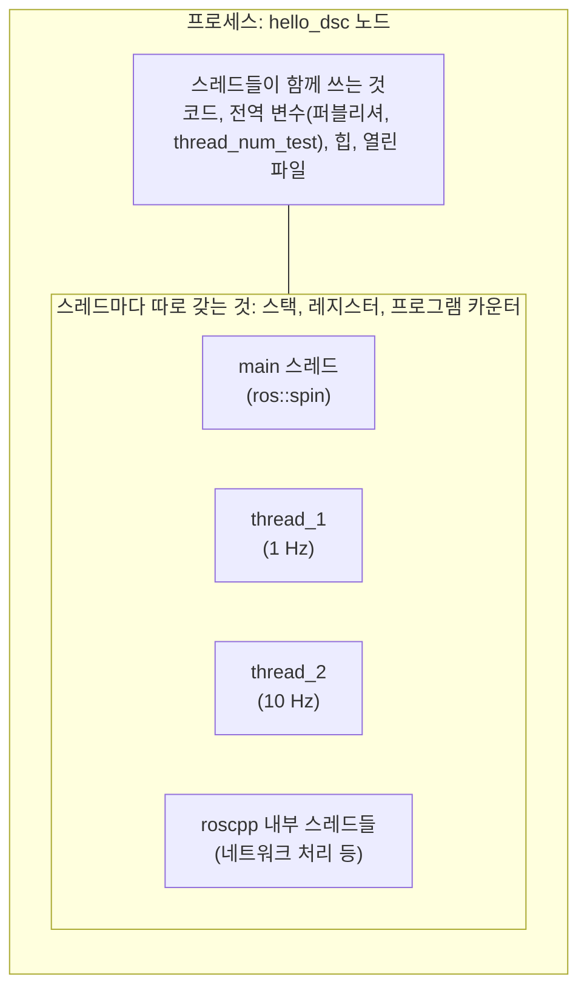
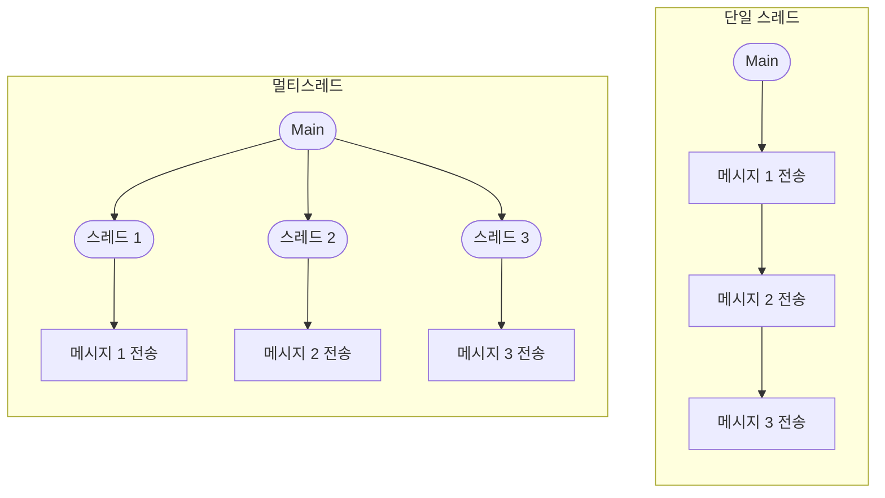
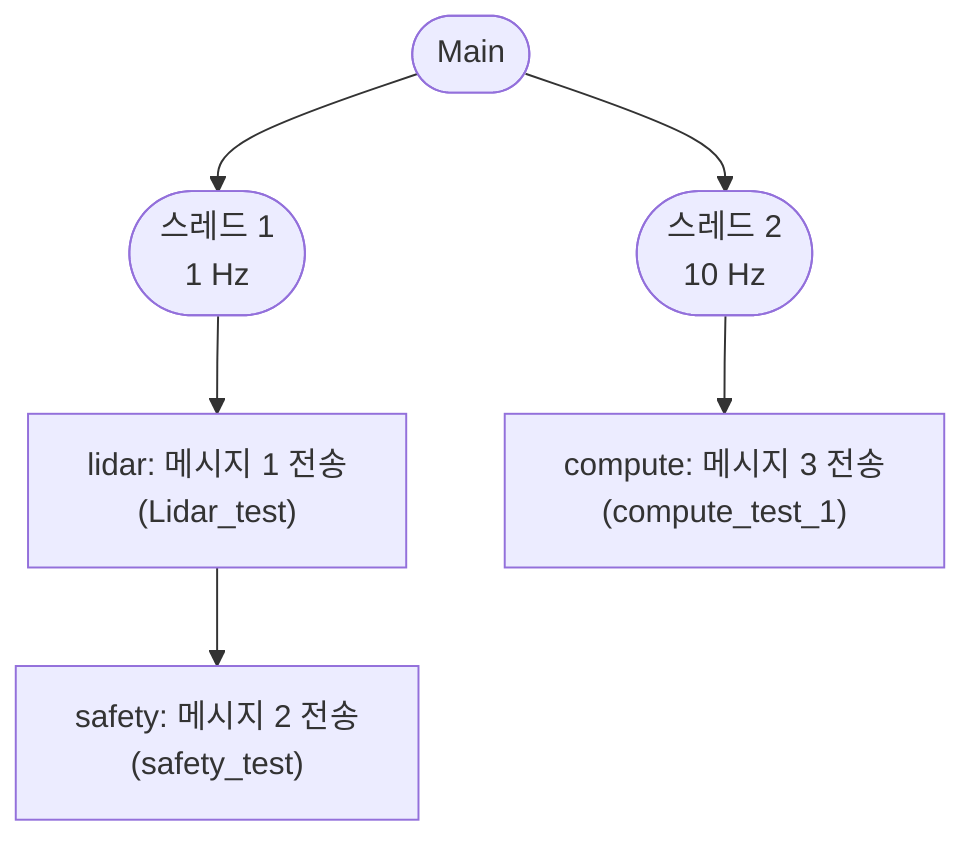
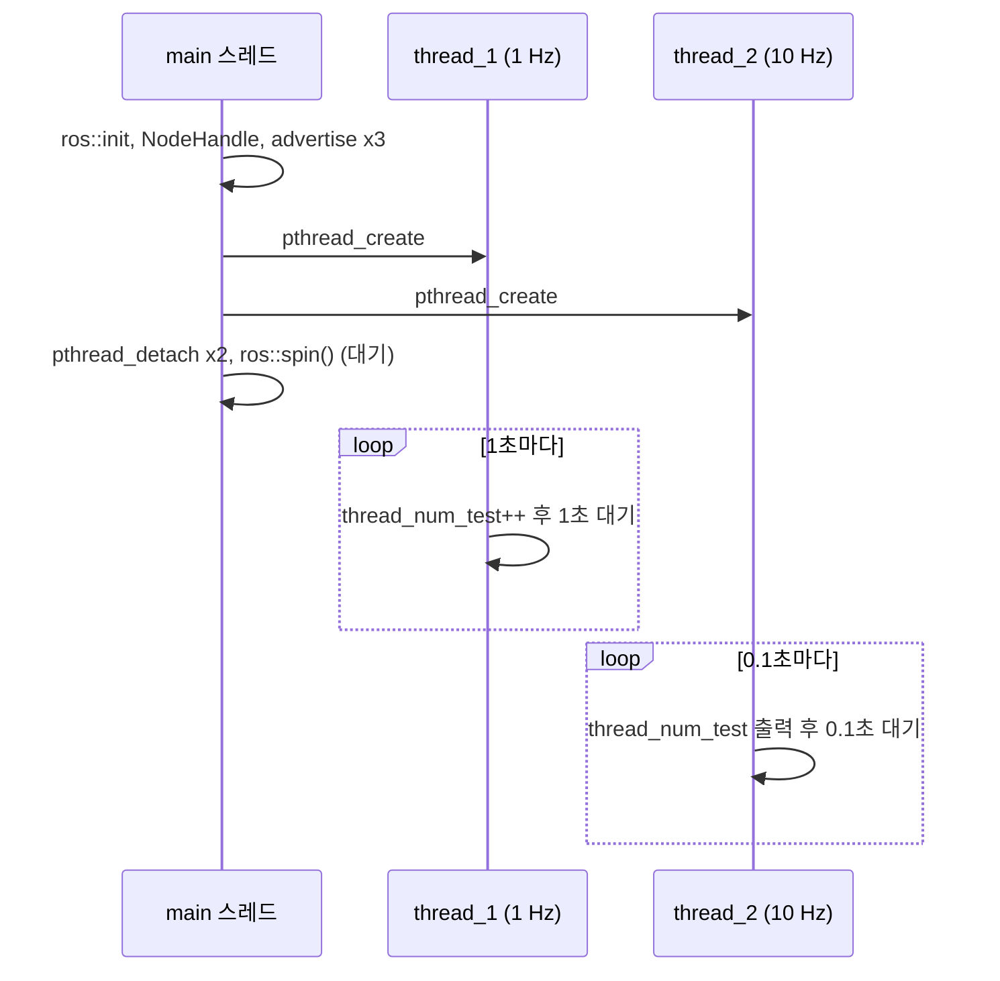
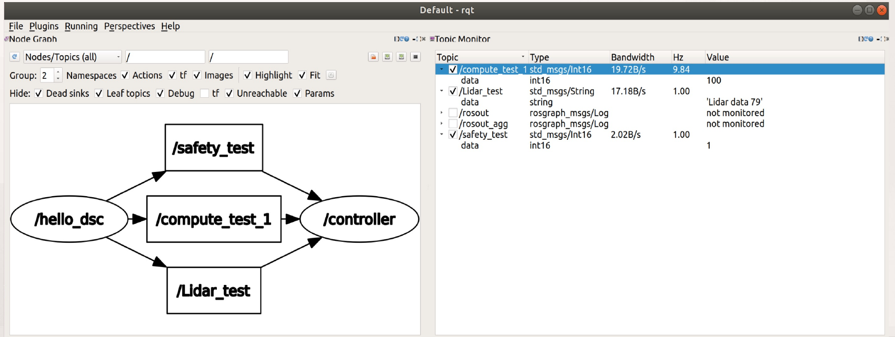
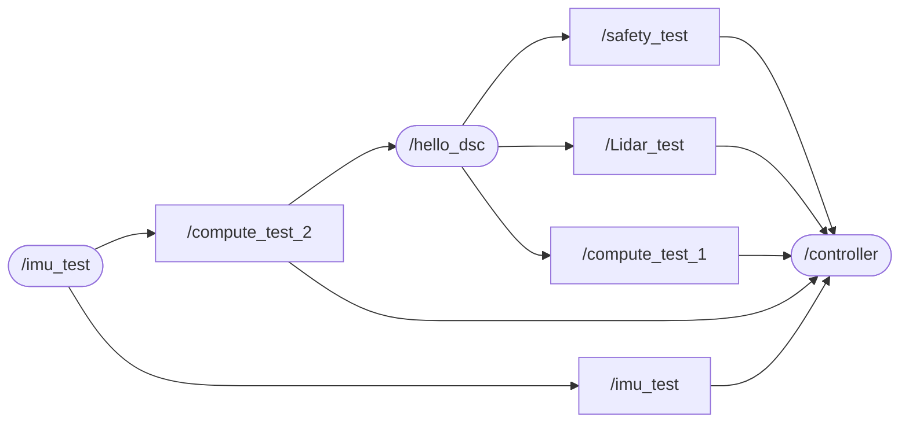
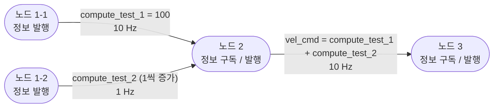
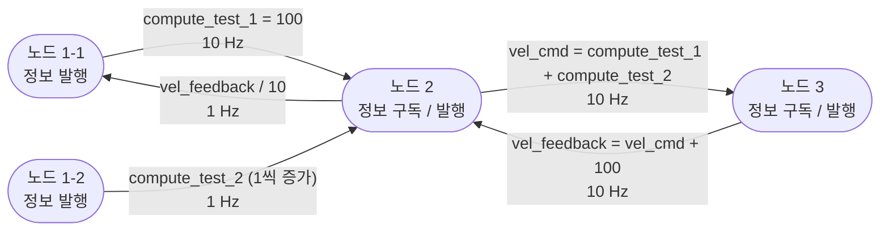

# 7주차 이론 — 멀티스레드를 이용한 ROS 노드 메시지 송수신

[레포지토리 안내](../../README.ko.md) | [English](Concepts_Lecture.md) | [한국어](Concepts_Lecture.ko.md)

> **최종 수정일:** 2026-11-04

> **학습 목표:**
> 1. 프로세스와 스레드의 차이, 단일 스레드와 멀티스레드의 실행 흐름, 동시성과 병렬성의 차이를 설명할 수 있다
> 2. `pthread_create`, `pthread_detach`, `pthread_join`으로 POSIX 스레드를 만들고 관리하는 방법과 그 오류 처리 방식을 설명할 수 있다
> 3. 스레드마다 다른 주기로 동작하는 `thread_prac` 노드의 각 줄이 하는 일과 `main`의 `ros::spin`이 맡는 역할을 설명할 수 있다
> 4. 스레드 사이에서 전역 변수를 공유할 때 생기는 데이터 경쟁과 뮤텍스를 이용한 보호 방법을 설명할 수 있다
> 5. 스레드 함수에서 서로 다른 주기로 토픽을 발행하는 노드를 작성하고, `ros::Rate`, `ros::Timer`, 멀티스레드 스피너를 쓰는 다른 설계와 비교할 수 있다
> 6. 주기가 다른 메시지가 여러 노드를 거쳐 흐르는 시스템의 구성과 데이터 흐름을 설명할 수 있다

---

## 목차

- [1. 다른 주기로 토픽을 보내는 이유와 스레드](#1-다른-주기로-토픽을-보내는-이유와-스레드)
  - [1.1 개발의 순서](#11-개발의-순서)
  - [1.2 목표: 주기가 다른 두 토픽](#12-목표-주기가-다른-두-토픽)
  - [1.3 프로세스와 스레드](#13-프로세스와-스레드)
  - [1.4 단일 스레드와 멀티스레드](#14-단일-스레드와-멀티스레드)
  - [1.5 동시성과 병렬성](#15-동시성과-병렬성)
  - [1.6 스레드 구성 설계](#16-스레드-구성-설계)
- [2. POSIX 스레드](#2-posix-스레드)
  - [2.1 pthread란](#21-pthread란)
  - [2.2 사용 순서와 주요 함수](#22-사용-순서와-주요-함수)
  - [2.3 스레드 함수의 형태](#23-스레드-함수의-형태)
  - [2.4 분리와 합류](#24-분리와-합류)
  - [2.5 오류 처리와 빌드](#25-오류-처리와-빌드)
- [3. thread_prac 예제](#3-thread_prac-예제)
  - [3.1 전체 코드](#31-전체-코드)
  - [3.2 헤더와 전역 변수](#32-헤더와-전역-변수)
  - [3.3 스레드 함수 thread_1과 thread_2](#33-스레드-함수-thread_1과-thread_2)
  - [3.4 main 함수](#34-main-함수)
  - [3.5 실행 결과](#35-실행-결과)
  - [3.6 공유 데이터와 뮤텍스](#36-공유-데이터와-뮤텍스)
- [4. 스레드에서 ROS 메시지 발행](#4-스레드에서-ros-메시지-발행)
  - [4.1 thread_1: 1 Hz로 두 토픽 발행](#41-thread_1-1-hz로-두-토픽-발행)
  - [4.2 thread_2: 10 Hz로 계산 값 발행](#42-thread_2-10-hz로-계산-값-발행)
  - [4.3 실행 결과](#43-실행-결과)
  - [4.4 rqt로 확인하기](#44-rqt로-확인하기)
  - [4.5 응용: 발행과 구독을 함께 하는 노드](#45-응용-발행과-구독을-함께-하는-노드)
- [5. 주기를 만드는 여러 방법](#5-주기를-만드는-여러-방법)
  - [5.1 단일 스레드와 ros::Rate](#51-단일-스레드와-rosrate)
  - [5.2 ros::Timer](#52-rostimer)
  - [5.3 멀티스레드 스피너](#53-멀티스레드-스피너)
  - [5.4 방법의 비교](#54-방법의-비교)
- [6. 여러 노드 사이의 주기가 다른 메시지 흐름](#6-여러-노드-사이의-주기가-다른-메시지-흐름)
  - [6.1 세 단계로 이어지는 노드 구성](#61-세-단계로-이어지는-노드-구성)
  - [6.2 노드 2의 수정](#62-노드-2의-수정)
  - [6.3 노드 3 vehicle 작성](#63-노드-3-vehicle-작성)
  - [6.4 피드백이 있는 구성](#64-피드백이-있는-구성)
- [개념 적용](#개념-적용)
- [요약](#요약)
- [점검 문제](#점검-문제)
- [참고 문헌](#참고-문헌)

---

<br>

## 1. 다른 주기로 토픽을 보내는 이유와 스레드

### 1.1 개발의 순서

5주차와 6주차에서는 노드를 작성하여 빌드하고, 노드 사이에서 메시지를 주고받고, 여러 토픽과 여러 노드로 응용하였다. 이 정리본은 그 다음 단계인 멀티스레드를 이용한 토픽 전송을 다룬다.

| 단계 | ROS 노드 개발 | 다룬 곳 |
|:-----|:-----|:-----|
| 1\~3 | ROS 노드 작성, 빌드, 동작 확인 | 5주차 |
| 4 | 노드 간 메시지 송수신 | 6주차 |
| 5 | 노드 간 메시지 송수신 응용 | 6주차 |
| 6 | **멀티스레드를 이용한 토픽 전송** | 이 정리본 |

*표 1. ROS 노드 개발의 순서와 이 정리본이 다루는 단계*

### 1.2 목표: 주기가 다른 두 토픽

6주차의 송신 노드 `hello_dsc`는 하나의 `while` 반복문 안에서 `Lidar_test`와 `safety_test`를 함께 발행하고 끝에서 `usleep(1000000)`으로 1초를 쉬었다. 그래서 두 토픽은 언제나 같은 주기(1 Hz)로 발행된다. 그러나 실제 로봇에서는 데이터마다 필요한 주기가 다르다. 예를 들어 회전형 LiDAR는 1초에 10바퀴 안팎으로 돌며 포인트 클라우드를 내지만, 차량의 안전 상태나 제어 명령은 그보다 자주 확인하고 보내야 할 수 있다. 이 정리본의 첫 목표는 한 노드가 두 토픽을 서로 다른 주기로 보내는 것이다.



*그림 1. 한 노드가 두 토픽을 서로 다른 주기로 보내는 구성*

반복문 하나와 고정된 대기 시간으로는 반복할 때마다 모든 일을 같은 주기로 하게 된다. 이 문제를 푸는 방법은 여러 가지이며(5절), 이 정리본은 먼저 일마다 실행 흐름을 따로 두는 **멀티스레드(multithreading)** 를 쓴다. 이를 위해 `hello_dsc.cpp`를 멀티스레드가 가능하도록 고친다.

### 1.3 프로세스와 스레드

> **용어 정의:** **프로세스(process)** 는 실행 중인 프로그램이다. 운영체제는 프로세스마다 독립된 메모리 공간(코드, 데이터, 힙, 스택)과 자원을 준다. **스레드(thread)** 는 프로세스 안에서 실행되는 여러 흐름의 단위로, CPU가 실행하는 기본 단위이다 [1].

ROS에서는 노드 하나가 프로세스 하나이다. 지금까지 만든 노드는 `main` 함수에서 시작하는 실행 흐름 하나, 곧 스레드 하나로 일을 했다. 한 프로세스 안에 스레드를 여러 개 만들면, 각 스레드는 자신만의 스택, 레지스터 값, 프로그램 카운터(다음에 실행할 명령의 위치)를 가지고 독립적으로 실행되면서, 코드, 전역 변수, 힙, 열린 파일 같은 프로세스의 자원은 함께 쓴다 [1].



*그림 2. hello_dsc 노드의 프로세스와 스레드 구조*

스레드가 전역 변수를 함께 쓰므로 스레드 사이에서는 별도의 통신 없이 변수를 통해 정보를 주고받을 수 있다(3절). 반면 여러 스레드가 같은 변수를 동시에 바꾸면 결과가 꼬일 수 있어 보호가 필요하다(3.6절). 프로세스를 새로 만드는 것보다 스레드를 만드는 것이 훨씬 가볍고, 스레드 사이의 정보 교환도 프로세스 사이의 통신보다 빠르다 [1].

> **[운영체제]** 운영체제의 스케줄러는 실행할 준비가 된 스레드들에 CPU 코어를 번갈아 배정한다. 스레드가 `usleep`을 부르면 그 스레드는 정해진 시간 동안 대기 상태가 되어 CPU를 쓰지 않고, 그동안 다른 스레드가 실행된다. 그래서 1초를 쉬는 스레드와 0.1초를 쉬는 스레드가 같은 프로세스 안에서 서로를 방해하지 않고 각자의 주기로 동작할 수 있다.

### 1.4 단일 스레드와 멀티스레드



*그림 3. 단일 스레드와 멀티스레드의 실행 흐름*

단일 스레드에서는 `main`이 메시지 1, 2, 3을 차례로 전송한다. 한 일이 끝나야 다음 일을 할 수 있으므로 세 메시지는 같은 반복 주기에 묶이고, 한 작업이 오래 걸리면 나머지도 함께 늦어진다. 멀티스레드에서는 `main`이 스레드 세 개를 만들고, 각 스레드가 자기 메시지를 맡아 전송한다. 각 스레드는 자기 반복문과 대기 시간을 따로 가지므로 메시지마다 다른 주기로 전송할 수 있다.

### 1.5 동시성과 병렬성


*그림 4. 커피 머신 하나를 쓰는 두 줄(동시성)과 커피 머신 두 대를 쓰는 두 줄(병렬성)*

여러 스레드가 "함께" 실행된다는 말에는 두 가지 뜻이 있다 [1].

- **동시성(concurrency):** 여러 작업이 모두 진행되도록 번갈아 실행하는 것이다. 그림 4의 위쪽처럼 두 줄이 커피 머신 하나를 번갈아 쓰면, 어느 순간에는 한 사람만 커피를 받지만 두 줄이 모두 줄어든다. CPU 코어가 하나뿐이어도 운영체제가 스레드를 빠르게 번갈아 실행하면 동시성이 생긴다.
- **병렬성(parallelism):** 여러 작업을 같은 순간에 실제로 함께 실행하는 것이다. 그림 4의 아래쪽처럼 커피 머신이 두 대이면 두 사람이 동시에 커피를 받는다. CPU 코어가 여러 개일 때 가능하다.

이 정리본의 노드에서 스레드들은 대부분의 시간을 `usleep`으로 쉬므로, 코어가 하나여도 동시성만으로 각 스레드가 자기 주기를 지킬 수 있다. 계산량이 많은 일을 여러 코어로 나누어 빨리 끝내려면 병렬성이 필요하다.

### 1.6 스레드 구성 설계

`hello_dsc`의 일을 다음과 같이 두 스레드로 나눈다. 스레드 1은 1 Hz로 LiDAR 데이터(메시지 1)와 안전 상태(메시지 2)를 보내고, 스레드 2는 10 Hz로 계산 값(메시지 3)을 보낸다. `main`은 두 스레드를 만든 뒤 노드가 종료될 때까지 기다린다.



*그림 5. hello_dsc의 일을 두 스레드로 나눈 구성*

이 구성에서 노드 1(`hello_dsc`)은 노드 2(`controller`)로 `Lidar_test`(1 Hz), `safety_test`(1 Hz), `compute_test_1`(10 Hz) 세 토픽을 보낸다. 그림 1에서는 `safety_test`를 10 Hz로 두었지만, 이 구성에서는 10 Hz로 보낼 값을 새 토픽 `compute_test_1`로 따로 두고 `safety_test`는 `Lidar_test`와 함께 1 Hz로 보낸다. 3절에서는 먼저 두 스레드가 각자의 주기로 동작하는지 확인하고, 4절에서 스레드 함수에 메시지 발행을 넣는다.

---

<br>

## 2. POSIX 스레드

### 2.1 pthread란

**POSIX 스레드(POSIX threads, pthread)** 는 모든 유닉스 계열(리눅스 포함) POSIX 시스템에서 일반적으로 쓰이는 병렬 처리용 표준 API이다. 1995년 IEEE Std 1003.1c로 표준화되었고, 현재는 POSIX 규격(IEEE Std 1003.1)의 일부이다 [2]. Windows는 POSIX 시스템이 아니지만 pthread를 구현한 라이브러리를 설치하면 쓸 수 있다. 다른 스레드 API를 써도 되며, C++11 이후의 표준 라이브러리 `std::thread`나 ROS가 내부에서 쓰는 Boost의 `boost::thread`도 리눅스에서는 pthread 위에 구현되어 있다. 이 정리본은 pthread를 쓴다.

### 2.2 사용 순서와 주요 함수

pthread는 다음 순서로 쓴다.

1. **헤더 포함:** `#include <pthread.h>`로 pthread의 자료형과 함수를 선언한 헤더를 포함한다.
2. **스레드 변수 선언:** `pthread_t th[2];`처럼 스레드를 가리킬 식별자 변수를 만든다. 스레드가 둘이므로 크기 2인 배열을 쓴다.
3. **스레드 생성:** `pthread_create`로 스레드를 만들어 지정한 함수를 실행시킨다.
4. **스레드 분리(detach) 또는 합류(join):** 끝난 스레드의 자원을 누가 어떻게 회수할지 정한다(2.4절).

| 함수 | 원형 | 하는 일 |
|:-----|:-----|:-----|
| `pthread_create` | `int pthread_create(pthread_t *thread, const pthread_attr_t *attr, void *(*start_routine)(void *), void *arg);` | 새 스레드를 만들어 `start_routine(arg)`를 실행하게 하고, 그 식별자를 `*thread`에 저장한다. `attr`이 `nullptr`이면 기본 속성을 쓴다 |
| `pthread_detach` | `int pthread_detach(pthread_t thread);` | 스레드를 분리 상태로 만든다. 분리된 스레드는 끝날 때 자원이 자동으로 회수된다 |
| `pthread_join` | `int pthread_join(pthread_t thread, void **retval);` | 지정한 스레드가 끝날 때까지 기다리고, 스레드 함수의 반환값을 `*retval`로 받는다 |
| `pthread_exit` | `void pthread_exit(void *retval);` | 호출한 스레드를 끝낸다. 스레드 함수에서 `return`하는 것과 같다 |

*표 2. pthread의 주요 함수*

네 함수 모두 성공하면 0을, 실패하면 0이 아닌 오류 번호를 돌려준다(`pthread_exit`는 돌아오지 않는다) [3].

### 2.3 스레드 함수의 형태

`pthread_create`로 실행할 함수는 반드시 `void *` 하나를 받고 `void *`를 돌려주는 형태여야 한다.

```cpp
static void *thread_1(void *unused)
{
    // 스레드가 할 일
    return nullptr;
}
```

- **매개변수 `void *`:** `pthread_create`의 네 번째 인자(`arg`)가 그대로 전달된다. 어떤 형의 데이터든 주소로 넘길 수 있도록 형이 정해지지 않은 포인터를 쓴다. 이 정리본의 예제는 데이터를 전역 변수로 주고받으므로 `nullptr`을 넘기고 매개변수 이름을 `unused`로 두었다.
- **반환형 `void *`:** 스레드의 결과를 돌려줄 때 쓰며, `pthread_join`의 두 번째 인자로 받을 수 있다. 돌려줄 결과가 없으면 `nullptr`을 반환한다.
- **`static`:** 함수 이름을 이 소스 파일 안에서만 보이게 한다. 다른 파일의 같은 이름과 충돌하지 않게 하는 습관적인 선언이며 스레드 동작과는 관계없다.

> **[컴퓨터프로그래밍]** `void *`는 가리키는 대상의 형을 정하지 않은 포인터로, 어떤 객체의 주소든 담을 수 있다. 예를 들어 스레드마다 주기를 다르게 주려면 `int period_us = 100000;`의 주소 `&period_us`를 `arg`로 넘기고, 스레드 함수 안에서 `int p = *static_cast<int *>(arg);`처럼 원래 형으로 바꾸어 읽는다. 넘긴 변수는 스레드가 읽는 동안 사라지지 않아야 한다.

### 2.4 분리와 합류

스레드는 끝난 뒤에도 종료 상태와 일부 자원이 남아 있다가, 다른 스레드가 **합류(join)** 하거나 미리 **분리(detach)** 되어 있을 때 회수된다 [3].

| 항목 | `pthread_join` (합류) | `pthread_detach` (분리) |
|:-----|:-----|:-----|
| 호출한 스레드의 동작 | 대상 스레드가 끝날 때까지 기다린다 | 기다리지 않고 바로 돌아온다 |
| 끝난 스레드의 자원 | `pthread_join`이 돌아올 때 회수된다 | 스레드가 끝나는 순간 자동으로 회수된다 [4] |
| 스레드 함수의 반환값 | 받을 수 있다 | 받을 수 없다 |
| 알맞은 경우 | 스레드의 결과가 필요하거나, 스레드가 끝난 뒤에 정리 작업을 해야 할 때 | 스레드를 실행해 두고 끝을 기다릴 필요가 없을 때 |

*표 3. 스레드의 합류와 분리*

합류할 수 있는 스레드를 합류하지도 분리하지도 않으면, 끝난 뒤에도 자원이 회수되지 않는 좀비 스레드가 된다 [5]. 이 예제는 두 스레드를 만든 직후 분리하여 이 문제를 피한다. 또한 `main` 함수가 반환하거나 어느 스레드든 `exit`를 부르면 분리 여부와 관계없이 프로세스의 모든 스레드가 함께 끝난다 [3]. 그러므로 `main`은 다른 스레드가 일하는 동안 먼저 끝나지 않도록 붙잡아 두어야 하며, 이 예제에서는 `ros::spin()`이 그 일을 한다(3.4절).

### 2.5 오류 처리와 빌드

이 예제는 다음과 같이 반환값이 0이 아니면 오류 메시지를 출력하고 프로그램을 끝낸다.

```cpp
if (pthread_create(&th[0], nullptr, thread_1, nullptr) != 0) {
    std::perror("pthread_create 0");
    std::exit(1);
}
```

- **`!= 0`:** pthread 함수는 성공하면 0을 돌려주므로 0이 아니면 실패이다. 스레드를 만들지 못하는 원인으로는 시스템의 스레드 수나 메모리 한도를 넘은 경우(`EAGAIN`) 등이 있다 [3].
- **`std::perror("...")`:** 전역 오류 변수 `errno`에 해당하는 설명을 주어진 문자열 뒤에 붙여 표준 오류로 출력한다. `<cstdio>`에 선언되어 있다.
- **`std::exit(1)`:** 종료 상태 1(실패)로 프로세스를 끝낸다. `<cstdlib>`에 선언되어 있다.

> **참고:** pthread 함수는 오류를 반환값으로 알릴 뿐 `errno`를 설정하지 않는다 [6]. 그래서 `std::perror`는 pthread 함수의 실패 원인이 아니라 그 전에 `errno`에 남아 있던 값을 설명할 수 있다. 정확한 원인을 출력하려면 반환값을 받아 `strerror`로 바꾼다. 다음은 그렇게 고친 코드이며, `<cstring>`을 더 포함해야 한다.
>
> ```cpp
> int ret = pthread_create(&th[0], nullptr, thread_1, nullptr);
> if (ret != 0) {
>     std::fprintf(stderr, "pthread_create 0: %s\n", std::strerror(ret));
>     std::exit(1);
> }
> ```

pthread를 쓰는 프로그램은 링크할 때 pthread 라이브러리가 필요하다. ROS 없이 g++로 빌드할 때는 `g++ -pthread main.cpp`처럼 `-pthread` 옵션을 준다. catkin 패키지는 `${catkin_LIBRARIES}`로 링크하는 roscpp가 pthread를 함께 끌어오므로 대개 따로 설정하지 않아도 되며, `undefined reference to pthread_create` 같은 링크 오류가 나면 `CMakeLists.txt`에 `find_package(Threads REQUIRED)`를 더하고 `target_link_libraries`에 `Threads::Threads`를 넣는다.

---

<br>

## 3. thread_prac 예제

### 3.1 전체 코드

다음 코드는 `hello_dsc`를 멀티스레드로 바꾸고, 두 스레드가 각자의 주기로 동작하는지와 스레드 사이에 정보가 전달되는지를 확인하는 예제이다. 이 코드는 [Example_thread_prac.cpp](Example_thread_prac.cpp)에 있다.

```cpp
#include "ros/ros.h"
#include "std_msgs/String.h"
#include "std_msgs/Int16.h"
#include <sstream>
#include <pthread.h>
#include <cstdio>
#include <cstdlib>
#include <unistd.h>

ros::Publisher hello_dsc_pub1;
ros::Publisher hello_dsc_pub2;
ros::Publisher hello_dsc_pub3;

int16_t thread_num_test;

static void *thread_1(void *unused)
{
    while (ros::ok())
    {
        ROS_INFO("thread 1 working!!!");

        thread_num_test++;
        usleep(1000000);
    }

ErrorExit:
    return nullptr;
}

static void *thread_2(void *unused)
{
    while (ros::ok())
    {
        ROS_INFO("thread 2 working");
        ROS_INFO("thread_num_test: [%d]", thread_num_test);

        usleep(100000);
    }

ErrorExit:
    return nullptr;
}

int main(int argc, char **argv)
{
    ros::init(argc, argv, "hello_dsc");

    ros::NodeHandle n1;

    hello_dsc_pub1 = n1.advertise<std_msgs::String>("Lidar_test", 1000);
    hello_dsc_pub2 = n1.advertise<std_msgs::Int16>("safety_test", 1000);
    hello_dsc_pub3 = n1.advertise<std_msgs::Int16>("compute_test_1", 1000);

    pthread_t th[2];
    if (pthread_create(&th[0], nullptr, thread_1, nullptr) != 0) {
        std::perror("pthread_create 0");
        std::exit(1);
    }

    if (pthread_create(&th[1], nullptr, thread_2, nullptr) != 0) {
        std::perror("pthread_create 1");
        std::exit(1);
    }

    if (pthread_detach(th[0]) != 0) {
        std::perror("pthread_detach 0");
        std::exit(1);
    }

    if (pthread_detach(th[1]) != 0) {
        std::perror("pthread_detach 1");
        std::exit(1);
    }

    ros::spin();

    return 0;
}
```

이 프로그램은 노드 `hello_dsc`를 시작하여 토픽 세 개(`Lidar_test`, `safety_test`, `compute_test_1`)의 퍼블리셔를 만든 뒤, 스레드 두 개를 실행한다. 스레드 1은 1초마다 전역 변수 `thread_num_test`를 1씩 늘리고, 스레드 2는 0.1초마다 그 값을 출력한다. 이 단계에서는 아직 메시지를 발행하지 않으며, 발행은 4절에서 스레드 함수에 넣는다.

### 3.2 헤더와 전역 변수

- **`#include "ros/ros.h"`, `"std_msgs/String.h"`, `"std_msgs/Int16.h"`, `<sstream>`:** 6주차의 두 토픽 송신 노드와 같은 헤더이다.
- **`#include <pthread.h>`:** POSIX 스레드의 자료형(`pthread_t`)과 함수(`pthread_create`, `pthread_detach`)를 쓰기 위한 헤더이다.
- **`#include <cstdio>`, `#include <cstdlib>`, `#include <unistd.h>`:** `main`의 오류 처리에 쓰는 `std::perror`와 `std::exit`, 스레드 함수가 쓰는 `usleep`을 선언한 헤더이다.
- **`ros::Publisher hello_dsc_pub1;` (`pub2`, `pub3`도 같다):** 퍼블리셔 세 개를 전역 변수로 선언한다. 6주차에서는 퍼블리셔를 `main` 안의 지역 변수로 만들었지만, 이제는 `main`에서 만들고 스레드 함수에서 써야 하므로 두 곳에서 모두 보이는 전역 변수로 둔다. 선언할 때는 아무 토픽과도 연결되지 않은 빈 퍼블리셔이고, `main`에서 `advertise`의 결과를 대입받는다.
- **`int16_t thread_num_test;`:** 스레드 사이의 정보 교환을 시험하는 전역 변수이다. 스레드 1이 값을 바꾸고 스레드 2가 읽는다. 전역 변수는 초깃값을 주지 않아도 0으로 초기화된다.

### 3.3 스레드 함수 thread_1과 thread_2

```cpp
static void *thread_1(void *unused)
{
    while (ros::ok())
    {
        ROS_INFO("thread 1 working!!!");

        thread_num_test++;
        usleep(1000000);
    }

ErrorExit:
    return nullptr;
}
```

- **`static void *thread_1(void *unused)`:** 2.3절의 형태를 따르는 스레드 함수이다. `pthread_create`로 실행되면 `main`과 별개의 흐름으로 이 함수의 처음부터 실행된다.
- **`while (ros::ok())`:** 노드가 종료되기 전까지 반복한다(5주차 5.5절). `Ctrl + C`를 누르면 `ros::ok()`가 `false`가 되어 이 스레드도 반복을 끝낸다.
- **`ROS_INFO("thread 1 working!!!");`:** 스레드 1이 한 번 반복할 때마다 동작하고 있음을 출력한다.
- **`thread_num_test++;`:** 공유 변수를 1 늘린다. 스레드 1이 1초마다 실행하므로 값은 1초에 1씩 커진다.
- **`usleep(1000000);`:** 1초를 쉰다. 스레드 1은 약 1 Hz로 동작한다. 이 스레드가 쉬는 동안에도 다른 스레드는 계속 실행된다.
- **`ErrorExit:` 와 `return nullptr;`:** `ros::ok()`가 `false`가 되어 반복을 빠져나오면 `nullptr`을 돌려주고 스레드가 끝난다. `ErrorExit:`는 `goto`로 오류 처리 부분에 뛰어오기 위한 레이블이지만 이 코드에는 이 레이블로 가는 `goto`가 없으므로 동작에는 영향이 없고, 컴파일러가 경고를 켠 경우(`-Wall`) 쓰지 않은 레이블이라는 경고를 낸다.

```cpp
static void *thread_2(void *unused)
{
    while (ros::ok())
    {
        ROS_INFO("thread 2 working");
        ROS_INFO("thread_num_test: [%d]", thread_num_test);

        usleep(100000);
    }

ErrorExit:
    return nullptr;
}
```

- **`ROS_INFO("thread 2 working");`:** 스레드 2가 동작하고 있음을 출력한다.
- **`ROS_INFO("thread_num_test: [%d]", thread_num_test);`:** 스레드 1이 바꾼 공유 변수의 현재 값을 출력한다. 스레드 사이에 정보가 전달되는지 확인하는 줄이다.
- **`usleep(100000);`:** 0.1초를 쉰다. 스레드 2는 약 10 Hz로 동작하므로, 스레드 1이 값을 한 번 바꾸는 동안 같은 값을 약 10번 출력한다.

### 3.4 main 함수

```cpp
ros::init(argc, argv, "hello_dsc");

ros::NodeHandle n1;

hello_dsc_pub1 = n1.advertise<std_msgs::String>("Lidar_test", 1000);
hello_dsc_pub2 = n1.advertise<std_msgs::Int16>("safety_test", 1000);
hello_dsc_pub3 = n1.advertise<std_msgs::Int16>("compute_test_1", 1000);
```

- **`ros::init`, `ros::NodeHandle n1;`:** 노드 `hello_dsc`를 초기화하고 노드 핸들 하나를 만든다. 6주차와 달리 핸들 하나로 퍼블리셔 세 개를 모두 만든다.
- **`hello_dsc_pub1 = n1.advertise<std_msgs::String>("Lidar_test", 1000);`:** 문자열 토픽 `Lidar_test`의 퍼블리셔를 만들어 전역 변수에 대입한다.
- **`hello_dsc_pub2 = ...("safety_test", 1000);`, `hello_dsc_pub3 = ...("compute_test_1", 1000);`:** 정수 토픽 `safety_test`와 `compute_test_1`의 퍼블리셔를 만든다. `compute_test_1`은 스레드 2가 10 Hz로 보낼 계산 값의 토픽이다.

퍼블리셔를 만드는 이 세 줄이 스레드를 만드는 코드보다 앞에 있는 데에는 이유가 있다. 스레드는 만들어지는 즉시 실행되므로, 스레드 함수가 퍼블리셔를 쓰기 전에 퍼블리셔가 준비되어 있어야 한다.

```cpp
pthread_t th[2];
if (pthread_create(&th[0], nullptr, thread_1, nullptr) != 0) { ... }
if (pthread_create(&th[1], nullptr, thread_2, nullptr) != 0) { ... }
if (pthread_detach(th[0]) != 0) { ... }
if (pthread_detach(th[1]) != 0) { ... }
```

- **`pthread_t th[2];`:** 두 스레드의 식별자를 저장할 배열이다.
- **`pthread_create(&th[0], nullptr, thread_1, nullptr)`:** 기본 속성(`nullptr`)으로 새 스레드를 만들어 `thread_1(nullptr)`을 실행하고, 그 식별자를 `th[0]`에 저장한다. 두 번째 호출은 같은 방식으로 `thread_2`를 실행하여 `th[1]`에 저장한다. 이 줄이 실행된 순간부터 `main`, `thread_1`, `thread_2`가 함께 실행된다.
- **`pthread_detach(th[0])`, `pthread_detach(th[1])`:** 두 스레드를 분리하여, 끝날 때 자원이 자동으로 회수되게 한다(2.4절).
- **각 `if` 문의 몸체:** 실패하면 `std::perror`로 메시지를 출력하고 `std::exit(1)`로 끝낸다(2.5절).

```cpp
ros::spin();

return 0;
```

- **`ros::spin();`:** 노드가 종료될 때까지 `main` 스레드를 이 줄에 붙잡아 둔다. 이 노드는 아직 아무 토픽도 구독하지 않으므로 처리할 콜백은 없지만, 이 줄이 없으면 `main`이 곧바로 `return 0;`에 이르러 프로세스가 끝나고 두 스레드도 함께 사라진다(2.4절). 나중에 이 노드에 구독을 더하면 그 콜백도 이 `main` 스레드에서 실행된다(4.5절).
- **`return 0;`:** `Ctrl + C`로 `ros::spin()`이 반환하면 프로그램을 끝낸다. 이때 분리된 두 스레드는 `usleep` 중이더라도 프로세스와 함께 끝난다.



*그림 6. thread_prac에서 세 스레드가 실행되는 순서*

### 3.5 실행 결과

`catkin_make`로 빌드한 뒤 `roscore`와 `rosrun hello_ros hello_dsc`를 실행하면 다음과 같은 출력이 이어진다.

```text
[ INFO] [1676892234.822209687]: thread 2 working
[ INFO] [1676892234.822237600]: thread_num_test: [7]
[ INFO] [1676892234.923880426]: thread 2 working
[ INFO] [1676892234.923912399]: thread_num_test: [7]
[ INFO] [1676892235.023312849]: thread 1 working!!!
[ INFO] [1676892235.025108439]: thread 2 working
[ INFO] [1676892235.025122578]: thread_num_test: [8]
[ INFO] [1676892235.130591489]: thread 2 working
[ INFO] [1676892235.130618181]: thread_num_test: [8]
[ INFO] [1676892235.231727015]: thread 2 working
[ INFO] [1676892235.231757316]: thread_num_test: [8]
[ INFO] [1676892235.338881783]: thread 2 working
[ INFO] [1676892235.338916972]: thread_num_test: [8]
[ INFO] [1676892235.440182669]: thread 2 working
[ INFO] [1676892235.440213552]: thread_num_test: [8]
[ INFO] [1676892235.540270543]: thread 2 working
[ INFO] [1676892235.540303991]: thread_num_test: [8]
[ INFO] [1676892235.641595370]: thread 2 working
[ INFO] [1676892235.641622753]: thread_num_test: [8]
[ INFO] [1676892235.743886660]: thread 2 working
[ INFO] [1676892235.743913079]: thread_num_test: [8]
[ INFO] [1676892235.844138116]: thread 2 working
[ INFO] [1676892235.844169141]: thread_num_test: [8]
```

- **두 스레드가 다른 주기로 동작한다.** `thread 2 working`은 약 0.1초마다, `thread 1 working!!!`은 약 1초마다 출력된다. 출력에서 `thread 2 working` 열한 줄(234.822초에서 235.844초까지)의 간격은 평균 $(235.844138116 - 234.822209687) / 10 \approx 0.102$초이다.
- **스레드 사이에 정보가 전달된다.** 스레드 1이 235.023초에 `thread_num_test`를 7에서 8로 바꾼 직후부터 스레드 2는 8을 출력한다. 두 스레드가 같은 전역 변수를 보고 있기 때문이다.
- **실행 순서는 운영체제가 정한다.** 두 스레드의 출력 줄이 섞이는 순서는 코드에 적힌 순서가 아니라 운영체제가 스레드를 깨우고 실행하는 시점에 따라 정해진다. 스레드 1이 값을 바꾸는 시점과 스레드 2가 값을 읽는 시점의 앞뒤도 실행할 때마다 달라질 수 있다.

### 3.6 공유 데이터와 뮤텍스

`thread_num_test`는 스레드 1이 쓰고 스레드 2가 읽는다. 이처럼 둘 이상의 스레드가 같은 메모리 위치에 접근하고 그중 하나 이상이 쓰기일 때, 두 접근의 순서를 보장하는 동기화가 없으면 이를 **데이터 경쟁(data race)** 이라 한다. C++ 표준은 데이터 경쟁이 있는 프로그램의 동작을 정의하지 않는다 [7].

`thread_num_test++`는 한 줄이지만 기계어로는 "메모리에서 값을 읽기, 1 더하기, 메모리에 쓰기"의 세 단계이다. 두 스레드가 같은 변수를 동시에 늘리면 다음처럼 증가 하나가 사라질 수 있다.

```text
시점   스레드 A                    스레드 B                    메모리의 값
 1     값 읽기 (7)                                             7
 2                                 값 읽기 (7)                 7
 3     7 + 1 = 8 쓰기                                          8
 4                                 7 + 1 = 8 쓰기              8   (9가 되어야 한다)
```

*그림 7. 두 스레드가 같은 변수를 동시에 늘릴 때 증가 하나가 사라지는 실행 순서*

이 예제는 쓰는 스레드가 하나뿐이고 16비트 정수를 한 번에 읽고 쓰므로 실제로 값이 틀리게 보일 일은 드물다. 그러나 이는 특정 하드웨어와 컴파일러에서 우연히 맞는 것일 뿐이며, 쓰는 스레드가 늘거나 공유 데이터가 여러 필드로 이루어진 구조체가 되면 값이 실제로 꼬인다. 공유 데이터는 **뮤텍스(mutex, mutual exclusion)** 로 보호한다. 뮤텍스는 한 번에 한 스레드만 잠글 수 있는 잠금으로, 잠근 스레드가 풀기 전까지 다른 스레드는 잠그려는 지점에서 기다린다. 다음은 3.1절의 두 스레드 함수를 뮤텍스로 보호하도록 고친 코드이다.

```cpp
pthread_mutex_t num_mutex = PTHREAD_MUTEX_INITIALIZER;   // 전역 뮤텍스

static void *thread_1(void *unused)
{
    while (ros::ok())
    {
        ROS_INFO("thread 1 working!!!");

        pthread_mutex_lock(&num_mutex);      // 잠금: 다른 스레드는 여기서 기다린다
        thread_num_test++;
        pthread_mutex_unlock(&num_mutex);    // 잠금 해제
        usleep(1000000);
    }
    return nullptr;
}

static void *thread_2(void *unused)
{
    while (ros::ok())
    {
        pthread_mutex_lock(&num_mutex);
        int16_t value = thread_num_test;     // 잠근 상태에서 복사만 한다
        pthread_mutex_unlock(&num_mutex);

        ROS_INFO("thread 2 working");
        ROS_INFO("thread_num_test: [%d]", value);
        usleep(100000);
    }
    return nullptr;
}
```

- **`PTHREAD_MUTEX_INITIALIZER`:** 전역 뮤텍스를 기본 속성으로 초기화하는 매크로이다.
- **`pthread_mutex_lock`, `pthread_mutex_unlock`:** 그 사이의 코드(임계 구역)를 한 번에 한 스레드만 실행하게 한다. 잠근 채로 `usleep`이나 출력처럼 오래 걸리는 일을 하면 다른 스레드가 그동안 기다려야 하므로, 임계 구역에서는 공유 변수를 읽거나 쓰는 일만 하고 바로 푼다.

변수 하나를 늘리거나 읽기만 한다면 C++11의 원자적 변수 `std::atomic<int16_t> thread_num_test;`(헤더 `<atomic>`)를 써도 된다. 원자적 변수의 `++`와 읽기는 나뉘지 않는 한 동작으로 실행되므로 뮤텍스 없이도 데이터 경쟁이 생기지 않는다 [7].

> **[운영체제]** 여러 스레드가 공유 데이터에 접근하는 코드 구간을 **임계 구역(critical section)** 이라 하고, 실행 순서에 따라 결과가 달라지는 상황을 **경쟁 조건(race condition)** 이라 한다. 뮤텍스는 임계 구역에 한 스레드만 들어가게 하는 상호 배제 도구이며, 두 스레드가 서로 상대가 가진 뮤텍스를 기다리면 둘 다 영원히 멈추는 **교착 상태(deadlock)** 가 생길 수 있으므로 여러 뮤텍스를 잠글 때는 순서를 정해 둔다.

---

<br>

## 4. 스레드에서 ROS 메시지 발행

### 4.1 thread_1: 1 Hz로 두 토픽 발행

이제 스레드 함수에 ROS 메시지 전송을 구현한다. 스레드 1은 6주차의 `hello_dsc`가 반복문에서 하던 일, 곧 `Lidar_test`(메시지 `msg`)와 `safety_test`(메시지 `msg_safety`)를 1 Hz로 보내는 일을 맡는다. 이 일에 쓰는 `count`와 `true_false_test`는 3.1절의 전역 변수 아래에 다음처럼 전역 변수로 더한다.

```cpp
int count = 0;
int16_t true_false_test = 0;
```

```cpp
static void *thread_1(void *unused)
{
    while (ros::ok())
    {
        ROS_INFO("thread 1 working!!!");

        std_msgs::String msg;
        std_msgs::Int16 msg_safety;

        std::stringstream ss;

        ss << "Lidar data " << count;
        msg.data = ss.str();

        msg_safety.data = true_false_test;

        ROS_INFO("%s", msg.data.c_str());
        ROS_INFO("%d", msg_safety.data);

        hello_dsc_pub1.publish(msg);
        hello_dsc_pub2.publish(msg_safety);

        count++;
        if (true_false_test == 0)
            true_false_test = 1;
        else if (true_false_test == 1)
            true_false_test = 0;

        thread_num_test++;
        usleep(1000000);
    }

ErrorExit:
    return nullptr;
}
```

반복문의 몸체는 6주차 4.3절의 송신 노드와 같고, 다음 두 가지가 다르다.

- **퍼블리셔가 전역 변수이다.** `hello_dsc_pub1.publish(msg);`와 `hello_dsc_pub2.publish(msg_safety);`는 `main`에서 `advertise`로 준비해 둔 전역 퍼블리셔로 발행한다. 이 두 퍼블리셔는 스레드 1만 쓰고 `hello_dsc_pub3`은 스레드 2만 쓰므로, 한 퍼블리셔를 두 스레드가 함께 쓰는 일은 없다.
- **스레드 사이 정보 교환 시험이 남아 있다.** `thread_num_test++`는 3절과 같이 1초마다 공유 변수를 늘린다. `count`도 같은 시점에 1씩 늘므로 두 값은 함께 증가한다.

`count`와 `true_false_test`는 전역 변수이지만 스레드 1만 쓰고 읽으므로 데이터 경쟁이 없다.

### 4.2 thread_2: 10 Hz로 계산 값 발행

스레드 2는 계산 결과를 흉내 내는 값 100을 `compute_test_1`(메시지 `msg_compute`)로 10 Hz마다 보낸다.

```cpp
static void *thread_2(void *unused)
{
    while (ros::ok())
    {
        ROS_INFO("thread 2 working");
        ROS_INFO("thread_num_test: [%d]",
            thread_num_test);

        std_msgs::Int16 msg_compute;

        msg_compute.data = 100;

        hello_dsc_pub3.publish(msg_compute);

        usleep(100000);
    }

ErrorExit:
    return nullptr;
}
```

- **`std_msgs::Int16 msg_compute;`:** 계산 값을 담을 정수 메시지를 반복할 때마다 새로 만든다.
- **`msg_compute.data = 100;`:** 실제 계산 대신 고정된 값 100을 넣는다. 실제 노드라면 센서 데이터로 계산한 제어량 같은 값이 들어간다.
- **`hello_dsc_pub3.publish(msg_compute);`:** `compute_test_1` 토픽으로 발행한다. `usleep(100000)`으로 0.1초씩 쉬므로 약 10 Hz이다.

이로써 하나의 노드 `hello_dsc`가 `Lidar_test`와 `safety_test`는 1 Hz로, `compute_test_1`은 10 Hz로 발행한다(그림 5).

### 4.3 실행 결과

수신 노드 `controller`에는 6주차의 두 서브스크라이버에 더해 `compute_test_1`을 구독하는 서브스크라이버와 콜백 함수를 둔다. 콜백 함수는 6주차의 `SensorSafetyCallback`처럼 `std_msgs::Int16::ConstPtr`을 받아 `compute_1_check: [%d]` 형식으로 출력한다. 빌드한 뒤 `roscore`, `hello_dsc`, `controller`를 실행하면 송신 노드에는 다음과 같이 출력된다.

```text
[ INFO] [1676893320.408331095]: thread_num_test: [17]
[ INFO] [1676893320.475497905]: thread 1 working!!!
[ INFO] [1676893320.475549795]: Lidar data 17
[ INFO] [1676893320.475563711]: 1
[ INFO] [1676893320.510882767]: thread 2 working
[ INFO] [1676893320.510922184]: thread_num_test: [18]
[ INFO] [1676893320.614872383]: thread 2 working
[ INFO] [1676893320.614964884]: thread_num_test: [18]
```

수신 노드에는 다음과 같이 출력된다.

```text
[ INFO] [1676893315.396680826]: compute_1_check: [100]
[ INFO] [1676893315.471526403]: hello_dsc_check: [Lidar data 12]
[ INFO] [1676893315.471551370]: safety_check: [0]
[ INFO] [1676893315.498374077]: compute_1_check: [100]
[ INFO] [1676893315.599751434]: compute_1_check: [100]
[ INFO] [1676893315.700516132]: compute_1_check: [100]
[ INFO] [1676893315.800761373]: compute_1_check: [100]
[ INFO] [1676893315.907122151]: compute_1_check: [100]
[ INFO] [1676893316.007452966]: compute_1_check: [100]
[ INFO] [1676893316.108426760]: compute_1_check: [100]
[ INFO] [1676893316.208783265]: compute_1_check: [100]
[ INFO] [1676893316.310098441]: compute_1_check: [100]
[ INFO] [1676893316.410855048]: compute_1_check: [100]
[ INFO] [1676893316.472672934]: hello_dsc_check: [Lidar data 13]
[ INFO] [1676893316.472709885]: safety_check: [1]
```

- 송신 노드에서 스레드 1의 출력(`thread 1 working!!!`, `Lidar data 17`, `1`)은 1초에 한 번, 스레드 2의 출력은 0.1초마다 나온다. `Lidar data 17`이 발행된 뒤 `thread_num_test`가 17에서 18로 바뀐 것은 `count`와 `thread_num_test`가 스레드 1에서 함께 늘기 때문이다.
- 수신 노드에서는 `Lidar data 12`(315.47초)와 `Lidar data 13`(316.47초) 사이에 `compute_1_check: [100]`이 10번 출력된다. 한 노드의 두 스레드가 보낸 메시지가 6주차 5.3절의 두 노드가 보낸 메시지와 똑같이 1 : 10의 비율로 도착한다. 수신 노드는 메시지가 한 노드의 서로 다른 스레드에서 왔는지 서로 다른 노드에서 왔는지 구별하지 않는다.

### 4.4 rqt로 확인하기

`rqt`를 실행하고 Node Graph와 Topic Monitor 플러그인을 열면 노드 사이의 연결과 토픽의 실제 빈도를 함께 확인할 수 있다.



*그림 8. rqt의 Node Graph와 Topic Monitor로 본 hello_dsc와 controller*

그림 8의 왼쪽 Node Graph에서 타원은 노드, 사각형은 토픽이며, `/hello_dsc`가 세 토픽(`/safety_test`, `/compute_test_1`, `/Lidar_test`)을 발행하고 `/controller`가 셋을 모두 구독한다. 노드 안에 스레드가 몇 개인지는 그래프에 나타나지 않는다. 오른쪽 Topic Monitor의 값은 다음과 같다.

| 토픽 | 형식 | Bandwidth | Hz | Value |
|:-----|:-----|:-----|:-----|:-----|
| `/compute_test_1` | `std_msgs/Int16` | 19.72 B/s | 9.84 | 100 |
| `/Lidar_test` | `std_msgs/String` | 17.18 B/s | 1.00 | `'Lidar data 79'` |
| `/safety_test` | `std_msgs/Int16` | 2.02 B/s | 1.00 | 1 |
| `/rosout`, `/rosout_agg` | `rosgraph_msgs/Log` | (감시하지 않음) | | |

*표 4. Topic Monitor에 표시된 토픽별 대역폭과 빈도*

- **빈도(Hz):** `compute_test_1`은 10 Hz가 목표이지만 9.84 Hz로 측정되었다. 주기로 바꾸면 $1 / 9.84 \approx 0.1016$초로, `usleep(100000)`의 0.1초에 반복 몸체의 실행 시간이 더해진 결과이다. 1 Hz의 두 토픽은 1.00 Hz이다.
- **대역폭(Bandwidth):** 초당 전송되는 메시지의 바이트 수로, 대략 "메시지 하나의 직렬화된 크기 × 빈도"이다. `std_msgs/Int16` 메시지는 2바이트이므로 `safety_test`는 $2 \times 1.00 \approx 2$ B/s, `compute_test_1`은 $2 \times 9.84 \approx 19.7$ B/s이다. 문자열은 길이를 나타내는 4바이트 정수 뒤에 문자들을 이어 직렬화하므로 [8], `'Lidar data 79'`(13자)는 $4 + 13 = 17$바이트이고 1 Hz에서 약 17 B/s이다.
- **`/rosout`, `/rosout_agg`:** `ROS_INFO`로 출력한 로그 메시지가 발행되는 토픽이다(5주차 5.7절). 체크 상자를 끄면 감시하지 않는다(not monitored).

### 4.5 응용: 발행과 구독을 함께 하는 노드

응용으로 6주차의 `imu_test` 노드가 `compute_test_2` 토픽도 발행하고, `hello_dsc`와 `controller`가 이를 구독하도록 확장하면 노드 그래프는 다음과 같다.



*그림 9. compute_test_2를 더해 확장한 노드 그래프*

이 구성에서 `hello_dsc`는 세 토픽을 발행하면서 동시에 `compute_test_2`를 구독한다. 두 스레드가 `usleep`으로 각자의 주기를 지키며 발행하는 동안, `main` 스레드의 `ros::spin()`이 `compute_test_2`의 콜백을 처리한다. 3.4절에서 "처리할 콜백이 없다"던 `ros::spin()`이 여기서 실제 역할을 맡는다. 콜백 함수가 받은 값을 전역 변수에 저장하고 발행 스레드가 그 값을 읽는다면, 그 전역 변수는 3.6절의 방법으로 보호해야 한다.

---

<br>

## 5. 주기를 만드는 여러 방법

pthread와 `usleep`은 주기가 다른 일을 한 노드에서 하는 여러 방법 가운데 하나이다. 이 절은 같은 목표(1 Hz의 `Lidar_test`, `safety_test`와 10 Hz의 `compute_test_1`)를 ROS가 제공하는 기능으로 이루는 방법을 비교한다.

### 5.1 단일 스레드와 ros::Rate

가장 빠른 주기(10 Hz)로 반복하면서, 느린 일은 반복 횟수를 세어 열 번에 한 번만 한다.

```cpp
ros::Rate loop_rate(10);                     // 10 Hz
int tick = 0;
while (ros::ok())
{
    publishCompute();                        // compute_test_1: 매 반복 (10 Hz)
    if (tick % 10 == 0)
        publishLidarAndSafety();             // Lidar_test, safety_test: 열 번에 한 번 (1 Hz)
    tick++;

    ros::spinOnce();                         // 구독한 토픽의 콜백 처리
    loop_rate.sleep();                       // 남은 시간만큼 쉬어 0.1초 주기를 맞춘다
}
```

`publishCompute()`와 `publishLidarAndSafety()`는 4.1절과 4.2절의 반복문 몸체를 함수로 묶은 것이다. `ros::Rate`는 몸체의 실행 시간을 빼고 남은 시간만 쉬므로 `usleep`보다 주기가 정확하다(5주차 6.4절) [9]. 스레드가 하나뿐이어서 공유 데이터를 보호할 필요가 없다는 장점이 있지만, 한 일이 오래 걸리면 다른 일의 주기도 함께 밀린다.

### 5.2 ros::Timer

ROS의 **타이머(timer)** 는 정해진 주기마다 콜백 함수를 부르도록 예약하는 기능이다 [10].

```cpp
void lidarTimerCallback(const ros::TimerEvent&)      // 1초마다 호출된다
{
    publishLidarAndSafety();
}

void computeTimerCallback(const ros::TimerEvent&)    // 0.1초마다 호출된다
{
    publishCompute();
}

int main(int argc, char **argv)
{
    ros::init(argc, argv, "hello_dsc");
    ros::NodeHandle n1;
    // ... advertise 세 줄 ...
    ros::Timer timer1 = n1.createTimer(ros::Duration(1.0), lidarTimerCallback);
    ros::Timer timer2 = n1.createTimer(ros::Duration(0.1), computeTimerCallback);
    ros::spin();                                     // 타이머 콜백도 여기서 실행된다
    return 0;
}
```

- **`n1.createTimer(ros::Duration(1.0), lidarTimerCallback)`:** 1.0초마다 `lidarTimerCallback`을 부르는 타이머를 만든다. 서브스크라이버처럼 반환된 `ros::Timer` 객체를 저장해 두어야 타이머가 유지된다.
- **`const ros::TimerEvent&`:** 타이머 콜백의 매개변수로, 이번 호출이 예정되었던 시각과 실제 시각 같은 정보를 담는다.
- **`ros::spin()`:** 타이머 콜백은 구독 콜백과 같은 콜백 큐에 들어가 `ros::spin()`을 부른 스레드에서 실행된다.

타이머는 주기를 ROS 시간으로 관리하며, 모든 콜백이 한 스레드에서 차례로 실행되므로 콜백 사이에서 데이터 경쟁이 생기지 않는다. 다만 타이머는 실시간 보장을 하는 장치가 아니므로 엄격한 실시간 제어에는 알맞지 않다 [10].

### 5.3 멀티스레드 스피너

콜백이 많거나 오래 걸리는 노드는 여러 스레드가 콜백 큐를 함께 처리하게 할 수 있다 [11].

```cpp
ros::AsyncSpinner spinner(2);    // 콜백을 처리할 스레드 2개
spinner.start();                 // 별도의 스레드에서 콜백 처리를 시작한다
ros::waitForShutdown();          // main은 노드가 종료될 때까지 기다린다
```

`ros::AsyncSpinner`는 지정한 수의 스레드를 만들어 콜백을 병렬로 처리하고, `ros::MultiThreadedSpinner`는 같은 일을 `ros::spin()`처럼 호출한 자리에서 반환하지 않고 한다. 5.2절의 타이머와 함께 쓰면 1 Hz 콜백이 오래 걸려도 10 Hz 콜백이 다른 스레드에서 제때 실행된다. 대신 콜백들이 실제로 동시에 실행되므로, 콜백 사이에 공유하는 데이터는 3.6절처럼 보호해야 한다.

### 5.4 방법의 비교

| 방법 | 주기의 정확도 | 공유 데이터 보호 | 한 작업이 늦어질 때 | 특징 |
|:-----|:-----|:-----|:-----|:-----|
| pthread와 `usleep` (이 정리본) | 몸체 시간만큼 주기가 늘어난다 | 필요하다 | 다른 스레드는 영향을 받지 않는다 | ROS와 무관한 일반 스레드 기법으로, 동작이 코드에 그대로 드러난다 |
| 단일 스레드와 `ros::Rate` | 몸체 시간을 빼고 쉬어 정확하다 | 필요 없다 | 모든 일이 함께 늦어진다 | 가장 단순하며 주기가 정수배일 때 알맞다 |
| `ros::Timer`와 `ros::spin` | ROS 시간 기준으로 예약된다 | 필요 없다 | 같은 스레드의 다른 콜백이 기다린다 | ROS의 관례적인 방법이며 백 파일 재생 시간도 따른다 |
| `ros::Timer`와 멀티스레드 스피너 | ROS 시간 기준으로 예약된다 | 필요하다 | 다른 스레드의 콜백은 제때 실행된다 | 콜백이 많거나 무거운 노드에 알맞다 |

*표 5. 한 노드에서 주기가 다른 일을 하는 방법의 비교*

---

<br>

## 6. 여러 노드 사이의 주기가 다른 메시지 흐름

### 6.1 세 단계로 이어지는 노드 구성

마지막 응용은 주기가 다른 메시지가 노드 여러 개를 거쳐 흐르는 시스템이다.



*그림 10. 세 단계로 이어지는 노드 구성*

- **노드 1-1:** 값 100을 `compute_test_1`으로 10 Hz마다 보낸다(4.2절의 스레드 2와 같은 일).
- **노드 1-2:** 1초마다 1씩 커지는 값을 `compute_test_2`로 보낸다.
- **노드 2:** 두 토픽을 구독하여 최신 값을 보관하고, 둘을 더한 속도 명령 `vel_cmd`를 10 Hz로 발행한다. 구독과 발행을 함께 하는 노드이다.
- **노드 3:** `vel_cmd`를 구독한다.

이 구성을 만들기 위해 노드 2(`controller`)는 (1) 멀티스레드로 발행할 수 있도록 고치고, (2) 서로 다른 노드에서 데이터를 받아, (3) 데이터를 계산하여 메시지에 넣고, (4) `vel_cmd` 메시지를 발행하게 한다. 노드 3은 새로 작성하여 노드 2에서 보내는 데이터를 받는다.

입력의 주기가 서로 다르다는 점에 주의한다. 노드 2는 10 Hz로 발행하지만 `compute_test_2`는 1초에 한 번만 바뀌므로, `vel_cmd`는 같은 값을 열 번 보낸 뒤 1만큼 바뀐다. 예를 들어 `compute_test_2`의 최신 값이 5이면 `vel_cmd`는 $100 + 5 = 105$를 열 번 보내고, 새 값 6이 도착한 뒤에는 106을 보낸다. 이처럼 느린 입력의 마지막 값을 다음 값이 올 때까지 유지하여 빠른 주기로 쓰는 방식을 **영차 유지(zero-order hold)** 라 한다.

### 6.2 노드 2의 수정

`controller.cpp`를 멀티스레드로 발행할 수 있도록 다음 세 가지를 더한다.

```cpp
#include <pthread.h>                                          // 멀티스레드 사용을 위한 pthread 헤더

ros::Publisher vel_cmd_pub;                                   // vel_cmd 발행용 전역 퍼블리셔

vel_cmd_pub = n.advertise<std_msgs::Int16>("vel_cmd", 1000);  // main에서 퍼블리셔 생성
```

그리고 10 Hz로 `vel_cmd`를 전송하는 스레드 함수를 구현한다.

```cpp
static void *thread_1(void *unused)
{
    while (ros::ok())
    {
        ROS_INFO("Controller thread 1 working!!!");

        std_msgs::Int16 msg_vel_com;

        msg_vel_com.data = compute_1 + compute_2;

        ROS_INFO("vel com: [%d]", msg_vel_com.data);

        vel_cmd_pub.publish(msg_vel_com);

        usleep(100000);
    }

ErrorExit:
    return nullptr;
}
```

- **`#include <pthread.h>`, `ros::Publisher vel_cmd_pub;`:** 3절의 `hello_dsc`처럼 pthread 헤더를 포함하고, 스레드 함수에서 쓸 퍼블리셔를 전역 변수로 선언한다.
- **`vel_cmd_pub = n.advertise<std_msgs::Int16>("vel_cmd", 1000);`:** `main`에서 스레드를 만들기 전에 `vel_cmd` 토픽의 정수 퍼블리셔를 만든다.
- **`compute_1`, `compute_2`:** `compute_test_1`과 `compute_test_2`의 최신 값을 담는 전역 변수이다. 두 토픽의 콜백 함수가 메시지를 받을 때마다 `msg->data`를 이 변수에 저장한다.
- **`msg_vel_com.data = compute_1 + compute_2;`:** 두 입력의 최신 값을 더해 속도 명령 메시지에 넣는다.
- **`vel_cmd_pub.publish(msg_vel_com);`와 `usleep(100000);`:** `vel_cmd`를 약 10 Hz로 발행한다.

`main`은 3.4절처럼 스레드를 만들고 분리한 뒤 `ros::spin()`을 부른다. 그러면 콜백 함수는 `main` 스레드에서 `compute_1`, `compute_2`를 쓰고, 발행 스레드는 같은 변수를 읽는다. 서로 다른 스레드가 같은 변수에 접근하므로 이 변수들은 3.6절의 뮤텍스나 원자적 변수로 보호하는 것이 옳다.

### 6.3 노드 3 vehicle 작성

`hello_ros > src` 폴더에 `vehicle.cpp`를 만들고 `CMakeLists.txt`에 다음 내용을 추가한다.

```cmake
#빌드 실행 파일명 vehicle
add_executable(vehicle src/vehicle.cpp)

#라이브러리를 실행 파일에 링크
target_link_libraries(vehicle
  ${catkin_LIBRARIES}
)
```

`vehicle.cpp`에는 `vel_cmd` 메시지를 받는 다음 코드를 입력한다.

```cpp
#include "ros/ros.h"
#include "std_msgs/Int16.h"

void VelCmdCallback(const std_msgs::Int16::ConstPtr& msg)
{
    ROS_INFO("vel_cmd_check: [%d]", msg->data);
}

int main(int argc, char **argv)
{
    ros::init(argc, argv, "vehicle");
    ros::NodeHandle n;
    ros::Subscriber sub = n.subscribe("vel_cmd", 1000, VelCmdCallback);
    ros::spin();
    return 0;
}
```

6주차 3절의 `controller`와 같은 구조의 수신 노드이다. 노드 이름은 `vehicle`, 구독하는 토픽은 `vel_cmd`, 메시지 형식은 `std_msgs/Int16`이며, 받은 속도 명령을 `vel_cmd_check: [%d]` 형식으로 출력한다. 실제 차량이라면 이 자리에서 속도 명령을 구동 장치로 보낼 것이다(14주차의 CAN 노드).

### 6.4 피드백이 있는 구성

6.1절의 구성에서 메시지는 노드 1에서 노드 3으로 한 방향으로만 흐른다. 여기에 다음 두 흐름을 더하면, 아래쪽 노드의 결과가 위쪽 노드로 되돌아가는 **피드백(feedback)** 이 있는 구성이 된다.



*그림 11. 피드백이 있는 노드 구성*

- **노드 3 → 노드 2:** 노드 3은 받은 `vel_cmd`에 100을 더한 값을 `vel_feedback`으로 10 Hz마다 노드 2에 돌려보낸다. 실제 차량에서 속도 명령을 받은 구동 장치가 측정한 실제 속도를 되돌려 보내는 것에 해당한다.
- **노드 2 → 노드 1-1:** 노드 2는 받은 `vel_feedback`을 10으로 나눈 값을 1 Hz마다 노드 1-1에 보낸다.

이 구성에서는 노드 2가 10 Hz(`vel_cmd`)와 1 Hz(`vel_feedback / 10`)의 두 주기로 발행하고 두 입력과 피드백 하나를 구독하며, 노드 3과 노드 1-1도 구독과 발행을 함께 한다. 따라서 노드 2의 할 일은 6.1절의 네 가지에 (5) 노드 3에서 보내는 메시지를 받고, (6) 노드 1-1로 메시지를 보내는 일이 더해지고, 노드 3에는 (2) 노드 2로 메시지를 보내는 일이 더해진다. 한 노드 안에서 두 주기로 발행하는 일은 3절과 4절의 멀티스레드 구성으로, 받은 메시지를 다른 주기로 내보내는 일은 6.1절의 영차 유지로 해결할 수 있다. 10 Hz로 들어오는 피드백을 1 Hz로 보내면 그 사이의 값 아홉 개는 쓰이지 않고 최신 값만 전달된다.

> **핵심:** 노드 사이의 데이터 흐름은 토픽 이름과 주기로 설계한다. 각 노드는 받은 메시지의 최신 값을 보관하고, 자기 주기에 맞추어 계산하고 발행한다. 주기가 다른 일이 한 노드에 모이면 스레드나 타이머로 실행 흐름을 나누고, 흐름 사이에서 공유하는 데이터는 동기화로 보호한다.

---

<br>

## 개념 적용

| 상황 | 결과와 이유 |
|:-----|:------------|
| 3.1절의 `main`에서 `ros::spin();`을 지운다. | **노드가 곧바로 끝나고 스레드의 출력도 거의 나오지 않는다.** `main`이 `return 0;`에 이르면 프로세스가 끝나면서 분리된 스레드도 함께 사라지기 때문이다. |
| `pthread_detach` 두 줄을 지우고 `ros::spin();` 뒤에 `pthread_join(th[0], nullptr); pthread_join(th[1], nullptr);`을 넣는다. | **`Ctrl + C`를 누르면 두 스레드가 반복을 끝낼 때까지 기다린 뒤 종료된다.** 스레드 1은 `usleep(1000000)` 중이면 최대 약 1초 뒤에 `ros::ok()`를 다시 확인하고 끝난다. |
| 4절의 노드에서 퍼블리셔를 만드는 `advertise` 세 줄을 `pthread_create` 뒤로 옮긴다. | **스레드가 아직 토픽과 연결되지 않은 빈 퍼블리셔로 발행하려 할 수 있다.** 스레드는 만들어지자마자 실행되는데, 빈 퍼블리셔의 `publish()`는 `ROS_ASSERT`에 걸려 빌드 형식을 정하지 않은 기본 빌드에서는 노드가 중단되고 Release 빌드에서는 아무것도 보내지 않는다. 또한 퍼블리셔 변수에 대입하는 `main`과 그 변수를 읽는 스레드 사이에 데이터 경쟁도 생긴다. 퍼블리셔는 스레드를 만들기 전에 준비해 둔다. |
| 스레드 1의 `usleep(1000000)`을 `usleep(500000)`으로 바꾼다. | **스레드 2는 같은 `thread_num_test` 값을 약 5번씩 출력한다.** 스레드 1이 0.5초마다 값을 바꾸고 스레드 2가 0.1초마다 읽기 때문이다. |
| 두 스레드가 모두 `thread_num_test++`를 1초에 1000번씩 뮤텍스 없이 실행한다. | **10초 뒤의 값이 20000보다 작을 수 있다.** 읽기, 더하기, 쓰기가 섞이면 증가가 사라지기 때문이다(3.6절). |
| CPU 코어가 하나뿐인 가상 머신에서 이 노드를 실행한다. | **두 스레드는 여전히 각자의 주기로 동작한다.** 스레드들이 대부분의 시간을 `usleep`으로 쉬므로 한 코어를 번갈아 쓰는 동시성만으로 충분하다. |
| `compute_test_1`을 `ros::Timer`로 0.1초마다 발행하도록 바꾼다. | **주기가 0.1초에 더 가깝게 유지된다.** 타이머는 반복 몸체의 실행 시간을 주기에 더하지 않고 정해진 시각마다 콜백을 예약하기 때문이다. |

*표 6. 멀티스레드 노드와 관련된 상황별 결과와 그 이유*

**T/F 점검:**

| 문장 | 판단과 근거 |
|:-----|:------------|
| 한 프로세스의 스레드들은 전역 변수를 함께 쓰지만 스택은 따로 갖는다. | **T.** 코드, 전역 변수, 힙은 공유하고 스택, 레지스터, 프로그램 카운터는 스레드마다 따로 갖는다. |
| 동시성이 있으려면 CPU 코어가 여러 개 있어야 한다. | **F.** 코어가 하나여도 번갈아 실행하면 동시성이 있다. 코어가 여러 개 있어야 하는 것은 병렬성이다. |
| `pthread_create`가 실패하면 `errno`에 원인이 저장된다. | **F.** pthread 함수는 오류 번호를 반환값으로 돌려줄 뿐 `errno`를 설정하지 않는다. |
| 분리된 스레드는 `main`이 반환한 뒤에도 계속 실행된다. | **F.** `main`이 반환하면 프로세스가 끝나며 분리 여부와 관계없이 모든 스레드가 끝난다. |
| `thread_num_test++`는 한 줄이므로 여러 스레드가 동시에 실행해도 안전하다. | **F.** 읽기, 더하기, 쓰기의 세 단계로 실행되므로 동기화 없이 동시에 실행하면 데이터 경쟁이 생긴다. |
| `rqt_graph`는 노드 안에서 실행되는 스레드도 보여 준다. | **F.** 노드와 토픽만 보여 주며, 한 노드의 여러 스레드가 발행한 토픽은 모두 그 노드에서 나오는 화살표로 표시된다. |
| `ros::Timer`의 콜백은 `ros::spin()`을 부른 스레드에서 실행된다. | **T.** 타이머 콜백도 구독 콜백과 같은 콜백 큐를 거쳐 실행된다. |

---

<br>

## 요약

| 개념 | 핵심 요약 |
|:--------|:------------|
| 다른 주기의 필요성 | 반복문 하나와 고정 대기로는 모든 토픽이 같은 주기가 되므로, 데이터마다 필요한 주기를 주려면 실행 흐름을 나누거나 주기를 계산해야 한다. |
| 프로세스와 스레드 | 프로세스는 독립된 메모리를 가진 실행 중인 프로그램이고, 스레드는 그 안의 실행 흐름으로 코드, 전역 변수, 힙을 공유하고 스택과 레지스터는 따로 갖는다. |
| 동시성과 병렬성 | 동시성은 여러 작업을 번갈아 진행하는 것이고 병렬성은 여러 코어에서 실제로 동시에 실행하는 것이다. |
| pthread | POSIX 표준 스레드 API로, `pthread_create`로 만들고 `pthread_detach`나 `pthread_join`으로 자원 회수 방식을 정하며, 함수들은 0 또는 오류 번호를 반환한다. |
| 스레드 함수 | `void *f(void *arg)` 형태이며, `arg`로 데이터를 받고 `void *`로 결과를 돌려준다. |
| 분리와 합류 | 분리된 스레드는 끝날 때 자원이 자동으로 회수되고, 합류는 끝날 때까지 기다려 반환값을 받는다. `main`이 반환하면 모든 스레드가 끝난다. |
| thread_prac | 전역 퍼블리셔 세 개를 만든 뒤 1초 주기의 스레드 1과 0.1초 주기의 스레드 2를 실행하고, `main`은 `ros::spin()`으로 노드를 유지한다. |
| 스레드 간 정보 교환 | 전역 변수로 값을 주고받으며, 스레드 1이 바꾼 값을 스레드 2가 다음 출력에서 읽는다. |
| 데이터 경쟁과 뮤텍스 | 동기화 없이 같은 변수에 쓰고 읽으면 동작이 정의되지 않으므로, 뮤텍스로 임계 구역을 보호하거나 원자적 변수를 쓴다. |
| 스레드에서 발행 | 스레드 1은 `Lidar_test`, `safety_test`를 1 Hz로, 스레드 2는 `compute_test_1`을 10 Hz로 발행하며, 수신 노드는 출처가 스레드인지 노드인지 구별하지 않는다. |
| Topic Monitor | 토픽의 실제 빈도와 대역폭을 보여 주며, 대역폭은 직렬화된 메시지 크기와 빈도의 곱에 가깝다. |
| 다른 설계 | 단일 스레드와 `ros::Rate`, `ros::Timer`, 멀티스레드 스피너로도 여러 주기를 만들 수 있으며 정확도, 동기화 필요성, 지연의 영향이 다르다. |
| 다단계 노드 흐름 | 노드 2가 두 입력의 최신 값을 더해 10 Hz로 `vel_cmd`를 발행하고, 느린 입력은 다음 값이 올 때까지 유지된다(영차 유지). |
| 피드백 구성 | 아래쪽 노드의 결과를 위쪽 노드로 되돌려 보내며, 한 노드가 여러 주기로 구독과 발행을 함께 하게 된다. |

---

<br>

## 점검 문제

1. **스레드가 필요한 이유:** 6주차의 `hello_dsc`에서 `Lidar_test`를 1 Hz, `safety_test`를 10 Hz로 보내려 할 때, 반복문 하나와 `usleep` 하나로는 왜 바로 할 수 없는지 설명하고, 멀티스레드로 해결하는 방법을 쓰라.

   <details>
   <summary>정답</summary>

   반복문 하나에서는 반복할 때마다 몸체의 모든 일이 한 번씩 실행되고 같은 시간만큼 쉬므로, 두 토픽이 같은 주기로 발행된다. 멀티스레드를 쓰면 `Lidar_test`를 발행하고 1초 쉬는 반복문과 `safety_test`를 발행하고 0.1초 쉬는 반복문을 서로 다른 스레드 함수에 두어, 두 흐름이 각자의 주기로 동시에 실행되게 할 수 있다.

   </details>

2. **공유와 비공유:** 3.1절의 프로그램에서 `thread_num_test`, `hello_dsc_pub1`, `thread_1` 안의 지역 변수, `main`의 `th` 배열 가운데 모든 스레드가 함께 접근할 수 있는 것과 한 스레드의 스택에만 있는 것을 구분하라.

   <details>
   <summary>정답</summary>

   전역 변수인 `thread_num_test`와 `hello_dsc_pub1`은 프로세스의 데이터 영역에 있어 모든 스레드가 접근할 수 있다. `thread_1` 안에서 선언한 지역 변수(4.1절의 `msg`, `ss` 등)는 스레드 1의 스택에 있고, `main`의 `th` 배열은 `main` 스레드의 스택에 있다. 다른 스레드가 주소를 넘겨받지 않는 한 이 지역 변수들에는 접근할 수 없다.

   </details>

3. **pthread_create의 인자:** `pthread_create(&th[1], nullptr, thread_2, nullptr)`의 네 인자가 각각 무엇인지 쓰고, 스레드 함수에 주기(마이크로초)를 인자로 넘기도록 바꾸려면 무엇을 고쳐야 하는지 설명하라.

   <details>
   <summary>정답</summary>

   첫 인자는 새 스레드의 식별자를 저장할 곳, 둘째는 스레드 속성(`nullptr`이면 기본값), 셋째는 스레드가 실행할 함수, 넷째는 그 함수에 넘길 인자이다. 주기를 넘기려면 `static int period2 = 100000;`처럼 스레드가 실행되는 동안 사라지지 않는 변수를 두고 넷째 인자로 `&period2`를 넘긴 뒤, 스레드 함수에서 `int p = *static_cast<int *>(unused);`로 읽어 `usleep(p)`에 쓴다. 매개변수 이름도 `arg` 같은 의미 있는 이름으로 바꾸는 것이 좋다.

   </details>

4. **main의 역할:** `thread_prac`의 `main`에서 `ros::spin()` 대신 `while (ros::ok()) { usleep(1000000); }`를 쓰면 무엇이 같고 무엇이 달라지는지 설명하라.

   <details>
   <summary>정답</summary>

   두 방법 모두 노드가 종료될 때까지 `main`을 붙잡아 두므로 두 스레드는 계속 실행되고, 지금처럼 구독이 없는 노드에서는 동작이 같다. 그러나 `while` 반복문은 콜백 큐를 처리하지 않으므로, 4.5절처럼 이 노드가 `compute_test_2`를 구독하게 되면 그 콜백이 한 번도 실행되지 않는다. 반복문 안에 `ros::spinOnce()`를 넣으면 콜백이 처리되지만, 대기가 1초이므로 콜백이 최대 1초 늦게 실행된다.

   </details>

5. **뮤텍스:** 3.6절의 고친 코드에서 스레드 2가 `thread_num_test`를 잠근 상태에서 지역 변수 `value`로 복사한 뒤 잠금을 풀고 나서 출력하는 이유를 설명하라.

   <details>
   <summary>정답</summary>

   잠금을 쥐고 있는 동안에는 다른 스레드가 같은 뮤텍스를 잠그지 못하고 기다려야 한다. 출력(`ROS_INFO`)은 공유 변수에 접근하지 않으면서 시간이 걸리는 일이므로, 임계 구역에서는 값의 복사만 하고 곧바로 잠금을 풀어 스레드 1이 기다리는 시간을 줄인다. 복사한 `value`는 스레드 2의 지역 변수이므로 잠금 밖에서 읽어도 안전하다.

   </details>

6. **대역폭 계산:** 4.4절의 Topic Monitor에서 `Lidar_test`의 값이 `'Lidar data 105'`로 바뀌면 1 Hz에서의 대역폭은 약 몇 B/s가 되는지 계산하라. 또한 `compute_test_1`을 `std_msgs/Int32`로 바꾸어 같은 빈도로 보내면 대역폭이 어떻게 되는지 쓰라.

   <details>
   <summary>정답</summary>

   `'Lidar data 105'`는 14자이므로 직렬화된 크기는 길이 4바이트를 더한 $4 + 14 = 18$바이트이고, 1 Hz에서 약 18 B/s이다. `std_msgs/Int32`는 4바이트이므로 9.84 Hz에서 $4 \times 9.84 \approx 39.4$ B/s로, `Int16`일 때의 약 2배가 된다.

   </details>

7. **설계 비교:** 1 Hz와 10 Hz의 일을 하는 노드에서 1 Hz의 일이 가끔 0.5초씩 걸린다. (가) 단일 스레드와 `ros::Rate`, (나) pthread 두 개와 `usleep`을 쓸 때 10 Hz의 일이 각각 어떤 영향을 받는지 설명하라.

   <details>
   <summary>정답</summary>

   (가) 모든 일이 한 반복문에서 차례로 실행되므로, 1 Hz의 일이 0.5초 걸리는 반복에서는 10 Hz의 일도 0.5초 동안 실행되지 못하고 그 사이의 약 다섯 번이 밀린다. (나) 10 Hz의 일은 다른 스레드에서 실행되므로 1 Hz 스레드가 오래 걸려도 자기 주기를 지킨다. 대신 두 스레드가 공유하는 데이터가 있으면 뮤텍스 같은 동기화가 필요하다.

   </details>

8. **영차 유지:** 6.1절의 구성에서 `compute_test_2`의 값이 5에서 6으로 바뀌는 1초 동안 노드 3이 받는 `vel_cmd` 값들을 쓰고, 노드 2가 `vel_cmd`를 1 Hz로만 보낸다면 무엇이 달라지는지 설명하라.

   <details>
   <summary>정답</summary>

   노드 2는 0.1초마다 최신 값으로 계산하므로, 6이 도착하기 전까지는 $100 + 5 = 105$를 약 10번 보내고, 6이 도착한 뒤부터 106을 보낸다. 노드 3은 105를 여러 번 받은 뒤 106을 받는다. `vel_cmd`를 1 Hz로만 보내면 값의 변화는 같지만, 노드 3이 명령을 받는 간격이 1초로 늘어 명령이 늦게 반영되고, 메시지 하나를 잃으면 1초 동안 새 명령이 없다. 10 Hz로 보내면 같은 값이라도 자주 보내므로 명령이 끊기지 않았다는 것을 확인할 수 있다.

   </details>

---

<br>

## 참고 문헌

1. A. Silberschatz, P. B. Galvin, and G. Gagne, *Operating System Concepts*, 10th ed. Hoboken, NJ, USA: Wiley, 2018.
2. IEEE and The Open Group, "pthread_create," *The Open Group Base Specifications Issue 7 (IEEE Std 1003.1-2017)*, 2018. https://pubs.opengroup.org/onlinepubs/9699919799/functions/pthread_create.html
3. M. Kerrisk, "pthread_create(3)," Linux manual page. https://man7.org/linux/man-pages/man3/pthread_create.3.html
4. M. Kerrisk, "pthread_detach(3)," Linux manual page. https://man7.org/linux/man-pages/man3/pthread_detach.3.html
5. M. Kerrisk, "pthread_join(3)," Linux manual page. https://man7.org/linux/man-pages/man3/pthread_join.3.html
6. M. Kerrisk, "pthreads(7)," Linux manual page. https://man7.org/linux/man-pages/man7/pthreads.7.html
7. cppreference.com, "Multi-threaded executions and data races." https://en.cppreference.com/w/cpp/language/multithread
8. Open Robotics, "roscpp_serialization: serialization.h," roscpp_core repository. https://github.com/ros/roscpp_core/blob/noetic-devel/roscpp_serialization/include/ros/serialization.h
9. ROS Wiki, "roscpp/Overview/Time." https://wiki.ros.org/roscpp/Overview/Time
10. ROS Wiki, "roscpp/Overview/Timers." https://wiki.ros.org/roscpp/Overview/Timers
11. ROS Wiki, "roscpp/Overview/Callbacks and Spinning." https://wiki.ros.org/roscpp/Overview/Callbacks%20and%20Spinning
