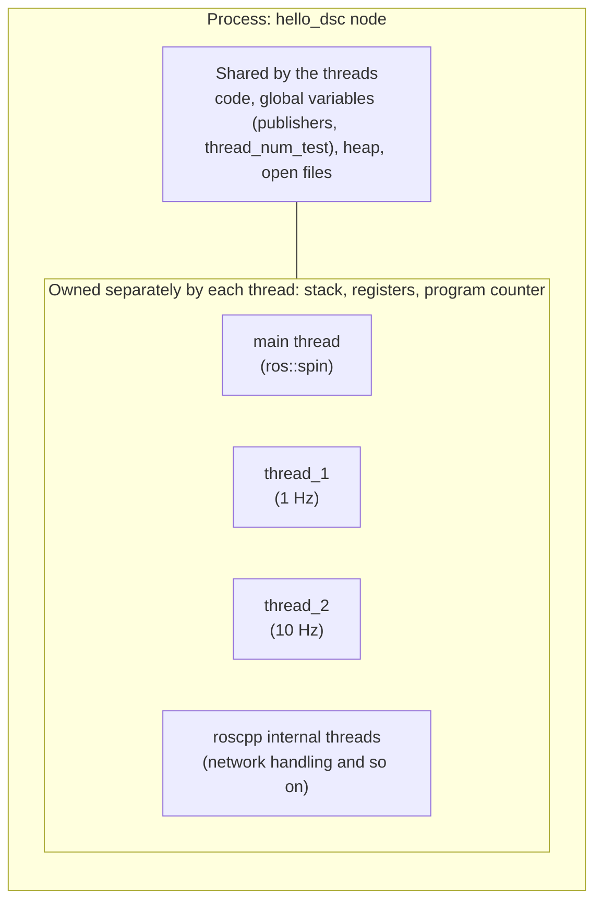
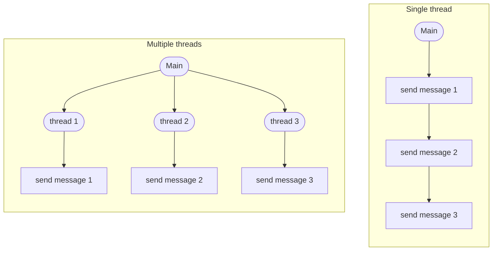
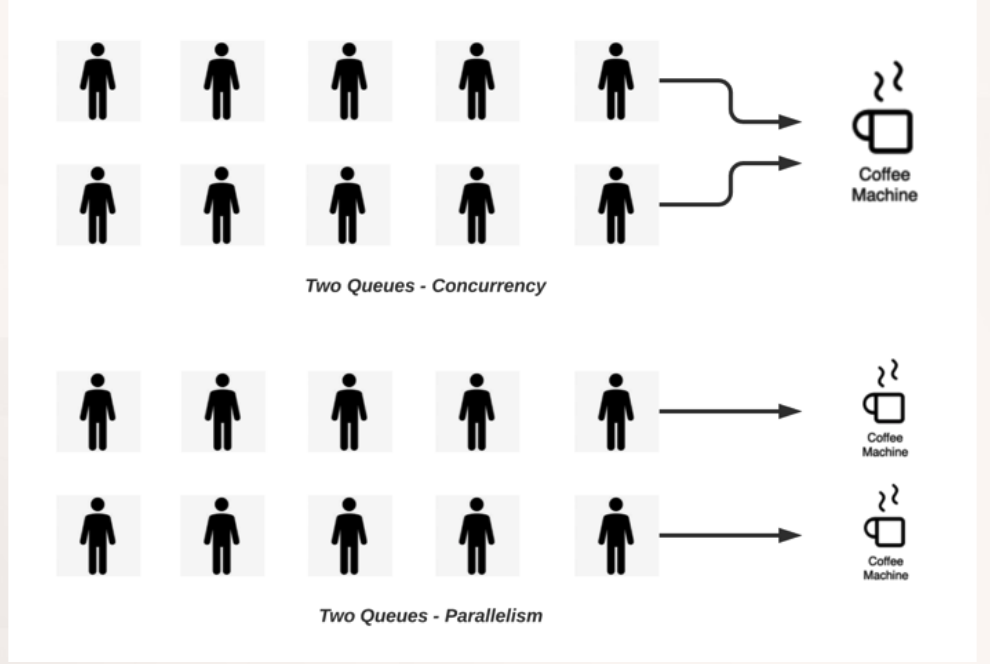
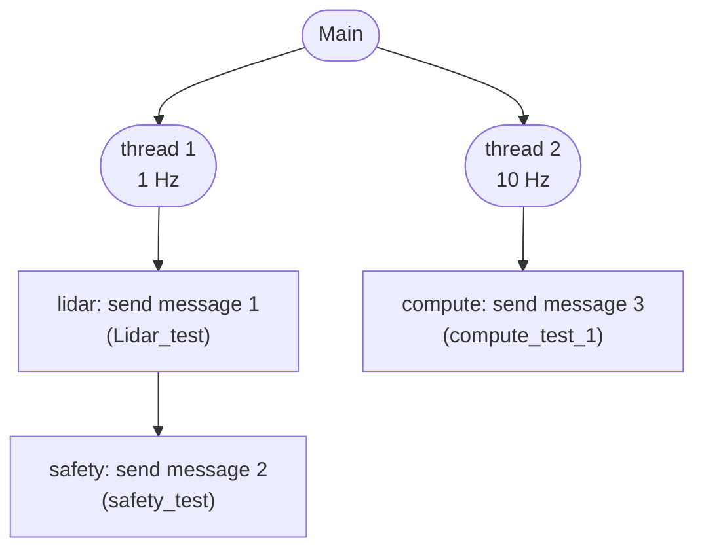
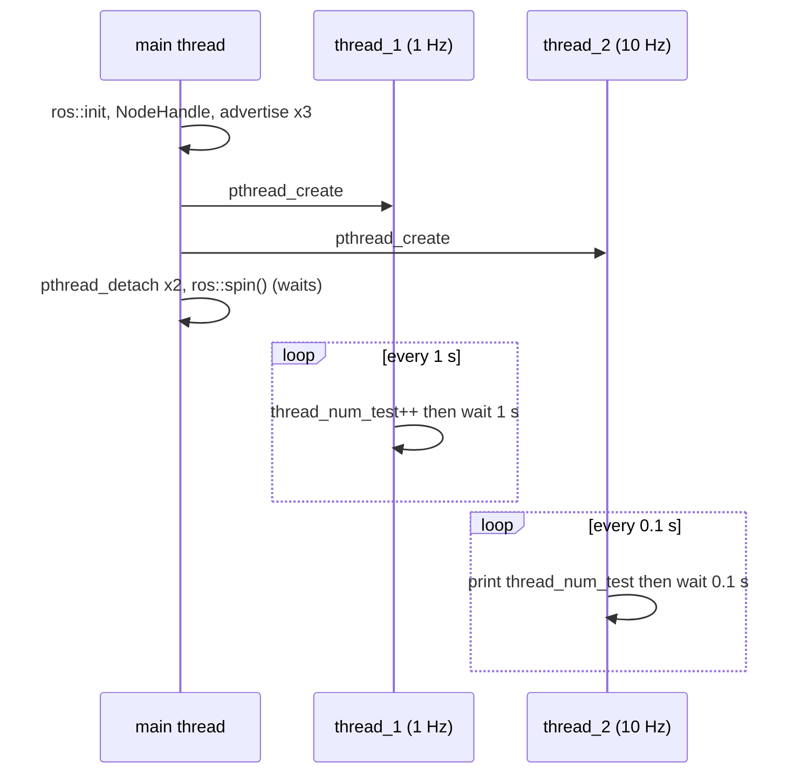
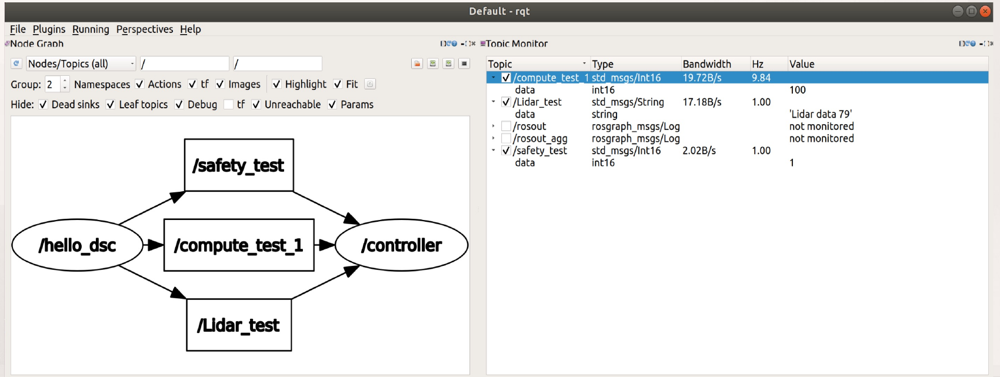
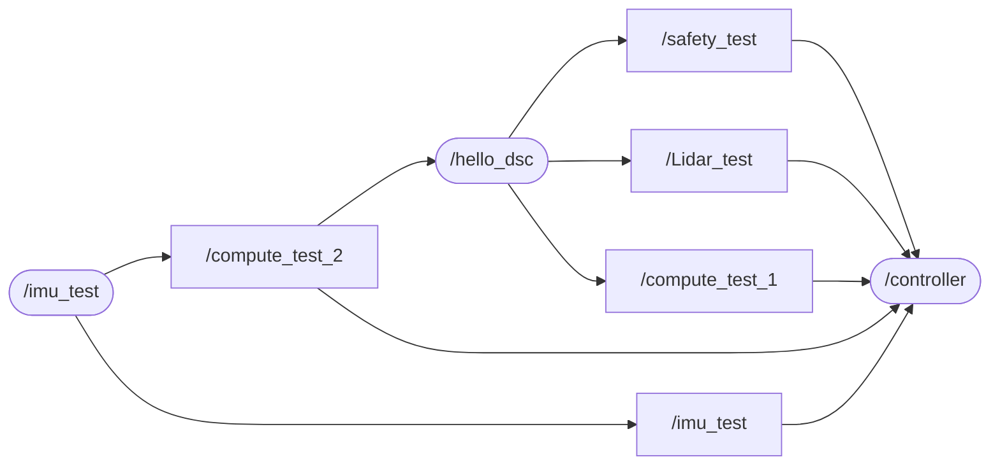
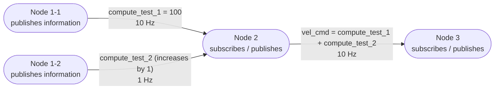
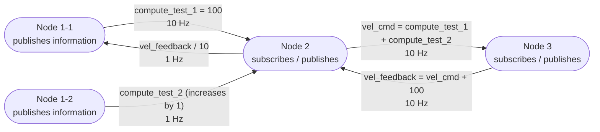

# Week 7 Lecture — Multithreaded Message Passing in ROS Nodes

[Repository Guide](../../README.md) | [English](Concepts_Lecture.md) | [한국어](Concepts_Lecture.ko.md)

> **Last Updated:** 2026-11-04

> **Learning Objectives:**
> 1. Explain the difference between processes and threads, the execution flows of single-threaded and multithreaded programs, and the difference between concurrency and parallelism
> 2. Explain how POSIX threads are created and managed with `pthread_create`, `pthread_detach`, and `pthread_join`, and how their errors are handled
> 3. Explain what each line of the `thread_prac` node, whose threads run at different periods, does and the role played by `ros::spin` in `main`
> 4. Explain the data race that occurs when threads share a global variable and how to protect it with a mutex
> 5. Write a node whose thread functions publish topics at different periods, and compare it with other designs that use `ros::Rate`, `ros::Timer`, or multithreaded spinners
> 6. Explain the structure and data flow of a system in which messages with different periods pass through several nodes

---

## Table of Contents

- [1. Why Topics Are Sent at Different Periods, and Threads](#1-why-topics-are-sent-at-different-periods-and-threads)
  - [1.1 Order of Development](#11-order-of-development)
  - [1.2 Goal: Two Topics with Different Periods](#12-goal-two-topics-with-different-periods)
  - [1.3 Processes and Threads](#13-processes-and-threads)
  - [1.4 Single Thread and Multiple Threads](#14-single-thread-and-multiple-threads)
  - [1.5 Concurrency and Parallelism](#15-concurrency-and-parallelism)
  - [1.6 Designing the Thread Structure](#16-designing-the-thread-structure)
- [2. POSIX Threads](#2-posix-threads)
  - [2.1 What pthread Is](#21-what-pthread-is)
  - [2.2 Order of Use and Main Functions](#22-order-of-use-and-main-functions)
  - [2.3 Form of a Thread Function](#23-form-of-a-thread-function)
  - [2.4 Detaching and Joining](#24-detaching-and-joining)
  - [2.5 Error Handling and Building](#25-error-handling-and-building)
- [3. The thread_prac Example](#3-the-thread_prac-example)
  - [3.1 Complete Code](#31-complete-code)
  - [3.2 Headers and Global Variables](#32-headers-and-global-variables)
  - [3.3 The Thread Functions thread_1 and thread_2](#33-the-thread-functions-thread_1-and-thread_2)
  - [3.4 The main Function](#34-the-main-function)
  - [3.5 Results](#35-results)
  - [3.6 Shared Data and Mutexes](#36-shared-data-and-mutexes)
- [4. Publishing ROS Messages from Threads](#4-publishing-ros-messages-from-threads)
  - [4.1 thread_1: Publishing Two Topics at 1 Hz](#41-thread_1-publishing-two-topics-at-1-hz)
  - [4.2 thread_2: Publishing a Computed Value at 10 Hz](#42-thread_2-publishing-a-computed-value-at-10-hz)
  - [4.3 Results](#43-results)
  - [4.4 Checking with rqt](#44-checking-with-rqt)
  - [4.5 Application: A Node That Both Publishes and Subscribes](#45-application-a-node-that-both-publishes-and-subscribes)
- [5. Several Ways to Create Periods](#5-several-ways-to-create-periods)
  - [5.1 A Single Thread and ros::Rate](#51-a-single-thread-and-rosrate)
  - [5.2 ros::Timer](#52-rostimer)
  - [5.3 Multithreaded Spinners](#53-multithreaded-spinners)
  - [5.4 Comparison of the Methods](#54-comparison-of-the-methods)
- [6. Message Flows with Different Periods Among Several Nodes](#6-message-flows-with-different-periods-among-several-nodes)
  - [6.1 A Node Structure in Three Stages](#61-a-node-structure-in-three-stages)
  - [6.2 Modifying Node 2](#62-modifying-node-2)
  - [6.3 Writing Node 3, vehicle](#63-writing-node-3-vehicle)
  - [6.4 A Structure with Feedback](#64-a-structure-with-feedback)
- [Concept Applications](#concept-applications)
- [Summary](#summary)
- [Self-Check Questions](#self-check-questions)
- [References](#references)

---

<br>

## 1. Why Topics Are Sent at Different Periods, and Threads

### 1.1 Order of Development

Weeks 5 and 6 covered writing and building nodes, passing messages between nodes, and applications with several topics and several nodes. This note covers the next step, topic transmission using multiple threads.

| Step | ROS node development | Covered in |
|:-----|:-----|:-----|
| 1-3 | Writing, building, and checking a ROS node | Week 5 |
| 4 | Message passing between nodes | Week 6 |
| 5 | Applications of message passing between nodes | Week 6 |
| 6 | **Topic transmission using multiple threads** | This note |

*Table 1. Order of ROS node development and the step covered in this note*

### 1.2 Goal: Two Topics with Different Periods

The sender node `hello_dsc` of Week 6 published `Lidar_test` and `safety_test` together in one `while` loop and rested for 1 second with `usleep(1000000)` at the end. The two topics are therefore always published at the same period (1 Hz). In a real robot, however, each kind of data needs its own period. For example, a rotating LiDAR spins about ten times per second to produce point clouds, while the safety state or the control commands of a vehicle may need to be checked and sent more often. The first goal of this note is for one node to send two topics at different periods.


*Figure 1. Structure in which one node sends two topics at different periods*

With one loop and a fixed wait, every task is done at the same period in each iteration. There are several ways to solve this problem (Section 5), and this note first uses **multithreading**, which gives each task its own flow of execution. For this, `hello_dsc.cpp` is modified to allow multiple threads.

### 1.3 Processes and Threads

> **Definition:** A **process** is a program in execution. The operating system gives each process an independent memory space (code, data, heap, stack) and resources. A **thread** is a unit of the several flows executing within a process, and it is the basic unit that the CPU executes [1].

In ROS, one node is one process. The nodes built so far did their work with one flow of execution starting at `main`, that is, with one thread. When several threads are created in one process, each thread runs independently with its own stack, register values, and program counter (the location of the next instruction to execute), while sharing the resources of the process such as the code, global variables, heap, and open files [1].



*Figure 2. Process and thread structure of the hello_dsc node*

Because threads share global variables, they can exchange information through variables without separate communication (Section 3). On the other hand, if several threads change the same variable at the same time, the result can become corrupted, so protection is needed (Section 3.6). Creating a thread is much lighter than creating a new process, and exchanging information between threads is faster than communication between processes [1].

> **[Operating Systems]** The scheduler of the operating system assigns CPU cores in turn to the threads that are ready to run. When a thread calls `usleep`, it enters a waiting state for the given time and does not use the CPU, and other threads run in the meantime. This is why a thread that rests for 1 second and a thread that rests for 0.1 s can each keep their own period in the same process without disturbing each other.

### 1.4 Single Thread and Multiple Threads



*Figure 3. Execution flows of a single thread and multiple threads*

With a single thread, `main` sends messages 1, 2, and 3 in turn. The next task can start only after the previous one ends, so the three messages are tied to the same loop period, and if one task takes long, the others are delayed with it. With multiple threads, `main` creates three threads, and each thread takes charge of sending its own message. Each thread has its own loop and wait, so each message can be sent at a different period.

### 1.5 Concurrency and Parallelism



*Figure 4. Two queues using one coffee machine (concurrency) and two queues using two coffee machines (parallelism)*

Saying that several threads run "together" has two meanings [1].

- **Concurrency:** Running several tasks in turn so that all of them make progress. When two queues take turns at one coffee machine, as at the top of Figure 4, only one person gets coffee at any moment, but both queues shrink. Even with a single CPU core, concurrency arises if the operating system switches between threads quickly.
- **Parallelism:** Actually running several tasks at the same instant. With two coffee machines, as at the bottom of Figure 4, two people get coffee at the same time. This is possible when there are several CPU cores.

The threads of the nodes in this note spend most of their time resting in `usleep`, so even with one core, concurrency alone lets each thread keep its period. Parallelism is needed to finish computation-heavy work faster by dividing it among several cores.

### 1.6 Designing the Thread Structure

The work of `hello_dsc` is divided between two threads as follows. Thread 1 sends LiDAR data (message 1) and the safety state (message 2) at 1 Hz, and thread 2 sends a computed value (message 3) at 10 Hz. `main` creates the two threads and then waits until the node shuts down.



*Figure 5. Structure dividing the work of hello_dsc between two threads*

In this structure, node 1 (`hello_dsc`) sends three topics to node 2 (`controller`): `Lidar_test` (1 Hz), `safety_test` (1 Hz), and `compute_test_1` (10 Hz). Figure 1 put `safety_test` at 10 Hz, but in this structure the value to be sent at 10 Hz is given its own new topic, `compute_test_1`, and `safety_test` is sent at 1 Hz together with `Lidar_test`. Section 3 first checks that the two threads run at their own periods, and Section 4 adds message publishing to the thread functions.

---

<br>

## 2. POSIX Threads

### 2.1 What pthread Is

**POSIX threads (pthread)** form the standard API for parallel processing commonly used on all Unix-like POSIX systems, including Linux. They were standardized as IEEE Std 1003.1c in 1995 and are now part of the POSIX specification (IEEE Std 1003.1) [2]. Windows is not a POSIX system, but pthread can be used there by installing a library that implements it. Other thread APIs may also be used; on Linux, the C++11 standard library's `std::thread` and Boost's `boost::thread`, which ROS uses internally, are also implemented on top of pthread. This note uses pthread.

### 2.2 Order of Use and Main Functions

pthread is used in the following order.

1. **Include the header:** `#include <pthread.h>` includes the header that declares the types and functions of pthread.
2. **Declare thread variables:** Create identifier variables that refer to threads, as in `pthread_t th[2];`. There are two threads, so an array of size 2 is used.
3. **Create threads:** `pthread_create` creates a thread and has it run the specified function.
4. **Detach or join threads:** Decide who reclaims the resources of a finished thread and how (Section 2.4).

| Function | Prototype | What it does |
|:-----|:-----|:-----|
| `pthread_create` | `int pthread_create(pthread_t *thread, const pthread_attr_t *attr, void *(*start_routine)(void *), void *arg);` | Creates a new thread that runs `start_routine(arg)` and stores its identifier in `*thread`. If `attr` is `nullptr`, default attributes are used |
| `pthread_detach` | `int pthread_detach(pthread_t thread);` | Puts the thread in the detached state. The resources of a detached thread are reclaimed automatically when it ends |
| `pthread_join` | `int pthread_join(pthread_t thread, void **retval);` | Waits until the specified thread ends and receives the return value of the thread function in `*retval` |
| `pthread_exit` | `void pthread_exit(void *retval);` | Ends the calling thread. Equivalent to `return` from the thread function |

*Table 2. Main functions of pthread*

All four functions return 0 on success and a nonzero error number on failure (`pthread_exit` does not return) [3].

### 2.3 Form of a Thread Function

A function run by `pthread_create` must take one `void *` and return a `void *`.

```cpp
static void *thread_1(void *unused)
{
    // work of the thread
    return nullptr;
}
```

- **Parameter `void *`:** Receives the fourth argument (`arg`) of `pthread_create` unchanged. A pointer of unspecified type is used so that data of any type can be passed by address. The examples in this note exchange data through global variables, so they pass `nullptr` and name the parameter `unused`.
- **Return type `void *`:** Used to return a thread's result, which can be received through the second argument of `pthread_join`. If there is no result, `nullptr` is returned.
- **`static`:** Makes the function name visible only within this source file. It is a habitual declaration that avoids clashes with the same name in other files and has nothing to do with thread behavior.

> **[Computer Programming]** `void *` is a pointer that does not specify the type of what it points to, so it can hold the address of any object. For example, to give each thread a different period, pass the address `&period_us` of `int period_us = 100000;` as `arg`, and inside the thread function convert it back to its original type and read it, as in `int p = *static_cast<int *>(arg);`. The passed variable must not disappear while the thread reads it.

### 2.4 Detaching and Joining

Even after a thread ends, its exit status and some resources remain until another thread **joins** it or it has been **detached** in advance, at which point they are reclaimed [3].

| Item | `pthread_join` (join) | `pthread_detach` (detach) |
|:-----|:-----|:-----|
| Behavior of the calling thread | Waits until the target thread ends | Returns immediately without waiting |
| Resources of the finished thread | Reclaimed when `pthread_join` returns | Reclaimed automatically the moment the thread ends [4] |
| Return value of the thread function | Can be received | Cannot be received |
| Suitable case | When the thread's result is needed, or cleanup must be done after the thread ends | When a thread is started and there is no need to wait for its end |

*Table 3. Joining and detaching threads*

A joinable thread that is neither joined nor detached becomes a zombie thread whose resources are not reclaimed even after it ends [5]. This example avoids the problem by detaching the two threads right after creating them. Also, when the `main` function returns or any thread calls `exit`, all threads of the process end together, whether detached or not [3]. Therefore `main` must be held so that it does not end first while the other threads work, and in this example `ros::spin()` does that (Section 3.4).

### 2.5 Error Handling and Building

This example prints an error message and ends the program if a return value is nonzero, as follows.

```cpp
if (pthread_create(&th[0], nullptr, thread_1, nullptr) != 0) {
    std::perror("pthread_create 0");
    std::exit(1);
}
```

- **`!= 0`:** pthread functions return 0 on success, so a nonzero value means failure. Causes of failing to create a thread include exceeding the system's limits on the number of threads or memory (`EAGAIN`) [3].
- **`std::perror("...")`:** Prints the given string followed by the description corresponding to the global error variable `errno` to standard error. It is declared in `<cstdio>`.
- **`std::exit(1)`:** Ends the process with exit status 1 (failure). It is declared in `<cstdlib>`.

> **Note:** pthread functions report errors only through their return value and do not set `errno` [6]. `std::perror` may therefore describe a value left in `errno` earlier rather than the cause of the pthread function's failure. To print the exact cause, take the return value and convert it with `strerror`. The following is the code corrected in this way, and it requires `<cstring>` as well.
>
> ```cpp
> int ret = pthread_create(&th[0], nullptr, thread_1, nullptr);
> if (ret != 0) {
>     std::fprintf(stderr, "pthread_create 0: %s\n", std::strerror(ret));
>     std::exit(1);
> }
> ```

A program that uses pthread needs the pthread library at link time. When building with g++ without ROS, give the `-pthread` option, as in `g++ -pthread main.cpp`. In a catkin package, roscpp, linked through `${catkin_LIBRARIES}`, brings in pthread as well, so usually nothing extra is needed; if a link error such as `undefined reference to pthread_create` occurs, add `find_package(Threads REQUIRED)` to `CMakeLists.txt` and put `Threads::Threads` in `target_link_libraries`.

---

<br>

## 3. The thread_prac Example

### 3.1 Complete Code

The following code is an example that turns `hello_dsc` into a multithreaded node and checks that two threads run at their own periods and that information is passed between threads. This code is in [Example_thread_prac.cpp](Example_thread_prac.cpp).

```cpp
#include "ros/ros.h"
#include "std_msgs/String.h"
#include "std_msgs/Int16.h"
#include <sstream>
#include <pthread.h>
#include <cstdio>
#include <cstdlib>
#include <unistd.h>

ros::Publisher hello_dsc_pub1;
ros::Publisher hello_dsc_pub2;
ros::Publisher hello_dsc_pub3;

int16_t thread_num_test;

static void *thread_1(void *unused)
{
    while (ros::ok())
    {
        ROS_INFO("thread 1 working!!!");

        thread_num_test++;
        usleep(1000000);
    }

ErrorExit:
    return nullptr;
}

static void *thread_2(void *unused)
{
    while (ros::ok())
    {
        ROS_INFO("thread 2 working");
        ROS_INFO("thread_num_test: [%d]", thread_num_test);

        usleep(100000);
    }

ErrorExit:
    return nullptr;
}

int main(int argc, char **argv)
{
    ros::init(argc, argv, "hello_dsc");

    ros::NodeHandle n1;

    hello_dsc_pub1 = n1.advertise<std_msgs::String>("Lidar_test", 1000);
    hello_dsc_pub2 = n1.advertise<std_msgs::Int16>("safety_test", 1000);
    hello_dsc_pub3 = n1.advertise<std_msgs::Int16>("compute_test_1", 1000);

    pthread_t th[2];
    if (pthread_create(&th[0], nullptr, thread_1, nullptr) != 0) {
        std::perror("pthread_create 0");
        std::exit(1);
    }

    if (pthread_create(&th[1], nullptr, thread_2, nullptr) != 0) {
        std::perror("pthread_create 1");
        std::exit(1);
    }

    if (pthread_detach(th[0]) != 0) {
        std::perror("pthread_detach 0");
        std::exit(1);
    }

    if (pthread_detach(th[1]) != 0) {
        std::perror("pthread_detach 1");
        std::exit(1);
    }

    ros::spin();

    return 0;
}
```

This program starts the node `hello_dsc`, creates publishers for three topics (`Lidar_test`, `safety_test`, `compute_test_1`), and then runs two threads. Thread 1 increases the global variable `thread_num_test` by 1 every second, and thread 2 prints its value every 0.1 s. At this stage no messages are published yet; publishing is added to the thread functions in Section 4.

### 3.2 Headers and Global Variables

- **`#include "ros/ros.h"`, `"std_msgs/String.h"`, `"std_msgs/Int16.h"`, `<sstream>`:** The same headers as the two-topic sender node of Week 6.
- **`#include <pthread.h>`:** The header for the type (`pthread_t`) and functions (`pthread_create`, `pthread_detach`) of POSIX threads.
- **`#include <cstdio>`, `#include <cstdlib>`, `#include <unistd.h>`:** The headers that declare `std::perror` and `std::exit`, which `main` uses for error handling, and `usleep`, which the thread functions use.
- **`ros::Publisher hello_dsc_pub1;` (likewise `pub2`, `pub3`):** Declares the three publishers as global variables. In Week 6 publishers were local variables inside `main`, but now they are created in `main` and used in the thread functions, so they are made global variables visible in both places. At declaration they are empty publishers connected to no topic, and they are assigned the results of `advertise` in `main`.
- **`int16_t thread_num_test;`:** A global variable for testing the exchange of information between threads. Thread 1 changes its value and thread 2 reads it. A global variable is initialized to 0 even without an initial value.

### 3.3 The Thread Functions thread_1 and thread_2

```cpp
static void *thread_1(void *unused)
{
    while (ros::ok())
    {
        ROS_INFO("thread 1 working!!!");

        thread_num_test++;
        usleep(1000000);
    }

ErrorExit:
    return nullptr;
}
```

- **`static void *thread_1(void *unused)`:** A thread function of the form in Section 2.3. When run by `pthread_create`, it executes from the beginning of this function as a flow separate from `main`.
- **`while (ros::ok())`:** Repeats until the node shuts down (Week 5, Section 5.5). When `Ctrl + C` is pressed, `ros::ok()` becomes `false`, and this thread also ends its loop.
- **`ROS_INFO("thread 1 working!!!");`:** Prints that thread 1 is working in each iteration.
- **`thread_num_test++;`:** Increases the shared variable by 1. Thread 1 runs this every second, so the value grows by 1 per second.
- **`usleep(1000000);`:** Rests for 1 second. Thread 1 runs at about 1 Hz. Other threads keep running while this thread rests.
- **`ErrorExit:` and `return nullptr;`:** When `ros::ok()` becomes `false` and the loop exits, the thread returns `nullptr` and ends. `ErrorExit:` is a label for jumping to error-handling code with `goto`, but this code has no `goto` to this label, so it has no effect on behavior; when the compiler's warnings are enabled (`-Wall`), it warns that the label is unused.

```cpp
static void *thread_2(void *unused)
{
    while (ros::ok())
    {
        ROS_INFO("thread 2 working");
        ROS_INFO("thread_num_test: [%d]", thread_num_test);

        usleep(100000);
    }

ErrorExit:
    return nullptr;
}
```

- **`ROS_INFO("thread 2 working");`:** Prints that thread 2 is working.
- **`ROS_INFO("thread_num_test: [%d]", thread_num_test);`:** Prints the current value of the shared variable changed by thread 1. This line checks that information is passed between threads.
- **`usleep(100000);`:** Rests for 0.1 s. Thread 2 runs at about 10 Hz, so it prints the same value about ten times while thread 1 changes it once.

### 3.4 The main Function

```cpp
ros::init(argc, argv, "hello_dsc");

ros::NodeHandle n1;

hello_dsc_pub1 = n1.advertise<std_msgs::String>("Lidar_test", 1000);
hello_dsc_pub2 = n1.advertise<std_msgs::Int16>("safety_test", 1000);
hello_dsc_pub3 = n1.advertise<std_msgs::Int16>("compute_test_1", 1000);
```

- **`ros::init`, `ros::NodeHandle n1;`:** Initializes the node `hello_dsc` and creates one node handle. Unlike Week 6, all three publishers are created with one handle.
- **`hello_dsc_pub1 = n1.advertise<std_msgs::String>("Lidar_test", 1000);`:** Creates the publisher of the string topic `Lidar_test` and assigns it to the global variable.
- **`hello_dsc_pub2 = ...("safety_test", 1000);`, `hello_dsc_pub3 = ...("compute_test_1", 1000);`:** Create the publishers of the integer topics `safety_test` and `compute_test_1`. `compute_test_1` is the topic of the computed value that thread 2 will send at 10 Hz.

There is a reason these three lines that create publishers come before the code that creates threads. A thread starts running as soon as it is created, so the publishers must be ready before the thread functions use them.

```cpp
pthread_t th[2];
if (pthread_create(&th[0], nullptr, thread_1, nullptr) != 0) { ... }
if (pthread_create(&th[1], nullptr, thread_2, nullptr) != 0) { ... }
if (pthread_detach(th[0]) != 0) { ... }
if (pthread_detach(th[1]) != 0) { ... }
```

- **`pthread_t th[2];`:** An array that stores the identifiers of the two threads.
- **`pthread_create(&th[0], nullptr, thread_1, nullptr)`:** Creates a new thread with default attributes (`nullptr`) that runs `thread_1(nullptr)` and stores its identifier in `th[0]`. The second call runs `thread_2` the same way and stores it in `th[1]`. From the moment these lines run, `main`, `thread_1`, and `thread_2` run together.
- **`pthread_detach(th[0])`, `pthread_detach(th[1])`:** Detach the two threads so that their resources are reclaimed automatically when they end (Section 2.4).
- **Body of each `if` statement:** On failure, prints a message with `std::perror` and ends with `std::exit(1)` (Section 2.5).

```cpp
ros::spin();

return 0;
```

- **`ros::spin();`:** Holds the `main` thread on this line until the node shuts down. This node does not subscribe to any topic yet, so there are no callbacks to process, but without this line `main` would reach `return 0;` at once, the process would end, and the two threads would vanish with it (Section 2.4). If a subscription is later added to this node, its callbacks also run in this `main` thread (Section 4.5).
- **`return 0;`:** Ends the program when `ros::spin()` returns because of `Ctrl + C`. The two detached threads end together with the process, even if they are in `usleep`.



*Figure 6. Order in which the three threads of thread_prac run*

### 3.5 Results

After building with `catkin_make` and running `roscore` and `rosrun hello_ros hello_dsc`, output such as the following continues.

```text
[ INFO] [1676892234.822209687]: thread 2 working
[ INFO] [1676892234.822237600]: thread_num_test: [7]
[ INFO] [1676892234.923880426]: thread 2 working
[ INFO] [1676892234.923912399]: thread_num_test: [7]
[ INFO] [1676892235.023312849]: thread 1 working!!!
[ INFO] [1676892235.025108439]: thread 2 working
[ INFO] [1676892235.025122578]: thread_num_test: [8]
[ INFO] [1676892235.130591489]: thread 2 working
[ INFO] [1676892235.130618181]: thread_num_test: [8]
[ INFO] [1676892235.231727015]: thread 2 working
[ INFO] [1676892235.231757316]: thread_num_test: [8]
[ INFO] [1676892235.338881783]: thread 2 working
[ INFO] [1676892235.338916972]: thread_num_test: [8]
[ INFO] [1676892235.440182669]: thread 2 working
[ INFO] [1676892235.440213552]: thread_num_test: [8]
[ INFO] [1676892235.540270543]: thread 2 working
[ INFO] [1676892235.540303991]: thread_num_test: [8]
[ INFO] [1676892235.641595370]: thread 2 working
[ INFO] [1676892235.641622753]: thread_num_test: [8]
[ INFO] [1676892235.743886660]: thread 2 working
[ INFO] [1676892235.743913079]: thread_num_test: [8]
[ INFO] [1676892235.844138116]: thread 2 working
[ INFO] [1676892235.844169141]: thread_num_test: [8]
```

- **The two threads run at different periods.** `thread 2 working` is printed about every 0.1 s, and `thread 1 working!!!` about every 1 second. The eleven `thread 2 working` lines in the output (from 234.822 s to 235.844 s) are spaced on average $(235.844138116 - 234.822209687) / 10 \approx 0.102$ s apart.
- **Information passes between the threads.** Right after thread 1 changes `thread_num_test` from 7 to 8 at 235.023 s, thread 2 prints 8. This is because both threads look at the same global variable.
- **The execution order is decided by the operating system.** The order in which the output lines of the two threads interleave is set not by the order written in the code but by when the operating system wakes and runs the threads. Whether thread 1 changes the value before or after thread 2 reads it can also differ from run to run.

### 3.6 Shared Data and Mutexes

`thread_num_test` is written by thread 1 and read by thread 2. When two or more threads access the same memory location, at least one of them writing, without synchronization that orders the two accesses, this is called a **data race**. The C++ standard leaves the behavior of a program with a data race undefined [7].

`thread_num_test++` is one line, but in machine code it is three steps: "read the value from memory, add 1, write it to memory". If two threads increase the same variable at the same time, one increment can be lost, as follows.

```text
Time   Thread A                    Thread B                    Value in memory
 1     read value (7)                                          7
 2                                 read value (7)              7
 3     write 7 + 1 = 8                                         8
 4                                 write 7 + 1 = 8             8   (should be 9)
```

*Figure 7. Execution order in which one increment is lost when two threads increment the same variable at once*

In this example there is only one writing thread and the 16-bit integer is read and written in one access, so a wrong value is rarely seen in practice. However, this only happens to work on particular hardware and compilers, and when more threads write or the shared data becomes a struct with several fields, values do become corrupted. Shared data is protected with a **mutex (mutual exclusion)**. A mutex is a lock that only one thread can hold at a time; until the holding thread releases it, other threads wait at the point where they try to lock it. The following is the code of the two thread functions of Section 3.1 corrected to be protected by a mutex.

```cpp
pthread_mutex_t num_mutex = PTHREAD_MUTEX_INITIALIZER;   // global mutex

static void *thread_1(void *unused)
{
    while (ros::ok())
    {
        ROS_INFO("thread 1 working!!!");

        pthread_mutex_lock(&num_mutex);      // lock: other threads wait here
        thread_num_test++;
        pthread_mutex_unlock(&num_mutex);    // unlock
        usleep(1000000);
    }
    return nullptr;
}

static void *thread_2(void *unused)
{
    while (ros::ok())
    {
        pthread_mutex_lock(&num_mutex);
        int16_t value = thread_num_test;     // only copy while locked
        pthread_mutex_unlock(&num_mutex);

        ROS_INFO("thread 2 working");
        ROS_INFO("thread_num_test: [%d]", value);
        usleep(100000);
    }
    return nullptr;
}
```

- **`PTHREAD_MUTEX_INITIALIZER`:** A macro that initializes a global mutex with default attributes.
- **`pthread_mutex_lock`, `pthread_mutex_unlock`:** Make the code between them (the critical section) run in only one thread at a time. Doing long work such as `usleep` or printing while holding the lock makes other threads wait for that time, so the critical section only reads or writes the shared variable and releases the lock at once.

If a single variable is only increased or read, the C++11 atomic variable `std::atomic<int16_t> thread_num_test;` (header `<atomic>`) may be used instead. `++` and reads of an atomic variable are executed as indivisible operations, so no data race arises even without a mutex [7].

> **[Operating Systems]** A section of code in which several threads access shared data is called a **critical section**, and a situation in which the result depends on the order of execution is called a **race condition**. A mutex is a mutual-exclusion tool that lets only one thread enter a critical section; when two threads each wait for a mutex held by the other, a **deadlock** in which both stop forever can occur, so when several mutexes are locked, their order is fixed in advance.

---

<br>

## 4. Publishing ROS Messages from Threads

### 4.1 thread_1: Publishing Two Topics at 1 Hz

Now ROS message transmission is implemented in the thread functions. Thread 1 takes over the work that the loop of `hello_dsc` did in Week 6, namely sending `Lidar_test` (message `msg`) and `safety_test` (message `msg_safety`) at 1 Hz. `count` and `true_false_test`, used for this work, are added as global variables below the global variables of Section 3.1, as follows.

```cpp
int count = 0;
int16_t true_false_test = 0;
```

```cpp
static void *thread_1(void *unused)
{
    while (ros::ok())
    {
        ROS_INFO("thread 1 working!!!");

        std_msgs::String msg;
        std_msgs::Int16 msg_safety;

        std::stringstream ss;

        ss << "Lidar data " << count;
        msg.data = ss.str();

        msg_safety.data = true_false_test;

        ROS_INFO("%s", msg.data.c_str());
        ROS_INFO("%d", msg_safety.data);

        hello_dsc_pub1.publish(msg);
        hello_dsc_pub2.publish(msg_safety);

        count++;
        if (true_false_test == 0)
            true_false_test = 1;
        else if (true_false_test == 1)
            true_false_test = 0;

        thread_num_test++;
        usleep(1000000);
    }

ErrorExit:
    return nullptr;
}
```

The body of the loop is the same as the sender node of Week 6, Section 4.3, with the following two differences.

- **The publishers are global variables.** `hello_dsc_pub1.publish(msg);` and `hello_dsc_pub2.publish(msg_safety);` publish through global publishers prepared with `advertise` in `main`. Only thread 1 uses these two publishers and only thread 2 uses `hello_dsc_pub3`, so no publisher is shared by two threads.
- **The test of information exchange between threads remains.** `thread_num_test++` increases the shared variable every second, as in Section 3. `count` also increases by 1 at the same moment, so the two values grow together.

`count` and `true_false_test` are global variables, but only thread 1 writes and reads them, so there is no data race.

### 4.2 thread_2: Publishing a Computed Value at 10 Hz

Thread 2 sends the value 100, imitating a computation result, on `compute_test_1` (message `msg_compute`) at 10 Hz.

```cpp
static void *thread_2(void *unused)
{
    while (ros::ok())
    {
        ROS_INFO("thread 2 working");
        ROS_INFO("thread_num_test: [%d]",
            thread_num_test);

        std_msgs::Int16 msg_compute;

        msg_compute.data = 100;

        hello_dsc_pub3.publish(msg_compute);

        usleep(100000);
    }

ErrorExit:
    return nullptr;
}
```

- **`std_msgs::Int16 msg_compute;`:** Creates a new integer message for the computed value in each iteration.
- **`msg_compute.data = 100;`:** Puts the fixed value 100 instead of a real computation. In a real node, a value such as a control quantity computed from sensor data would go here.
- **`hello_dsc_pub3.publish(msg_compute);`:** Publishes on the topic `compute_test_1`. It rests 0.1 s each time with `usleep(100000)`, so the rate is about 10 Hz.

With this, the single node `hello_dsc` publishes `Lidar_test` and `safety_test` at 1 Hz and `compute_test_1` at 10 Hz (Figure 5).

### 4.3 Results

In the receiver node `controller`, a subscriber to `compute_test_1` and its callback function are added to the two subscribers of Week 6. The callback function takes a `std_msgs::Int16::ConstPtr`, like `SensorSafetyCallback` of Week 6, and prints in the format `compute_1_check: [%d]`. After building and running `roscore`, `hello_dsc`, and `controller`, the sender node prints the following.

```text
[ INFO] [1676893320.408331095]: thread_num_test: [17]
[ INFO] [1676893320.475497905]: thread 1 working!!!
[ INFO] [1676893320.475549795]: Lidar data 17
[ INFO] [1676893320.475563711]: 1
[ INFO] [1676893320.510882767]: thread 2 working
[ INFO] [1676893320.510922184]: thread_num_test: [18]
[ INFO] [1676893320.614872383]: thread 2 working
[ INFO] [1676893320.614964884]: thread_num_test: [18]
```

The receiver node prints the following.

```text
[ INFO] [1676893315.396680826]: compute_1_check: [100]
[ INFO] [1676893315.471526403]: hello_dsc_check: [Lidar data 12]
[ INFO] [1676893315.471551370]: safety_check: [0]
[ INFO] [1676893315.498374077]: compute_1_check: [100]
[ INFO] [1676893315.599751434]: compute_1_check: [100]
[ INFO] [1676893315.700516132]: compute_1_check: [100]
[ INFO] [1676893315.800761373]: compute_1_check: [100]
[ INFO] [1676893315.907122151]: compute_1_check: [100]
[ INFO] [1676893316.007452966]: compute_1_check: [100]
[ INFO] [1676893316.108426760]: compute_1_check: [100]
[ INFO] [1676893316.208783265]: compute_1_check: [100]
[ INFO] [1676893316.310098441]: compute_1_check: [100]
[ INFO] [1676893316.410855048]: compute_1_check: [100]
[ INFO] [1676893316.472672934]: hello_dsc_check: [Lidar data 13]
[ INFO] [1676893316.472709885]: safety_check: [1]
```

- In the sender node, the output of thread 1 (`thread 1 working!!!`, `Lidar data 17`, `1`) appears once per second, and the output of thread 2 every 0.1 s. `thread_num_test` changes from 17 to 18 after `Lidar data 17` is published because `count` and `thread_num_test` increase together in thread 1.
- In the receiver node, `compute_1_check: [100]` is printed ten times between `Lidar data 12` (315.47 s) and `Lidar data 13` (316.47 s). The messages sent by two threads of one node arrive in the same 1 : 10 ratio as the messages sent by two nodes in Week 6, Section 5.3. The receiver node does not distinguish whether messages came from different threads of one node or from different nodes.

### 4.4 Checking with rqt

Running `rqt` and opening the Node Graph and Topic Monitor plugins shows both the connections between nodes and the actual frequencies of the topics.



*Figure 8. hello_dsc and controller viewed in the Node Graph and Topic Monitor of rqt*

In the Node Graph on the left of Figure 8, ellipses are nodes and rectangles are topics; `/hello_dsc` publishes three topics (`/safety_test`, `/compute_test_1`, `/Lidar_test`), and `/controller` subscribes to all three. How many threads a node has does not appear in the graph. The values in the Topic Monitor on the right are as follows.

| Topic | Type | Bandwidth | Hz | Value |
|:-----|:-----|:-----|:-----|:-----|
| `/compute_test_1` | `std_msgs/Int16` | 19.72 B/s | 9.84 | 100 |
| `/Lidar_test` | `std_msgs/String` | 17.18 B/s | 1.00 | `'Lidar data 79'` |
| `/safety_test` | `std_msgs/Int16` | 2.02 B/s | 1.00 | 1 |
| `/rosout`, `/rosout_agg` | `rosgraph_msgs/Log` | (not monitored) | | |

*Table 4. Bandwidth and frequency of each topic shown in the Topic Monitor*

- **Frequency (Hz):** `compute_test_1` targets 10 Hz but was measured at 9.84 Hz. As a period this is $1 / 9.84 \approx 0.1016$ s, the result of the running time of the loop body being added to the 0.1 s of `usleep(100000)`. The two 1 Hz topics are at 1.00 Hz.
- **Bandwidth:** The number of message bytes transmitted per second, roughly "serialized size of one message × frequency". A `std_msgs/Int16` message is 2 bytes, so `safety_test` gives $2 \times 1.00 \approx 2$ B/s and `compute_test_1` gives $2 \times 9.84 \approx 19.7$ B/s. A string is serialized as a 4-byte integer giving its length followed by its characters [8], so `'Lidar data 79'` (13 characters) is $4 + 13 = 17$ bytes, about 17 B/s at 1 Hz.
- **`/rosout`, `/rosout_agg`:** Topics on which the log messages printed with `ROS_INFO` are published (Week 5, Section 5.7). With their check boxes off, they are not monitored.

### 4.5 Application: A Node That Both Publishes and Subscribes

As an application, if the `imu_test` node of Week 6 is extended to also publish the topic `compute_test_2`, and `hello_dsc` and `controller` subscribe to it, the node graph becomes the following.



*Figure 9. Node graph extended with compute_test_2*

In this structure, `hello_dsc` publishes three topics and at the same time subscribes to `compute_test_2`. While the two threads publish, keeping their own periods with `usleep`, `ros::spin()` in the `main` thread processes the callbacks of `compute_test_2`. The `ros::spin()` that "had no callbacks to process" in Section 3.4 takes on a real role here. If the callback function stores the received value in a global variable and a publishing thread reads that value, the global variable must be protected by the methods of Section 3.6.

---

<br>

## 5. Several Ways to Create Periods

pthread with `usleep` is one of several ways to do work at different periods in one node. This section compares ways of reaching the same goal (`Lidar_test` and `safety_test` at 1 Hz and `compute_test_1` at 10 Hz) with features provided by ROS.

### 5.1 A Single Thread and ros::Rate

The loop runs at the fastest period (10 Hz), and the slow work is done only once every ten iterations by counting the iterations.

```cpp
ros::Rate loop_rate(10);                     // 10 Hz
int tick = 0;
while (ros::ok())
{
    publishCompute();                        // compute_test_1: every iteration (10 Hz)
    if (tick % 10 == 0)
        publishLidarAndSafety();             // Lidar_test, safety_test: once every ten (1 Hz)
    tick++;

    ros::spinOnce();                         // processes callbacks of subscribed topics
    loop_rate.sleep();                       // rests for the remaining time to keep the 0.1 s period
}
```

`publishCompute()` and `publishLidarAndSafety()` are the loop bodies of Sections 4.1 and 4.2 bundled into functions. `ros::Rate` rests only for the time left after subtracting the running time of the body, so its period is more accurate than with `usleep` (Week 5, Section 6.4) [9]. With only one thread there is the advantage that shared data needs no protection, but if one task takes long, the periods of the other tasks slip with it.

### 5.2 ros::Timer

A ROS **timer** schedules a callback function to be called at a fixed period [10].

```cpp
void lidarTimerCallback(const ros::TimerEvent&)      // called every 1 s
{
    publishLidarAndSafety();
}

void computeTimerCallback(const ros::TimerEvent&)    // called every 0.1 s
{
    publishCompute();
}

int main(int argc, char **argv)
{
    ros::init(argc, argv, "hello_dsc");
    ros::NodeHandle n1;
    // ... the three advertise lines ...
    ros::Timer timer1 = n1.createTimer(ros::Duration(1.0), lidarTimerCallback);
    ros::Timer timer2 = n1.createTimer(ros::Duration(0.1), computeTimerCallback);
    ros::spin();                                     // timer callbacks also run here
    return 0;
}
```

- **`n1.createTimer(ros::Duration(1.0), lidarTimerCallback)`:** Creates a timer that calls `lidarTimerCallback` every 1.0 s. As with subscribers, the returned `ros::Timer` object must be stored for the timer to persist.
- **`const ros::TimerEvent&`:** The parameter of a timer callback, holding information such as the time this call was scheduled for and the actual time.
- **`ros::spin()`:** Timer callbacks go into the same callback queue as subscription callbacks and run in the thread that called `ros::spin()`.

A timer manages its period in ROS time, and all callbacks run in turn in one thread, so no data race arises between callbacks. However, a timer is not a device that guarantees real-time behavior, so it is not suitable for strict real-time control [10].

### 5.3 Multithreaded Spinners

A node with many or slow callbacks can let several threads process the callback queue together [11].

```cpp
ros::AsyncSpinner spinner(2);    // two threads to process callbacks
spinner.start();                 // starts processing callbacks in separate threads
ros::waitForShutdown();          // main waits until the node shuts down
```

`ros::AsyncSpinner` creates the given number of threads and processes callbacks in parallel, and `ros::MultiThreadedSpinner` does the same without returning from the place where it is called, like `ros::spin()`. Combined with the timers of Section 5.2, the 10 Hz callback runs on time in another thread even if the 1 Hz callback takes long. In exchange, callbacks actually run at the same time, so data shared between callbacks must be protected as in Section 3.6.

### 5.4 Comparison of the Methods

| Method | Accuracy of the period | Protection of shared data | When one task is late | Characteristics |
|:-----|:-----|:-----|:-----|:-----|
| pthread with `usleep` (this note) | The period grows by the body time | Needed | Other threads are not affected | A general threading technique independent of ROS, whose behavior is visible directly in the code |
| A single thread with `ros::Rate` | Accurate, resting after subtracting the body time | Not needed | All tasks are delayed together | The simplest; suitable when the periods are integer multiples |
| `ros::Timer` with `ros::spin` | Scheduled in ROS time | Not needed | Other callbacks in the same thread wait | The conventional ROS method; also follows the time of bag playback |
| `ros::Timer` with a multithreaded spinner | Scheduled in ROS time | Needed | Callbacks in other threads run on time | Suitable for nodes with many or heavy callbacks |

*Table 5. Comparison of methods for doing work at different periods in one node*

---

<br>

## 6. Message Flows with Different Periods Among Several Nodes

### 6.1 A Node Structure in Three Stages

The final application is a system in which messages with different periods pass through several nodes.



*Figure 10. A node structure in three stages*

- **Node 1-1:** Sends the value 100 on `compute_test_1` at 10 Hz (the same work as thread 2 in Section 4.2).
- **Node 1-2:** Sends on `compute_test_2` a value that grows by 1 every second.
- **Node 2:** Subscribes to the two topics, keeps their latest values, and publishes the velocity command `vel_cmd`, their sum, at 10 Hz. It is a node that both subscribes and publishes.
- **Node 3:** Subscribes to `vel_cmd`.

To build this structure, node 2 (`controller`) is (1) modified so that it can publish with multiple threads, (2) made to receive data from different nodes, (3) made to compute with the data and put the result into a message, and (4) made to publish the `vel_cmd` message. Node 3 is newly written to receive the data sent by node 2.

Note that the inputs have different periods. Node 2 publishes at 10 Hz, but `compute_test_2` changes only once per second, so `vel_cmd` sends the same value ten times and then changes by 1. For example, if the latest value of `compute_test_2` is 5, `vel_cmd` sends $100 + 5 = 105$ ten times, and after the new value 6 arrives it sends 106. This way of holding the last value of a slow input until the next value arrives and using it at a faster period is called a **zero-order hold**.

### 6.2 Modifying Node 2

The following three things are added to `controller.cpp` so that it can publish with multiple threads.

```cpp
#include <pthread.h>                                          // pthread header for using multiple threads

ros::Publisher vel_cmd_pub;                                   // global publisher for vel_cmd

vel_cmd_pub = n.advertise<std_msgs::Int16>("vel_cmd", 1000);  // create the publisher in main
```

Then a thread function that sends `vel_cmd` at 10 Hz is implemented.

```cpp
static void *thread_1(void *unused)
{
    while (ros::ok())
    {
        ROS_INFO("Controller thread 1 working!!!");

        std_msgs::Int16 msg_vel_com;

        msg_vel_com.data = compute_1 + compute_2;

        ROS_INFO("vel com: [%d]", msg_vel_com.data);

        vel_cmd_pub.publish(msg_vel_com);

        usleep(100000);
    }

ErrorExit:
    return nullptr;
}
```

- **`#include <pthread.h>`, `ros::Publisher vel_cmd_pub;`:** As in `hello_dsc` of Section 3, include the pthread header and declare the publisher used in the thread function as a global variable.
- **`vel_cmd_pub = n.advertise<std_msgs::Int16>("vel_cmd", 1000);`:** In `main`, before the thread is created, creates the integer publisher of the topic `vel_cmd`.
- **`compute_1`, `compute_2`:** Global variables holding the latest values of `compute_test_1` and `compute_test_2`. The callback functions of the two topics store `msg->data` in these variables each time they receive a message.
- **`msg_vel_com.data = compute_1 + compute_2;`:** Adds the latest values of the two inputs and puts the sum into the velocity command message.
- **`vel_cmd_pub.publish(msg_vel_com);` and `usleep(100000);`:** Publish `vel_cmd` at about 10 Hz.

`main` creates and detaches the thread as in Section 3.4 and then calls `ros::spin()`. The callback functions then write `compute_1` and `compute_2` in the `main` thread, and the publishing thread reads the same variables. Because different threads access the same variables, it is correct to protect them with the mutex or atomic variables of Section 3.6.

### 6.3 Writing Node 3, vehicle

Create `vehicle.cpp` in the `hello_ros > src` folder and add the following to `CMakeLists.txt`.

```cmake
# Name of the executable to build: vehicle
add_executable(vehicle src/vehicle.cpp)

# Link the libraries to the executable
target_link_libraries(vehicle
  ${catkin_LIBRARIES}
)
```

Enter the following code, which receives `vel_cmd` messages, in `vehicle.cpp`.

```cpp
#include "ros/ros.h"
#include "std_msgs/Int16.h"

void VelCmdCallback(const std_msgs::Int16::ConstPtr& msg)
{
    ROS_INFO("vel_cmd_check: [%d]", msg->data);
}

int main(int argc, char **argv)
{
    ros::init(argc, argv, "vehicle");
    ros::NodeHandle n;
    ros::Subscriber sub = n.subscribe("vel_cmd", 1000, VelCmdCallback);
    ros::spin();
    return 0;
}
```

This is a receiver node with the same structure as `controller` in Week 6, Section 3. The node name is `vehicle`, the subscribed topic is `vel_cmd`, and the message type is `std_msgs/Int16`, and it prints the received velocity command in the format `vel_cmd_check: [%d]`. In a real vehicle, this is where the velocity command would be sent to the drive unit (the CAN node of Week 14).

### 6.4 A Structure with Feedback

In the structure of Section 6.1, messages flow in only one direction, from node 1 to node 3. Adding the following two flows produces a structure with **feedback**, in which the result of a downstream node returns to an upstream node.



*Figure 11. A node structure with feedback*

- **Node 3 → node 2:** Node 3 sends back to node 2, at 10 Hz, the received `vel_cmd` plus 100 as `vel_feedback`. This corresponds to a drive unit that received a velocity command in a real vehicle sending back the actual speed it measured.
- **Node 2 → node 1-1:** Node 2 sends the received `vel_feedback` divided by 10 to node 1-1 at 1 Hz.

In this structure, node 2 publishes at two periods, 10 Hz (`vel_cmd`) and 1 Hz (`vel_feedback / 10`), and subscribes to two inputs and one feedback, and node 3 and node 1-1 also both subscribe and publish. Therefore, to the four tasks of node 2 in Section 6.1 are added (5) receiving the message sent by node 3 and (6) sending a message to node 1-1, and node 3 gains (2) sending a message to node 2. Publishing at two periods within one node can be handled by the multithreaded structure of Sections 3 and 4, and sending received messages out at a different period by the zero-order hold of Section 6.1. When feedback arriving at 10 Hz is sent at 1 Hz, the nine values in between go unused and only the latest value is passed on.

> **Key Point:** The data flow between nodes is designed with topic names and periods. Each node keeps the latest values of the messages it receives and computes and publishes at its own period. When work with different periods gathers in one node, the flows of execution are separated with threads or timers, and the data shared between the flows is protected by synchronization.

---

<br>

## Concept Applications

| Situation | Result and Reason |
|:-----|:------------|
| `ros::spin();` is removed from `main` in Section 3.1. | **The node ends at once and the threads print almost nothing.** When `main` reaches `return 0;`, the process ends and the detached threads vanish with it. |
| The two `pthread_detach` lines are removed, and `pthread_join(th[0], nullptr); pthread_join(th[1], nullptr);` is placed after `ros::spin();`. | **When `Ctrl + C` is pressed, the program waits until both threads finish their loops before ending.** If thread 1 is in `usleep(1000000)`, it checks `ros::ok()` again and ends after at most about 1 second. |
| In the node of Section 4, the three `advertise` lines that create the publishers are moved after `pthread_create`. | **A thread may try to publish through an empty publisher not yet connected to a topic.** Threads start running as soon as they are created, and `publish()` on an empty publisher trips `ROS_ASSERT`: a default (non-Release) build aborts the node, and a Release build silently sends nothing. There is also a data race between `main`, which assigns the publisher variables, and the threads that read them. Publishers are prepared before the threads are created. |
| `usleep(1000000)` of thread 1 is changed to `usleep(500000)`. | **Thread 2 prints each value of `thread_num_test` about five times.** Thread 1 changes the value every 0.5 s and thread 2 reads it every 0.1 s. |
| Two threads both run `thread_num_test++` 1000 times per second without a mutex. | **After 10 seconds the value can be less than 20000.** When reads, additions, and writes interleave, increments are lost (Section 3.6). |
| This node is run in a virtual machine with only one CPU core. | **The two threads still run at their own periods.** The threads spend most of their time resting in `usleep`, so concurrency alone, sharing one core in turn, is enough. |
| `compute_test_1` is changed to be published every 0.1 s by a `ros::Timer`. | **The period stays closer to 0.1 s.** A timer schedules its callback at fixed times instead of adding the running time of the loop body to the period. |

*Table 6. Results and reasons for situations involving multithreaded nodes*

**True/False Check:**

| Statement | Judgment and Reason |
|:-----|:------------|
| The threads of one process share global variables but have separate stacks. | **T.** Code, global variables, and the heap are shared, while each thread has its own stack, registers, and program counter. |
| Concurrency requires several CPU cores. | **F.** Even with one core, running tasks in turn gives concurrency. Parallelism is what requires several cores. |
| When `pthread_create` fails, the cause is stored in `errno`. | **F.** pthread functions only return an error number and do not set `errno`. |
| Detached threads keep running after `main` returns. | **F.** When `main` returns, the process ends and all threads end, detached or not. |
| `thread_num_test++` is one line, so it is safe for several threads to run it at the same time. | **F.** It runs as three steps (read, add, write), so running it concurrently without synchronization causes a data race. |
| `rqt_graph` also shows the threads running in a node. | **F.** It shows only nodes and topics; topics published by several threads of one node are all drawn as arrows from that node. |
| Callbacks of `ros::Timer` run in the thread that called `ros::spin()`. | **T.** Timer callbacks also run through the same callback queue as subscription callbacks. |

---

<br>

## Summary

| Concept | Key Summary |
|:--------|:------------|
| Need for different periods | With one loop and a fixed wait, all topics have the same period, so giving each kind of data its own period requires separating the flows of execution or computing the periods. |
| Processes and threads | A process is a running program with its own memory, and a thread is a flow of execution within it that shares code, global variables, and the heap while having its own stack and registers. |
| Concurrency and parallelism | Concurrency is making progress on several tasks in turn, and parallelism is actually running them at the same time on several cores. |
| pthread | The POSIX standard thread API; threads are created with `pthread_create`, their resource reclamation is set with `pthread_detach` or `pthread_join`, and the functions return 0 or an error number. |
| Thread function | It has the form `void *f(void *arg)`, receiving data through `arg` and returning its result as `void *`. |
| Detaching and joining | A detached thread's resources are reclaimed automatically when it ends, and joining waits until it ends and receives its return value. When `main` returns, all threads end. |
| thread_prac | After creating three global publishers, it runs thread 1 with a 1 s period and thread 2 with a 0.1 s period, and `main` keeps the node alive with `ros::spin()`. |
| Information exchange between threads | Values are exchanged through global variables, and the value changed by thread 1 is read by thread 2 at its next output. |
| Data races and mutexes | Writing and reading the same variable without synchronization makes the behavior undefined, so the critical section is protected with a mutex or an atomic variable is used. |
| Publishing from threads | Thread 1 publishes `Lidar_test` and `safety_test` at 1 Hz and thread 2 publishes `compute_test_1` at 10 Hz, and the receiver node does not distinguish whether the source is a thread or a node. |
| Topic Monitor | It shows the actual frequency and bandwidth of topics, and the bandwidth is close to the product of the serialized message size and the frequency. |
| Other designs | A single thread with `ros::Rate`, `ros::Timer`, and multithreaded spinners can also create several periods, differing in accuracy, need for synchronization, and the effect of delays. |
| Multistage node flow | Node 2 adds the latest values of two inputs and publishes `vel_cmd` at 10 Hz, and the slow input is held until its next value arrives (zero-order hold). |
| Feedback structure | The result of a downstream node is sent back to an upstream node, so one node both subscribes and publishes at several periods. |

---

<br>

## Self-Check Questions

1. **Why threads are needed:** To send `Lidar_test` at 1 Hz and `safety_test` at 10 Hz from `hello_dsc` of Week 6, explain why this cannot be done directly with one loop and one `usleep`, and describe how multithreading solves it.

   <details>
   <summary>Answer</summary>

   In one loop, every task in the body runs once per iteration and the loop rests for the same time, so the two topics are published at the same period. With multiple threads, a loop that publishes `Lidar_test` and rests 1 second and a loop that publishes `safety_test` and rests 0.1 s are placed in different thread functions, so the two flows run at the same time, each at its own period.

   </details>

2. **Shared and unshared:** In the program of Section 3.1, classify `thread_num_test`, `hello_dsc_pub1`, the local variables inside `thread_1`, and the `th` array of `main` into those all threads can access and those that are only on one thread's stack.

   <details>
   <summary>Answer</summary>

   `thread_num_test` and `hello_dsc_pub1`, being global variables, are in the data area of the process and can be accessed by all threads. Local variables declared inside `thread_1` (`msg`, `ss`, and so on in Section 4.1) are on the stack of thread 1, and the `th` array of `main` is on the stack of the `main` thread. Unless another thread is given their addresses, these local variables cannot be accessed.

   </details>

3. **Arguments of pthread_create:** State what each of the four arguments of `pthread_create(&th[1], nullptr, thread_2, nullptr)` is, and explain what must be changed to pass the period (in microseconds) to the thread function as an argument.

   <details>
   <summary>Answer</summary>

   The first argument is where the identifier of the new thread is stored, the second is the thread attributes (defaults if `nullptr`), the third is the function the thread runs, and the fourth is the argument passed to that function. To pass the period, keep a variable that does not disappear while the thread runs, such as `static int period2 = 100000;`, pass `&period2` as the fourth argument, and in the thread function read it with `int p = *static_cast<int *>(unused);` and use it in `usleep(p)`. It is also better to rename the parameter to something meaningful such as `arg`.

   </details>

4. **Role of main:** Explain what stays the same and what changes if `main` of `thread_prac` uses `while (ros::ok()) { usleep(1000000); }` instead of `ros::spin()`.

   <details>
   <summary>Answer</summary>

   Both hold `main` until the node shuts down, so the two threads keep running, and for a node without subscriptions, as now, the behavior is the same. However, the `while` loop does not process the callback queue, so if this node subscribes to `compute_test_2` as in Section 4.5, its callback never runs. Putting `ros::spinOnce()` inside the loop processes the callbacks, but since the wait is 1 second, callbacks can run up to 1 second late.

   </details>

5. **Mutex:** In the corrected code of Section 3.6, explain why thread 2 copies `thread_num_test` into the local variable `value` while holding the lock and prints only after releasing the lock.

   <details>
   <summary>Answer</summary>

   While the lock is held, other threads cannot lock the same mutex and must wait. Printing (`ROS_INFO`) takes time without accessing the shared variable, so the critical section only copies the value and releases the lock at once, reducing the time thread 1 waits. The copied `value` is a local variable of thread 2, so reading it outside the lock is safe.

   </details>

6. **Computing bandwidth:** If the value of `Lidar_test` in the Topic Monitor of Section 4.4 becomes `'Lidar data 105'`, compute the bandwidth at 1 Hz in B/s. Also state what happens to the bandwidth if `compute_test_1` is changed to `std_msgs/Int32` and sent at the same frequency.

   <details>
   <summary>Answer</summary>

   `'Lidar data 105'` has 14 characters, so its serialized size, adding the 4-byte length, is $4 + 14 = 18$ bytes, about 18 B/s at 1 Hz. `std_msgs/Int32` is 4 bytes, so at 9.84 Hz it gives $4 \times 9.84 \approx 39.4$ B/s, about twice that of `Int16`.

   </details>

7. **Comparing designs:** In a node doing 1 Hz and 10 Hz work, the 1 Hz work occasionally takes 0.5 s. Explain how the 10 Hz work is affected when using (a) a single thread with `ros::Rate` and (b) two pthreads with `usleep`.

   <details>
   <summary>Answer</summary>

   (a) All tasks run in turn in one loop, so in an iteration where the 1 Hz work takes 0.5 s, the 10 Hz work cannot run for those 0.5 s and about five executions are pushed back. (b) The 10 Hz work runs in a different thread, so it keeps its period even if the 1 Hz thread takes long. In exchange, any data shared by the two threads needs synchronization such as a mutex.

   </details>

8. **Zero-order hold:** In the structure of Section 6.1, write the `vel_cmd` values node 3 receives during the second in which the value of `compute_test_2` changes from 5 to 6, and explain what changes if node 2 sends `vel_cmd` only at 1 Hz.

   <details>
   <summary>Answer</summary>

   Node 2 computes with the latest values every 0.1 s, so until 6 arrives it sends $100 + 5 = 105$ about ten times, and after 6 arrives it sends 106. Node 3 receives 105 several times and then 106. If `vel_cmd` is sent only at 1 Hz, the changes in value are the same, but the interval at which node 3 receives commands grows to 1 second, so commands take effect later, and if one message is lost there is no new command for 1 second. Sending at 10 Hz sends even the same value often, which makes it possible to confirm that the commands have not stopped.

   </details>

---

<br>

## References

1. A. Silberschatz, P. B. Galvin, and G. Gagne, *Operating System Concepts*, 10th ed. Hoboken, NJ, USA: Wiley, 2018.
2. IEEE and The Open Group, "pthread_create," *The Open Group Base Specifications Issue 7 (IEEE Std 1003.1-2017)*, 2018. https://pubs.opengroup.org/onlinepubs/9699919799/functions/pthread_create.html
3. M. Kerrisk, "pthread_create(3)," Linux manual page. https://man7.org/linux/man-pages/man3/pthread_create.3.html
4. M. Kerrisk, "pthread_detach(3)," Linux manual page. https://man7.org/linux/man-pages/man3/pthread_detach.3.html
5. M. Kerrisk, "pthread_join(3)," Linux manual page. https://man7.org/linux/man-pages/man3/pthread_join.3.html
6. M. Kerrisk, "pthreads(7)," Linux manual page. https://man7.org/linux/man-pages/man7/pthreads.7.html
7. cppreference.com, "Multi-threaded executions and data races." https://en.cppreference.com/w/cpp/language/multithread
8. Open Robotics, "roscpp_serialization: serialization.h," roscpp_core repository. https://github.com/ros/roscpp_core/blob/noetic-devel/roscpp_serialization/include/ros/serialization.h
9. ROS Wiki, "roscpp/Overview/Time." https://wiki.ros.org/roscpp/Overview/Time
10. ROS Wiki, "roscpp/Overview/Timers." https://wiki.ros.org/roscpp/Overview/Timers
11. ROS Wiki, "roscpp/Overview/Callbacks and Spinning." https://wiki.ros.org/roscpp/Overview/Callbacks%20and%20Spinning
