# 9주차 이론 — Autoware의 지도 작성과 위치 인식

[레포지토리 안내](../../README.ko.md) | [English](Concepts_Lecture.md) | [한국어](Concepts_Lecture.ko.md)

> **최종 수정일:** 2026-11-04

> **학습 목표:**
> 1. Moriyama rosbag과 지도 데이터를 준비하여 Autoware Quick Start 데모를 실행하고, 포인트 클라우드 지도와 벡터 지도의 파일 구성을 설명할 수 있다
> 2. 포인트 클라우드와 3차원 강체 변환을 동차 변환 행렬로 나타내고, 지도, 차량, LiDAR 좌표계 사이의 변환을 합성할 수 있다
> 3. ndt_mapping이 스캔을 걸러 정합하고 지도에 더하는 과정을 단계별로 설명하고, 매개변수와 실행 출력의 의미를 해석할 수 있다
> 4. 복셀 그리드 필터로 포인트 클라우드를 다운샘플링하는 과정을 계산하고, leaf size가 정합에 주는 영향을 설명할 수 있다
> 5. Runtime Manager에서 지도, TF, voxel_grid_filter, nmea2tfpose, ndt_matching을 차례로 실행하여 위치를 인식하고, rqt_graph로 노드 구성을 해석할 수 있다

---

## 목차

- [1. Autoware Quick Start](#1-autoware-quick-start)
  - [1.1 데모의 목적과 진행 순서](#11-데모의-목적과-진행-순서)
  - [1.2 rosbag과 지도 데이터 준비](#12-rosbag과-지도-데이터-준비)
  - [1.3 포인트 클라우드 지도와 벡터 지도](#13-포인트-클라우드-지도와-벡터-지도)
  - [1.4 Runtime Manager 실행과 rosbag 불러오기](#14-runtime-manager-실행과-rosbag-불러오기)
  - [1.5 RViz 설정과 Quick Start 실행](#15-rviz-설정과-quick-start-실행)
- [2. 포인트 클라우드와 좌표 변환](#2-포인트-클라우드와-좌표-변환)
  - [2.1 포인트 클라우드의 표현](#21-포인트-클라우드의-표현)
  - [2.2 3차원 강체 변환](#22-3차원-강체-변환)
  - [2.3 좌표계와 변환의 합성](#23-좌표계와-변환의-합성)
- [3. NDT 매핑을 이용한 지도 작성](#3-ndt-매핑을-이용한-지도-작성)
  - [3.1 지도 작성의 진행 순서](#31-지도-작성의-진행-순서)
  - [3.2 센서 데이터의 기록과 재생](#32-센서-데이터의-기록과-재생)
  - [3.3 스캔 정합으로 지도 만들기](#33-스캔-정합으로-지도-만들기)
  - [3.4 3차원 NDT 정합의 수식](#34-3차원-ndt-정합의-수식)
  - [3.5 ndt_mapping의 처리 과정](#35-ndt_mapping의-처리-과정)
  - [3.6 ndt_mapping의 매개변수](#36-ndt_mapping의-매개변수)
  - [3.7 실행과 출력 해석](#37-실행과-출력-해석)
  - [3.8 노드 구성과 지도 저장](#38-노드-구성과-지도-저장)
  - [3.9 누적 오차와 루프 결합](#39-누적-오차와-루프-결합)
- [4. NDT 매칭을 이용한 위치 인식](#4-ndt-매칭을-이용한-위치-인식)
  - [4.1 위치 인식의 진행 순서](#41-위치-인식의-진행-순서)
  - [4.2 rosbag 불러오기](#42-rosbag-불러오기)
  - [4.3 지도와 TF 불러오기](#43-지도와-tf-불러오기)
  - [4.4 LiDAR 노드와 포인트 필터](#44-lidar-노드와-포인트-필터)
  - [4.5 복셀 그리드 필터의 원리](#45-복셀-그리드-필터의-원리)
  - [4.6 nmea2tfpose와 ndt_matching](#46-nmea2tfpose와-ndt_matching)
  - [4.7 rqt_graph로 본 노드 구성](#47-rqt_graph로-본-노드-구성)
  - [4.8 실행 결과 확인](#48-실행-결과-확인)
- [개념 적용](#개념-적용)
- [요약](#요약)
- [점검 문제](#점검-문제)
- [참고 문헌](#참고-문헌)

---

<br>

## 1. Autoware Quick Start

### 1.1 데모의 목적과 진행 순서

**Autoware Quick Start**는 미리 기록한 센서 데이터와 지도만으로 Autoware의 주요 기능을 한 번에 실행해 보는 데모이다. rosbag으로 기록한 LiDAR와 GNSS 데이터를 재생하면 Autoware의 노드들은 실제 센서에서 데이터가 들어올 때와 똑같이 동작하므로, 차량과 센서가 없어도 지도 불러오기, 위치 인식, 인식, 경로 계획의 흐름을 확인할 수 있다(rosbag의 원리와 Autoware의 기능 구성은 2주차에서 다루었다). 데모는 다음 순서로 진행한다.

1. rosbag 데이터와 지도 데이터를 저장한다.
2. Autoware의 Runtime Manager를 실행한다.
3. rosbag 데이터를 불러온다.
4. RViz를 실행하고 표시 설정을 적용한다.
5. 포인트 클라우드 지도를 불러온다.
6. 센싱 데이터를 이용한 데모를 실행한다.

### 1.2 rosbag과 지도 데이터 준비

데모에는 두 압축 파일이 필요하다. `sample_moriyama_150324.tar.gz`에는 주행 중에 기록한 rosbag 파일이, `sample_moriyama_data.tar.gz`에는 포인트 클라우드 지도, 벡터 지도, 좌표 변환 설정이 들어 있다. 두 파일 모두 일본 나고야 대학 근처를 주행하며 얻은 실제 센서 데이터와 그 지역의 지도이다. 내려받은 파일을 다음 명령으로 홈 디렉토리 아래의 `.autoware` 디렉토리에 풀어 둔다.

```bash
cd ~                                        # 홈 디렉토리로 이동한다
mkdir .autoware                             # 데모 데이터를 둘 숨김 디렉토리를 만든다
cd .autoware
cp ~/Downloads/sample_moriyama_* .          # 내려받은 두 압축 파일을 현재 디렉토리로 복사한다
tar zxfv sample_moriyama_150324.tar.gz      # rosbag 파일을 푼다
tar zxfv sample_moriyama_data.tar.gz        # 지도와 TF 설정 파일을 푼다
```

`tar`의 옵션에서 `z`는 gzip으로 압축된 파일을 다룬다는 뜻이고, `x`는 묶음을 푼다(extract), `f`는 바로 뒤에 오는 이름의 파일을 대상으로 한다, `v`는 푸는 파일의 이름을 화면에 출력한다는 뜻이다. 데이터를 `~/.autoware`에 두는 이유는 데모용 launch 파일과 설정이 이 경로의 지도와 TF 파일을 가리키도록 작성되어 있기 때문이다. 다른 곳에 두면 각 설정의 경로를 모두 고쳐야 한다.

> **참고:** 이름이 점(`.`)으로 시작하는 파일과 디렉토리는 리눅스에서 숨김 항목으로 취급되어 파일 관리자와 `ls`에 기본으로 표시되지 않는다. Ubuntu의 파일 관리자에서는 Ctrl+H로 숨김 항목을 보이거나 감출 수 있고, 터미널에서는 `ls -a`로 모든 항목을 본다.

압축을 풀면 다음과 같은 파일이 생긴다(주요 항목만 표시).

```text
~/.autoware/
├── sample_moriyama_150324.bag           rosbag (LiDAR와 GNSS 기록)
└── data/
    ├── map/
    │   ├── pointcloud_map/              bin_Laser-00147_-00846.pcd 등 PCD 파일
    │   └── vector_map/                  area.csv, lane.csv 등 CSV 파일
    └── tf/
        └── tf.launch                    지도 좌표계의 관계를 정의한 launch 파일
```

*그림 1. 압축을 푼 데모 데이터의 디렉토리 구조*

### 1.3 포인트 클라우드 지도와 벡터 지도

Autoware가 쓰는 지도에는 두 종류가 있다.

| 지도 | 형식 | 담는 정보 | 주된 용도 |
|:-----|:-----|:-----|:-----|
| **포인트 클라우드 지도(point cloud map)** | PCD 파일 여러 개 | 주변 환경의 표면을 이루는 수많은 3차원 점 | LiDAR 스캔과 정합하여 차량의 위치를 구하는 위치 인식 |
| **벡터 지도(vector map)** | CSV 파일 여러 개 | 차선, 정지선, 횡단보도, 신호등 같은 도로 요소의 점, 선, 면 | 경로 생성, 정지 위치와 신호 판단, 시각화 |

*표 1. 포인트 클라우드 지도와 벡터 지도의 비교*

`pointcloud_map` 디렉토리에는 `bin_Laser-00147_-00846.pcd`, `bin_Laser-00147_-00847.pcd`처럼 이름 끝의 두 숫자만 다른 PCD 파일이 많이 들어 있다. 넓은 지역의 지도를 파일 하나에 담으면 매우 커지므로, 지역을 일정한 크기의 구역(타일)으로 나누어 구역마다 파일을 따로 저장한 것이며, 두 숫자는 그 구역의 위치를 나타낸다. 위치 인식을 할 때는 이 파일들을 모두 불러와 하나의 지도로 합친다(4.3절).

`vector_map` 디렉토리의 CSV 파일은 ADAS 지도 형식의 벡터 지도이다. 모든 요소가 참조하는 점(`point.csv`), 벡터(`vector.csv`), 선(`line.csv`), 면(`area.csv`), 차선 구간(`lane.csv`, `node.csv`, `dtlane.csv`), 정지선(`stopline.csv`), 횡단보도(`crosswalk.csv`), 신호등(`signaldata.csv`), 색인(`idx.csv`)의 역할은 2주차 3.5절에서 다루었다. 이 데모 데이터에는 그 밖에 다음과 같은 도로 시설물 파일도 들어 있다.

| 파일 | 나타내는 도로 요소 |
|:-----|:-----|
| `whiteline.csv` | 노면에 그려진 흰색 차선 |
| `roadedge.csv`, `curb.csv`, `gutter.csv` | 도로의 가장자리, 연석, 배수로 |
| `road_surface_mark.csv`, `zebrazone.csv` | 화살표 같은 노면 표시와 빗금으로 칠한 구역 |
| `roadsign.csv` | 도로 표지판 |
| `pole.csv`, `poledata.csv`, `utilitypole.csv`, `streetlight.csv` | 기둥, 전신주, 가로등 |

*표 2. 데모용 벡터 지도에 들어 있는 도로 시설물 파일*

### 1.4 Runtime Manager 실행과 rosbag 불러오기

**Runtime Manager**는 Autoware의 노드를 탭과 버튼으로 실행하고 설정하는 그래픽 도구이다(2주차 참고). 새 터미널에서 다음 명령으로 실행한다.

```bash
cd autoware.ai                                     # Autoware 작업 공간으로 이동한다
source install/setup.bash                          # 빌드한 패키지의 환경 변수를 현재 셸에 적용한다
roslaunch runtime_manager runtime_manager.launch   # Runtime Manager를 실행한다
```

`source install/setup.bash`는 빌드 결과가 있는 `install` 디렉토리의 패키지를 ROS가 찾을 수 있도록 경로 같은 환경 변수를 현재 셸에 설정한다. 새 터미널을 열 때마다 다시 실행해야 한다. `roslaunch`는 ROS 마스터가 실행 중이 아니면 마스터도 함께 실행한다.

Runtime Manager가 뜨면 다음 순서로 rosbag을 불러온다.

1. **rosbag 파일 지정.** Simulation 탭에서 Ref 버튼을 누르고 `~/.autoware/sample_moriyama_150324.bag`을 고른다. 파일 선택 창에 `.autoware`가 보이지 않으면 창의 빈 곳을 오른쪽 클릭하여 Show Hidden Files를 켠다.
2. **재생 시작 시각 설정.** Start Time을 140으로 정한다. 재생이 bag의 처음이 아니라 기록 시작 후 140초 지점부터 시작된다.
3. **재생 후 바로 일시 정지.** Play를 누르고 곧바로 Pause를 누른다.

3단계에서 Play를 한 번 눌렀다가 멈추는 데는 이유가 있다. 재생을 시작하면 ROS 매개변수 `/use_sim_time`이 `true`로 바뀌고 bag에 기록된 시각이 `/clock` 토픽으로 발행되므로, 이후에 실행하는 노드들은 컴퓨터의 현재 시각이 아니라 bag의 시각을 기준으로 동작한다. 그러면서도 일시 정지해 두면 지도와 위치 인식 노드가 준비되기 전에 센서 데이터가 흘러가 버리지 않는다.

Simulation 탭에는 불러온 bag의 정보가 다음과 같이 표시된다.

```text
path:        /home/mobility/.autoware/sample_moriyama_150324.bag
version:     2.0
duration:    7:59s (479s)
start:       Mar 24 2015 09:40:50.33 (1427157650.33)
end:         Mar 24 2015 09:48:49.50 (1427158129.50)
size:        7.9 GB
messages:    16768
compression: none [4788/4788 chunks]
types:       nmea_msgs/Sentence      [9f221efc5f4b3bac7ce4af102b32308b]
             sensor_msgs/PointCloud2 [1158d486dd51d683ce2f1be655c3c181]
topics:      /nmea_sentence   11980 msgs    : nmea_msgs/Sentence
             /points_raw       4788 msgs    : sensor_msgs/PointCloud2
```

이 정보로 데이터의 성격을 알 수 있다.

- **기록 시간:** 2015년 3월 24일에 479초(7분 59초) 동안 기록하였다. 괄호 안의 수는 1970-01-01 00:00 (UTC)부터 센 초 단위의 시각(Unix 시각)이고, 앞의 날짜와 시각은 이를 bag 정보를 출력한 컴퓨터의 시간대로 나타낸 것이다. 위 출력은 UTC+9 기준이므로 협정 세계시로는 00:40:50부터 00:48:49까지이며, 기록 장소인 일본의 표준시도 UTC+9이므로 현지 시각으로는 오전 9시 40분부터 9시 48분까지 기록한 데이터이다.
- **토픽:** GNSS 수신기의 NMEA 문장 `/nmea_sentence`와 LiDAR의 포인트 클라우드 `/points_raw` 두 가지만 있다. 메시지 수를 더하면 11980 + 4788 = 16768로 전체 메시지 수와 같다.
- **LiDAR의 주기:** 4788 / 479 ≈ 10.0이므로 LiDAR는 1초에 약 10번 스캔을 만든다.
- **스캔 하나의 크기:** 7.9 GB를 4788개 스캔으로 나누면 스캔 하나가 약 1.65 MB이다. NMEA 문장은 짧은 텍스트이므로 bag의 크기는 거의 모두 LiDAR 데이터가 차지한다. 이렇게 큰 데이터를 매 스캔 처리하려면 점의 수를 줄이는 다운샘플링이 필요하다(4.5절).

### 1.5 RViz 설정과 Quick Start 실행

**RViz**는 ROS의 3차원 시각화 도구이며, 어떤 토픽을 어떤 색과 크기로 보여 줄지(Display 목록)와 시점(View)을 `.rviz` 설정 파일에 저장해 두고 불러올 수 있다. 데모용 설정 파일을 다음 순서로 적용한다.

1. Runtime Manager 오른쪽 아래의 RViz 버튼을 눌러 RViz를 실행한다.
2. RViz의 File 메뉴에서 Open Config를 고르고, 다음 파일을 연다.

```text
autoware.ai/src/autoware/documentation/autoware_quickstart_examples/launch/rosbag_demo/default.rviz
```

다음으로 Quick Start 탭에서 각 단계의 launch 파일을 지정한다. launch 파일은 여러 노드와 그 매개변수를 한 번에 실행하도록 적은 XML 스크립트이며, 데모용 파일은 다음 디렉토리에 미리 작성되어 있다.

```text
autoware.ai/src/autoware/documentation/autoware_quickstart_examples/launch/rosbag_demo/
```

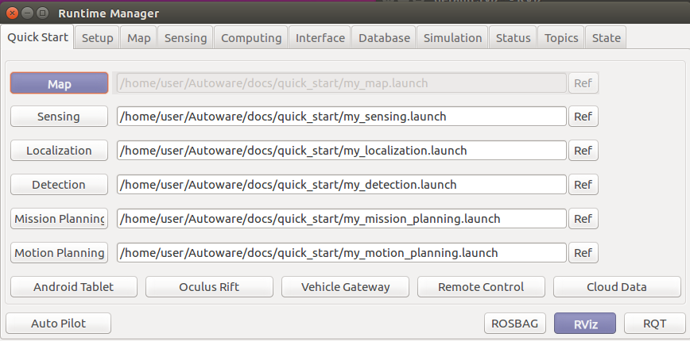

*그림 2. Quick Start 탭에서 단계별 launch 파일을 지정한 화면*

| 버튼 | launch 파일 | 실행하는 기능 |
|:-----|:-----|:-----|
| Map | `my_map.launch` | 포인트 클라우드 지도, 벡터 지도, 지도 좌표계의 TF를 불러온다 |
| Sensing | `my_sensing.launch` | LiDAR(Velodyne HDL-32E)의 드라이버 노드를 실행한다 |
| Localization | `my_localization.launch` | 차량과 LiDAR 사이의 TF를 설정하고, 차량의 위치를 구하는 노드(NDT 매칭 등)를 실행한다 |
| Detection | `my_detection.launch` | 주변 물체를 검출하는 노드를 실행한다 |
| Mission Planning | `my_mission_planning.launch` | 웨이포인트와 차선 정보로 목적지까지의 전역 경로를 만드는 노드(lane_navi, lane_rule, lane_stop 등)를 실행한다 |
| Motion Planning | `my_motion_planning.launch` | 장애물 회피, 속도 설정, 경로 추종 노드(velocity_set, pure_pursuit 등)를 실행한다 |

*표 3. Quick Start 탭의 버튼과 launch 파일*

각 칸의 Ref 버튼으로 파일을 지정한 뒤 버튼을 누르면 해당 launch 파일이 실행되고, 실행 중인 버튼은 그림 2의 Map 버튼처럼 색이 바뀐다. 이 순서는 데이터가 흐르는 순서(지도와 센서 → 위치 인식 → 인식 → 경로 계획)와 같다. 마지막으로 Simulation 탭으로 돌아가 멈춰 두었던 Pause를 풀고, RViz에 지도가 보이는지 확인한다.

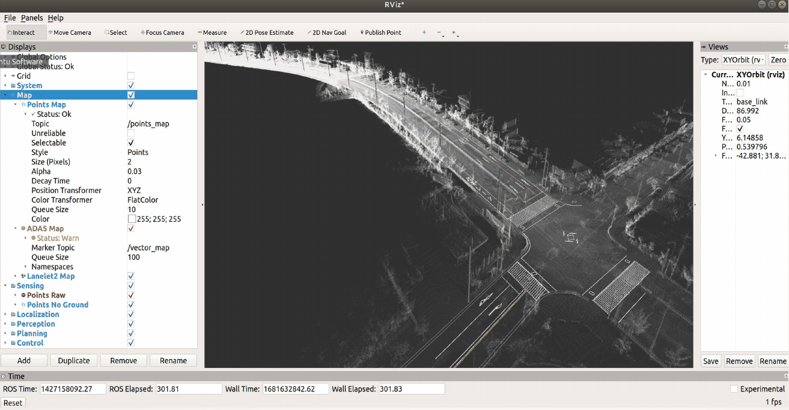

*그림 3. Quick Start를 실행한 뒤 RViz에 표시된 Moriyama 지역의 포인트 클라우드 지도*

그림 3의 가운데에는 교차로와 도로, 건물 벽, 나무가 흰 점으로 표시된 포인트 클라우드 지도가 보인다. 왼쪽의 Displays 패널을 보면 Map 아래의 Points Map이 `/points_map` 토픽을 크기 2픽셀, 투명도(Alpha) 0.03의 흰 점으로 그리고 있고, ADAS Map이 벡터 지도 토픽 `/vector_map`을, Sensing 아래의 Points Raw가 LiDAR의 원시 스캔을 그린다. 아래쪽 Time 패널의 ROS Time은 1427158092.27로 bag이 기록된 2015년의 시각인 반면, Wall Time은 1681632842.62(2023년)로 실제 컴퓨터의 시각이다. `/use_sim_time`이 켜져 있으면 ROS의 시각이 bag의 시각을 따른다는 것을 이 차이로 확인할 수 있다.

---

<br>

## 2. 포인트 클라우드와 좌표 변환

지도 작성과 위치 인식은 모두 포인트 클라우드를 이리저리 옮기고 비교하는 계산이다. 이 절에서는 3절과 4절의 바탕이 되는 포인트 클라우드의 표현과 3차원 좌표 변환을 정리한다. 스캔, 포인트 클라우드, 정합의 정의는 3주차 2.2절에서 다루었다.

### 2.1 포인트 클라우드의 표현

포인트 클라우드는 점 $`\mathbf{p}_i = (x_i, y_i, z_i)`$의 집합 $`P = \lbrace\mathbf{p}_1, \dots, \mathbf{p}_N\rbrace`$이다. LiDAR의 점에는 좌표 말고도 레이저가 되돌아온 세기(intensity)나 그 점을 측정한 레이저의 번호(ring) 같은 값이 붙을 수 있다. 점의 순서에는 의미가 없으므로 포인트 클라우드는 수학적으로 순서 없는 집합이다. 오픈 소스 라이브러리 **PCL(Point Cloud Library)** 은 포인트 클라우드의 저장, 필터링, 정합 같은 알고리즘을 모아 둔 C++ 라이브러리이며, Autoware의 지도 작성과 위치 인식은 PCL을 바탕으로 한다 [1].

ROS에서는 포인트 클라우드를 `sensor_msgs/PointCloud2` 메시지로 주고받는다 [2]. 이 메시지는 점들을 바이트 배열 하나에 이어 붙여 담고, 각 점의 바이트 안에서 어느 위치에 어떤 값이 있는지를 따로 기술한다.

| 필드 | 의미 |
|:-----|:-----|
| `header` | 측정 시각(`stamp`)과 좌표계 이름(`frame_id`) |
| `height`, `width` | 점들의 배열 모양. 순서 없는 포인트 클라우드는 `height = 1`, `width = N`이다 |
| `fields` | 점 하나를 이루는 값들의 이름(`x`, `y`, `z`, `intensity` 등), 바이트 위치, 자료형 |
| `point_step`, `row_step` | 점 하나와 한 행이 차지하는 바이트 수 |
| `data` | 모든 점의 값을 이어 붙인 바이트 배열 |
| `is_dense` | 값이 없는 점(NaN)이 하나도 없으면 참 |

*표 4. `sensor_msgs/PointCloud2` 메시지의 주요 필드*

점마다 $x, y, z$, intensity를 4바이트 실수로 담으면 점 하나는 적어도 16바이트이다(구현에 따라 정렬을 위한 여백이 더해질 수 있다). 1.4절에서 스캔 하나가 약 1.65 MB였으므로, 한 스캔에는 수만 개의 점이 들어 있다.

지도를 파일로 저장할 때는 PCL의 **PCD(point cloud data)** 형식을 쓴다 [3]. PCD 파일은 머리부(header)와 점 데이터로 이루어진다.

```text
# .PCD v0.7 - Point Cloud Data file format
VERSION 0.7
FIELDS x y z intensity
SIZE 4 4 4 4
TYPE F F F F
COUNT 1 1 1 1
WIDTH 41004
HEIGHT 1
VIEWPOINT 0 0 0 1 0 0 0
POINTS 41004
DATA ascii
5.213 -1.044 -1.672 23
...
```

`FIELDS`는 점을 이루는 값의 이름, `SIZE`는 각 값의 바이트 수, `TYPE`의 `F`는 실수, `COUNT`는 값마다의 원소 수이다. `WIDTH`와 `HEIGHT`는 `PointCloud2`와 같은 뜻이고, `POINTS`는 전체 점의 수이다. `DATA`가 `ascii`이면 그 아래에 점 하나가 한 줄씩 텍스트로 적히고, `binary`이면 바이트 배열로 저장된다. 텍스트 형식은 사람이 읽을 수 있지만 파일이 커지고 읽고 쓰는 데 시간이 더 걸린다.

### 2.2 3차원 강체 변환

물체의 모양을 바꾸지 않고 회전과 평행 이동만 하는 변환을 **강체 변환(rigid-body transformation)** 이라고 한다. 3차원 점 $\mathbf{p}$를 회전 행렬 $R$로 돌리고 평행 이동 벡터 $\mathbf{t}$만큼 옮기면 $\mathbf{p}' = R\mathbf{p} + \mathbf{t}$이다. 차량의 방향은 3주차에서 정의한 roll($`\phi`$), pitch($`\theta`$), yaw($`\psi`$)로 나타내며, 각각 $x$축, $y$축, $z$축을 중심으로 한 회전이다.

```math
R_x(\phi) = \begin{pmatrix} 1 & 0 & 0 \\ 0 & \cos\phi & -\sin\phi \\ 0 & \sin\phi & \cos\phi \end{pmatrix}, \quad
R_y(\theta) = \begin{pmatrix} \cos\theta & 0 & \sin\theta \\ 0 & 1 & 0 \\ -\sin\theta & 0 & \cos\theta \end{pmatrix}, \quad
R_z(\psi) = \begin{pmatrix} \cos\psi & -\sin\psi & 0 \\ \sin\psi & \cos\psi & 0 \\ 0 & 0 & 1 \end{pmatrix}
```

ROS와 PCL은 세 각으로부터 회전 행렬을 $R = R_z(\psi) R_y(\theta) R_x(\phi)$의 순서로 만든다. 즉 먼저 roll, 다음 pitch, 마지막으로 yaw만큼 고정된 축을 중심으로 돌린다. 회전과 평행 이동을 한 번에 다루기 위해 점에 1을 덧붙인 **동차 좌표(homogeneous coordinates)** $(x, y, z, 1)$을 쓰면, 강체 변환은 $4 \times 4$ 행렬 하나의 곱이 된다.

```math
T = \begin{pmatrix} R & \mathbf{t} \\ \mathbf{0}^{T} & 1 \end{pmatrix}, \qquad
\begin{pmatrix} \mathbf{p}' \\ 1 \end{pmatrix} = T \begin{pmatrix} \mathbf{p} \\ 1 \end{pmatrix} = \begin{pmatrix} R\mathbf{p} + \mathbf{t} \\ 1 \end{pmatrix}
```

이 행렬을 **동차 변환 행렬(homogeneous transformation matrix)** 이라고 한다. 3차원 포즈 $(x, y, z, \phi, \theta, \psi)$는 $\mathbf{t} = (x, y, z)$이고 $R = R_z(\psi) R_y(\theta) R_x(\phi)$인 동차 변환 행렬 하나와 같은 정보이다.

> **[선형대수학]** 회전 행렬은 $R^{T} R = I$이고 $\det R = 1$인 직교 행렬이다. 따라서 역행렬은 전치 행렬과 같고($`R^{-1} = R^{T}`$), 동차 변환 행렬의 역행렬은 $`T^{-1} = \begin{pmatrix} R^{T} & -R^{T}\mathbf{t} \\ \mathbf{0}^{T} & 1 \end{pmatrix}`$이다. 두 변환을 차례로 적용한 결과는 행렬의 곱 $T_1 T_2$이며, 행렬의 곱은 교환 법칙이 성립하지 않으므로 곱하는 순서가 중요하다.

각이 충분히 작으면 $\cos\alpha \approx 1$, $\sin\alpha \approx \alpha$이고 두 작은 각의 곱은 무시할 수 있으므로, 회전 행렬은 다음과 같이 근사된다. 3.7절에서 이 근사를 실제 출력으로 확인한다.

```math
R \approx \begin{pmatrix} 1 & -\psi & \theta \\ \psi & 1 & -\phi \\ -\theta & \phi & 1 \end{pmatrix}
```

### 2.3 좌표계와 변환의 합성

자율주행 시스템에는 여러 **좌표계(coordinate frame)** 가 있다. 같은 점이라도 어느 좌표계에서 표현하느냐에 따라 좌표값이 달라진다.

| 좌표계 | 원점과 축 | 예 |
|:-----|:-----|:-----|
| `world` | 전체의 기준이 되는 좌표계 | 여러 지도를 함께 쓸 때의 기준 |
| `map` | 지도의 원점 | 포인트 클라우드 지도와 벡터 지도의 좌표 |
| `base_link` | 차량의 기준점, $x$축은 차량의 앞, $z$축은 위 | 경로 추종과 제어의 기준 |
| `velodyne` (localizer) | LiDAR의 중심 | LiDAR가 측정한 스캔의 좌표 |
| `gps` | GNSS 안테나의 위치 | GNSS로 구한 위치 |

*표 5. Autoware에서 쓰는 주요 좌표계*

좌표계 $B$의 점을 좌표계 $A$의 점으로 바꾸는 변환을 $`T^{A}_{B}`$로 나타낸다. $`T^{A}_{B}`$는 $A$에서 본 $B$의 포즈이기도 하다. 그러면 LiDAR가 측정한 점 $\mathbf{p}^{\text{lidar}}$의 지도 좌표는 LiDAR → 차량 → 지도의 순서로 옮겨 구한다.

```math
\mathbf{p}^{\text{map}} = T^{\text{map}}_{\text{base}} \, T^{\text{base}}_{\text{lidar}} \, \mathbf{p}^{\text{lidar}}, \qquad
T^{\text{map}}_{\text{lidar}} = T^{\text{map}}_{\text{base}} \, T^{\text{base}}_{\text{lidar}}
```

$`T^{\text{base}}_{\text{lidar}}`$는 차량에 LiDAR를 달 때 정해지는 고정된 값이고, Runtime Manager의 Setup 탭에서 입력하는 Baselink to Localizer가 바로 이 값이다(4.3절). NDT 정합이 직접 구하는 것은 LiDAR의 포즈 $`T^{\text{map}}_{\text{lidar}}`$이므로, 차량의 포즈는 위 식을 거꾸로 풀어 $`T^{\text{map}}_{\text{base}} = T^{\text{map}}_{\text{lidar}} \, (T^{\text{base}}_{\text{lidar}})^{-1}`$로 얻는다.

**계산 예: 변환의 합성.** 차량이 지도의 $(10, 5, 0)$ m에서 yaw $= 90°$(지도의 $y$축 방향)를 보고 있고, LiDAR는 차량 기준점에서 앞으로 1.2 m, 위로 2.0 m에 달려 있다고 하자. LiDAR가 자기 앞 5 m, 아래 1.5 m에서 점 $\mathbf{p}^{\text{lidar}} = (5, 0, -1.5)$를 측정하였다.

1. **LiDAR → 차량.** LiDAR는 회전 없이 평행 이동만 되어 있으므로 $`\mathbf{p}^{\text{base}} = (5 + 1.2, \; 0, \; -1.5 + 2.0) = (6.2, 0, 0.5)`$이다. 차량 기준점에서 앞으로 6.2 m, 위로 0.5 m인 점이다.
2. **차량 → 지도.** $R_z(90°)$는 $(x, y, z)$를 $(-y, x, z)$로 보내므로 $R_z(90°)\mathbf{p}^{\text{base}} = (0, 6.2, 0.5)$이고, 차량의 위치를 더하면 $\mathbf{p}^{\text{map}} = (10, 11.2, 0.5)$이다.

차량이 지도의 $y$축 방향을 보고 있으므로, 차량 앞의 점은 지도에서 $y$ 방향으로 6.2 m 떨어진 곳에 놓인다. 같은 방식으로 LiDAR 자체의 지도 위치는 $(0, 0, 0)$을 옮긴 $(10, 6.2, 2.0)$이다.

ROS에서는 **TF**가 이런 좌표계들의 관계를 트리 구조로 관리한다 [4]. 각 노드가 두 좌표계 사이의 변환을 발행하면, TF는 트리를 따라 변환을 곱하여 임의의 두 좌표계 사이의 변환을 계산해 준다.

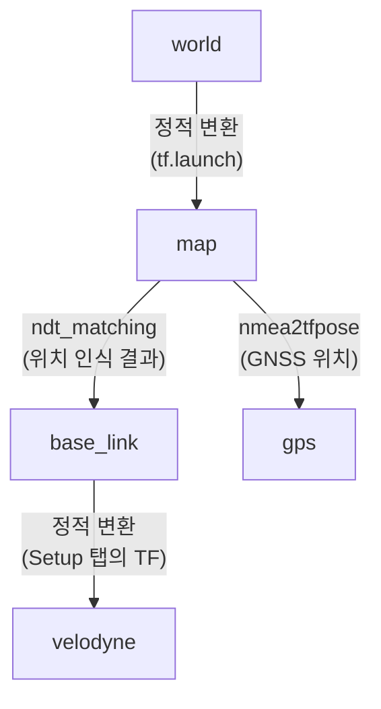

*그림 4. 위치 인식에서 쓰는 TF 트리*

그림 4에서 화살표는 부모 좌표계에서 자식 좌표계로의 변환을 뜻하고, 화살표 옆에는 그 변환을 발행하는 곳을 적었다. `world`와 `map`, `base_link`와 `velodyne`의 관계는 바뀌지 않는 정적 변환이고, `map`과 `base_link`의 관계는 차량이 움직일 때마다 위치 인식 노드가 새로 발행한다.

---

<br>

## 3. NDT 매핑을 이용한 지도 작성

### 3.1 지도 작성의 진행 순서

위치 인식에는 미리 만든 포인트 클라우드 지도가 필요하다. 이 절에서는 rosbag에 기록한 LiDAR 데이터로 지도를 만드는 과정을 다룬다. 진행 순서는 다음과 같다.

1. rosbag 데이터로 LiDAR 데이터를 불러온다.
2. Simulation을 실행한다.
3. LiDAR 노드를 실행한다.
4. RViz를 실행하여 LiDAR 데이터가 시각화되는지 확인한다.
5. NDT 매핑을 실행한다.
6. 생성된 지도 파일을 확인한다.

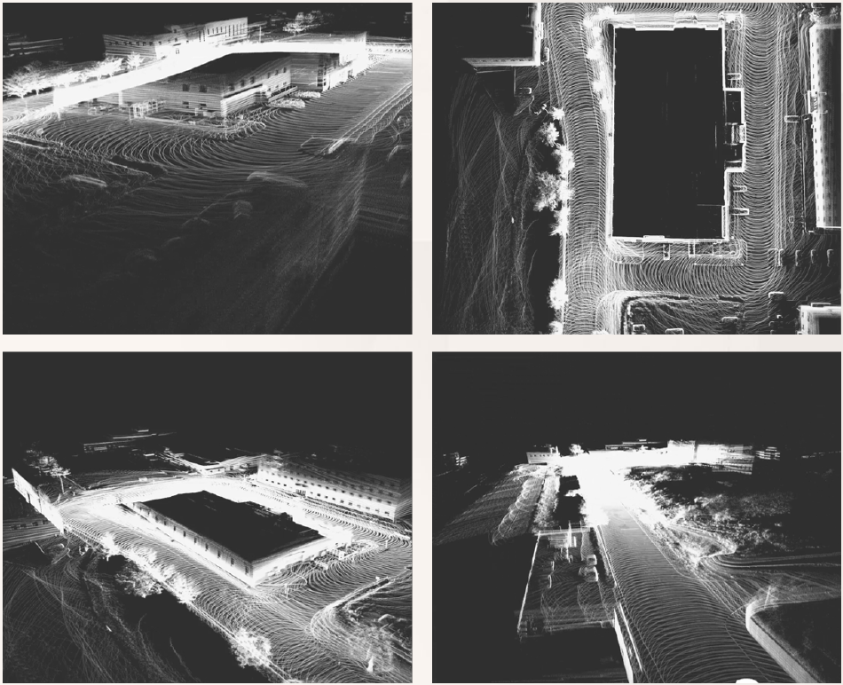

*그림 5. rosbag 파일로 만든 건물 주변의 포인트 클라우드 지도*

그림 5는 이 과정으로 만든 지도를 네 시점에서 본 것이다. 왼쪽 위는 건물과 주변 도로를 비스듬히 내려다본 모습, 오른쪽 위는 바로 위에서 내려다본 모습으로 건물을 둘러싼 도로가 보인다. 아래의 두 그림은 건물을 다른 각도에서 본 모습과 도로를 따라 본 모습이다. 지붕처럼 LiDAR의 레이저가 닿지 않은 곳은 점이 없어 검게 비어 있다.

### 3.2 센서 데이터의 기록과 재생

지도를 만들려면 먼저 차량으로 그 지역을 주행하며 LiDAR 데이터를 rosbag으로 기록해 두어야 한다. 기록과 재생의 원리는 2주차 1.2절과 3.2절에서 다루었으며, 데이터의 흐름은 다음과 같다.

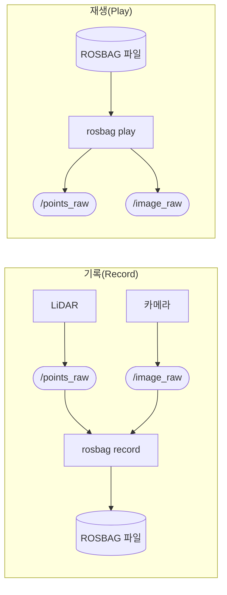

*그림 6. rosbag의 기록과 재생에서 데이터의 흐름*

기록할 때는 센서 드라이버가 발행하는 토픽을 받아 파일에 저장하고, 재생할 때는 파일의 메시지를 기록 당시와 같은 이름의 토픽으로 다시 발행한다. 따라서 재생된 토픽을 구독하는 노드는 실제 센서의 데이터와 기록된 데이터를 구별하지 않는다. Runtime Manager로 기록하는 순서는 다음과 같다.

1. **Autoware 실행.** Autoware 초기 버전에서는 `cd ~/Autoware/ros/`와 `./run`으로 실행하였으며, Autoware.ai 1.14에서는 1.4절의 `roslaunch runtime_manager runtime_manager.launch`로 실행한다.
2. **센서 노드 실행.** Sensing 탭의 LIDARs에서 차량의 LiDAR(예: Velodyne HDL-32E)를 체크하면 드라이버 노드가 실행되어 기록할 토픽이 발행된다.
3. **기록.** 다음 순서로 기록한다.
   - ROSBAG 버튼을 눌러 ROSBAG Record 창을 띄운다.
   - Ref 버튼을 누르고 저장할 파일 이름을 정한다.
   - Refresh 버튼을 눌러 현재 발행 중인 토픽 목록을 불러온다.
   - 기록할 토픽(예: `/points_raw`)을 체크한다.
   - Start 버튼을 누르면 기록이 시작되고, Stop 버튼을 누르면 끝난다.

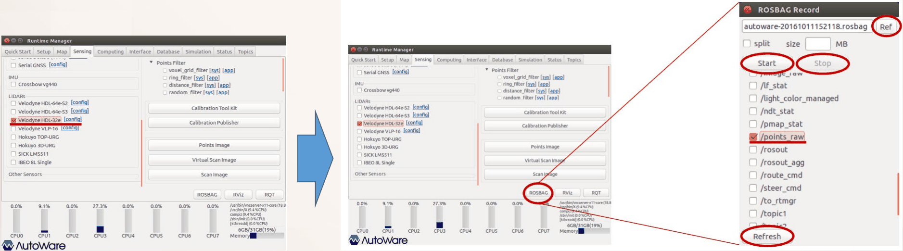

*그림 7. Sensing 탭에서 LiDAR를 켜고 ROSBAG Record 창에서 기록할 토픽을 고르는 화면*

ROSBAG Record 창의 split을 켜고 size에 MB 단위의 크기를 적으면, 파일이 그 크기에 이를 때마다 새 파일로 나누어 기록한다. LiDAR 데이터는 1.4절에서 본 것처럼 금방 수 GB가 되므로 긴 주행을 기록할 때 쓸모가 있다.

기록한 파일은 Simulation 탭에서 재생한다. Ref 버튼으로 bag 파일을 고르고 Play를 누르면 재생이 시작되며, 이때 `/use_sim_time`이 자동으로 `true`가 된다. Pause는 재생을 멈추거나 다시 시작하고, Stop은 재생을 끝내며 `/use_sim_time`을 다시 `false`로 돌려놓는다. bag 정보로 기록 내용을 알아볼 수도 있다. 예를 들어 카메라와 LiDAR를 함께 기록한 256초 길이의 bag(10.2 GB)에 `/image_raw` 3844개와 `/velodyne_points` 2561개가 들어 있다면, 카메라는 약 15 Hz(3844 / 256 ≈ 15.0), LiDAR는 약 10 Hz(2561 / 256 ≈ 10.0)로 기록된 것이다.

### 3.3 스캔 정합으로 지도 만들기

LiDAR는 한 번 회전할 때마다 자기 주변 수십 m의 모양만 측정한다. 넓은 지역의 지도를 만들려면 주행하며 얻은 수천 장의 스캔을 하나의 좌표계에 이어 붙여야 하는데, 각 스캔은 측정한 순간의 LiDAR를 원점으로 한 좌표로 표현되어 있으므로 스캔마다 그때 LiDAR가 어디에 있었는지를 알아야 한다.

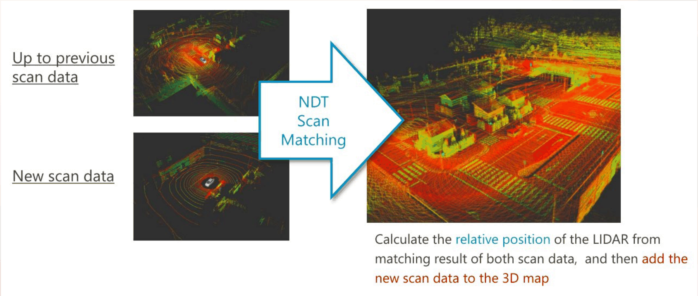

*그림 8. 지금까지의 스캔으로 만든 지도와 새 스캔을 NDT로 정합하여 지도에 더하는 과정*

**NDT 매핑(NDT mapping)** 은 이 문제를 스캔 정합으로 푼다(3주차 2.6절). 그림 8의 왼쪽 위는 지금까지의 스캔을 쌓아 만든 지도이고, 왼쪽 아래는 새로 들어온 스캔이다. 두 데이터를 NDT로 정합하면 지도에 대한 LiDAR의 상대 위치가 나오고, 그 위치로 새 스캔을 옮겨 3차원 지도에 더한다. 이를 되풀이하면 오른쪽처럼 넓은 지역의 지도가 만들어진다. 식으로 쓰면 다음과 같다.

```math
T_k = \arg\min_{T} \; E(T; \, S_k, M_{k-1}), \qquad
M_k = M_{k-1} \cup \lbrace \, T_k \mathbf{s} \mid \mathbf{s} \in S_k \, \rbrace
```

여기서 $S_k$는 $k$번째 스캔(LiDAR 좌표계), $M_{k-1}$은 그 전까지 만든 지도(지도 좌표계), $E$는 스캔을 변환 $T$로 옮겼을 때 지도와 어긋난 정도를 재는 비용 함수, $`T_k = T^{\text{map}}_{\text{lidar}}`$는 $k$번째 스캔을 측정할 때의 LiDAR 포즈이다. NDT에서는 $E$가 3주차 2.4절의 점수에 음의 부호를 붙인 것이다 [5]. 첫 스캔 $S_0$는 비교할 지도가 없으므로 그대로 지도가 되며, 따라서 지도 좌표계의 원점은 지도 작성을 시작한 순간의 차량 위치이다.

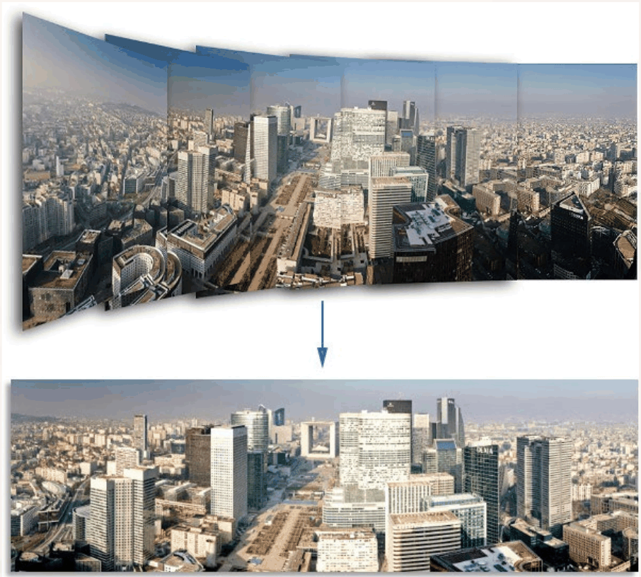

*그림 9. 여러 장의 사진을 겹치는 부분에 맞추어 이어 붙인 파노라마*

그림 9의 파노라마 사진이 좋은 비유이다. 한 장의 사진은 도시의 일부만 담지만, 이웃한 사진의 겹치는 부분이 서로 맞도록 각 사진의 위치와 각도를 찾아 이어 붙이면 넓은 풍경 한 장이 된다. NDT 매핑은 이를 3차원 점에 대해 하는 것이며, 겹치는 부분을 맞추는 일이 스캔 정합이다. 사진을 이을 때 겹치는 부분이 없으면 이을 수 없듯이, 스캔 사이에도 충분히 겹치는 부분이 있어야 정합이 성공한다. LiDAR가 1초에 10번 스캔하므로 연속한 두 스캔은 대부분 겹친다.

지도 작성 노드의 입력과 출력은 다음과 같다.

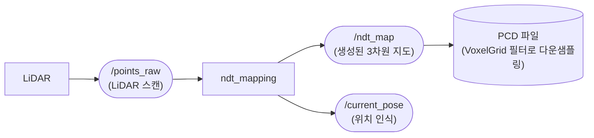

*그림 10. ndt_mapping의 입력과 출력*

`ndt_mapping`은 LiDAR 스캔 `/points_raw`를 받아 지금까지 만든 지도 `/ndt_map`을 발행하고, 동시에 차량의 현재 위치를 `/current_pose`로 발행한다. 지도를 만들면서 동시에 그 지도 안에서 자기 위치를 구하는 이런 작업을 일반적으로 **SLAM(simultaneous localization and mapping)** 이라고 한다. 완성한 지도는 VoxelGrid 필터로 점의 수를 줄여 PCD 파일로 저장한다(3.8절).

### 3.4 3차원 NDT 정합의 수식

3주차 2.3\~2.4절은 평면(2차원)에서 NDT의 점수, 기울기, 헤세 행렬을 유도하였다. 지도 작성과 위치 인식은 3차원에서 이루어지므로, 여기서는 그 식이 3차원으로 어떻게 넓어지는지를 정리한다 [6].

3차원 변환의 매개변수는 평행 이동 3개와 회전각 3개를 모은 $\mathbf{p} = (t_x, t_y, t_z, \phi, \theta, \psi)$이다. 스캔의 점 $\mathbf{x}$는 $T(\mathbf{p}, \mathbf{x}) = R(\phi, \theta, \psi)\mathbf{x} + \mathbf{t}$로 옮겨지고, 옮겨진 점이 들어간 지도 셀의 평균이 $\boldsymbol{\mu}$, 공분산이 $\Sigma$이면 $\mathbf{q} = T(\mathbf{p}, \mathbf{x}) - \boldsymbol{\mu}$이다. 3주차 2.5절의 3차원 점수 함수를 최소화할 때, 점 하나의 기울기 성분은 연쇄 법칙에 따라 다음과 같다.

```math
g_i = -d_1 d_2 \left( \mathbf{q}^{T} \Sigma^{-1} \frac{\partial \mathbf{q}}{\partial p_i} \right) \exp\left( -\frac{d_2}{2} \mathbf{q}^{T} \Sigma^{-1} \mathbf{q} \right), \qquad i = 1, \dots, 6
```

$d_1 < 0$이므로 계수 $-d_1 d_2$는 양수이고, $d_1 = -1$, $d_2 = 1$로 두면 3주차 2.4절의 2차원 기울기와 같은 식이 된다. 식의 모양은 2차원과 같고, 달라지는 것은 $\mathbf{q}$를 매개변수로 미분한 $3 \times 6$ 행렬, 즉 **야코비 행렬(Jacobian)** $J = \partial \mathbf{q} / \partial \mathbf{p}$이다. 평행 이동에 대한 미분은 단위 행렬 $I_3$이다. 회전에 대한 미분은 일반적인 각에서는 길지만, 현재 추정 근처에서 작은 회전 증분을 매개변수로 삼으면 2.2절의 근사 $`R \approx I + [\boldsymbol{\omega}]_{\times}`$를 써서 간단히 구할 수 있다. 여기서 $\boldsymbol{\omega} = (\phi, \theta, \psi)$이고 $`[\boldsymbol{\omega}]_{\times}`$는 벡터 곱 $\boldsymbol{\omega} \times \mathbf{x}$를 행렬 곱으로 나타낸 반대칭 행렬이다.

```math
R\mathbf{x} \approx \mathbf{x} + \boldsymbol{\omega} \times \mathbf{x} = \mathbf{x} - \mathbf{x} \times \boldsymbol{\omega}
\quad \Rightarrow \quad
\frac{\partial (R\mathbf{x})}{\partial \boldsymbol{\omega}} = -[\mathbf{x}]_{\times} = \begin{pmatrix} 0 & z & -y \\ -z & 0 & x \\ y & -x & 0 \end{pmatrix}
```

```math
J = \begin{pmatrix} I_3 & -[\mathbf{x}]_{\times} \end{pmatrix} = \begin{pmatrix} 1 & 0 & 0 & 0 & z & -y \\ 0 & 1 & 0 & -z & 0 & x \\ 0 & 0 & 1 & y & -x & 0 \end{pmatrix}
```

> **[선형대수학]** 벡터 $\mathbf{a} = (a_1, a_2, a_3)$의 반대칭 행렬은 $`[\mathbf{a}]_{\times} = \begin{pmatrix} 0 & -a_3 & a_2 \\ a_3 & 0 & -a_1 \\ -a_2 & a_1 & 0 \end{pmatrix}`$이며, 모든 $\mathbf{b}$에 대해 $`[\mathbf{a}]_{\times}\mathbf{b} = \mathbf{a} \times \mathbf{b}`$이다. 벡터 곱은 $\mathbf{a} \times \mathbf{b} = -\mathbf{b} \times \mathbf{a}$를 만족한다.

$J$의 마지막 열 $(-y, x, 0)$은 3주차 2.4절의 2차원 식 $\partial \mathbf{q} / \partial \phi$에 $\phi = 0$을 넣은 $(-y, x)$와 같다. 즉 평면의 yaw 회전은 3차원 식의 특수한 경우이다. 각 열의 뜻을 LiDAR 앞 10 m의 점 $\mathbf{x} = (10, 0, 0)$으로 확인할 수 있다.

- **yaw 열** $(-y, x, 0) = (0, 10, 0)$: yaw를 작은 각 $\delta\psi$만큼 돌리면 이 점은 옆으로 $`10\,\delta\psi`$만큼 움직인다. 같은 각이라도 수평 거리가 먼 점일수록 크게 움직이므로, 먼 점들이 방향(회전)을 정확히 정하는 데 크게 기여한다.
- **pitch 열** $(z, 0, -x) = (0, 0, -10)$: pitch를 돌리면 앞쪽의 먼 점은 위아래로 움직인다.
- **roll 열** $(0, -z, y) = (0, 0, 0)$: roll은 $x$축을 중심으로 돌리는 회전이므로, $x$축 위에 놓인 점은 움직이지 않는다. roll을 정하려면 옆쪽이나 위아래에 있는 점이 필요하다.

헤세 행렬도 3주차의 2차원 식과 같은 방식으로 $6 \times 6$ 행렬이 되고, 뉴턴 방법의 연립 방정식 $H \Delta\mathbf{p} = -\mathbf{g}$는 미지수 6개의 연립 방정식이 된다. 스캔의 모든 점에 대해 이 값들을 더하므로, 계산량은 정합에 쓰는 스캔의 점 수에 비례한다. 3.5절과 4.5절의 다운샘플링이 필요한 이유이다.

### 3.5 ndt_mapping의 처리 과정

Autoware의 `ndt_mapping` 노드는 스캔 하나가 들어올 때마다 다음 일을 한다 [7].

1. **거리 필터.** 스캔의 점마다 수평 거리 $r = \sqrt{x^2 + y^2}$를 계산하여, $r_{\min} < r < r_{\max}$인 점만 남긴다(Minimum Scan Range, Maximum Scan Range). 너무 가까운 점은 대개 차량 자신의 몸체에 맞은 점이고, 너무 먼 점은 드물고 오차가 크다.
2. **첫 스캔 처리.** 첫 스캔이면 $`T^{\text{base}}_{\text{lidar}}`$로 옮겨 그대로 지도로 삼는다. 3.3절에서 본 것처럼 지도의 원점은 출발 순간의 차량 기준점이 된다.
3. **다운샘플링.** 거리 필터를 거친 스캔에 복셀 그리드 필터(Leaf Size)를 적용하여 정합에 쓸 점을 줄인다(4.5절).
4. **초기 추정.** 차량이 직전과 같은 움직임을 이어 간다고 보고(등속 운동 모델) 이번 포즈를 예측한다. $k$번째 스캔의 예측 포즈는 $`\hat{x}_k = x_{k-1} + (x_{k-1} - x_{k-2})`$이며 $y, z$, yaw도 같은 식으로 예측하고, roll과 pitch는 직전 값을 쓴다. 예측한 차량 포즈에 $`T^{\text{base}}_{\text{lidar}}`$를 곱하여 LiDAR 포즈의 초기 추정으로 쓴다.
5. **NDT 정합.** 다운샘플링한 스캔을 지금까지의 지도에 NDT로 정합하여 $`T^{\text{map}}_{\text{lidar}}`$를 얻는다.
6. **차량 포즈 계산.** $`T^{\text{map}}_{\text{base}} = T^{\text{map}}_{\text{lidar}} \, (T^{\text{base}}_{\text{lidar}})^{-1}`$로 차량의 포즈를 구하여 `/current_pose`와 TF(`map` → `base_link`)로 발행한다.
7. **스캔 변환.** 다운샘플링하기 전의 스캔(거리 필터만 거친 것)을 $`T^{\text{map}}_{\text{lidar}}`$로 지도 좌표계에 옮긴다.
8. **지도에 더할지 판단.** 마지막으로 지도에 스캔을 더한 위치와 현재 위치 사이의 수평 거리 $\text{shift}$를 계산하여, $\text{shift} \ge$ Minimum Add Scan Shift이면 옮긴 스캔을 지도에 더하고 그 위치를 기억한다. 지도가 바뀌었으므로 다음 정합에 쓸 NDT의 셀 분포도 새로 만든다.
9. **발행.** 갱신된 지도를 `/ndt_map`으로 발행한다.

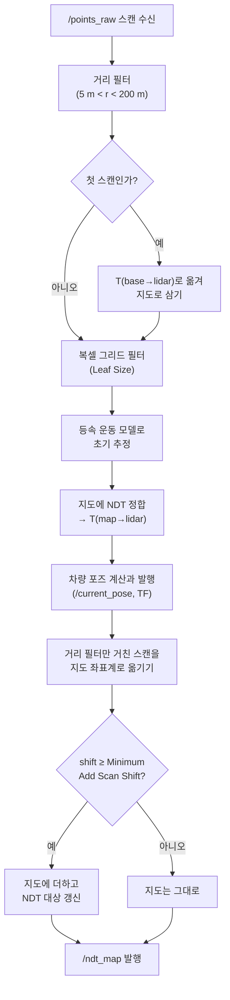

*그림 11. ndt_mapping이 스캔 하나를 처리하는 과정*

이 과정에서 눈여겨볼 점이 세 가지 있다.

- **정합에 쓰는 점과 지도에 더하는 점이 다르다.** 정합은 빨라야 하므로 다운샘플링한 적은 점으로 하고, 지도에는 세부 모양을 남기도록 거리 필터만 거친 많은 점을 더한다.
- **초기 추정이 정합의 성패를 좌우한다.** 3주차 2.4절의 주의에서 본 것처럼 NDT는 초기 추정 근처에서만 수렴한다. 등속 운동 모델의 예측은 차량이 급하게 가속하거나 회전하지 않는 한 참값에 가까우므로, 지도 작성용 데이터는 일정한 속도로 부드럽게 주행하며 기록하는 것이 좋다.
- **움직인 거리를 기준으로 스캔을 더한다.** 차량이 서 있는 동안 들어온 스캔을 모두 더하면 같은 자리에 같은 점이 계속 쌓여 지도만 커지고 정보는 늘지 않는다. 1 m 간격으로 더하면 주행 경로를 따라 점의 밀도가 고르게 유지되고, 지도를 바꿀 때마다 드는 NDT 셀 계산도 줄어든다.

### 3.6 ndt_mapping의 매개변수

Computing 탭의 `ndt_mapping` 옆 [app]을 누르면 매개변수 창이 열린다. 창의 맨 위에 적힌 `/config/ndt_mapping`은 Runtime Manager가 이 값들을 노드에 보내는 토픽의 이름이다.

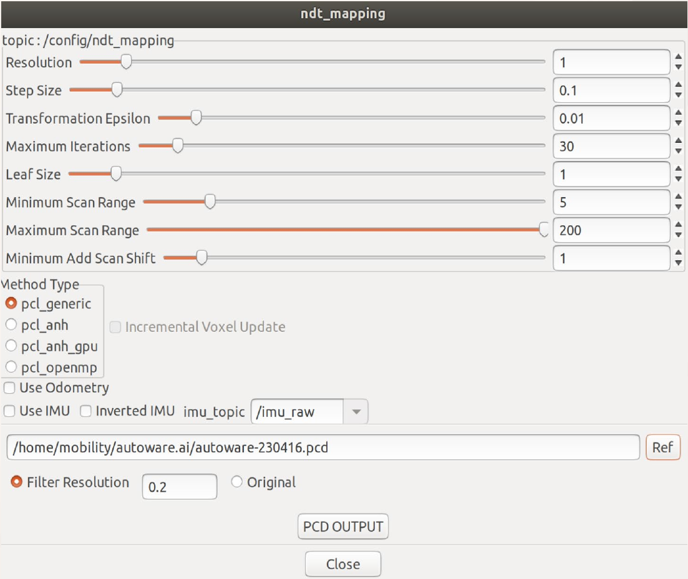

*그림 12. ndt_mapping의 매개변수 창*

| 항목 | 예시 값 | 의미 |
|:-----|:-----|:-----|
| Resolution | 1 | 지도의 NDT 셀(복셀) 한 변의 길이 (m) |
| Step Size | 0.1 | 선 탐색이 한 번에 움직일 수 있는 최대 걸음 크기 |
| Transformation Epsilon | 0.01 | 연속한 두 반복 사이의 변환 변화량이 이보다 작으면 수렴으로 본다 |
| Maximum Iterations | 30 | 수렴하지 않아도 멈추는 최대 반복 횟수 |
| Leaf Size | 1 | 정합에 쓸 스캔을 다운샘플링하는 복셀 한 변의 길이 (m) |
| Minimum Scan Range | 5 | 이보다 가까운 점을 버리는 거리 (m) |
| Maximum Scan Range | 200 | 이보다 먼 점을 버리는 거리 (m) |
| Minimum Add Scan Shift | 1 | 지도에 스캔을 더하는 최소 이동 거리 (m) |

*표 6. ndt_mapping의 매개변수*

Resolution, Step Size, Transformation Epsilon, Maximum Iterations는 3주차 2.5절의 NDT 정합 매개변수와 같고, 나머지 넷은 3.5절의 처리 과정에서 쓰인다. Resolution과 Leaf Size는 둘 다 공간을 정육면체로 나누는 길이이지만 역할이 다르다. Resolution은 지도 쪽에서 정규 분포를 만들 셀의 크기이고, Leaf Size는 스캔 쪽에서 점을 줄이는 칸의 크기이다. 예시처럼 둘을 같게(1 m) 두면 스캔의 대표점 하나가 지도의 셀 하나에 대략 대응한다.

창의 아래쪽 항목은 다음과 같다.

- **Method Type:** NDT 정합의 구현을 고른다. `pcl_generic`은 PCL의 구현, `pcl_anh`는 Autoware가 직접 작성한 CPU 구현, `pcl_anh_gpu`는 같은 방식을 GPU로 계산하는 구현, `pcl_openmp`는 여러 CPU 코어로 나누어 계산하는 구현이다. `pcl_anh`에서만 고를 수 있는 Incremental Voxel Update는 지도에 스캔을 더할 때 NDT 셀 전체를 다시 만들지 않고, 새 점이 들어간 셀만 갱신하여 시간을 줄인다.
- **Use Odometry, Use IMU, Inverted IMU, imu_topic:** 차량의 주행 거리계(odometry)나 관성 측정 장치(IMU)의 측정으로 초기 추정을 더 정확하게 만든다. Inverted IMU는 IMU를 뒤집어 장착한 경우에 값의 부호를 바로잡는다.
- **지도 저장:** 파일 이름 칸(예: `/home/mobility/autoware.ai/autoware-230416.pcd`)에 저장할 경로를 적고 PCD OUTPUT 버튼을 누르면 지금까지 만든 지도가 저장된다. Filter Resolution을 고르면 적힌 크기(예: 0.2 m)의 복셀 그리드 필터로 점을 줄여 저장하고, Original을 고르면 모든 점을 그대로 저장한다.

### 3.7 실행과 출력 해석

지도 작성은 다음 순서로 실행한다.

1. Simulation 탭에서 기록한 bag 파일을 지정한다(3.2절).
2. Sensing 탭에서 LiDAR(Velodyne HDL-32E)를 체크하고, RViz를 띄워 스캔이 표시되는지 확인한다.
3. Computing 탭의 Localization > lidar_localizer에서 `ndt_mapping`을 체크하고 [app]에서 매개변수를 정한다.
4. bag을 재생하면 지도 작성이 시작된다.

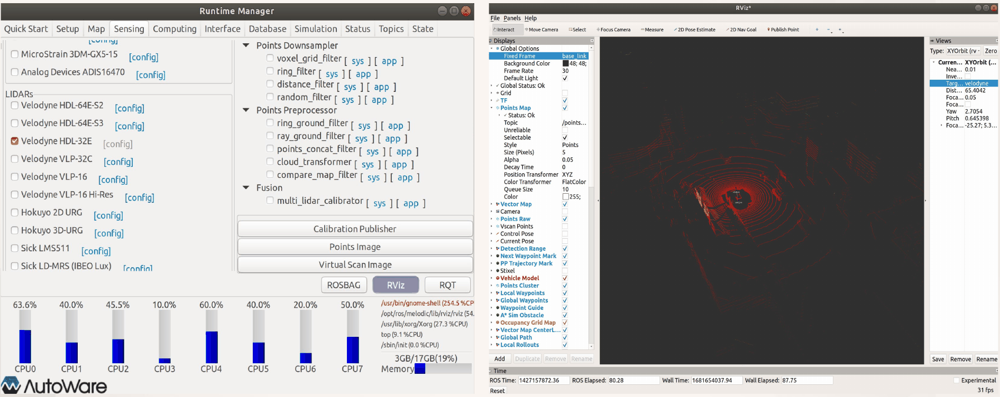

*그림 13. Sensing 탭에서 LiDAR를 켠 화면과 RViz에 표시된 LiDAR 스캔*

그림 13의 왼쪽은 Sensing 탭이다. LIDARs 목록에서 Velodyne HDL-32E가 체크되어 있고, 오른쪽에는 점을 줄이는 Points Downsampler(voxel_grid_filter, ring_filter, distance_filter, random_filter), 바닥 제거 같은 전처리를 하는 Points Preprocessor, 여러 LiDAR를 맞추는 Fusion 항목이 있다(4.4절). 오른쪽의 RViz에는 차량을 중심으로 동심원 모양으로 퍼진 붉은 점들이 보이는데, 회전하는 LiDAR의 레이저 하나하나가 땅에 닿아 그린 원이다.

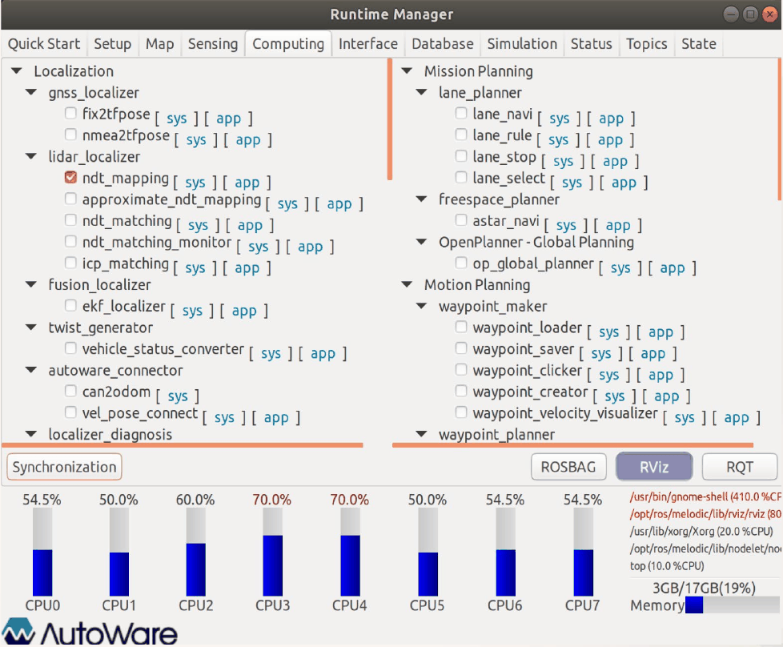

*그림 14. Computing 탭의 lidar_localizer에서 ndt_mapping을 선택한 화면*

Computing 탭의 왼쪽은 위치 인식(Localization) 노드들이다. `gnss_localizer`에는 GNSS로 위치를 구하는 `fix2tfpose`와 `nmea2tfpose`, `lidar_localizer`에는 `ndt_mapping`, `approximate_ndt_mapping`, `ndt_matching`, `ndt_matching_monitor`, `icp_matching`이 있고, 그 아래에 여러 센서를 융합하는 `ekf_localizer`, 차량 속도를 변환하는 `twist_generator`, `autoware_connector` 등이 있다. 오른쪽은 경로 계획 노드들이며 10주차에서 다룬다.

`ndt_mapping`을 실행하면 터미널에 스캔마다 다음과 같은 정보가 출력된다. 마지막 줄은 함께 실행되는 `queue_counter` 노드가 출력한다.

```text
Sequence number: 86688
Number of scan points: 41004 points.
Number of filtered scan points: 2191 points.
transformed_scan_ptr: 41004 points.
map: 40695 points.
NDT has converged: 1
Fitness score: 0.315708
Number of iteration: 2
(x,y,z,roll,pitch,yaw):
(-0.0299602, 0.0102507, 0.000453711, 0.000521842, -0.00114297, 0.00407962)
Transformation Matrix:
0.999991 -0.00408021 -0.00114083     1.16775
0.00407961    0.999992  -0.0005265   0.0140932
0.00114297 0.000521841    0.999999     2.00182
0           0           0           1
shift: 0.0316652
-----------------------------------------------------------------
(Processed/Input): (55 / 55)
```

| 출력 | 값 | 해석 |
|:-----|:-----|:-----|
| Sequence number | 86688 | 받은 `/points_raw` 메시지의 일련번호 |
| Number of scan points | 41004 | 거리 필터를 거친 스캔의 점 수 |
| Number of filtered scan points | 2191 | Leaf Size 1 m로 다운샘플링한 뒤의 점 수. 원래의 약 5.3%만 정합에 쓰므로 계산이 약 19배 가벼워진다 |
| transformed_scan_ptr | 41004 | 지도 좌표계로 옮긴 스캔(다운샘플링 전)의 점 수 |
| map | 40695 | 지금 지도의 점 수 |
| NDT has converged | 1 | 정합이 수렴하였다(1은 참) |
| Fitness score | 0.315708 | 옮긴 스캔의 각 점과 지도에서 가장 가까운 점 사이 거리의 제곱 평균 (m²) |
| Number of iteration | 2 | 수렴까지 걸린 반복 횟수 |
| (x, y, z, roll, pitch, yaw) | 아래 해석 참고 | 지도 좌표계에서 차량 기준점의 포즈 (m, rad) |
| Transformation Matrix | 아래 해석 참고 | 정합으로 구한 LiDAR의 포즈 $`T^{\text{map}}_{\text{lidar}}`$ |
| shift | 0.0316652 | 마지막으로 스캔을 더한 위치에서 움직인 수평 거리 (m) |
| (Processed/Input) | (55 / 55) | `queue_counter`가 센 처리한 스캔(`/ndt_map` 발행 횟수)과 받은 스캔(`/points_raw`)의 수. 받은 55개를 모두 처리하였다 |

*표 7. ndt_mapping 출력의 해석*

이 출력에서 다음을 읽을 수 있다.

- **차량은 거의 움직이지 않았다.** 차량의 위치는 $(-0.030, 0.010, 0.0005)$ m이고 yaw는 0.00408 rad(약 0.23°)로, 지도 원점(출발 위치) 근처에 서 있다. 그래서 정합이 2번 만에 수렴하였다.
- **지도에 스캔이 아직 더해지지 않았다.** shift가 0.032 m로 Minimum Add Scan Shift 1 m보다 작으므로 이번 스캔은 지도에 더하지 않는다. 지도의 점 수 40695가 이번 스캔의 41004와 다른 것은 지도가 아직 첫 스캔(거리 필터를 거친 뒤 40695개)만으로 이루어져 있기 때문이다.
- **Fitness score의 의미.** $0.3157$ m²의 제곱근은 약 0.56 m이다. 정합에 쓴 대표점은 복셀 안 점들의 무게 중심이라 실제 표면 위에 있지 않을 수 있고, 지나가는 차 같은 움직이는 물체의 점도 섞이므로 이 값이 0이 되지는 않는다. 그래서 값 하나의 크기보다 주행 중에 이 값이 갑자기 커지는지를 보고 정합의 이상을 판단한다.
- **변환 행렬은 LiDAR의 포즈이다.** 행렬의 왼쪽 위 $3 \times 3$은 회전 행렬이다. 각이 작으므로 2.2절의 근사에 따라 $R_{01} \approx -\psi = -0.00408$, $R_{02} \approx \theta = -0.00114$, $R_{12} \approx -\phi = -0.00052$이고, 출력값과 맞는다. 반면 마지막 열의 평행 이동 $(1.168, 0.014, 2.002)$는 차량의 위치 $(-0.030, 0.010, 0.0005)$와 다르다.

**계산 예: 변환 행렬의 평행 이동 확인.** 이 데이터의 LiDAR는 차량 기준점에서 $(1.2, 0, 2.0)$ m에 회전 없이 달려 있다(4.3절의 TF 값). 2.3절의 식 $`T^{\text{map}}_{\text{lidar}} = T^{\text{map}}_{\text{base}} T^{\text{base}}_{\text{lidar}}`$에서 평행 이동 부분은 $`\mathbf{t}_{\text{lidar}} = \mathbf{t}_{\text{base}} + R \, (1.2, 0, 2.0)^{T}`$이다.

1. $`R \, (1.2, 0, 2.0)^{T}`$의 첫 성분은 $1.2 \times 0.999991 + 2.0 \times (-0.00114083) = 1.19999 - 0.00228 = 1.19771$이다.
2. 둘째 성분은 $1.2 \times 0.00407961 + 2.0 \times (-0.0005265) = 0.00490 - 0.00105 = 0.00384$이다.
3. 셋째 성분은 $1.2 \times 0.00114297 + 2.0 \times 0.999999 = 0.00137 + 2.00000 = 2.00137$이다.
4. 차량의 위치를 더하면 $`(1.19771 - 0.02996, \; 0.00384 + 0.01025, \; 2.00137 + 0.00045) = (1.16775, 0.01409, 2.00182)`$로, 출력된 행렬의 마지막 열과 일치한다.

즉 NDT 정합이 구한 것은 LiDAR의 포즈이고, 화면에 출력되고 `/current_pose`로 발행되는 것은 거기서 LiDAR의 장착 위치를 되돌린 차량의 포즈이다.

### 3.8 노드 구성과 지도 저장

넓은 지역의 지도를 만들 때는 `ndt_mapping` 대신 `approximate_ndt_mapping`을 쓸 수 있다. 이 노드는 지도를 일정한 크기의 부분 지도로 나누어 만들고 차례로 파일에 저장하므로, 지도가 커져도 정합 대상과 메모리가 무한히 늘지 않는다. 이를 실행했을 때 rqt_graph로 본 노드 구성은 2주차 3.4절에서 다루었다. 요약하면 Velodyne 드라이버의 노드릿들이 `/velodyne_packets`를 거쳐 `/points_raw`를 발행하고, `approximate_ndt_mapping`은 `/points_raw`와 Runtime Manager가 보낸 설정 `/config/approximate_ndt_mapping`을 받아 `/ndt_map`을 발행하며, `queue_counter`는 받은 `/points_raw`와 발행된 `/ndt_map`의 수를 세어 지도 작성이 입력을 따라가고 있는지 보여 준다(3.7절의 (Processed/Input)).

bag 재생이 끝나면 3.6절의 PCD OUTPUT 버튼으로 지도를 저장하고, 마지막 단계로 생성된 파일을 확인한다. 저장된 PCD 파일을 Map 탭의 Point Cloud에 지정하여 불러오면 RViz에서 지도를 볼 수 있고, PCL의 `pcl_viewer` 같은 도구로 직접 열어 볼 수도 있다. 저장할 때 Filter Resolution 0.2를 고르면, 같은 0.2 m 정육면체 안에 들어간 점들이 그 무게 중심 하나로 합쳐지므로 파일이 훨씬 작아지면서도 위치 인식에 필요한 모양은 남는다.

지도가 완성되면 같은 NDT 정합을 이번에는 고정된 지도에 대해 수행하여 위치를 인식한다. 지도 작성과 달리 위치 인식에서는 새 스캔을 지도에 더하지 않는다(4절).

### 3.9 누적 오차와 루프 결합

NDT 매핑은 스캔마다 직전까지의 지도에 정합하므로, 정합마다 생기는 작은 오차가 다음 정합의 기준이 되어 계속 쌓인다. 이를 **누적 오차(drift)** 라고 한다. 특히 방향의 오차는 진행할수록 위치 오차로 커진다. 방향이 $\delta\psi$만큼 틀어진 채로 거리 $d$를 진행하면 옆으로 벗어나는 거리는 작은 각에서 약 $`d \, \delta\psi`$이다.

**계산 예: 방향 오차가 만드는 위치 오차.** 어느 지점에서 지도의 방향이 0.1°만큼 틀어졌다고 하자. $0.1° = 0.1 \times \pi / 180 \approx 0.001745$ rad이므로, 그 지점에서 500 m를 더 진행한 곳의 지도는 옆으로 약 $500 \times 0.001745 \approx 0.87$ m 어긋난다. 차선 폭이 3 m 남짓임을 생각하면 무시할 수 없는 크기이다.

넓은 순환 도로를 한 바퀴 돌아 출발점으로 돌아왔을 때 지도의 시작 부분과 끝 부분이 어긋나 같은 건물이 두 번 겹쳐 보이는 것이 누적 오차의 전형적인 증상이다. 이를 바로잡는 방법이 **루프 결합(loop closure)** 이다. 이미 지나온 곳에 다시 왔음을 알아차리면 두 포즈가 같은 곳이라는 제약을 더하고, 모든 스캔의 포즈를 그래프의 노드로, 스캔 사이의 상대 변환을 간선으로 놓은 뒤 전체 오차가 가장 작아지도록 포즈들을 한꺼번에 다시 계산한다. 이런 방식을 **그래프 기반 SLAM(graph-based SLAM)** 이라고 한다 [8]. Autoware의 `ndt_mapping`은 루프 결합을 하지 않으므로, 넓은 지역의 지도를 만들 때는 다음과 같은 방법으로 누적 오차를 줄인다.

- 일정한 속도로 부드럽게 주행하여 초기 추정이 정확하도록 한다(3.5절).
- 점이 충분하고 모양이 뚜렷한 환경(건물, 벽)이 계속 보이는 경로로 주행한다. 넓은 공터나 긴 터널처럼 모양이 단조로운 곳에서는 정합이 쉽게 미끄러진다.
- IMU나 주행 거리계를 함께 써서 초기 추정을 개선한다(3.6절의 Use IMU, Use Odometry).
- 지도를 만든 뒤 시작 부분과 끝 부분이 맞는지 확인하고, 어긋나면 구간을 나누어 다시 만든다.

---

<br>

## 4. NDT 매칭을 이용한 위치 인식

### 4.1 위치 인식의 진행 순서

**NDT 매칭(NDT matching)** 은 미리 만든 포인트 클라우드 지도에 현재 스캔을 NDT로 정합하여 차량의 포즈를 구하는 위치 인식 방법이다. 원리와 `ndt_matching`의 매개변수는 3주차 2절과 3절에서 다루었으므로, 여기서는 Quick Start의 Moriyama 데이터로 위치 인식을 직접 실행하는 과정을 단계별로 정리한다. 진행 순서는 다음과 같다.

1. rosbag 데이터를 불러온다.
2. Simulation을 실행한다.
3. 지도, TF, LiDAR 노드를 실행한다.
4. voxel_grid_filter 노드를 실행한다.
5. nmea2tfpose 노드를 실행한다.
6. NDT 매칭을 실행한다.

### 4.2 rosbag 불러오기

1.4절과 같은 방법으로 Simulation 탭에서 Moriyama bag 파일을 지정하고, Start Time을 140으로 정한 뒤 재생한다.

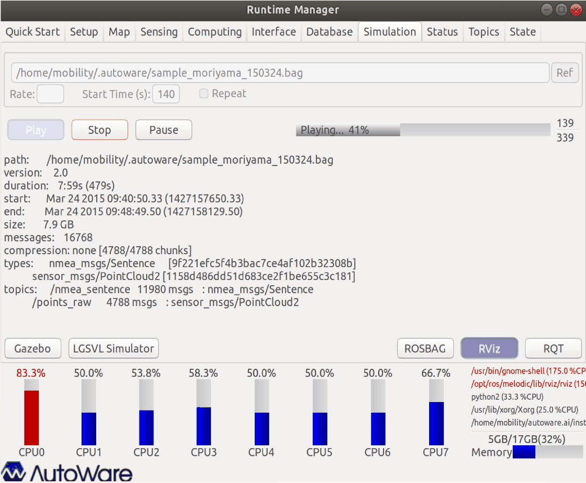

*그림 15. Simulation 탭에서 Moriyama bag 파일을 140초 지점부터 재생하는 화면*

그림 15에서 진행 막대는 Playing... 41%이고, 오른쪽의 두 수(139, 339)는 재생을 시작한 뒤 지난 시간과 재생할 전체 시간을 초 단위로 나타내며, 139 / 339 ≈ 41%이다. 140초 지점부터 bag의 끝(479초)까지 재생하므로 전체 구간은 약 339초이다. 1.4절에서 본 것처럼 이 bag에는 `/points_raw`와 `/nmea_sentence`만 있으므로, 위치 인식은 LiDAR와 GNSS 두 센서로 이루어진다.

### 4.3 지도와 TF 불러오기

Map 탭에서 위치 인식에 쓸 지도와 지도 좌표계의 관계를 불러온다.

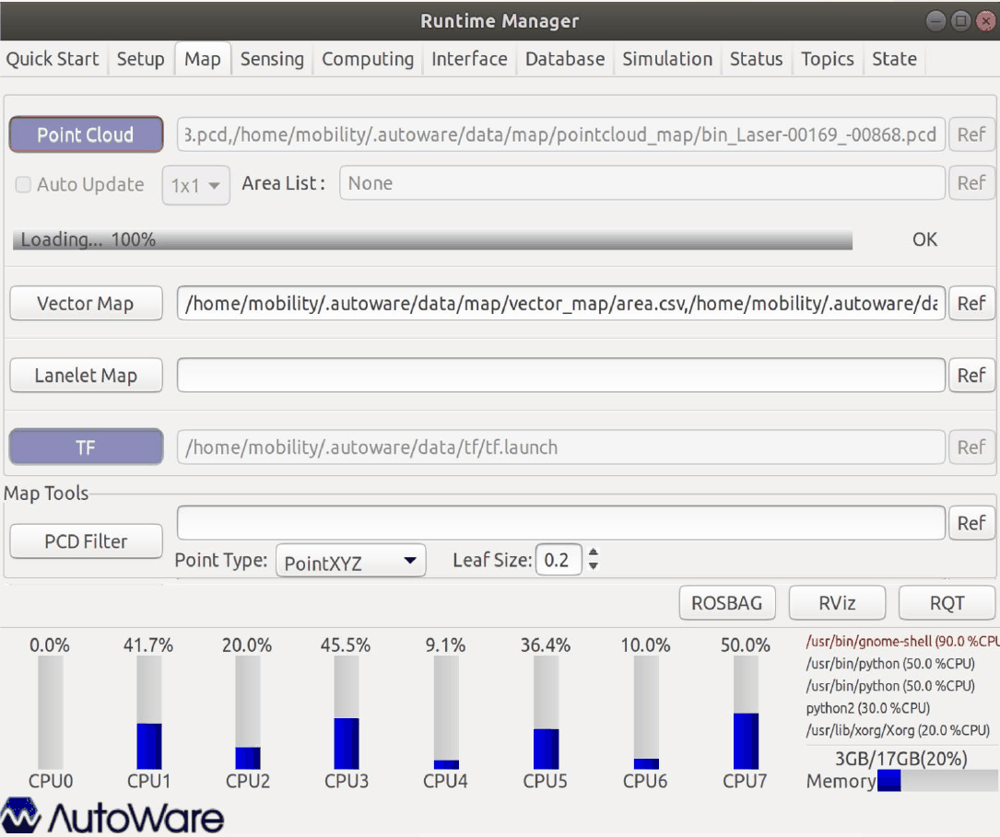

*그림 16. Map 탭에서 포인트 클라우드 지도, 벡터 지도, TF를 불러온 화면*

1. **Point Cloud.** Ref 버튼으로 `~/.autoware/data/map/pointcloud_map/`의 PCD 파일을 모두 고르고 Point Cloud 버튼을 누른다. 경로 칸에는 고른 파일들이 쉼표로 이어져 표시되고, 진행 막대가 Loading... 100%와 OK가 되면 다 읽은 것이다. 이때 `points_map_loader` 노드가 실행되어 모든 타일을 합친 지도를 `/points_map`으로 발행한다. Auto Update와 그 옆의 선택 상자(1x1)는 차량 주변의 타일만 골라 읽는 기능이며, 예시에서는 쓰지 않는다.
2. **Vector Map.** `~/.autoware/data/map/vector_map/`의 CSV 파일을 모두 고르고 Vector Map 버튼을 누른다.
3. **TF.** `~/.autoware/data/tf/tf.launch`를 고르고 TF 버튼을 누른다. 이 launch 파일은 `world`와 `map` 같은 좌표계 사이의 정적 변환을 발행한다(2.3절의 그림 4).

아래쪽의 Map Tools > PCD Filter는 PCD 파일을 정해진 Leaf Size(예: 0.2)의 복셀 그리드 필터로 줄여 새 파일로 저장하는 도구이다. 지도 파일이 너무 커서 불러오는 데 오래 걸릴 때 쓴다.

다음으로 Setup 탭에서 차량과 LiDAR의 관계를 정한다.

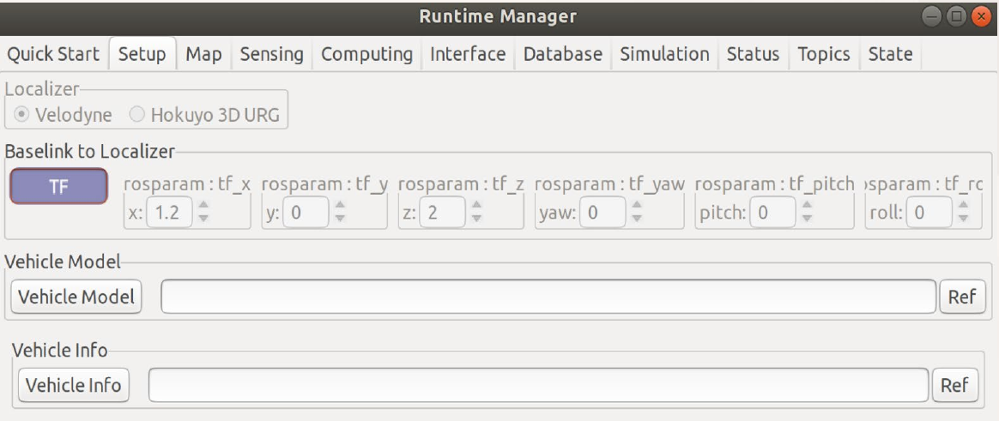

*그림 17. Setup 탭의 Baselink to Localizer에 LiDAR 장착 위치를 입력한 화면*

Localizer로 Velodyne을 고르고, Baselink to Localizer에 $x = 1.2$, $y = 0$, $z = 2$, yaw $= 0$, pitch $= 0$, roll $= 0$을 입력한 뒤 TF 버튼을 누른다. 각 칸 위의 `rosparam : tf_x` 같은 이름은 이 값이 ROS 매개변수 `tf_x` 등으로 저장된다는 뜻이다. 이 값이 2.3절의 $`T^{\text{base}}_{\text{lidar}}`$이며, LiDAR가 차량 기준점에서 앞으로 1.2 m, 위로 2 m에 회전 없이 달려 있음을 뜻한다. Vehicle Model과 Vehicle Info는 RViz에 그릴 차량 모델과 차량의 치수 정보를 불러오는 칸이며, 위치 인식 자체에는 필요하지 않다.

### 4.4 LiDAR 노드와 포인트 필터

Sensing 탭에서 LiDAR 노드와 다운샘플링 필터를 실행한다.

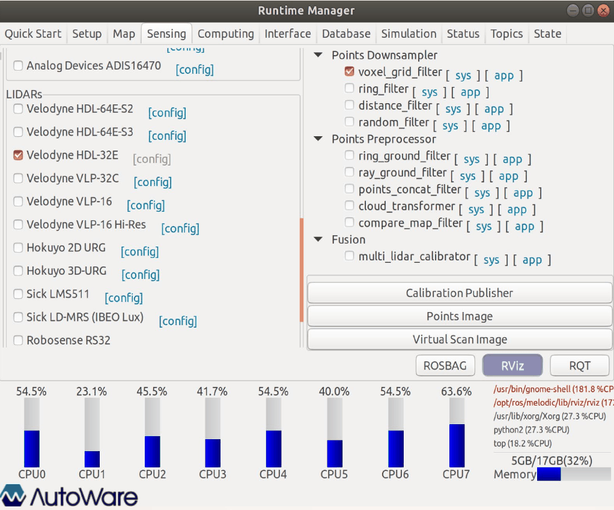

*그림 18. Sensing 탭에서 Velodyne HDL-32E와 voxel_grid_filter를 선택한 화면*

LIDARs 목록에서 Velodyne HDL-32E를 체크하고, Points Downsampler에서 `voxel_grid_filter`를 체크한다. Points Downsampler에는 점을 줄이는 방법이 다른 네 필터가 있다 [7].

| 필터 | 점을 줄이는 방법 |
|:-----|:-----|
| `voxel_grid_filter` | 공간을 정육면체 복셀로 나누고 복셀마다 점들의 무게 중심 하나만 남긴다(4.5절) |
| `ring_filter` | LiDAR의 레이저 번호(ring)가 정해진 수(ring_div)의 배수인 점만 남긴 뒤 복셀 그리드 필터를 적용한다 |
| `distance_filter` | 거리에 따른 가중치로 정해진 개수(sample_num)의 점을 고른다 |
| `random_filter` | 정해진 개수(sample_num)가 되도록 일정한 간격으로 점을 고른다 |

*표 8. Points Downsampler의 필터*

`voxel_grid_filter`의 출력 토픽 `/filtered_points`가 `ndt_matching`의 입력이 된다. 필터의 [app] 창에서는 복셀 한 변의 길이 Voxel Leaf Size(기본값 2.0 m)와, 이보다 먼 점을 버리는 Measurement Range를 정한다. Autoware의 구현은 Leaf Size가 0.1 m보다 작으면 다운샘플링을 하지 않고 점을 그대로 내보낸다.

### 4.5 복셀 그리드 필터의 원리

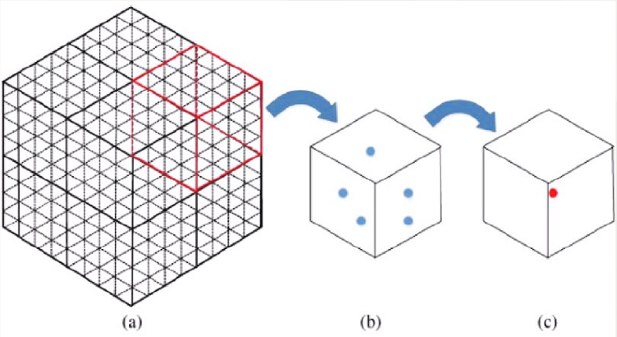

*그림 19. 복셀 그리드 필터의 동작: (a) 공간을 복셀로 나누기, (b) 한 복셀 안의 점들, (c) 점들을 대표하는 무게 중심 하나*

**복셀 그리드 필터(voxel grid filter)** 는 그림 19처럼 동작한다 [9], [10]. (a) 공간을 한 변의 길이가 $l$(leaf size)인 정육면체 복셀로 나눈다. (b) 각 점이 어느 복셀에 들어가는지 정한다. (c) 복셀마다 그 안의 점들을 무게 중심 하나로 바꾼다. 점 $\mathbf{p} = (x, y, z)$가 들어가는 복셀의 번호는 각 좌표를 $l$로 나누어 내림한 정수 세 개이다.

```math
(i, j, k) = \left( \left\lfloor \frac{x}{l} \right\rfloor, \left\lfloor \frac{y}{l} \right\rfloor, \left\lfloor \frac{z}{l} \right\rfloor \right), \qquad
\bar{\mathbf{p}}_{ijk} = \frac{1}{\vert V_{ijk} \vert} \sum_{\mathbf{p} \in V_{ijk}} \mathbf{p}
```

$V_{ijk}$는 번호가 $(i, j, k)$인 복셀에 들어간 점들의 집합이고, $\vert V_{ijk} \vert$는 그 점의 수이다. 출력 점의 수는 점이 하나 이상 들어간 복셀의 수와 같다. $\lfloor a \rfloor$는 $a$보다 크지 않은 가장 큰 정수이므로 $\lfloor -0.3 \rfloor = -1$이다. 실제 구현은 포인트 클라우드의 최솟값을 기준으로 번호를 매기지만, 복셀을 나누는 방식은 같다.

**계산 예: 복셀 그리드 필터.** leaf size $l = 1$ m로 다음 여섯 점을 다운샘플링한다.

| 점 | 좌표 (m) | 복셀 번호 $(\lfloor x \rfloor, \lfloor y \rfloor, \lfloor z \rfloor)$ |
|:-----|:-----|:-----|
| $`\mathbf{p}_1`$ | $(0.2, 0.3, 0.1)$ | $(0, 0, 0)$ |
| $`\mathbf{p}_2`$ | $(0.6, 0.1, 0.4)$ | $(0, 0, 0)$ |
| $`\mathbf{p}_3`$ | $(0.4, 0.8, 0.7)$ | $(0, 0, 0)$ |
| $`\mathbf{p}_4`$ | $(1.2, 0.5, 0.2)$ | $(1, 0, 0)$ |
| $`\mathbf{p}_5`$ | $(1.8, 0.9, 0.6)$ | $(1, 0, 0)$ |
| $`\mathbf{p}_6`$ | $(2.5, 2.5, 0.5)$ | $(2, 2, 0)$ |

*표 9. 여섯 점의 복셀 번호*

- 복셀 $(0, 0, 0)$에는 세 점이 있으므로 무게 중심은 $\left( \frac{0.2 + 0.6 + 0.4}{3}, \frac{0.3 + 0.1 + 0.8}{3}, \frac{0.1 + 0.4 + 0.7}{3} \right) = (0.4, 0.4, 0.4)$이다.
- 복셀 $(1, 0, 0)$에는 두 점이 있으므로 $\left( \frac{1.2 + 1.8}{2}, \frac{0.5 + 0.9}{2}, \frac{0.2 + 0.6}{2} \right) = (1.5, 0.7, 0.4)$이다.
- 복셀 $(2, 2, 0)$에는 점이 하나뿐이므로 $(2.5, 2.5, 0.5)$가 그대로 남는다.

여섯 점이 세 점으로 줄었다. 점이 많이 몰린 곳(복셀 $`(0, 0, 0)`$)일수록 많이 줄고 점이 드문 곳은 그대로 남으므로, 결과는 공간에 고르게 퍼진다. 무게 중심은 원래 점들 사이에 있으므로 표면의 대략적인 모양도 유지된다.

다운샘플링이 위치 인식에 주는 효과는 다음과 같다.

- **계산량:** 3.4절에서 본 것처럼 NDT 정합의 계산량은 스캔의 점 수에 비례한다. 3.7절의 예에서 41004개의 점이 Leaf Size 1 m로 2191개로 줄었으므로, 정합 한 번의 계산이 약 19배 가벼워진다. LiDAR가 0.1초마다 스캔을 보내므로 정합은 0.1초 안에 끝나야 한다.
- **밀도의 균일화:** LiDAR는 가까운 곳을 촘촘하게, 먼 곳을 성기게 측정한다. 다운샘플링하지 않으면 가까운 바닥의 점들이 점수를 지배하고, 방향을 잘 정해 주는 먼 점들(3.4절)의 영향이 작아진다.
- **leaf size의 선택:** leaf size가 너무 크면 점이 지나치게 줄어 기둥이나 모서리 같은 작은 구조가 사라지고, 정합이 불안정해진다. 너무 작으면 점이 거의 줄지 않아 실시간 처리가 어려워진다. 지도의 NDT 셀 크기(Resolution)와 비슷하거나 조금 큰 값이 흔히 쓰인다.

### 4.6 nmea2tfpose와 ndt_matching

Computing 탭에서 GNSS 위치 변환 노드와 NDT 매칭 노드를 실행한다.

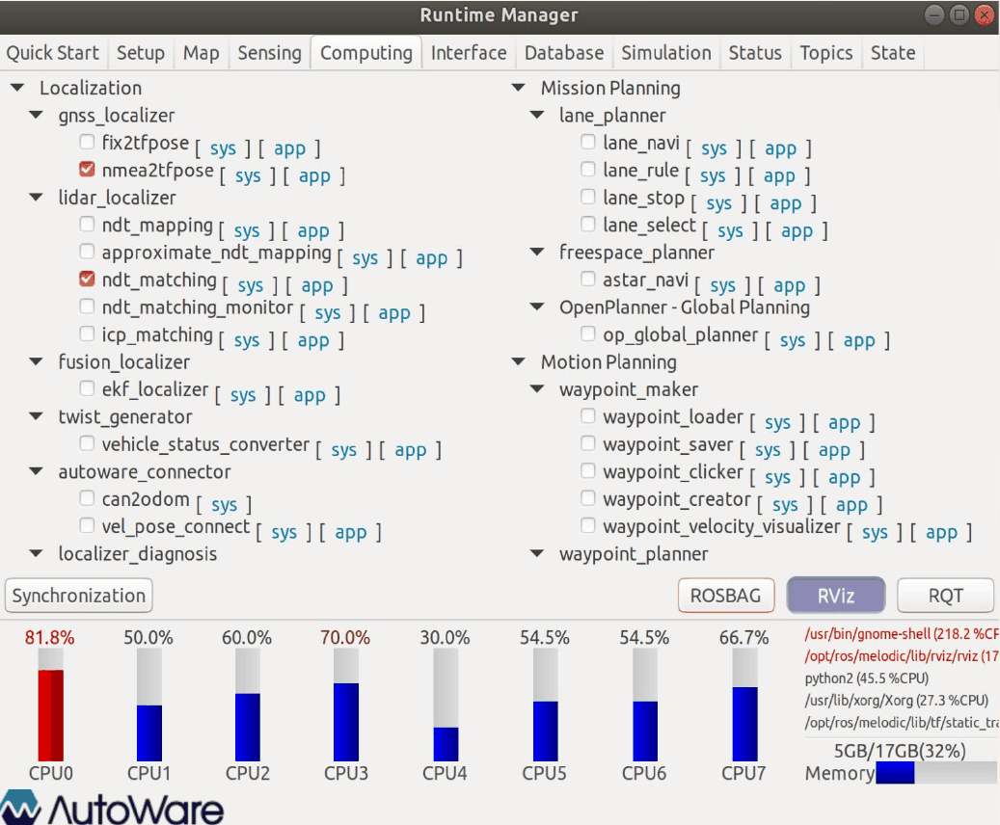

*그림 20. Computing 탭에서 nmea2tfpose와 ndt_matching을 선택한 화면*

**nmea2tfpose.** Localization > gnss_localizer의 `nmea2tfpose`를 체크한다. 이 노드는 GNSS 수신기가 내보낸 NMEA 문장(`/nmea_sentence`)을 읽어 위도, 경도, 높이를 얻고, 이를 그 지역에 맞게 정의된 평면 직각 좌표계의 $(x, y, z)$로 바꾸어 `/gnss_pose`로 발행하며, TF로 `map`과 `gps` 좌표계의 관계도 발행한다 [7]. 위치는 GGA나 RMC 문장에서 읽고, 방향은 방향을 담은 문장이 있으면 그것을 쓰고 없으면 연속한 두 위치를 잇는 방향($`\text{atan2}(\Delta y, \Delta x)`$)으로 계산한다.

> **용어 정의:** **NMEA 0183**은 GNSS 수신기 같은 항해 장비가 측정값을 쉼표로 구분한 텍스트 문장으로 내보내는 표준이다 [11]. 문장은 `$`로 시작하고, 그 뒤의 다섯 글자가 문장의 종류(예: `GPGGA`)를 나타내며, `*` 뒤의 두 글자는 오류 검출용 검사합(checksum)이다.

**계산 예: GGA 문장 읽기.** 다음은 GGA 문장의 예이다.

```text
$GPGGA,123519,4807.038,N,01131.000,E,1,08,0.9,545.4,M,46.9,M,,*47
```

| 순서 | 값 | 의미 |
|:-----|:-----|:-----|
| 1 | `123519` | 측정 시각 12시 35분 19초 (UTC) |
| 2, 3 | `4807.038`, `N` | 위도 48° 07.038′ (북위) |
| 4, 5 | `01131.000`, `E` | 경도 11° 31.000′ (동경) |
| 6 | `1` | 위치 결정 상태 (0은 실패, 1은 단독 측위, 2는 DGPS) |
| 7 | `08` | 사용한 위성 수 |
| 8 | `0.9` | 수평 정밀도 저하율(HDOP). 작을수록 위성 배치가 좋다 |
| 9, 10 | `545.4`, `M` | 평균 해수면 기준 안테나 높이 (m) |
| 11, 12 | `46.9`, `M` | 평균 해수면과 기준 타원체 사이의 높이 차 (m) |

*표 10. GGA 문장의 필드*

위도와 경도는 도(degree)와 분(minute)을 붙여 쓴 형식(위도는 ddmm.mmmm, 경도는 dddmm.mmmm)이다. 위도 `4807.038`은 48도와 7.038분이므로 십진 도로 바꾸면 $48 + 7.038 / 60 = 48.1173°$이고, 경도 `01131.000`은 $11 + 31.000 / 60 = 11.5167°$이다. `nmea2tfpose`는 이렇게 얻은 위도와 경도를 평면 좌표로 바꾼다. GNSS의 오차 요인과 정밀도를 높이는 방법은 13주차에서 다룬다.

**ndt_matching.** Localization > lidar_localizer의 `ndt_matching`을 체크하고, [app] 창에서 초기 위치를 정한다(3주차 3.2절의 표 6). 초기 위치로 GNSS를 고르면 `/gnss_pose`를 첫 정합의 초기 추정으로 쓰므로, 사용자가 위치를 직접 입력하지 않아도 지도 위의 대략적인 위치에서 정합이 시작된다. 이후에는 직전 포즈를 바탕으로 예측한 포즈에서 정합을 시작한다. 정합 결과는 `/ndt_pose`와 TF(`map` → `base_link`)로 발행되고, 정합 상태는 `/ndt_stat`으로 Runtime Manager에 전달된다.

> **주의:** GNSS로 정한 초기 위치가 크게 틀리거나 정합이 실패하여 차량이 지도에서 벗어나면, RViz의 2D Pose Estimate 도구로 지도 위의 올바른 위치와 방향을 끌어 지정한다. 이 도구는 지정한 포즈를 `/initialpose` 토픽으로 발행하며, `ndt_matching`은 이를 새 초기 추정으로 삼아 정합을 다시 시작한다.

### 4.7 rqt_graph로 본 노드 구성

위치 인식을 실행한 상태에서 rqt_graph로 본 노드와 토픽의 연결을 정리하면 다음과 같다(타원은 노드, 사각형은 토픽).

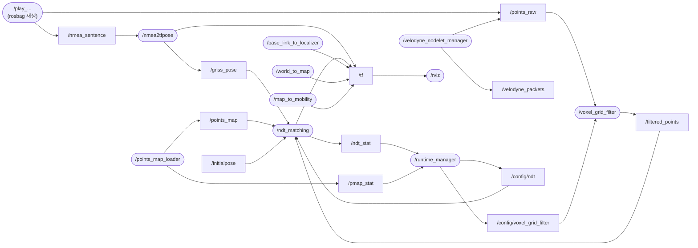

*그림 21. NDT 매칭 위치 인식을 실행했을 때의 노드와 토픽*

3주차 3.3절의 노드 그래프와 비교하면 다음 부분이 더해졌다.

- **rosbag 재생 노드.** `/play_...`는 Simulation 탭이 실행한 rosbag 재생 노드이며, bag에 기록된 `/nmea_sentence`와 `/points_raw`를 발행한다. 이름 끝의 긴 숫자는 같은 이름의 노드가 겹치지 않도록 실행 시각으로 붙인 것이다.
- **GNSS 경로.** `/nmea2tfpose`가 `/nmea_sentence`를 받아 `/gnss_pose`를 발행하고, `/ndt_matching`이 이를 초기 위치로 쓴다.
- **초기 위치 지정.** RViz의 2D Pose Estimate가 발행하는 `/initialpose`도 `/ndt_matching`의 입력이다.
- **TF의 발행자.** `/tf` 토픽에는 여러 노드가 좌표계의 관계를 발행한다. `/base_link_to_localizer`는 Setup 탭에서 입력한 차량과 LiDAR의 관계, `/world_to_map`과 `/map_to_mobility`는 `tf.launch`가 실행한 정적 변환 노드이며, `/nmea2tfpose`와 `/ndt_matching`은 각각 `gps`와 `base_link`의 위치를 발행한다. RViz는 `/tf`를 받아 모든 데이터를 한 좌표계에 그린다.

### 4.8 실행 결과 확인

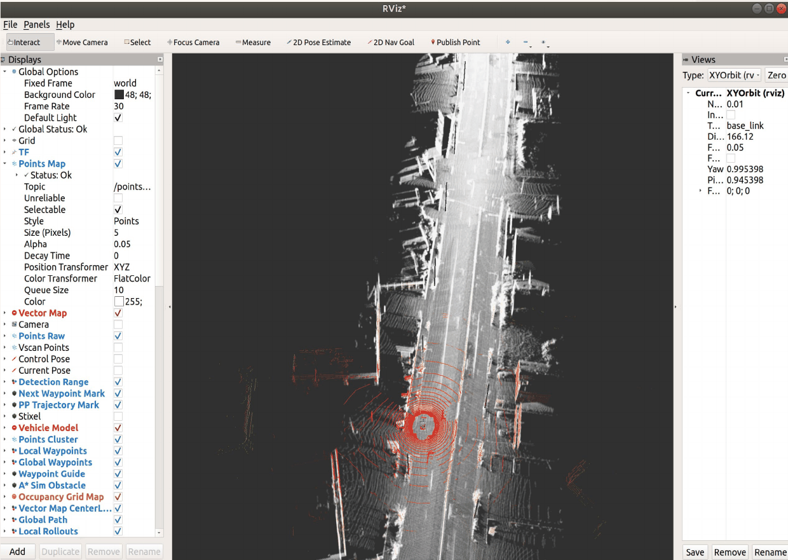

*그림 22. NDT 매칭으로 위치를 인식하는 동안 RViz에 표시된 지도와 현재 스캔*

그림 22는 위에서 내려다본 RViz 화면이다. 흰 점은 포인트 클라우드 지도로, 위아래로 곧게 뻗은 도로와 양옆의 건물, 나무가 보인다. 가운데 아래쪽에 동심원 모양으로 퍼진 붉은 점들이 현재 LiDAR 스캔이고, 그 중심에 차량 모델이 있다. 왼쪽의 Displays 패널에서 Fixed Frame이 `world`이므로 모든 데이터는 `world` 좌표계에 그려지며, 차량의 위치는 TF 트리(그림 4)를 따라 계산된다.

위치 인식이 잘 되고 있으면 스캔의 점들이 지도의 건물 벽과 도로 경계에 겹쳐 보이고, bag이 재생되는 동안 차량과 스캔이 지도 위를 함께 미끄러지듯 이동한다. 반대로 스캔이 지도의 벽과 어긋나 겹쳐 그려지거나, 차량이 도로를 벗어나 건물 속을 지나거나, 갑자기 다른 곳으로 튀면 정합이 실패한 것이다. 이때는 Runtime Manager에 표시되는 `/ndt_stat`의 정합 상태를 확인하고, 4.6절의 주의처럼 초기 위치를 다시 지정한다.

---

<br>

## 개념 적용

| 상황 | 분석 |
|:-----|:-----|
| Quick Start에서 rosbag을 Play한 뒤 Pause하지 않고 그대로 두고 지도와 위치 인식 노드를 천천히 실행하였다. | **처음 구간의 데이터를 놓칠 수 있다.** 노드가 준비되기 전에 스캔과 GNSS 데이터가 지나가 버리므로, 위치 인식이 늦게 시작되거나 초기 위치를 다시 잡아야 한다. Play 직후 Pause하는 이유이다. |
| ndt_mapping의 Minimum Scan Range를 0으로 바꾸었다. | **차량 자신의 몸체가 지도에 찍힌다.** 차체에 맞은 점은 스캔마다 차량을 따라 같은 상대 위치에 나타나므로, 지도에 차량의 흔적이 남고 정합도 방해한다. |
| Setup 탭의 Baselink to Localizer에 $x = 1.2$ 대신 0을 입력하였다. | **차량의 위치가 1.2 m 어긋난다.** NDT가 구한 LiDAR 포즈에서 잘못된 장착 위치를 되돌리므로, 지도 위에서 차량이 실제보다 1.2 m 앞에 있는 것으로 계산되고 경로 추종도 그만큼 틀어진다. |
| 정차한 차량에서 ndt_mapping을 실행하였더니 map의 점 수가 늘지 않는다. | **정상이다.** 차량이 움직이지 않아 shift가 Minimum Add Scan Shift보다 작으므로 스캔을 지도에 더하지 않는다. 같은 자리의 스캔을 중복해서 쌓지 않기 위한 동작이다. |
| 2 km 길이의 순환 도로를 한 바퀴 돌며 만든 지도에서 출발 지점의 건물이 두 겹으로 보인다. | **누적 오차이다.** 스캔마다 생긴 작은 정합 오차가 쌓여 지도의 끝이 시작과 맞지 않는다. ndt_mapping은 루프 결합을 하지 않으므로 구간을 나누어 다시 만들거나 루프 결합을 지원하는 SLAM 도구를 쓴다. |
| voxel_grid_filter의 Voxel Leaf Size를 0.05 m로 줄였다. | **다운샘플링이 이루어지지 않는다.** Autoware의 구현은 0.1 m보다 작은 값에서 점을 그대로 내보내므로 정합의 계산량이 크게 늘어 스캔 주기(0.1초) 안에 처리하지 못할 수 있다. |

*표 11. 지도 작성과 위치 인식의 사례 분석*

**T/F 점검:**

| 문장 | 판단과 근거 |
|:-----|:-----|
| NDT 매핑에서 지도 좌표계의 원점은 지도 작성을 시작한 순간의 차량 기준점이다. | **T.** 첫 스캔을 $`T^{\text{base}}_{\text{lidar}}`$로 옮겨 그대로 지도로 삼기 때문이다. |
| ndt_mapping은 다운샘플링한 스캔을 지도에 더한다. | **F.** 다운샘플링한 스캔은 정합에만 쓰고, 지도에는 거리 필터만 거친 스캔을 옮겨 더한다. |
| ndt_mapping이 출력하는 Transformation Matrix의 평행 이동은 차량 기준점의 위치이다. | **F.** 변환 행렬은 LiDAR의 포즈이며, 차량 기준점의 위치는 여기서 LiDAR의 장착 위치를 되돌린 $(x, y, z)$이다. |
| 복셀 그리드 필터의 출력 점 수는 점이 들어 있는 복셀의 수와 같다. | **T.** 점이 하나 이상 들어간 복셀마다 무게 중심 하나를 남기기 때문이다. |
| 작은 yaw 회전에서 LiDAR로부터 수평 거리가 먼 점일수록 크게 움직인다. | **T.** 야코비 행렬의 yaw 열이 $(-y, x, 0)$이므로 움직이는 거리는 회전축에서 점까지의 거리에 비례한다. |

---

<br>

## 요약

| 개념 | 핵심 요약 |
|:--------|:------------|
| Autoware Quick Start | Moriyama rosbag과 지도를 `~/.autoware`에 두고 Runtime Manager에서 bag을 불러와 RViz 설정과 Quick Start 탭의 launch 파일을 실행하는 데모이다. |
| 포인트 클라우드 지도와 벡터 지도 | 포인트 클라우드 지도는 타일별 PCD 파일로 위치 인식에 쓰고, 벡터 지도는 도로 요소별 CSV 파일로 경로 생성과 판단에 쓴다. |
| 포인트 클라우드 | 3차원 점의 순서 없는 집합이며, ROS에서는 `sensor_msgs/PointCloud2`로 주고받고 파일로는 PCD 형식으로 저장한다. |
| 강체 변환 | $\mathbf{p}' = R\mathbf{p} + \mathbf{t}$이며, 동차 변환 행렬 하나로 나타내고 $R = R_z(\psi) R_y(\theta) R_x(\phi)$로 만든다. |
| 변환의 합성 | $`T^{\text{map}}_{\text{lidar}} = T^{\text{map}}_{\text{base}} T^{\text{base}}_{\text{lidar}}`$이며, NDT가 구한 LiDAR 포즈에서 장착 위치를 되돌려 차량의 포즈를 얻는다. |
| NDT 매핑 | 새 스캔을 지금까지의 지도에 NDT로 정합하고 그 포즈로 옮겨 지도에 더하는 과정을 되풀이하는 지도 작성 방법이다. |
| ndt_mapping의 처리 | 거리 필터, 다운샘플링, 등속 운동 모델의 초기 추정, NDT 정합, 이동 거리 기준의 지도 추가로 이루어진다. |
| 3차원 NDT의 야코비 행렬 | 작은 회전에서 $`J = (I_3 \;\; -[\mathbf{x}]_{\times})`$이며, 먼 점일수록 회전을 정하는 데 크게 기여한다. |
| 누적 오차 | 정합 오차가 쌓여 지도가 휘는 현상이며, 방향 오차 $\delta\psi$는 거리 $d$에서 약 $`d\,\delta\psi`$의 위치 오차를 만들고 루프 결합으로 바로잡는다. |
| 복셀 그리드 필터 | 공간을 leaf size의 복셀로 나누어 복셀마다 무게 중심 하나만 남기며, 정합의 계산량을 줄이고 점의 밀도를 고르게 한다. |
| nmea2tfpose | NMEA 문장의 위도, 경도, 높이를 지도의 평면 좌표로 바꾸어 `/gnss_pose`와 TF로 발행하며, NDT 매칭의 초기 위치로 쓰인다. |
| 위치 인식의 실행 | bag 재생, 지도와 TF, LiDAR와 voxel_grid_filter, nmea2tfpose, ndt_matching의 순서로 실행하고 RViz에서 스캔이 지도에 겹치는지 확인한다. |

---

<br>

## 점검 문제

1. **데이터 준비:** Quick Start의 데모 데이터를 홈 디렉토리 아래의 `.autoware`에 푸는 이유와, 파일 관리자에서 이 디렉토리가 보이지 않을 때의 해결 방법을 쓰라.

   <details>
   <summary>정답</summary>

   데모용 launch 파일과 설정이 `~/.autoware` 아래의 지도와 TF 파일을 가리키도록 작성되어 있으므로, 이 경로에 두면 설정의 경로를 고치지 않고 그대로 쓸 수 있다. 이름이 점으로 시작하는 디렉토리는 숨김 항목이므로, Ubuntu의 파일 관리자에서는 Ctrl+H를 누르고, 파일 선택 창에서는 오른쪽 클릭 메뉴의 Show Hidden Files를 켜면 보인다.

   </details>

2. **bag 정보 해석:** 어떤 bag의 길이가 300초이고 `/points_raw` 메시지가 3000개, 크기가 5 GB라면, LiDAR의 스캔 주기와 스캔 하나의 대략적인 크기는 얼마인가?

   <details>
   <summary>정답</summary>

   3000 / 300 = 10이므로 LiDAR는 1초에 10번, 즉 0.1초마다 스캔한다. bag의 크기를 거의 모두 LiDAR가 차지한다고 보면 5 GB / 3000 ≈ 1.67 MB이므로 스캔 하나는 약 1.7 MB이다.

   </details>

3. **변환의 합성:** 차량이 지도의 $(20, 0, 0)$ m에서 yaw $= 180°$를 보고 있고, LiDAR는 차량 기준점에서 $(1.0, 0, 1.5)$ m에 회전 없이 달려 있다. LiDAR가 측정한 점 $(4, 2, -1.5)$의 지도 좌표를 구하라.

   <details>
   <summary>정답</summary>

   먼저 LiDAR → 차량 변환으로 $`\mathbf{p}^{\text{base}} = (4 + 1.0, \; 2, \; -1.5 + 1.5) = (5, 2, 0)`$이다. $R_z(180°)$는 $(x, y, z)$를 $(-x, -y, z)$로 보내므로 $R_z(180°)\mathbf{p}^{\text{base}} = (-5, -2, 0)$이고, 차량의 위치를 더하면 $\mathbf{p}^{\text{map}} = (15, -2, 0)$이다. 차량이 지도의 $-x$ 방향을 보고 있으므로 차량 앞 5 m의 점은 지도에서 $x$가 5 작은 곳에 놓인다.

   </details>

4. **ndt_mapping의 처리:** ndt_mapping이 정합에는 다운샘플링한 스캔을 쓰고 지도에는 다운샘플링하지 않은 스캔을 더하는 이유를 설명하라.

   <details>
   <summary>정답</summary>

   정합은 스캔마다 0.1초 안에 끝나야 하고 계산량이 점 수에 비례하므로, 점을 크게 줄인 스캔으로 빠르게 수행한다. 반면 지도는 이후 위치 인식의 기준이 되므로 표면의 세부 모양을 남기도록 거리 필터만 거친 많은 점을 더한다. 지도의 크기는 저장할 때 Filter Resolution으로 따로 줄일 수 있다.

   </details>

5. **지도 추가 판단:** Minimum Add Scan Shift가 1 m이고 마지막으로 스캔을 더한 위치가 $(10.0, 4.0)$일 때, 현재 위치가 $(10.6, 4.7)$이면 이번 스캔을 지도에 더하는가?

   <details>
   <summary>정답</summary>

   $\text{shift} = \sqrt{(10.6 - 10.0)^2 + (4.7 - 4.0)^2} = \sqrt{0.36 + 0.49} = \sqrt{0.85} \approx 0.922$ m이다. 1 m보다 작으므로 이번 스캔은 지도에 더하지 않는다.

   </details>

6. **출력 해석:** ndt_mapping의 출력에서 변환 행렬의 평행 이동이 $(1.168, 0.014, 2.002)$인데 차량의 위치는 $(-0.030, 0.010, 0.0005)$로 출력되었다. 두 값이 다른 이유를 설명하라.

   <details>
   <summary>정답</summary>

   변환 행렬은 NDT 정합으로 구한 LiDAR의 포즈 $`T^{\text{map}}_{\text{lidar}}`$이고, 차량의 위치는 여기서 LiDAR의 장착 위치 $(1.2, 0, 2.0)$을 되돌린 차량 기준점의 포즈 $`T^{\text{map}}_{\text{base}} = T^{\text{map}}_{\text{lidar}} (T^{\text{base}}_{\text{lidar}})^{-1}`$이다. 회전이 거의 없으므로 두 위치의 차이는 장착 위치와 거의 같다.

   </details>

7. **야코비 행렬:** LiDAR 좌표계의 점 $\mathbf{x} = (0, 8, 0)$(왼쪽 8 m)에 대해 roll, pitch, yaw 열을 구하고, 어느 회전을 정하는 데 이 점이 도움이 되는지 설명하라.

   <details>
   <summary>정답</summary>

   roll 열은 $(0, -z, y) = (0, 0, 8)$, pitch 열은 $(z, 0, -x) = (0, 0, 0)$, yaw 열은 $(-y, x, 0) = (-8, 0, 0)$이다. 작은 roll은 이 점을 회전각의 8배만큼 위아래로, 작은 yaw는 회전각의 8배만큼 앞뒤로 움직이지만, pitch는 이 점을 움직이지 않는다. 따라서 이 점은 roll과 yaw를 정하는 데 도움이 되고, pitch는 앞뒤에 있는 점들이 정한다.

   </details>

8. **복셀 그리드 필터:** leaf size $l = 2$ m로 점 $(0.5, 0.5, 0)$, $(1.5, 1.0, 0)$, $(2.5, 0.5, 0)$, $(3.5, 1.5, 0)$을 다운샘플링한 결과를 구하라.

   <details>
   <summary>정답</summary>

   복셀 번호는 각각 $(\lfloor 0.25 \rfloor, \lfloor 0.25 \rfloor, 0) = (0, 0, 0)$, $(0, 0, 0)$, $(1, 0, 0)$, $(1, 0, 0)$이다. 복셀 $(0, 0, 0)$의 무게 중심은 $(1.0, 0.75, 0)$, 복셀 $(1, 0, 0)$의 무게 중심은 $(3.0, 1.0, 0)$이므로, 네 점이 두 점으로 줄어든다.

   </details>

9. **NMEA 변환:** GGA 문장의 위도 필드가 `3532.125`, 경도 필드가 `13651.600`이다. 십진 도로 바꾸라.

   <details>
   <summary>정답</summary>

   위도는 35도와 32.125분이므로 $35 + 32.125 / 60 = 35.5354°$이다. 경도는 136도와 51.600분이므로 $136 + 51.600 / 60 = 136.86°$이다.

   </details>

10. **누적 오차:** 지도 작성 중 한 지점에서 방향이 0.05°만큼 틀어졌다. 그 뒤로 1 km를 더 진행한 곳의 지도는 옆으로 얼마나 어긋나는가? 이런 오차를 바로잡는 방법을 쓰라.

    <details>
    <summary>정답</summary>

    $0.05° = 0.05 \times \pi / 180 \approx 0.000873$ rad이므로 어긋남은 약 $1000 \times 0.000873 \approx 0.87$ m이다. 이미 지나온 곳에 다시 왔을 때 두 포즈가 같은 곳이라는 제약을 더하고 모든 포즈를 함께 다시 계산하는 루프 결합(그래프 기반 SLAM)으로 바로잡는다. ndt_mapping에는 이 기능이 없으므로 구간을 나누어 지도를 만들거나 IMU, 주행 거리계로 초기 추정을 개선한다.

    </details>

11. **위치 인식 절차:** NDT 매칭 위치 인식을 실행할 때 Setup 탭의 TF, Map 탭의 TF, nmea2tfpose가 각각 발행하는 좌표계의 관계를 쓰라.

    <details>
    <summary>정답</summary>

    Setup 탭의 TF는 차량 기준점과 LiDAR의 관계(`base_link` → `velodyne`), Map 탭의 TF(`tf.launch`)는 `world`와 `map` 같은 지도 좌표계 사이의 정적 관계, nmea2tfpose는 GNSS로 구한 `map`과 `gps`의 관계를 발행한다. 여기에 ndt_matching이 `map`과 `base_link`의 관계를 발행하여 TF 트리가 완성된다.

    </details>

---

<br>

## 참고 문헌

1. R. B. Rusu and S. Cousins, "3D is here: Point Cloud Library (PCL)," in *Proc. IEEE Int. Conf. Robot. Autom. (ICRA)*, Shanghai, China, 2011, pp. 1-4.
2. Open Robotics, "sensor_msgs/PointCloud2 message," ROS Melodic API documentation. https://docs.ros.org/en/melodic/api/sensor_msgs/html/msg/PointCloud2.html
3. Point Cloud Library, "The PCD (Point Cloud Data) file format," PCL Tutorials. https://pcl.readthedocs.io/projects/tutorials/en/latest/pcd_file_format.html
4. T. Foote, "tf: The transform library," in *Proc. IEEE Int. Conf. Technol. Practical Robot Appl. (TePRA)*, Woburn, MA, USA, 2013, pp. 1-6.
5. P. Biber and W. Straßer, "The normal distributions transform: A new approach to laser scan matching," in *Proc. IEEE/RSJ Int. Conf. Intell. Robots Syst. (IROS)*, Las Vegas, NV, USA, 2003, vol. 3, pp. 2743-2748.
6. M. Magnusson, "The three-dimensional normal-distributions transform: An efficient representation for registration, surface analysis, and loop detection," Ph.D. dissertation, Örebro Univ., Örebro, Sweden, 2009.
7. Autoware Foundation, "core_perception: lidar_localizer, points_downsampler, gnss_localizer," GitHub repository, Autoware.ai. https://github.com/Autoware-AI/core_perception
8. G. Grisetti, R. Kümmerle, C. Stachniss, and W. Burgard, "A tutorial on graph-based SLAM," *IEEE Intell. Transp. Syst. Mag.*, vol. 2, no. 4, pp. 31-43, 2010.
9. Point Cloud Library, "Downsampling a PointCloud using a VoxelGrid filter," PCL Tutorials. https://pcl.readthedocs.io/projects/tutorials/en/latest/voxel_grid.html
10. L.-C. Chen, S.-H. Huang, and B.-H. Huang, "Precise 6DOF localization of robot end effectors using 3D vision and registration without referencing targets," in *Vision Sensors - Recent Advances*. London, U.K.: IntechOpen, 2022.
11. National Marine Electronics Association, *NMEA 0183 Interface Standard*. Severna Park, MD, USA: NMEA.
