# Week 9 Lecture — Map Building and Localization in Autoware

[Repository Guide](../../README.md) | [English](Concepts_Lecture.md) | [한국어](Concepts_Lecture.ko.md)

> **Last Updated:** 2026-11-04

> **Learning Objectives:**
> 1. Prepare the Moriyama rosbag and map data, run the Autoware Quick Start demo, and explain the file organization of point cloud maps and vector maps
> 2. Represent point clouds and 3D rigid-body transformations with homogeneous transformation matrices, and compose the transformations between the map, vehicle, and LiDAR frames
> 3. Explain step by step how ndt_mapping filters, registers, and adds scans to the map, and interpret its parameters and runtime output
> 4. Compute how a voxel grid filter downsamples a point cloud, and explain how the leaf size affects registration
> 5. Run the map, TF, voxel_grid_filter, nmea2tfpose, and ndt_matching in order in the Runtime Manager to localize the vehicle, and interpret the node configuration with rqt_graph

---

## Table of Contents

- [1. Autoware Quick Start](#1-autoware-quick-start)
  - [1.1 Purpose and Procedure of the Demo](#11-purpose-and-procedure-of-the-demo)
  - [1.2 Preparing the rosbag and Map Data](#12-preparing-the-rosbag-and-map-data)
  - [1.3 Point Cloud Maps and Vector Maps](#13-point-cloud-maps-and-vector-maps)
  - [1.4 Launching the Runtime Manager and Loading the rosbag](#14-launching-the-runtime-manager-and-loading-the-rosbag)
  - [1.5 RViz Configuration and Running the Quick Start](#15-rviz-configuration-and-running-the-quick-start)
- [2. Point Clouds and Coordinate Transformations](#2-point-clouds-and-coordinate-transformations)
  - [2.1 Representing Point Clouds](#21-representing-point-clouds)
  - [2.2 Rigid-Body Transformations in 3D](#22-rigid-body-transformations-in-3d)
  - [2.3 Coordinate Frames and Composition of Transformations](#23-coordinate-frames-and-composition-of-transformations)
- [3. Map Building with NDT Mapping](#3-map-building-with-ndt-mapping)
  - [3.1 Procedure for Map Building](#31-procedure-for-map-building)
  - [3.2 Recording and Playing Back Sensor Data](#32-recording-and-playing-back-sensor-data)
  - [3.3 Building a Map by Scan Matching](#33-building-a-map-by-scan-matching)
  - [3.4 Mathematics of 3D NDT Registration](#34-mathematics-of-3d-ndt-registration)
  - [3.5 Processing Steps of ndt_mapping](#35-processing-steps-of-ndt_mapping)
  - [3.6 Parameters of ndt_mapping](#36-parameters-of-ndt_mapping)
  - [3.7 Running and Interpreting the Output](#37-running-and-interpreting-the-output)
  - [3.8 Node Configuration and Saving the Map](#38-node-configuration-and-saving-the-map)
  - [3.9 Drift and Loop Closure](#39-drift-and-loop-closure)
- [4. Localization with NDT Matching](#4-localization-with-ndt-matching)
  - [4.1 Procedure for Localization](#41-procedure-for-localization)
  - [4.2 Loading the rosbag](#42-loading-the-rosbag)
  - [4.3 Loading the Map and TF](#43-loading-the-map-and-tf)
  - [4.4 LiDAR Node and Point Filters](#44-lidar-node-and-point-filters)
  - [4.5 Principle of the Voxel Grid Filter](#45-principle-of-the-voxel-grid-filter)
  - [4.6 nmea2tfpose and ndt_matching](#46-nmea2tfpose-and-ndt_matching)
  - [4.7 Node Configuration Seen in rqt_graph](#47-node-configuration-seen-in-rqt_graph)
  - [4.8 Checking the Result](#48-checking-the-result)
- [Concept Applications](#concept-applications)
- [Summary](#summary)
- [Self-Check Questions](#self-check-questions)
- [References](#references)

---

<br>

## 1. Autoware Quick Start

### 1.1 Purpose and Procedure of the Demo

**Autoware Quick Start** is a demo that runs the main functions of Autoware at once using only prerecorded sensor data and a map. When LiDAR and GNSS data recorded in a rosbag are played back, the Autoware nodes behave exactly as they would with data from real sensors, so the flow of map loading, localization, perception, and path planning can be examined without a vehicle or sensors (the principle of rosbag and the functional organization of Autoware were covered in Week 2). The demo proceeds in the following order.

1. Store the rosbag data and the map data.
2. Launch the Autoware Runtime Manager.
3. Load the rosbag data.
4. Launch RViz and apply the display configuration.
5. Load the point cloud map.
6. Run the demo using the sensing data.

### 1.2 Preparing the rosbag and Map Data

The demo needs two archive files. `sample_moriyama_150324.tar.gz` contains a rosbag file recorded while driving, and `sample_moriyama_data.tar.gz` contains a point cloud map, a vector map, and coordinate transformation settings. Both are real sensor data obtained while driving near Nagoya University in Japan, together with the map of that area. Extract the downloaded files into the `.autoware` directory under the home directory with the following commands.

```bash
cd ~                                        # move to the home directory
mkdir .autoware                             # create a hidden directory for the demo data
cd .autoware
cp ~/Downloads/sample_moriyama_* .          # copy the two downloaded archives here
tar zxfv sample_moriyama_150324.tar.gz      # extract the rosbag file
tar zxfv sample_moriyama_data.tar.gz        # extract the map and TF settings
```

Among the options of `tar`, `z` means the file is compressed with gzip, `x` means extract the archive, `f` means operate on the file whose name follows, and `v` means print the name of each extracted file. The data is placed in `~/.autoware` because the demo launch files and settings are written to point to the map and TF files under this path. If the data were placed elsewhere, every path in the settings would have to be edited.

> **Note:** Files and directories whose names start with a dot (`.`) are treated as hidden in Linux and are not shown by default in the file manager or by `ls`. In the Ubuntu file manager, Ctrl+H toggles hidden items, and in a terminal `ls -a` lists all items.

Extracting the archives produces the following files (main items only).

```text
~/.autoware/
├── sample_moriyama_150324.bag           rosbag (LiDAR and GNSS record)
└── data/
    ├── map/
    │   ├── pointcloud_map/              PCD files such as bin_Laser-00147_-00846.pcd
    │   └── vector_map/                  CSV files such as area.csv and lane.csv
    └── tf/
        └── tf.launch                    launch file defining the map frame relations
```

*Figure 1. Directory structure of the extracted demo data*

### 1.3 Point Cloud Maps and Vector Maps

Autoware uses two kinds of maps.

| Map | Format | Information | Main use |
|:-----|:-----|:-----|:-----|
| **Point cloud map** | Many PCD files | A huge number of 3D points forming the surfaces of the surroundings | Localization by registering LiDAR scans to the map |
| **Vector map** | Many CSV files | Points, lines, and areas of road elements such as lanes, stop lines, crosswalks, and traffic lights | Route generation, stop positions and signal decisions, visualization |

*Table 1. Comparison of point cloud maps and vector maps*

The `pointcloud_map` directory contains many PCD files whose names differ only in the last two numbers, such as `bin_Laser-00147_-00846.pcd` and `bin_Laser-00147_-00847.pcd`. A map of a wide area stored in a single file would be very large, so the area is divided into regions of fixed size (tiles) and each region is stored in its own file; the two numbers indicate the position of the region. For localization, all these files are loaded and merged into one map (Section 4.3).

The CSV files in the `vector_map` directory form a vector map in the ADAS map format. The roles of the points referenced by all elements (`point.csv`), vectors (`vector.csv`), lines (`line.csv`), areas (`area.csv`), lane segments (`lane.csv`, `node.csv`, `dtlane.csv`), stop lines (`stopline.csv`), crosswalks (`crosswalk.csv`), traffic lights (`signaldata.csv`), and the index (`idx.csv`) were covered in Week 2, Section 3.5. The demo data also contains the following road-facility files.

| File | Road element |
|:-----|:-----|
| `whiteline.csv` | White lane lines painted on the road surface |
| `roadedge.csv`, `curb.csv`, `gutter.csv` | Road edges, curbs, and gutters |
| `road_surface_mark.csv`, `zebrazone.csv` | Road surface markings such as arrows, and hatched zones |
| `roadsign.csv` | Road signs |
| `pole.csv`, `poledata.csv`, `utilitypole.csv`, `streetlight.csv` | Poles, utility poles, and street lights |

*Table 2. Road-facility files in the demo vector map*

### 1.4 Launching the Runtime Manager and Loading the rosbag

The **Runtime Manager** is a graphical tool that launches and configures Autoware nodes through tabs and buttons (see Week 2). Launch it in a new terminal with the following commands.

```bash
cd autoware.ai                                     # move to the Autoware workspace
source install/setup.bash                          # apply the built packages' environment to this shell
roslaunch runtime_manager runtime_manager.launch   # launch the Runtime Manager
```

`source install/setup.bash` sets environment variables such as paths in the current shell so that ROS can find the packages in the `install` directory where the build results are. It must be run again in every new terminal. `roslaunch` also starts the ROS master if it is not already running.

When the Runtime Manager appears, load the rosbag in the following order.

1. **Select the rosbag file.** In the Simulation tab, press the Ref button and choose `~/.autoware/sample_moriyama_150324.bag`. If `.autoware` is not visible in the file dialog, right-click an empty area of the dialog and enable Show Hidden Files.
2. **Set the playback start time.** Set Start Time to 140. Playback then starts not at the beginning of the bag but 140 seconds after the start of the recording.
3. **Play and pause immediately.** Press Play and then press Pause right away.

There is a reason for pressing Play once and then pausing in step 3. When playback starts, the ROS parameter `/use_sim_time` becomes `true` and the times recorded in the bag are published on the `/clock` topic, so nodes launched afterward run on the time of the bag rather than the current time of the computer. Pausing at the same time keeps the sensor data from flowing past before the map and localization nodes are ready.

The Simulation tab shows the information of the loaded bag as follows.

```text
path:        /home/mobility/.autoware/sample_moriyama_150324.bag
version:     2.0
duration:    7:59s (479s)
start:       Mar 24 2015 09:40:50.33 (1427157650.33)
end:         Mar 24 2015 09:48:49.50 (1427158129.50)
size:        7.9 GB
messages:    16768
compression: none [4788/4788 chunks]
types:       nmea_msgs/Sentence      [9f221efc5f4b3bac7ce4af102b32308b]
             sensor_msgs/PointCloud2 [1158d486dd51d683ce2f1be655c3c181]
topics:      /nmea_sentence   11980 msgs    : nmea_msgs/Sentence
             /points_raw       4788 msgs    : sensor_msgs/PointCloud2
```

This information tells us the nature of the data.

- **Recording time:** The data was recorded for 479 seconds (7 minutes 59 seconds) on March 24, 2015. The number in parentheses is the time in seconds counted from 1970-01-01 00:00 (UTC) (Unix time), and the date and time before it express that time in the time zone of the computer that printed the bag information. The output above uses UTC+9, so in Coordinated Universal Time the recording ran from 00:40:50 to 00:48:49; Japan, where the data was recorded, also uses UTC+9, so the data was recorded from 9:40 to 9:48 in the morning local time.
- **Topics:** There are only two, the NMEA sentences of the GNSS receiver `/nmea_sentence` and the LiDAR point clouds `/points_raw`. The message counts add up to 11980 + 4788 = 16768, the total number of messages.
- **LiDAR rate:** Since 4788 / 479 ≈ 10.0, the LiDAR produces about 10 scans per second.
- **Size of one scan:** Dividing 7.9 GB by 4788 scans gives about 1.65 MB per scan. NMEA sentences are short text, so almost all of the bag consists of LiDAR data. Processing such large data at every scan requires downsampling to reduce the number of points (Section 4.5).

### 1.5 RViz Configuration and Running the Quick Start

**RViz** is the 3D visualization tool of ROS; which topics to show with which colors and sizes (the Display list) and the viewpoint (View) can be saved in and loaded from a `.rviz` configuration file. Apply the demo configuration file in the following order.

1. Press the RViz button at the lower right of the Runtime Manager to launch RViz.
2. Choose Open Config from the File menu of RViz and open the following file.

```text
autoware.ai/src/autoware/documentation/autoware_quickstart_examples/launch/rosbag_demo/default.rviz
```

Next, specify the launch file of each stage in the Quick Start tab. A launch file is an XML script that runs several nodes and their parameters at once, and the demo files are already written in the following directory.

```text
autoware.ai/src/autoware/documentation/autoware_quickstart_examples/launch/rosbag_demo/
```

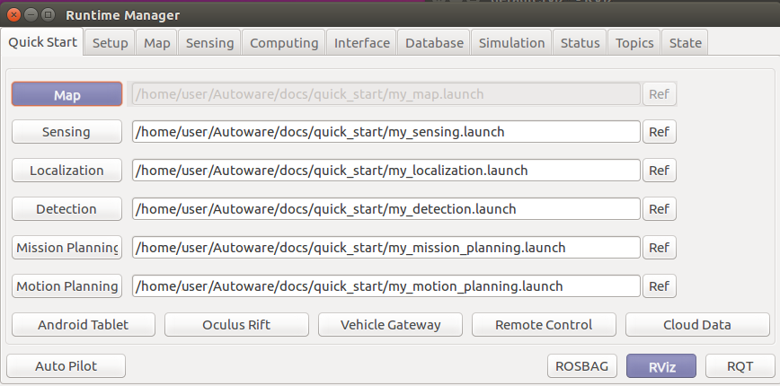

*Figure 2. The Quick Start tab with the launch file of each stage specified*

| Button | Launch file | Function launched |
|:-----|:-----|:-----|
| Map | `my_map.launch` | Loads the point cloud map, the vector map, and the TF of the map frames |
| Sensing | `my_sensing.launch` | Runs the driver nodes of the LiDAR (Velodyne HDL-32E) |
| Localization | `my_localization.launch` | Sets the TF between the vehicle and the LiDAR and runs nodes that compute the vehicle position (NDT matching and so on) |
| Detection | `my_detection.launch` | Runs nodes that detect surrounding objects |
| Mission Planning | `my_mission_planning.launch` | Runs nodes that build the global route to the destination from waypoints and lane information (lane_navi, lane_rule, lane_stop, and so on) |
| Motion Planning | `my_motion_planning.launch` | Runs obstacle avoidance, speed setting, and path following nodes (velocity_set, pure_pursuit, and so on) |

*Table 3. Buttons and launch files of the Quick Start tab*

After a file is specified with the Ref button of each row, pressing the button runs that launch file, and a running button changes color like the Map button in Figure 2. This order is the same as the order in which data flows (map and sensors → localization → perception → path planning). Finally, return to the Simulation tab, release the Pause, and check that the map appears in RViz.

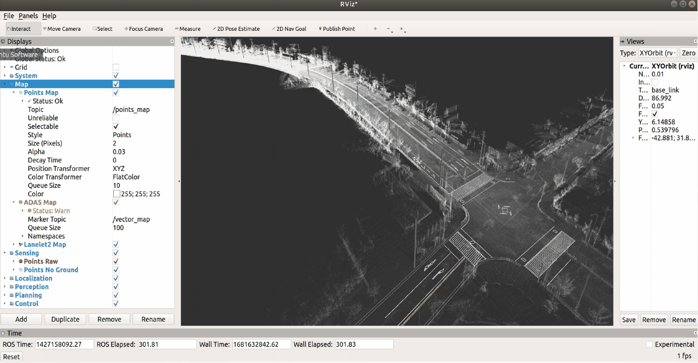

*Figure 3. Point cloud map of the Moriyama area displayed in RViz after running the Quick Start*

The center of Figure 3 shows a point cloud map in which an intersection, roads, building walls, and trees are drawn as white points. In the Displays panel on the left, Points Map under Map draws the `/points_map` topic as white points of size 2 pixels with transparency (Alpha) 0.03, ADAS Map draws the vector map topic `/vector_map`, and Points Raw under Sensing draws the raw LiDAR scan. In the Time panel at the bottom, the ROS Time is 1427158092.27, a time in 2015 when the bag was recorded, whereas the Wall Time is 1681632842.62 (2023), the actual time of the computer. This difference confirms that when `/use_sim_time` is on, ROS time follows the time of the bag.

---

<br>

## 2. Point Clouds and Coordinate Transformations

Both map building and localization are computations that move point clouds around and compare them. This section summarizes the representation of point clouds and 3D coordinate transformations that underlie Sections 3 and 4. Scans, point clouds, and registration were defined in Week 3, Section 2.2.

### 2.1 Representing Point Clouds

A point cloud is a set of points $P = \lbrace\mathbf{p}_1, \dots, \mathbf{p}_N\rbrace$ with $\mathbf{p}_i = (x_i, y_i, z_i)$. A LiDAR point may carry values besides its coordinates, such as the strength of the returned laser (intensity) or the index of the laser that measured it (ring). The order of the points has no meaning, so a point cloud is mathematically an unordered set. The open-source **PCL (Point Cloud Library)** is a C++ library that collects algorithms for storing, filtering, and registering point clouds, and map building and localization in Autoware are based on PCL [1].

In ROS, point clouds are exchanged as `sensor_msgs/PointCloud2` messages [2]. The message packs all points into a single byte array and separately describes which value sits at which position within the bytes of each point.

| Field | Meaning |
|:-----|:-----|
| `header` | Measurement time (`stamp`) and coordinate frame name (`frame_id`) |
| `height`, `width` | Shape of the array of points. An unordered point cloud has `height = 1` and `width = N` |
| `fields` | Names (`x`, `y`, `z`, `intensity`, and so on), byte offsets, and data types of the values forming one point |
| `point_step`, `row_step` | Number of bytes occupied by one point and by one row |
| `data` | Byte array concatenating the values of all points |
| `is_dense` | True if no point has a missing value (NaN) |

*Table 4. Main fields of the `sensor_msgs/PointCloud2` message*

If each point stores $x, y, z$, and intensity as 4-byte floats, one point takes at least 16 bytes (padding for alignment may be added depending on the implementation). Since one scan was about 1.65 MB in Section 1.4, a scan contains tens of thousands of points.

Maps are saved to files in the **PCD (point cloud data)** format of PCL [3]. A PCD file consists of a header and the point data.

```text
# .PCD v0.7 - Point Cloud Data file format
VERSION 0.7
FIELDS x y z intensity
SIZE 4 4 4 4
TYPE F F F F
COUNT 1 1 1 1
WIDTH 41004
HEIGHT 1
VIEWPOINT 0 0 0 1 0 0 0
POINTS 41004
DATA ascii
5.213 -1.044 -1.672 23
...
```

`FIELDS` gives the names of the values forming a point, `SIZE` the number of bytes of each value, `F` in `TYPE` a floating-point number, and `COUNT` the number of elements per value. `WIDTH` and `HEIGHT` mean the same as in `PointCloud2`, and `POINTS` is the total number of points. If `DATA` is `ascii`, one point is written per line as text below it; if it is `binary`, the points are stored as a byte array. The text format is human-readable, but the file is larger and takes longer to read and write.

### 2.2 Rigid-Body Transformations in 3D

A transformation that only rotates and translates an object without changing its shape is called a **rigid-body transformation**. Rotating a 3D point $\mathbf{p}$ by a rotation matrix $R$ and moving it by a translation vector $\mathbf{t}$ gives $\mathbf{p}' = R\mathbf{p} + \mathbf{t}$. The orientation of a vehicle is expressed by roll ($\phi$), pitch ($\theta$), and yaw ($\psi$) as defined in Week 3, which are rotations about the $x$-, $y$-, and $z$-axes, respectively.

$$
R_x(\phi) = \begin{pmatrix} 1 & 0 & 0 \\ 0 & \cos\phi & -\sin\phi \\ 0 & \sin\phi & \cos\phi \end{pmatrix}, \quad
R_y(\theta) = \begin{pmatrix} \cos\theta & 0 & \sin\theta \\ 0 & 1 & 0 \\ -\sin\theta & 0 & \cos\theta \end{pmatrix}, \quad
R_z(\psi) = \begin{pmatrix} \cos\psi & -\sin\psi & 0 \\ \sin\psi & \cos\psi & 0 \\ 0 & 0 & 1 \end{pmatrix}
$$

ROS and PCL build the rotation matrix from the three angles in the order $R = R_z(\psi) R_y(\theta) R_x(\phi)$; that is, they rotate first by roll, then by pitch, and finally by yaw about fixed axes. To handle rotation and translation together, a 1 is appended to the point to form **homogeneous coordinates** $(x, y, z, 1)$, and a rigid-body transformation becomes a single product with a $4 \times 4$ matrix.

$$
T = \begin{pmatrix} R & \mathbf{t} \\ \mathbf{0}^{T} & 1 \end{pmatrix}, \qquad
\begin{pmatrix} \mathbf{p}' \\ 1 \end{pmatrix} = T \begin{pmatrix} \mathbf{p} \\ 1 \end{pmatrix} = \begin{pmatrix} R\mathbf{p} + \mathbf{t} \\ 1 \end{pmatrix}
$$

This matrix is called a **homogeneous transformation matrix**. A 3D pose $(x, y, z, \phi, \theta, \psi)$ carries the same information as one homogeneous transformation matrix with $\mathbf{t} = (x, y, z)$ and $R = R_z(\psi) R_y(\theta) R_x(\phi)$.

> **[Linear Algebra]** A rotation matrix is an orthogonal matrix with $R^{T} R = I$ and $\det R = 1$. Its inverse therefore equals its transpose ($R^{-1} = R^{T}$), and the inverse of a homogeneous transformation matrix is $T^{-1} = \begin{pmatrix} R^{T} & -R^{T}\mathbf{t} \\ \mathbf{0}^{T} & 1 \end{pmatrix}$. Applying two transformations in sequence gives the matrix product $T_1 T_2$, and since matrix multiplication is not commutative, the order of multiplication matters.

When the angles are sufficiently small, $\cos\alpha \approx 1$ and $\sin\alpha \approx \alpha$, and products of two small angles can be neglected, so the rotation matrix is approximated as follows. Section 3.7 checks this approximation against actual output.

$$
R \approx \begin{pmatrix} 1 & -\psi & \theta \\ \psi & 1 & -\phi \\ -\theta & \phi & 1 \end{pmatrix}
$$

### 2.3 Coordinate Frames and Composition of Transformations

An autonomous driving system has several **coordinate frames**. The same point has different coordinate values depending on the frame in which it is expressed.

| Frame | Origin and axes | Example |
|:-----|:-----|:-----|
| `world` | Frame serving as the overall reference | Reference when several maps are used together |
| `map` | Origin of the map | Coordinates of the point cloud map and the vector map |
| `base_link` | Reference point of the vehicle, $x$-axis to the front of the vehicle, $z$-axis up | Reference for path following and control |
| `velodyne` (localizer) | Center of the LiDAR | Coordinates of the scans measured by the LiDAR |
| `gps` | Position of the GNSS antenna | Position obtained by GNSS |

*Table 5. Main coordinate frames used in Autoware*

The transformation that converts a point in frame $B$ into a point in frame $A$ is denoted $T^{A}_{B}$. $T^{A}_{B}$ is also the pose of $B$ seen from $A$. The map coordinates of a point $\mathbf{p}^{\text{lidar}}$ measured by the LiDAR are then obtained by moving it in the order LiDAR → vehicle → map.

$$
\mathbf{p}^{\text{map}} = T^{\text{map}}_{\text{base}} \, T^{\text{base}}_{\text{lidar}} \, \mathbf{p}^{\text{lidar}}, \qquad
T^{\text{map}}_{\text{lidar}} = T^{\text{map}}_{\text{base}} \, T^{\text{base}}_{\text{lidar}}
$$

$T^{\text{base}}_{\text{lidar}}$ is a fixed value determined when the LiDAR is mounted on the vehicle, and the Baselink to Localizer entered in the Setup tab of the Runtime Manager is exactly this value (Section 4.3). What NDT registration computes directly is the LiDAR pose $T^{\text{map}}_{\text{lidar}}$, so the vehicle pose is obtained by solving the equation above backward: $T^{\text{map}}_{\text{base}} = T^{\text{map}}_{\text{lidar}} \, (T^{\text{base}}_{\text{lidar}})^{-1}$.

**Worked example: composing transformations.** Suppose the vehicle is at $(10, 5, 0)$ m in the map facing yaw $= 90°$ (the map $y$-axis), and the LiDAR is mounted 1.2 m ahead of and 2.0 m above the vehicle reference point. The LiDAR measures a point $\mathbf{p}^{\text{lidar}} = (5, 0, -1.5)$ located 5 m ahead of and 1.5 m below itself.

1. **LiDAR → vehicle.** The LiDAR is only translated, without rotation, so $\mathbf{p}^{\text{base}} = (5 + 1.2, \; 0, \; -1.5 + 2.0) = (6.2, 0, 0.5)$. This point is 6.2 m ahead of and 0.5 m above the vehicle reference point.
2. **Vehicle → map.** $R_z(90°)$ maps $(x, y, z)$ to $(-y, x, z)$, so $R_z(90°)\mathbf{p}^{\text{base}} = (0, 6.2, 0.5)$, and adding the vehicle position gives $\mathbf{p}^{\text{map}} = (10, 11.2, 0.5)$.

Because the vehicle faces the map $y$-axis, a point ahead of the vehicle lands 6.2 m away in the $y$ direction of the map. In the same way, the map position of the LiDAR itself is $(10, 6.2, 2.0)$, obtained by moving $(0, 0, 0)$.

In ROS, **TF** manages the relations among such frames as a tree [4]. When each node publishes the transformation between two frames, TF multiplies the transformations along the tree to compute the transformation between any two frames.

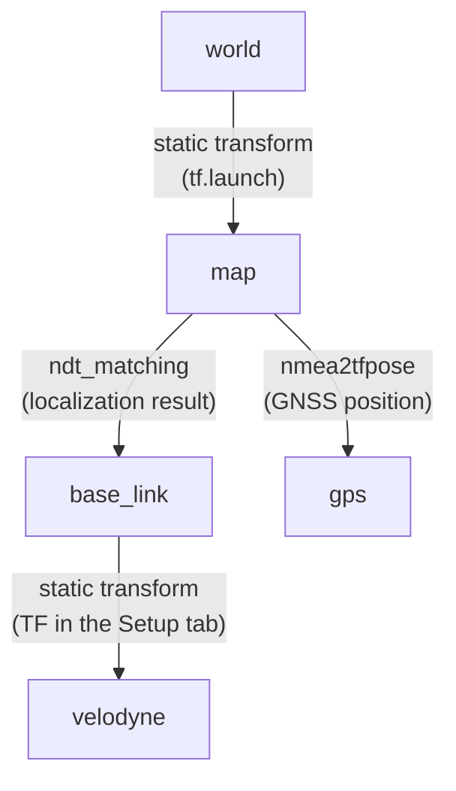

*Figure 4. TF tree used in localization*

In Figure 4, an arrow means the transformation from a parent frame to a child frame, and the label next to the arrow gives the source that publishes it. The relations between `world` and `map` and between `base_link` and `velodyne` are static transformations that do not change, whereas the relation between `map` and `base_link` is published anew by the localization node every time the vehicle moves.

---

<br>

## 3. Map Building with NDT Mapping

### 3.1 Procedure for Map Building

Localization needs a point cloud map built in advance. This section covers building a map from LiDAR data recorded in a rosbag. The procedure is as follows.

1. Load LiDAR data from the rosbag data.
2. Run the Simulation.
3. Run the LiDAR node.
4. Launch RViz and check that the LiDAR data is visualized.
5. Run NDT mapping.
6. Check the generated map file.

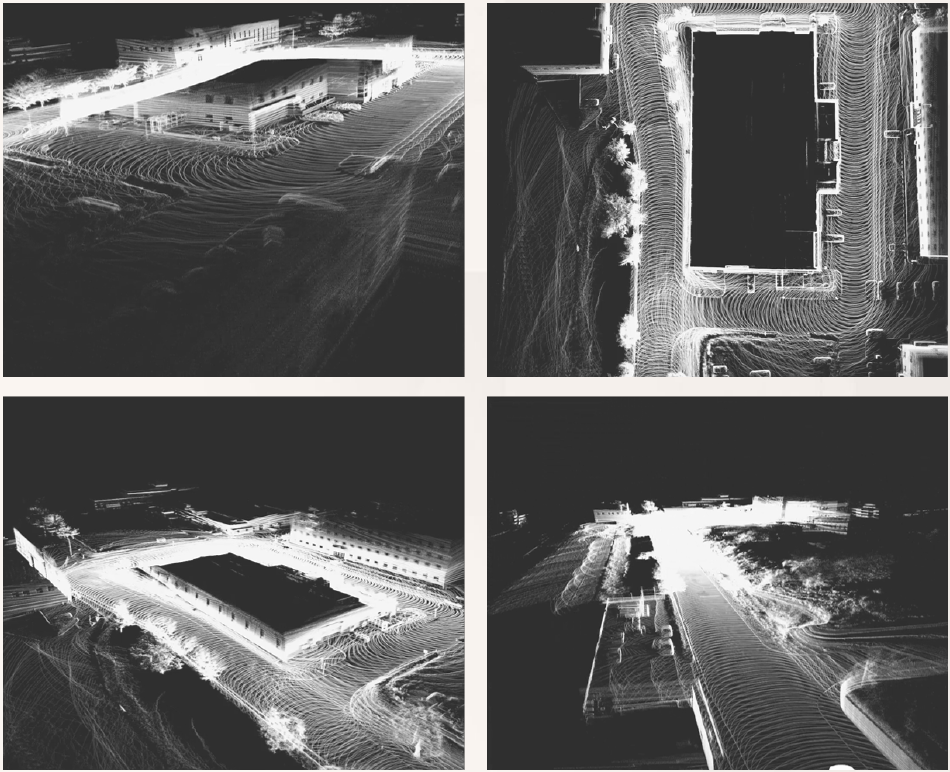

*Figure 5. Point cloud map of the area around a building built from a rosbag file*

Figure 5 shows a map built by this procedure from four viewpoints. The upper left is an oblique bird's-eye view of a building and the surrounding roads, and the upper right is a view from directly above that shows the roads surrounding the building. The two lower images view the building from another angle and along a road. Places the LiDAR laser did not reach, such as the roof, have no points and appear as empty black areas.

### 3.2 Recording and Playing Back Sensor Data

To build a map, the area must first be driven with a vehicle while recording LiDAR data in a rosbag. The principle of recording and playback was covered in Week 2, Sections 1.2 and 3.2, and the data flows as follows.

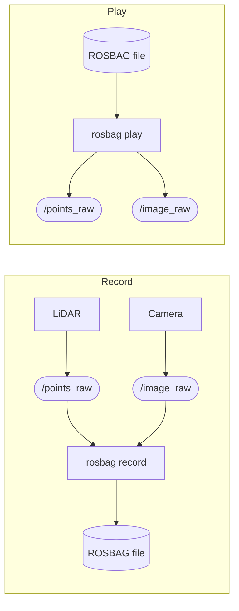

*Figure 6. Data flow in rosbag recording and playback*

Recording receives the topics published by the sensor drivers and stores them in a file, and playback republishes the messages in the file on topics with the same names as at recording time. Nodes subscribing to the played-back topics therefore cannot tell recorded data from real sensor data. Recording with the Runtime Manager proceeds as follows.

1. **Launch Autoware.** Early versions of Autoware were launched with `cd ~/Autoware/ros/` and `./run`; in Autoware.ai 1.14 it is launched with `roslaunch runtime_manager runtime_manager.launch` as in Section 1.4.
2. **Run the sensor nodes.** Checking the vehicle's LiDAR (for example, Velodyne HDL-32E) under LIDARs in the Sensing tab runs the driver node, which publishes the topics to be recorded.
3. **Record.** Record in the following order.
   - Press the ROSBAG button to open the ROSBAG Record window.
   - Press the Ref button and choose the name of the file to save.
   - Press the Refresh button to load the list of topics currently being published.
   - Check the topics to record (for example, `/points_raw`).
   - Press the Start button to start recording and the Stop button to end it.

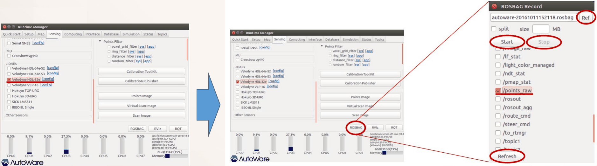

*Figure 7. Turning on the LiDAR in the Sensing tab and choosing topics to record in the ROSBAG Record window*

If split is enabled in the ROSBAG Record window and a size in MB is entered in size, recording continues into a new file every time a file reaches that size. As seen in Section 1.4, LiDAR data quickly grows to several GB, so this is useful for recording long drives.

A recorded file is played back in the Simulation tab. Choosing the bag file with the Ref button and pressing Play starts playback, and `/use_sim_time` becomes `true` automatically. Pause stops or resumes playback, and Stop ends playback and sets `/use_sim_time` back to `false`. The bag information also shows what was recorded. For example, if a 256-second bag (10.2 GB) recorded with a camera and a LiDAR contains 3844 `/image_raw` and 2561 `/velodyne_points` messages, the camera was recorded at about 15 Hz (3844 / 256 ≈ 15.0) and the LiDAR at about 10 Hz (2561 / 256 ≈ 10.0).

### 3.3 Building a Map by Scan Matching

In each rotation, a LiDAR measures only the shape of its surroundings within a few tens of meters. To build a map of a wide area, the thousands of scans obtained while driving must be stitched into a single coordinate frame, but each scan is expressed in coordinates whose origin is the LiDAR at the moment of measurement, so where the LiDAR was at that moment must be known for every scan.

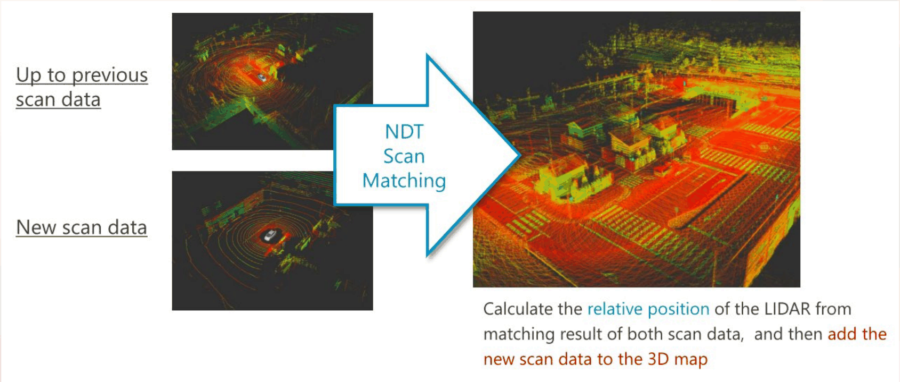

*Figure 8. Registering a new scan to the map built from previous scans with NDT and adding it to the map*

**NDT mapping** solves this problem with scan matching (Week 3, Section 2.6). The upper left of Figure 8 is the map built by stacking the scans so far, and the lower left is a newly arrived scan. Registering the two with NDT gives the relative position of the LiDAR with respect to the map, and the new scan is moved by that position and added to the 3D map. Repeating this builds a map of a wide area as on the right. In equations, this is as follows.

$$
T_k = \arg\min_{T} \; E(T; \, S_k, M_{k-1}), \qquad
M_k = M_{k-1} \cup \lbrace \, T_k \mathbf{s} \mid \mathbf{s} \in S_k \, \rbrace
$$

Here $S_k$ is the $k$-th scan (in the LiDAR frame), $M_{k-1}$ is the map built so far (in the map frame), $E$ is a cost function measuring how far the scan moved by a transformation $T$ deviates from the map, and $T_k = T^{\text{map}}_{\text{lidar}}$ is the LiDAR pose when the $k$-th scan was measured. In NDT, $E$ is the score of Week 3, Section 2.4 with a negative sign [5]. The first scan $S_0$ has no map to compare with and becomes the map as it is, so the origin of the map frame is the vehicle position at the moment map building starts.

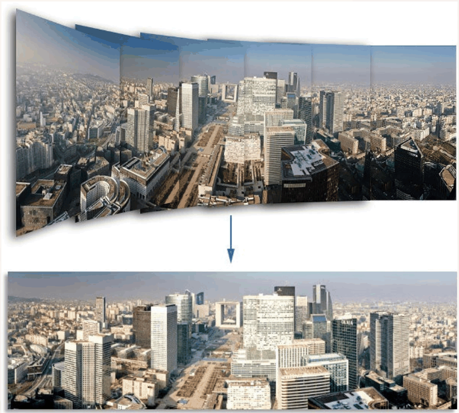

*Figure 9. Panorama stitched from several photos by aligning their overlapping parts*

The panorama in Figure 9 is a good analogy. One photo captures only part of the city, but finding the position and angle of each photo so that the overlapping parts of neighboring photos match and stitching them together produces a single wide view. NDT mapping does this for 3D points, and aligning the overlapping parts is scan matching. Just as photos cannot be stitched without overlap, scans must overlap sufficiently for registration to succeed. Since the LiDAR scans 10 times per second, two consecutive scans mostly overlap.

The inputs and outputs of the map building node are as follows.

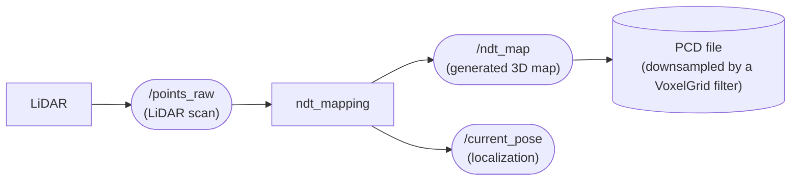

*Figure 10. Inputs and outputs of ndt_mapping*

`ndt_mapping` receives LiDAR scans on `/points_raw`, publishes the map built so far on `/ndt_map`, and at the same time publishes the current vehicle position on `/current_pose`. Such a task of building a map while simultaneously finding one's own position in that map is generally called **SLAM (simultaneous localization and mapping)**. The finished map is reduced in points with a VoxelGrid filter and saved as a PCD file (Section 3.8).

### 3.4 Mathematics of 3D NDT Registration

Week 3, Sections 2.3-2.4 derived the NDT score, gradient, and Hessian in the plane (2D). Map building and localization take place in 3D, so this section summarizes how those equations extend to 3D [6].

The parameters of a 3D transformation collect three translations and three rotation angles, $\mathbf{p} = (t_x, t_y, t_z, \phi, \theta, \psi)$. A scan point $\mathbf{x}$ is moved by $T(\mathbf{p}, \mathbf{x}) = R(\phi, \theta, \psi)\mathbf{x} + \mathbf{t}$, and if the map cell containing the moved point has mean $\boldsymbol{\mu}$ and covariance $\Sigma$, then $\mathbf{q} = T(\mathbf{p}, \mathbf{x}) - \boldsymbol{\mu}$. When minimizing the 3D score function of Week 3, Section 2.5, the gradient components for one point follow from the chain rule.

$$
g_i = -d_1 d_2 \left( \mathbf{q}^{T} \Sigma^{-1} \frac{\partial \mathbf{q}}{\partial p_i} \right) \exp\left( -\frac{d_2}{2} \mathbf{q}^{T} \Sigma^{-1} \mathbf{q} \right), \qquad i = 1, \dots, 6
$$

Since $d_1 < 0$, the coefficient $-d_1 d_2$ is positive, and setting $d_1 = -1$, $d_2 = 1$ gives the same expression as the 2D gradient of Week 3, Section 2.4. The form of the equation is the same as in 2D; what changes is the $3 \times 6$ matrix obtained by differentiating $\mathbf{q}$ with respect to the parameters, the **Jacobian** $J = \partial \mathbf{q} / \partial \mathbf{p}$. The derivative with respect to translation is the identity matrix $I_3$. The derivative with respect to rotation is long at general angles, but if a small rotation increment near the current estimate is taken as the parameter, it follows simply from the approximation $R \approx I + [\boldsymbol{\omega}]_{\times}$ of Section 2.2. Here $\boldsymbol{\omega} = (\phi, \theta, \psi)$, and $[\boldsymbol{\omega}]_{\times}$ is the skew-symmetric matrix that expresses the cross product $\boldsymbol{\omega} \times \mathbf{x}$ as a matrix product.

$$
R\mathbf{x} \approx \mathbf{x} + \boldsymbol{\omega} \times \mathbf{x} = \mathbf{x} - \mathbf{x} \times \boldsymbol{\omega}
\quad \Rightarrow \quad
\frac{\partial (R\mathbf{x})}{\partial \boldsymbol{\omega}} = -[\mathbf{x}]_{\times} = \begin{pmatrix} 0 & z & -y \\ -z & 0 & x \\ y & -x & 0 \end{pmatrix}
$$

$$
J = \begin{pmatrix} I_3 & -[\mathbf{x}]_{\times} \end{pmatrix} = \begin{pmatrix} 1 & 0 & 0 & 0 & z & -y \\ 0 & 1 & 0 & -z & 0 & x \\ 0 & 0 & 1 & y & -x & 0 \end{pmatrix}
$$

> **[Linear Algebra]** The skew-symmetric matrix of a vector $\mathbf{a} = (a_1, a_2, a_3)$ is $[\mathbf{a}]_{\times} = \begin{pmatrix} 0 & -a_3 & a_2 \\ a_3 & 0 & -a_1 \\ -a_2 & a_1 & 0 \end{pmatrix}$, and $[\mathbf{a}]_{\times}\mathbf{b} = \mathbf{a} \times \mathbf{b}$ for every $\mathbf{b}$. The cross product satisfies $\mathbf{a} \times \mathbf{b} = -\mathbf{b} \times \mathbf{a}$.

The last column of $J$, $(-y, x, 0)$, equals $(-y, x)$, the 2D expression $\partial \mathbf{q} / \partial \phi$ of Week 3, Section 2.4 evaluated at $\phi = 0$. That is, planar yaw rotation is a special case of the 3D equations. The meaning of each column can be checked with the point $\mathbf{x} = (10, 0, 0)$ located 10 m ahead of the LiDAR.

- **Yaw column** $(-y, x, 0) = (0, 10, 0)$: rotating yaw by a small angle $\delta\psi$ moves this point sideways by $10\,\delta\psi$. For the same angle, points at a larger horizontal distance move more, so distant points contribute strongly to determining the orientation (rotation) accurately.
- **Pitch column** $(z, 0, -x) = (0, 0, -10)$: rotating pitch moves a distant point ahead up or down.
- **Roll column** $(0, -z, y) = (0, 0, 0)$: roll is a rotation about the $x$-axis, so a point on the $x$-axis does not move. Points to the side or above and below are needed to determine roll.

The Hessian likewise becomes a $6 \times 6$ matrix in the same way as the 2D equations of Week 3, and the Newton system $H \Delta\mathbf{p} = -\mathbf{g}$ becomes a system of equations in six unknowns. These values are summed over all points of the scan, so the computational cost is proportional to the number of scan points used for registration. This is why the downsampling of Sections 3.5 and 4.5 is needed.

### 3.5 Processing Steps of ndt_mapping

The Autoware `ndt_mapping` node does the following every time a scan arrives [7].

1. **Range filter.** For each scan point, compute the horizontal distance $r = \sqrt{x^2 + y^2}$ and keep only points with $r_{\min} < r < r_{\max}$ (Minimum Scan Range, Maximum Scan Range). Points too close are usually hits on the vehicle's own body, and points too far are sparse and have large errors.
2. **First scan.** If this is the first scan, move it by $T^{\text{base}}_{\text{lidar}}$ and take it as the map as it is. As seen in Section 3.3, the map origin becomes the vehicle reference point at the starting moment.
3. **Downsampling.** Apply a voxel grid filter (Leaf Size) to the range-filtered scan to reduce the points used for registration (Section 4.5).
4. **Initial guess.** Predict the current pose by assuming that the vehicle continues the same motion as just before (a constant-velocity motion model). The predicted pose for the $k$-th scan is $\hat{x}_k = x_{k-1} + (x_{k-1} - x_{k-2})$, with $y, z$, and yaw predicted by the same formula and roll and pitch taken from the previous values. The predicted vehicle pose multiplied by $T^{\text{base}}_{\text{lidar}}$ is used as the initial guess of the LiDAR pose.
5. **NDT registration.** Register the downsampled scan to the map so far with NDT to obtain $T^{\text{map}}_{\text{lidar}}$.
6. **Vehicle pose.** Compute the vehicle pose as $T^{\text{map}}_{\text{base}} = T^{\text{map}}_{\text{lidar}} \, (T^{\text{base}}_{\text{lidar}})^{-1}$ and publish it on `/current_pose` and as TF (`map` → `base_link`).
7. **Scan transformation.** Move the scan before downsampling (only range-filtered) into the map frame with $T^{\text{map}}_{\text{lidar}}$.
8. **Decide whether to add to the map.** Compute the horizontal distance $\text{shift}$ between the position where a scan was last added to the map and the current position; if $\text{shift} \ge$ Minimum Add Scan Shift, add the moved scan to the map and remember this position. Since the map has changed, the NDT cell distributions used for the next registration are rebuilt as well.
9. **Publish.** Publish the updated map on `/ndt_map`.

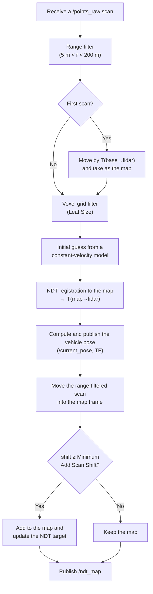

*Figure 11. How ndt_mapping processes one scan*

Three points in this process deserve attention.

- **The points used for registration differ from those added to the map.** Registration must be fast, so it uses few downsampled points, while the map receives many range-filtered points so that the detailed shape is kept.
- **The initial guess decides the success of registration.** As seen in the caution of Week 3, Section 2.4, NDT converges only near the initial guess. The constant-velocity prediction is close to the true value unless the vehicle accelerates or turns abruptly, so data for map building should be recorded while driving smoothly at a constant speed.
- **Scans are added based on the distance moved.** Adding every scan received while the vehicle is standing still would keep piling the same points at the same place, enlarging the map without adding information. Adding scans at 1 m intervals keeps the point density uniform along the driving path and also reduces the NDT cell computation required every time the map changes.

### 3.6 Parameters of ndt_mapping

Pressing [app] next to `ndt_mapping` in the Computing tab opens the parameter window. The `/config/ndt_mapping` written at the top of the window is the name of the topic on which the Runtime Manager sends these values to the node.

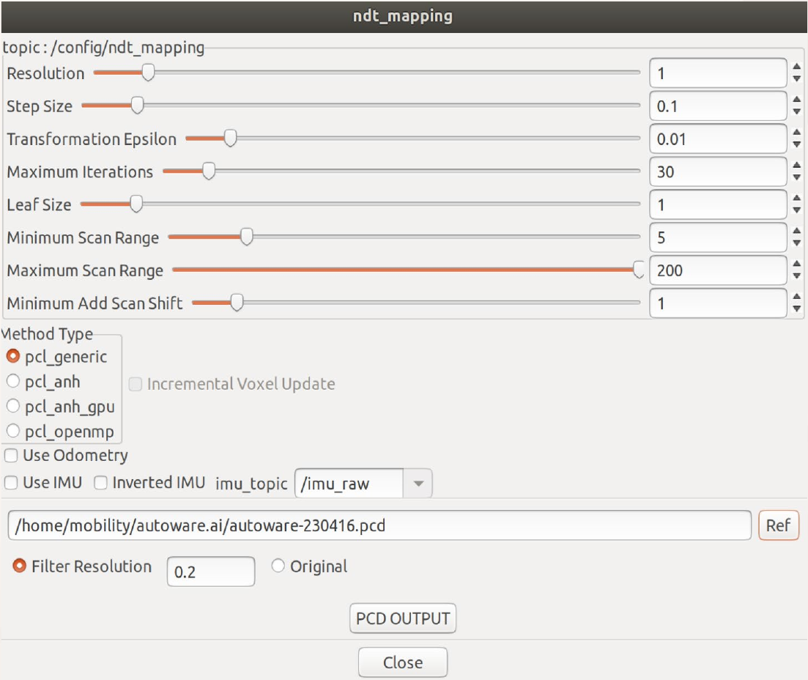

*Figure 12. Parameter window of ndt_mapping*

| Item | Example value | Meaning |
|:-----|:-----|:-----|
| Resolution | 1 | Side length of an NDT cell (voxel) of the map (m) |
| Step Size | 0.1 | Maximum step the line search may take at once |
| Transformation Epsilon | 0.01 | If the change of the transformation between two consecutive iterations is smaller than this, registration is considered converged |
| Maximum Iterations | 30 | Maximum number of iterations, after which the search stops even without convergence |
| Leaf Size | 1 | Side length of the voxel used to downsample the scan for registration (m) |
| Minimum Scan Range | 5 | Distance below which points are discarded (m) |
| Maximum Scan Range | 200 | Distance above which points are discarded (m) |
| Minimum Add Scan Shift | 1 | Minimum distance moved before a scan is added to the map (m) |

*Table 6. Parameters of ndt_mapping*

Resolution, Step Size, Transformation Epsilon, and Maximum Iterations are the same as the NDT registration parameters of Week 3, Section 2.5, and the other four are used in the processing steps of Section 3.5. Resolution and Leaf Size are both lengths that divide space into cubes, but their roles differ. Resolution is the size of the cells in which normal distributions are built on the map side, and Leaf Size is the size of the cells in which points are reduced on the scan side. Setting the two equal (1 m) as in the example makes one representative scan point roughly correspond to one map cell.

The lower items of the window are as follows.

- **Method Type:** Selects the implementation of NDT registration. `pcl_generic` is the PCL implementation, `pcl_anh` is a CPU implementation written by Autoware, `pcl_anh_gpu` computes the same method on a GPU, and `pcl_openmp` splits the computation across several CPU cores. Incremental Voxel Update, available only with `pcl_anh`, updates only the cells receiving new points when a scan is added to the map instead of rebuilding all NDT cells, which saves time.
- **Use Odometry, Use IMU, Inverted IMU, imu_topic:** Improve the initial guess with measurements of the vehicle's odometry or inertial measurement unit (IMU). Inverted IMU corrects the signs of the values when the IMU is mounted upside down.
- **Saving the map:** Enter the path to save in the file name field (for example, `/home/mobility/autoware.ai/autoware-230416.pcd`) and press the PCD OUTPUT button to save the map built so far. Choosing Filter Resolution reduces the points with a voxel grid filter of the given size (for example, 0.2 m) before saving, and choosing Original saves all points as they are.

### 3.7 Running and Interpreting the Output

Map building is run in the following order.

1. Specify the recorded bag file in the Simulation tab (Section 3.2).
2. Check the LiDAR (Velodyne HDL-32E) in the Sensing tab, and open RViz to check that scans are displayed.
3. Check `ndt_mapping` under Localization > lidar_localizer in the Computing tab and set its parameters with [app].
4. Play the bag to start map building.

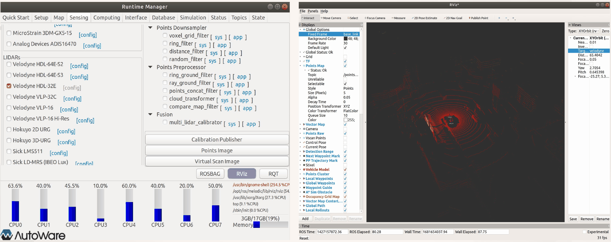

*Figure 13. The Sensing tab with the LiDAR turned on and a LiDAR scan displayed in RViz*

The left of Figure 13 is the Sensing tab. Velodyne HDL-32E is checked in the LIDARs list, and on the right are Points Downsampler items that reduce points (voxel_grid_filter, ring_filter, distance_filter, random_filter), Points Preprocessor items that perform preprocessing such as ground removal, and a Fusion item that aligns several LiDARs (Section 4.4). The RViz view on the right shows red points spreading in concentric circles around the vehicle; each circle is drawn on the ground by one laser of the rotating LiDAR.

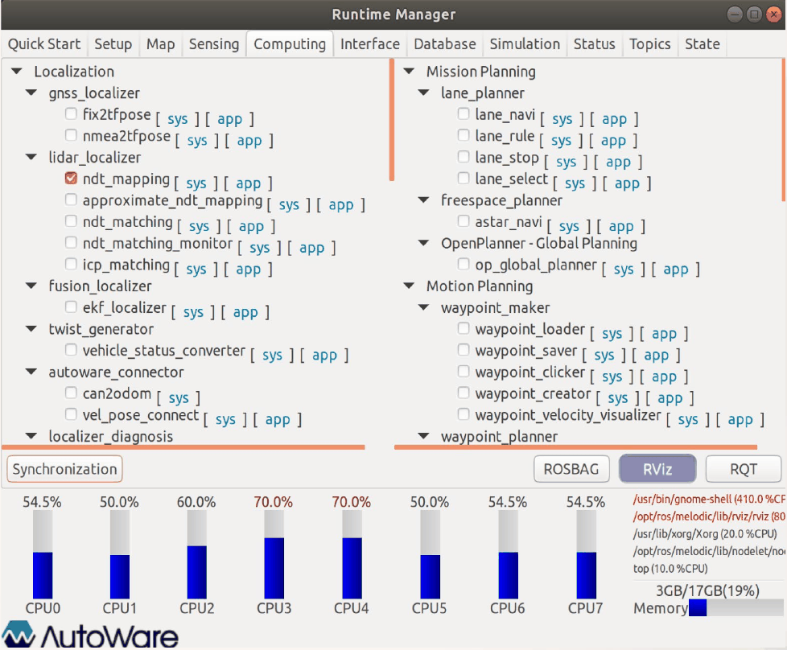

*Figure 14. Selecting ndt_mapping under lidar_localizer in the Computing tab*

The left side of the Computing tab holds the localization nodes. `gnss_localizer` contains `fix2tfpose` and `nmea2tfpose`, which obtain positions from GNSS; `lidar_localizer` contains `ndt_mapping`, `approximate_ndt_mapping`, `ndt_matching`, `ndt_matching_monitor`, and `icp_matching`; below them are `ekf_localizer`, which fuses several sensors, `twist_generator`, which converts vehicle speed, `autoware_connector`, and others. The right side holds the path planning nodes, covered in Week 10.

When `ndt_mapping` runs, it prints information like the following to the terminal for every scan. The last line is printed by the `queue_counter` node, which runs alongside it.

```text
Sequence number: 86688
Number of scan points: 41004 points.
Number of filtered scan points: 2191 points.
transformed_scan_ptr: 41004 points.
map: 40695 points.
NDT has converged: 1
Fitness score: 0.315708
Number of iteration: 2
(x,y,z,roll,pitch,yaw):
(-0.0299602, 0.0102507, 0.000453711, 0.000521842, -0.00114297, 0.00407962)
Transformation Matrix:
0.999991 -0.00408021 -0.00114083     1.16775
0.00407961    0.999992  -0.0005265   0.0140932
0.00114297 0.000521841    0.999999     2.00182
0           0           0           1
shift: 0.0316652
-----------------------------------------------------------------
(Processed/Input): (55 / 55)
```

| Output | Value | Interpretation |
|:-----|:-----|:-----|
| Sequence number | 86688 | Sequence number of the received `/points_raw` message |
| Number of scan points | 41004 | Number of points of the range-filtered scan |
| Number of filtered scan points | 2191 | Number of points after downsampling with a Leaf Size of 1 m. Only about 5.3% of the original points are used for registration, so the computation becomes about 19 times lighter |
| transformed_scan_ptr | 41004 | Number of points of the scan (before downsampling) moved into the map frame |
| map | 40695 | Current number of points in the map |
| NDT has converged | 1 | Registration converged (1 means true) |
| Fitness score | 0.315708 | Mean of the squared distances between each point of the moved scan and its nearest point in the map (m²) |
| Number of iteration | 2 | Number of iterations until convergence |
| (x, y, z, roll, pitch, yaw) | See the interpretation below | Pose of the vehicle reference point in the map frame (m, rad) |
| Transformation Matrix | See the interpretation below | LiDAR pose $T^{\text{map}}_{\text{lidar}}$ obtained by registration |
| shift | 0.0316652 | Horizontal distance moved since a scan was last added (m) |
| (Processed/Input) | (55 / 55) | Counts kept by `queue_counter` of processed scans (number of `/ndt_map` messages) and received scans (`/points_raw`). All 55 received scans have been processed |

*Table 7. Interpretation of the ndt_mapping output*

The following can be read from this output.

- **The vehicle has barely moved.** The vehicle position is $(-0.030, 0.010, 0.0005)$ m and the yaw is 0.00408 rad (about 0.23°), so the vehicle is standing near the map origin (the starting position). This is why registration converged in two iterations.
- **No scan has been added to the map yet.** The shift of 0.032 m is smaller than the Minimum Add Scan Shift of 1 m, so this scan is not added to the map. The map's point count of 40695 differs from this scan's 41004 because the map still consists of the first scan alone (40695 points after the range filter).
- **Meaning of the fitness score.** The square root of $0.3157$ m² is about 0.56 m. The representative points used for registration are centroids of the points in each voxel and may not lie on the actual surface, and points of moving objects such as passing cars are mixed in, so this value does not become 0. The size of a single value therefore matters less than whether the value suddenly grows while driving, which signals a registration problem.
- **The transformation matrix is the LiDAR pose.** The upper-left $3 \times 3$ block of the matrix is the rotation matrix. Since the angles are small, the approximation of Section 2.2 gives $R_{01} \approx -\psi = -0.00408$, $R_{02} \approx \theta = -0.00114$, and $R_{12} \approx -\phi = -0.00052$, which match the output. The translation in the last column, $(1.168, 0.014, 2.002)$, however, differs from the vehicle position $(-0.030, 0.010, 0.0005)$.

**Worked example: checking the translation of the transformation matrix.** In this data, the LiDAR is mounted at $(1.2, 0, 2.0)$ m from the vehicle reference point without rotation (the TF values of Section 4.3). In the equation $T^{\text{map}}_{\text{lidar}} = T^{\text{map}}_{\text{base}} T^{\text{base}}_{\text{lidar}}$ of Section 2.3, the translation part is $\mathbf{t}_{\text{lidar}} = \mathbf{t}_{\text{base}} + R \, (1.2, 0, 2.0)^{T}$.

1. The first component of $R \, (1.2, 0, 2.0)^{T}$ is $1.2 \times 0.999991 + 2.0 \times (-0.00114083) = 1.19999 - 0.00228 = 1.19771$.
2. The second component is $1.2 \times 0.00407961 + 2.0 \times (-0.0005265) = 0.00490 - 0.00105 = 0.00384$.
3. The third component is $1.2 \times 0.00114297 + 2.0 \times 0.999999 = 0.00137 + 2.00000 = 2.00137$.
4. Adding the vehicle position gives $(1.19771 - 0.02996, \; 0.00384 + 0.01025, \; 2.00137 + 0.00045) = (1.16775, 0.01409, 2.00182)$, which matches the last column of the printed matrix.

That is, NDT registration finds the LiDAR pose, and what is printed and published on `/current_pose` is the vehicle pose obtained by undoing the LiDAR's mounting position.

### 3.8 Node Configuration and Saving the Map

To build a map of a wide area, `approximate_ndt_mapping` can be used instead of `ndt_mapping`. This node builds the map as submaps of fixed size and saves them to files one after another, so the registration target and memory do not grow without bound as the map grows. The node configuration seen in rqt_graph when it runs was covered in Week 2, Section 3.4. In short, the nodelets of the Velodyne driver publish `/points_raw` via `/velodyne_packets`; `approximate_ndt_mapping` receives `/points_raw` and the settings `/config/approximate_ndt_mapping` sent by the Runtime Manager and publishes `/ndt_map`; and `queue_counter` counts the received `/points_raw` and published `/ndt_map` messages to show whether map building keeps up with the input ((Processed/Input) in Section 3.7).

When the bag finishes playing, save the map with the PCD OUTPUT button of Section 3.6 and, as the last step, check the generated file. Specifying the saved PCD file under Point Cloud in the Map tab and loading it shows the map in RViz, and it can also be opened directly with tools such as `pcl_viewer` of PCL. Choosing Filter Resolution 0.2 when saving merges the points that fall in the same 0.2 m cube into their single centroid, so the file becomes much smaller while keeping the shape needed for localization.

Once the map is complete, the same NDT registration is performed against the fixed map to localize the vehicle. Unlike map building, localization does not add new scans to the map (Section 4).

### 3.9 Drift and Loop Closure

NDT mapping registers each scan to the map built up to the previous scan, so the small error of each registration becomes the reference for the next one and keeps accumulating. This is called **drift**. Errors in orientation in particular grow into position errors as the vehicle proceeds. Proceeding a distance $d$ with an orientation off by $\delta\psi$ deviates sideways by about $d \, \delta\psi$ for small angles.

**Worked example: position error caused by an orientation error.** Suppose the orientation of the map is off by 0.1° at some point. Since $0.1° = 0.1 \times \pi / 180 \approx 0.001745$ rad, the map at a place 500 m farther on deviates sideways by about $500 \times 0.001745 \approx 0.87$ m. Considering that a lane is a little over 3 m wide, this is not negligible.

A typical symptom of drift is that after one lap around a wide loop road back to the start, the beginning and end of the map do not line up, so the same building appears twice. The remedy is **loop closure**. When the system recognizes that it has returned to a place it already passed, it adds the constraint that the two poses are at the same place, places the poses of all scans as graph nodes and the relative transformations between scans as edges, and recomputes all poses together so that the total error is minimized. This approach is called **graph-based SLAM** [8]. Autoware's `ndt_mapping` does not perform loop closure, so when building a map of a wide area, drift is reduced in the following ways.

- Drive smoothly at a constant speed so that the initial guess is accurate (Section 3.5).
- Drive along routes where environments with enough points and distinct shapes (buildings, walls) remain visible. In places with monotonous shapes, such as wide open lots or long tunnels, registration slips easily.
- Use an IMU or odometry together to improve the initial guess (Use IMU and Use Odometry in Section 3.6).
- After building the map, check that its beginning and end line up, and rebuild it in sections if they do not.

---

<br>

## 4. Localization with NDT Matching

### 4.1 Procedure for Localization

**NDT matching** is a localization method that finds the vehicle pose by registering the current scan to a prebuilt point cloud map with NDT. Its principle and the parameters of `ndt_matching` were covered in Week 3, Sections 2 and 3, so this section goes step by step through running localization directly with the Moriyama data of the Quick Start. The procedure is as follows.

1. Load the rosbag data.
2. Run the Simulation.
3. Run the map, TF, and LiDAR nodes.
4. Run the voxel_grid_filter node.
5. Run the nmea2tfpose node.
6. Run NDT matching.

### 4.2 Loading the rosbag

In the same way as in Section 1.4, specify the Moriyama bag file in the Simulation tab, set Start Time to 140, and play it.

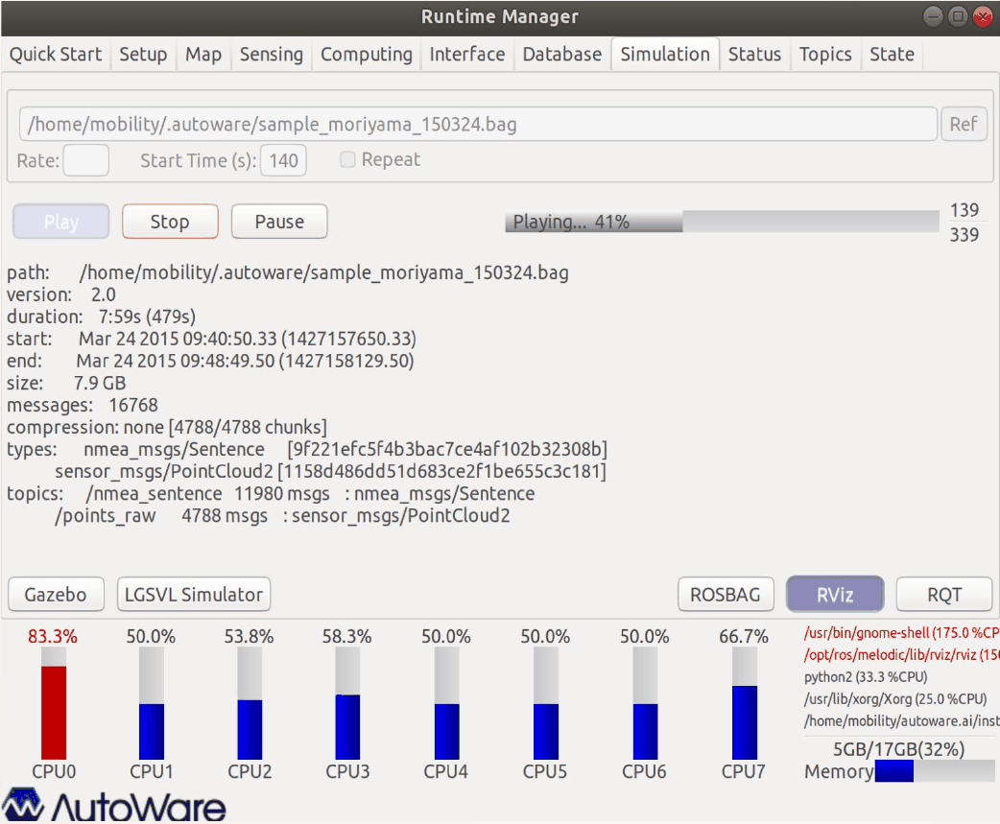

*Figure 15. Playing the Moriyama bag file from the 140-second point in the Simulation tab*

In Figure 15, the progress bar shows Playing... 41%, and the two numbers on the right (139, 339) give, in seconds, the time elapsed since playback started and the total time to play, with 139 / 339 ≈ 41%. Playback runs from the 140-second point to the end of the bag (479 seconds), so the total is about 339 seconds. As seen in Section 1.4, this bag contains only `/points_raw` and `/nmea_sentence`, so localization relies on two sensors, the LiDAR and GNSS.

### 4.3 Loading the Map and TF

In the Map tab, load the map used for localization and the relations of the map frames.

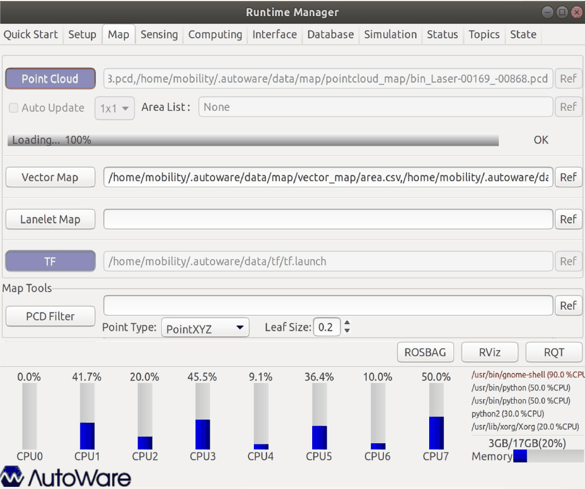

*Figure 16. Loading the point cloud map, vector map, and TF in the Map tab*

1. **Point Cloud.** Choose all PCD files in `~/.autoware/data/map/pointcloud_map/` with the Ref button and press the Point Cloud button. The path field shows the chosen files joined by commas, and loading is complete when the progress bar reads Loading... 100% and OK. The `points_map_loader` node then runs and publishes the map merging all tiles on `/points_map`. Auto Update and the selection box next to it (1x1) select and load only the tiles around the vehicle; they are not used in the example.
2. **Vector Map.** Choose all CSV files in `~/.autoware/data/map/vector_map/` and press the Vector Map button.
3. **TF.** Choose `~/.autoware/data/tf/tf.launch` and press the TF button. This launch file publishes static transformations between frames such as `world` and `map` (Figure 4 in Section 2.3).

Map Tools > PCD Filter at the bottom is a tool that reduces a PCD file with a voxel grid filter of a given Leaf Size (for example, 0.2) and saves it as a new file. It is used when the map file is so large that loading takes a long time.

Next, set the relation between the vehicle and the LiDAR in the Setup tab.

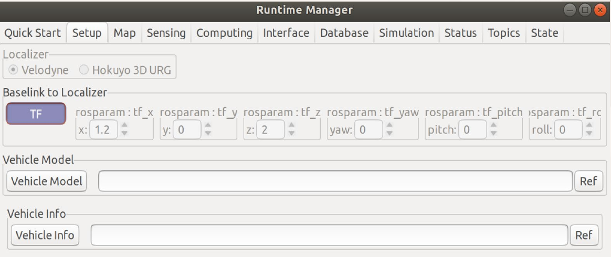

*Figure 17. Entering the LiDAR mounting position in Baselink to Localizer of the Setup tab*

Choose Velodyne as the Localizer, enter $x = 1.2$, $y = 0$, $z = 2$, yaw $= 0$, pitch $= 0$, and roll $= 0$ in Baselink to Localizer, and press the TF button. Names such as `rosparam : tf_x` above each field mean that the value is stored as the ROS parameter `tf_x` and so on. These values are $T^{\text{base}}_{\text{lidar}}$ of Section 2.3 and mean that the LiDAR is mounted 1.2 m ahead of and 2 m above the vehicle reference point without rotation. Vehicle Model and Vehicle Info are fields that load the vehicle model drawn in RViz and the vehicle's dimension information, and they are not needed for localization itself.

### 4.4 LiDAR Node and Point Filters

In the Sensing tab, run the LiDAR node and the downsampling filter.

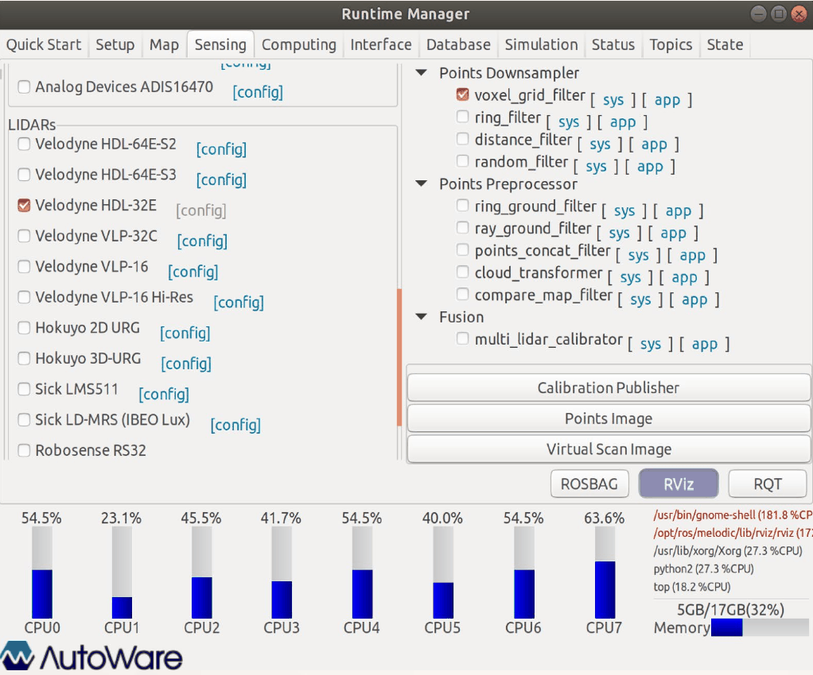

*Figure 18. Selecting Velodyne HDL-32E and voxel_grid_filter in the Sensing tab*

Check Velodyne HDL-32E in the LIDARs list, and check `voxel_grid_filter` under Points Downsampler. Points Downsampler has four filters that reduce points in different ways [7].

| Filter | How points are reduced |
|:-----|:-----|
| `voxel_grid_filter` | Divides space into cubic voxels and keeps only the centroid of the points in each voxel (Section 4.5) |
| `ring_filter` | Keeps only points whose LiDAR laser index (ring) is a multiple of a given number (ring_div), then applies a voxel grid filter |
| `distance_filter` | Selects a given number (sample_num) of points with distance-based weights |
| `random_filter` | Selects points at regular intervals until a given number (sample_num) is reached |

*Table 8. Filters of Points Downsampler*

The output topic of `voxel_grid_filter`, `/filtered_points`, becomes the input of `ndt_matching`. In the filter's [app] window, the side length of a voxel, Voxel Leaf Size (default 2.0 m), and Measurement Range, beyond which points are discarded, are set. In the Autoware implementation, a Leaf Size smaller than 0.1 m disables downsampling and passes the points through unchanged.

### 4.5 Principle of the Voxel Grid Filter

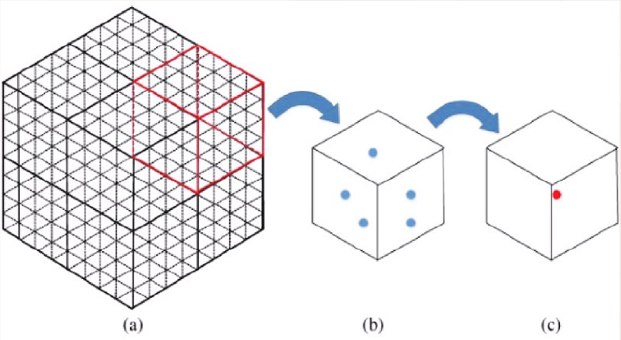

*Figure 19. Operation of a voxel grid filter: (a) dividing space into voxels, (b) points in one voxel, (c) a single centroid representing the points*

A **voxel grid filter** works as shown in Figure 19 [9], [10]. (a) Space is divided into cubic voxels of side length $l$ (the leaf size). (b) Each point is assigned to a voxel. (c) In each voxel, the points are replaced by their single centroid. The index of the voxel containing a point $\mathbf{p} = (x, y, z)$ is the three integers obtained by dividing each coordinate by $l$ and rounding down.

$$
(i, j, k) = \left( \left\lfloor \frac{x}{l} \right\rfloor, \left\lfloor \frac{y}{l} \right\rfloor, \left\lfloor \frac{z}{l} \right\rfloor \right), \qquad
\bar{\mathbf{p}}_{ijk} = \frac{1}{\vert V_{ijk} \vert} \sum_{\mathbf{p} \in V_{ijk}} \mathbf{p}
$$

$V_{ijk}$ is the set of points in the voxel with index $(i, j, k)$, and $\vert V_{ijk} \vert$ is the number of those points. The number of output points equals the number of voxels containing at least one point. $\lfloor a \rfloor$ is the largest integer not greater than $a$, so $\lfloor -0.3 \rfloor = -1$. Actual implementations number the voxels relative to the minimum of the point cloud, but the way the voxels divide space is the same.

**Worked example: voxel grid filter.** Downsample the following six points with leaf size $l = 1$ m.

| Point | Coordinates (m) | Voxel index $(\lfloor x \rfloor, \lfloor y \rfloor, \lfloor z \rfloor)$ |
|:-----|:-----|:-----|
| $\mathbf{p}_1$ | $(0.2, 0.3, 0.1)$ | $(0, 0, 0)$ |
| $\mathbf{p}_2$ | $(0.6, 0.1, 0.4)$ | $(0, 0, 0)$ |
| $\mathbf{p}_3$ | $(0.4, 0.8, 0.7)$ | $(0, 0, 0)$ |
| $\mathbf{p}_4$ | $(1.2, 0.5, 0.2)$ | $(1, 0, 0)$ |
| $\mathbf{p}_5$ | $(1.8, 0.9, 0.6)$ | $(1, 0, 0)$ |
| $\mathbf{p}_6$ | $(2.5, 2.5, 0.5)$ | $(2, 2, 0)$ |

*Table 9. Voxel indices of the six points*

- Voxel $(0, 0, 0)$ holds three points, so its centroid is $\left( \frac{0.2 + 0.6 + 0.4}{3}, \frac{0.3 + 0.1 + 0.8}{3}, \frac{0.1 + 0.4 + 0.7}{3} \right) = (0.4, 0.4, 0.4)$.
- Voxel $(1, 0, 0)$ holds two points, so its centroid is $\left( \frac{1.2 + 1.8}{2}, \frac{0.5 + 0.9}{2}, \frac{0.2 + 0.6}{2} \right) = (1.5, 0.7, 0.4)$.
- Voxel $(2, 2, 0)$ holds only one point, so $(2.5, 2.5, 0.5)$ remains as it is.

Six points have been reduced to three. Where points are crowded (voxel $(0, 0, 0)$), more are removed, while sparse points remain, so the result is spread evenly over space. The centroid lies among the original points, so the rough shape of the surface is preserved as well.

Downsampling affects localization as follows.

- **Computation:** As seen in Section 3.4, the computational cost of NDT registration is proportional to the number of scan points. In the example of Section 3.7, 41004 points were reduced to 2191 with a Leaf Size of 1 m, making one registration about 19 times lighter. The LiDAR sends a scan every 0.1 seconds, so registration must finish within 0.1 seconds.
- **Uniform density:** A LiDAR measures nearby areas densely and distant areas sparsely. Without downsampling, the points on the nearby ground dominate the score, and the influence of distant points, which determine the orientation well (Section 3.4), becomes small.
- **Choice of leaf size:** If the leaf size is too large, too many points are removed, small structures such as poles and corners vanish, and registration becomes unstable. If it is too small, few points are removed and real-time processing becomes difficult. A value similar to or slightly larger than the NDT cell size of the map (Resolution) is commonly used.

### 4.6 nmea2tfpose and ndt_matching

In the Computing tab, run the GNSS position conversion node and the NDT matching node.

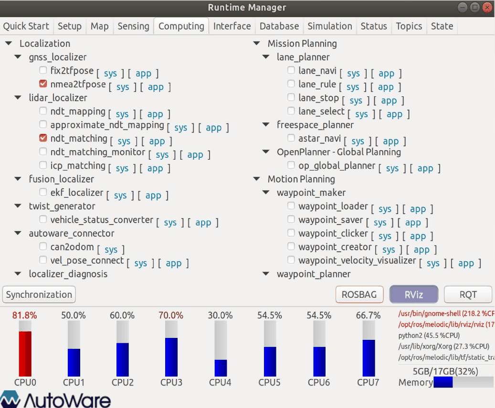

*Figure 20. Selecting nmea2tfpose and ndt_matching in the Computing tab*

**nmea2tfpose.** Check `nmea2tfpose` under Localization > gnss_localizer. This node reads the NMEA sentences (`/nmea_sentence`) output by the GNSS receiver to obtain latitude, longitude, and height, converts them into $(x, y, z)$ of a plane rectangular coordinate system defined for the region, publishes the result on `/gnss_pose`, and also publishes the relation between the `map` and `gps` frames as TF [7]. The position is read from GGA or RMC sentences, and the orientation is taken from an orientation sentence if one exists, or otherwise computed as the direction connecting two consecutive positions ($\text{atan2}(\Delta y, \Delta x)$).

> **Definition:** **NMEA 0183** is a standard in which navigation equipment such as GNSS receivers outputs measurements as comma-separated text sentences [11]. A sentence starts with `$`, the five characters after it indicate the sentence type (for example, `GPGGA`), and the two characters after `*` are a checksum for error detection.

**Worked example: reading a GGA sentence.** The following is an example of a GGA sentence.

```text
$GPGGA,123519,4807.038,N,01131.000,E,1,08,0.9,545.4,M,46.9,M,,*47
```

| Order | Value | Meaning |
|:-----|:-----|:-----|
| 1 | `123519` | Measurement time 12:35:19 (UTC) |
| 2, 3 | `4807.038`, `N` | Latitude 48° 07.038′ (north) |
| 4, 5 | `01131.000`, `E` | Longitude 11° 31.000′ (east) |
| 6 | `1` | Fix status (0 is invalid, 1 is standalone positioning, 2 is DGPS) |
| 7 | `08` | Number of satellites used |
| 8 | `0.9` | Horizontal dilution of precision (HDOP). Smaller means better satellite geometry |
| 9, 10 | `545.4`, `M` | Antenna height above mean sea level (m) |
| 11, 12 | `46.9`, `M` | Height difference between mean sea level and the reference ellipsoid (m) |

*Table 10. Fields of the GGA sentence*

Latitude and longitude are written with degrees and minutes joined together (ddmm.mmmm for latitude, dddmm.mmmm for longitude). The latitude `4807.038` is 48 degrees and 7.038 minutes, which is $48 + 7.038 / 60 = 48.1173°$ in decimal degrees, and the longitude `01131.000` is $11 + 31.000 / 60 = 11.5167°$. `nmea2tfpose` converts the latitude and longitude obtained this way into plane coordinates. The error sources of GNSS and methods for improving its accuracy are covered in Week 13.

**ndt_matching.** Check `ndt_matching` under Localization > lidar_localizer and set the initial position in its [app] window (Table 6 in Week 3, Section 3.2). Choosing GNSS for the initial position uses `/gnss_pose` as the initial guess of the first registration, so registration starts from the approximate position on the map without the user entering a position. Afterward, registration starts from a pose predicted from the previous pose. The registration result is published on `/ndt_pose` and as TF (`map` → `base_link`), and the registration status is sent to the Runtime Manager on `/ndt_stat`.

> **Caution:** If the initial position from GNSS is badly wrong or registration fails and the vehicle leaves the map, use the 2D Pose Estimate tool of RViz to drag out the correct position and orientation on the map. This tool publishes the specified pose on the `/initialpose` topic, and `ndt_matching` takes it as a new initial guess and restarts registration.

### 4.7 Node Configuration Seen in rqt_graph

The connections of nodes and topics seen in rqt_graph while localization is running are summarized as follows (ellipses are nodes, rectangles are topics).

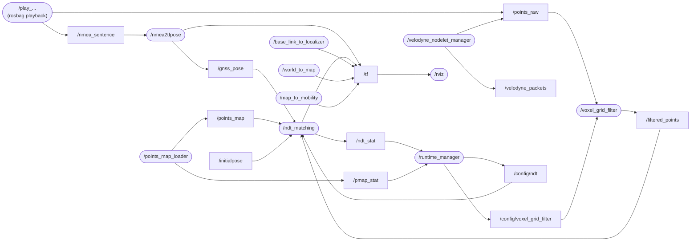

*Figure 21. Nodes and topics while running NDT matching localization*

Compared with the node graph of Week 3, Section 3.3, the following parts are added.

- **rosbag playback node.** `/play_...` is the rosbag playback node launched by the Simulation tab, and it publishes `/nmea_sentence` and `/points_raw` recorded in the bag. The long number at the end of the name is the launch time appended so that nodes with the same name do not collide.
- **GNSS path.** `/nmea2tfpose` receives `/nmea_sentence` and publishes `/gnss_pose`, which `/ndt_matching` uses as the initial position.
- **Initial pose input.** `/initialpose`, published by 2D Pose Estimate in RViz, is also an input of `/ndt_matching`.
- **Publishers of TF.** Several nodes publish frame relations on the `/tf` topic. `/base_link_to_localizer` is the vehicle-LiDAR relation entered in the Setup tab, `/world_to_map` and `/map_to_mobility` are static transformation nodes launched by `tf.launch`, and `/nmea2tfpose` and `/ndt_matching` publish the positions of `gps` and `base_link`, respectively. RViz receives `/tf` to draw all data in one frame.

### 4.8 Checking the Result

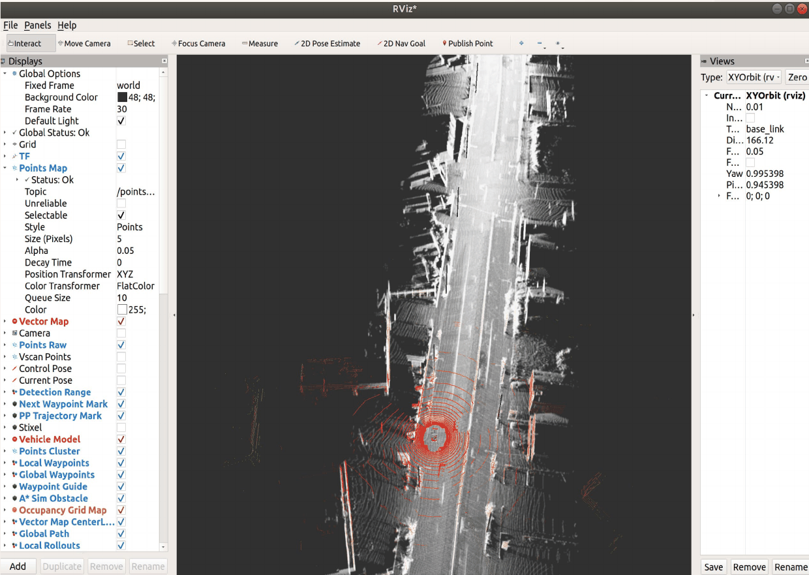

*Figure 22. Map and current scan displayed in RViz during localization with NDT matching*

Figure 22 is an RViz view from above. The white points are the point cloud map, showing a road running straight up and down with buildings and trees on both sides. The red points spreading in concentric circles near the bottom center are the current LiDAR scan, with the vehicle model at their center. The Fixed Frame in the Displays panel on the left is `world`, so all data is drawn in the `world` frame, and the vehicle position is computed along the TF tree (Figure 4).

When localization is working, the scan points overlap the building walls and road boundaries of the map, and the vehicle and scan glide together over the map while the bag plays. Conversely, if the scan is drawn misaligned with the walls of the map, if the vehicle leaves the road and passes through buildings, or if it suddenly jumps elsewhere, registration has failed. In that case, check the registration status of `/ndt_stat` shown in the Runtime Manager and set the initial pose again as in the caution of Section 4.6.

---

<br>

## Concept Applications

| Situation | Analysis |
|:-----|:-----|
| In the Quick Start, the rosbag was left playing without pressing Pause after Play, and the map and localization nodes were launched slowly. | **Data at the beginning can be missed.** Scans and GNSS data flow past before the nodes are ready, so localization starts late or the initial pose must be set again. This is why Pause is pressed right after Play. |
| The Minimum Scan Range of ndt_mapping was changed to 0. | **The vehicle's own body is imprinted on the map.** Points hitting the vehicle body appear at the same relative position in every scan as they move with the vehicle, leaving traces of the vehicle in the map and disturbing registration. |
| 0 was entered instead of $x = 1.2$ in Baselink to Localizer of the Setup tab. | **The vehicle position is off by 1.2 m.** The wrong mounting position is undone from the LiDAR pose found by NDT, so the vehicle is computed to be 1.2 m ahead of its actual position on the map, and path following is off by the same amount. |
| Running ndt_mapping on a stopped vehicle, the number of map points does not increase. | **This is normal.** The vehicle is not moving, so the shift is smaller than the Minimum Add Scan Shift and scans are not added to the map. This behavior avoids stacking duplicate scans at the same place. |
| In a map built by one lap around a 2 km loop road, the building at the starting point appears twice. | **This is drift.** Small registration errors of each scan have accumulated, so the end of the map does not line up with its beginning. ndt_mapping does not perform loop closure, so the map is rebuilt in sections or a SLAM tool supporting loop closure is used. |
| The Voxel Leaf Size of voxel_grid_filter was reduced to 0.05 m. | **No downsampling takes place.** The Autoware implementation passes the points through unchanged for values smaller than 0.1 m, so the computational cost of registration increases greatly and processing may not finish within the scan period (0.1 seconds). |

*Table 11. Case analysis of map building and localization*

**True/False Check:**

| Statement | Judgment and Reason |
|:-----|:-----|
| In NDT mapping, the origin of the map frame is the vehicle reference point at the moment map building starts. | **T.** The first scan is moved by $T^{\text{base}}_{\text{lidar}}$ and taken as the map as it is. |
| ndt_mapping adds the downsampled scan to the map. | **F.** The downsampled scan is used only for registration; the map receives the moved scan that has passed only the range filter. |
| The translation of the Transformation Matrix printed by ndt_mapping is the position of the vehicle reference point. | **F.** The transformation matrix is the LiDAR pose, and the position of the vehicle reference point is the $(x, y, z)$ obtained by undoing the LiDAR's mounting position from it. |
| The number of output points of a voxel grid filter equals the number of voxels containing points. | **T.** One centroid is kept for each voxel containing at least one point. |
| Under a small yaw rotation, points at a larger horizontal distance from the LiDAR move more. | **T.** The yaw column of the Jacobian is $(-y, x, 0)$, so the distance moved is proportional to the distance from the rotation axis to the point. |

---

<br>

## Summary

| Concept | Key Summary |
|:--------|:------------|
| Autoware Quick Start | A demo that places the Moriyama rosbag and map in `~/.autoware`, loads the bag in the Runtime Manager, and runs the RViz configuration and the launch files of the Quick Start tab. |
| Point cloud map and vector map | A point cloud map consists of PCD files per tile and is used for localization; a vector map consists of CSV files per road element and is used for route generation and decisions. |
| Point cloud | An unordered set of 3D points, exchanged in ROS as `sensor_msgs/PointCloud2` and saved to files in the PCD format. |
| Rigid-body transformation | $\mathbf{p}' = R\mathbf{p} + \mathbf{t}$, expressed by one homogeneous transformation matrix, with $R = R_z(\psi) R_y(\theta) R_x(\phi)$. |
| Composition of transformations | $T^{\text{map}}_{\text{lidar}} = T^{\text{map}}_{\text{base}} T^{\text{base}}_{\text{lidar}}$; the vehicle pose is obtained by undoing the mounting position from the LiDAR pose found by NDT. |
| NDT mapping | A map building method that repeatedly registers a new scan to the map so far with NDT, moves it by the resulting pose, and adds it to the map. |
| Processing of ndt_mapping | Consists of a range filter, downsampling, an initial guess from a constant-velocity model, NDT registration, and adding scans to the map based on the distance moved. |
| Jacobian of 3D NDT | For small rotations $J = (I_3 \;\; -[\mathbf{x}]_{\times})$, and farther points contribute more to determining rotation. |
| Drift | The bending of the map caused by accumulated registration errors; an orientation error $\delta\psi$ produces a position error of about $d\,\delta\psi$ at distance $d$, and loop closure corrects it. |
| Voxel grid filter | Divides space into voxels of the leaf size and keeps one centroid per voxel, reducing the computation of registration and making the point density uniform. |
| nmea2tfpose | Converts the latitude, longitude, and height of NMEA sentences into plane coordinates of the map and publishes them on `/gnss_pose` and as TF, used as the initial position of NDT matching. |
| Running localization | Run bag playback, map and TF, LiDAR and voxel_grid_filter, nmea2tfpose, and ndt_matching in this order, and check in RViz that the scan overlaps the map. |

---

<br>

## Self-Check Questions

1. **Data preparation:** State why the Quick Start demo data is extracted into `.autoware` under the home directory, and how to make this directory visible when the file manager does not show it.

   <details>
   <summary>Answer</summary>

   The demo launch files and settings are written to point to the map and TF files under `~/.autoware`, so placing the data at this path allows the settings to be used without editing their paths. A directory whose name starts with a dot is hidden, so it becomes visible by pressing Ctrl+H in the Ubuntu file manager, or by enabling Show Hidden Files from the right-click menu in a file dialog.

   </details>

2. **Interpreting bag information:** If a bag is 300 seconds long with 3000 `/points_raw` messages and a size of 5 GB, what are the scan rate of the LiDAR and the approximate size of one scan?

   <details>
   <summary>Answer</summary>

   Since 3000 / 300 = 10, the LiDAR scans 10 times per second, that is, every 0.1 seconds. Assuming that the LiDAR occupies almost all of the bag, 5 GB / 3000 ≈ 1.67 MB, so one scan is about 1.7 MB.

   </details>

3. **Composing transformations:** The vehicle is at $(20, 0, 0)$ m in the map facing yaw $= 180°$, and the LiDAR is mounted at $(1.0, 0, 1.5)$ m from the vehicle reference point without rotation. Find the map coordinates of the point $(4, 2, -1.5)$ measured by the LiDAR.

   <details>
   <summary>Answer</summary>

   First, the LiDAR → vehicle transformation gives $\mathbf{p}^{\text{base}} = (4 + 1.0, \; 2, \; -1.5 + 1.5) = (5, 2, 0)$. $R_z(180°)$ maps $(x, y, z)$ to $(-x, -y, z)$, so $R_z(180°)\mathbf{p}^{\text{base}} = (-5, -2, 0)$, and adding the vehicle position gives $\mathbf{p}^{\text{map}} = (15, -2, 0)$. The vehicle faces the map's $-x$ direction, so a point 5 m ahead of the vehicle lands where $x$ is 5 smaller in the map.

   </details>

4. **Processing of ndt_mapping:** Explain why ndt_mapping uses the downsampled scan for registration but adds the scan without downsampling to the map.

   <details>
   <summary>Answer</summary>

   Registration must finish within 0.1 seconds for each scan and its cost is proportional to the number of points, so it is performed quickly with a scan whose points are greatly reduced. The map, on the other hand, becomes the reference for later localization, so many points that have passed only the range filter are added to keep the detailed shape of surfaces. The size of the map can be reduced separately with Filter Resolution when saving.

   </details>

5. **Deciding whether to add a scan:** If the Minimum Add Scan Shift is 1 m, the position where a scan was last added is $(10.0, 4.0)$, and the current position is $(10.6, 4.7)$, is this scan added to the map?

   <details>
   <summary>Answer</summary>

   $\text{shift} = \sqrt{(10.6 - 10.0)^2 + (4.7 - 4.0)^2} = \sqrt{0.36 + 0.49} = \sqrt{0.85} \approx 0.922$ m. This is smaller than 1 m, so this scan is not added to the map.

   </details>

6. **Interpreting the output:** In the output of ndt_mapping, the translation of the transformation matrix is $(1.168, 0.014, 2.002)$, while the vehicle position is printed as $(-0.030, 0.010, 0.0005)$. Explain why the two values differ.

   <details>
   <summary>Answer</summary>

   The transformation matrix is the LiDAR pose $T^{\text{map}}_{\text{lidar}}$ found by NDT registration, and the vehicle position is the pose of the vehicle reference point $T^{\text{map}}_{\text{base}} = T^{\text{map}}_{\text{lidar}} (T^{\text{base}}_{\text{lidar}})^{-1}$ obtained by undoing the LiDAR's mounting position $(1.2, 0, 2.0)$. There is almost no rotation, so the difference between the two positions is nearly equal to the mounting position.

   </details>

7. **Jacobian:** For the point $\mathbf{x} = (0, 8, 0)$ in the LiDAR frame (8 m to the left), find the roll, pitch, and yaw columns, and explain which rotations this point helps determine.

   <details>
   <summary>Answer</summary>

   The roll column is $(0, -z, y) = (0, 0, 8)$, the pitch column is $(z, 0, -x) = (0, 0, 0)$, and the yaw column is $(-y, x, 0) = (-8, 0, 0)$. A small roll moves this point up or down by 8 times the rotation angle, and a small yaw moves it forward or backward by 8 times the rotation angle, but pitch does not move this point. This point therefore helps determine roll and yaw, while pitch is determined by points ahead of and behind the LiDAR.

   </details>

8. **Voxel grid filter:** Find the result of downsampling the points $(0.5, 0.5, 0)$, $(1.5, 1.0, 0)$, $(2.5, 0.5, 0)$, and $(3.5, 1.5, 0)$ with leaf size $l = 2$ m.

   <details>
   <summary>Answer</summary>

   The voxel indices are $(\lfloor 0.25 \rfloor, \lfloor 0.25 \rfloor, 0) = (0, 0, 0)$, $(0, 0, 0)$, $(1, 0, 0)$, and $(1, 0, 0)$, respectively. The centroid of voxel $(0, 0, 0)$ is $(1.0, 0.75, 0)$ and that of voxel $(1, 0, 0)$ is $(3.0, 1.0, 0)$, so the four points are reduced to two.

   </details>

9. **NMEA conversion:** The latitude field of a GGA sentence is `3532.125` and the longitude field is `13651.600`. Convert them to decimal degrees.

   <details>
   <summary>Answer</summary>

   The latitude is 35 degrees and 32.125 minutes, so $35 + 32.125 / 60 = 35.5354°$. The longitude is 136 degrees and 51.600 minutes, so $136 + 51.600 / 60 = 136.86°$.

   </details>

10. **Drift:** During map building, the orientation became off by 0.05° at one point. How far sideways does the map deviate at a place 1 km farther on? State a way to correct such an error.

    <details>
    <summary>Answer</summary>

    Since $0.05° = 0.05 \times \pi / 180 \approx 0.000873$ rad, the deviation is about $1000 \times 0.000873 \approx 0.87$ m. It is corrected by loop closure (graph-based SLAM), which adds the constraint that two poses are the same place when an already visited place is reached again and recomputes all poses together. ndt_mapping lacks this function, so the map is built in sections or the initial guess is improved with an IMU or odometry.

    </details>

11. **Localization procedure:** When running NDT matching localization, state which frame relation is published by the TF of the Setup tab, the TF of the Map tab, and nmea2tfpose, respectively.

    <details>
    <summary>Answer</summary>

    The TF of the Setup tab publishes the relation between the vehicle reference point and the LiDAR (`base_link` → `velodyne`), the TF of the Map tab (`tf.launch`) publishes static relations between map frames such as `world` and `map`, and nmea2tfpose publishes the relation between `map` and `gps` obtained by GNSS. Together with ndt_matching, which publishes the relation between `map` and `base_link`, these complete the TF tree.

    </details>

---

<br>

## References

1. R. B. Rusu and S. Cousins, "3D is here: Point Cloud Library (PCL)," in *Proc. IEEE Int. Conf. Robot. Autom. (ICRA)*, Shanghai, China, 2011, pp. 1-4.
2. Open Robotics, "sensor_msgs/PointCloud2 message," ROS Melodic API documentation. https://docs.ros.org/en/melodic/api/sensor_msgs/html/msg/PointCloud2.html
3. Point Cloud Library, "The PCD (Point Cloud Data) file format," PCL Tutorials. https://pcl.readthedocs.io/projects/tutorials/en/latest/pcd_file_format.html
4. T. Foote, "tf: The transform library," in *Proc. IEEE Int. Conf. Technol. Practical Robot Appl. (TePRA)*, Woburn, MA, USA, 2013, pp. 1-6.
5. P. Biber and W. Straßer, "The normal distributions transform: A new approach to laser scan matching," in *Proc. IEEE/RSJ Int. Conf. Intell. Robots Syst. (IROS)*, Las Vegas, NV, USA, 2003, vol. 3, pp. 2743-2748.
6. M. Magnusson, "The three-dimensional normal-distributions transform: An efficient representation for registration, surface analysis, and loop detection," Ph.D. dissertation, Örebro Univ., Örebro, Sweden, 2009.
7. Autoware Foundation, "core_perception: lidar_localizer, points_downsampler, gnss_localizer," GitHub repository, Autoware.ai. https://github.com/Autoware-AI/core_perception
8. G. Grisetti, R. Kümmerle, C. Stachniss, and W. Burgard, "A tutorial on graph-based SLAM," *IEEE Intell. Transp. Syst. Mag.*, vol. 2, no. 4, pp. 31-43, 2010.
9. Point Cloud Library, "Downsampling a PointCloud using a VoxelGrid filter," PCL Tutorials. https://pcl.readthedocs.io/projects/tutorials/en/latest/voxel_grid.html
10. L.-C. Chen, S.-H. Huang, and B.-H. Huang, "Precise 6DOF localization of robot end effectors using 3D vision and registration without referencing targets," in *Vision Sensors - Recent Advances*. London, U.K.: IntechOpen, 2022.
11. National Marine Electronics Association, *NMEA 0183 Interface Standard*. Severna Park, MD, USA: NMEA.
