# 10주차 이론 — 경로 계획

[레포지토리 안내](../../README.ko.md) | [English](Concepts_Lecture.md) | [한국어](Concepts_Lecture.ko.md)

> **최종 수정일:** 2026-11-04

> **학습 목표:**
> 1. 차량 경로 계획 문제를 정의하고, 비홀로노믹 제약의 의미와 전역 경로 계획과 지역 경로 계획의 역할을 구분할 수 있다
> 2. 격자 지도를 그래프로 보고 Dijkstra 알고리즘, 탐욕적 최선 우선 탐색, A\* 알고리즘의 차이를 우선순위 함수로 설명할 수 있다
> 3. 네 방향 이동과 대각선 이동을 허용한 격자에서 A\*의 열린 목록, 닫힌 목록, 비용 갱신을 단계별로 추적할 수 있다
> 4. 휴리스틱의 허용성과 일관성을 정의하고, 이동 모델에 맞는 휴리스틱을 고를 수 있다
> 5. Hybrid A\*가 차량 운동 모델로 주행할 수 있는 경로를 만드는 방식과 비용 함수 G(n), H(n)의 각 항을 설명하고, 후보 노드의 비용을 계산할 수 있다
> 6. Autoware의 경로 계획 노드가 전역 경로 계획과 지역 경로 계획에서 맡는 역할을 설명할 수 있다

---

## 목차

- [1. 차량의 경로 계획](#1-차량의-경로-계획)
  - [1.1 경로 계획 문제](#11-경로-계획-문제)
  - [1.2 비홀로노믹 제약](#12-비홀로노믹-제약)
  - [1.3 전역 경로 계획과 지역 경로 계획](#13-전역-경로-계획과-지역-경로-계획)
- [2. 그래프 탐색의 기초](#2-그래프-탐색의-기초)
  - [2.1 격자 지도와 그래프](#21-격자-지도와-그래프)
  - [2.2 Dijkstra 알고리즘](#22-dijkstra-알고리즘)
  - [2.3 휴리스틱과 탐욕적 최선 우선 탐색](#23-휴리스틱과-탐욕적-최선-우선-탐색)
- [3. A\* 알고리즘](#3-a-알고리즘)
  - [3.1 비용 함수 F = G + H](#31-비용-함수-f--g--h)
  - [3.2 알고리즘의 절차](#32-알고리즘의-절차)
  - [3.3 탐색 영역의 시각화](#33-탐색-영역의-시각화)
  - [3.4 예제 1: 네 방향으로 움직이는 격자](#34-예제-1-네-방향으로-움직이는-격자)
  - [3.5 예제 2: 대각선 이동을 허용한 격자](#35-예제-2-대각선-이동을-허용한-격자)
  - [3.6 휴리스틱의 조건과 선택](#36-휴리스틱의-조건과-선택)
  - [3.7 도로망에서의 A\*](#37-도로망에서의-a)
- [4. Hybrid A\* 알고리즘](#4-hybrid-a-알고리즘)
  - [4.1 격자 A\*의 한계와 Hybrid A\*의 착안](#41-격자-a의-한계와-hybrid-a의-착안)
  - [4.2 실제 이동 비용 G(n)](#42-실제-이동-비용-gn)
  - [4.3 휴리스틱 비용 H(n)](#43-휴리스틱-비용-hn)
  - [4.4 후속 노드 선택과 경로 탐색](#44-후속-노드-선택과-경로-탐색)
  - [4.5 계산 예: 후보 노드의 비용 비교](#45-계산-예-후보-노드의-비용-비교)
  - [4.6 경로 평활화와 이후 단계](#46-경로-평활화와-이후-단계)
- [5. Autoware의 경로 계획 노드](#5-autoware의-경로-계획-노드)
- [개념 적용](#개념-적용)
- [요약](#요약)
- [점검 문제](#점검-문제)
- [참고 문헌](#참고-문헌)

---

<br>

## 1. 차량의 경로 계획

### 1.1 경로 계획 문제

> **용어 정의:** **차량 경로 계획(vehicle path planning)** 은 차량의 현재 위치에서 주어진 목표 지점까지, 탑승자의 승차감과 차량이 실제로 낼 수 있는 움직임(비홀로노믹 제약)을 고려하여 주행 경로를 만드는 문제이다.

경로 계획은 위치 인식(9주차)과 차량 제어(11\~12주차) 사이에 놓인다. 입력은 위치 인식이 구한 차량의 위치, 사용자가 정한 목표 지점, 인식 단계가 알려 주는 장애물 정보이고, 출력은 차량 제어기가 따라갈 경로(와 그로부터 만든 제어 명령)이다. 경로 계획은 전체 경로를 만드는 **전역 경로 계획(global path planning)** 과 장애물을 피하는 **지역 경로 계획(local path planning)** 으로 나뉜다.

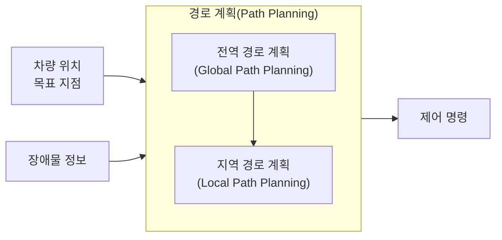

*그림 1. 경로 계획의 입력, 구성, 출력*

### 1.2 비홀로노믹 제약

로봇이나 차량의 상태를 나타내는 변수들의 모음을 **형상(configuration)** 이라고 하며, 평면을 달리는 차량의 형상은 위치와 방향 $\mathbf{q} = (x, y, \theta)$이다. 형상에 걸리는 제약은 두 가지로 나뉜다 [1].

> **용어 정의:** **홀로노믹 제약(holonomic constraint)** 은 형상 자체에 대한 등식 $f(\mathbf{q}) = 0$으로 쓸 수 있는 제약이며, 갈 수 있는 형상의 범위를 줄인다(예: 레일 위의 열차). **비홀로노믹 제약(non-holonomic constraint)** 은 속도 $\dot{\mathbf{q}}$에 걸리는 제약 가운데 적분하여 형상의 제약으로 바꿀 수 없는 것이며, 갈 수 있는 형상은 줄이지 않지만 한 순간에 움직일 수 있는 방향을 제한한다.

자동차의 뒷바퀴는 옆으로 미끄러지지 않고 굴러간다고 보면, 뒤 차축 중심의 속도는 항상 차체가 향한 방향 $\theta$를 따른다. 즉 차체의 옆 방향 속도 성분이 0이다.

```math
\dot{x} \sin\theta - \dot{y} \cos\theta = 0
```

이를 만족하는 가장 간단한 운동 모델은 자전거 모델이다. 앞바퀴의 조향각을 $\delta$, 앞뒤 차축 사이의 거리(축간거리)를 $L$, 속도를 $v$라 하면 다음과 같다(자전거 모델의 자세한 유도는 12주차에서 다룬다).

```math
\dot{x} = v \cos\theta, \qquad \dot{y} = v \sin\theta, \qquad \dot{\theta} = \frac{v}{L} \tan\delta
```

첫 두 식을 대입하면 $\dot{x}\sin\theta - \dot{y}\cos\theta = v\cos\theta\sin\theta - v\sin\theta\cos\theta = 0$이므로 제약이 만족된다. 형상의 변수는 셋($`x, y, \theta`$)인데 조작할 수 있는 입력은 둘($`v, \delta`$)뿐이므로, 차량은 옆으로 곧장 움직일 수 없다. 그래도 전진과 후진, 조향을 조합하면 평행 주차처럼 원하는 형상에 이를 수는 있다. 이것이 갈 수 있는 형상은 줄이지 않고 움직이는 방향만 제한한다는 뜻이다.

조향각에는 한계 $\delta_{\max}$가 있으므로 차량이 그리는 원의 반지름에는 하한이 있다. 속도 $v$로 각속도 $\dot{\theta}$로 돌 때 회전 반지름은 $R = v / \dot{\theta} = L / \tan\delta$이므로 **최소 회전 반경(minimum turning radius)** 은 다음과 같다.

```math
R_{\min} = \frac{L}{\tan\delta_{\max}}
```

예를 들어 $L = 2.7$ m, $\delta_{\max} = 30°$이면 $R_{\min} = 2.7 / \tan 30° = 2.7 / 0.5774 \approx 4.68$ m이다. 격자 위의 경로가 한 칸에서 90° 꺾이면 그 자리에서 반지름 0으로 돌아야 하므로 차량은 그 경로를 그대로 따라갈 수 없다. 4절의 Hybrid A\*는 이 문제를 풀기 위한 방법이다.

### 1.3 전역 경로 계획과 지역 경로 계획

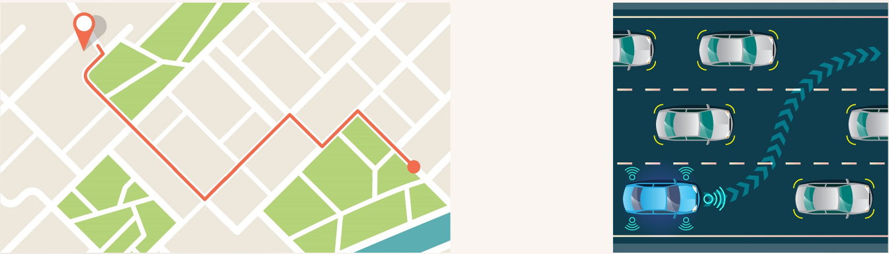

*그림 2. 지도 위의 출발지에서 목적지까지의 전역 경로(왼쪽)와 주변 차량을 피해 차선을 바꾸는 지역 경로(오른쪽)*

| 구분 | 전역 경로 계획 | 지역 경로 계획 |
|:-----|:-----|:-----|
| 목적 | 현재 지점에서 목표 지점까지의 최적 경로 탐색 | 주행 중에 생기는 많은 변수에 대응 |
| 고려하는 장애물 | 건물, 자연환경처럼 비교적 크고 바뀔 가능성이 작은 장애물만 고려 | 이동 경로에 지장을 줄 수 있는 모든 움직이는 장애물과 정지한 장애물 |
| 사용하는 정보 | 미리 만든 지도(도로망, 벡터 지도) | 센서가 실시간으로 인식한 주변 상황 |
| 계획 범위와 주기 | 목적지까지의 긴 범위, 출발할 때나 경로를 벗어났을 때 다시 계산 | 차량 앞 수십 m의 짧은 범위, 매우 짧은 주기로 반복 계산 |
| 예 | 내비게이션의 목적지 경로 | 앞차 추월, 차선 변경, 장애물 회피 |

*표 1. 전역 경로 계획과 지역 경로 계획의 비교*

그림 2의 왼쪽은 도시 지도 위에서 출발지(빨간 핀)부터 목적지(빨간 점)까지 도로를 따라 이어진 전역 경로이고, 오른쪽은 여러 대의 차량이 달리는 도로에서 자차(파란 차)가 옆 차선으로 옮겨 가는 지역 경로이다. 두 계획은 서로 보완한다. 전역 경로 계획만 있으면 갑자기 나타난 장애물에 대응할 수 없고, 지역 경로 계획만 있으면 가까운 장애물은 피하지만 목적지로 가는 큰 방향을 잃는다. 그래서 전역 경로를 큰 길잡이로 삼고, 지역 경로 계획이 그 길을 따라가면서 주변 상황에 맞게 짧은 구간을 고쳐 나가는 계층 구조를 쓴다.

---

<br>

## 2. 그래프 탐색의 기초

### 2.1 격자 지도와 그래프

경로 계획 알고리즘의 대부분은 공간을 **그래프(graph)** 로 나타낸 뒤 그래프에서 비용이 가장 작은 경로를 찾는다. 그래프는 노드(node)와 두 노드를 잇는 간선(edge)으로 이루어지며, 간선마다 그 간선을 지나는 비용(거리, 시간 등)이 붙는다.

> **[이산수학]** 그래프 $G = (V, E)$는 노드의 집합 $V$와 간선의 집합 $E \subseteq V \times V$로 이루어진다. 간선 $(u, v)$에 음이 아닌 비용 $c(u, v)$가 붙은 그래프를 가중 그래프라고 하며, 경로의 비용은 경로를 이루는 간선 비용의 합이다.

로봇 공학에서 흔히 쓰는 **격자 지도(grid map)** 는 평면을 같은 크기의 정사각형 칸으로 나누고 칸마다 장애물인지 아닌지를 표시한 지도이다. 장애물이 아닌 칸을 노드로, 이웃한 두 칸 사이의 이동을 간선으로 보면 격자 지도는 그래프가 된다. 이웃의 정의에 따라 두 가지 이동 모델이 있다.

- **네 방향 이동:** 상하좌우의 네 칸으로만 움직이며, 한 칸 이동의 비용은 1(또는 10)이다.
- **여덟 방향 이동:** 대각선의 네 칸까지 움직인다. 칸 한 변의 길이를 1로 두면 대각선 이동의 거리는 $\sqrt{2} \approx 1.414$이므로, 계산을 정수로 하기 위해 곧은 이동을 10, 대각선 이동을 14로 두는 경우가 많다.

```text
  14   10   14
  10  [●]   10
  14   10   14
```

*그림 3. 여덟 방향 이동에서 가운데 칸(●)에서 이웃 칸으로 가는 비용*

### 2.2 Dijkstra 알고리즘

간선의 비용이 모두 음이 아닐 때 한 노드에서 다른 모든 노드까지의 최단 경로를 구하는 고전적인 방법이 **Dijkstra 알고리즘**이다 [2]. 출발 노드에서의 거리 $g(n)$이 가장 작은 노드부터 차례로 확정해 나간다.

1. 출발 노드의 $g$를 0, 나머지 노드의 $g$를 무한대로 둔다.
2. 아직 확정하지 않은 노드 가운데 $g$가 가장 작은 노드 $n$을 골라 확정한다.
3. $n$의 이웃 $m$마다 $g(n) + c(n, m) < g(m)$이면 $g(m)$을 이 값으로 줄이고, $m$의 부모를 $n$으로 기록한다.
4. 목표 노드가 확정되거나 더 확정할 노드가 없을 때까지 2\~3을 되풀이한다.

목표 노드가 확정되면 부모를 거꾸로 따라가 경로를 복원한다. 간선 비용이 음이 아니므로 한 번 확정한 노드의 $g$는 다시 줄어들 수 없고, 그래서 확정된 $g$는 최단 거리이다.

> **[알고리즘]** 2단계에서 $g$가 가장 작은 노드를 빠르게 꺼내기 위해 우선순위 큐(이진 힙)를 쓰면, 노드가 $\vert V \vert$개, 간선이 $\vert E \vert$개인 그래프에서 Dijkstra 알고리즘의 시간 복잡도는 $O((\vert V \vert + \vert E \vert) \log \vert V \vert)$이다.

Dijkstra 알고리즘은 목표가 어느 쪽에 있는지 모르고 출발점에서 모든 방향으로 고르게 퍼져 나간다. 목표가 멀리 한쪽에 있어도 반대쪽의 노드까지 거리 순서대로 모두 확인하므로, 넓은 지도에서는 확인하는 노드가 매우 많아진다.

### 2.3 휴리스틱과 탐욕적 최선 우선 탐색

목표 쪽으로 탐색을 이끌려면 각 노드에서 목표까지 남은 비용을 어림해야 한다.

> **용어 정의:** **휴리스틱(heuristic)** $h(n)$은 노드 $n$에서 목표까지 남은 비용을 빠르게 어림한 값이다. 격자 지도에서는 장애물을 무시한 직선거리나 격자 거리를 흔히 쓴다.

휴리스틱만으로 탐색 순서를 정하는, 즉 $h(n)$이 가장 작은 노드부터 확장하는 방법을 **탐욕적 최선 우선 탐색(greedy best-first search)** 이라고 한다. 목표 방향으로 곧장 나아가므로 장애물이 없으면 매우 빠르지만, 지금까지 온 비용을 보지 않으므로 장애물이 있으면 돌아가는 길이 길어지거나 막다른 곳에 빠진다. 웹에서 격자 탐색 알고리즘을 시각화하는 도구 PathFinding.js [3]의 예로 이 문제를 볼 수 있다.

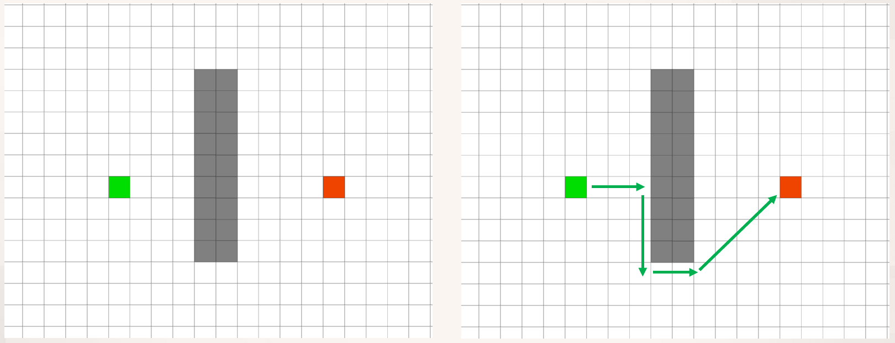

*그림 4. 세로 벽을 사이에 둔 출발점(초록)과 목표점(빨강), 벽을 돌아가는 경로*

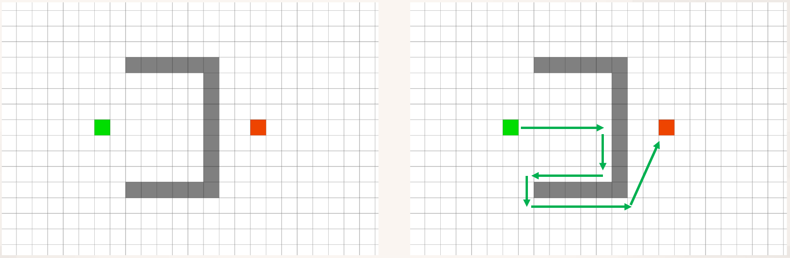

*그림 5. ㄷ자 장애물 안쪽으로 목표를 향해 곧장 들어갔다가 막혀서 되돌아 나오는 경로*

그림 4의 왼쪽은 출발점(초록)과 목표점(빨강) 사이에 세로로 긴 벽(회색)이 있는 격자이고, 오른쪽은 벽에 다다를 때까지 목표 쪽으로 간 뒤 벽을 따라 내려가 끝을 돌아 목표로 가는 경로이다. 그림 5의 장애물은 출발점 쪽이 열린 ㄷ자 모양이다. 목표 방향으로만 나아가면 오른쪽 화살표처럼 ㄷ자 안쪽으로 들어가 벽에 막히고, 아래로 내려와 다시 왼쪽으로 되돌아 나온 뒤에야 장애물의 아래를 돌아 목표에 간다. 목표까지의 어림 거리만 보면 안쪽 칸들이 가장 좋아 보이기 때문에 생기는 일이다. A\* 알고리즘은 지금까지 온 비용과 남은 비용의 어림을 함께 보아 이 문제를 줄인다.

---

<br>

## 3. A\* 알고리즘

### 3.1 비용 함수 F = G + H

**A\* 알고리즘**은 주어진 출발지에서 목적지까지의 최단 경로를 찾는 트리 탐색 알고리즘이다 [4]. 출발 지점에서 시작하여 인접한 지역을 조사해 나가며, 시작 지점에서 목표 지점까지 가장 싼 비용의 경로를 찾는다. 각 노드 $n$의 비용 $F$는 다음과 같이 두 비용의 합이다.

```math
F(n) = G(n) + H(n)
```

| 기호 | 이름 | 의미 |
|:-----|:-----|:-----|
| $G(n)$ | 실제 비용 | 출발 지점에서 노드 $n$까지 실제로 움직인 거리(비용) |
| $H(n)$ | 휴리스틱 비용 | 노드 $n$에서 목표 지점까지 예상되는 거리(비용). 보통 장애물을 무시하고 계산한다 |
| $F(n)$ | 전체 비용 | $n$을 지나는 경로 전체의 비용을 어림한 값 |

*표 2. A\*의 비용 함수*

인접 지역을 탐색할 때, 목표 지점까지의 좋은 경로를 추정하기 위해 각 인접 지역에 이 비용으로 순위를 매기는 **휴리스틱 추정(heuristic estimate)** 을 쓰고, 그 순서대로 인접 지역을 방문한다. $H = 0$이면 A\*는 Dijkstra 알고리즘과 같고, $G$를 무시하면 탐욕적 최선 우선 탐색과 같다. A\*는 그 사이에서 이미 온 거리와 남은 거리의 어림을 함께 보아, 목표 방향으로 이끌리면서도 지나치게 먼 길로 빠지지 않는다. A\*는 경로 탐색이 필요한 여러 분야에서 쓰이며, 실시간 전략 게임에서 캐릭터나 유닛의 이동 경로를 만드는 데에도 자주 쓰인다.

### 3.2 알고리즘의 절차

A\*는 두 목록을 관리한다.

- **열린 목록(open list):** 발견하였지만 아직 확장하지 않은 노드들. $F$가 작은 순으로 꺼낼 수 있도록 우선순위 큐에 둔다.
- **닫힌 목록(closed list):** 이미 확장을 마친 노드들.

노드를 **확장(expand)** 한다는 것은 그 노드를 열린 목록에서 꺼내 닫힌 목록으로 옮기고, 이웃 노드들의 비용을 계산하는 것이다. 각 노드는 자신에게 가장 싸게 오는 직전 노드를 **부모(parent)** 로 기억한다.

```text
A*(start, goal):
    G(start) ← 0,  parent(start) ← 없음
    OPEN ← {start},  CLOSED ← { }
    while OPEN이 비어 있지 않다:
        n ← OPEN에서 F(n) = G(n) + H(n)이 가장 작은 노드
        if n = goal:
            goal에서 parent를 거꾸로 따라가 경로를 복원하여 반환한다
        OPEN에서 n을 빼고 CLOSED에 넣는다
        for n의 이웃 m (장애물이 아닌 칸):
            if m ∈ CLOSED: 건너뛴다
            G' ← G(n) + c(n, m)
            if m ∉ OPEN:
                G(m) ← G',  parent(m) ← n,  m을 OPEN에 넣는다
            else if G' < G(m):
                G(m) ← G',  parent(m) ← n   (더 짧은 길을 찾았으므로 갱신)
    return 실패 (목표에 이르는 경로가 없다)
```

절차에서 중요한 점은 다음과 같다.

- **목표 검사는 꺼낼 때 한다.** 목표가 열린 목록에 처음 들어간 순간에는 아직 더 싼 경로가 남아 있을 수 있다. 목표를 열린 목록에서 꺼낼 때 비로소 그 비용이 최소임이 보장된다(3.6절).
- **갱신을 빠뜨리지 않는다.** 열린 목록에 이미 있는 노드라도 더 짧은 길이 발견되면 $G$와 부모를 고쳐야 한다. 이 단계를 빠뜨리면 최단이 아닌 경로를 얻는다(3.5절의 주의).
- **동점 처리.** $F$가 같은 노드가 여럿이면 어느 것을 먼저 꺼낼지 정해야 한다. 3.4절과 3.5절의 예제는 $H$가 작은 노드(목표에 더 가까운 노드)를 먼저 꺼내고, $H$도 같으면 먼저 들어온 노드를 먼저 꺼낸다. 동점 규칙이 달라도 찾은 경로의 비용은 같지만, 확장 순서와 경로의 모양은 달라질 수 있다.

### 3.3 탐색 영역의 시각화

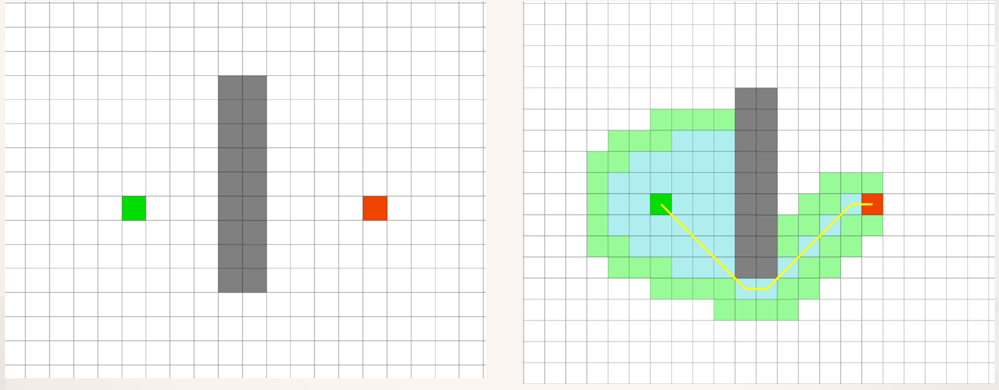

*그림 6. 세로 벽 예제에서 A\*가 확장한 칸(하늘색)과 열린 목록의 칸(연두색), 찾은 경로(노란 선)*

그림 6은 그림 4와 같은 지도에서 A\*를 실행한 결과이다. 하늘색은 닫힌 목록(확장한 칸), 연두색은 열린 목록(발견하였지만 확장하지 않은 칸), 노란 선은 찾은 경로이다. 탐색은 출발점 주변에서 시작하여 벽 앞에서 위아래로 퍼지다가 벽의 아래 끝을 돌아 목표 쪽으로 향한다. 목표에서 먼 왼쪽 위와 아래의 넓은 영역은 확장하지 않으므로, 모든 방향으로 고르게 퍼지는 Dijkstra 알고리즘보다 확인하는 칸이 적다. 찾은 경로는 벽의 아래 끝을 대각선으로 스치는 최단 경로이다.

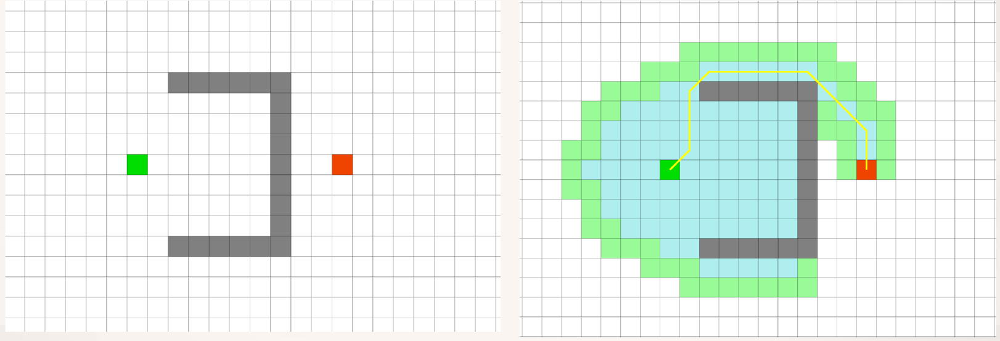

*그림 7. ㄷ자 장애물 예제에서 A\*가 확장한 칸과 장애물 위쪽으로 돌아가는 경로*

그림 7은 ㄷ자 장애물에서의 결과이다. A\*도 처음에는 목표 쪽의 ㄷ자 안쪽 칸들을 확장한다(하늘색 영역). 안쪽 칸들은 $H$가 작아 $F$가 작아 보이기 때문이다. 그러나 안쪽으로 갈수록 막다른 벽 때문에 더 나아갈 수 없고, 안쪽 칸을 모두 확장하고 나면 열린 목록에서 $F$가 가장 작은 칸은 장애물 바깥쪽의 칸이 된다. 결국 A\*는 장애물의 위쪽을 돌아 목표에 이르는 최단 경로(노란 선)를 찾는다. 그림 5의 경로와 달리 막다른 곳에 들어갔다 나오는 길을 경로에 포함하지 않는다. 확장한 칸은 많지만, 그 칸들은 경로가 아니라 탐색의 흔적일 뿐이다.

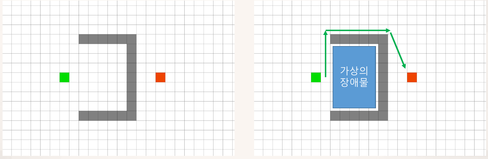

*그림 8. 막다른 안쪽 공간을 가상의 장애물로 채워 바깥으로 돌아가는 경로*

막다른 공간이 미리 알려져 있으면 그림 8처럼 그 공간을 **가상의 장애물(virtual obstacle)** 로 채울 수 있다. 그러면 탐색이 처음부터 안쪽으로 들어가지 않으므로 확장하는 칸이 크게 줄고, 경로는 장애물의 바깥을 따라 위쪽으로 돌아 목표에 간다. 탐색에 들어가기 전에 지도의 모양을 이용하여 쓸모없는 영역을 지우는 이런 전처리는 탐색 시간을 줄이는 흔한 방법이다.

### 3.4 예제 1: 네 방향으로 움직이는 격자

다음 격자에서 A\*를 손으로 추적한다. 칸의 이름은 열 문자(A\~H)와 행 번호(1\~8)로 쓴다.

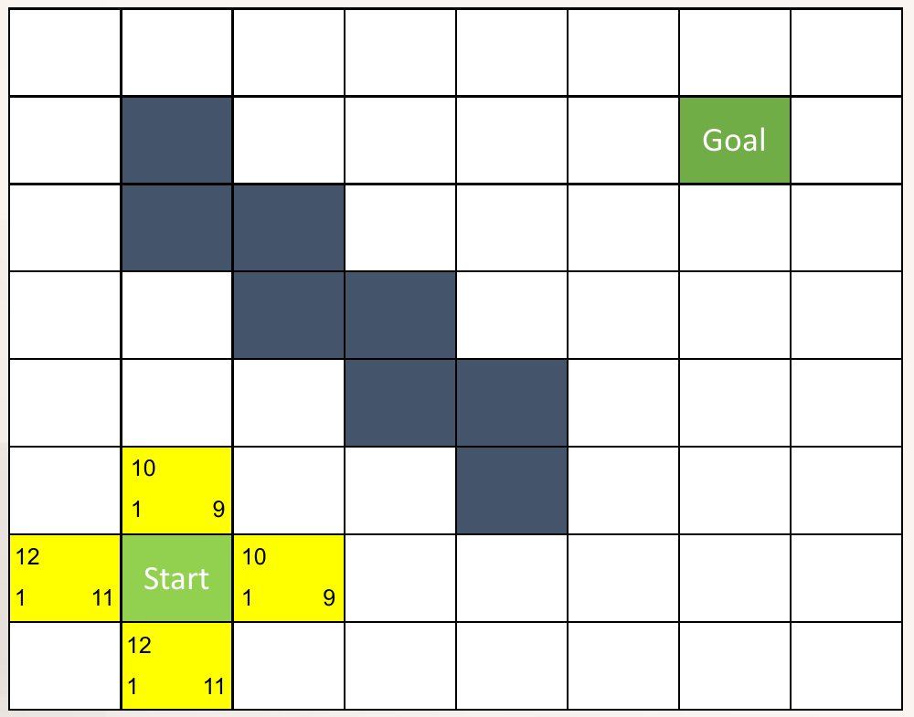

*그림 9. 예제 1의 격자와 출발 칸(Start)의 네 이웃에 계산한 비용*

- **지도:** 8×8 격자이고, 짙은 색 칸 B2, B3, C3, C4, D4, D5, E5, E6이 왼쪽 위에서 오른쪽 아래로 이어진 벽이다. 출발 칸은 B7, 목표 칸은 G2이다.
- **이동:** 상하좌우로만 움직이며 한 칸의 비용은 1이다.
- **휴리스틱:** 장애물을 무시한 격자 거리(맨해튼 거리) $H = \vert \Delta\text{열} \vert + \vert \Delta\text{행} \vert$이다. 예를 들어 출발 칸 B7에서 G2까지는 열로 5칸, 행으로 5칸이므로 $H = 10$이다.
- **칸의 표기:** 그림 9의 노란 칸에서 왼쪽 위의 수는 $F$, 왼쪽 아래는 $G$, 오른쪽 아래는 $H$이다.

그림 9는 첫 단계의 결과이다. 출발 칸 B7을 확장하면 네 이웃의 비용은 다음과 같다.

- 위쪽 B6: $G = 1$이고, G2까지 열로 5칸(B → G), 행으로 4칸(6 → 2)이므로 $H = 5 + 4 = 9$, $F = 10$이다.
- 오른쪽 C7: $G = 1$이고, 열로 4칸, 행으로 5칸이므로 $H = 9$, $F = 10$이다.
- 왼쪽 A7: $G = 1$이고, 열로 6칸, 행으로 5칸이므로 $H = 11$, $F = 12$이다.
- 아래쪽 B8: $G = 1$이고, 열로 5칸, 행으로 6칸이므로 $H = 11$, $F = 12$이다.

목표 쪽(위와 오른쪽)으로 한 칸 간 칸은 $H$가 1 줄어 $F$가 그대로 10이고, 반대쪽으로 간 칸은 $H$가 1 늘어 $F$가 12가 된다. 이후의 과정은 다음 표와 같다(굵은 글씨는 이미 열린 목록에 있던 칸의 비용을 더 작은 값으로 갱신한 것이다).

| 단계 | 확장한 칸 | G | H | F | 열린 목록에 추가하거나 갱신한 칸 (G+H=F) |
|:-----|:-----|:-----|:-----|:-----|:-----|
| 1 | B7 | 0 | 10 | 10 | B6 (1+9=10), C7 (1+9=10), B8 (1+11=12), A7 (1+11=12) |
| 2 | B6 | 1 | 9 | 10 | B5 (2+8=10), C6 (2+8=10), A6 (2+10=12) |
| 3 | B5 | 2 | 8 | 10 | B4 (3+7=10), C5 (3+7=10), A5 (3+9=12) |
| 4 | B4 | 3 | 7 | 10 | A4 (4+8=12) |
| 5 | C5 | 3 | 7 | 10 | 없음 (이웃이 모두 장애물이거나 이미 목록에 있고 더 짧아지지 않음) |
| 6 | C6 | 2 | 8 | 10 | D6 (3+7=10) |
| 7 | D6 | 3 | 7 | 10 | D7 (4+8=12) |
| 8 | C7 | 1 | 9 | 10 | **D7 갱신** (4+8=12 → 2+8=10), C8 (2+10=12) |
| 9 | D7 | 2 | 8 | 10 | E7 (3+7=10), D8 (3+9=12) |
| 10 | E7 | 3 | 7 | 10 | F7 (4+6=10), E8 (4+8=12) |
| 11 | F7 | 4 | 6 | 10 | F6 (5+5=10), G7 (5+5=10), F8 (5+7=12) |
| 12 | F6 | 5 | 5 | 10 | F5 (6+4=10), G6 (6+4=10) |
| 13 | F5 | 6 | 4 | 10 | F4 (7+3=10), G5 (7+3=10) |
| 14 | F4 | 7 | 3 | 10 | F3 (8+2=10), G4 (8+2=10), E4 (8+4=12) |
| 15 | F3 | 8 | 2 | 10 | F2 (9+1=10), G3 (9+1=10), E3 (9+3=12) |
| 16 | F2 | 9 | 1 | 10 | F1 (10+2=12), G2 (10+0=10), E2 (10+2=12) |
| 17 | G2 | 10 | 0 | 10 | 목표 도달, 탐색 종료 |

*표 3. 예제 1에서 A\*의 확장 과정*

과정을 나누어 보면 다음과 같다.

1. **막다른 곳의 탐색(2\~7단계).** B6, B5, B4, C5, C6, D6은 모두 $F = 10$이라 목표로 가는 좋은 길처럼 보인다. 동점 규칙에 따라 $H$가 작은 칸부터 확장하므로 탐색은 먼저 왼쪽 위 공간으로 들어간다. 그러나 이 공간은 벽에 막혀 있어 목표 쪽으로 더 나아갈 수 없다. 7단계에서 D6이 새로 연 D7은 $G = 4$, $F = 12$로 비용이 늘어난다.
2. **이전 지역으로 돌아가기(8단계).** 이제 열린 목록에서 $F$가 가장 작은 칸은 1단계에서 넣어 둔 C7($`F = 10`$)이다. 더 이상 나아갈 수 없거나 비용이 늘어나는 길을 포기하고, 이전 지역으로 돌아와 다음 순위의 다른 길을 탐색하는 것이 A\*의 이 동작이다. C7에서 보면 D7까지 $G = 1 + 1 = 2$로 갈 수 있으므로, D7의 $G$를 4에서 2로, 부모를 D6에서 C7로 갱신한다.
3. **목표까지의 진행(9\~17단계).** 이후로는 $F = 10$인 칸을 따라 7행을 오른쪽으로 가다가 F열을 따라 위로 올라가 목표 G2에 이른다. 목표를 꺼낼 때의 $G = 10$이 최단 경로의 비용이다.

최종 상태는 다음과 같다(굵은 글씨는 확장한 칸, ■는 장애물).

| | A | B | C | D | E | F | G | H |
|:-----|:-----|:-----|:-----|:-----|:-----|:-----|:-----|:-----|
| 1 |  |  |  |  |  | 10+2=12 |  |  |
| 2 |  | ■ |  |  | 10+2=12 | **9+1=10** | **목표 10+0=10** |  |
| 3 |  | ■ | ■ |  | 9+3=12 | **8+2=10** | 9+1=10 |  |
| 4 | 4+8=12 | **3+7=10** | ■ | ■ | 8+4=12 | **7+3=10** | 8+2=10 |  |
| 5 | 3+9=12 | **2+8=10** | **3+7=10** | ■ | ■ | **6+4=10** | 7+3=10 |  |
| 6 | 2+10=12 | **1+9=10** | **2+8=10** | **3+7=10** | ■ | **5+5=10** | 6+4=10 |  |
| 7 | 1+11=12 | **출발 0+10=10** | **1+9=10** | **2+8=10** | **3+7=10** | **4+6=10** | 5+5=10 |  |
| 8 |  | 1+11=12 | 2+10=12 | 3+9=12 | 4+8=12 | 5+7=12 |  |  |

*표 4. 예제 1의 최종 상태 (각 칸은 G+H=F)*

```text
    A  B  C  D  E  F  G  H
1   .  .  .  .  .  o  .  .
2   .  #  .  .  o  *  T  .
3   .  #  #  .  o  *  o  .
4   o  x  #  #  o  *  o  .
5   o  x  x  #  #  *  o  .
6   o  x  x  x  #  *  o  .
7   o  S  *  *  *  *  o  .
8   .  o  o  o  o  o  .  .
```

*그림 10. 예제 1의 결과 (S 출발, T 목표, # 장애물, * 경로, x 확장했지만 경로가 아닌 칸, o 열린 목록에 남은 칸)*

부모를 거꾸로 따라가면 경로는 B7 → C7 → D7 → E7 → F7 → F6 → F5 → F4 → F3 → F2 → G2이고 비용은 10이다. 두 가지를 눈여겨볼 수 있다.

- **확장한 칸의 F가 모두 10이다.** 이 예제의 최단 비용 $C^{\ast} = 10$이며, A\*는 $F < C^{\ast}$인 칸을 모두 확장하고 $F = C^{\ast}$인 칸 일부를 확장한 뒤 끝난다. $F = 12$인 칸은 하나도 확장하지 않았다.
- **최단 경로는 하나가 아니다.** 예를 들어 F4 → G4 → G3 → G2로 가도 비용이 10이다. 동점 규칙이나 이웃을 살피는 순서가 달라지면 같은 비용의 다른 경로를 찾을 수 있다.

### 3.5 예제 2: 대각선 이동을 허용한 격자

이번에는 대각선 이동을 허용한다. 곧은 이동의 비용은 10, 대각선 이동의 비용은 14이다.

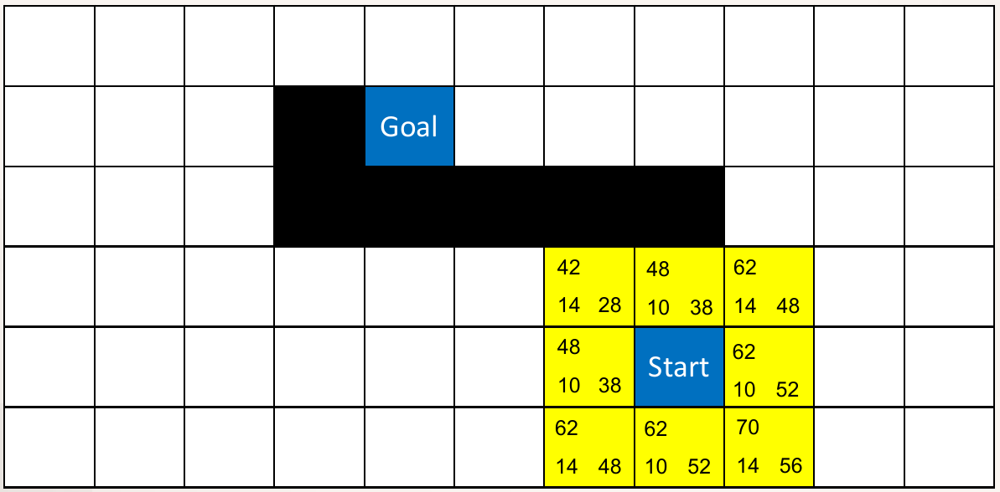

*그림 11. 예제 2의 격자와 출발 칸의 여덟 이웃에 계산한 비용*

- **지도:** 11×6 격자(열 A\~K, 행 1\~6)이다. 검은 칸 D2와 D3\~H3이 ㄱ자를 뒤집은 모양의 벽을 이루고, 목표 칸 E2는 벽의 위쪽 안쪽에 있다. 출발 칸은 벽 아래의 H5이다.
- **휴리스틱:** 장애물을 무시하고 여덟 방향으로 갈 때의 최단 비용인 **대각 거리(octile distance)** 를 쓴다. 열의 차를 $d_x$, 행의 차를 $d_y$라 하면, 짧은 쪽만큼은 대각선으로, 나머지는 곧게 가는 것이 가장 싸다.

```math
H = 14 \min(d_x, d_y) + 10 \left( \max(d_x, d_y) - \min(d_x, d_y) \right)
```

예를 들어 출발 칸 H5에서 E2까지는 $d_x = 3$, $d_y = 3$이므로 $H = 14 \times 3 = 42$이다. 출발 칸의 왼쪽 위 G4는 $G = 14$(대각선 한 번), $d_x = 2$, $d_y = 2$이므로 $H = 28$, $F = 42$이다. 오른쪽 I5는 $G = 10$, $d_x = 4$, $d_y = 3$이므로 $H = 14 \times 3 + 10 \times 1 = 52$, $F = 62$이다. 그림 11의 여덟 칸은 모두 이렇게 계산한 것이다.

| 단계 | 확장한 칸 | G | H | F | 열린 목록에 추가하거나 갱신한 칸 (G+H=F) |
|:-----|:-----|:-----|:-----|:-----|:-----|
| 1 | H5 | 0 | 42 | 42 | H4 (10+38=48), I4 (14+48=62), I5 (10+52=62), I6 (14+56=70), H6 (10+52=62), G6 (14+48=62), G5 (10+38=48), G4 (14+28=42) |
| 2 | G4 | 14 | 28 | 42 | F5 (28+34=62), F4 (24+24=48) |
| 3 | F4 | 24 | 24 | 48 | E5 (38+30=68), E4 (34+20=54) |
| 4 | H4 | 10 | 38 | 48 | I3 (24+44=68) |
| 5 | G5 | 10 | 38 | 48 | F6 (24+44=68), **F5 갱신** (28+34=62 → 20+34=54) |
| 6 | E4 | 34 | 20 | 54 | D5 (48+34=82), D4 (44+24=68) |
| 7 | F5 | 20 | 34 | 54 | E6 (34+40=74), **E5 갱신** (38+30=68 → 30+30=60) |
| 8 | E5 | 30 | 30 | 60 | D6 (44+44=88), **D5 갱신** (48+34=82 → 40+34=74) |
| 9 | I4 | 14 | 48 | 62 | J3 (28+54=82), J4 (24+58=82), J5 (28+62=90) |
| 10 | G6 | 14 | 48 | 62 | 없음 (이웃이 모두 장애물이거나 이미 목록에 있고 더 짧아지지 않음) |
| 11 | I5 | 10 | 52 | 62 | **J5 갱신** (28+62=90 → 20+62=82), J6 (24+66=90) |
| 12 | H6 | 10 | 52 | 62 | 없음 (이웃이 모두 장애물이거나 이미 목록에 있고 더 짧아지지 않음) |
| 13 | D4 | 44 | 24 | 68 | C5 (58+38=96), C4 (54+28=82), C3 (58+24=82) |
| 14 | I3 | 24 | 44 | 68 | I2 (34+40=74), J2 (38+50=88), H2 (38+30=68) |
| 15 | H2 | 38 | 30 | 68 | H1 (48+34=82), I1 (52+44=96), G2 (48+20=68), G1 (52+24=76) |
| 16 | G2 | 48 | 20 | 68 | F2 (58+10=68), F1 (62+14=76) |
| 17 | F2 | 58 | 10 | 68 | E2 (68+0=68), E1 (72+10=82) |
| 18 | E2 | 68 | 0 | 68 | 목표 도달, 탐색 종료 |

*표 5. 예제 2에서 A\*의 확장 과정*

1. **벽 아래로의 탐색(2\~8단계).** 목표가 왼쪽 위에 있으므로 $F = 42$인 G4가 가장 먼저 확장되고, 탐색은 벽 아래를 따라 왼쪽으로 나아간다(F4, E4, D4 방향). 그러나 벽이 위쪽을 막고 있어 목표에 다가가지 못하고, 확장하는 칸의 $F$는 42 → 48 → 54 → 60으로 커진다.
2. **출발점 주변의 정리(9\~12단계).** $F = 62$인 I4, G6, I5, H6을 확장한다. 이 칸들은 목표에서 멀어지는 쪽이라 새로 연 칸들의 $F$가 82 이상으로 커서 탐색이 그쪽으로 이어지지 않는다.
3. **벽의 오른쪽 끝을 돌기(13\~18단계).** $F = 68$인 칸이 D4와 I3 둘이다. 동점이므로 $H$가 작은 D4(24)를 먼저 확장하지만, D4에서 연 칸들은 $F$가 82 이상이다. 다음으로 I3을 확장하면 벽 위의 H2가 $F = 68$로 열리고, H2 → G2 → F2를 거쳐 목표 E2를 비용 68로 꺼낸다.

최종 상태와 경로는 다음과 같다.

| | A | B | C | D | E | F | G | H | I | J | K |
|:-----|:-----|:-----|:-----|:-----|:-----|:-----|:-----|:-----|:-----|:-----|:-----|
| 1 |  |  |  |  | 72+10=82 | 62+14=76 | 52+24=76 | 48+34=82 | 52+44=96 |  |  |
| 2 |  |  |  | ■ | **목표 68+0=68** | **58+10=68** | **48+20=68** | **38+30=68** | 34+40=74 | 38+50=88 |  |
| 3 |  |  | 58+24=82 | ■ | ■ | ■ | ■ | ■ | **24+44=68** | 28+54=82 |  |
| 4 |  |  | 54+28=82 | **44+24=68** | **34+20=54** | **24+24=48** | **14+28=42** | **10+38=48** | **14+48=62** | 24+58=82 |  |
| 5 |  |  | 58+38=96 | 40+34=74 | **30+30=60** | **20+34=54** | **10+38=48** | **출발 0+42=42** | **10+52=62** | 20+62=82 |  |
| 6 |  |  |  | 44+44=88 | 34+40=74 | 24+44=68 | **14+48=62** | **10+52=62** | 14+56=70 | 24+66=90 |  |

*표 6. 예제 2의 최종 상태 (각 칸은 G+H=F)*

```text
    A  B  C  D  E  F  G  H  I  J  K
1   .  .  .  .  o  o  o  o  o  .  .
2   .  .  .  #  T  *  *  *  o  o  .
3   .  .  o  #  #  #  #  #  *  o  .
4   .  .  o  x  x  x  x  *  x  o  .
5   .  .  o  o  x  x  x  S  x  o  .
6   .  .  .  o  o  o  x  x  o  o  .
```

*그림 12. 예제 2의 결과 (기호는 그림 10과 같음)*

경로는 H5 → H4 → I3 → H2 → G2 → F2 → E2이고, 비용은 $10 + 14 + 14 + 10 + 10 + 10 = 68$이다. 벽의 왼쪽 끝을 돌아가는 길은 H5 → G4 → F4 → E4 → D4 → C3 → C2 → D1 → E2로 비용이 96이므로, 오른쪽으로 도는 길이 더 짧다.

> **주의:** 열린 목록에 이미 있는 칸의 비용을 갱신하는 단계를 빠뜨리기 쉽다. 예를 들어 D5는 6단계에서 E4로부터 대각선으로 처음 열려 $G = 34 + 14 = 48$, $F = 82$가 되지만, 8단계에서 E5($`G = 30`$)를 확장하면 곧은 이동으로 $30 + 10 = 40$에 갈 수 있으므로 $G = 40$, $F = 74$로 고쳐야 한다. 같은 방식으로 J5도 11단계에서 28에서 20으로 줄어든다. 갱신을 빠뜨리면 그 칸을 지나는 경로의 비용을 실제보다 크게 계산하게 되어, 그 칸을 지나는 길이 최단일 때 그 길을 놓친다. 갱신을 빠뜨린 채 끝까지 계산하면 최종 상태에서 D5는 48+34=82, J5는 28+62=90으로 남는다.

> **주의:** 이 경로의 H4 → I3과 I3 → H2는 장애물 H3의 모서리를 대각선으로 스쳐 지나간다. 장애물 모서리를 가로지르는 대각선 이동을 금지하면(대각선으로 움직일 때 곁의 두 칸이 모두 비어 있어야 한다는 규칙), 경로는 H5 → I4 → I3 → I2 → H2 → G2 → F2 → E2로 바뀌고 비용은 74가 된다. 실제 차량은 폭이 있으므로, 장애물을 차량의 반폭만큼 부풀린 지도에서 탐색하여 모서리를 스치는 경로가 나오지 않게 한다.

### 3.6 휴리스틱의 조건과 선택

A\*가 최단 경로를 보장하려면 휴리스틱이 다음 조건을 만족해야 한다 [4].

> **용어 정의:** 노드 $n$에서 목표까지의 실제 최소 비용을 $h^{\ast}(n)$이라 하자. 모든 $n$에서 $h(n) \le h^{\ast}(n)$이면 휴리스틱이 **허용적(admissible)** 이라고 한다. 즉 남은 비용을 절대로 과대평가하지 않는다. 모든 간선 $(n, m)$에서 $h(n) \le c(n, m) + h(m)$이고 $h(\text{goal}) = 0$이면 **일관적(consistent)** 이라고 한다.

> **[인공지능]** 상태 공간 탐색에서 휴리스틱은 문제의 제약 일부를 없앤 완화 문제(relaxed problem)의 최적 비용으로 만드는 경우가 많다. 장애물을 무시한 거리는 장애물이 없다고 가정한 완화 문제의 최단 거리이므로, 원래 문제의 비용보다 클 수 없어 허용적이다.

**허용적 휴리스틱이면 A\*는 최단 경로를 찾는다.** 단, 닫힌 노드라도 더 싼 경로가 나오면 다시 열거나, 아래의 일관성이 성립해야 한다. 최단 비용을 $C^{\ast}$라 하자. 목표가 아직 꺼내지지 않았다면 최단 경로 위의 어떤 노드 $n$이 열린 목록에 있고, 그 노드는 최단 경로를 따라 왔으므로 $G(n) = g^{\ast}(n)$이다. 따라서 $F(n) = g^{\ast}(n) + h(n) \le g^{\ast}(n) + h^{\ast}(n) = C^{\ast}$이다. 만약 비용이 $C^{\ast}$보다 큰 경로로 목표가 먼저 꺼내진다면 그때 목표의 $F$는 $C^{\ast}$보다 크므로, $F(n) \le C^{\ast}$인 $n$이 먼저 꺼내졌어야 하여 모순이다. 그러므로 목표를 꺼낼 때의 비용은 $C^{\ast}$이다.

**일관적 휴리스틱이면 확장한 노드를 다시 열 필요가 없다.** 일관성이 있으면 경로를 따라갈 때 $F$가 줄어들지 않는다($`F(m) = G(n) + c(n, m) + h(m) \ge G(n) + h(n) = F(n)`$). 그래서 노드는 $F$가 커지는 순서로 확장되고, 어떤 노드가 처음 확장될 때의 $G$가 이미 최소이다. 3.2절의 의사 코드가 닫힌 목록의 노드를 건너뛰어도 되는 이유이다. 일관적인 휴리스틱은 항상 허용적이다.

이동 모델에 따라 쓰는 대표적인 휴리스틱은 다음과 같다. 곧은 이동의 비용을 1, 대각선 이동의 비용을 $\sqrt{2}$로 두고, $d_x$, $d_y$는 목표까지의 열과 행의 차이다.

| 휴리스틱 | 식 | 맞는 이동 모델 |
|:-----|:-----|:-----|
| 맨해튼 거리 | $d_x + d_y$ | 네 방향 이동에서 장애물이 없을 때의 정확한 거리. 여덟 방향 이동에서는 대각선을 쓰는 실제 비용보다 커질 수 있어 허용적이지 않다 |
| 대각 거리 | $\sqrt{2} \min(d_x, d_y) + (\max(d_x, d_y) - \min(d_x, d_y))$ | 여덟 방향 이동에서 장애물이 없을 때의 정확한 거리 |
| 체비쇼프 거리 | $\max(d_x, d_y)$ | 대각선 이동의 비용도 1인 여덟 방향 이동의 정확한 거리. 대각선 비용이 $\sqrt{2}$이면 허용적이지만 덜 정확하다 |
| 유클리드 거리 | $\sqrt{d_x^2 + d_y^2}$ | 어느 방향으로든 움직일 수 있을 때의 정확한 거리. 격자 이동에서는 허용적이지만 덜 정확하다 |

*표 7. 이동 모델에 따른 휴리스틱*

> **참고:** 예제 2처럼 대각선 비용 $10\sqrt{2} \approx 14.14$를 정수 14로 반올림하면, 유클리드 거리 $10\sqrt{d_x^2 + d_y^2}$는 대각선으로만 가는 경우에 실제 비용보다 조금 커져 엄밀하게는 허용적이지 않다. 비용을 정수로 근사할 때는 그 근사에 맞춘 대각 거리를 쓰는 편이 안전하다.

허용적인 휴리스틱 가운데서는 실제 비용에 가까울수록(값이 클수록) 확장하는 노드가 적어지는 경향이 있다. 값이 작은 쪽 휴리스틱이 일관적이고 목표가 아닌 모든 노드에서 다른 휴리스틱의 값이 그보다 크면, 큰 쪽을 쓴 A\*가 확장하는 노드는 모두 작은 쪽을 쓴 A\*도 확장한다 [4]. 두 예제를 여러 방법으로 풀어 확장한 노드의 수와 찾은 경로의 비용을 비교하면 다음과 같다(동점 규칙은 3.2절과 같다).

| 방법 | 확장 순서의 기준 | 예제 1 확장 수 | 예제 1 경로 비용 | 예제 2 확장 수 | 예제 2 경로 비용 |
|:-----|:-----|:-----|:-----|:-----|:-----|
| Dijkstra 알고리즘 | $G$ | 45 | 10 | 47 | 68 |
| 탐욕적 최선 우선 탐색 | $H$ | 18 | 14 | 9 | 96 |
| A\* (예제 1은 맨해튼, 예제 2는 대각 거리) | $G + H$ | 17 | 10 | 18 | 68 |
| A\* (예제 2에 체비쇼프 거리 $`10\max(d_x, d_y)`$) | $G + H$ | | | 20 | 68 |
| A\* (예제 2에 맨해튼 거리 $`10(d_x + d_y)`$) | $G + H$ | | | 15 | 68 |

*표 8. 탐색 방법과 휴리스틱에 따른 확장 수와 경로 비용*

- Dijkstra 알고리즘은 항상 최단 경로를 찾지만, 목표 방향을 모르므로 A\*보다 2.5배 이상 많은 칸을 확장한다.
- 탐욕적 최선 우선 탐색은 예제 2에서 가장 적은 9칸만 확장하지만, 목표에 가까워 보이는 벽의 왼쪽으로 돌아 비용 96의 경로를 찾는다. 예제 1에서도 왼쪽 위의 막다른 공간으로 들어갔다가 맨 위 행을 돌아 비용 14의 경로를 낸다.
- A\*는 최단 경로를 찾으면서도 확장 수가 적다. 체비쇼프 거리는 대각 거리보다 작은 값(덜 정확한 어림)이므로 확장 수가 18에서 20으로 늘었다.
- 맨해튼 거리를 여덟 방향 격자에 쓰면 실제 비용보다 큰 값을 줄 수 있으므로(대각선 한 칸이 14인데 20으로 어림한다) 허용적이지 않다. 이 예제에서는 확장 수가 줄고 우연히 최단 경로를 찾았지만, 일반적으로는 최단이 아닌 경로를 낼 수 있다.

휴리스틱에 1보다 큰 가중치를 곱한 $F = G + w H$($`w > 1`$)를 쓰는 방법을 **가중 A\*(weighted A\*)** 라고 한다 [5]. 탐색이 목표 쪽으로 더 강하게 이끌려 확장 수가 줄어드는 대신, 찾은 경로의 비용이 최단 비용의 $w$배를 넘지 않는다는 약한 보장만 남는다. 실시간으로 다시 계획해야 하는 자율주행에서는 이처럼 최적성을 조금 양보하고 속도를 얻는 설계가 흔하며, 4절의 Hybrid A\*도 그러하다.

### 3.7 도로망에서의 A\*

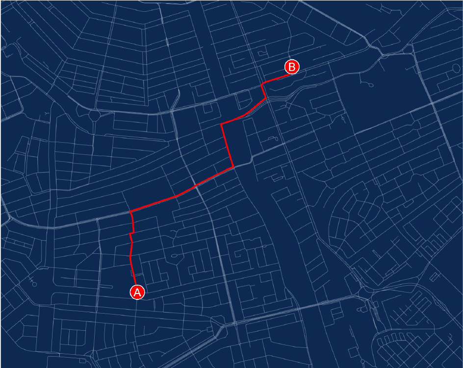

*그림 13. 도시의 도로망 그래프에서 A\*로 찾은 A 지점부터 B 지점까지의 경로*

A\*는 격자뿐 아니라 일반적인 그래프에도 쓸 수 있다. 그림 13은 경로 탐색 라이브러리 ngraph.path [6]의 예로, 도시의 도로망에서 A 지점부터 B 지점까지의 경로(빨간 선)를 찾은 결과이다. 내비게이션에서는 교차로를 노드로, 교차로 사이의 도로 구간을 간선으로, 구간의 길이나 통과 시간을 간선의 비용으로 둔다. 도로를 따라가는 거리는 두 지점 사이의 직선거리보다 짧을 수 없으므로, 간선 비용이 길이이면 직선거리는 허용적인 휴리스틱이다. 간선 비용이 통과 시간이면 직선거리를 최고 속도로 나눈 값이 허용적이다. 이것이 1.3절의 전역 경로 계획에 해당한다.

---

<br>

## 4. Hybrid A\* 알고리즘

### 4.1 격자 A\*의 한계와 Hybrid A\*의 착안

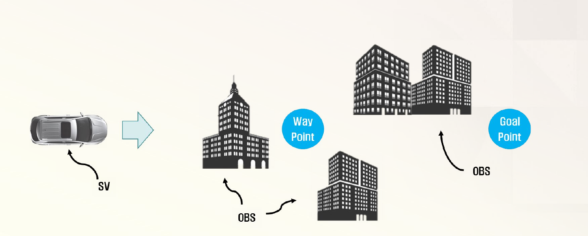

*그림 14. 자차(SV)가 건물 같은 장애물(OBS) 사이로 웨이포인트를 거쳐 목표 지점에 가야 하는 상황*

3절의 A\*가 찾는 경로는 격자 칸의 중심을 잇는 꺾인 선이다. 칸에서 칸으로 90°나 45° 꺾이는 경로는 1.2절의 최소 회전 반경 때문에 차량이 그대로 따라갈 수 없다. **Hybrid A\* 알고리즘**은 기존의 A\* 기법에 차량의 거동 특성을 고려하여, 차량이 실제로 주행할 수 있는 최적 경로를 만드는 기법이다. 그림 14는 이 절에서 다룰 상황이다. 자차(SV, subject vehicle)가 건물 같은 장애물(OBS) 사이를 지나, 중간 지점인 웨이포인트(way point)를 거쳐 목표 지점(goal point)에 가야 한다.

Hybrid A\*라는 이름은 이산적인 격자와 연속적인 차량 상태를 함께(hybrid) 쓰는 데서 왔다 [7], [8].

- **연속 상태:** 각 노드는 칸의 중심이 아니라 차량의 실제 연속 상태 $(x, y, \theta)$를 가진다.
- **운동 기본 요소(motion primitive):** 노드를 확장할 때 이웃 칸으로 곧장 옮기는 대신, 몇 가지 조향각(예: 왼쪽 최대, 0, 오른쪽 최대)으로 일정한 거리만큼 차량을 움직여 본 결과를 후보 노드로 만든다. 1.2절의 자전거 모델을 따르는 원호이므로, 후보로 가는 길은 항상 차량이 달릴 수 있다.
- **이산 격자로 중복 제거:** 연속 상태는 무한히 많으므로, $(x, y, \theta)$를 일정한 간격으로 나눈 3차원 격자의 칸마다 상태를 하나만 남긴다. 후보가 이미 다른 상태가 있는 칸에 떨어지면 비용이 더 작은 쪽만 남긴다.

조향각 $\delta$로 호의 길이 $s$만큼 움직이면, 회전 반지름은 $R = L / \tan\delta$이고 방향은 $\Delta\theta = s / R$만큼 바뀐다. 처음 상태가 $(x, y, \theta)$이면 후보 노드의 상태는 다음과 같다($\delta = 0$이면 직진하여 $`(x + s\cos\theta, \; y + s\sin\theta, \; \theta)`$이다).

```math
x' = x + R\left( \sin(\theta + \Delta\theta) - \sin\theta \right), \qquad
y' = y - R\left( \cos(\theta + \Delta\theta) - \cos\theta \right), \qquad
\theta' = \theta + \Delta\theta
```

> **참고:** 칸마다 상태를 하나만 남기는 방식 때문에, 버려진 상태로만 갈 수 있는 경로가 있으면 그 경로를 놓칠 수 있다. 그래서 Hybrid A\*는 격자 A\*와 달리 최단 경로를 보장하지 않는다. 대신 찾은 경로는 차량이 따라갈 수 있고, 실제로는 최적에 가까운 경로를 얻는다는 것이 Dolgov 등의 보고이다 [8]. 그들은 또한 휴리스틱으로 장애물을 무시하고 차량의 회전 제약만 고려한 최단 거리(Reeds-Shepp 곡선의 길이 [9])와, 회전 제약을 무시하고 장애물만 고려한 최단 거리(격자에서 Dijkstra로 구한 거리) 가운데 큰 값을 쓰고, 탐색 도중에 목표까지 Reeds-Shepp 곡선을 이어 볼 수 있으면 바로 탐색을 끝내는 방법을 썼다.

### 4.2 실제 이동 비용 G(n)

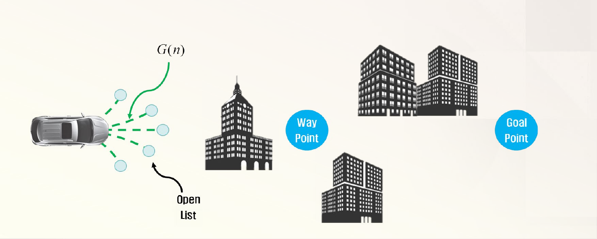

*그림 15. 자차에서 뻗어 나간 후보 노드들(열린 목록)과 실제 이동 비용 G(n)*

그림 15에서 자차 앞으로 다섯 갈래의 점선 끝에 있는 작은 원들이 서로 다른 조향각으로 만든 후보 노드이며, 이들이 열린 목록에 들어간다. 비용 함수는 A\*와 같은 $F(n) = G(n) + H(n)$이고, 실제 이동 비용은 다음과 같다.

```math
G(n) = (\text{시작 노드부터 현재 노드 } n \text{까지의 실제 이동 거리}) \times K_{\delta}
```

$K_{\delta}$는 직선 주행을 우선시하기 위한 조정 계수(tuning factor)로, 직선으로 움직일 때 $K_{\delta} = 1$, 곡선으로 움직일 때 $K_{\delta} > 1$이다. 같은 거리를 움직여도 조향한 이동을 더 비싸게 쳐서, 필요하지 않으면 조향하지 않는 부드러운 경로를 고르게 한다. 조향을 크게 할수록 $K_{\delta}$를 더 크게 두면 급한 회전을 더 피한다. 실제 구현에서는 이 밖에 전진과 후진이 바뀌는 이동에도 벌점을 준다(5절의 `reverse_weight`).

### 4.3 휴리스틱 비용 H(n)

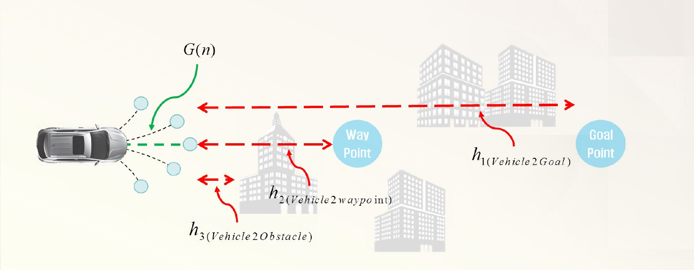

*그림 16. 후보 노드에서 목표 지점, 웨이포인트, 장애물까지의 휴리스틱 항*

휴리스틱 비용은 세 항의 가중합이다.

```math
H(n) = \alpha_h \cdot h_1(\text{Vehicle2Goal}) + \beta_h \cdot h_2(\text{Vehicle2Waypoint}) + \gamma_h \cdot h_3(\text{Vehicle2Obstacle})
```

$\alpha_h$, $\beta_h$, $\gamma_h$는 각 휴리스틱 항의 조정 계수이다. 그림 16의 빨간 점선 화살표가 각 항이 재는 거리이다.

| 항 | 정의 | 역할 |
|:-----|:-----|:-----|
| $h_1$ (Vehicle2Goal) | 후보 노드의 차량 위치부터 목표 웨이포인트(Goal Point)까지의 유클리드 거리 | 최종 목표 쪽으로 탐색을 이끈다 |
| $h_2$ (Vehicle2Waypoint) | 후보 노드의 차량 위치부터 다음 웨이포인트까지의 유클리드 거리 | 전역 경로가 정한 중간 지점을 차례로 거치게 한다 |
| $h_3$ (Vehicle2Obstacle) | 후보 노드의 차량 위치부터, 차량이 그대로 직진하면 충돌할 수 있는 장애물까지의 유클리드 거리의 역수에 $K_{\text{scale}}$을 곱한 값 | 장애물에 가까워지는 후보에 벌점을 주어 장애물에서 떨어진 경로를 고르게 한다 |

*표 9. Hybrid A\*의 휴리스틱 항*

$h_3 = K_{\text{scale}} / d_{\text{obs}}$는 장애물까지의 거리 $d_{\text{obs}}$가 줄어들수록 빠르게 커진다. 예를 들어 $K_{\text{scale}} = 20$이면 장애물이 10 m 앞에 있을 때 2, 5 m 앞이면 4, 2 m 앞이면 10이다. 직진 경로 위에 장애물이 없으면 이 항은 0이다.

> **주의:** 이 $H(n)$은 3.6절의 의미로 허용적이지 않다. $h_2$와 $h_3$은 목표까지 남은 비용이 아니라 웨이포인트를 지나게 하고 장애물을 피하게 하는 벌점이므로, 남은 비용을 과대평가할 수 있다. 따라서 이 비용 함수로 찾은 경로는 거리로 따진 최단 경로라는 보장이 없다. 대신 계수 $\alpha_h$, $\beta_h$, $\gamma_h$, $K_{\delta}$를 조정하여 짧은 경로, 웨이포인트 추종, 장애물과의 여유, 조향의 부드러움 사이의 균형을 정한다. 3.6절의 가중 A\*처럼 최적성을 양보하고 실용적인 경로를 얻는 설계이다.

### 4.4 후속 노드 선택과 경로 탐색

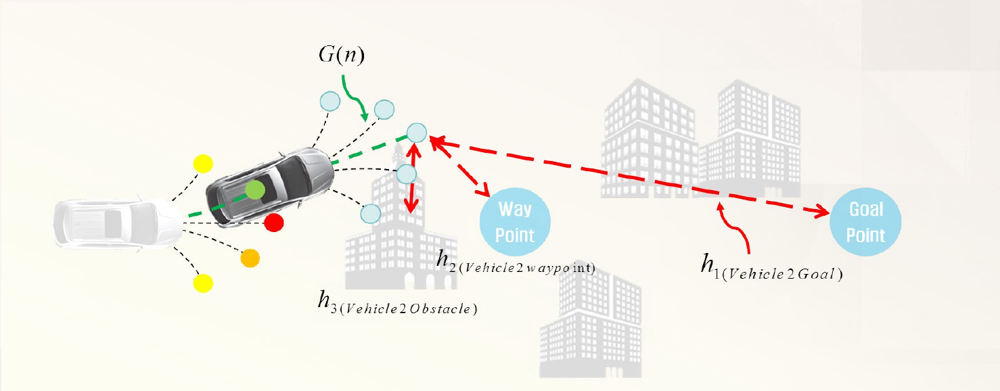

*그림 17. 후보 노드의 비용을 계산하여 가장 작은 노드를 다음 후속 노드로 고른 모습*

탐색은 다음을 되풀이한다.

1. 각 후보 노드에 대하여 비용 함수 $F(n) = G(n) + H(n)$을 계산한다.
2. 가장 작은 비용 함수 값을 갖는 노드를 다음 **후속 노드(successor)** 로 고른다.
3. 고른 후속 노드에서 다시 후보 노드를 만들고 앞의 과정을 되풀이한다.

그림 17에서 흐린 차량은 이전 위치이고, 그 앞의 노란색, 주황색, 빨간색 원은 이전 단계의 후보들이다. 이 가운데 비용이 가장 작은 후보(초록 점)가 후속 노드가 되어 차량이 그 위치로 옮겨졌고, 그 자리에서 다시 다섯 갈래의 후보를 만들었다. 새 후보 가운데 하나에 대해 $G(n)$(초록 점선), $h_1$, $h_2$, $h_3$(빨간 화살표)이 표시되어 있다.

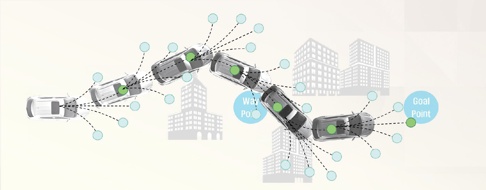

*그림 18. 후속 노드 선택을 되풀이하여 목표 웨이포인트까지 만든 경로*

그림 18은 이 과정을 되풀이하여 목표 웨이포인트(Goal Point)까지 경로를 만든 결과이다. 각 단계의 차량 위치(초록 점)가 이어져 경로가 되고, 차량은 건물 사이를 지나 웨이포인트 근처를 거쳐 목표에 이른다. 각 구간이 조향각을 정한 원호이므로, 경로 전체가 차량의 최소 회전 반경을 지킨다.

> **참고:** 위 절차는 현재 노드의 후보들 가운데 가장 싼 것으로 나아가는 것처럼 보이지만, A\*의 틀에서 다음에 확장할 노드는 현재 노드의 후보만이 아니라 열린 목록 전체에서 $F$가 가장 작은 노드이다. 새로 만든 후보들이 모두 장애물에 막히거나 비용이 커지면, 탐색은 예제 1의 8단계처럼 이전 단계에서 열어 둔 다른 후보로 돌아가 거기서 다시 뻗어 나간다. 장애물이 없는 넓은 곳에서는 대개 가장 최근의 후보가 가장 싸므로, 결과적으로 위 절차와 같은 모양이 된다.

### 4.5 계산 예: 후보 노드의 비용 비교

다음 값으로 한 단계의 후보 비용을 직접 계산한다. 모든 값은 설명을 위해 정한 것이다.

- **차량:** 위치 $(0, 0)$, 방향 $\theta = 0°$(오른쪽), 축간거리 $L = 2.7$ m.
- **후보:** 조향각 $\delta \in \lbrace20°, 10°, 0°, -10°, -20°\rbrace$(양수가 왼쪽)로 호의 길이 $s = 3$ m만큼 움직인 다섯 노드.
- **비용 계수:** $K_{\delta}$는 $\vert\delta\vert = 0°, 10°, 20°$에서 각각 1.0, 1.1, 1.2이다. $\alpha_h = 1$, $\beta_h = 0.5$, $\gamma_h = 1$, $K_{\text{scale}} = 20$이다.
- **환경:** 목표 $(30, 6)$, 웨이포인트 $(12, 3)$, 반지름 1 m의 원형 장애물이 $(9, 0)$에 있다. 후보 노드에서 그 방향으로 그은 직선이 장애물의 원과 만나면 표 9에서 말한 직진하면 충돌할 수 있는 장애물로 보고, $d_{\text{obs}}$는 후보 노드에서 장애물 중심까지의 거리로 한다.

$\delta = 10°$인 후보를 단계별로 계산하면 다음과 같다.

1. **회전 반지름과 방향 변화:** $R = 2.7 / \tan 10° = 2.7 / 0.17633 = 15.31$ m이고, $\Delta\theta = s / R = 3 / 15.31 = 0.1959$ rad $= 11.23°$이다.
2. **후보의 위치:** $\theta = 0$이므로 4.1절의 식은 $x' = R \sin\Delta\theta$, $y' = R(1 - \cos\Delta\theta)$가 된다. $x' = 15.31 \times 0.1947 = 2.981$, $y' = 15.31 \times (1 - 0.9809) = 0.293$이다.
3. **G:** $G = 3 \times 1.1 = 3.3$이다.
4. **$h_1$:** $\sqrt{(30 - 2.981)^2 + (6 - 0.293)^2} = \sqrt{730.0 + 32.6} = 27.615$이다.
5. **$h_2$:** $\sqrt{(12 - 2.981)^2 + (3 - 0.293)^2} = \sqrt{81.3 + 7.3} = 9.417$이다.
6. **$h_3$:** 후보의 방향(11.23°)으로 그은 직선과 장애물 중심 사이의 수직 거리는 약 1.46 m로, 장애물의 반지름 1 m보다 크다. 직진해도 충돌하지 않으므로 $h_3 = 0$이다.
7. **H와 F:** $H = 1 \times 27.615 + 0.5 \times 9.417 + 1 \times 0 = 32.324$이고, $F = 3.3 + 32.324 = 35.624$이다.

다섯 후보를 모두 계산하면 다음과 같다.

| 후보 | $\delta$ | 위치 $(x', y')$ | $\theta'$ | $G$ | $h_1$ | $h_2$ | $h_3$ | $H$ | $F$ |
|:-----|:-----|:-----|:-----|:-----|:-----|:-----|:-----|:-----|:-----|
| (1) | $20°$ | $(2.919, 0.598)$ | $23.17°$ | 3.6 | 27.615 | 9.393 | 0 | 32.311 | 35.911 |
| (2) | $10°$ | $(2.981, 0.293)$ | $11.23°$ | 3.3 | 27.615 | 9.417 | 0 | 32.324 | **35.624** |
| (3) | $0°$ | $(3.000, 0.000)$ | $0°$ | 3.0 | 27.659 | 9.487 | 3.333 | 35.735 | 38.735 |
| (4) | $-10°$ | $(2.981, -0.293)$ | $-11.23°$ | 3.3 | 27.742 | 9.601 | 0 | 32.543 | 35.843 |
| (5) | $-20°$ | $(2.919, -0.598)$ | $-23.17°$ | 3.6 | 27.873 | 9.768 | 0 | 32.757 | 36.357 |

*표 10. 다섯 후보 노드의 비용*

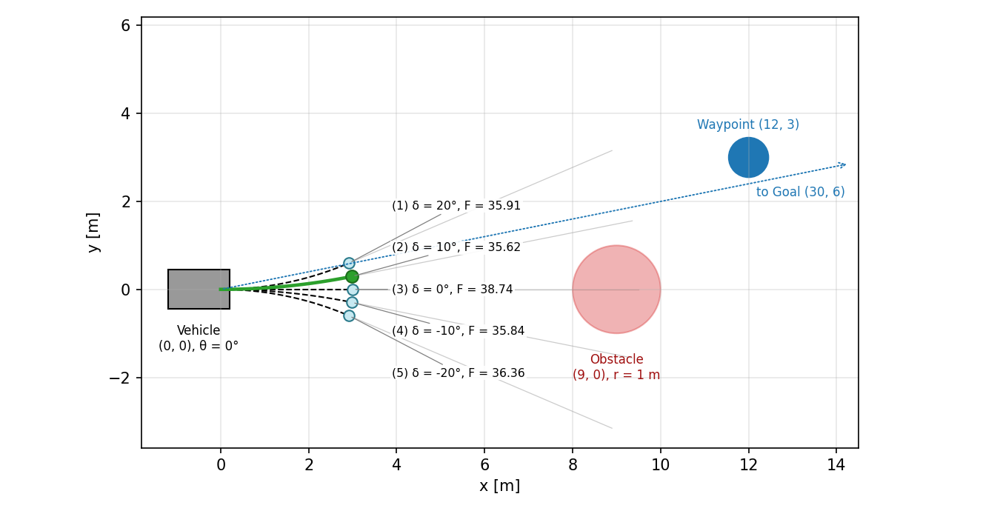

*그림 19. 다섯 후보 노드의 원호와 비용, 선택된 후보(초록)*

결과를 해석하면 다음과 같다.

- **직진 후보(3)는 가장 짧지만 선택되지 않는다.** $G = 3.0$으로 가장 작지만, 직진하면 6 m 앞의 장애물에 부딪히므로 $h_3 = 20 / 6 = 3.333$의 벌점을 받아 $F$가 가장 크다.
- **완만한 왼쪽 후보(2)가 선택된다.** 목표와 웨이포인트가 모두 왼쪽 위에 있으므로 왼쪽 후보들의 $H$가 작다. (1)은 목표 쪽으로 더 많이 돌지만, 큰 조향의 벌점($`K_{\delta} = 1.2`$) 때문에 $G$가 0.3 커서 (2)보다 비싸다.
- **조정 계수가 결과를 바꾼다.** 예를 들어 $K_{\delta}$를 모든 조향에서 1로 두면 (1)의 $F$는 $3.0 + 32.311 = 35.311$, (2)의 $F$는 $3.0 + 32.324 = 35.324$가 되어 더 크게 도는 (1)이 선택된다. 계수를 바꾸면 같은 상황에서도 다른 경로가 나오므로, 원하는 주행 성격에 맞게 계수를 조정해야 한다.

### 4.6 경로 평활화와 이후 단계

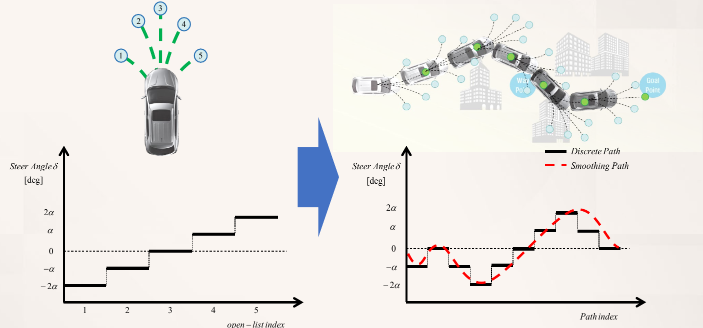

*그림 20. 다섯 후보의 이산 조향각(왼쪽)과, 그 조향각으로 만든 경로의 계단 모양 조향각 및 평활화한 조향각(오른쪽)*

Hybrid A\*의 후보는 정해진 몇 개의 조향각($-2\alpha$, $-\alpha$, $0$, $\alpha$, $`2\alpha`$)으로만 만들어진다. 그림 20의 왼쪽 그래프는 후보 번호 1\~5에 대응하는 조향각이 계단 모양으로 나뉘어 있음을 보이고, 오른쪽 그래프는 그렇게 만든 경로를 따라갈 때 경로의 각 지점에서 필요한 조향각이다. 검은 실선(Discrete Path)은 구간마다 조향각이 갑자기 바뀌는 계단 모양이다. 차량은 조향각을 순간적으로 바꿀 수 없으므로 이런 이산적인 경로는 추종하기 어렵다. 그래서 빨간 점선(Smoothing Path)처럼 조향각, 즉 경로의 곡률이 연속적으로 바뀌도록 경로를 다듬는 **경로 평활화(path smoothing)** 가 필요하다. Dolgov 등은 장애물과의 거리, 경로의 매끄러움, 곡률의 한계를 항으로 하는 비용 함수를 경사 기반 최적화로 줄여 경로를 평활화하였다 [8].

평활화한 경로의 결과, 곡률 반경에 따른 속도 프로파일, 장애물 회피를 위한 swerve와 nudge는 11주차 1.2\~1.4절에서 다룬다.

---

<br>

## 5. Autoware의 경로 계획 노드

Autoware.ai의 Runtime Manager에서 경로 계획 노드는 Computing 탭의 오른쪽에 모여 있다. Mission Planning은 목적지까지의 전역 경로를, Motion Planning은 실제로 따라갈 지역 경로와 속도를 만든다 [10].

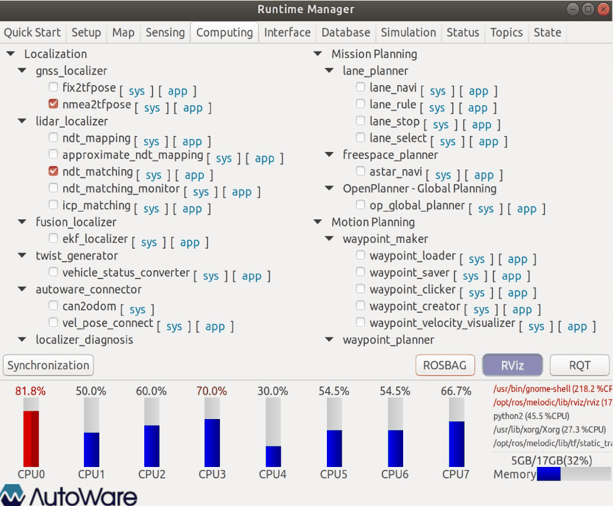

*그림 21. Computing 탭의 Mission Planning과 Motion Planning 노드 목록*

| 구분 | 패키지 | 노드 | 하는 일 |
|:-----|:-----|:-----|:-----|
| Mission Planning | `lane_planner` | `lane_navi` | 벡터 지도의 차선 위에서 목적지까지의 경로를 만든다 |
| Mission Planning | `lane_planner` | `lane_rule`, `lane_stop`, `lane_select` | 신호와 정지선에 맞게 경로의 속도를 정하고 주행할 차선을 고른다(3주차 5절) |
| Mission Planning | `freespace_planner` | `astar_navi` | 장애물 격자 지도(costmap) 위에서 Hybrid A\*로 전역 경로를 만든다. 주차장처럼 차선이 없는 공간에 쓴다 |
| Mission Planning | OpenPlanner | `op_global_planner` | 벡터 지도의 도로망 그래프에서 거리를 비용으로 하는 최단 경로를 만든다 |
| Motion Planning | `waypoint_maker` | `waypoint_loader` 등 | 저장한 웨이포인트를 불러오거나 만든다(3주차 4절) |
| Motion Planning | `waypoint_planner` | `astar_avoid` | 경로 위에 장애물이 있으면 Hybrid A\*로 회피 경로를 만든다 |
| Motion Planning | `waypoint_planner` | `velocity_set` | 경로 위의 장애물에 맞추어 목표 속도를 정한다(3주차 5절) |

*표 11. Autoware.ai의 주요 경로 계획 노드*

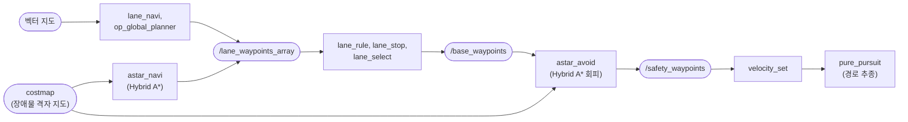

*그림 22. Autoware.ai에서 전역 경로 계획부터 경로 추종까지의 흐름 (사각형은 노드, 둥근 상자는 토픽이나 지도)*

`lane_navi`나 `op_global_planner`가 만든 전역 경로(`/lane_waypoints_array`)는 신호와 차선 처리를 거쳐 `/base_waypoints`가 된다. `astar_avoid`는 평소에는 이 경로를 그대로 넘기다가(Relay 모드), 회피 기능을 켠 상태에서 경로 위에 장애물이 있으면 Hybrid A\*로 장애물을 피하는 경로를 다시 계획하여 `/safety_waypoints`로 발행한다(Avoidance 모드). 이후 `velocity_set`이 속도를 정하고 `pure_pursuit`가 경로를 따라간다(3주차 6절).

`astar_navi`와 `astar_avoid`가 함께 쓰는 Hybrid A\* 구현(`astar_search` 패키지)의 주요 매개변수와 기본값은 다음과 같다. 4절의 개념이 실제 구현에 어떻게 나타나는지 볼 수 있다.

| 매개변수 | 기본값 | 의미와 4절과의 관계 |
|:-----|:-----|:-----|
| `minimum_turning_radius` | 6.0 m | 후보 노드를 만드는 원호의 반지름(1.2절의 $`R_{\min}`$) |
| `theta_size` | 48 | 방향 $\theta$를 나누는 칸의 수. $360° / 48 = 7.5°$마다 상태를 하나씩 남긴다 |
| `use_back` | true | 후진하는 운동 기본 요소도 후보로 쓸지 여부 |
| `reverse_weight` | 2.00 | 전진과 후진이 바뀌는 이동의 비용에 곱하는 벌점 |
| `distance_heuristic_weight` | 1.0 | 목표까지의 유클리드 거리 휴리스틱에 곱하는 가중치($\alpha_h$에 해당) |
| `use_potential_heuristic`, `potential_weight` | true, 10.0 | costmap의 장애물 비용에 가중치를 곱하여 비용에 더한다(장애물 항 $h_3$과 같은 역할) |
| `robot_length`, `robot_width` | 4.5 m, 1.75 m | 충돌 검사에 쓰는 차량의 크기 |
| `time_limit` | 5000 ms | 이 시간 안에 경로를 찾지 못하면 탐색을 멈춘다 |

*표 12. Autoware.ai `astar_search`의 주요 매개변수*

이 구현은 방향 한 칸의 각 $\Delta\theta = 2\pi / 48$만큼 최소 회전 반경의 원을 따라 도는 원호를 후보로 쓰므로, 한 번에 움직이는 거리는 $s = R_{\min} \Delta\theta = 6.0 \times 2\pi / 48 \approx 0.785$ m이다. 후보는 직진, 왼쪽 최대 조향, 오른쪽 최대 조향의 셋이고, `use_back`을 켜면 같은 세 가지의 후진이 더해진다.

---

<br>

## 개념 적용

| 상황 | 분석 |
|:-----|:-----|
| 주차장 지도에서 격자 A\*로 찾은 경로를 차량에 그대로 주었더니, 칸이 꺾이는 곳마다 차량이 경로를 크게 벗어났다. | **비홀로노믹 제약을 무시한 경로이다.** 격자 A\*의 경로는 한 칸에서 90°나 45° 꺾이지만 차량은 최소 회전 반경보다 작게 돌 수 없다. 운동 기본 요소로 후보를 만드는 Hybrid A\*를 쓰거나 경로를 평활화해야 한다. |
| 넓은 도시 지도에서 Dijkstra 알고리즘으로 목적지 경로를 구하는 데 시간이 오래 걸린다. | **목표 방향을 모르는 탐색이다.** Dijkstra 알고리즘은 모든 방향으로 고르게 퍼진다. 직선거리 같은 허용적 휴리스틱을 쓰는 A\*로 바꾸면 같은 최단 경로를 더 적은 노드 확장으로 찾는다. |
| 여덟 방향 격자에서 휴리스틱으로 맨해튼 거리를 썼더니 가끔 최단이 아닌 경로가 나온다. | **허용적이지 않은 휴리스틱이다.** 대각선 한 칸(비용 14)을 20으로 어림하므로 남은 비용을 과대평가할 수 있다. 대각 거리처럼 허용적인 휴리스틱을 쓰면 최단 경로가 보장된다. |
| Hybrid A\*로 만든 경로가 장애물에 너무 가깝게 붙어 지나간다. | **장애물 항의 가중치가 작다.** $\gamma_h$나 $K_{\text{scale}}$을 키우면 장애물에 가까운 후보의 비용이 커져 여유 있는 경로를 고른다. 다만 너무 키우면 좁은 길을 지나지 못하고 크게 돌아갈 수 있다. |
| Hybrid A\* 경로가 직선 구간에서도 좌우로 조금씩 흔들린다. | **곡선 벌점 $K_{\delta}$가 작다.** 조향한 이동과 직진의 비용 차이가 작으면 미세한 휴리스틱 차이로 조향 후보가 선택된다. 곡선의 $K_{\delta}$를 키우면 직진을 우선한다. |

*표 13. 경로 계획의 사례 분석*

**T/F 점검:**

| 문장 | 판단과 근거 |
|:-----|:-----|
| A\*에서 $H = 0$으로 두면 Dijkstra 알고리즘과 같아진다. | **T.** 우선순위가 $F = G$가 되어 출발점에서의 거리 순서로 노드를 확장한다. |
| A\*는 목표 노드를 열린 목록에 처음 넣는 순간 탐색을 끝내도 최단 경로를 보장한다. | **F.** 처음 넣을 때의 비용보다 싼 경로가 남아 있을 수 있으므로, 목표를 열린 목록에서 꺼낼 때 끝내야 한다. |
| 허용적 휴리스틱 가운데 실제 비용에 가까운 것일수록 A\*의 확장 수가 줄어드는 경향이 있다. | **T.** 표 8에서 대각 거리(18)가 그보다 작은 체비쇼프 거리(20)보다 적게 확장하였다. |
| Hybrid A\*는 격자 A\*처럼 항상 최단 경로를 보장한다. | **F.** 격자 칸마다 연속 상태를 하나만 남기므로 경로를 놓칠 수 있고, 4.3절의 $H(n)$은 허용적이지도 않다. 대신 주행할 수 있는 경로를 준다. |
| 비홀로노믹 제약이 있는 차량은 갈 수 있는 위치와 방향의 범위가 줄어든다. | **F.** 비홀로노믹 제약은 한 순간에 움직일 수 있는 방향을 제한할 뿐이며, 전진, 후진, 조향을 조합하면 평행 주차처럼 원하는 형상에 이를 수 있다. |

---

<br>

## 요약

| 개념 | 핵심 요약 |
|:--------|:------------|
| 차량 경로 계획 | 현재 위치에서 목표 지점까지 승차감과 차량의 거동(비홀로노믹 제약)을 고려하여 주행 경로를 만드는 문제이다. |
| 비홀로노믹 제약 | 뒷바퀴가 옆으로 미끄러지지 않는다는 속도 제약 $\dot{x}\sin\theta - \dot{y}\cos\theta = 0$이며, 최소 회전 반경 $R_{\min} = L / \tan\delta_{\max}$를 만든다. |
| 전역과 지역 경로 계획 | 전역 경로 계획은 지도로 목표까지의 최적 경로를 찾고, 지역 경로 계획은 센서 정보로 주행 중의 장애물을 피하는 짧은 경로를 만든다. |
| Dijkstra 알고리즘 | 출발점에서의 거리 $G$가 작은 노드부터 확정하여 최단 경로를 찾지만, 목표 방향을 모르고 모든 방향으로 퍼진다. |
| 탐욕적 최선 우선 탐색 | 휴리스틱 $H$만으로 확장하여 빠르지만, 막다른 곳에 빠지거나 최단이 아닌 경로를 낸다. |
| A\* 알고리즘 | $F = G + H$가 가장 작은 노드를 열린 목록에서 꺼내 확장하고, 더 짧은 길을 찾으면 비용과 부모를 갱신하며, 목표를 꺼낼 때 끝난다. |
| 허용성과 일관성 | $h \le h^{\ast}$이면 허용적이라 최단 경로가 보장되고(닫힌 노드를 다시 여는 경우), $h(n) \le c(n, m) + h(m)$이면 일관적이라 확장한 노드를 다시 열 필요가 없다. |
| 휴리스틱의 선택 | 네 방향 이동에는 맨해튼 거리, 여덟 방향 이동에는 대각 거리가 정확한 허용적 휴리스틱이며, 가중 A\*는 최적성을 양보하고 속도를 얻는다. |
| Hybrid A\* | 노드가 연속 상태 $(x, y, \theta)$를 가지고, 조향각별 원호로 후보를 만들며, 3차원 격자로 중복을 없애 차량이 주행할 수 있는 경로를 찾는다. |
| Hybrid A\*의 비용 | $G$는 이동 거리에 곡선 벌점 $K_{\delta}$를 곱하고, $H$는 목표 거리, 웨이포인트 거리, 장애물 거리의 역수를 계수로 더한다. |
| 경로 평활화 | 이산 조향각으로 만든 계단 모양의 조향을 연속적으로 바꾸어 차량이 추종할 수 있게 하며, 이어서 속도 프로파일을 만든다. |
| Autoware의 경로 계획 | `lane_navi`, `op_global_planner`, `astar_navi`가 전역 경로를, `astar_avoid`와 `velocity_set`이 회피 경로와 속도를 정하며, Hybrid A\*는 `astar_search`가 구현한다. |

---

<br>

## 점검 문제

1. **최소 회전 반경:** 축간거리 $L = 3.0$ m, 최대 조향각 $\delta_{\max} = 35°$인 차량의 최소 회전 반경을 구하라. 이 차량이 폭 6 m인 도로에서 한 번에 유턴할 수 있는지 판단하라.

   <details>
   <summary>정답</summary>

   $R_{\min} = 3.0 / \tan 35° = 3.0 / 0.7002 \approx 4.28$ m이다. 한 번에 유턴하려면 지름 $2R_{\min} \approx 8.57$ m의 원을 그려야 하므로 폭 6 m의 도로에서는 한 번에 돌 수 없고, 전진과 후진을 섞은 방향 전환이 필요하다. 이 계산은 뒤 차축 중심의 궤적만 본 것이며, 실제로는 차체의 폭과 앞뒤 길이 때문에 더 넓은 공간이 필요하다.

   </details>

2. **전역과 지역 경로 계획:** 다음을 전역 경로 계획과 지역 경로 계획으로 나누라. (가) 출발 전에 목적지까지의 도로를 정한다. (나) 앞에 갑자기 정차한 차를 피해 옆 차선으로 옮긴다. (다) 공사로 막힌 도로를 알고 다른 도로로 경로를 다시 정한다.

   <details>
   <summary>정답</summary>

   (가)는 지도를 이용해 목표까지의 경로를 찾으므로 전역 경로 계획이다. (나)는 센서로 인식한 움직이는 장애물을 짧은 범위에서 피하므로 지역 경로 계획이다. (다)는 도로망 수준에서 목적지까지의 경로를 바꾸므로 전역 경로 계획의 재계획이다.

   </details>

3. **휴리스틱 계산:** 예제 2의 격자에서 칸 C3의 대각 거리 휴리스틱을 구하라(목표 E2).

   <details>
   <summary>정답</summary>

   C3에서 E2까지 $d_x = 2$, $d_y = 1$이므로 $H = 14 \times 1 + 10 \times (2 - 1) = 24$이다. 표 6의 C3 칸(58+24=82)과 같다.

   </details>

4. **A\* 추적:** 예제 1의 8단계에서 D7의 비용을 갱신하지 않았다면 어떤 일이 생기는가?

   <details>
   <summary>정답</summary>

   D7은 $G = 4$(부모 D6), $F = 12$로 남는다. D7을 거치는 모든 길이 실제보다 2만큼 비싸게 계산되고, 8단계 뒤에는 $F = 10$인 칸이 남지 않으므로 탐색은 $F = 12$인 칸들을 확장하게 된다. 결국 막다른 공간을 거치는 B7 → B6 → C6 → D6 → D7 → E7 → F7 → F6 → F5 → F4 → F3 → F2 → G2를 비용 12로 찾는다. 이는 최단 비용 10보다 크므로, 갱신 단계를 빠뜨리면 A\*가 최단 경로를 보장하지 못한다.

   </details>

5. **허용성:** 네 방향 이동 격자에서 $h(n) = 2 \times$(맨해튼 거리)를 쓰면 어떤 문제가 생기는가?

   <details>
   <summary>정답</summary>

   장애물이 없으면 남은 실제 비용은 맨해튼 거리와 같으므로, 그 두 배는 실제 비용을 과대평가하여 허용적이지 않다. 탐색은 목표 쪽으로 더 강하게 이끌려 확장 수가 줄 수 있지만, 최단이 아닌 경로를 낼 수 있다. 이는 가중치 $w = 2$인 가중 A\*와 같으므로, 찾은 경로의 비용은 최단 비용의 2배를 넘지 않는다.

   </details>

6. **일관성:** 휴리스틱이 일관적이면 A\*에서 한 번 닫힌 목록에 들어간 노드를 다시 열 필요가 없는 이유를 설명하라.

   <details>
   <summary>정답</summary>

   일관성 $h(n) \le c(n, m) + h(m)$에서 $F(m) = G(n) + c(n, m) + h(m) \ge G(n) + h(n) = F(n)$이므로, 경로를 따라갈수록 $F$가 줄지 않는다. 따라서 노드는 $F$가 커지는 순서로 확장되고, 어떤 노드를 처음 확장할 때 그 노드에 이르는 더 싼 경로는 이미 모두 확장되어 있다. 그래서 처음 확장할 때의 $G$가 최소이며, 나중에 더 싼 경로가 발견되는 일이 없다.

   </details>

7. **Hybrid A\*의 후보:** 차량이 $(0, 0)$, $\theta = 0°$에 있고 축간거리 $L = 2.7$ m이다. 조향각 $\delta = 30°$로 호의 길이 3 m만큼 움직인 후보의 위치와 방향을 구하라.

   <details>
   <summary>정답</summary>

   $R = 2.7 / \tan 30° = 2.7 / 0.5774 = 4.677$ m이고 $\Delta\theta = 3 / 4.677 = 0.6415$ rad $= 36.76°$이다. $x' = R\sin\Delta\theta = 4.677 \times 0.5984 = 2.798$ m, $y' = R(1 - \cos\Delta\theta) = 4.677 \times (1 - 0.8012) = 0.930$ m이므로, 후보는 $(2.798, 0.930)$에서 $36.76°$를 향한다.

   </details>

8. **비용 함수:** 4.5절의 계산 예에서 $\gamma_h = 0$으로 두면 어느 후보가 선택되는가? 이 결과가 뜻하는 바를 설명하라.

   <details>
   <summary>정답</summary>

   $h_3$이 빠지므로 직진 후보 (3)의 $F$는 $3.0 + 27.659 + 0.5 \times 9.487 = 35.402$가 되어, 다섯 후보 가운데 가장 작아진다((2)는 35.624). 즉 장애물 항이 없으면 6 m 앞의 장애물을 향해 직진하는 후보가 선택된다. 장애물에 대한 고려가 충돌 검사뿐이라면 장애물 바로 앞까지 다가간 뒤에야 피하게 되므로, $h_3$은 미리 장애물에서 떨어진 쪽으로 경로를 이끄는 역할을 한다.

   </details>

9. **최적성:** 4.2\~4.3절의 Hybrid A\* 비용 함수로 찾은 경로가 거리로 따진 최단 경로가 아닐 수 있는 이유를 두 가지 쓰라.

   <details>
   <summary>정답</summary>

   첫째, $H(n)$에 웨이포인트 항 $h_2$와 장애물 항 $h_3$이 더해져 있어 남은 비용을 과대평가할 수 있으므로 허용적이지 않다. 둘째, 연속 상태를 $(x, y, \theta)$ 격자의 칸마다 하나만 남기므로 버려진 상태로만 갈 수 있는 더 짧은 경로를 놓칠 수 있다. 여기에 $G$의 곡선 벌점 $K_{\delta}$도 거리 외의 기준을 더한다.

   </details>

10. **Autoware 구현:** `astar_search`의 기본값으로 후보 노드 사이의 이동 거리를 구하고, `theta_size`를 96으로 늘리면 무엇이 달라지는지 설명하라.

    <details>
    <summary>정답</summary>

    $s = R_{\min} \times 2\pi / 48 = 6.0 \times 0.1309 \approx 0.785$ m이다. `theta_size`를 96으로 늘리면 방향을 $3.75°$마다 나누므로 한 번의 이동 거리가 약 0.393 m로 줄고 방향을 더 세밀하게 구분한다. 경로가 더 정밀해지고 좁은 곳을 지날 가능성이 커지지만, 탐색할 상태의 수가 늘어 계산 시간이 길어진다.

    </details>

---

<br>

## 참고 문헌

1. S. M. LaValle, *Planning Algorithms*. Cambridge, U.K.: Cambridge Univ. Press, 2006.
2. E. W. Dijkstra, "A note on two problems in connexion with graphs," *Numerische Mathematik*, vol. 1, no. 1, pp. 269-271, 1959.
3. X. Xu, "PathFinding.js," GitHub repository. https://github.com/qiao/PathFinding.js
4. P. E. Hart, N. J. Nilsson, and B. Raphael, "A formal basis for the heuristic determination of minimum cost paths," *IEEE Trans. Syst. Sci. Cybern.*, vol. 4, no. 2, pp. 100-107, 1968.
5. I. Pohl, "Heuristic search viewed as path finding in a graph," *Artif. Intell.*, vol. 1, no. 3-4, pp. 193-204, 1970.
6. A. Kashcha, "ngraph.path: Path finding in a graph," GitHub repository. https://github.com/anvaka/ngraph.path
7. D. Dolgov, S. Thrun, M. Montemerlo, and J. Diebel, "Practical search techniques in path planning for autonomous driving," in *Proc. 1st Int. Symp. Search Techn. Artif. Intell. Robot. (STAIR-08)*, Chicago, IL, USA, 2008.
8. D. Dolgov, S. Thrun, M. Montemerlo, and J. Diebel, "Path planning for autonomous vehicles in unknown semi-structured environments," *Int. J. Robot. Res.*, vol. 29, no. 5, pp. 485-501, 2010.
9. J. A. Reeds and L. A. Shepp, "Optimal paths for a car that goes both forwards and backwards," *Pacific J. Math.*, vol. 145, no. 2, pp. 367-393, 1990.
10. Autoware Foundation, "core_planning: astar_search, freespace_planner, waypoint_planner, op_global_planner," GitHub repository, Autoware.ai. https://github.com/Autoware-AI/core_planning
