# Week 10 Lecture — Path Planning

[Repository Guide](../../README.md) | [English](Concepts_Lecture.md) | [한국어](Concepts_Lecture.ko.md)

> **Last Updated:** 2026-11-04

> **Learning Objectives:**
> 1. Define the vehicle path planning problem, and distinguish the meaning of non-holonomic constraints and the roles of global and local path planning
> 2. Treat a grid map as a graph and explain the differences among Dijkstra's algorithm, greedy best-first search, and the A\* algorithm in terms of their priority functions
> 3. Trace the open list, closed list, and cost updates of A\* step by step on grids with four-directional and diagonal movement
> 4. Define the admissibility and consistency of heuristics, and choose a heuristic that fits the movement model
> 5. Explain how Hybrid A\* builds drivable paths with a vehicle motion model and what each term of the cost functions G(n) and H(n) means, and compute the costs of candidate nodes
> 6. Explain the roles of Autoware's path planning nodes in global and local path planning

---

## Table of Contents

- [1. Vehicle Path Planning](#1-vehicle-path-planning)
  - [1.1 The Path Planning Problem](#11-the-path-planning-problem)
  - [1.2 Non-Holonomic Constraints](#12-non-holonomic-constraints)
  - [1.3 Global and Local Path Planning](#13-global-and-local-path-planning)
- [2. Basics of Graph Search](#2-basics-of-graph-search)
  - [2.1 Grid Maps and Graphs](#21-grid-maps-and-graphs)
  - [2.2 Dijkstra's Algorithm](#22-dijkstras-algorithm)
  - [2.3 Heuristics and Greedy Best-First Search](#23-heuristics-and-greedy-best-first-search)
- [3. The A\* Algorithm](#3-the-a-algorithm)
  - [3.1 The Cost Function F = G + H](#31-the-cost-function-f--g--h)
  - [3.2 Procedure of the Algorithm](#32-procedure-of-the-algorithm)
  - [3.3 Visualizing the Search Region](#33-visualizing-the-search-region)
  - [3.4 Example 1: A Grid with Four-Directional Movement](#34-example-1-a-grid-with-four-directional-movement)
  - [3.5 Example 2: A Grid with Diagonal Movement](#35-example-2-a-grid-with-diagonal-movement)
  - [3.6 Conditions on and Choice of Heuristics](#36-conditions-on-and-choice-of-heuristics)
  - [3.7 A\* on Road Networks](#37-a-on-road-networks)
- [4. The Hybrid A\* Algorithm](#4-the-hybrid-a-algorithm)
  - [4.1 Limits of Grid A\* and the Idea of Hybrid A\*](#41-limits-of-grid-a-and-the-idea-of-hybrid-a)
  - [4.2 Actual Travel Cost G(n)](#42-actual-travel-cost-gn)
  - [4.3 Heuristic Cost H(n)](#43-heuristic-cost-hn)
  - [4.4 Successor Selection and Path Search](#44-successor-selection-and-path-search)
  - [4.5 Worked Example: Comparing Candidate Node Costs](#45-worked-example-comparing-candidate-node-costs)
  - [4.6 Path Smoothing and Subsequent Steps](#46-path-smoothing-and-subsequent-steps)
- [5. Path Planning Nodes in Autoware](#5-path-planning-nodes-in-autoware)
- [Concept Applications](#concept-applications)
- [Summary](#summary)
- [Self-Check Questions](#self-check-questions)
- [References](#references)

---

<br>

## 1. Vehicle Path Planning

### 1.1 The Path Planning Problem

> **Definition:** **Vehicle path planning** is the problem of generating a driving path from the vehicle's current position to a given goal, taking into account passenger ride comfort and the motions the vehicle can actually make (non-holonomic constraints).

Path planning sits between localization (Week 9) and vehicle control (Weeks 11-12). Its inputs are the vehicle position found by localization, the goal set by the user, and obstacle information from the perception stage, and its output is the path for the vehicle controller to follow (and the control commands derived from it). Path planning is divided into **global path planning**, which builds the overall route, and **local path planning**, which avoids obstacles.

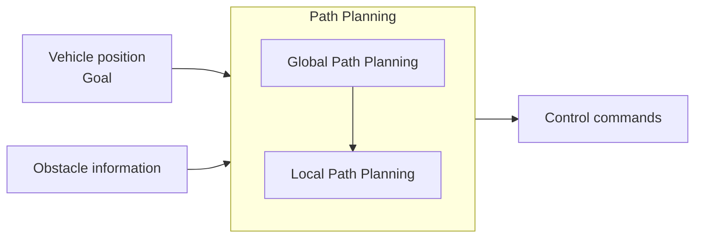

*Figure 1. Inputs, structure, and output of path planning*

### 1.2 Non-Holonomic Constraints

The collection of variables describing the state of a robot or vehicle is called its **configuration**, and the configuration of a vehicle driving on a plane is its position and orientation $\mathbf{q} = (x, y, \theta)$. Constraints on the configuration fall into two kinds [1].

> **Definition:** A **holonomic constraint** is a constraint that can be written as an equation $f(\mathbf{q}) = 0$ on the configuration itself, and it reduces the set of reachable configurations (for example, a train on rails). A **non-holonomic constraint** is a constraint on the velocity $\dot{\mathbf{q}}$ that cannot be integrated into a constraint on the configuration; it does not reduce the reachable configurations but restricts the directions in which the system can move at any instant.

If the rear wheels of a car are assumed to roll without slipping sideways, the velocity of the rear-axle center always points along the heading $\theta$ of the body. That is, the sideways component of the body's velocity is zero.

$$
\dot{x} \sin\theta - \dot{y} \cos\theta = 0
$$

The simplest motion model satisfying this is the bicycle model. With front-wheel steering angle $\delta$, distance between the front and rear axles (wheelbase) $L$, and speed $v$, it reads as follows (the detailed derivation of the bicycle model is covered in Week 12).

$$
\dot{x} = v \cos\theta, \qquad \dot{y} = v \sin\theta, \qquad \dot{\theta} = \frac{v}{L} \tan\delta
$$

Substituting the first two equations gives $\dot{x}\sin\theta - \dot{y}\cos\theta = v\cos\theta\sin\theta - v\sin\theta\cos\theta = 0$, so the constraint is satisfied. The configuration has three variables ($x, y, \theta$) but only two inputs ($v, \delta$) can be manipulated, so the vehicle cannot move directly sideways. Still, combining forward and reverse motion with steering lets it reach a desired configuration, as in parallel parking. This is what it means that the reachable configurations are not reduced while the directions of motion are restricted.

The steering angle has a limit $\delta_{\max}$, so the radius of the circle the vehicle drives has a lower bound. When turning with speed $v$ and angular velocity $\dot{\theta}$, the turning radius is $R = v / \dot{\theta} = L / \tan\delta$, so the **minimum turning radius** is as follows.

$$
R_{\min} = \frac{L}{\tan\delta_{\max}}
$$

For example, with $L = 2.7$ m and $\delta_{\max} = 30°$, $R_{\min} = 2.7 / \tan 30° = 2.7 / 0.5774 \approx 4.68$ m. If a path on a grid turns 90° at one cell, the vehicle would have to turn with radius 0 on the spot, so it cannot follow that path as it is. Hybrid A\* in Section 4 is a method for solving this problem.

### 1.3 Global and Local Path Planning

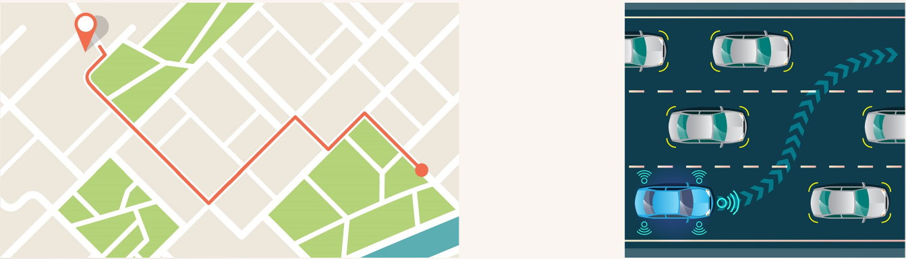

*Figure 2. Global route from the start to the destination on a map (left) and a local path changing lanes to avoid surrounding vehicles (right)*

| Aspect | Global path planning | Local path planning |
|:-----|:-----|:-----|
| Purpose | Searching for the optimal route from the current point to the goal | Responding to the many variables arising while driving |
| Obstacles considered | Only relatively large obstacles unlikely to change, such as buildings and natural terrain | All moving and stationary obstacles that may interfere with the path |
| Information used | Prebuilt maps (road network, vector map) | Surroundings perceived by sensors in real time |
| Planning range and rate | Long range up to the destination, recomputed at departure or after leaving the route | Short range of a few tens of meters ahead, recomputed repeatedly at a very short period |
| Example | A navigation route to the destination | Overtaking, lane changes, obstacle avoidance |

*Table 1. Comparison of global and local path planning*

The left of Figure 2 is a global route on a city map running along the roads from the start (red pin) to the destination (red dot), and the right is a local path in which the ego vehicle (blue car) moves into the next lane on a road with several vehicles. The two kinds of planning complement each other. With only global planning, the vehicle cannot respond to suddenly appearing obstacles; with only local planning, it avoids nearby obstacles but loses the overall direction to the destination. A hierarchical structure is therefore used: the global route serves as the overall guide, and local planning follows it while revising short sections to fit the surroundings.

---

<br>

## 2. Basics of Graph Search

### 2.1 Grid Maps and Graphs

Most path planning algorithms represent space as a **graph** and then find the path of least cost in the graph. A graph consists of nodes and edges connecting pairs of nodes, and each edge carries the cost (distance, time, and so on) of traversing it.

> **[Discrete Mathematics]** A graph $G = (V, E)$ consists of a set of nodes $V$ and a set of edges $E \subseteq V \times V$. A graph whose edges $(u, v)$ carry nonnegative costs $c(u, v)$ is called a weighted graph, and the cost of a path is the sum of the costs of the edges forming it.

A **grid map**, common in robotics, divides the plane into equal square cells and marks each cell as obstacle or free. Taking free cells as nodes and moves between neighboring cells as edges turns a grid map into a graph. Depending on the definition of neighbors, there are two movement models.

- **Four-directional movement:** Moves only to the four cells up, down, left, and right, with a cost of 1 (or 10) per move.
- **Eight-directional movement:** Also moves to the four diagonal cells. With a cell side of 1, a diagonal move covers $\sqrt{2} \approx 1.414$, so to compute with integers, straight moves are often given cost 10 and diagonal moves cost 14.

```text
  14   10   14
  10  [●]   10
  14   10   14
```

*Figure 3. Costs of moving from the center cell (●) to its neighbors under eight-directional movement*

### 2.2 Dijkstra's Algorithm

The classic method for finding the shortest paths from one node to all other nodes when all edge costs are nonnegative is **Dijkstra's algorithm** [2]. It finalizes nodes one by one in order of increasing distance $g(n)$ from the start node.

1. Set $g$ of the start node to 0 and $g$ of all other nodes to infinity.
2. Among the nodes not yet finalized, pick the node $n$ with the smallest $g$ and finalize it.
3. For each neighbor $m$ of $n$, if $g(n) + c(n, m) < g(m)$, reduce $g(m)$ to this value and record $n$ as the parent of $m$.
4. Repeat steps 2-3 until the goal node is finalized or no node remains to be finalized.

Once the goal node is finalized, the path is recovered by following the parents backward. Since edge costs are nonnegative, the $g$ of a finalized node can never decrease again, so the finalized $g$ is the shortest distance.

> **[Algorithms]** If a priority queue (binary heap) is used to extract the node with the smallest $g$ quickly in step 2, the time complexity of Dijkstra's algorithm on a graph with $\vert V \vert$ nodes and $\vert E \vert$ edges is $O((\vert V \vert + \vert E \vert) \log \vert V \vert)$.

Dijkstra's algorithm does not know where the goal lies and spreads evenly from the start in all directions. Even if the goal is far off to one side, it checks nodes on the opposite side in order of distance, so on a wide map the number of nodes checked becomes very large.

### 2.3 Heuristics and Greedy Best-First Search

To guide the search toward the goal, the remaining cost from each node to the goal must be estimated.

> **Definition:** A **heuristic** $h(n)$ is a quickly computed estimate of the remaining cost from node $n$ to the goal. On grid maps, the straight-line distance or grid distance ignoring obstacles is commonly used.

The method that orders the search by the heuristic alone, that is, expands the node with the smallest $h(n)$ first, is called **greedy best-first search**. It heads straight toward the goal, so it is very fast without obstacles, but since it ignores the cost already traveled, obstacles can make its detours long or trap it in dead ends. Examples from PathFinding.js [3], a web tool that visualizes grid search algorithms, show this problem.

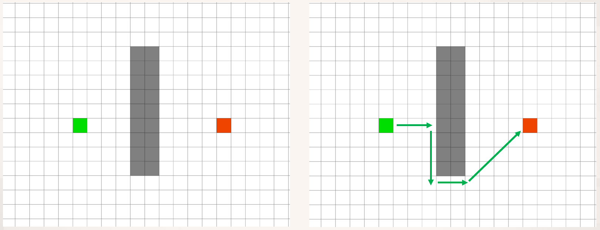

*Figure 4. Start (green) and goal (red) separated by a vertical wall, and a path going around the wall*

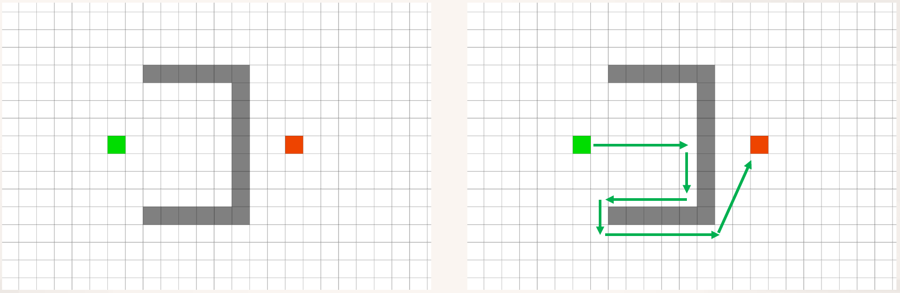

*Figure 5. A path heading straight toward the goal into a U-shaped obstacle, getting blocked, and coming back out*

The left of Figure 4 is a grid with a long vertical wall (gray) between the start (green) and the goal (red), and the right is a path that moves toward the goal until it reaches the wall, then follows the wall down, rounds its end, and goes to the goal. The obstacle in Figure 5 is U-shaped and open toward the start. Moving only in the direction of the goal enters the inside of the U and hits the wall, as shown by the arrows on the right, and only after moving down and back out to the left does the path round the bottom of the obstacle to reach the goal. This happens because the inner cells look best when judged only by the estimated distance to the goal. The A\* algorithm reduces this problem by considering both the cost traveled so far and the estimate of the remaining cost.

---

<br>

## 3. The A\* Algorithm

### 3.1 The Cost Function F = G + H

The **A\* algorithm** is a tree search algorithm that finds the shortest path from a given start to a destination [4]. Starting from the start point, it examines adjacent regions one after another and finds the cheapest path from the start to the goal. The cost $F$ of each node $n$ is the sum of two costs.

$$
F(n) = G(n) + H(n)
$$

| Symbol | Name | Meaning |
|:-----|:-----|:-----|
| $G(n)$ | Actual cost | Distance (cost) actually traveled from the start to node $n$ |
| $H(n)$ | Heuristic cost | Expected distance (cost) from node $n$ to the goal, usually computed ignoring obstacles |
| $F(n)$ | Total cost | Estimate of the cost of the whole path through $n$ |

*Table 2. Cost function of A\**

When exploring adjacent regions, a **heuristic estimate** that ranks each adjacent region by this cost is used to estimate good paths to the goal, and the adjacent regions are visited in that order. With $H = 0$, A\* is the same as Dijkstra's algorithm, and ignoring $G$ makes it the same as greedy best-first search. A\* lies in between: by considering both the distance already traveled and the estimate of the remaining distance, it is drawn toward the goal without straying onto excessively long routes. A\* is used in many fields that need path search, and it is also commonly used to generate the movement paths of characters and units in real-time strategy games.

### 3.2 Procedure of the Algorithm

A\* maintains two lists.

- **Open list:** Nodes discovered but not yet expanded, kept in a priority queue so that they can be extracted in order of increasing $F$.
- **Closed list:** Nodes whose expansion is complete.

To **expand** a node means to move it from the open list to the closed list and compute the costs of its neighbors. Each node remembers as its **parent** the preceding node through which it is reached most cheaply.

```text
A*(start, goal):
    G(start) ← 0,  parent(start) ← none
    OPEN ← {start},  CLOSED ← { }
    while OPEN is not empty:
        n ← node in OPEN with the smallest F(n) = G(n) + H(n)
        if n = goal:
            return the path recovered by following parent backward from goal
        remove n from OPEN and add it to CLOSED
        for each neighbor m of n (cells that are not obstacles):
            if m ∈ CLOSED: skip
            G' ← G(n) + c(n, m)
            if m ∉ OPEN:
                G(m) ← G',  parent(m) ← n,  add m to OPEN
            else if G' < G(m):
                G(m) ← G',  parent(m) ← n   (update because a shorter way was found)
    return failure (no path reaches the goal)
```

The important points of the procedure are as follows.

- **The goal test is done at extraction.** When the goal first enters the open list, a cheaper path may still remain. Only when the goal is extracted from the open list is its cost guaranteed to be minimal (Section 3.6).
- **Do not skip updates.** Even for a node already in the open list, $G$ and the parent must be corrected when a shorter way is found. Skipping this step yields paths that are not shortest (the caution in Section 3.5).
- **Tie-breaking.** When several nodes have the same $F$, the order of extraction must be decided. The examples in this note extract the node with the smaller $H$ (closer to the goal) first, and if $H$ is also equal, the node that entered first. Different tie-breaking rules give the same path cost, but the expansion order and the shape of the path may differ.

### 3.3 Visualizing the Search Region

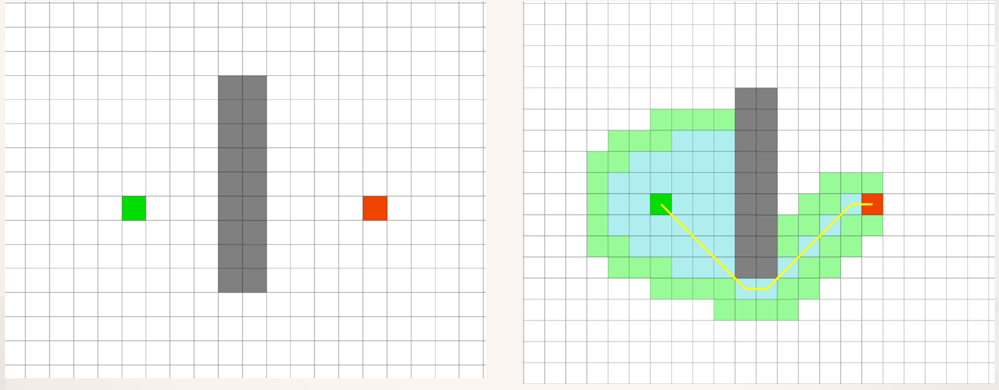

*Figure 6. Cells expanded by A\* (light blue), cells in the open list (light green), and the path found (yellow line) in the vertical wall example*

Figure 6 is the result of running A\* on the same map as Figure 4. Light blue is the closed list (expanded cells), light green is the open list (discovered but unexpanded cells), and the yellow line is the path found. The search starts around the start, spreads up and down in front of the wall, then rounds the lower end of the wall toward the goal. The wide regions to the upper and lower left, far from the goal, are not expanded, so fewer cells are checked than with Dijkstra's algorithm, which spreads evenly in all directions. The path found is the shortest path that grazes the lower end of the wall diagonally.

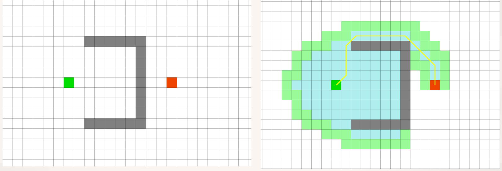

*Figure 7. Cells expanded by A\* and a path going around the top of the obstacle in the U-shaped obstacle example*

Figure 7 is the result for the U-shaped obstacle. A\* also first expands the cells inside the U toward the goal (the light blue region), because the inner cells have small $H$ and thus seem to have small $F$. However, the dead-end wall prevents going further inside, and once all inner cells have been expanded, the cell with the smallest $F$ in the open list becomes one outside the obstacle. In the end, A\* finds the shortest path (yellow line) going around the top of the obstacle to the goal. Unlike the path of Figure 5, the path does not include going into the dead end and back out. Many cells are expanded, but they are only traces of the search, not part of the path.

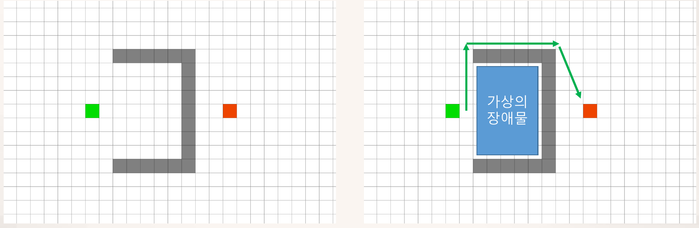

*Figure 8. A path going around the outside after filling the dead-end interior with a virtual obstacle*

If the dead-end space is known in advance, it can be filled with a **virtual obstacle** as in Figure 8. The search then never enters the interior, so far fewer cells are expanded, and the path goes around the outside of the obstacle over the top to the goal. Such preprocessing, which uses the shape of the map to remove useless regions before searching, is a common way to reduce search time.

### 3.4 Example 1: A Grid with Four-Directional Movement

Let us trace A\* by hand on the following grid. Cells are named by a column letter (A-H) and a row number (1-8).

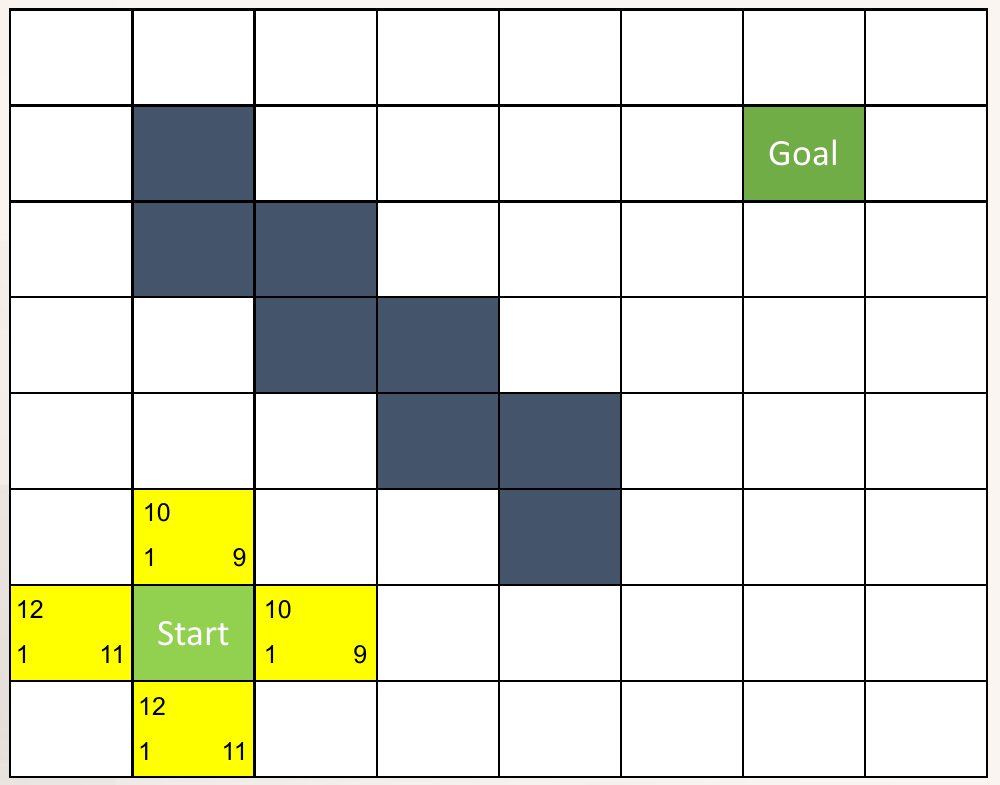

*Figure 9. Grid of Example 1 and the costs computed for the four neighbors of the start cell (Start)*

- **Map:** An 8×8 grid in which the dark cells B2, B3, C3, C4, D4, D5, E5, and E6 form a wall running from the upper left to the lower right. The start cell is B7 and the goal cell is G2.
- **Movement:** Moves only up, down, left, and right, at a cost of 1 per cell.
- **Heuristic:** The grid distance ignoring obstacles (Manhattan distance), $H = \vert \Delta\text{column} \vert + \vert \Delta\text{row} \vert$. For example, from the start cell B7 to G2 there are 5 columns and 5 rows, so $H = 10$.
- **Cell notation:** In the yellow cells of Figure 9, the number at the upper left is $F$, at the lower left $G$, and at the lower right $H$.

Figure 9 shows the result of the first step. Expanding the start cell B7 gives the following costs for its four neighbors.

- Up, B6: $G = 1$; to G2 there are 5 columns (B → G) and 4 rows (6 → 2), so $H = 5 + 4 = 9$ and $F = 10$.
- Right, C7: $G = 1$; there are 4 columns and 5 rows, so $H = 9$ and $F = 10$.
- Left, A7: $G = 1$; there are 6 columns and 5 rows, so $H = 11$ and $F = 12$.
- Down, B8: $G = 1$; there are 5 columns and 6 rows, so $H = 11$ and $F = 12$.

A cell one step toward the goal (up or right) has $H$ reduced by 1, so $F$ stays 10, while a cell one step the other way has $H$ increased by 1, so $F$ becomes 12. The rest of the process is shown in the following table (bold marks an update of a cell already in the open list to a smaller cost).

| Step | Expanded cell | G | H | F | Cells added to or updated in the open list (G+H=F) |
|:-----|:-----|:-----|:-----|:-----|:-----|
| 1 | B7 | 0 | 10 | 10 | B6 (1+9=10), C7 (1+9=10), B8 (1+11=12), A7 (1+11=12) |
| 2 | B6 | 1 | 9 | 10 | B5 (2+8=10), C6 (2+8=10), A6 (2+10=12) |
| 3 | B5 | 2 | 8 | 10 | B4 (3+7=10), C5 (3+7=10), A5 (3+9=12) |
| 4 | B4 | 3 | 7 | 10 | A4 (4+8=12) |
| 5 | C5 | 3 | 7 | 10 | None (every neighbor is an obstacle or already listed without a shorter path) |
| 6 | C6 | 2 | 8 | 10 | D6 (3+7=10) |
| 7 | D6 | 3 | 7 | 10 | D7 (4+8=12) |
| 8 | C7 | 1 | 9 | 10 | **D7 updated** (4+8=12 → 2+8=10), C8 (2+10=12) |
| 9 | D7 | 2 | 8 | 10 | E7 (3+7=10), D8 (3+9=12) |
| 10 | E7 | 3 | 7 | 10 | F7 (4+6=10), E8 (4+8=12) |
| 11 | F7 | 4 | 6 | 10 | F6 (5+5=10), G7 (5+5=10), F8 (5+7=12) |
| 12 | F6 | 5 | 5 | 10 | F5 (6+4=10), G6 (6+4=10) |
| 13 | F5 | 6 | 4 | 10 | F4 (7+3=10), G5 (7+3=10) |
| 14 | F4 | 7 | 3 | 10 | F3 (8+2=10), G4 (8+2=10), E4 (8+4=12) |
| 15 | F3 | 8 | 2 | 10 | F2 (9+1=10), G3 (9+1=10), E3 (9+3=12) |
| 16 | F2 | 9 | 1 | 10 | F1 (10+2=12), G2 (10+0=10), E2 (10+2=12) |
| 17 | G2 | 10 | 0 | 10 | Goal reached, search ends |

*Table 3. Expansion process of A\* in Example 1*

The process divides into the following phases.

1. **Exploring the dead end (steps 2-7).** B6, B5, B4, C5, C6, and D6 all have $F = 10$ and look like good ways to the goal. By the tie-breaking rule, cells with smaller $H$ are expanded first, so the search first enters the upper-left space. This space, however, is closed off by the wall and leads no further toward the goal. In step 7, D7, newly opened from D6, has $G = 4$ and $F = 12$, so the cost increases.
2. **Returning to an earlier region (step 8).** Now the cell with the smallest $F$ in the open list is C7 ($F = 10$), placed there in step 1. This behavior of A\* is exactly giving up a path that can go no further or whose cost increases, returning to an earlier region, and exploring another path of the next priority. From C7, D7 can be reached with $G = 1 + 1 = 2$, so the $G$ of D7 is updated from 4 to 2 and its parent from D6 to C7.
3. **Proceeding to the goal (steps 9-17).** From then on, the search follows cells with $F = 10$ to the right along row 7 and then up column F to the goal G2. The $G = 10$ when the goal is extracted is the cost of the shortest path.

The final state is as follows (bold marks expanded cells, ■ marks obstacles).

| | A | B | C | D | E | F | G | H |
|:-----|:-----|:-----|:-----|:-----|:-----|:-----|:-----|:-----|
| 1 |  |  |  |  |  | 10+2=12 |  |  |
| 2 |  | ■ |  |  | 10+2=12 | **9+1=10** | **Goal 10+0=10** |  |
| 3 |  | ■ | ■ |  | 9+3=12 | **8+2=10** | 9+1=10 |  |
| 4 | 4+8=12 | **3+7=10** | ■ | ■ | 8+4=12 | **7+3=10** | 8+2=10 |  |
| 5 | 3+9=12 | **2+8=10** | **3+7=10** | ■ | ■ | **6+4=10** | 7+3=10 |  |
| 6 | 2+10=12 | **1+9=10** | **2+8=10** | **3+7=10** | ■ | **5+5=10** | 6+4=10 |  |
| 7 | 1+11=12 | **Start 0+10=10** | **1+9=10** | **2+8=10** | **3+7=10** | **4+6=10** | 5+5=10 |  |
| 8 |  | 1+11=12 | 2+10=12 | 3+9=12 | 4+8=12 | 5+7=12 |  |  |

*Table 4. Final state of Example 1 (each cell shows G+H=F)*

```text
    A  B  C  D  E  F  G  H
1   .  .  .  .  .  o  .  .
2   .  #  .  .  o  *  T  .
3   .  #  #  .  o  *  o  .
4   o  x  #  #  o  *  o  .
5   o  x  x  #  #  *  o  .
6   o  x  x  x  #  *  o  .
7   o  S  *  *  *  *  o  .
8   .  o  o  o  o  o  .  .
```

*Figure 10. Result of Example 1 (S start, T goal, # obstacle, * path, x expanded but not on the path, o left in the open list)*

Following the parents backward gives the path B7 → C7 → D7 → E7 → F7 → F6 → F5 → F4 → F3 → F2 → G2 with cost 10. Two things are worth noting.

- **Every expanded cell has F = 10.** The shortest cost of this example is $C^{\ast} = 10$, and A\* finishes after expanding all cells with $F < C^{\ast}$ and some cells with $F = C^{\ast}$. Not a single cell with $F = 12$ was expanded.
- **The shortest path is not unique.** For example, going F4 → G4 → G3 → G2 also costs 10. A different tie-breaking rule or neighbor order can find a different path of the same cost.

### 3.5 Example 2: A Grid with Diagonal Movement

This time diagonal movement is allowed. Straight moves cost 10 and diagonal moves cost 14.

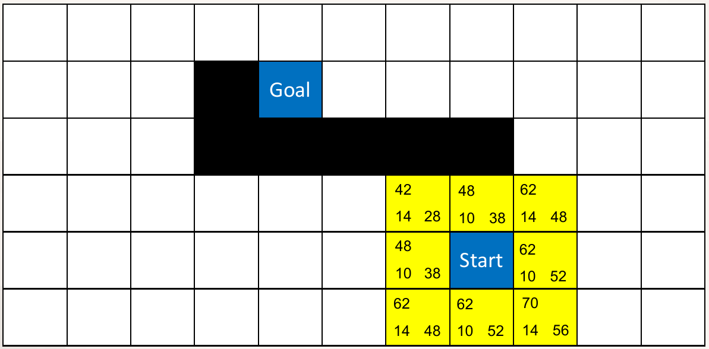

*Figure 11. Grid of Example 2 and the costs computed for the eight neighbors of the start cell*

- **Map:** An 11×6 grid (columns A-K, rows 1-6). The black cells D2 and D3-H3 form a wall shaped like an upside-down L, and the goal cell E2 lies inside above the wall. The start cell is H5, below the wall.
- **Heuristic:** The **octile distance**, the least cost of moving in eight directions when obstacles are ignored. With column difference $d_x$ and row difference $d_y$, it is cheapest to move diagonally for the shorter of the two and straight for the rest.

$$
H = 14 \min(d_x, d_y) + 10 \left( \max(d_x, d_y) - \min(d_x, d_y) \right)
$$

For example, from the start cell H5 to E2, $d_x = 3$ and $d_y = 3$, so $H = 14 \times 3 = 42$. G4, to the upper left of the start, has $G = 14$ (one diagonal move), $d_x = 2$, $d_y = 2$, so $H = 28$ and $F = 42$. I5, to the right, has $G = 10$, $d_x = 4$, $d_y = 3$, so $H = 14 \times 3 + 10 \times 1 = 52$ and $F = 62$. All eight cells in Figure 11 are computed this way.

| Step | Expanded cell | G | H | F | Cells added to or updated in the open list (G+H=F) |
|:-----|:-----|:-----|:-----|:-----|:-----|
| 1 | H5 | 0 | 42 | 42 | H4 (10+38=48), I4 (14+48=62), I5 (10+52=62), I6 (14+56=70), H6 (10+52=62), G6 (14+48=62), G5 (10+38=48), G4 (14+28=42) |
| 2 | G4 | 14 | 28 | 42 | F5 (28+34=62), F4 (24+24=48) |
| 3 | F4 | 24 | 24 | 48 | E5 (38+30=68), E4 (34+20=54) |
| 4 | H4 | 10 | 38 | 48 | I3 (24+44=68) |
| 5 | G5 | 10 | 38 | 48 | F6 (24+44=68), **F5 updated** (28+34=62 → 20+34=54) |
| 6 | E4 | 34 | 20 | 54 | D5 (48+34=82), D4 (44+24=68) |
| 7 | F5 | 20 | 34 | 54 | E6 (34+40=74), **E5 updated** (38+30=68 → 30+30=60) |
| 8 | E5 | 30 | 30 | 60 | D6 (44+44=88), **D5 updated** (48+34=82 → 40+34=74) |
| 9 | I4 | 14 | 48 | 62 | J3 (28+54=82), J4 (24+58=82), J5 (28+62=90) |
| 10 | G6 | 14 | 48 | 62 | None (every neighbor is an obstacle or already listed without a shorter path) |
| 11 | I5 | 10 | 52 | 62 | **J5 updated** (28+62=90 → 20+62=82), J6 (24+66=90) |
| 12 | H6 | 10 | 52 | 62 | None (every neighbor is an obstacle or already listed without a shorter path) |
| 13 | D4 | 44 | 24 | 68 | C5 (58+38=96), C4 (54+28=82), C3 (58+24=82) |
| 14 | I3 | 24 | 44 | 68 | I2 (34+40=74), J2 (38+50=88), H2 (38+30=68) |
| 15 | H2 | 38 | 30 | 68 | H1 (48+34=82), I1 (52+44=96), G2 (48+20=68), G1 (52+24=76) |
| 16 | G2 | 48 | 20 | 68 | F2 (58+10=68), F1 (62+14=76) |
| 17 | F2 | 58 | 10 | 68 | E2 (68+0=68), E1 (72+10=82) |
| 18 | E2 | 68 | 0 | 68 | Goal reached, search ends |

*Table 5. Expansion process of A\* in Example 2*

1. **Exploring under the wall (steps 2-8).** The goal is to the upper left, so G4 with $F = 42$ is expanded first, and the search moves left along the underside of the wall (toward F4, E4, D4). The wall blocks the way up, however, so the search cannot approach the goal, and the $F$ of the expanded cells grows 42 → 48 → 54 → 60.
2. **Clearing the area around the start (steps 9-12).** I4, G6, I5, and H6 with $F = 62$ are expanded. These cells lie away from the goal, so the cells they open have $F$ of 82 or more, and the search does not continue in that direction.
3. **Rounding the right end of the wall (steps 13-18).** Two cells, D4 and I3, have $F = 68$. In the tie, D4 with the smaller $H$ (24) is expanded first, but the cells it opens have $F$ of 82 or more. Expanding I3 next opens H2 above the wall with $F = 68$, and the search proceeds through H2 → G2 → F2 to extract the goal E2 with cost 68.

The final state and path are as follows.

| | A | B | C | D | E | F | G | H | I | J | K |
|:-----|:-----|:-----|:-----|:-----|:-----|:-----|:-----|:-----|:-----|:-----|:-----|
| 1 |  |  |  |  | 72+10=82 | 62+14=76 | 52+24=76 | 48+34=82 | 52+44=96 |  |  |
| 2 |  |  |  | ■ | **Goal 68+0=68** | **58+10=68** | **48+20=68** | **38+30=68** | 34+40=74 | 38+50=88 |  |
| 3 |  |  | 58+24=82 | ■ | ■ | ■ | ■ | ■ | **24+44=68** | 28+54=82 |  |
| 4 |  |  | 54+28=82 | **44+24=68** | **34+20=54** | **24+24=48** | **14+28=42** | **10+38=48** | **14+48=62** | 24+58=82 |  |
| 5 |  |  | 58+38=96 | 40+34=74 | **30+30=60** | **20+34=54** | **10+38=48** | **Start 0+42=42** | **10+52=62** | 20+62=82 |  |
| 6 |  |  |  | 44+44=88 | 34+40=74 | 24+44=68 | **14+48=62** | **10+52=62** | 14+56=70 | 24+66=90 |  |

*Table 6. Final state of Example 2 (each cell shows G+H=F)*

```text
    A  B  C  D  E  F  G  H  I  J  K
1   .  .  .  .  o  o  o  o  o  .  .
2   .  .  .  #  T  *  *  *  o  o  .
3   .  .  o  #  #  #  #  #  *  o  .
4   .  .  o  x  x  x  x  *  x  o  .
5   .  .  o  o  x  x  x  S  x  o  .
6   .  .  .  o  o  o  x  x  o  o  .
```

*Figure 12. Result of Example 2 (symbols as in Figure 10)*

The path is H5 → H4 → I3 → H2 → G2 → F2 → E2, with cost $10 + 14 + 14 + 10 + 10 + 10 = 68$. The way around the left end of the wall, H5 → G4 → F4 → E4 → D4 → C3 → C2 → D1 → E2, costs 96, so going around the right is shorter.

> **Caution:** The step that updates the cost of a cell already in the open list is easy to skip. For example, D5 is first opened diagonally from E4 in step 6 with $G = 34 + 14 = 48$ and $F = 82$, but when E5 ($G = 30$) is expanded in step 8, D5 can be reached by a straight move at $30 + 10 = 40$, so it must be corrected to $G = 40$ and $F = 74$. In the same way, J5 decreases from 28 to 20 in step 11. Skipping the update makes the cost of paths through that cell appear larger than it is, so when the shortest path passes through that cell, the search misses it.

> **Caution:** The moves H4 → I3 and I3 → H2 in this path cut diagonally past the corner of the obstacle H3. If diagonal moves that cut across obstacle corners are forbidden (the rule that both side cells must be free for a diagonal move), the path becomes H5 → I4 → I3 → I2 → H2 → G2 → F2 → E2 with cost 74. A real vehicle has width, so the search is run on a map in which obstacles are inflated by half the vehicle width, so that paths grazing corners do not arise.

### 3.6 Conditions on and Choice of Heuristics

For A\* to guarantee the shortest path, the heuristic must satisfy the following conditions [4].

> **Definition:** Let $h^{\ast}(n)$ be the actual minimum cost from node $n$ to the goal. A heuristic is **admissible** if $h(n) \le h^{\ast}(n)$ for every $n$; that is, it never overestimates the remaining cost. It is **consistent** if $h(n) \le c(n, m) + h(m)$ for every edge $(n, m)$ and $h(\text{goal}) = 0$.

> **[Artificial Intelligence]** In state-space search, heuristics are often built as the optimal cost of a relaxed problem that removes some constraints of the original problem. The distance ignoring obstacles is the shortest distance of the relaxed problem that assumes there are no obstacles, so it cannot exceed the cost of the original problem and is admissible.

**With an admissible heuristic, A\* finds the shortest path,** provided that closed nodes are reopened when a cheaper path is found or that the consistency below holds. Let $C^{\ast}$ be the shortest cost. If the goal has not yet been extracted, some node $n$ on a shortest path is in the open list, and since it was reached along the shortest path, $G(n) = g^{\ast}(n)$. Hence $F(n) = g^{\ast}(n) + h(n) \le g^{\ast}(n) + h^{\ast}(n) = C^{\ast}$. If the goal were extracted first via a path costing more than $C^{\ast}$, its $F$ at that moment would exceed $C^{\ast}$, so $n$ with $F(n) \le C^{\ast}$ should have been extracted first, a contradiction. Therefore the cost when the goal is extracted is $C^{\ast}$.

**With a consistent heuristic, expanded nodes never need to be reopened.** Consistency means that $F$ does not decrease along a path ($F(m) = G(n) + c(n, m) + h(m) \ge G(n) + h(n) = F(n)$). Nodes are therefore expanded in order of increasing $F$, and the $G$ of a node when it is first expanded is already minimal. This is why the pseudocode of Section 3.2 may skip nodes in the closed list. A consistent heuristic is always admissible.

Typical heuristics for each movement model are as follows. Straight moves cost 1 and diagonal moves cost $\sqrt{2}$, and $d_x$ and $d_y$ are the column and row differences to the goal.

| Heuristic | Formula | Matching movement model |
|:-----|:-----|:-----|
| Manhattan distance | $d_x + d_y$ | Exact distance for four-directional movement without obstacles. For eight-directional movement it can exceed the actual cost using diagonals, so it is not admissible |
| Octile distance | $\sqrt{2} \min(d_x, d_y) + (\max(d_x, d_y) - \min(d_x, d_y))$ | Exact distance for eight-directional movement without obstacles |
| Chebyshev distance | $\max(d_x, d_y)$ | Exact distance for eight-directional movement in which diagonal moves also cost 1. Admissible but less accurate when the diagonal cost is $\sqrt{2}$ |
| Euclidean distance | $\sqrt{d_x^2 + d_y^2}$ | Exact distance when motion in any direction is possible. Admissible but less accurate for grid movement |

*Table 7. Heuristics by movement model*

> **Note:** If the diagonal cost $10\sqrt{2} \approx 14.14$ is rounded to the integer 14 as in Example 2, the Euclidean distance $10\sqrt{d_x^2 + d_y^2}$ slightly exceeds the actual cost when moving purely diagonally, so strictly speaking it is not admissible. When costs are approximated by integers, it is safer to use the octile distance matching that approximation.

Among admissible heuristics, the closer to the actual cost (the larger the value), the fewer nodes are expanded. Solving the two examples with several methods and comparing the number of expanded nodes and the cost of the path found gives the following (tie-breaking as in Section 3.2).

| Method | Expansion order key | Example 1 expansions | Example 1 path cost | Example 2 expansions | Example 2 path cost |
|:-----|:-----|:-----|:-----|:-----|:-----|
| Dijkstra's algorithm | $G$ | 45 | 10 | 47 | 68 |
| Greedy best-first search | $H$ | 18 | 14 | 9 | 96 |
| A\* (Manhattan for Example 1, octile for Example 2) | $G + H$ | 17 | 10 | 18 | 68 |
| A\* (Chebyshev distance $10\max(d_x, d_y)$ for Example 2) | $G + H$ | | | 20 | 68 |
| A\* (Manhattan distance $10(d_x + d_y)$ for Example 2) | $G + H$ | | | 15 | 68 |

*Table 8. Expansions and path costs by search method and heuristic*

- Dijkstra's algorithm always finds the shortest path, but it does not know the direction of the goal and expands more than 2.5 times as many cells as A\*.
- Greedy best-first search expands only 9 cells in Example 2, the fewest, but goes around the left of the wall, which looks closer to the goal, and finds a path of cost 96. In Example 1 as well, it enters the upper-left dead end and then goes around the top row, producing a path of cost 14.
- A\* finds the shortest path while expanding few cells. The Chebyshev distance is smaller than the octile distance (a less accurate estimate), so the number of expansions grew from 18 to 20.
- Using the Manhattan distance on an eight-directional grid can give values larger than the actual cost (one diagonal step costs 14 but is estimated as 20), so it is not admissible. In this example the number of expansions decreased and the shortest path was found by chance, but in general it can produce paths that are not shortest.

The method that uses $F = G + w H$ with the heuristic multiplied by a weight greater than 1 ($w > 1$) is called **weighted A\*** [5]. The search is drawn more strongly toward the goal and expands fewer nodes, but only a weaker guarantee remains: the cost of the path found does not exceed $w$ times the shortest cost. In autonomous driving, which must replan in real time, designs that give up a little optimality for speed like this are common, and Hybrid A\* in Section 4 is one of them.

### 3.7 A\* on Road Networks

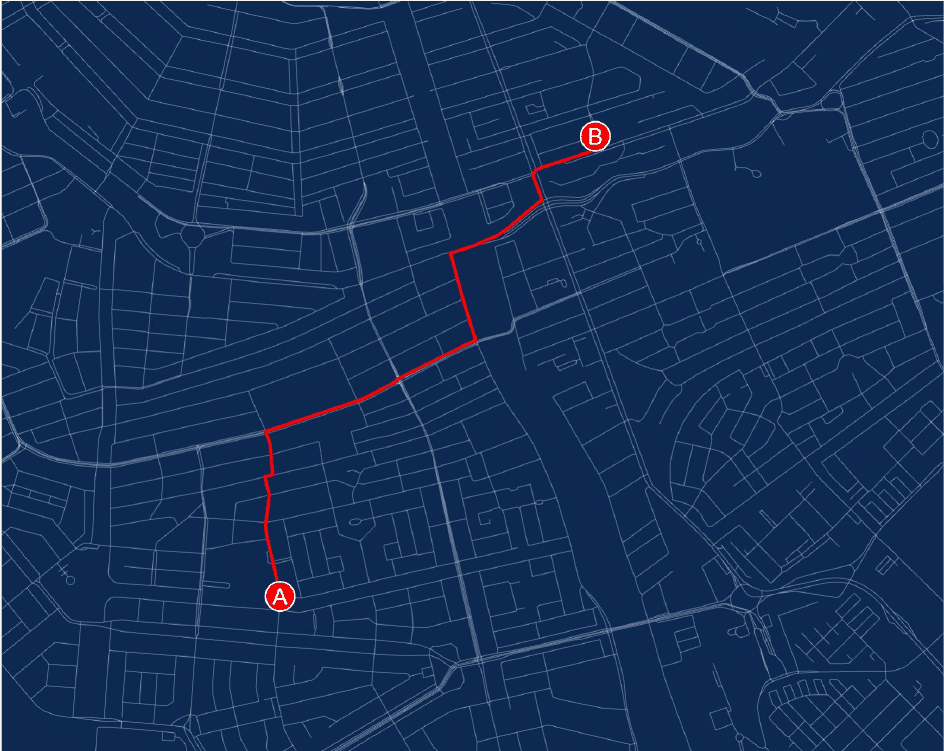

*Figure 13. Path from point A to point B found by A\* on a city road network graph*

A\* can be used not only on grids but on general graphs. Figure 13 is an example from the path finding library ngraph.path [6], showing a path (red line) found from point A to point B on a city road network. In navigation, intersections are nodes, road segments between intersections are edges, and the length or travel time of a segment is the edge cost. The distance along roads cannot be shorter than the straight-line distance between two points, so when edge costs are lengths, the straight-line distance is an admissible heuristic. When edge costs are travel times, the straight-line distance divided by the maximum speed is admissible. This corresponds to global path planning in Section 1.3.

---

<br>

## 4. The Hybrid A\* Algorithm

### 4.1 Limits of Grid A\* and the Idea of Hybrid A\*

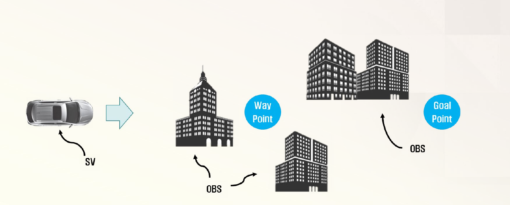

*Figure 14. The subject vehicle (SV) must pass between obstacles (OBS) such as buildings and reach the goal point via a waypoint*

The paths found by the A\* of Section 3 are polylines connecting the centers of grid cells. A path that turns 90° or 45° from cell to cell cannot be followed as it is because of the minimum turning radius of Section 1.2. The **Hybrid A\* algorithm** is a technique that extends the conventional A\* method by considering the motion characteristics of the vehicle to generate optimal paths the vehicle can actually drive. Figure 14 shows the situation treated in this section. The subject vehicle (SV) must pass between obstacles (OBS) such as buildings and reach the goal point via an intermediate waypoint.

The name Hybrid A\* comes from using a discrete grid and continuous vehicle states together (hybrid) [7], [8].

- **Continuous states:** Each node holds the vehicle's actual continuous state $(x, y, \theta)$ rather than a cell center.
- **Motion primitives:** When expanding a node, instead of jumping to neighboring cells, the vehicle is moved a fixed distance with a few steering angles (for example, maximum left, zero, maximum right), and the results become candidate nodes. These are arcs following the bicycle model of Section 1.2, so the way to each candidate is always drivable.
- **Pruning with a discrete grid:** Continuous states are infinitely many, so only one state is kept per cell of a 3D grid dividing $(x, y, \theta)$ at fixed intervals. If a candidate falls into a cell that already holds another state, only the one with the smaller cost is kept.

Moving an arc length $s$ with steering angle $\delta$ gives a turning radius $R = L / \tan\delta$ and changes the heading by $\Delta\theta = s / R$. If the initial state is $(x, y, \theta)$, the state of the candidate node is as follows (if $\delta = 0$, the vehicle goes straight to $(x + s\cos\theta, \; y + s\sin\theta, \; \theta)$).

$$
x' = x + R\left( \sin(\theta + \Delta\theta) - \sin\theta \right), \qquad
y' = y - R\left( \cos(\theta + \Delta\theta) - \cos\theta \right), \qquad
\theta' = \theta + \Delta\theta
$$

> **Note:** Because only one state is kept per cell, a path reachable only through a discarded state may be missed. Unlike grid A\*, Hybrid A\* therefore does not guarantee the shortest path. Instead, the path found can be followed by the vehicle, and Dolgov et al. report that in practice it is close to optimal [8]. As the heuristic they also used the larger of the shortest distance considering only the vehicle's turning constraints and ignoring obstacles (the length of a Reeds-Shepp curve [9]) and the shortest distance considering only obstacles and ignoring turning constraints (the distance computed by Dijkstra on a grid), and they ended the search immediately whenever a Reeds-Shepp curve to the goal could be connected during the search.

### 4.2 Actual Travel Cost G(n)

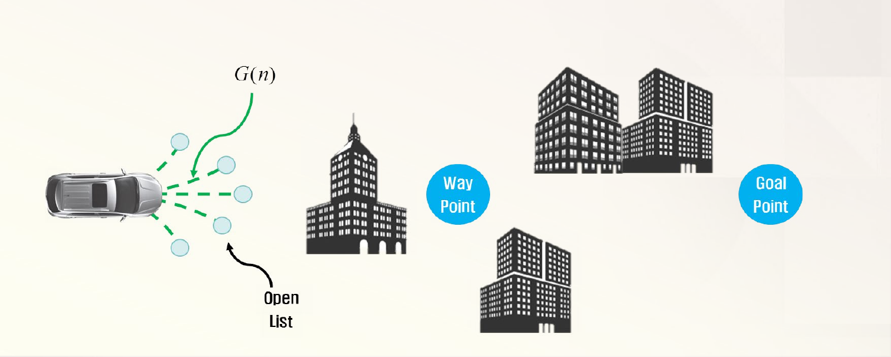

*Figure 15. Candidate nodes branching from the subject vehicle (open list) and the actual travel cost G(n)*

In Figure 15, the small circles at the ends of the five dashed branches in front of the vehicle are candidate nodes generated with different steering angles, and they enter the open list. The cost function is the same as A\*, $F(n) = G(n) + H(n)$, and the actual travel cost is as follows.

$$
G(n) = (\text{actual distance traveled from the start node to the current node } n) \times K_{\delta}
$$

$K_{\delta}$ is a tuning factor that gives priority to straight driving, with $K_{\delta} = 1$ for straight motion and $K_{\delta} > 1$ for curved motion. Charging steered motion more for the same distance makes the search choose smooth paths that do not steer unless necessary. Making $K_{\delta}$ larger for larger steering avoids sharp turns more. Actual implementations also penalize moves that switch between forward and reverse (`reverse_weight` in Section 5).

### 4.3 Heuristic Cost H(n)

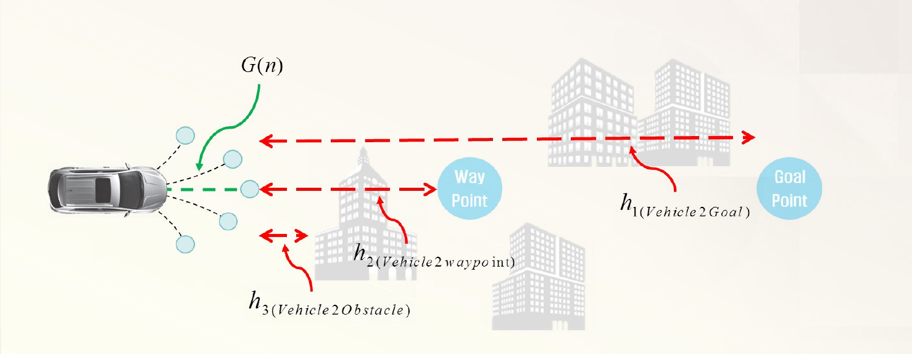

*Figure 16. Heuristic terms from a candidate node to the goal point, the waypoint, and an obstacle*

The heuristic cost is a weighted sum of three terms.

$$
H(n) = \alpha_h \cdot h_1(\text{Vehicle2Goal}) + \beta_h \cdot h_2(\text{Vehicle2Waypoint}) + \gamma_h \cdot h_3(\text{Vehicle2Obstacle})
$$

$\alpha_h$, $\beta_h$, and $\gamma_h$ are tuning factors for the heuristic terms. The red dashed arrows in Figure 16 are the distances each term measures.

| Term | Definition | Role |
|:-----|:-----|:-----|
| $h_1$ (Vehicle2Goal) | Euclidean distance from the vehicle position at the candidate node to the goal waypoint (Goal Point) | Draws the search toward the final goal |
| $h_2$ (Vehicle2Waypoint) | Euclidean distance from the vehicle position at the candidate node to the next waypoint | Makes the path pass through the intermediate points set by the global route in order |
| $h_3$ (Vehicle2Obstacle) | Reciprocal of the Euclidean distance from the vehicle position at the candidate node to an obstacle the vehicle could collide with if it drove straight on, multiplied by $K_{\text{scale}}$ | Penalizes candidates approaching obstacles so that paths keeping away from obstacles are chosen |

*Table 9. Heuristic terms of Hybrid A\**

$h_3 = K_{\text{scale}} / d_{\text{obs}}$ grows quickly as the distance to the obstacle $d_{\text{obs}}$ decreases. For example, with $K_{\text{scale}} = 20$ it is 2 when the obstacle is 10 m ahead, 4 at 5 m, and 10 at 2 m. If no obstacle lies on the straight path, this term is 0.

> **Caution:** This $H(n)$ is not admissible in the sense of Section 3.6. $h_2$ and $h_3$ are not the remaining cost to the goal but penalties that make the path pass the waypoint and avoid obstacles, so they can overestimate the remaining cost. The path found with this cost function is therefore not guaranteed to be shortest in distance. Instead, tuning the factors $\alpha_h$, $\beta_h$, $\gamma_h$, and $K_{\delta}$ sets the balance among a short path, following the waypoints, clearance from obstacles, and smooth steering. Like weighted A\* in Section 3.6, this design gives up optimality to obtain a practical path.

### 4.4 Successor Selection and Path Search

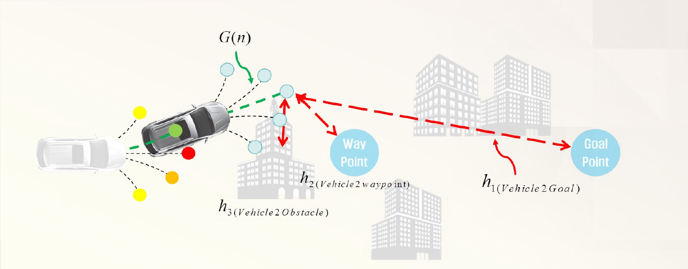

*Figure 17. Computing the costs of candidate nodes and choosing the smallest as the next successor*

The search repeats the following.

1. Compute the cost function $F(n) = G(n) + H(n)$ for each candidate node.
2. Choose the node with the smallest cost function value as the next **successor**.
3. Generate candidate nodes again from the chosen successor and repeat the process.

In Figure 17, the faded vehicle is the previous position, and the yellow, orange, and red circles in front of it are the candidates of the previous step. The candidate with the smallest cost among them (green dot) became the successor, the vehicle moved to that position, and five new branches of candidates were generated there. For one of the new candidates, $G(n)$ (green dashed line) and $h_1$, $h_2$, $h_3$ (red arrows) are shown.

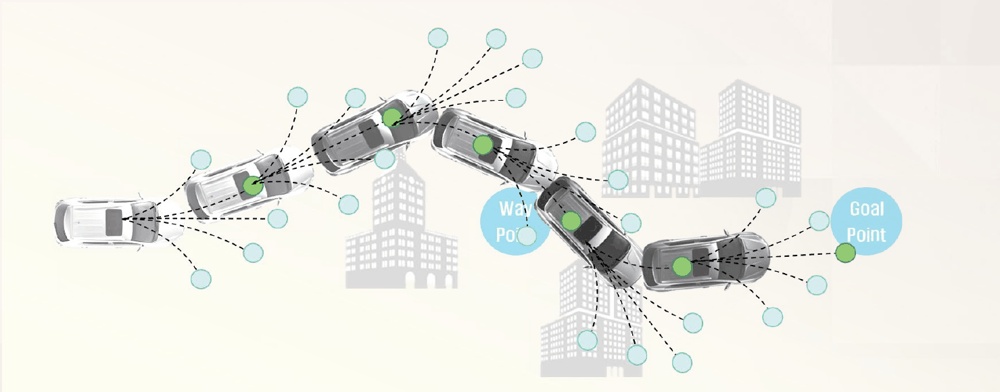

*Figure 18. Path to the goal waypoint built by repeating successor selection*

Figure 18 is the result of repeating this process to build a path to the goal waypoint (Goal Point). The vehicle positions at each step (green dots) connect into the path, and the vehicle passes between buildings, near the waypoint, and on to the goal. Each segment is an arc with a fixed steering angle, so the whole path respects the vehicle's minimum turning radius.

> **Note:** The procedure above looks like advancing to the cheapest of the current node's candidates, but in the A\* framework the next node to expand is the node with the smallest $F$ in the entire open list, not just among the current node's candidates. If the new candidates are all blocked by obstacles or become costly, the search returns, as in step 8 of Example 1, to another candidate opened at an earlier step and branches out again from there. In open areas without obstacles, the most recent candidates are usually the cheapest, so the result takes the same shape as the procedure above.

### 4.5 Worked Example: Comparing Candidate Node Costs

Let us compute the candidate costs of one step directly with the following values. All values are chosen for illustration.

- **Vehicle:** Position $(0, 0)$, heading $\theta = 0°$ (to the right), wheelbase $L = 2.7$ m.
- **Candidates:** Five nodes reached by moving an arc length $s = 3$ m with steering angles $\delta \in \{20°, 10°, 0°, -10°, -20°\}$ (positive to the left).
- **Cost factors:** $K_{\delta}$ is 1.0, 1.1, and 1.2 for $\vert\delta\vert = 0°, 10°, 20°$, respectively. $\alpha_h = 1$, $\beta_h = 0.5$, $\gamma_h = 1$, and $K_{\text{scale}} = 20$.
- **Environment:** Goal $(30, 6)$, waypoint $(12, 3)$, and a circular obstacle of radius 1 m at $(9, 0)$. If the straight line drawn from a candidate node in its heading meets the obstacle circle, the obstacle is regarded as an obstacle the vehicle could collide with if it drove straight on (Table 9), and $d_{\text{obs}}$ is the distance from the candidate node to the obstacle center.

The candidate with $\delta = 10°$ is computed step by step as follows.

1. **Turning radius and heading change:** $R = 2.7 / \tan 10° = 2.7 / 0.17633 = 15.31$ m, and $\Delta\theta = s / R = 3 / 15.31 = 0.1959$ rad $= 11.23°$.
2. **Position of the candidate:** Since $\theta = 0$, the equations of Section 4.1 become $x' = R \sin\Delta\theta$ and $y' = R(1 - \cos\Delta\theta)$. So $x' = 15.31 \times 0.1947 = 2.981$ and $y' = 15.31 \times (1 - 0.9809) = 0.293$.
3. **G:** $G = 3 \times 1.1 = 3.3$.
4. **$h_1$:** $\sqrt{(30 - 2.981)^2 + (6 - 0.293)^2} = \sqrt{730.0 + 32.6} = 27.615$.
5. **$h_2$:** $\sqrt{(12 - 2.981)^2 + (3 - 0.293)^2} = \sqrt{81.3 + 7.3} = 9.417$.
6. **$h_3$:** The perpendicular distance between the obstacle center and the line drawn in the candidate's heading (11.23°) is about 1.46 m, larger than the obstacle radius of 1 m. Driving straight on does not hit the obstacle, so $h_3 = 0$.
7. **H and F:** $H = 1 \times 27.615 + 0.5 \times 9.417 + 1 \times 0 = 32.324$, and $F = 3.3 + 32.324 = 35.624$.

Computing all five candidates gives the following.

| Candidate | $\delta$ | Position $(x', y')$ | $\theta'$ | $G$ | $h_1$ | $h_2$ | $h_3$ | $H$ | $F$ |
|:-----|:-----|:-----|:-----|:-----|:-----|:-----|:-----|:-----|:-----|
| (1) | $20°$ | $(2.919, 0.598)$ | $23.17°$ | 3.6 | 27.615 | 9.393 | 0 | 32.311 | 35.911 |
| (2) | $10°$ | $(2.981, 0.293)$ | $11.23°$ | 3.3 | 27.615 | 9.417 | 0 | 32.324 | **35.624** |
| (3) | $0°$ | $(3.000, 0.000)$ | $0°$ | 3.0 | 27.659 | 9.487 | 3.333 | 35.735 | 38.735 |
| (4) | $-10°$ | $(2.981, -0.293)$ | $-11.23°$ | 3.3 | 27.742 | 9.601 | 0 | 32.543 | 35.843 |
| (5) | $-20°$ | $(2.919, -0.598)$ | $-23.17°$ | 3.6 | 27.873 | 9.768 | 0 | 32.757 | 36.357 |

*Table 10. Costs of the five candidate nodes*

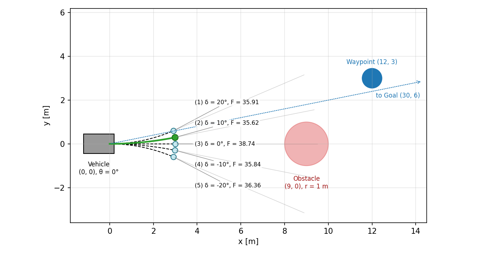

*Figure 19. Arcs and costs of the five candidate nodes, with the chosen candidate (green)*

The results are interpreted as follows.

- **The straight candidate (3) is the shortest but is not chosen.** Its $G = 3.0$ is the smallest, but driving straight on hits the obstacle 6 m ahead, so it receives a penalty of $h_3 = 20 / 6 = 3.333$ and has the largest $F$.
- **The gentle left candidate (2) is chosen.** The goal and the waypoint both lie to the upper left, so the left candidates have small $H$. (1) turns more toward the goal, but the penalty for large steering ($K_{\delta} = 1.2$) makes its $G$ larger by 0.3, so it costs more than (2).
- **The tuning factors change the result.** For example, setting $K_{\delta}$ to 1 for every steering angle gives $F = 3.0 + 32.311 = 35.311$ for (1) and $F = 3.0 + 32.324 = 35.324$ for (2), so (1), which turns more sharply, is chosen. Changing the factors yields different paths in the same situation, so the factors must be tuned to the desired driving character.

### 4.6 Path Smoothing and Subsequent Steps

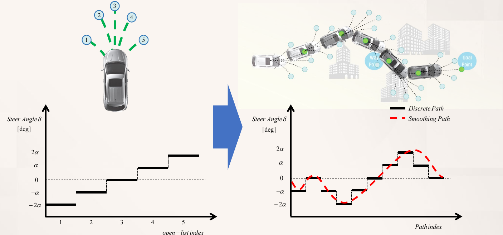

*Figure 20. Discrete steering angles of the five candidates (left), and the stepwise and smoothed steering angles of a path built from them (right)*

The candidates of Hybrid A\* are generated with only a few fixed steering angles ($-2\alpha$, $-\alpha$, $0$, $\alpha$, $2\alpha$). The left graph of Figure 20 shows that the steering angles corresponding to candidates 1-5 are divided into steps, and the right graph is the steering angle needed at each point of a path built this way. The black solid line (Discrete Path) is a staircase in which the steering angle changes abruptly at each segment. A vehicle cannot change its steering angle instantaneously, so such a discrete path is hard to follow. **Path smoothing** is therefore needed to refine the path so that the steering angle, that is, the curvature of the path, changes continuously, as in the red dashed line (Smoothing Path). Dolgov et al. smoothed the path by reducing, with gradient-based optimization, a cost function whose terms are the distance to obstacles, the smoothness of the path, and the curvature limit [8].

The result of smoothing, the velocity profile from the radius of curvature, and swerves and nudges for obstacle avoidance are covered in Week 11, Sections 1.2-1.4.

---

<br>

## 5. Path Planning Nodes in Autoware

In the Runtime Manager of Autoware.ai, the path planning nodes are gathered on the right side of the Computing tab. Mission Planning builds the global route to the destination, and Motion Planning builds the local path and speed actually followed [10].

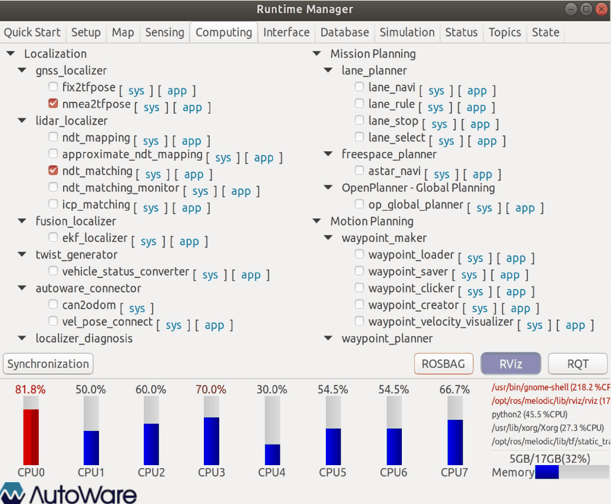

*Figure 21. Mission Planning and Motion Planning node lists in the Computing tab*

| Category | Package | Node | Function |
|:-----|:-----|:-----|:-----|
| Mission Planning | `lane_planner` | `lane_navi` | Builds a route to the destination on the lanes of the vector map |
| Mission Planning | `lane_planner` | `lane_rule`, `lane_stop`, `lane_select` | Sets the route's speeds for signals and stop lines and selects the lane to drive (Week 3, Section 5) |
| Mission Planning | `freespace_planner` | `astar_navi` | Builds a global path with Hybrid A\* on an obstacle grid map (costmap). Used in spaces without lanes such as parking lots |
| Mission Planning | OpenPlanner | `op_global_planner` | Builds the shortest route with distance as the cost on the road network graph of the vector map |
| Motion Planning | `waypoint_maker` | `waypoint_loader` and others | Loads or creates saved waypoints (Week 3, Section 4) |
| Motion Planning | `waypoint_planner` | `astar_avoid` | Builds an avoidance path with Hybrid A\* when an obstacle lies on the path |
| Motion Planning | `waypoint_planner` | `velocity_set` | Sets the target speed according to obstacles on the path (Week 3, Section 5) |

*Table 11. Main path planning nodes of Autoware.ai*

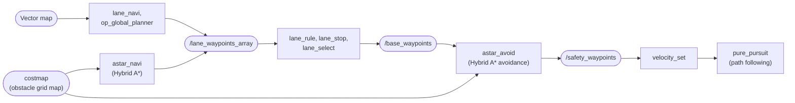

*Figure 22. Flow from global path planning to path following in Autoware.ai (rectangles are nodes, rounded boxes are topics or maps)*

The global route built by `lane_navi` or `op_global_planner` (`/lane_waypoints_array`) becomes `/base_waypoints` after signal and lane processing. `astar_avoid` normally passes this path through unchanged (Relay mode), but with avoidance enabled, when an obstacle lies on the path it replans a path around the obstacle with Hybrid A\* and publishes it on `/safety_waypoints` (Avoidance mode). Then `velocity_set` sets the speeds and `pure_pursuit` follows the path (Week 3, Section 6).

The main parameters and default values of the Hybrid A\* implementation shared by `astar_navi` and `astar_avoid` (the `astar_search` package) are as follows. They show how the concepts of Section 4 appear in an actual implementation.

| Parameter | Default | Meaning and relation to Section 4 |
|:-----|:-----|:-----|
| `minimum_turning_radius` | 6.0 m | Radius of the arcs that generate candidate nodes ($R_{\min}$ of Section 1.2) |
| `theta_size` | 48 | Number of bins dividing the heading $\theta$. One state is kept every $360° / 48 = 7.5°$ |
| `use_back` | true | Whether reverse motion primitives are also used as candidates |
| `reverse_weight` | 2.00 | Penalty multiplied onto the cost of moves that switch between forward and reverse |
| `distance_heuristic_weight` | 1.0 | Weight multiplied onto the Euclidean distance heuristic to the goal (corresponding to $\alpha_h$) |
| `use_potential_heuristic`, `potential_weight` | true, 10.0 | Adds the costmap's obstacle cost multiplied by a weight to the cost (the same role as the obstacle term $h_3$) |
| `robot_length`, `robot_width` | 4.5 m, 1.75 m | Vehicle size used for collision checking |
| `time_limit` | 5000 ms | The search stops if no path is found within this time |

*Table 12. Main parameters of `astar_search` in Autoware.ai*

This implementation uses as candidates arcs that turn along the circle of the minimum turning radius by one heading bin $\Delta\theta = 2\pi / 48$, so the distance moved at once is $s = R_{\min} \Delta\theta = 6.0 \times 2\pi / 48 \approx 0.785$ m. There are three candidates, straight, maximum left steering, and maximum right steering, and enabling `use_back` adds the same three in reverse.

---

<br>

## Concept Applications

| Situation | Analysis |
|:-----|:-----|
| A path found by grid A\* on a parking lot map was given directly to the vehicle, and the vehicle strayed far from the path at every turning cell. | **The path ignores the non-holonomic constraint.** A grid A\* path turns 90° or 45° at a single cell, but the vehicle cannot turn tighter than its minimum turning radius. Hybrid A\*, which generates candidates with motion primitives, should be used, or the path should be smoothed. |
| Finding a route to the destination with Dijkstra's algorithm on a large city map takes a long time. | **The search does not know the direction of the goal.** Dijkstra's algorithm spreads evenly in all directions. Switching to A\* with an admissible heuristic such as the straight-line distance finds the same shortest path with fewer node expansions. |
| Using the Manhattan distance as the heuristic on an eight-directional grid sometimes produces paths that are not shortest. | **The heuristic is not admissible.** It estimates one diagonal step (cost 14) as 20, so it can overestimate the remaining cost. The octile distance must be used to guarantee the shortest path. |
| A path built by Hybrid A\* passes too close to obstacles. | **The weight of the obstacle term is small.** Increasing $\gamma_h$ or $K_{\text{scale}}$ raises the cost of candidates close to obstacles so that paths with more clearance are chosen. If it is made too large, however, the vehicle may fail to pass narrow passages and take large detours. |
| A Hybrid A\* path wobbles slightly left and right even on straight sections. | **The curve penalty $K_{\delta}$ is small.** If the cost difference between steered and straight moves is small, steered candidates are chosen because of tiny differences in the heuristic. Increasing $K_{\delta}$ for curves gives priority to going straight. |

*Table 13. Case analysis of path planning*

**True/False Check:**

| Statement | Judgment and rationale |
|:-----|:-----|
| Setting $H = 0$ in A\* makes it the same as Dijkstra's algorithm. | **T.** The priority becomes $F = G$, so nodes are expanded in order of distance from the start. |
| A\* still guarantees the shortest path if it ends the search the moment the goal node is first placed in the open list. | **F.** A path cheaper than the one at insertion may remain, so the search must end when the goal is extracted from the open list. |
| Among admissible heuristics, the closer one is to the actual cost, the fewer expansions A\* tends to make. | **T.** In Table 8, the octile distance (18) expanded fewer cells than the smaller Chebyshev distance (20). |
| Hybrid A\* always guarantees the shortest path, like grid A\*. | **F.** Keeping only one continuous state per grid cell can miss paths, and the $H(n)$ of Section 4.3 is not admissible either. Instead, it gives drivable paths. |
| A vehicle with non-holonomic constraints has a reduced range of reachable positions and orientations. | **F.** A non-holonomic constraint only restricts the directions of motion at each instant; combining forward motion, reverse motion, and steering reaches the desired configuration, as in parallel parking. |

---

<br>

## Summary

| Concept | Key Summary |
|:--------|:------------|
| Vehicle path planning | The problem of generating a driving path from the current position to the goal, considering ride comfort and the vehicle's motion (non-holonomic constraints). |
| Non-holonomic constraint | The velocity constraint $\dot{x}\sin\theta - \dot{y}\cos\theta = 0$ that the rear wheels do not slip sideways, which produces the minimum turning radius $R_{\min} = L / \tan\delta_{\max}$. |
| Global and local path planning | Global path planning finds the optimal route to the goal using maps, and local path planning builds short paths that avoid obstacles while driving using sensor information. |
| Dijkstra's algorithm | Finds the shortest path by finalizing nodes in order of distance $G$ from the start, but does not know the direction of the goal and spreads in all directions. |
| Greedy best-first search | Expands by the heuristic $H$ alone and is fast, but falls into dead ends or produces paths that are not shortest. |
| A\* algorithm | Extracts and expands the node with the smallest $F = G + H$ from the open list, updates the cost and parent when a shorter way is found, and ends when the goal is extracted. |
| Admissibility and consistency | If $h \le h^{\ast}$, the heuristic is admissible and the shortest path is guaranteed (when closed nodes are reopened); if $h(n) \le c(n, m) + h(m)$, it is consistent and expanded nodes never need reopening. |
| Choice of heuristic | The Manhattan distance for four-directional movement and the octile distance for eight-directional movement are exact admissible heuristics, and weighted A\* trades optimality for speed. |
| Hybrid A\* | Nodes hold continuous states $(x, y, \theta)$, candidates are generated as arcs per steering angle, and a 3D grid removes duplicates, finding paths the vehicle can drive. |
| Cost of Hybrid A\* | $G$ multiplies the distance traveled by the curve penalty $K_{\delta}$, and $H$ adds the goal distance, the waypoint distance, and the reciprocal of the obstacle distance with factors. |
| Path smoothing | Makes the stepwise steering of a path built with discrete steering angles continuous so that the vehicle can follow it, followed by velocity profile generation. |
| Path planning in Autoware | `lane_navi`, `op_global_planner`, and `astar_navi` build global routes, `astar_avoid` and `velocity_set` decide avoidance paths and speeds, and `astar_search` implements Hybrid A\*. |

---

<br>

## Self-Check Questions

1. **Minimum turning radius:** Find the minimum turning radius of a vehicle with wheelbase $L = 3.0$ m and maximum steering angle $\delta_{\max} = 35°$. Decide whether this vehicle can make a U-turn in one motion on a 6 m wide road.

   <details>
   <summary>Answer</summary>

   $R_{\min} = 3.0 / \tan 35° = 3.0 / 0.7002 \approx 4.28$ m. A U-turn in one motion requires a circle of diameter $2R_{\min} \approx 8.57$ m, so the vehicle cannot turn in one motion on a 6 m wide road and needs a multi-point turn mixing forward and reverse motion. This calculation considers only the trajectory of the rear-axle center; in reality, the width and length of the body require even more space.

   </details>

2. **Global and local path planning:** Classify the following as global or local path planning. (a) Choosing the roads to the destination before departure. (b) Moving into the next lane to avoid a car that suddenly stopped ahead. (c) Learning that a road is closed for construction and rerouting through another road.

   <details>
   <summary>Answer</summary>

   (a) finds a route to the goal using a map, so it is global path planning. (b) avoids a moving obstacle perceived by sensors over a short range, so it is local path planning. (c) changes the route to the destination at the road network level, so it is replanning in global path planning.

   </details>

3. **Computing a heuristic:** On the grid of Example 2, find the octile distance heuristic of cell C3 (goal E2).

   <details>
   <summary>Answer</summary>

   From C3 to E2, $d_x = 2$ and $d_y = 1$, so $H = 14 \times 1 + 10 \times (2 - 1) = 24$. This matches the C3 cell of Table 6 (58+24=82).

   </details>

4. **Tracing A\*:** What happens if the cost of D7 is not updated in step 8 of Example 1?

   <details>
   <summary>Answer</summary>

   D7 remains at $G = 4$ (parent D6) and $F = 12$. Every path through D7 is computed as 2 more expensive than it is, and after step 8 no cell with $F = 10$ remains, so the search goes on to expand cells with $F = 12$. In the end it finds B7 → B6 → C6 → D6 → D7 → E7 → F7 → F6 → F5 → F4 → F3 → F2 → G2, which passes through the dead-end space, with cost 12. This exceeds the shortest cost of 10, so skipping the update step prevents A\* from guaranteeing the shortest path.

   </details>

5. **Admissibility:** What problem arises when $h(n) = 2 \times$(Manhattan distance) is used on a four-directional grid?

   <details>
   <summary>Answer</summary>

   Without obstacles the remaining actual cost equals the Manhattan distance, so twice that overestimates the actual cost and is not admissible. The search is drawn more strongly toward the goal and may expand fewer nodes, but it can produce paths that are not shortest. This is the same as weighted A\* with weight $w = 2$, so the cost of the path found does not exceed twice the shortest cost.

   </details>

6. **Consistency:** Explain why, with a consistent heuristic, a node that has entered the closed list in A\* never needs to be reopened.

   <details>
   <summary>Answer</summary>

   Consistency $h(n) \le c(n, m) + h(m)$ gives $F(m) = G(n) + c(n, m) + h(m) \ge G(n) + h(n) = F(n)$, so $F$ does not decrease along a path. Nodes are therefore expanded in order of increasing $F$, and when a node is first expanded, every cheaper path reaching it has already been expanded. Hence the $G$ at the first expansion is minimal, and a cheaper path is never found later.

   </details>

7. **Candidates of Hybrid A\*:** A vehicle is at $(0, 0)$ with $\theta = 0°$ and wheelbase $L = 2.7$ m. Find the position and heading of the candidate reached by moving an arc length of 3 m with steering angle $\delta = 30°$.

   <details>
   <summary>Answer</summary>

   $R = 2.7 / \tan 30° = 2.7 / 0.5774 = 4.677$ m and $\Delta\theta = 3 / 4.677 = 0.6415$ rad $= 36.76°$. $x' = R\sin\Delta\theta = 4.677 \times 0.5984 = 2.798$ m and $y' = R(1 - \cos\Delta\theta) = 4.677 \times (1 - 0.8012) = 0.930$ m, so the candidate is at $(2.798, 0.930)$ heading $36.76°$.

   </details>

8. **Cost function:** In the worked example of Section 4.5, which candidate is chosen if $\gamma_h = 0$? Explain what this result means.

   <details>
   <summary>Answer</summary>

   Without $h_3$, the $F$ of the straight candidate (3) becomes $3.0 + 27.659 + 0.5 \times 9.487 = 35.402$, the smallest of the five (for (2) it is 35.624). That is, without the obstacle term, the candidate driving straight toward the obstacle 6 m ahead is chosen. If obstacles were considered only through collision checking, the vehicle would avoid them only after coming right up to them, so $h_3$ serves to steer the path away from obstacles in advance.

   </details>

9. **Optimality:** Give two reasons why a path found with the Hybrid A\* cost function of Sections 4.2-4.3 may not be the shortest in distance.

   <details>
   <summary>Answer</summary>

   First, the waypoint term $h_2$ and the obstacle term $h_3$ are added to $H(n)$, so it can overestimate the remaining cost and is not admissible. Second, only one continuous state is kept per cell of the $(x, y, \theta)$ grid, so a shorter path reachable only through a discarded state may be missed. In addition, the curve penalty $K_{\delta}$ in $G$ adds a criterion other than distance.

   </details>

10. **Autoware implementation:** Find the distance moved between candidate nodes with the default values of `astar_search`, and explain what changes if `theta_size` is increased to 96.

    <details>
    <summary>Answer</summary>

    $s = R_{\min} \times 2\pi / 48 = 6.0 \times 0.1309 \approx 0.785$ m. Increasing `theta_size` to 96 divides the heading every $3.75°$, so one move shrinks to about 0.393 m and headings are distinguished more finely. The path becomes more precise and passing through narrow places becomes more likely, but the number of states to search increases and the computation takes longer.

    </details>

---

<br>

## References

1. S. M. LaValle, *Planning Algorithms*. Cambridge, U.K.: Cambridge Univ. Press, 2006.
2. E. W. Dijkstra, "A note on two problems in connexion with graphs," *Numerische Mathematik*, vol. 1, no. 1, pp. 269-271, 1959.
3. X. Xu, "PathFinding.js," GitHub repository. https://github.com/qiao/PathFinding.js
4. P. E. Hart, N. J. Nilsson, and B. Raphael, "A formal basis for the heuristic determination of minimum cost paths," *IEEE Trans. Syst. Sci. Cybern.*, vol. 4, no. 2, pp. 100-107, 1968.
5. I. Pohl, "Heuristic search viewed as path finding in a graph," *Artif. Intell.*, vol. 1, no. 3-4, pp. 193-204, 1970.
6. A. Kashcha, "ngraph.path: Path finding in a graph," GitHub repository. https://github.com/anvaka/ngraph.path
7. D. Dolgov, S. Thrun, M. Montemerlo, and J. Diebel, "Practical search techniques in path planning for autonomous driving," in *Proc. 1st Int. Symp. Search Techn. Artif. Intell. Robot. (STAIR-08)*, Chicago, IL, USA, 2008.
8. D. Dolgov, S. Thrun, M. Montemerlo, and J. Diebel, "Path planning for autonomous vehicles in unknown semi-structured environments," *Int. J. Robot. Res.*, vol. 29, no. 5, pp. 485-501, 2010.
9. J. A. Reeds and L. A. Shepp, "Optimal paths for a car that goes both forwards and backwards," *Pacific J. Math.*, vol. 145, no. 2, pp. 367-393, 1990.
10. Autoware Foundation, "core_planning: astar_search, freespace_planner, waypoint_planner, op_global_planner," GitHub repository, Autoware.ai. https://github.com/Autoware-AI/core_planning
