# 11주차 이론 — 자율주행차의 횡방향 제어 I

[레포지토리 안내](../../README.ko.md) | [English](Concepts_Lecture.md) | [한국어](Concepts_Lecture.ko.md)

> **최종 수정일:** 2026-11-04

> **학습 목표:**
> 1. Hybrid A\* 경로를 평활화하는 이유를 설명하고, 웨이포인트로 구한 곡률 반경에서 승차감을 고려한 최대 속도를 계산할 수 있다
> 2. 장애물 회피 경로를 이루는 swerve와 nudge의 역할과 장애물 탐색, 회피, 복귀의 단계를 설명할 수 있다
> 3. 횡방향 제어기의 설계 개념과 구조를 설명하고, 자전거 모델과 그 상태 변수를 정의할 수 있다
> 4. 바퀴 위치의 속도로부터 전륜과 후륜의 타이어 슬립각을 유도하고 작은 각도 근사를 적용할 수 있다
> 5. 선형 타이어 모델과 운동 방정식으로 차체 슬립각과 요레이트의 상태 방정식을 유도하고 정상 선회 응답을 계산할 수 있다
> 6. 주행 실험 데이터로 횡방향 모델의 차량 파라미터를 추정하는 절차를 설명할 수 있다

---

## 목차

- [1. 경로 후처리와 횡방향 제어기의 구조](#1-경로-후처리와-횡방향-제어기의-구조)
  - [1.1 횡방향 제어의 역할](#11-횡방향-제어의-역할)
  - [1.2 Hybrid A\* 경로의 평활화](#12-hybrid-a-경로의-평활화)
  - [1.3 곡률 반경에 따른 속도 프로파일](#13-곡률-반경에-따른-속도-프로파일)
  - [1.4 장애물 회피 경로: swerve와 nudge](#14-장애물-회피-경로-swerve와-nudge)
  - [1.5 횡방향 제어기의 개념과 구조](#15-횡방향-제어기의-개념과-구조)
  - [1.6 단일 트랙 모델(자전거 모델)](#16-단일-트랙-모델자전거-모델)
  - [1.7 상태 변수의 정의](#17-상태-변수의-정의)
- [2. 타이어 각도 관계](#2-타이어-각도-관계)
  - [2.1 바퀴 위치의 속도](#21-바퀴-위치의-속도)
  - [2.2 타이어 슬립각](#22-타이어-슬립각)
  - [2.3 전륜의 각도 관계](#23-전륜의-각도-관계)
  - [2.4 후륜의 각도 관계](#24-후륜의-각도-관계)
  - [2.5 작은 각도 근사와 수치 예](#25-작은-각도-근사와-수치-예)
- [3. 힘 관계와 차량 파라미터 추정](#3-힘-관계와-차량-파라미터-추정)
  - [3.1 선형 타이어 모델과 코너링 강성](#31-선형-타이어-모델과-코너링-강성)
  - [3.2 횡방향 운동 방정식](#32-횡방향-운동-방정식)
  - [3.3 차체 슬립각과 요레이트의 상태 방정식](#33-차체-슬립각과-요레이트의-상태-방정식)
  - [3.4 동역학 모델의 가정](#34-동역학-모델의-가정)
  - [3.5 정상 선회 해석](#35-정상-선회-해석)
  - [3.6 횡방향 속도를 상태로 쓰는 형태](#36-횡방향-속도를-상태로-쓰는-형태)
  - [3.7 차량 파라미터 추정](#37-차량-파라미터-추정)
  - [3.8 저속의 기구학 모델](#38-저속의-기구학-모델)
- [개념 적용](#개념-적용)
- [요약](#요약)
- [점검 문제](#점검-문제)
- [참고 문헌](#참고-문헌)

---

 

## 1. 경로 후처리와 횡방향 제어기의 구조

### 1.1 횡방향 제어의 역할

자율주행차의 운동 제어는 두 방향으로 나뉜다. **종방향 제어(longitudinal control)** 는 구동력과 제동력으로 진행 방향의 속도를 조절하고, **횡방향 제어(lateral control)** 는 조향으로 차량이 경로에서 옆으로 벗어나지 않게 한다. 10주차의 경로 계획이 만든 경로는 그대로 차량에 줄 수 없다. 먼저 경로를 매끄럽게 다듬고(평활화), 구간마다 달릴 속도를 정하고(속도 프로파일), 주행 중에 장애물이 나타나면 회피 경로를 만든다. 그다음 **횡방향 제어기(lateral controller)** 가 그 경로를 따라가도록 조향각을 계산하여 조향 장치에 보낸다.

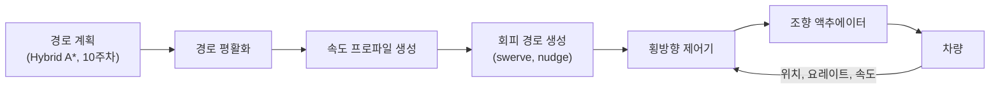

*그림 1. 경로 계획에서 조향까지의 처리 흐름*

3주차의 pure pursuit도 횡방향 제어 방법의 하나로, 목표점과 차량의 기하 관계만으로 곡률을 정하는 기하학적 방법이다. 이 단원과 12주차에서 다루는 제어기는 차량의 운동을 수식으로 나타낸 모델(자전거 모델)을 세우고, 그 모델에 근거하여 조향각을 정하는 모델 기반 방법이다. 이 단원은 경로의 후처리와 제어기의 구조를 살핀 뒤, 제어기가 쓰는 동역학 모델을 유도하고 저속의 기구학 모델을 정리한다.

### 1.2 Hybrid A\* 경로의 평활화

Hybrid A\*(10주차)는 차량이 실제로 낼 수 있는 조향각으로 상태를 확장하므로, 차량이 따라갈 수 있는(기구학적으로 실현 가능한) 경로를 낸다. 그러나 탐색이 몇 개의 이산적인 조향각만 쓰기 때문에, 결과 경로는 불필요하게 좌우로 꺾이고 곡률이 계단처럼 바뀐다. 이런 경로를 그대로 따라가면 조향 입력이 자주 바뀌어 승차감이 나빠지고 타이어와 조향 장치에도 부담이 된다. 그래서 탐색이 끝난 뒤 경로를 매끄럽게 다듬는 **경로 평활화(path smoothing)** 를 한다.

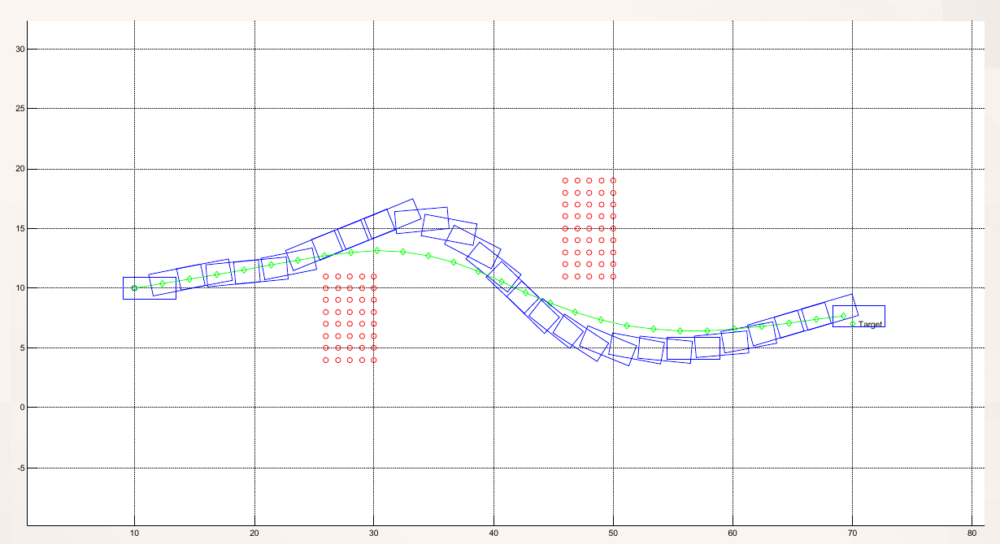

*그림 2. Hybrid A\* 차량 궤적(파란색 사각형), 평활화한 궤적(초록색 실선), 장애물(빨간색 점)*

그림 2의 파란색 사각형은 Hybrid A\*가 찾은 경로를 따라 놓인 차량의 외곽이고, 초록색 실선은 평활화한 경로, 빨간색 점은 장애물이다. 차량은 왼쪽의 (10, 10) 부근에서 출발하여 아래쪽과 위쪽의 두 장애물 무리 사이를 S자로 빠져나간 뒤 오른쪽의 목표(Target)에 도착한다. 평활화한 경로는 장애물과의 간격을 유지하면서 Hybrid A\* 궤적의 작은 꺾임을 펴서, 곡률이 완만하게 변하는 곡선이 된다.

Hybrid A\*를 제안한 연구는 탐색 결과를 초기값으로 두고, 경로 점들의 위치를 조금씩 옮겨 다음 항들의 가중합을 줄이는 수치 최적화(켤레 기울기법)로 평활화한다 [1].

| 항 | 하는 일 |
|:-----|:-----|
| 보로노이 항 | 장애물 사이 빈 공간의 가운데 쪽으로 경로를 끌어당긴다 |
| 장애물 항 | 경로 점이 장애물에 정해진 거리보다 가까워지면 벌점을 준다 |
| 곡률 항 | 경로의 곡률이 차량의 최대 곡률을 넘으면 벌점을 준다 |
| 평활 항 | 이웃한 변위 벡터의 차이가 클수록, 즉 경로가 들쭉날쭉할수록 벌점을 준다 |

*표 1. 경로 평활화 비용 함수를 이루는 항*

평활 항은 경로 점 $\mathbf{x}_i$에 대해 변위 $\Delta\mathbf{x}_i = \mathbf{x}_i - \mathbf{x}_{i-1}$를 정의하고 다음 값을 더한다.

$$
J_s = \sum_i \left\lVert \Delta\mathbf{x}_{i+1} - \Delta\mathbf{x}_i \right\rVert^2
$$

예를 들어 점 (0, 0), (1, 0.4), (2, 0), (3, 0.4), (4, 0)으로 이루어진 지그재그 경로는 변위가 (1, 0.4), (1, −0.4), (1, 0.4), (1, −0.4)이고, 이웃한 변위의 차이가 (0, −0.8), (0, 0.8), (0, −0.8)이므로 $J_s = 3 \times 0.8^2 = 1.92$이다. 같은 두 끝점을 잇는 직선 경로는 변위가 모두 같아 $J_s = 0$이다. 최적화는 장애물 항과 곡률 항을 지키는 범위에서 이 값을 줄이므로 경로가 펴진다.

### 1.3 곡률 반경에 따른 속도 프로파일

평활화한 경로에는 위치뿐 아니라 각 점에서 달릴 목표 속도도 정해야 한다. 이 목표 속도의 배열을 **속도 프로파일(velocity profile)** 이라 한다. 절차는 다음과 같다.

1. 생성된 경로의 점들을 이용하여 구간마다 **곡률 반경(radius of curvature)** $R_i$를 구한다.
2. 곡률 반경으로 탑승자의 승차감을 고려한 최대 속도 $V_i$를 구한다.

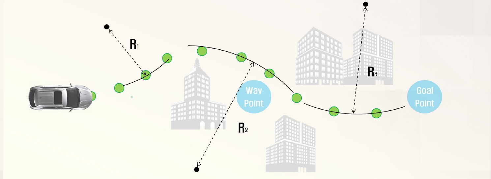

*그림 3. 경로의 구간마다 다른 곡률 반경 R1, R2, R3*

그림 3에서 초록색 점은 출발점부터 목표점(Goal Point)까지 놓인 경로 점, 즉 웨이포인트(Way Point)이고, 점선 화살표는 구간마다의 곡률 반경 $R_1$, $R_2$, $R_3$이다. 많이 휜 구간일수록 반경이 작다.

**곡률 반경 구하기.** 이웃한 세 경로 점 $W_1$, $W_2$, $W_3$를 지나는 원(외접원)의 반지름을 그 지점의 곡률 반경으로 쓴다. 세 변의 길이를 $a = \lvert W_2 W_3 \rvert$, $b = \lvert W_3 W_1 \rvert$, $c = \lvert W_1 W_2 \rvert$, 삼각형의 넓이를 $S$라 하면 다음과 같다. 세 점이 한 직선 위에 있으면 $S = 0$이므로 $R = \infty$(직선 구간)이다.

$$
R = \frac{abc}{4S}
$$

**최대 속도 구하기.** 반지름 $R$인 원을 속도 $V$로 달리는 차량에는 원의 중심 쪽으로 $a_y = V^2 / R$의 횡방향 가속도가 걸린다. 승차감을 위해 이 값을 $0.3g$($g = 9.81$ m/s²이므로 약 2.94 m/s²) 이하로 제한하면 $V^2 / R \le 0.3 g$이고, 이를 $V$에 대해 풀면 구간 $i$의 최대 속도가 나온다.

$$
V_i = \sqrt{0.3 \cdot g \cdot R_i}
$$

**계산 예.** 세 점이 $W_1 = (0, 0)$, $W_2 = (4, 1)$, $W_3 = (8, 0)$ m라 하자.

1. 변의 길이: $a = \lvert W_2 W_3 \rvert = \sqrt{4^2 + 1^2} = \sqrt{17} \approx 4.123$ m, $b = \lvert W_3 W_1 \rvert = 8$ m, $c = \lvert W_1 W_2 \rvert = \sqrt{17}$ m.
2. 넓이: 밑변 $W_3 W_1$의 길이가 8 m, 높이가 1 m이므로 $S = 8 \times 1 / 2 = 4$ m².
3. 곡률 반경: $R = \sqrt{17} \times 8 \times \sqrt{17} / (4 \times 4) = 136 / 16 = 8.5$ m.
4. 최대 속도: $V = \sqrt{0.3 \times 9.81 \times 8.5} = \sqrt{25.02} \approx 5.00$ m/s, 즉 약 18.0 km/h이다.

| 곡률 반경 $R$ | $0.3 g R$ (m²/s²) | 최대 속도 $V$ |
|:-----|:-----|:-----|
| 8.5 m | 25.02 | 5.00 m/s (18.0 km/h) |
| 12 m | 35.32 | 5.94 m/s (21.4 km/h) |
| 20 m | 58.86 | 7.67 m/s (27.6 km/h) |
| 50 m | 147.15 | 12.13 m/s (43.7 km/h) |
| 100 m | 294.30 | 17.16 m/s (61.8 km/h) |

*표 2. 곡률 반경에 따른 최대 속도(횡방향 가속도 0.3g 제한)*

최대 속도는 반경의 제곱근에 비례하므로, 반경이 4배가 되어도 속도는 2배만 늘어난다. 직선 구간($R = \infty$)에서는 이 식이 상한을 주지 않으므로 도로의 제한 속도 $V_{\max}$를 쓰고, 실제 프로파일은 $V_i = \min\left(V_{\max}, \sqrt{0.3 g R_i}\right)$로 정한 뒤 이웃한 점 사이의 속도 변화가 가속도 한계를 넘지 않게 다듬는다. 3주차의 twist_filter가 횡방향 가속도 한도로 목표 속도를 줄이는 것도 같은 원리이다.

### 1.4 장애물 회피 경로: swerve와 nudge

도로를 달리는 중에는 앞 차량이나 도로 시설물처럼 경로를 막는 장애물이 나타난다. 이를 피하는 경로는 두 종류의 경로 조각으로 만든다.

> **용어 정의:** **Swerve**는 장애물을 긴급하게 피하기 위해 짧은 거리 안에서 옆으로 크게 이동하는 경로이다. **Nudge**는 옆으로 조금 비켜 가거나 원래 경로로 완만하게 돌아오는, 긴 거리에 걸친 부드러운 경로이다.

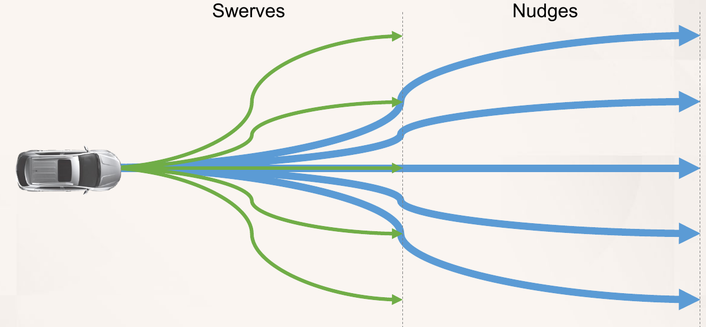

*그림 4. 차량에서 뻗어 나가는 swerve 경로(초록색)와 그 끝에서 이어지는 nudge 경로(파란색)*

그림 4에서 초록색 swerve 경로는 차량 앞의 짧은 구간에서 여러 횡방향 위치로 갈라지고, 파란색 nudge 경로는 각 swerve의 끝에서 이어져 긴 구간에 걸쳐 완만하게 휜다. 두 조각을 이어 붙이면 급한 회피와 완만한 복귀를 모두 표현하는 후보 경로의 집합이 생긴다. 회피는 장애물 탐색, 회피, 복귀의 세 단계로 진행한다.

**1단계: 장애물 탐색.** 전방 레이더와 카메라 같은 주변 환경 인지 센서로 움직이는 장애물의 위치와 속도를 담은 **동적 장애물 지도(dynamic obstacle map)** 를 만든다. 주행 경로 위에 장애물이 나타나면 회피 경로 생성을 시작하는 신호(trigger)를 낸다.

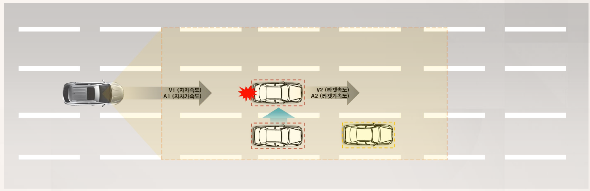

*그림 5. 자차(속도 V1, 가속도 A1)의 경로 위에 앞 차량(속도 V2, 가속도 A2)이 나타난 상황*

그림 5의 노란 영역은 센서의 탐지 범위이고, $V_1$, $A_1$은 자차의 속도와 가속도, $V_2$, $A_2$는 앞 차량(타깃)의 속도와 가속도이다. 빨간 점선 상자는 자차의 주행 경로에 들어와 회피 대상이 된 차량으로, 앞 차량과 아래 차로에서 자차의 차로로 끼어드는 차량(위쪽 화살표)이 이에 해당한다. 앞 차량 뒤의 빨간 표시는 충돌이 예상되는 지점이고, 노란 점선 상자는 경로를 막지 않는 차량이다. 두 차량의 속도와 가속도를 함께 보는 이유는 충돌까지 남은 시간을 판단하기 위해서이다. 예를 들어 앞 차량과의 간격이 30 m이고 $V_1 = 20$ m/s, $V_2 = 10$ m/s로 일정하다면, 간격이 초당 10 m씩 줄어 약 $30 / (20 - 10) = 3$ s 뒤에 충돌하므로 그 전에 회피를 시작해야 한다.

**2단계: 회피.** 생성한 swerve 경로와 nudge 경로마다 비용 함수(cost function)를 계산하고, 비용이 가장 작은 경로를 전방 장애물을 피하는 최적 경로로 고른다. 비용 함수에는 보통 장애물과 충돌하는지, 장애물과 얼마나 가까운지, 차선 중앙에서 얼마나 벗어나는지, 곡률이 얼마나 큰지(승차감) 같은 항을 가중치를 두어 더한다.

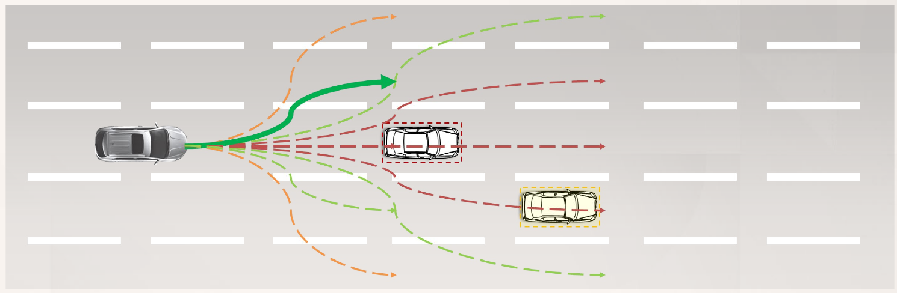

*그림 6. 회피 후보 경로들(점선)과 비용 함수로 고른 최적 회피 경로(초록색 실선)*

그림 6에서 빨간색 점선은 앞 차량이나 옆 차로의 차량과 부딪히는 후보이고, 초록색과 주황색 점선은 충돌하지 않는 후보이다. 비용이 가장 작은 초록색 실선, 즉 위쪽 차로로 비켜 가는 경로가 선택된다.

**3단계: 복귀.** 장애물을 지난 뒤에는 안전하게 원래 경로로 돌아오는 최적 경로를 다시 계산한다.

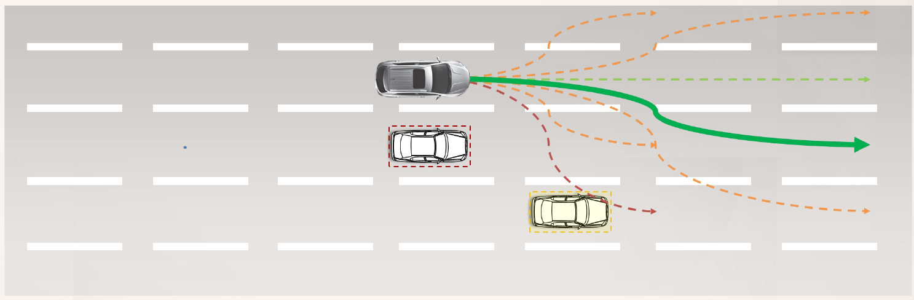

*그림 7. 장애물을 지난 뒤 원래 차로로 돌아오는 복귀 후보 경로들과 최적 복귀 경로(초록색 실선)*

그림 7에서 차량은 앞 차량을 지나 위쪽 차로에 있다. 아래 차로의 차량 쪽으로 내려가는 빨간색 점선 후보는 그 차량과 부딪히고, 나머지 점선 후보들은 충돌하지는 않지만 비용이 더 크므로, 완만하게 원래 차로로 돌아오는 초록색 실선이 선택된다.

### 1.5 횡방향 제어기의 개념과 구조

이 단원과 12주차에서 다루는 횡방향 제어기는 다음 네 가지 설계 개념을 따른다.

| 설계 개념 | 기대 효과 |
|:-----|:-----|
| 요레이트(yaw rate)를 직접 제어한다 | 차체의 회전 속도를 매끄럽게 만들어 승차감이 좋아진다 |
| 두 제어기를 연속 구조(cascade form)로 잇는다 | 경로 오차와 차량 운동을 나누어 다루므로 외란과 모델 오차에 강건해진다 |
| 차체 슬립각(sideslip angle)을 추정하여 쓴다 | 추종 정밀도가 높아진다(직선로 기준 최대 경로 오차 15 cm) |
| 기구학 모델과 동역학 모델을 함께 쓴다 | 저속에서 고속까지 전 속도 영역에서 쓸 수 있다 |

*표 3. 횡방향 제어기의 설계 개념과 기대 효과*

> **용어 정의:** **요(yaw)** 는 차체가 수직축을 중심으로 도는 회전이고, **요레이트(yaw rate)** 는 그 회전의 각속도(rad/s)이다. **차체 슬립각(sideslip angle)** 은 차량이 향한 방향(차체의 앞뒤 축)과 무게 중심이 실제로 움직이는 방향이 이루는 각이다.

제어기의 전체 구조는 다음과 같다.

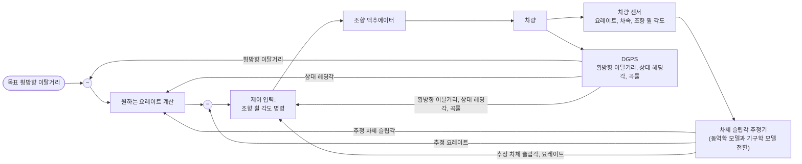

*그림 8. 횡방향 제어기의 구조*

그림 8의 흐름은 다음과 같다. 목표 횡방향 이탈거리(보통 0, 즉 경로 위)와 DGPS가 측정한 실제 횡방향 이탈거리의 차이로부터 **원하는 요레이트**를 계산하고, 이 값과 추정 요레이트의 차이로부터 조향 휠 각도 명령을 계산한다. 원하는 요레이트의 계산에는 상대 헤딩각과 추정 차체 슬립각이, 조향 휠 각도 명령의 계산에는 DGPS의 세 값과 추정 차체 슬립각, 추정 요레이트가 함께 쓰인다. 차량 센서는 요레이트, 차속, 조향 휠 각도를 재고, DGPS(차분 GPS, 13주차)는 경로에 대한 횡방향 이탈거리, 상대 헤딩각, 경로의 곡률을 잰다. 차체 슬립각은 직접 재기 어려우므로 추정기가 차량 센서 값으로 추정하며, 이때 속도에 따라 동역학 모델과 기구학 모델을 바꾸어 쓴다. 구조도의 예에서는 속도가 15 km/h 아래로 내려가면 기구학 모델로, 20 km/h 위로 올라가면 동역학 모델로 바꾼다. 두 임계값을 다르게 두는 이유(히스테리시스)와 각 단계의 식은 12주차에서 유도한다.

### 1.6 단일 트랙 모델(자전거 모델)

제어기를 설계하려면 조향각이 차량의 횡방향 운동을 어떻게 바꾸는지 나타내는 모델이 필요하다. 네 바퀴를 모두 다루면 식이 복잡하므로, 같은 축의 좌우 바퀴를 차체 중심선 위의 가상의 바퀴 하나로 바꾸어 생각한다. 이렇게 얻는 모델을 **단일 트랙 모델(single-track model)** 또는 **자전거 모델(bicycle model)** 이라 한다.

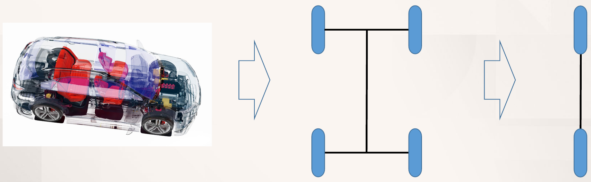

*그림 9. 네 바퀴 차량을 두 축의 모델로, 다시 앞뒤 바퀴 하나씩의 자전거 모델로 단순화하는 과정*

이 단순화는 좌우 바퀴가 거의 같은 각도로 조향되고, 좌우 하중 이동과 차체의 기울어짐(롤)을 무시할 수 있을 때 잘 맞는다. 같은 축의 두 바퀴가 내는 힘은 가상의 바퀴 하나가 내는 힘으로 합친다.

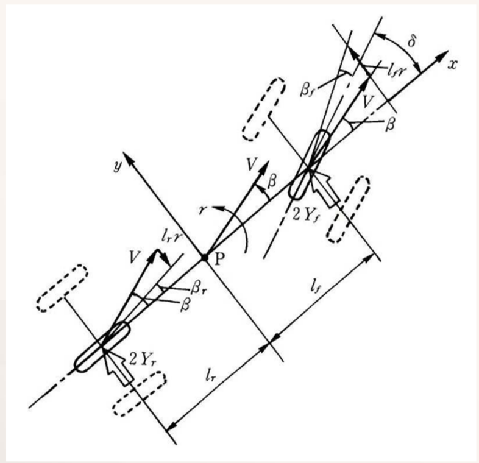

*그림 10. 자전거 모델의 기하 구조와 변수*

그림 10에서 P는 무게 중심, $x$축은 차체의 앞쪽, $y$축은 차체의 왼쪽이다. 무게 중심의 속도 $V$는 $x$축과 각 $\beta$를 이루고, 차체는 요레이트 $r$로 돈다. 앞바퀴는 $x$축에 대해 $\delta$만큼 조향되어 있으며, $l_f$와 $l_r$는 무게 중심에서 앞 축과 뒤 축까지의 거리이다. 앞바퀴와 뒷바퀴 위치에는 무게 중심의 속도 $V$에 회전 때문에 생기는 횡방향 속도 $l_f r$와 $l_r r$가 더해지며(2.1절), 그 결과 바퀴가 향한 방향과 바퀴가 움직이는 방향 사이에 각 $\beta_f$, $\beta_r$가 생긴다. 그림의 $2Y_f$, $2Y_r$는 좌우 타이어 두 개가 각각 $Y_f$, $Y_r$의 횡력을 낸다고 보고 축 전체의 횡력을 나타낸 표기이다.

> **주의:** 이 단원의 식은 축 하나의 좌우 타이어를 합친 값을 기준으로 한다. 즉 $Y_f$, $Y_r$는 앞 축과 뒤 축 전체의 횡력이고, 3.1절의 코너링 강성 $C_f$, $C_r$도 축 전체의 값이다. 타이어 하나 기준의 값(그림의 $Y_f$ 등)을 쓰는 문헌에서는 식에 2가 곱해져 나타난다.

자전거 모델은 앞바퀴뿐 아니라 뒷바퀴의 조향도 나타낼 수 있다. 바퀴마다 조향 각도를 따로 정하는 차량이 그 예이다.

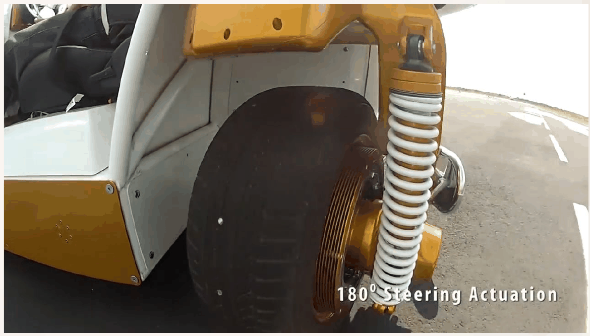

*그림 11. 바퀴마다 180°까지 조향하는 조향 모듈의 예*

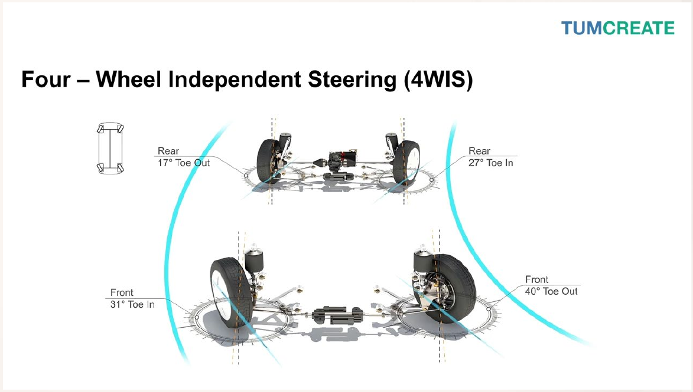

*그림 12. 네 바퀴 독립 조향(4WIS)에서 바퀴마다 다른 조향 각도*

그림 11은 NASA 존슨 우주 센터(JSC)의 차량에 쓰인, 바퀴 하나를 180°까지 돌리는 조향 모듈이다. 그림 12는 TUMCREATE의 **네 바퀴 독립 조향(four-wheel independent steering, 4WIS)** 으로, 바퀴마다 다른 각도로 꺾을 수 있다. 그림에서 앞바퀴 두 개는 31°(토인)와 40°(토아웃)만큼 같은 쪽으로, 뒷바퀴 두 개는 17°(토아웃)와 27°(토인)만큼 앞바퀴와 반대쪽으로 꺾여 있으며, 축마다 회전 중심에 가까운 안쪽 바퀴가 더 크게 꺾인다(토인은 바퀴의 앞쪽이 차체 중심선 쪽을, 토아웃은 바깥쪽을 향하는 것이다). 이런 차량을 자전거 모델로 나타내면 앞 축과 뒤 축의 가상 바퀴가 각각 조향각 $\delta_f$, $\delta_r$를 가진다(3.8절과 12주차의 기구학 모델). 보통의 승용차에서도 선회할 때 좌우 앞바퀴의 각도는 조금 다르며, 이 차이는 12주차에서 차량의 폭을 고려하여 다룬다.

### 1.7 상태 변수의 정의

자전거 모델의 변수는 다음과 같다.

| 기호 | 이름 | 뜻 |
|:-----|:-----|:-----|
| $\delta$ | 앞바퀴 조향각(front wheel angle) | 차체 $x$축에 대한 앞바퀴의 각도 |
| $\beta$ | 차체 슬립각(side slip angle) | 차체 $x$축과 무게 중심 속도가 이루는 각 |
| $V$ | 차속(vehicle speed) | 무게 중심 속도의 크기 |
| $r$ | 요레이트(yaw rate) | 차체가 수직축을 중심으로 도는 각속도 |
| P | 무게 중심(center of gravity) | 질량 $m$이 모여 있다고 보는 점 |
| $Y$ | 횡력(cornering force) | 타이어가 바퀴 축 방향(옆 방향)으로 내는 힘 |
| $l$ | 축간거리(wheelbase) | 앞 축과 뒤 축 사이의 거리, $l = l_f + l_r$ |

*표 4. 자전거 모델의 변수*

각도와 회전은 위에서 보았을 때 반시계 방향(왼쪽)을 양수로 잡는다. 이 가운데 시간에 따라 변하며 제어기가 다루는 **상태 변수(state variable)** 는 $\beta$와 $r$이고, 조향각 $\delta$는 입력, 차속 $V$는 천천히 변하는 값으로 보아 일정하다고 가정한다. 이 밖에 질량 $m$과 요 관성 모멘트 $I$(무게 중심을 지나는 수직축에 대한 관성 모멘트)가 차량 파라미터로 쓰인다.

---

 

## 2. 타이어 각도 관계

### 2.1 바퀴 위치의 속도

타이어가 내는 힘은 바퀴가 향한 방향과 바퀴가 실제로 움직이는 방향의 차이에 따라 정해진다. 그러므로 먼저 앞바퀴와 뒷바퀴 위치의 속도를 구한다. 차체를 강체로 보면, 무게 중심에서 앞으로 $l_f$ 떨어진 점의 속도는 무게 중심의 속도에 회전 때문에 생기는 속도를 더한 것이다. 반시계 방향으로 요레이트 $r$로 돌면, 앞쪽 점은 왼쪽($+y$)으로 $l_f r$, 뒤쪽 점은 오른쪽($-y$)으로 $l_r r$의 속도를 더 얻는다.

| 위치 | $x$ 방향 속도 | $y$ 방향 속도 |
|:-----|:-----|:-----|
| 무게 중심 P | $V \cos\beta$ | $V \sin\beta$ |
| 앞바퀴 | $V \cos\beta$ | $V \sin\beta + l_f r$ |
| 뒷바퀴 | $V \cos\beta$ | $V \sin\beta - l_r r$ |

*표 5. 차체 좌표계에서 본 무게 중심과 바퀴 위치의 속도 성분*

> **참고:** 강체 위의 두 점 P와 Q의 속도는 $\mathbf{v}_Q = \mathbf{v}_P + \boldsymbol{\omega} \times \overrightarrow{PQ}$의 관계를 가진다. 평면 운동에서 $\boldsymbol{\omega} = r\,\hat{\mathbf{z}}$이고 앞바퀴가 $\overrightarrow{PQ} = l_f \hat{\mathbf{x}}$에 있으면 $\boldsymbol{\omega} \times \overrightarrow{PQ} = r l_f \hat{\mathbf{y}}$이므로, 회전은 $x$ 방향 속도를 바꾸지 않고 $y$ 방향 속도만 $l_f r$만큼 바꾼다. 뒷바퀴는 $\overrightarrow{PQ} = -l_r \hat{\mathbf{x}}$이므로 $-l_r r \hat{\mathbf{y}}$이다.

### 2.2 타이어 슬립각

> **용어 정의:** **타이어 슬립각(tire slip angle)** $\alpha$는 바퀴가 향한 방향과 바퀴 위치의 속도 방향 사이의 각이다. 여기서는 속도 방향에서 바퀴가 향한 방향까지 반시계 방향으로 잰 각을 $\alpha$로 쓴다. 이렇게 정하면 $\alpha > 0$일 때 타이어는 $+y$ 방향(왼쪽)의 횡력을 낸다.

바퀴 위치의 속도가 차체 $x$축과 이루는 각을 $\theta_f$(앞바퀴), $\theta_r$(뒷바퀴)라 하자. 앞바퀴는 $x$축에 대해 $\delta$만큼, 뒷바퀴는 0만큼 향해 있으므로 두 바퀴의 슬립각은 다음과 같다.

$$
\alpha_f = \delta - \theta_f, \qquad \alpha_r = 0 - \theta_r = -\theta_r
$$

타이어가 완전히 구르기만 하면 바퀴는 향한 방향으로만 움직이므로 $\alpha = 0$이다. 선회 중에는 원의 중심 쪽 힘이 필요하고, 고무 타이어는 접지면이 옆으로 비틀리면서(슬립각이 생기면서) 그 힘을 낸다.

### 2.3 전륜의 각도 관계

앞바퀴 위치의 속도를 크기 $V_f$와 방향 $\theta_f = \delta - \alpha_f$로 나타내고, 표 5의 성분과 같다고 놓는다.

$$
\underbrace{V_f \sin(\delta - \alpha_f)}_{y\text{ 방향 바퀴 속도}} = \underbrace{l_f r + V \sin\beta}_{y\text{ 방향 차체 속도}}, \qquad \underbrace{V_f \cos(\delta - \alpha_f)}_{x\text{ 방향 바퀴 속도}} = \underbrace{V \cos\beta}_{x\text{ 방향 차체 속도}}
$$

두 식을 나누면 $V_f$가 지워진다.

$$
\tan(\delta - \alpha_f) = \frac{l_f r + V \sin\beta}{V \cos\beta}
$$

$\beta \ll 1$이면 $\sin\beta \approx \beta$, $\cos\beta \approx 1$이고, 우변 전체도 작은 값이므로 $\tan(\delta - \alpha_f) \approx \delta - \alpha_f$이다. 따라서 다음을 얻는다.

$$
\delta - \alpha_f \approx \beta + \frac{l_f r}{V} \quad \Longrightarrow \quad \alpha_f \approx \delta - \beta - \frac{l_f r}{V}
$$

앞바퀴의 슬립각은 조향각에서 차체 슬립각과 회전이 만드는 각 $l_f r / V$를 뺀 것이다. 조향을 더 하면 $\alpha_f$가 커져 앞바퀴의 횡력이 커지고, 차체가 이미 돌고 있으면($r > 0$) 그만큼 작아진다.

### 2.4 후륜의 각도 관계

뒷바퀴는 조향하지 않으므로 속도 방향은 $\theta_r = -\alpha_r$이다. 같은 방법으로 성분을 맞춘다.

$$
\underbrace{V_r \sin\alpha_r}_{y\text{ 방향 바퀴 속도}} = \underbrace{l_r r - V \sin\beta}_{y\text{ 방향 차체 속도}}, \qquad \underbrace{V_r \cos\alpha_r}_{x\text{ 방향 바퀴 속도}} = \underbrace{V \cos\beta}_{x\text{ 방향 차체 속도}}
$$

첫 식은 표 5의 $y$ 방향 속도 $V\sin\beta - l_r r$에 $-1$을 곱한 것이다. 바퀴의 속도 방향이 $-\alpha_r$이기 때문이다. 두 식을 나누고 작은 각도 근사를 쓰면 다음과 같다.

$$
\tan\alpha_r = \frac{l_r r - V \sin\beta}{V \cos\beta} \quad \Longrightarrow \quad \alpha_r \approx -\beta + \frac{l_r r}{V}
$$

> **참고:** 슬립각의 부호를 정하는 방식은 문헌마다 다르다. 그림 10의 $\beta_f$, $\beta_r$는 바퀴가 향한 방향에서 속도 방향까지 잰 각으로, 2.2절의 $\alpha_f$, $\alpha_r$와 부호만 반대이다($\beta_f = -\alpha_f = \beta + l_f r / V - \delta$, $\beta_r = -\alpha_r = \beta - l_r r / V$). 그래서 같은 횡력을 $Y_f = -C_f \beta_f$처럼 음의 부호를 붙여 쓰기도 한다 [2]. 강의자료는 전륜의 결과를 2.2절의 규약에 따라 $\beta_f = \delta - \beta - l_f r / V$로 쓰면서 3.1절의 힘 관계에서는 그림 10의 규약인 $Y_f = -C_f(\beta + l_f r / V - \delta)$를 써서 두 규약을 섞고, 후륜의 결과는 $\beta_r = -\beta - l_r r / V$로 쓰는데 이 식은 어느 규약에도 맞지 않는 오류이다. 후륜의 바른 결과는 2.2절의 규약에서 $\alpha_r \approx -\beta + l_r r / V$, 그림 10의 규약에서 $\beta_r \approx \beta - l_r r / V$이고, 강의자료의 힘 관계 $Y_r = -C_r(\beta - l_r r / V)$도 이 결과와 맞는다.

### 2.5 작은 각도 근사와 수치 예

작은 각도 근사가 얼마나 정확한지 수치로 확인한다. $V = 10$ m/s, $\beta = 0.02$ rad, $r = 0.2$ rad/s, $\delta = 0.08$ rad, $l_f = 1.15$ m, $l_r = 1.57$ m라 하자.

1. 차체 속도 성분: $V \sin\beta = 0.19999$ m/s, $V \cos\beta = 9.99800$ m/s이다.
2. 회전이 더하는 속도: $l_f r = 0.230$ m/s, $l_r r = 0.314$ m/s이다.
3. 앞바퀴: $\tan\theta_f = (0.19999 + 0.230) / 9.99800 = 0.043007$이므로 $\theta_f = 0.042981$ rad이고, $\alpha_f = 0.08 - 0.042981 = 0.037019$ rad이다. 근사식은 $0.08 - 0.02 - 0.023 = 0.037$ rad이다.
4. 뒷바퀴: $\tan\alpha_r = (0.314 - 0.19999) / 9.99800 = 0.011404$이므로 $\alpha_r = 0.011403$ rad이다. 근사식은 $-0.02 + 0.0314 = 0.0114$ rad이다.

| 값 | 정확한 식 | 근사식 | 차이 |
|:-----|:-----|:-----|:-----|
| $\alpha_f$ | 0.037019 rad (2.121°) | 0.037000 rad (2.120°) | 0.05% |
| $\alpha_r$ | 0.011403 rad (0.6533°) | 0.011400 rad (0.6532°) | 0.03% |

*표 6. 타이어 슬립각의 정확한 값과 작은 각도 근사의 비교*

각이 수 도 이내이면 근사의 오차는 무시할 만하다. 이 근사 덕분에 다음 절의 힘 관계가 상태 변수에 대해 선형이 된다.

> **[미적분학]** $\sin x$, $\cos x$, $\tan x$를 $x = 0$에서 테일러 전개하면 $\sin x = x - x^3/6 + \cdots$, $\cos x = 1 - x^2/2 + \cdots$, $\tan x = x + x^3/3 + \cdots$이다. $x$가 작으면 2차 이상의 항이 매우 작으므로 $\sin x \approx x$, $\cos x \approx 1$, $\tan x \approx x$로 둘 수 있다. $x = 0.1$ rad(약 5.7°)에서 $\tan x$의 상대 오차는 약 0.3%이다.

---

 

## 3. 힘 관계와 차량 파라미터 추정

### 3.1 선형 타이어 모델과 코너링 강성

타이어의 횡력은 슬립각이 작은 범위에서 슬립각에 거의 비례한다. 이 비례 상수를 **코너링 강성(cornering stiffness)** 이라 한다 [3].

> **용어 정의:** **코너링 강성** $C$는 슬립각이 0 근처일 때 횡력이 슬립각에 따라 늘어나는 기울기 $C = \partial Y / \partial \alpha \,\vert_{\alpha = 0}$이며 단위는 N/rad이다. 이 기울기로 횡력을 $Y = C\alpha$로 나타내는 모델을 **선형 타이어 모델(linear tire model)** 이라 한다.

2.3절과 2.4절의 슬립각을 넣으면 앞 축과 뒤 축의 횡력은 다음과 같다.

$$
Y_f = C_f \alpha_f = -C_f\left(\beta + \frac{l_f r}{V} - \delta\right), \qquad Y_r = C_r \alpha_r = -C_r\left(\beta - \frac{l_r r}{V}\right)
$$

2.5절의 예에서 $C_f = C_r = 70000$ N/rad이면 $Y_f = 70000 \times 0.037 = 2590$ N, $Y_r = 70000 \times 0.0114 = 798$ N이다. 두 힘 모두 왼쪽을 향하므로 차량은 왼쪽으로 선회하는 중이다.

> **주의:** 선형 관계는 슬립각이 작을 때(승용차 타이어에서 대략 수 도 이내)만 성립한다. 슬립각이 더 커지면 횡력의 증가가 둔해지다가 노면 마찰의 한계에서 포화되므로, 급선회나 미끄러운 노면에서는 비선형 타이어 모델이 필요하다.

### 3.2 횡방향 운동 방정식

뉴턴의 운동 법칙을 차체의 횡방향과 요 방향에 적용한다.

**횡방향 힘의 평형.** 차체 좌표계에서 무게 중심의 속도 성분은 $u = V\cos\beta$(앞쪽), $v = V\sin\beta$(왼쪽)이다. 차체 좌표계 자체가 요레이트 $r$로 돌기 때문에, 무게 중심의 횡방향 가속도는 $v$의 변화율에 회전에 의한 항 $u r$를 더한 $a_y = \dot v + u r$이다 [3]. 차속 $V$가 일정하고 $\beta$가 작으면 $v \approx V\beta$, $u \approx V$이므로 $a_y \approx V\dot\beta + V r = V(\dot\beta + r)$이다. 앞바퀴 횡력의 차체 $y$ 성분은 $Y_f\cos\delta \approx Y_f$이므로 다음을 얻는다.

$$
mV\left(\frac{d\beta}{dt} + r\right) = Y_f + Y_r
$$

**요 모멘트의 평형.** 앞 축의 횡력은 무게 중심에 대해 팔 길이 $l_f$로 반시계 방향 모멘트를, 뒤 축의 횡력은 팔 길이 $l_r$로 시계 방향 모멘트를 만든다.

$$
I\frac{dr}{dt} = l_f Y_f - l_r Y_r
$$

> **참고:** $a_y = \dot v + u r$의 $ur$ 항은 회전하는 좌표계에서 속도를 쟀기 때문에 생긴다. 차량이 일정한 속도 $V$로 반지름 $R$의 원을 정상 선회하면 $\dot\beta = 0$이고 $r = V/R$이므로 $a_y = V r = V^2/R$, 즉 익숙한 구심 가속도가 된다.

### 3.3 차체 슬립각과 요레이트의 상태 방정식

3.1절의 횡력을 3.2절의 두 식에 넣고 $\dot\beta$, $\dot r$에 대해 정리한다.

**1단계: 횡방향 식.** 우변을 전개한다.

$$
Y_f + Y_r = -(C_f + C_r)\beta + \frac{C_r l_r - C_f l_f}{V} r + C_f \delta
$$

좌변의 $mVr$를 우변으로 옮기고 양변을 $mV$로 나눈다.

$$
\dot\beta = -\frac{C_f + C_r}{mV}\beta + \left(-1 + \frac{C_r l_r - C_f l_f}{mV^2}\right) r + \frac{C_f}{mV}\delta
$$

**2단계: 요 방향 식.** 우변을 전개한다.

$$
l_f Y_f - l_r Y_r = (C_r l_r - C_f l_f)\beta - \frac{C_f l_f^2 + C_r l_r^2}{V} r + C_f l_f \delta
$$

양변을 $I$로 나눈다.

$$
\dot r = \frac{C_r l_r - C_f l_f}{I}\beta - \frac{C_f l_f^2 + C_r l_r^2}{IV} r + \frac{C_f l_f}{I}\delta
$$

**3단계: 행렬 형태.** 상태 벡터 $\mathbf{x} = [\beta \;\; r]^T$와 입력 $\delta$로 쓰면 다음과 같다.

$$
\begin{bmatrix} \dot\beta \\ \dot r \end{bmatrix} =
\begin{bmatrix}
-\dfrac{C_f + C_r}{mV} & -1 + \dfrac{C_r l_r - C_f l_f}{mV^2} \\
\dfrac{C_r l_r - C_f l_f}{I} & -\dfrac{C_f l_f^2 + C_r l_r^2}{IV}
\end{bmatrix}
\begin{bmatrix} \beta \\ r \end{bmatrix}
+
\begin{bmatrix} \dfrac{C_f}{mV} \\ \dfrac{C_f l_f}{I} \end{bmatrix} \delta
$$

이 식은 조향각이 차체 슬립각과 요레이트를 어떻게 바꾸는지 나타내는 **동역학적 자전거 모델(dynamic bicycle model)** 이다. 두 행렬을 차례로 $A$, $B$라 하면 $\dot{\mathbf{x}} = A\mathbf{x} + B\delta$이다. 행렬의 원소가 $1/V$, $1/V^2$를 포함하므로 같은 차량이라도 속도에 따라 응답이 달라진다.

> **참고:** 강의자료는 $\dot r$ 식을 $\dot r = \frac{C_r l_r + C_f l_f}{I}\beta - \frac{C_r l_r^2 - C_f l_f^2}{IV} r + \frac{C_f l_f}{I}\delta$로 적어 $\beta$ 계수와 $r$ 계수의 부호가 바뀌어 있다. $l_f Y_f - l_r Y_r$를 전개하면 위의 식처럼 $\beta$ 계수는 $C_r l_r - C_f l_f$(뺄셈)이고 $r$ 계수는 $-(C_f l_f^2 + C_r l_r^2)/(IV)$(분자는 덧셈)이다. $r$ 계수는 요 운동의 감쇠를 나타내므로 언제나 음수여야 하는데, 강의자료의 식에서는 $C_f l_f^2 > C_r l_r^2$인 차량에서 이 계수가 양수가 되어 물리적으로 맞지 않는다. 강의자료가 함께 제시한 횡방향 속도 형태의 행렬(3.6절)은 바른 부호를 쓴다.

### 3.4 동역학 모델의 가정

3.3절의 모델은 다음 가정 아래에서 성립한다 [3].

1. **일정한 차속:** 종방향 속도 $V$가 일정하거나 횡방향 운동보다 천천히 변한다.
2. **작은 각도:** $\beta$, $\delta$, 타이어 슬립각이 작아 삼각 함수를 1차 근사할 수 있다.
3. **선형 타이어 모델:** 횡력이 슬립각에 비례한다($Y = C\alpha$).
4. **단일 트랙:** 좌우 바퀴를 하나로 합치고, 롤과 좌우 하중 이동, 노면의 경사, 공기력을 무시한다.

가정 1과 2 때문에 이 모델은 차속이 일정한 구간의 작은 조향 입력에 대해 정확하다. 또 행렬 원소가 $1/V$에 비례하므로 $V$가 0에 가까운 저속에서는 쓸 수 없는데, 12주차에서 저속에는 기구학 모델을 쓰는 이유가 여기에 있다.

### 3.5 정상 선회 해석

조향각 $\delta$를 일정하게 유지하면 차량은 시간이 지나 $\dot\beta = 0$, $\dot r = 0$인 **정상 선회(steady-state cornering)** 에 이른다. 이때 상태는 $A\mathbf{x} + B\delta = 0$을 풀어 얻으며, 요레이트는 다음과 같이 정리된다 [2].

$$
r_{ss} = \frac{V}{l\,(1 + KV^2)}\,\delta, \qquad K = \frac{m\,(C_r l_r - C_f l_f)}{l^2 C_f C_r}
$$

$K$를 **안정 계수(stability factor)** 라 한다. $K = 0$이면 $r_{ss} = V\delta / l$로, 타이어 슬립이 없는 기구학 모델(3.8절)의 작은 조향각에서의 요레이트와 같다. $K > 0$이면 같은 조향에 대한 요레이트가 기구학 값보다 작고, 기구학 값에 대한 비율 $1/(1 + KV^2)$이 속도가 높을수록 더 작아지는데, 이를 **언더스티어(understeer)** 라 한다. $K < 0$이면 요레이트가 더 커지는 **오버스티어(oversteer)** 이며, $1 + KV^2 = 0$이 되는 속도 이상에서는 차량이 불안정해진다.

**계산 예.** 3.7절에서 추정한 파라미터 $m = 1999.1$ kg, $I = 2573.4$ kg m², $l_f = 0.5412$ m, $l_r = 2.3038$ m, $C_f = 136180$ N/rad, $C_r = 50544$ N/rad로 $\delta = 0.02$ rad의 정상 선회를 계산한다.

1. 축간거리: $l = 0.5412 + 2.3038 = 2.845$ m.
2. 안정 계수: $C_r l_r - C_f l_f = 116443 - 73701 = 42743$ N이므로 $K = 1999.1 \times 42743 / (2.845^2 \times 136180 \times 50544) = 0.001534$ s²/m²이다. $K > 0$이므로 언더스티어 차량이다.
3. 40 km/h($V = 11.11$ m/s): $1 + KV^2 = 1.189$이고 $r_{ss} = 11.11 \times 0.02 / (2.845 \times 1.189) = 0.0657$ rad/s(3.76°/s)이다.
4. 80 km/h($V = 22.22$ m/s): $1 + KV^2 = 1.757$이고 $r_{ss} = 0.0889$ rad/s(5.09°/s)이다.

| 차속 | 정상 요레이트 $r_{ss}$ | 기구학 요레이트 $V\delta/l$ | 정상 차체 슬립각 $\beta_{ss}$ | 횡방향 가속도 $V r_{ss}$ |
|:-----|:-----|:-----|:-----|:-----|
| 40 km/h | 0.0657 rad/s (3.76°/s) | 0.0781 rad/s | 0.0081 rad (0.47°) | 0.73 m/s² (0.074g) |
| 80 km/h | 0.0889 rad/s (5.09°/s) | 0.1562 rad/s | −0.0056 rad (−0.32°) | 1.98 m/s² (0.20g) |

*표 7. 추정 파라미터로 계산한 조향각 0.02 rad의 정상 선회 응답*

속도를 두 배로 높이면 기구학 요레이트는 두 배가 되지만 실제 요레이트는 1.35배에 그친다. 또 저속에서는 $\beta_{ss} > 0$(무게 중심이 선회 안쪽을 향해 움직임)이지만 고속에서는 $\beta_{ss} < 0$이 된다. 고속에서는 큰 횡력을 내기 위해 뒷바퀴에도 큰 슬립각이 필요하고, 그만큼 차체가 진행 방향보다 안쪽을 향하기 때문이다.

### 3.6 횡방향 속도를 상태로 쓰는 형태

차체 슬립각 대신 무게 중심의 횡방향 속도 $v = V\beta$를 상태로 쓰기도 한다. $V$가 일정하면 $\dot v = V\dot\beta$이고 $\beta = v/V$이므로, 3.3절의 식에 대입하여 정리하면 다음과 같다.

$$
\begin{bmatrix} \dot r \\ \dot v \end{bmatrix} =
\begin{bmatrix}
-\dfrac{C_r l_r^2 + C_f l_f^2}{I V} & \dfrac{C_r l_r - C_f l_f}{I V} \\
-V + \dfrac{C_r l_r - C_f l_f}{mV} & -\dfrac{C_f + C_r}{mV}
\end{bmatrix}
\begin{bmatrix} r \\ v \end{bmatrix}
+
\begin{bmatrix} \dfrac{C_f l_f}{I} \\ \dfrac{C_f}{m} \end{bmatrix} \delta
$$

예를 들어 $\dot r$ 식의 $\beta$ 항 $\frac{C_r l_r - C_f l_f}{I}\beta$에 $\beta = v/V$를 넣으면 $\frac{C_r l_r - C_f l_f}{IV}v$가 된다. 두 형태는 같은 물리를 다른 변수로 쓴 것이므로 고유값(응답의 빠르기와 진동)이 같다. 3.7절의 파라미터 추정 모델은 이 형태를 쓰고, 출력으로 요레이트 $r$와 횡방향 가속도 $a_y = \dot v + V r$를 낸다.

### 3.7 차량 파라미터 추정

3.3절의 모델을 실제 차량에 쓰려면 $m$, $I$, $l_f$, $l_r$, $C_f$, $C_r$의 값이 필요하다. 질량은 저울로 잴 수 있지만 코너링 강성과 관성 모멘트는 직접 재기 어렵다. 그래서 차량을 실제로 몰아 입력(차속, 조향)과 출력(요레이트, 횡방향 가속도)을 기록하고, 같은 입력을 넣은 모델의 출력이 측정값과 가장 가까워지도록 파라미터를 고른다. 이를 **파라미터 추정(parameter estimation)** 또는 시스템 식별이라 한다.

**1단계: 센서 오차 확인.** 추정에 쓸 센서가 믿을 만한지 먼저 확인한다.

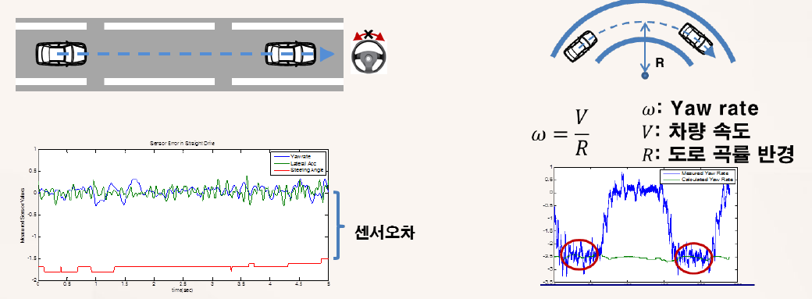

*그림 13. 직선 주행과 곡선 주행으로 차량 센서의 오차를 확인하는 방법*

- **직선 주행:** 조향 없이 곧게 달리면 요레이트, 횡방향 가속도, 조향각이 모두 0이어야 한다. 그림 13의 왼쪽 그래프에서 요레이트(파란색)와 횡방향 가속도(초록색)는 0 주위에서 잡음만 보이지만, 조향각(빨간색)은 0이 아닌 일정한 값에 머문다. 이 값이 센서의 영점 오차(오프셋)이므로 측정값에서 빼서 보정한다.
- **곡선 주행:** 반경 $R$을 아는 곡선 도로를 차속 $V$로 달리면 요레이트는 $\omega = V/R$이어야 한다. 예를 들어 $V = 10$ m/s로 반경 50 m의 곡선을 돌면 $\omega = 0.2$ rad/s(11.46°/s)이다. 그림 13의 오른쪽 그래프는 측정한 요레이트(파란색)와 이 식으로 계산한 요레이트(초록색)를 비교한다. 빨간색 원으로 표시한 곡선 주행 구간에서 측정값이 계산값 주위에서 흔들리며 겹치므로 요레이트 센서에 큰 오차가 없음을 알 수 있고, 두 값이 계속 어긋난다면 센서에 오차가 있다고 판단한다.

**2단계: 횡방향 거동 실험.** 모델이 다양한 운동을 재현하도록 여러 조향 패턴으로 차량의 상태 정보를 얻는다.

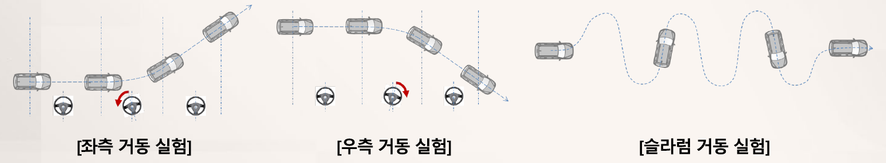

*그림 14. 왼쪽 거동 실험, 오른쪽 거동 실험, 슬라럼 거동 실험의 조향 패턴*

왼쪽과 오른쪽 거동 실험은 직진하다가 조향 휠을 한쪽으로 돌렸다가 가운데로 되돌려, 진행 방향을 그쪽으로 바꾼 뒤 다시 곧게 달리고, 슬라럼 실험은 조향 휠을 좌우로 반복해 돌려 S자로 달린다. 계단 모양의 입력과 주기적인 입력을 모두 넣으므로 응답의 크기와 빠르기를 함께 볼 수 있다.

**3단계: 모델 기반 추정.** 3.6절의 모델을 Simulink로 만들고 Simulink의 파라미터 추정 도구로 파라미터를 맞춘다.

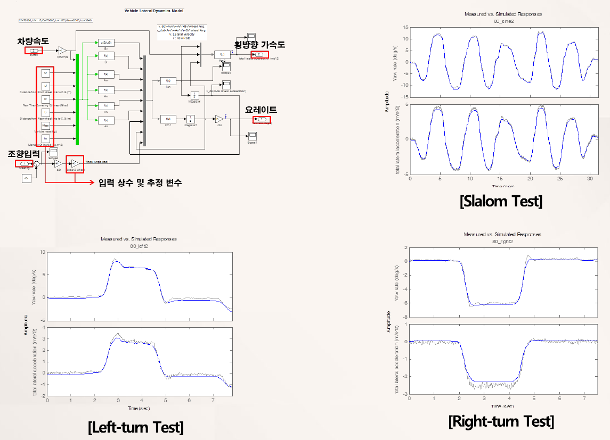

*그림 15. 횡방향 동역학 Simulink 모델과 슬라럼, 왼쪽 선회, 오른쪽 선회 실험의 측정 응답과 모델 응답*

그림 15의 왼쪽 위 Simulink 모델은 차량 속도(km/h를 m/s로 바꾸는 이득을 거침)와 조향 입력을 입력으로 받는다. 조향 입력에는 1단계에서 찾은 영점 오차를 보정하는 상수가 더해지고, 도를 라디안으로 바꾸는 이득과 조향 휠 각도를 바퀴 각도로 바꾸는 조향비 이득(Steer 2 Wheel)을 거친다. 빨간 상자로 묶인 입력 상수와 추정 변수는 $C_f$, $l_f$, $C_r$, $l_r$, 질량, 관성 모멘트와 조향비 이득이며, 초기값은 $C_f = C_r = 70000$ N/rad, $l_f = 1.15$ m, $l_r = 1.57$ m, $m = 2000$ kg, $I = 3340$ kg m²로 주어진다. 모델은 $\dot v = A_{vv} v + A_{vr} r + B_v \delta$, $\dot r = A_{rv} v + A_{rr} r + B_r \delta$를 적분하여 요레이트와 횡방향 가속도를 출력한다. 추정 도구는 측정 응답과 모델 응답의 차이 제곱합 같은 비용을 최소화하도록 파라미터를 반복해서 고친다. 나머지 그래프는 슬라럼, 왼쪽 선회, 오른쪽 선회 실험에서 요레이트(위)와 횡방향 가속도(아래)의 측정값과 모델 출력을 겹쳐 그린 것으로, 두 곡선이 거의 겹친다. 슬라럼 실험에서는 요레이트가 약 ±12°/s, 횡방향 가속도가 약 ±5 m/s²로 진동하고, 왼쪽 선회 실험에서는 각각 약 7°/s와 3 m/s², 오른쪽 선회 실험에서는 약 −6°/s와 −2.3 m/s²의 계단 모양 응답이 나타난다.

**4단계: 추정 결과.** 추정한 파라미터는 다음과 같다.

| 파라미터 | 추정값 | 단위 |
|:-----|:-----|:-----|
| 질량 $m$ | 1999.1 | kg |
| 요 관성 모멘트 $I$ | 2573.4 | kg m² |
| 무게 중심에서 앞 축까지 $l_f$ | 0.5412 | m |
| 무게 중심에서 뒤 축까지 $l_r$ | 2.3038 | m |
| 앞 축 코너링 강성 $C_f$ | 136180 | N/rad |
| 뒤 축 코너링 강성 $C_r$ | 50544 | N/rad |

*표 8. 횡방향 모델로 추정한 차량 파라미터*

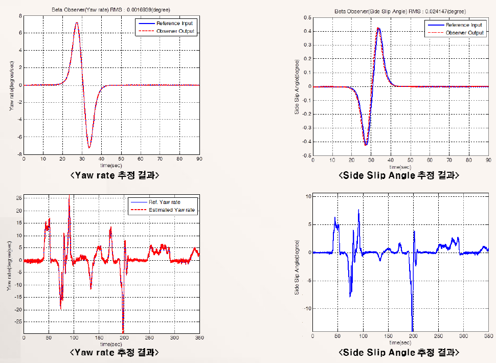

*그림 16. 추정 파라미터로 만든 관측기의 요레이트와 차체 슬립각 추정 결과(위: 시뮬레이션, 아래: 실차 주행)*

그림 16은 추정한 파라미터로 만든 상태 관측기가 요레이트와 차체 슬립각을 얼마나 잘 추정하는지 보여 준다. 위의 두 그래프는 시뮬레이션으로, 기준 입력(파란색)과 관측기 출력(빨간 점선)이 거의 겹치며 RMS 오차가 요레이트 0.0016939°/s, 차체 슬립각 0.024147°이다. 아래의 두 그래프는 실차 주행에서 측정한 요레이트와 추정 요레이트(두 곡선이 거의 겹친다), 그리고 추정한 차체 슬립각이다. 상태 관측기의 원리는 12주차에서 다룬다.

> **주의:** 추정값은 측정 응답을 가장 잘 재현하는 모델의 **등가 파라미터**이다. 표 8의 $l_f = 0.54$ m, $l_r = 2.30$ m는 초기값(1.15 m, 1.57 m)과 크게 다르고 축간거리도 2.845 m로 달라지는데, 모델이 무시한 롤, 하중 이동, 조향 계통의 유연성 같은 효과를 파라미터가 함께 흡수하기 때문이다. 따라서 추정값을 실제 무게 중심 위치로 해석하지 않고, 같은 모델 구조 안에서만 쓴다.

3.3절의 동역학 모델은 저속에서 쓸 수 없으므로, 제어기는 저속에서 타이어 슬립을 무시한 기구학 모델(3.8절)을 함께 쓴다. 두 모델의 전환은 12주차에서 다룬다.

### 3.8 저속의 기구학 모델

저속에서는 선회에 필요한 횡력 $mV^2/R$이 작아 타이어 슬립각을 0으로 볼 수 있다. 그러면 앞바퀴와 뒷바퀴 위치의 속도가 각 바퀴가 향한 방향과 같아지므로, 힘을 쓰지 않고 기하 관계만으로 운동을 나타내는 **기구학적 자전거 모델(kinematic bicycle model)** 을 얻는다 [3]. 앞바퀴를 A, 뒷바퀴를 B, 무게 중심을 C, 앞바퀴와 뒷바퀴의 조향각을 $\delta_f$, $\delta_r$라 한다(앞 절들의 $\delta$는 $\delta_r = 0$일 때의 $\delta_f$이다). $\psi$는 전역 좌표계 $(X, Y)$에서 본 차체의 **헤딩각(heading angle)** 이고, O는 A에서 앞바퀴 속도에 수직인 선과 B에서 뒷바퀴 속도에 수직인 선이 만나는 **순간 회전 중심(instantaneous rolling center)**, $R = \lvert OC \rvert$는 무게 중심의 회전 반경이다.

삼각형 OCA와 OCB에 사인 법칙(삼각형의 각 변의 길이와 그 대각의 사인의 비가 일정하다는 법칙)을 적용하고 정리하면 다음 두 식을 얻는다.

$$
\frac{\sin(\delta_f - \beta)}{l_f} = \frac{\sin\left(\frac{\pi}{2} - \delta_f\right)}{R} \;\Longrightarrow\; \tan\delta_f\cos\beta - \sin\beta = \frac{l_f}{R} \qquad \text{(식 1)}
$$

$$
\frac{\sin(\beta - \delta_r)}{l_r} = \frac{\sin\left(\frac{\pi}{2} + \delta_r\right)}{R} \;\Longrightarrow\; \sin\beta - \tan\delta_r\cos\beta = \frac{l_r}{R} \qquad \text{(식 2)}
$$

(식 1)과 (식 2)를 더하면 $(\tan\delta_f - \tan\delta_r)\cos\beta = (l_f + l_r)/R$ (식 3)이다. 저속에서 회전 반경이 천천히 변하면 차체 전체가 O를 중심으로 돌므로 요레이트는 $\dot\psi = V/R$이고, 여기에 (식 3)을 넣으면 요레이트가 조향각으로 표현된다. 또 (식 2)에 $l_f$를, (식 1)에 $l_r$를 곱해 빼면 $R$이 지워져 차체 슬립각이 정해진다. 무게 중심 속도의 방향은 전역 좌표계에서 $\psi + \beta$이므로 모델은 다음과 같다.

$$
\begin{aligned}
\dot X &= V\cos(\psi + \beta), \qquad \dot Y = V\sin(\psi + \beta) \\
\dot\psi &= \frac{V\cos\beta}{l_f + l_r}\left(\tan\delta_f - \tan\delta_r\right), \qquad \beta = \tan^{-1}\left(\frac{l_f\tan\delta_r + l_r\tan\delta_f}{l_f + l_r}\right)
\end{aligned}
$$

이 모델은 $V$로 나누는 항이 없으므로 정지 직전의 저속에서도 쓸 수 있다. 앞바퀴만 조향하고($\delta_r = 0$) 조향각이 작으면 $\dot\psi \approx V\delta_f / l$로, 3.5절에서 $K = 0$인 경우와 같다. 각 삼각형의 각을 구하는 과정과 계산 예, 차량의 폭을 고려한 확장은 12주차 1절에서 다룬다.

---

 

## 개념 적용

**T/F 점검:**

| 문장 | 판단과 근거 |
|:-----|:-----|
| 곡률 반경이 4배가 되면 횡방향 가속도 제한으로 정한 최대 속도도 4배가 된다. | **F.** $V = \sqrt{0.3 g R}$이므로 최대 속도는 반경의 제곱근에 비례하여 2배가 된다. |
| Swerve는 장애물을 긴급하게 피하는 짧은 경로이고, nudge는 완만하게 비켜 가거나 복귀하는 긴 경로이다. | **T.** 두 조각을 이어 급한 회피와 완만한 복귀를 함께 표현한다. |
| 자전거 모델에서 회전은 바퀴 위치의 $x$ 방향 속도를 바꾸지 않는다. | **T.** $\boldsymbol{\omega} \times \overrightarrow{PQ}$는 $y$ 방향이므로 앞바퀴는 $+l_f r$, 뒷바퀴는 $-l_r r$의 $y$ 방향 속도만 더해진다. |
| 뒷바퀴의 슬립각은 작은 각도에서 $\alpha_r \approx -\beta - l_r r / V$이다. | **F.** $\tan\alpha_r = (l_r r - V\sin\beta)/(V\cos\beta)$이므로 $\alpha_r \approx -\beta + l_r r / V$이다. |
| 동역학적 자전거 모델은 차속이 0에 가까울 때도 그대로 쓸 수 있다. | **F.** 행렬 원소가 $1/V$, $1/V^2$에 비례하여 저속에서 매우 커지므로 저속에는 기구학 모델을 쓴다. |
| 안정 계수 $K$가 양수인 차량은 같은 조향에 대해 기구학 모델보다 작은 요레이트를 낸다. | **T.** $r_{ss} = V\delta / (l(1 + KV^2))$에서 $1 + KV^2 > 1$이므로 언더스티어이다. |

---

 

## 요약

| 개념 | 핵심 요약 |
|:-----|:-----|
| 경로 평활화 | Hybrid A\* 경로의 불필요한 꺾임을 보로노이, 장애물, 곡률, 평활 항의 가중합을 줄이는 최적화로 편다. |
| 속도 프로파일 | 세 점의 외접원으로 곡률 반경 $R_i$를 구하고, 횡방향 가속도를 $0.3g$로 제한한 $V_i = \sqrt{0.3 g R_i}$를 최대 속도로 쓴다. |
| Swerve와 nudge | 긴급 회피용의 짧은 swerve와 완만한 비켜 가기와 복귀용의 nudge를 이어 후보 경로를 만들고, 비용이 가장 작은 경로를 고른다. |
| 회피의 세 단계 | 동적 장애물 지도로 장애물을 탐색하고, 비용 함수로 회피 경로를 고르고, 장애물을 지난 뒤 복귀 경로를 계산한다. |
| 횡방향 제어기 구조 | 횡방향 이탈거리로 원하는 요레이트를, 요레이트 오차로 조향 휠 각도를 정하는 연속 구조이며, 차체 슬립각을 추정하여 쓴다. |
| 자전거 모델 | 같은 축의 좌우 바퀴를 중심선 위의 바퀴 하나로 합쳐, 상태 $\beta$, $r$와 입력 $\delta$로 횡방향 운동을 나타낸다. |
| 타이어 슬립각 | 바퀴가 향한 방향과 바퀴 속도 방향의 차이로, 작은 각도에서 $\alpha_f \approx \delta - \beta - l_f r / V$, $\alpha_r \approx -\beta + l_r r / V$이다. |
| 선형 타이어 모델 | 작은 슬립각에서 횡력은 $Y = C\alpha$이고, $C$는 축 전체의 코너링 강성(N/rad)이다. |
| 운동 방정식 | $mV(\dot\beta + r) = Y_f + Y_r$, $I\dot r = l_f Y_f - l_r Y_r$를 정리하면 $\beta$, $r$에 대한 2차 선형 상태 방정식이 된다. |
| 정상 선회 | $r_{ss} = V\delta / (l(1 + KV^2))$이고, 안정 계수 $K > 0$이면 언더스티어이다. |
| 파라미터 추정 | 센서 오차를 보정하고 여러 거동 실험의 응답에 모델 출력을 맞추어 $m$, $I$, $l_f$, $l_r$, $C_f$, $C_r$의 등가값을 구한다. |
| 기구학 모델 | 저속에서 슬립각을 0으로 보고 사인 법칙으로 $\dot\psi = V\cos\beta(\tan\delta_f - \tan\delta_r)/(l_f + l_r)$와 차체 슬립각을 구하며, $V$로 나누는 항이 없어 저속에서도 쓸 수 있다. |

---

 

## 점검 문제

1. **속도 프로파일:** 경로 위의 세 점이 (0, 0), (6, 2), (12, 0) m이다. 이 지점의 곡률 반경과, 횡방향 가속도를 $0.3g$로 제한할 때의 최대 속도를 구하라($g = 9.81$ m/s²).

   

   
정답

   변의 길이는 $a = c = \sqrt{6^2 + 2^2} = \sqrt{40} \approx 6.325$ m, $b = 12$ m이고, 넓이는 $S = 12 \times 2 / 2 = 12$ m²이다. 곡률 반경은 $R = abc / (4S) = 40 \times 12 / 48 = 10$ m이다. 최대 속도는 $V = \sqrt{0.3 \times 9.81 \times 10} = \sqrt{29.43} \approx 5.42$ m/s, 즉 약 19.5 km/h이다.

   

2. **Swerve와 nudge:** 회피 경로를 swerve와 nudge 두 종류의 조각으로 나누어 만드는 이유를 설명하라.

   

   
정답

   장애물이 갑자기 나타나면 짧은 거리 안에서 크게 옆으로 비켜야 하므로 급한 횡방향 이동(swerve)이 필요하다. 반면 장애물을 지난 뒤 원래 차로로 돌아오거나 조금 비켜 가는 동작은 승차감과 안정성을 위해 긴 거리에 걸쳐 완만해야 한다(nudge). 두 조각을 이어 붙이면 여러 횡방향 위치와 복귀 방식을 조합한 후보 경로를 만들 수 있고, 비용 함수로 그중 가장 좋은 경로를 고를 수 있다.

   

3. **바퀴 위치의 속도:** 차체가 반시계 방향으로 $r$로 돌 때 앞바퀴와 뒷바퀴 위치에 더해지는 횡방향 속도의 크기와 방향을 쓰고, 그 이유를 설명하라.

   

   
정답

   앞바퀴에는 $+y$ 방향(왼쪽)으로 $l_f r$, 뒷바퀴에는 $-y$ 방향(오른쪽)으로 $l_r r$가 더해진다. 강체의 속도 관계 $\mathbf{v}_Q = \mathbf{v}_P + \boldsymbol{\omega} \times \overrightarrow{PQ}$에서 $\boldsymbol{\omega} = r\hat{\mathbf{z}}$와 앞쪽 위치 $l_f \hat{\mathbf{x}}$의 외적은 $r l_f \hat{\mathbf{y}}$, 뒤쪽 위치 $-l_r\hat{\mathbf{x}}$와의 외적은 $-r l_r \hat{\mathbf{y}}$이기 때문이다.

   

4. **타이어 슬립각:** $V = 15$ m/s, $\beta = 0.01$ rad, $r = 0.1$ rad/s, $\delta = 0.05$ rad, $l_f = 1.2$ m, $l_r = 1.6$ m일 때 작은 각도 근사로 $\alpha_f$와 $\alpha_r$를 구하라.

   

   
정답

   $\alpha_f \approx \delta - \beta - l_f r / V = 0.05 - 0.01 - 0.12/15 = 0.05 - 0.01 - 0.008 = 0.032$ rad이다. $\alpha_r \approx -\beta + l_r r / V = -0.01 + 0.16/15 = -0.01 + 0.01067 = 0.00067$ rad이다. 뒷바퀴의 슬립각은 거의 0이므로 이 순간 뒤 축은 횡력을 거의 내지 않는다.

   

5. **상태 방정식 유도:** $Y_f = -C_f(\beta + l_f r / V - \delta)$, $Y_r = -C_r(\beta - l_r r / V)$를 $mV(\dot\beta + r) = Y_f + Y_r$에 넣어 $\dot\beta$의 식을 유도하라.

   

   
정답

   우변은 $-(C_f + C_r)\beta + \frac{C_r l_r - C_f l_f}{V} r + C_f\delta$이다. 좌변의 $mVr$를 우변으로 옮기면 $mV\dot\beta = -(C_f + C_r)\beta + \left(\frac{C_r l_r - C_f l_f}{V} - mV\right) r + C_f\delta$이고, 양변을 $mV$로 나누면 $\dot\beta = -\frac{C_f + C_r}{mV}\beta + \left(-1 + \frac{C_r l_r - C_f l_f}{mV^2}\right) r + \frac{C_f}{mV}\delta$이다.

   

6. **정상 선회:** $m = 1500$ kg, $l_f = 1.1$ m, $l_r = 1.5$ m, $C_f = 80000$ N/rad, $C_r = 90000$ N/rad인 차량의 안정 계수를 구하고, 언더스티어인지 오버스티어인지 판단하라. 또 $V = 20$ m/s, $\delta = 0.02$ rad일 때 정상 요레이트를 구하라.

   

   
정답

   $C_r l_r - C_f l_f = 135000 - 88000 = 47000$ N이고 $l = 2.6$ m이므로 $K = 1500 \times 47000 / (2.6^2 \times 80000 \times 90000) = 70500000 / 48672000000 \approx 0.001448$ s²/m²이다. $K > 0$이므로 언더스티어이다. $1 + KV^2 = 1 + 0.001448 \times 400 = 1.579$이므로 $r_{ss} = 20 \times 0.02 / (2.6 \times 1.579) \approx 0.0974$ rad/s(약 5.58°/s)이다. 기구학 값 $V\delta/l = 0.154$ rad/s보다 작다.

   

7. **모델의 가정:** 3.3절의 동역학 모델이 급선회나 정지 직전의 저속에서 맞지 않는 이유를 각각 설명하라.

   

   
정답

   급선회에서는 타이어 슬립각이 커져 횡력이 슬립각에 비례한다는 선형 타이어 모델이 성립하지 않고, 작은 각도 근사도 부정확해진다. 정지 직전의 저속에서는 행렬 원소가 $1/V$, $1/V^2$에 비례하여 매우 커지므로 모델이 수치적으로 불안정해지고, 작은 측정 오차도 큰 슬립각 계산으로 이어진다. 그래서 저속에는 타이어 슬립을 무시한 기구학 모델을 쓴다.

   

8. **파라미터 추정:** 직선 주행 실험에서 조향각 센서가 0이 아닌 일정한 값을 계속 보였다. 이 값을 보정하지 않고 파라미터를 추정하면 어떤 문제가 생기는지 설명하라.

   

   
정답

   실제 바퀴 각도는 0인데 모델에는 0이 아닌 조향 입력이 들어가므로, 모델은 직진 중에도 요레이트와 횡방향 가속도가 생긴다고 계산한다. 추정 도구는 이 불일치를 줄이려고 코너링 강성이나 길이 파라미터를 잘못된 값으로 바꾸게 되어, 추정 결과가 실제 차량의 응답을 잘못 나타낸다. 그래서 직선 주행으로 영점 오차를 먼저 찾아 빼야 한다.

   

---

 

## 참고 문헌

1. D. Dolgov, S. Thrun, M. Montemerlo, and J. Diebel, "Path planning for autonomous vehicles in unknown semi-structured environments," *Int. J. Robot. Res.*, vol. 29, no. 5, pp. 485-501, 2010, doi: 10.1177/0278364909359210.
2. M. Abe, *Vehicle Handling Dynamics: Theory and Application*, 2nd ed. Oxford, U.K.: Butterworth-Heinemann, 2015.
3. R. Rajamani, *Vehicle Dynamics and Control*, 2nd ed. New York, NY, USA: Springer, 2012, doi: 10.1007/978-1-4614-1433-9.
