# Week 11 Lecture — Lateral Control of Autonomous Vehicles I

[Repository Guide](../../README.md) | [English](Concepts_Lecture.md) | [한국어](Concepts_Lecture.ko.md)

> **Last Updated:** 2026-11-04

> **Learning Objectives:**
> 1. Explain why a Hybrid A\* path is smoothed, and compute the maximum speed that respects ride comfort from the radius of curvature obtained from waypoints
> 2. Explain the roles of swerves and nudges that make up an obstacle avoidance path, and the stages of obstacle detection, avoidance, and return
> 3. Explain the design concept and structure of the lateral controller, and define the bicycle model and its state variables
> 4. Derive the tire slip angles of the front and rear wheels from the velocities at the wheel positions, and apply the small-angle approximation
> 5. Derive the state equations of the sideslip angle and the yaw rate from a linear tire model and the equations of motion, and compute the steady-state cornering response
> 6. Explain the procedure for estimating the vehicle parameters of a lateral model from driving test data

---

## Table of Contents

- [1. Path Post-Processing and the Structure of the Lateral Controller](#1-path-post-processing-and-the-structure-of-the-lateral-controller)
  - [1.1 The Role of Lateral Control](#11-the-role-of-lateral-control)
  - [1.2 Smoothing a Hybrid A\* Path](#12-smoothing-a-hybrid-a-path)
  - [1.3 Velocity Profile from the Radius of Curvature](#13-velocity-profile-from-the-radius-of-curvature)
  - [1.4 Obstacle Avoidance Paths: Swerves and Nudges](#14-obstacle-avoidance-paths-swerves-and-nudges)
  - [1.5 Concept and Structure of the Lateral Controller](#15-concept-and-structure-of-the-lateral-controller)
  - [1.6 The Single-Track Model (Bicycle Model)](#16-the-single-track-model-bicycle-model)
  - [1.7 Definition of the State Variables](#17-definition-of-the-state-variables)
- [2. Tire Angle Relations](#2-tire-angle-relations)
  - [2.1 Velocities at the Wheel Positions](#21-velocities-at-the-wheel-positions)
  - [2.2 Tire Slip Angle](#22-tire-slip-angle)
  - [2.3 Front Tire Angle Relation](#23-front-tire-angle-relation)
  - [2.4 Rear Tire Angle Relation](#24-rear-tire-angle-relation)
  - [2.5 Small-Angle Approximation and a Numerical Example](#25-small-angle-approximation-and-a-numerical-example)
- [3. Force Relations and Vehicle Parameter Estimation](#3-force-relations-and-vehicle-parameter-estimation)
  - [3.1 Linear Tire Model and Cornering Stiffness](#31-linear-tire-model-and-cornering-stiffness)
  - [3.2 Equations of Lateral Motion](#32-equations-of-lateral-motion)
  - [3.3 State Equations of the Sideslip Angle and the Yaw Rate](#33-state-equations-of-the-sideslip-angle-and-the-yaw-rate)
  - [3.4 Assumptions of the Dynamic Model](#34-assumptions-of-the-dynamic-model)
  - [3.5 Steady-State Cornering Analysis](#35-steady-state-cornering-analysis)
  - [3.6 A Form with the Lateral Velocity as a State](#36-a-form-with-the-lateral-velocity-as-a-state)
  - [3.7 Vehicle Parameter Estimation](#37-vehicle-parameter-estimation)
  - [3.8 The Kinematic Model at Low Speed](#38-the-kinematic-model-at-low-speed)
- [Concept Applications](#concept-applications)
- [Summary](#summary)
- [Self-Check Questions](#self-check-questions)
- [References](#references)

---

 

## 1. Path Post-Processing and the Structure of the Lateral Controller

### 1.1 The Role of Lateral Control

Motion control of an autonomous vehicle is divided into two directions. **Longitudinal control** adjusts the speed along the direction of travel with driving and braking forces, and **lateral control** uses steering to keep the vehicle from drifting sideways off the path. The path produced by the path planning of Week 10 cannot be handed to the vehicle as it is. The path is first smoothed, a target speed is set for each segment (velocity profile), and an avoidance path is generated when an obstacle appears while driving. The **lateral controller** then computes the steering angle that makes the vehicle follow that path and sends it to the steering system.

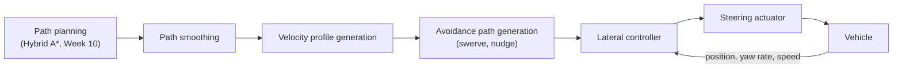

*Figure 1. Processing flow from path planning to steering*

Pure pursuit in Week 3 is also a lateral control method; it is a geometric method that sets the curvature only from the geometric relation between the target point and the vehicle. The controller treated in this unit and in Week 12 is a model-based method: it builds a model that describes the motion of the vehicle with equations (the bicycle model) and decides the steering angle based on that model. This unit examines the post-processing of the path and the structure of the controller, then derives the dynamic model that the controller uses and summarizes the kinematic model for low speeds.

### 1.2 Smoothing a Hybrid A\* Path

Hybrid A\* (Week 10) expands states with steering angles that the vehicle can actually produce, so it returns a path that the vehicle can follow (a kinematically feasible path). However, because the search uses only a few discrete steering angles, the resulting path bends left and right unnecessarily and its curvature changes in steps. If the vehicle follows such a path directly, the steering input changes frequently, which degrades ride comfort and burdens the tires and the steering system. Therefore, after the search ends, **path smoothing** is applied to make the path smooth.

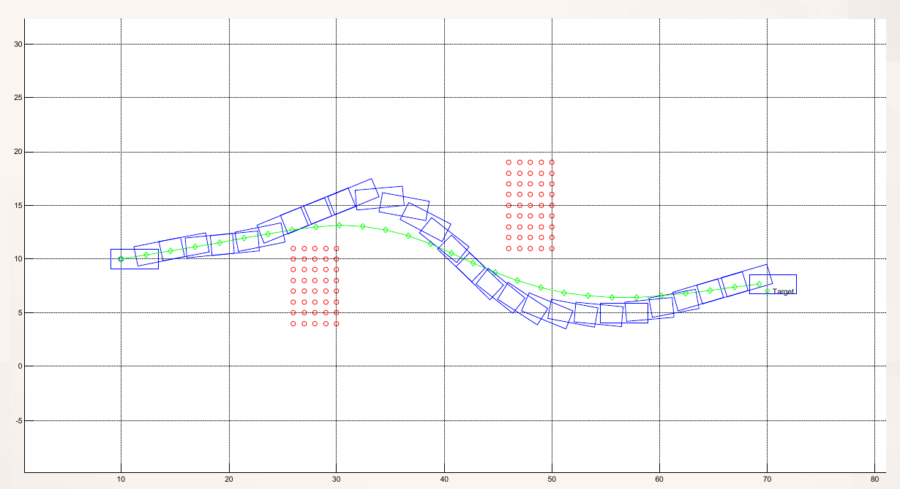

*Figure 2. Hybrid A\* vehicle trajectory (blue rectangles), smoothed trajectory (green solid line), and obstacles (red dots)*

The blue rectangles in Figure 2 are the outlines of the vehicle placed along the path found by Hybrid A\*, the green solid line is the smoothed path, and the red dots are obstacles. The vehicle starts near (10, 10) on the left, passes in an S shape between the lower and upper clusters of obstacles, and arrives at the goal (Target) on the right. The smoothed path straightens the small kinks of the Hybrid A\* trajectory while keeping a clearance from the obstacles, and becomes a curve whose curvature changes gradually.

The work that proposed Hybrid A\* uses the search result as the initial value and smooths it by numerical optimization (the conjugate gradient method), moving the path points little by little to reduce the weighted sum of the following terms [1].

| Term | What it does |
|:-----|:-----|
| Voronoi term | Pulls the path toward the middle of the free space between obstacles |
| Obstacle term | Penalizes a path point that comes closer to an obstacle than a set distance |
| Curvature term | Penalizes a path whose curvature exceeds the maximum curvature of the vehicle |
| Smoothness term | Penalizes large differences between neighboring displacement vectors, that is, a jagged path |

*Table 1. Terms that make up the cost function of path smoothing*

For path points $\mathbf{x}_i$, the smoothness term defines the displacement $\Delta\mathbf{x}_i = \mathbf{x}_i - \mathbf{x}_{i-1}$ and adds the following value.

$$
J_s = \sum_i \left\lVert \Delta\mathbf{x}_{i+1} - \Delta\mathbf{x}_i \right\rVert^2
$$

For example, a zigzag path made of the points (0, 0), (1, 0.4), (2, 0), (3, 0.4), (4, 0) has the displacements (1, 0.4), (1, −0.4), (1, 0.4), (1, −0.4), and the differences between neighboring displacements are (0, −0.8), (0, 0.8), (0, −0.8), so $J_s = 3 \times 0.8^2 = 1.92$. A straight path joining the same two end points has equal displacements everywhere, so $J_s = 0$. The optimization reduces this value while respecting the obstacle and curvature terms, so the path straightens out.

### 1.3 Velocity Profile from the Radius of Curvature

The smoothed path needs not only positions but also the target speed at each point. This array of target speeds is called the **velocity profile**. The procedure is as follows.

1. Use the points of the generated path to obtain the **radius of curvature** $R_i$ of each segment.
2. Use the radius of curvature to obtain the maximum speed $V_i$ that respects the ride comfort of the passengers.

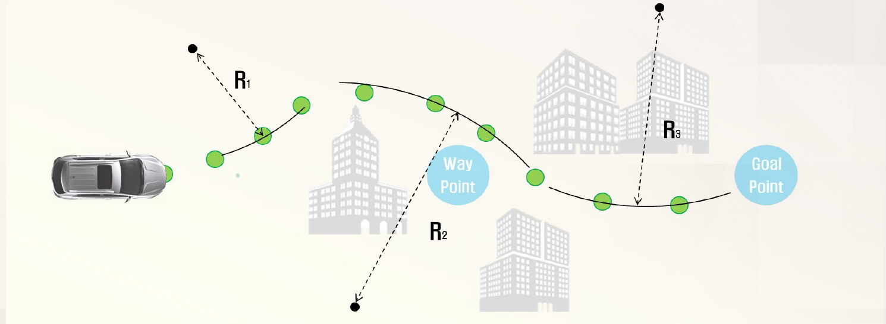

*Figure 3. Different radii of curvature R1, R2, R3 for different segments of a path*

In Figure 3, the green dots are the path points placed from the start to the goal (Goal Point), that is, the waypoints (Way Point), and the dashed arrows are the radii of curvature $R_1$, $R_2$, $R_3$ of the segments. The more sharply a segment bends, the smaller its radius.

**Finding the radius of curvature.** The radius of the circle (circumscribed circle) through three neighboring path points $W_1$, $W_2$, $W_3$ is used as the radius of curvature at that location. With side lengths $a = \lvert W_2 W_3 \rvert$, $b = \lvert W_3 W_1 \rvert$, $c = \lvert W_1 W_2 \rvert$ and triangle area $S$, the radius is as follows. If the three points lie on a straight line, $S = 0$ and therefore $R = \infty$ (a straight segment).

$$
R = \frac{abc}{4S}
$$

**Finding the maximum speed.** A vehicle driving at speed $V$ on a circle of radius $R$ experiences a lateral acceleration $a_y = V^2 / R$ toward the center of the circle. If this value is limited to $0.3g$ (about 2.94 m/s², since $g = 9.81$ m/s²) for ride comfort, then $V^2 / R \le 0.3 g$, and solving for $V$ gives the maximum speed of segment $i$.

$$
V_i = \sqrt{0.3 \cdot g \cdot R_i}
$$

**Worked example.** Let the three points be $W_1 = (0, 0)$, $W_2 = (4, 1)$, $W_3 = (8, 0)$ m.

1. Side lengths: $a = \lvert W_2 W_3 \rvert = \sqrt{4^2 + 1^2} = \sqrt{17} \approx 4.123$ m, $b = \lvert W_3 W_1 \rvert = 8$ m, $c = \lvert W_1 W_2 \rvert = \sqrt{17}$ m.
2. Area: the base $W_3 W_1$ is 8 m long and the height is 1 m, so $S = 8 \times 1 / 2 = 4$ m².
3. Radius of curvature: $R = \sqrt{17} \times 8 \times \sqrt{17} / (4 \times 4) = 136 / 16 = 8.5$ m.
4. Maximum speed: $V = \sqrt{0.3 \times 9.81 \times 8.5} = \sqrt{25.02} \approx 5.00$ m/s, that is, about 18.0 km/h.

| Radius of curvature $R$ | $0.3 g R$ (m²/s²) | Maximum speed $V$ |
|:-----|:-----|:-----|
| 8.5 m | 25.02 | 5.00 m/s (18.0 km/h) |
| 12 m | 35.32 | 5.94 m/s (21.4 km/h) |
| 20 m | 58.86 | 7.67 m/s (27.6 km/h) |
| 50 m | 147.15 | 12.13 m/s (43.7 km/h) |
| 100 m | 294.30 | 17.16 m/s (61.8 km/h) |

*Table 2. Maximum speed by radius of curvature (lateral acceleration limited to 0.3g)*

Because the maximum speed is proportional to the square root of the radius, multiplying the radius by 4 only doubles the speed. On a straight segment ($R = \infty$) this formula gives no upper bound, so the road speed limit $V_{\max}$ is used; the actual profile is set as $V_i = \min\left(V_{\max}, \sqrt{0.3 g R_i}\right)$ and then adjusted so that the speed change between neighboring points does not exceed the acceleration limits. The twist_filter of Week 3, which reduces the target speed by a lateral acceleration limit, works on the same principle.

### 1.4 Obstacle Avoidance Paths: Swerves and Nudges

While driving on a road, obstacles that block the path appear, such as a vehicle ahead or road facilities. The path that avoids them is built from two kinds of path pieces.

> **Definition:** A **swerve** is a path that moves sideways by a large amount within a short distance to avoid an obstacle urgently. A **nudge** is a smooth path over a long distance that shifts slightly sideways or returns gently to the original path.

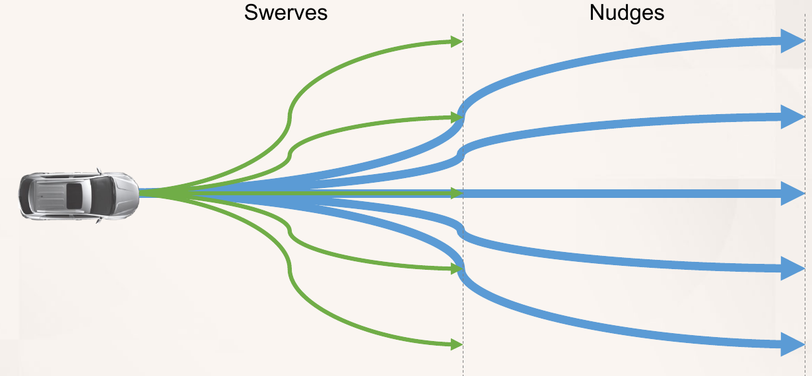

*Figure 4. Swerve paths (green) branching out from the vehicle and nudge paths (blue) continuing from their ends*

In Figure 4, the green swerve paths split into several lateral positions over a short section in front of the vehicle, and the blue nudge paths continue from the end of each swerve and bend gently over a long section. Joining the two pieces gives a set of candidate paths that express both an urgent avoidance and a gentle return. Avoidance proceeds in three stages: obstacle detection, avoidance, and return.

**Stage 1: obstacle detection.** Environment perception sensors such as a front radar and cameras are used to build a **dynamic obstacle map** that holds the positions and velocities of moving obstacles. When an obstacle appears on the driving path, a signal (trigger) that starts avoidance path generation is issued.

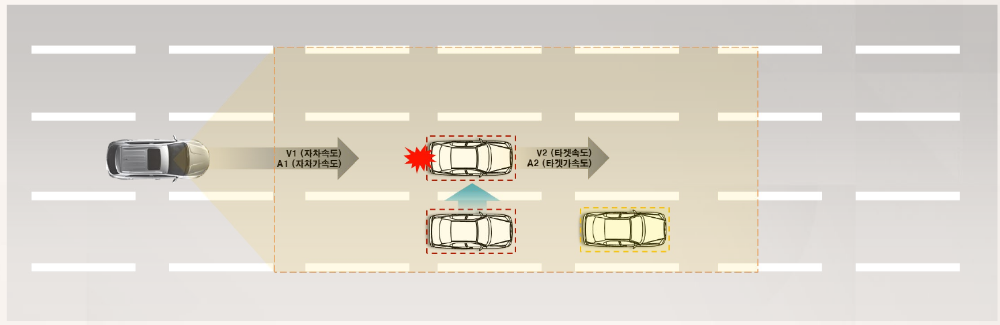

*Figure 5. A vehicle ahead (speed V2, acceleration A2) appearing on the path of the ego vehicle (speed V1, acceleration A1)*

The yellow area in Figure 5 is the detection range of the sensors; $V_1$, $A_1$ are the speed and acceleration of the ego vehicle, and $V_2$, $A_2$ are the speed and acceleration of the vehicle ahead (the target). The red dashed boxes mark vehicles that have entered the driving path of the ego vehicle and become avoidance targets: the vehicle ahead and a vehicle cutting into the ego lane from the lower lane (upward arrow). The red mark behind the vehicle ahead is the expected collision point, and the yellow dashed box marks a vehicle that does not block the path. The speeds and accelerations of both vehicles are considered together in order to judge the time left before a collision. For example, if the gap to the vehicle ahead is 30 m and $V_1 = 20$ m/s and $V_2 = 10$ m/s are constant, the gap shrinks by 10 m per second and a collision occurs after about $30 / (20 - 10) = 3$ s, so avoidance must start before then.

**Stage 2: avoidance.** A cost function is computed for each generated swerve path and nudge path, and the path with the smallest cost is chosen as the optimal path that avoids the obstacle ahead. A cost function usually adds weighted terms such as whether the path collides with an obstacle, how close it comes to obstacles, how far it departs from the lane center, and how large its curvature is (ride comfort).

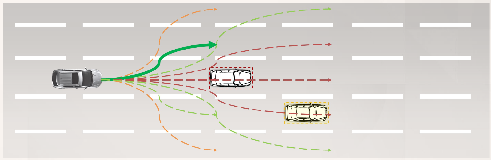

*Figure 6. Candidate avoidance paths (dashed lines) and the optimal avoidance path chosen by the cost function (green solid line)*

In Figure 6, the red dashed lines are candidates that hit the vehicle ahead or the vehicle in the neighboring lane, and the green and orange dashed lines are candidates without a collision. The green solid line with the smallest cost, that is, the path that moves over to the upper lane, is selected.

**Stage 3: return.** After passing the obstacle, the optimal path that returns safely to the original path is computed again.

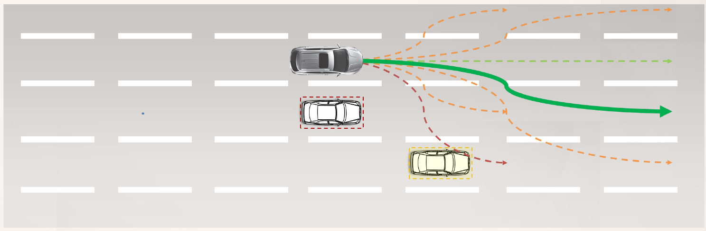

*Figure 7. Candidate return paths back to the original lane after passing the obstacle and the optimal return path (green solid line)*

In Figure 7, the vehicle has passed the vehicle ahead and is in the upper lane. The red dashed candidate that descends toward the vehicle in the lower lane hits that vehicle, and the other dashed candidates avoid collisions but have larger costs, so the green solid line that returns gently to the original lane is selected.

### 1.5 Concept and Structure of the Lateral Controller

The lateral controller treated in this unit and in Week 12 follows four design concepts.

| Design concept | Expected effect |
|:-----|:-----|
| Control the yaw rate directly | The rotation speed of the body becomes smooth, which improves ride comfort |
| Connect two controllers in a cascade form | Path errors and vehicle motion are handled separately, which makes the controller robust to disturbances and model errors |
| Estimate and use the sideslip angle | Tracking precision improves (maximum path error of 15 cm on a straight road) |
| Use both a kinematic model and a dynamic model | The controller can be used over the whole speed range from low to high speed |

*Table 3. Design concepts of the lateral controller and their expected effects*

> **Definition:** **Yaw** is the rotation of the body about its vertical axis, and the **yaw rate** is the angular velocity of that rotation (rad/s). The **sideslip angle** is the angle between the direction the vehicle faces (the longitudinal axis of the body) and the direction in which the center of gravity actually moves.

The overall structure of the controller is as follows.

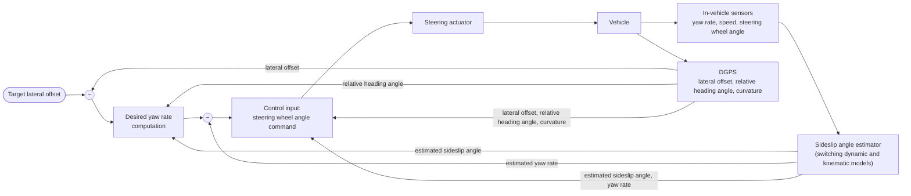

*Figure 8. Structure of the lateral controller*

The flow in Figure 8 is as follows. The **desired yaw rate** is computed from the difference between the target lateral offset (usually 0, that is, on the path) and the actual lateral offset measured by DGPS, and the steering wheel angle command is computed from the difference between this value and the estimated yaw rate. The computation of the desired yaw rate also uses the relative heading angle and the estimated sideslip angle, and the computation of the steering wheel angle command also uses the three DGPS values, the estimated sideslip angle, and the estimated yaw rate. The in-vehicle sensors measure the yaw rate, the vehicle speed, and the steering wheel angle, and DGPS (differential GPS, Week 13) measures the lateral offset from the path, the relative heading angle, and the curvature of the path. Because the sideslip angle is hard to measure directly, an estimator estimates it from the in-vehicle sensor values, switching between the dynamic model and the kinematic model depending on the speed. In the example of the block diagram, the estimator switches to the kinematic model when the speed drops below 15 km/h and to the dynamic model when it rises above 20 km/h. The reason for using two different thresholds (hysteresis) and the equations of each stage are derived in Week 12.

### 1.6 The Single-Track Model (Bicycle Model)

Designing a controller requires a model that describes how the steering angle changes the lateral motion of the vehicle. Treating all four wheels makes the equations complicated, so the left and right wheels of the same axle are replaced by one virtual wheel on the centerline of the body. The model obtained in this way is called the **single-track model** or the **bicycle model**.

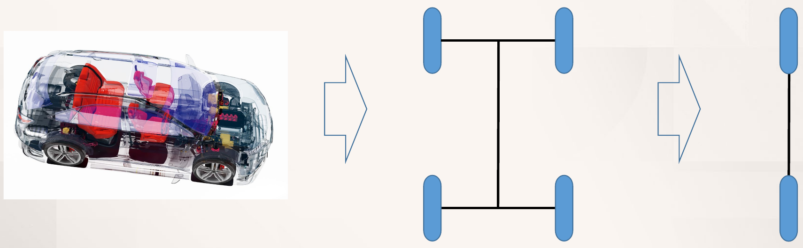

*Figure 9. Simplifying a four-wheel vehicle into a two-axle model and then into a bicycle model with one front and one rear wheel*

This simplification works well when the left and right wheels are steered by nearly the same angle and the lateral load transfer and the tilting of the body (roll) can be neglected. The forces produced by the two wheels of the same axle are combined into the force produced by one virtual wheel.

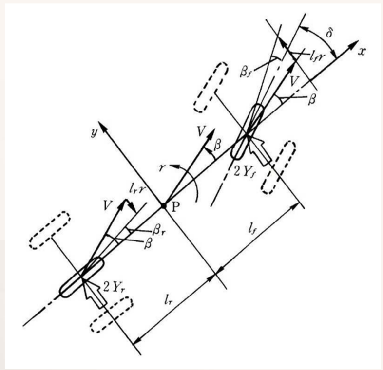

*Figure 10. Geometry and variables of the bicycle model*

In Figure 10, P is the center of gravity, the $x$ axis points to the front of the body, and the $y$ axis points to the left of the body. The velocity $V$ of the center of gravity makes an angle $\beta$ with the $x$ axis, and the body rotates with yaw rate $r$. The front wheel is steered by $\delta$ with respect to the $x$ axis, and $l_f$ and $l_r$ are the distances from the center of gravity to the front and rear axles. At the front and rear wheel positions, the lateral velocities $l_f r$ and $l_r r$ caused by the rotation are added to the velocity $V$ of the center of gravity (Section 2.1), and as a result the angles $\beta_f$, $\beta_r$ appear between the direction a wheel faces and the direction it moves. The labels $2Y_f$, $2Y_r$ in the figure denote the lateral force of a whole axle, assuming that each of the two left and right tires produces a lateral force $Y_f$ or $Y_r$.

> **Caution:** The equations in this unit are written for the combined left and right tires of one axle. That is, $Y_f$ and $Y_r$ are the lateral forces of the whole front and rear axles, and the cornering stiffnesses $C_f$, $C_r$ of Section 3.1 are also values for the whole axle. In references that use values for a single tire (such as $Y_f$ in the figure), a factor of 2 appears in the equations.

The bicycle model can represent steering of the rear wheel as well as the front wheel. Vehicles that set the steering angle of each wheel separately are examples.

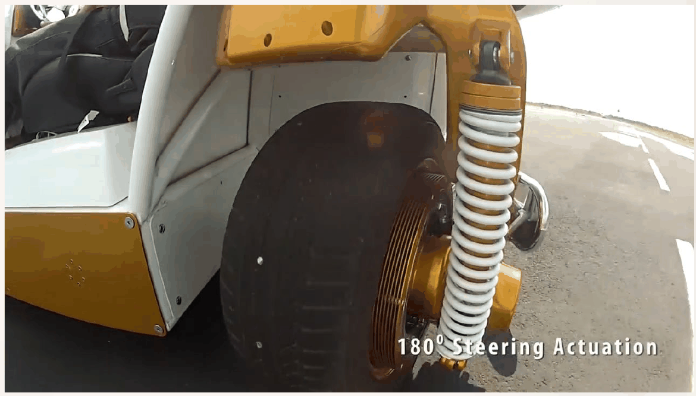

*Figure 11. Example of a steering module that turns each wheel up to 180°*

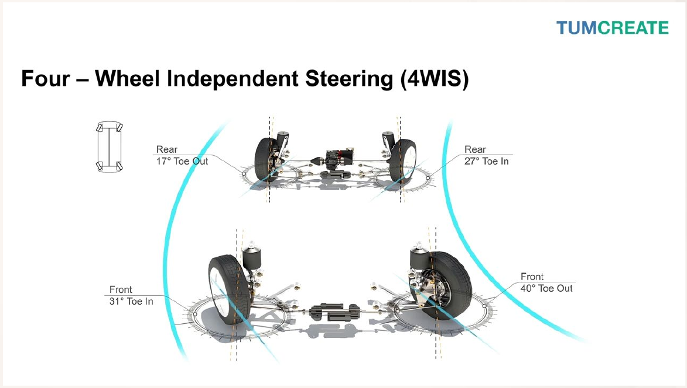

*Figure 12. Different steering angles for each wheel in four-wheel independent steering (4WIS)*

Figure 11 shows a steering module used in a vehicle of the NASA Johnson Space Center (JSC) that turns a single wheel up to 180°. Figure 12 shows the **four-wheel independent steering (4WIS)** of TUMCREATE, in which each wheel can be turned by a different angle. In the figure, the two front wheels are turned to the same side by 31° (toe-in) and 40° (toe-out), and the two rear wheels are turned to the side opposite to the front wheels by 17° (toe-out) and 27° (toe-in); on each axle the inner wheel, closer to the center of rotation, is turned more (toe-in means that the front of a wheel points toward the centerline of the body, and toe-out means that it points outward). When such a vehicle is represented by the bicycle model, the virtual wheels of the front and rear axles have the steering angles $\delta_f$ and $\delta_r$ (the kinematic model of Section 3.8 and Week 12). Even in an ordinary passenger car the angles of the left and right front wheels differ slightly during a turn, and this difference is treated in Week 12 by taking the width of the vehicle into account.

### 1.7 Definition of the State Variables

The variables of the bicycle model are as follows.

| Symbol | Name | Meaning |
|:-----|:-----|:-----|
| $\delta$ | Front wheel angle | Angle of the front wheel with respect to the body $x$ axis |
| $\beta$ | Side slip angle | Angle between the body $x$ axis and the velocity of the center of gravity |
| $V$ | Vehicle speed | Magnitude of the velocity of the center of gravity |
| $r$ | Yaw rate | Angular velocity of the body about the vertical axis |
| P | Center of gravity | The point where the mass $m$ is regarded as concentrated |
| $Y$ | Cornering force | Force produced by a tire along the wheel axle (sideways) |
| $l$ | Wheelbase | Distance between the front and rear axles, $l = l_f + l_r$ |

*Table 4. Variables of the bicycle model*

Angles and rotations are positive counterclockwise (to the left) when seen from above. Among these, the **state variables** that change with time and are handled by the controller are $\beta$ and $r$; the steering angle $\delta$ is the input, and the vehicle speed $V$ is regarded as a slowly changing value and assumed constant. In addition, the mass $m$ and the yaw moment of inertia $I$ (the moment of inertia about the vertical axis through the center of gravity) are used as vehicle parameters.

---

 

## 2. Tire Angle Relations

### 2.1 Velocities at the Wheel Positions

The force produced by a tire is determined by the difference between the direction the wheel faces and the direction in which the wheel actually moves. Therefore, the velocities at the front and rear wheel positions are found first. If the body is regarded as a rigid body, the velocity of a point $l_f$ ahead of the center of gravity is the velocity of the center of gravity plus the velocity caused by the rotation. When the body rotates counterclockwise with yaw rate $r$, a point in front gains an extra velocity $l_f r$ to the left ($+y$), and a point behind gains an extra velocity $l_r r$ to the right ($-y$).

| Position | Velocity in the $x$ direction | Velocity in the $y$ direction |
|:-----|:-----|:-----|
| Center of gravity P | $V \cos\beta$ | $V \sin\beta$ |
| Front wheel | $V \cos\beta$ | $V \sin\beta + l_f r$ |
| Rear wheel | $V \cos\beta$ | $V \sin\beta - l_r r$ |

*Table 5. Velocity components of the center of gravity and the wheel positions seen in the body frame*

> **Note:** The velocities of two points P and Q on a rigid body satisfy $\mathbf{v}_Q = \mathbf{v}_P + \boldsymbol{\omega} \times \overrightarrow{PQ}$. In planar motion $\boldsymbol{\omega} = r\,\hat{\mathbf{z}}$, and if the front wheel is at $\overrightarrow{PQ} = l_f \hat{\mathbf{x}}$, then $\boldsymbol{\omega} \times \overrightarrow{PQ} = r l_f \hat{\mathbf{y}}$, so the rotation does not change the velocity in the $x$ direction and changes only the velocity in the $y$ direction by $l_f r$. For the rear wheel, $\overrightarrow{PQ} = -l_r \hat{\mathbf{x}}$, which gives $-l_r r \hat{\mathbf{y}}$.

### 2.2 Tire Slip Angle

> **Definition:** The **tire slip angle** $\alpha$ is the angle between the direction a wheel faces and the direction of the velocity at the wheel position. Here $\alpha$ denotes the angle measured counterclockwise from the velocity direction to the direction the wheel faces. With this choice, a tire produces a lateral force in the $+y$ direction (to the left) when $\alpha > 0$.

Let $\theta_f$ (front wheel) and $\theta_r$ (rear wheel) be the angles that the velocities at the wheel positions make with the body $x$ axis. The front wheel faces at $\delta$ and the rear wheel at 0 with respect to the $x$ axis, so the slip angles of the two wheels are as follows.

$$
\alpha_f = \delta - \theta_f, \qquad \alpha_r = 0 - \theta_r = -\theta_r
$$

If a tire only rolls, the wheel moves only in the direction it faces, so $\alpha = 0$. During a turn a force toward the center of the circle is needed, and a rubber tire produces that force as its contact patch twists sideways (as a slip angle develops).

### 2.3 Front Tire Angle Relation

Write the velocity at the front wheel position with magnitude $V_f$ and direction $\theta_f = \delta - \alpha_f$, and set it equal to the components in Table 5.

$$
\underbrace{V_f \sin(\delta - \alpha_f)}_{y\text{-dir. wheel velocity}} = \underbrace{l_f r + V \sin\beta}_{y\text{-dir. chassis velocity}}, \qquad \underbrace{V_f \cos(\delta - \alpha_f)}_{x\text{-dir. wheel velocity}} = \underbrace{V \cos\beta}_{x\text{-dir. chassis velocity}}
$$

Dividing the two equations eliminates $V_f$.

$$
\tan(\delta - \alpha_f) = \frac{l_f r + V \sin\beta}{V \cos\beta}
$$

If $\beta \ll 1$, then $\sin\beta \approx \beta$ and $\cos\beta \approx 1$, and since the whole right-hand side is also small, $\tan(\delta - \alpha_f) \approx \delta - \alpha_f$. Therefore the following is obtained.

$$
\delta - \alpha_f \approx \beta + \frac{l_f r}{V} \quad \Longrightarrow \quad \alpha_f \approx \delta - \beta - \frac{l_f r}{V}
$$

The slip angle of the front wheel is the steering angle minus the sideslip angle and the angle $l_f r / V$ caused by the rotation. Steering more increases $\alpha_f$ and the lateral force of the front wheel, and if the body is already rotating ($r > 0$), the slip angle is reduced by that amount.

### 2.4 Rear Tire Angle Relation

The rear wheel is not steered, so its velocity direction is $\theta_r = -\alpha_r$. The components are matched in the same way.

$$
\underbrace{V_r \sin\alpha_r}_{y\text{-dir. wheel velocity}} = \underbrace{l_r r - V \sin\beta}_{y\text{-dir. chassis velocity}}, \qquad \underbrace{V_r \cos\alpha_r}_{x\text{-dir. wheel velocity}} = \underbrace{V \cos\beta}_{x\text{-dir. chassis velocity}}
$$

The first equation is the $y$ velocity $V\sin\beta - l_r r$ of Table 5 multiplied by $-1$. This is because the velocity direction of the wheel is $-\alpha_r$. Dividing the two equations and using the small-angle approximation gives the following.

$$
\tan\alpha_r = \frac{l_r r - V \sin\beta}{V \cos\beta} \quad \Longrightarrow \quad \alpha_r \approx -\beta + \frac{l_r r}{V}
$$

> **Note:** References differ in how they choose the sign of the slip angle. The $\beta_f$, $\beta_r$ in Figure 10 are measured from the direction the wheel faces to the velocity direction, so they differ from $\alpha_f$, $\alpha_r$ of Section 2.2 only in sign ($\beta_f = -\alpha_f = \beta + l_f r / V - \delta$, $\beta_r = -\alpha_r = \beta - l_r r / V$). For this reason, the same lateral force is also written with a negative sign, as in $Y_f = -C_f \beta_f$ [2]. The lecture material writes the front result as $\beta_f = \delta - \beta - l_f r / V$ following the convention of Section 2.2 but uses the convention of Figure 10, $Y_f = -C_f(\beta + l_f r / V - \delta)$, in the force relation of Section 3.1, which mixes the two conventions, and it writes the rear result as $\beta_r = -\beta - l_r r / V$, which is an error that fits neither convention. The correct rear result is $\alpha_r \approx -\beta + l_r r / V$ in the convention of Section 2.2 and $\beta_r \approx \beta - l_r r / V$ in the convention of Figure 10, and the force relation $Y_r = -C_r(\beta - l_r r / V)$ of the lecture material also agrees with this result.

### 2.5 Small-Angle Approximation and a Numerical Example

The accuracy of the small-angle approximation is checked numerically. Let $V = 10$ m/s, $\beta = 0.02$ rad, $r = 0.2$ rad/s, $\delta = 0.08$ rad, $l_f = 1.15$ m, and $l_r = 1.57$ m.

1. Body velocity components: $V \sin\beta = 0.19999$ m/s and $V \cos\beta = 9.99800$ m/s.
2. Velocities added by the rotation: $l_f r = 0.230$ m/s and $l_r r = 0.314$ m/s.
3. Front wheel: $\tan\theta_f = (0.19999 + 0.230) / 9.99800 = 0.043007$, so $\theta_f = 0.042981$ rad and $\alpha_f = 0.08 - 0.042981 = 0.037019$ rad. The approximation gives $0.08 - 0.02 - 0.023 = 0.037$ rad.
4. Rear wheel: $\tan\alpha_r = (0.314 - 0.19999) / 9.99800 = 0.011404$, so $\alpha_r = 0.011403$ rad. The approximation gives $-0.02 + 0.0314 = 0.0114$ rad.

| Value | Exact formula | Approximation | Difference |
|:-----|:-----|:-----|:-----|
| $\alpha_f$ | 0.037019 rad (2.121°) | 0.037000 rad (2.120°) | 0.05% |
| $\alpha_r$ | 0.011403 rad (0.6533°) | 0.011400 rad (0.6532°) | 0.03% |

*Table 6. Exact tire slip angles compared with the small-angle approximation*

When the angles are within a few degrees, the error of the approximation is negligible. Thanks to this approximation, the force relations in the next section become linear in the state variables.

> **[Calculus]** Expanding $\sin x$, $\cos x$, $\tan x$ in Taylor series at $x = 0$ gives $\sin x = x - x^3/6 + \cdots$, $\cos x = 1 - x^2/2 + \cdots$, $\tan x = x + x^3/3 + \cdots$. When $x$ is small, the terms of second and higher order are very small, so $\sin x \approx x$, $\cos x \approx 1$, $\tan x \approx x$ can be used. At $x = 0.1$ rad (about 5.7°), the relative error of $\tan x$ is about 0.3%.

---

 

## 3. Force Relations and Vehicle Parameter Estimation

### 3.1 Linear Tire Model and Cornering Stiffness

In the range of small slip angles, the lateral force of a tire is nearly proportional to the slip angle. This proportionality constant is called the **cornering stiffness** [3].

> **Definition:** The **cornering stiffness** $C$ is the slope $C = \partial Y / \partial \alpha \,\vert_{\alpha = 0}$ at which the lateral force increases with the slip angle near zero slip angle, and its unit is N/rad. The model that expresses the lateral force as $Y = C\alpha$ with this slope is called the **linear tire model**.

Substituting the slip angles of Sections 2.3 and 2.4 gives the lateral forces of the front and rear axles.

$$
Y_f = C_f \alpha_f = -C_f\left(\beta + \frac{l_f r}{V} - \delta\right), \qquad Y_r = C_r \alpha_r = -C_r\left(\beta - \frac{l_r r}{V}\right)
$$

In the example of Section 2.5 with $C_f = C_r = 70000$ N/rad, $Y_f = 70000 \times 0.037 = 2590$ N and $Y_r = 70000 \times 0.0114 = 798$ N. Both forces point to the left, so the vehicle is turning left.

> **Caution:** The linear relation holds only when the slip angle is small (roughly within a few degrees for passenger car tires). As the slip angle grows further, the increase of the lateral force slows down and then saturates at the limit of road friction, so a nonlinear tire model is needed for sharp turns or slippery roads.

### 3.2 Equations of Lateral Motion

Newton's laws of motion are applied to the lateral and yaw directions of the body.

**Balance of lateral forces.** In the body frame, the velocity components of the center of gravity are $u = V\cos\beta$ (forward) and $v = V\sin\beta$ (to the left). Because the body frame itself rotates with yaw rate $r$, the lateral acceleration of the center of gravity is the rate of change of $v$ plus the rotational term $u r$, $a_y = \dot v + u r$ [3]. If the vehicle speed $V$ is constant and $\beta$ is small, then $v \approx V\beta$ and $u \approx V$, so $a_y \approx V\dot\beta + V r = V(\dot\beta + r)$. The body $y$ component of the front lateral force is $Y_f\cos\delta \approx Y_f$, which gives the following.

$$
mV\left(\frac{d\beta}{dt} + r\right) = Y_f + Y_r
$$

**Balance of yaw moments.** The lateral force of the front axle creates a counterclockwise moment about the center of gravity with moment arm $l_f$, and the lateral force of the rear axle creates a clockwise moment with moment arm $l_r$.

$$
I\frac{dr}{dt} = l_f Y_f - l_r Y_r
$$

> **Note:** The $ur$ term in $a_y = \dot v + u r$ appears because the velocity is measured in a rotating frame. When the vehicle corners steadily on a circle of radius $R$ at constant speed $V$, $\dot\beta = 0$ and $r = V/R$, so $a_y = V r = V^2/R$, which is the familiar centripetal acceleration.

### 3.3 State Equations of the Sideslip Angle and the Yaw Rate

The lateral forces of Section 3.1 are substituted into the two equations of Section 3.2, which are then solved for $\dot\beta$ and $\dot r$.

**Step 1: the lateral equation.** Expand the right-hand side.

$$
Y_f + Y_r = -(C_f + C_r)\beta + \frac{C_r l_r - C_f l_f}{V} r + C_f \delta
$$

Move $mVr$ on the left-hand side to the right-hand side and divide both sides by $mV$.

$$
\dot\beta = -\frac{C_f + C_r}{mV}\beta + \left(-1 + \frac{C_r l_r - C_f l_f}{mV^2}\right) r + \frac{C_f}{mV}\delta
$$

**Step 2: the yaw equation.** Expand the right-hand side.

$$
l_f Y_f - l_r Y_r = (C_r l_r - C_f l_f)\beta - \frac{C_f l_f^2 + C_r l_r^2}{V} r + C_f l_f \delta
$$

Divide both sides by $I$.

$$
\dot r = \frac{C_r l_r - C_f l_f}{I}\beta - \frac{C_f l_f^2 + C_r l_r^2}{IV} r + \frac{C_f l_f}{I}\delta
$$

**Step 3: matrix form.** With the state vector $\mathbf{x} = [\beta \;\; r]^T$ and the input $\delta$, the equations become the following.

$$
\begin{bmatrix} \dot\beta \\ \dot r \end{bmatrix} =
\begin{bmatrix}
-\dfrac{C_f + C_r}{mV} & -1 + \dfrac{C_r l_r - C_f l_f}{mV^2} \\
\dfrac{C_r l_r - C_f l_f}{I} & -\dfrac{C_f l_f^2 + C_r l_r^2}{IV}
\end{bmatrix}
\begin{bmatrix} \beta \\ r \end{bmatrix}
+
\begin{bmatrix} \dfrac{C_f}{mV} \\ \dfrac{C_f l_f}{I} \end{bmatrix} \delta
$$

This equation is the **dynamic bicycle model**, which describes how the steering angle changes the sideslip angle and the yaw rate. Calling the two matrices $A$ and $B$ in order, $\dot{\mathbf{x}} = A\mathbf{x} + B\delta$. Because the matrix entries contain $1/V$ and $1/V^2$, the response of the same vehicle differs with speed.

> **Note:** The lecture material writes the $\dot r$ equation as $\dot r = \frac{C_r l_r + C_f l_f}{I}\beta - \frac{C_r l_r^2 - C_f l_f^2}{IV} r + \frac{C_f l_f}{I}\delta$, in which the signs of the $\beta$ coefficient and the $r$ coefficient are swapped. Expanding $l_f Y_f - l_r Y_r$ gives, as above, the $\beta$ coefficient $C_r l_r - C_f l_f$ (a subtraction) and the $r$ coefficient $-(C_f l_f^2 + C_r l_r^2)/(IV)$ (an addition in the numerator). The $r$ coefficient represents the damping of the yaw motion and must always be negative, but in the equation of the lecture material it becomes positive for a vehicle with $C_f l_f^2 > C_r l_r^2$, which is physically wrong. The matrix in the lateral-velocity form that the lecture material also presents (Section 3.6) uses the correct signs.

### 3.4 Assumptions of the Dynamic Model

The model of Section 3.3 holds under the following assumptions [3].

1. **Constant vehicle speed:** The longitudinal speed $V$ is constant or changes more slowly than the lateral motion.
2. **Small angles:** $\beta$, $\delta$, and the tire slip angles are small, so the trigonometric functions can be approximated to first order.
3. **Linear tire model:** The lateral force is proportional to the slip angle ($Y = C\alpha$).
4. **Single track:** The left and right wheels are combined into one, and roll, lateral load transfer, road slope, and aerodynamic forces are neglected.

Because of assumptions 1 and 2, the model is accurate for small steering inputs in sections of constant vehicle speed. Also, because the matrix entries are proportional to $1/V$, the model cannot be used at low speeds where $V$ is close to 0, which is why Week 12 uses a kinematic model at low speeds.

### 3.5 Steady-State Cornering Analysis

When the steering angle $\delta$ is held constant, the vehicle eventually reaches **steady-state cornering**, where $\dot\beta = 0$ and $\dot r = 0$. The state is then obtained by solving $A\mathbf{x} + B\delta = 0$, and the yaw rate can be written as follows [2].

$$
r_{ss} = \frac{V}{l\,(1 + KV^2)}\,\delta, \qquad K = \frac{m\,(C_r l_r - C_f l_f)}{l^2 C_f C_r}
$$

$K$ is called the **stability factor**. If $K = 0$, then $r_{ss} = V\delta / l$, which equals the small-steering-angle yaw rate of the kinematic model without tire slip (Section 3.8). If $K > 0$, the yaw rate for the same steering is smaller than the kinematic value, and its ratio to the kinematic value, $1/(1 + KV^2)$, shrinks as speed increases; this is called **understeer**. If $K < 0$, the yaw rate becomes larger, which is **oversteer**, and the vehicle becomes unstable at and above the speed where $1 + KV^2 = 0$.

**Worked example.** Using the parameters estimated in Section 3.7, $m = 1999.1$ kg, $I = 2573.4$ kg m², $l_f = 0.5412$ m, $l_r = 2.3038$ m, $C_f = 136180$ N/rad, $C_r = 50544$ N/rad, compute the steady-state cornering for $\delta = 0.02$ rad.

1. Wheelbase: $l = 0.5412 + 2.3038 = 2.845$ m.
2. Stability factor: $C_r l_r - C_f l_f = 116443 - 73701 = 42743$ N, so $K = 1999.1 \times 42743 / (2.845^2 \times 136180 \times 50544) = 0.001534$ s²/m². Since $K > 0$, the vehicle understeers.
3. 40 km/h ($V = 11.11$ m/s): $1 + KV^2 = 1.189$ and $r_{ss} = 11.11 \times 0.02 / (2.845 \times 1.189) = 0.0657$ rad/s (3.76°/s).
4. 80 km/h ($V = 22.22$ m/s): $1 + KV^2 = 1.757$ and $r_{ss} = 0.0889$ rad/s (5.09°/s).

| Vehicle speed | Steady-state yaw rate $r_{ss}$ | Kinematic yaw rate $V\delta/l$ | Steady-state sideslip angle $\beta_{ss}$ | Lateral acceleration $V r_{ss}$ |
|:-----|:-----|:-----|:-----|:-----|
| 40 km/h | 0.0657 rad/s (3.76°/s) | 0.0781 rad/s | 0.0081 rad (0.47°) | 0.73 m/s² (0.074g) |
| 80 km/h | 0.0889 rad/s (5.09°/s) | 0.1562 rad/s | −0.0056 rad (−0.32°) | 1.98 m/s² (0.20g) |

*Table 7. Steady-state cornering response for a steering angle of 0.02 rad computed with the estimated parameters*

Doubling the speed doubles the kinematic yaw rate, but the actual yaw rate increases only by a factor of 1.35. Also, $\beta_{ss} > 0$ at low speed (the center of gravity moves toward the inside of the turn), but $\beta_{ss} < 0$ at high speed. At high speed the rear wheel also needs a large slip angle to produce a large lateral force, and the body points that much further toward the inside than the direction of travel.

### 3.6 A Form with the Lateral Velocity as a State

The lateral velocity of the center of gravity $v = V\beta$ is sometimes used as a state instead of the sideslip angle. If $V$ is constant, then $\dot v = V\dot\beta$ and $\beta = v/V$, and substituting these into the equations of Section 3.3 gives the following.

$$
\begin{bmatrix} \dot r \\ \dot v \end{bmatrix} =
\begin{bmatrix}
-\dfrac{C_r l_r^2 + C_f l_f^2}{I V} & \dfrac{C_r l_r - C_f l_f}{I V} \\
-V + \dfrac{C_r l_r - C_f l_f}{mV} & -\dfrac{C_f + C_r}{mV}
\end{bmatrix}
\begin{bmatrix} r \\ v \end{bmatrix}
+
\begin{bmatrix} \dfrac{C_f l_f}{I} \\ \dfrac{C_f}{m} \end{bmatrix} \delta
$$

For example, substituting $\beta = v/V$ into the $\beta$ term $\frac{C_r l_r - C_f l_f}{I}\beta$ of the $\dot r$ equation gives $\frac{C_r l_r - C_f l_f}{IV}v$. The two forms describe the same physics with different variables, so their eigenvalues (the speed and oscillation of the response) are the same. The parameter estimation model of Section 3.7 uses this form and outputs the yaw rate $r$ and the lateral acceleration $a_y = \dot v + V r$.

### 3.7 Vehicle Parameter Estimation

Using the model of Section 3.3 on a real vehicle requires the values of $m$, $I$, $l_f$, $l_r$, $C_f$, and $C_r$. The mass can be measured with a scale, but the cornering stiffnesses and the moment of inertia are hard to measure directly. Therefore the vehicle is actually driven, the inputs (speed, steering) and outputs (yaw rate, lateral acceleration) are recorded, and the parameters are chosen so that the output of the model fed with the same inputs is as close as possible to the measurements. This is called **parameter estimation** or system identification.

**Step 1: checking sensor errors.** First check whether the sensors used for the estimation are reliable.

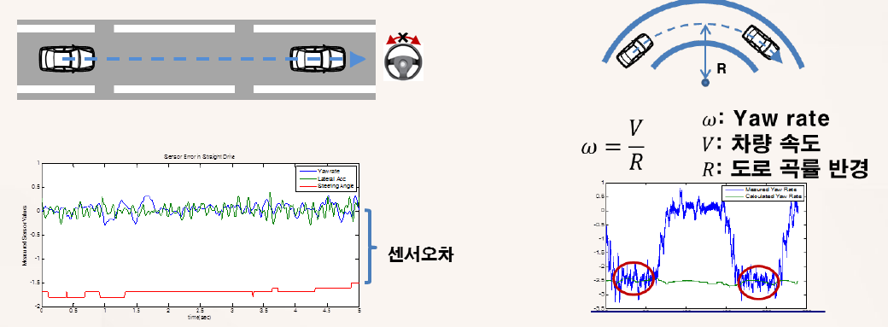

*Figure 13. Checking the errors of the vehicle sensors by straight driving and curved driving*

- **Straight driving:** When the vehicle drives straight without steering, the yaw rate, the lateral acceleration, and the steering angle should all be 0. In the left graph of Figure 13, the yaw rate (blue) and the lateral acceleration (green) show only noise around 0, but the steering angle (red) stays at a constant nonzero value. This value is the zero error (offset) of the sensor, so it is subtracted from the measurements as a correction.
- **Curved driving:** When the vehicle drives at speed $V$ on a curved road of known radius $R$, the yaw rate should be $\omega = V/R$. For example, turning on a curve of radius 50 m at $V = 10$ m/s gives $\omega = 0.2$ rad/s (11.46°/s). The right graph of Figure 13 compares the measured yaw rate (blue) with the yaw rate computed by this formula (green). In the curved-driving sections marked with red circles, the measured value fluctuates around the computed value and overlaps it, which shows that the yaw rate sensor has no large error; if the two values kept disagreeing, the sensor would be judged to have an error.

**Step 2: lateral maneuver tests.** Vehicle state information is collected with several steering patterns so that the model can reproduce a variety of motions.

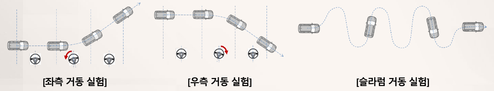

*Figure 14. Steering patterns of the left maneuver test, the right maneuver test, and the slalom maneuver test*

In the left and right maneuver tests, the vehicle drives straight, turns the steering wheel to one side and back to the center, and then drives straight again in the new direction, and in the slalom test the steering wheel is turned left and right repeatedly to drive in an S shape. Because both step-like and periodic inputs are applied, both the magnitude and the speed of the response can be observed.

**Step 3: model-based estimation.** The model of Section 3.6 is built in Simulink, and the parameters are fitted with the parameter estimation tool of Simulink.

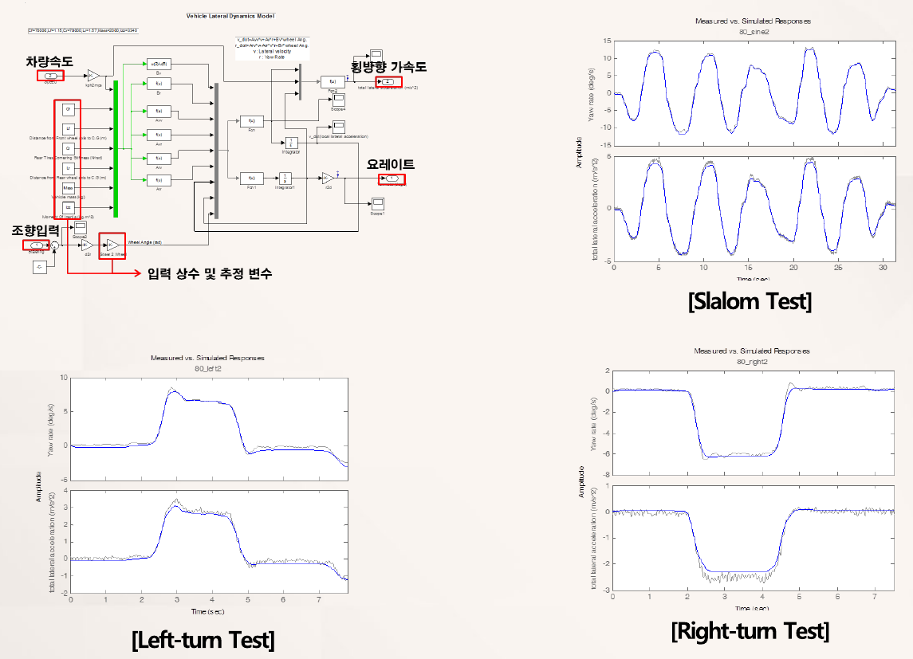

*Figure 15. Lateral dynamics Simulink model and the measured and model responses of the slalom, left-turn, and right-turn tests*

The Simulink model at the upper left of Figure 15 takes as inputs the vehicle speed (passed through a gain that converts km/h to m/s) and the steering input. A constant that corrects the zero error found in Step 1 is added to the steering input, which then passes through a gain that converts degrees to radians and a steering-ratio gain (Steer 2 Wheel) that converts the steering wheel angle to the wheel angle. The input constants and estimated variables grouped by the red boxes are $C_f$, $l_f$, $C_r$, $l_r$, the mass, the moment of inertia, and the steering-ratio gain, with the initial values $C_f = C_r = 70000$ N/rad, $l_f = 1.15$ m, $l_r = 1.57$ m, $m = 2000$ kg, and $I = 3340$ kg m². The model integrates $\dot v = A_{vv} v + A_{vr} r + B_v \delta$ and $\dot r = A_{rv} v + A_{rr} r + B_r \delta$ and outputs the yaw rate and the lateral acceleration. The estimation tool repeatedly adjusts the parameters to minimize a cost such as the sum of squared differences between the measured and model responses. The remaining graphs overlay the measurements and the model outputs of the yaw rate (top) and the lateral acceleration (bottom) in the slalom, left-turn, and right-turn tests, and the two curves almost coincide. In the slalom test the yaw rate oscillates by about ±12°/s and the lateral acceleration by about ±5 m/s², and the left-turn and right-turn tests show step-like responses of about 7°/s and 3 m/s², and about −6°/s and −2.3 m/s², respectively.

**Step 4: estimation results.** The estimated parameters are as follows.

| Parameter | Estimate | Unit |
|:-----|:-----|:-----|
| Mass $m$ | 1999.1 | kg |
| Yaw moment of inertia $I$ | 2573.4 | kg m² |
| Center of gravity to front axle $l_f$ | 0.5412 | m |
| Center of gravity to rear axle $l_r$ | 2.3038 | m |
| Front axle cornering stiffness $C_f$ | 136180 | N/rad |
| Rear axle cornering stiffness $C_r$ | 50544 | N/rad |

*Table 8. Vehicle parameters estimated with the lateral model*

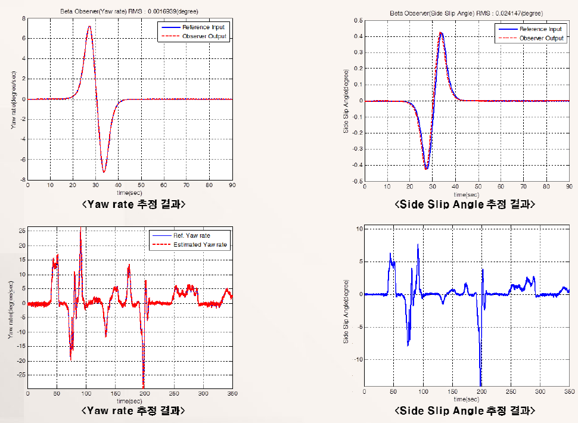

*Figure 16. Yaw rate and sideslip angle estimates of an observer built with the estimated parameters (top: simulation, bottom: real vehicle driving)*

Figure 16 shows how well a state observer built with the estimated parameters estimates the yaw rate and the sideslip angle. The upper two graphs are simulations in which the reference input (blue) and the observer output (red dashed) almost coincide, with RMS errors of 0.0016939°/s for the yaw rate and 0.024147° for the sideslip angle. The lower two graphs are the measured and estimated yaw rates (the two curves almost coincide) and the estimated sideslip angle in real vehicle driving. The principle of the state observer is treated in Week 12.

> **Caution:** The estimates are the **equivalent parameters** of the model that best reproduces the measured responses. The values $l_f = 0.54$ m and $l_r = 2.30$ m in Table 8 differ greatly from the initial values (1.15 m, 1.57 m), and the wheelbase also changes to 2.845 m, because the parameters also absorb effects that the model neglects, such as roll, load transfer, and the compliance of the steering system. Therefore the estimates should not be interpreted as the actual position of the center of gravity, and they should be used only within the same model structure.

Because the dynamic model of Section 3.3 cannot be used at low speed, the controller also uses a kinematic model that neglects tire slip at low speed (Section 3.8). The switching between the two models is treated in Week 12.

### 3.8 The Kinematic Model at Low Speed

At low speed the lateral force $mV^2/R$ needed for cornering is small, so the tire slip angles can be regarded as zero. The velocities at the front and rear wheel positions then point in the directions the wheels face, which gives the **kinematic bicycle model**, describing the motion only by geometric relations without forces [3]. Let A be the front wheel, B the rear wheel, C the center of gravity, and $\delta_f$, $\delta_r$ the steering angles of the front and rear wheels (the $\delta$ of the previous sections is $\delta_f$ with $\delta_r = 0$). $\psi$ is the **heading angle** of the body seen in the global frame $(X, Y)$, O is the **instantaneous rolling center** where the line through A perpendicular to the front wheel velocity meets the line through B perpendicular to the rear wheel velocity, and $R = \lvert OC \rvert$ is the turning radius of the center of gravity.

Applying the law of sines (the ratio of each side of a triangle to the sine of its opposite angle is constant) to the triangles OCA and OCB and rearranging gives the following two equations.

$$
\frac{\sin(\delta_f - \beta)}{l_f} = \frac{\sin\left(\frac{\pi}{2} - \delta_f\right)}{R} \;\Longrightarrow\; \tan\delta_f\cos\beta - \sin\beta = \frac{l_f}{R} \qquad \text{(Eq. 1)}
$$

$$
\frac{\sin(\beta - \delta_r)}{l_r} = \frac{\sin\left(\frac{\pi}{2} + \delta_r\right)}{R} \;\Longrightarrow\; \sin\beta - \tan\delta_r\cos\beta = \frac{l_r}{R} \qquad \text{(Eq. 2)}
$$

Adding (Eq. 1) and (Eq. 2) gives $(\tan\delta_f - \tan\delta_r)\cos\beta = (l_f + l_r)/R$ (Eq. 3). At low speed, if the turning radius changes slowly, the whole body rotates about O, so the yaw rate is $\dot\psi = V/R$, and substituting (Eq. 3) expresses the yaw rate in terms of the steering angles. Multiplying (Eq. 2) by $l_f$ and (Eq. 1) by $l_r$ and subtracting eliminates $R$ and determines the sideslip angle. The velocity of the center of gravity points in the direction $\psi + \beta$ in the global frame, so the model is as follows.

$$
\begin{aligned}
\dot X &= V\cos(\psi + \beta), \qquad \dot Y = V\sin(\psi + \beta) \\
\dot\psi &= \frac{V\cos\beta}{l_f + l_r}\left(\tan\delta_f - \tan\delta_r\right), \qquad \beta = \tan^{-1}\left(\frac{l_f\tan\delta_r + l_r\tan\delta_f}{l_f + l_r}\right)
\end{aligned}
$$

This model has no term divided by $V$, so it can be used even at the low speed just before stopping. If only the front wheel is steered ($\delta_r = 0$) and the steering angle is small, $\dot\psi \approx V\delta_f / l$, which is the case $K = 0$ of Section 3.5. The angles of each triangle, a worked example, and the extension that takes the vehicle width into account are treated in Section 1 of Week 12.

---

 

## Concept Applications

**True/False Check:**

| Statement | Judgment and Reason |
|:-----|:-----|
| If the radius of curvature becomes 4 times larger, the maximum speed set by the lateral acceleration limit also becomes 4 times larger. | **F.** Since $V = \sqrt{0.3 g R}$, the maximum speed is proportional to the square root of the radius and doubles. |
| A swerve is a short path for urgent avoidance of an obstacle, and a nudge is a long path that shifts gently or returns. | **T.** Joining the two pieces expresses both an urgent avoidance and a gentle return. |
| In the bicycle model, rotation does not change the $x$ velocity at the wheel positions. | **T.** $\boldsymbol{\omega} \times \overrightarrow{PQ}$ points in the $y$ direction, so only a $y$ velocity of $+l_f r$ at the front wheel and $-l_r r$ at the rear wheel is added. |
| For small angles, the slip angle of the rear wheel is $\alpha_r \approx -\beta - l_r r / V$. | **F.** Since $\tan\alpha_r = (l_r r - V\sin\beta)/(V\cos\beta)$, $\alpha_r \approx -\beta + l_r r / V$. |
| The dynamic bicycle model can be used as it is even when the vehicle speed is close to 0. | **F.** The matrix entries are proportional to $1/V$ and $1/V^2$ and become very large at low speed, so a kinematic model is used at low speed. |
| A vehicle with a positive stability factor $K$ produces a smaller yaw rate for the same steering than the kinematic model. | **T.** In $r_{ss} = V\delta / (l(1 + KV^2))$, $1 + KV^2 > 1$, so the vehicle understeers. |

---

 

## Summary

| Concept | Key Summary |
|:-----|:-----|
| Path smoothing | Straightens the unnecessary kinks of a Hybrid A\* path by an optimization that reduces the weighted sum of Voronoi, obstacle, curvature, and smoothness terms. |
| Velocity profile | Obtains the radius of curvature $R_i$ from the circumscribed circle of three points and uses $V_i = \sqrt{0.3 g R_i}$, which limits the lateral acceleration to $0.3g$, as the maximum speed. |
| Swerves and nudges | Builds candidate paths by joining short swerves for urgent avoidance and nudges for gentle shifting and returning, and selects the path with the smallest cost. |
| Three stages of avoidance | Detects obstacles with a dynamic obstacle map, selects an avoidance path with a cost function, and computes a return path after passing the obstacle. |
| Lateral controller structure | A cascade structure that sets the desired yaw rate from the lateral offset and the steering wheel angle from the yaw rate error, using an estimated sideslip angle. |
| Bicycle model | Combines the left and right wheels of each axle into one wheel on the centerline and describes lateral motion with the states $\beta$, $r$ and the input $\delta$. |
| Tire slip angle | The difference between the direction a wheel faces and the direction of its velocity; for small angles, $\alpha_f \approx \delta - \beta - l_f r / V$ and $\alpha_r \approx -\beta + l_r r / V$. |
| Linear tire model | For small slip angles the lateral force is $Y = C\alpha$, where $C$ is the cornering stiffness of the whole axle (N/rad). |
| Equations of motion | Rearranging $mV(\dot\beta + r) = Y_f + Y_r$ and $I\dot r = l_f Y_f - l_r Y_r$ gives a second-order linear state equation in $\beta$ and $r$. |
| Steady-state cornering | $r_{ss} = V\delta / (l(1 + KV^2))$, and a stability factor $K > 0$ means understeer. |
| Parameter estimation | Corrects sensor errors and fits the model output to the responses of several maneuver tests to obtain equivalent values of $m$, $I$, $l_f$, $l_r$, $C_f$, and $C_r$. |
| Kinematic model | At low speed the slip angles are taken as zero, and the law of sines gives $\dot\psi = V\cos\beta(\tan\delta_f - \tan\delta_r)/(l_f + l_r)$ and the sideslip angle; with no term divided by $V$, the model can be used at low speed. |

---

 

## Self-Check Questions

1. **Velocity profile:** Three points on a path are (0, 0), (6, 2), and (12, 0) m. Find the radius of curvature at this location and the maximum speed when the lateral acceleration is limited to $0.3g$ ($g = 9.81$ m/s²).

   

   
Answer

   The side lengths are $a = c = \sqrt{6^2 + 2^2} = \sqrt{40} \approx 6.325$ m and $b = 12$ m, and the area is $S = 12 \times 2 / 2 = 12$ m². The radius of curvature is $R = abc / (4S) = 40 \times 12 / 48 = 10$ m. The maximum speed is $V = \sqrt{0.3 \times 9.81 \times 10} = \sqrt{29.43} \approx 5.42$ m/s, that is, about 19.5 km/h.

   

2. **Swerves and nudges:** Explain why an avoidance path is built from two kinds of pieces, swerves and nudges.

   

   
Answer

   When an obstacle appears suddenly, the vehicle must move far sideways within a short distance, so an urgent lateral movement (swerve) is needed. On the other hand, returning to the original lane after passing the obstacle or shifting slightly should be gentle over a long distance for ride comfort and stability (nudge). Joining the two pieces creates candidate paths that combine various lateral positions and ways of returning, and a cost function can select the best of them.

   

3. **Velocities at the wheel positions:** When the body rotates counterclockwise with yaw rate $r$, state the magnitudes and directions of the lateral velocities added at the front and rear wheel positions, and explain why.

   

   
Answer

   A velocity $l_f r$ in the $+y$ direction (to the left) is added at the front wheel, and $l_r r$ in the $-y$ direction (to the right) at the rear wheel. In the rigid-body velocity relation $\mathbf{v}_Q = \mathbf{v}_P + \boldsymbol{\omega} \times \overrightarrow{PQ}$, the cross product of $\boldsymbol{\omega} = r\hat{\mathbf{z}}$ with the front position $l_f \hat{\mathbf{x}}$ is $r l_f \hat{\mathbf{y}}$, and with the rear position $-l_r\hat{\mathbf{x}}$ it is $-r l_r \hat{\mathbf{y}}$.

   

4. **Tire slip angle:** For $V = 15$ m/s, $\beta = 0.01$ rad, $r = 0.1$ rad/s, $\delta = 0.05$ rad, $l_f = 1.2$ m, and $l_r = 1.6$ m, find $\alpha_f$ and $\alpha_r$ with the small-angle approximation.

   

   
Answer

   $\alpha_f \approx \delta - \beta - l_f r / V = 0.05 - 0.01 - 0.12/15 = 0.05 - 0.01 - 0.008 = 0.032$ rad. $\alpha_r \approx -\beta + l_r r / V = -0.01 + 0.16/15 = -0.01 + 0.01067 = 0.00067$ rad. The slip angle of the rear wheel is almost 0, so at this moment the rear axle produces almost no lateral force.

   

5. **Deriving the state equation:** Substitute $Y_f = -C_f(\beta + l_f r / V - \delta)$ and $Y_r = -C_r(\beta - l_r r / V)$ into $mV(\dot\beta + r) = Y_f + Y_r$ and derive the equation for $\dot\beta$.

   

   
Answer

   The right-hand side is $-(C_f + C_r)\beta + \frac{C_r l_r - C_f l_f}{V} r + C_f\delta$. Moving $mVr$ on the left-hand side to the right gives $mV\dot\beta = -(C_f + C_r)\beta + \left(\frac{C_r l_r - C_f l_f}{V} - mV\right) r + C_f\delta$, and dividing both sides by $mV$ gives $\dot\beta = -\frac{C_f + C_r}{mV}\beta + \left(-1 + \frac{C_r l_r - C_f l_f}{mV^2}\right) r + \frac{C_f}{mV}\delta$.

   

6. **Steady-state cornering:** For a vehicle with $m = 1500$ kg, $l_f = 1.1$ m, $l_r = 1.5$ m, $C_f = 80000$ N/rad, and $C_r = 90000$ N/rad, find the stability factor and decide whether the vehicle understeers or oversteers. Also find the steady-state yaw rate for $V = 20$ m/s and $\delta = 0.02$ rad.

   

   
Answer

   $C_r l_r - C_f l_f = 135000 - 88000 = 47000$ N and $l = 2.6$ m, so $K = 1500 \times 47000 / (2.6^2 \times 80000 \times 90000) = 70500000 / 48672000000 \approx 0.001448$ s²/m². Since $K > 0$, the vehicle understeers. $1 + KV^2 = 1 + 0.001448 \times 400 = 1.579$, so $r_{ss} = 20 \times 0.02 / (2.6 \times 1.579) \approx 0.0974$ rad/s (about 5.58°/s). This is smaller than the kinematic value $V\delta/l = 0.154$ rad/s.

   

7. **Assumptions of the model:** Explain why the dynamic model of Section 3.3 does not fit in a sharp turn and at the low speed just before stopping.

   

   
Answer

   In a sharp turn the tire slip angles become large, so the linear tire model, in which the lateral force is proportional to the slip angle, no longer holds, and the small-angle approximation also becomes inaccurate. At the low speed just before stopping, the matrix entries are proportional to $1/V$ and $1/V^2$ and become very large, so the model becomes numerically unstable and even small measurement errors lead to large computed slip angles. Therefore a kinematic model that neglects tire slip is used at low speed.

   

8. **Parameter estimation:** In a straight driving test, the steering angle sensor kept showing a constant nonzero value. Explain what problem arises if the parameters are estimated without correcting this value.

   

   
Answer

   Although the actual wheel angle is 0, a nonzero steering input enters the model, so the model computes a yaw rate and a lateral acceleration even while driving straight. To reduce this mismatch, the estimation tool changes the cornering stiffnesses or the length parameters to wrong values, and the estimates then misrepresent the response of the actual vehicle. Therefore the zero error must first be found by straight driving and subtracted.

   

---

 

## References

1. D. Dolgov, S. Thrun, M. Montemerlo, and J. Diebel, "Path planning for autonomous vehicles in unknown semi-structured environments," *Int. J. Robot. Res.*, vol. 29, no. 5, pp. 485-501, 2010, doi: 10.1177/0278364909359210.
2. M. Abe, *Vehicle Handling Dynamics: Theory and Application*, 2nd ed. Oxford, U.K.: Butterworth-Heinemann, 2015.
3. R. Rajamani, *Vehicle Dynamics and Control*, 2nd ed. New York, NY, USA: Springer, 2012, doi: 10.1007/978-1-4614-1433-9.
