# 12주차 이론 — 자율주행차의 횡방향 제어 II

[레포지토리 안내](../../README.ko.md) | [English](Concepts_Lecture.md) | [한국어](Concepts_Lecture.ko.md)

> **최종 수정일:** 2026-11-04

> **학습 목표:**
> 1. 바퀴의 슬립각이 0이라는 가정 아래 사인 법칙으로 기구학적 자전거 모델(요레이트, 차체 슬립각, 위치의 변화율)을 유도할 수 있다
> 2. 차량의 폭을 고려한 애커먼 조향에서 안쪽 바퀴와 바깥쪽 바퀴의 조향각을 계산할 수 있다
> 3. 속도에 따라 기구학 모델과 동역학 모델을 바꾸어 쓰는 이유와 히스테리시스가 잦은 전환을 막는 원리를 설명할 수 있다
> 4. 횡방향 이탈거리와 상대 헤딩각으로 경로 추종 오차 모델을 세우고, 백스테핑으로 원하는 요레이트와 조향각을 유도할 수 있다
> 5. 요레이트 측정으로 차체 슬립각을 추정하는 상태 관측기를 설계하고 관측 가능 조건을 설명할 수 있다
> 6. Autoware의 wf_simulator로 웨이포인트 생성부터 경로 추종까지의 시뮬레이션을 실행할 수 있다

---

## 목차

- [1. 횡방향 차량 운동의 기구학](#1-횡방향-차량-운동의-기구학)
  - [1.1 기구학 모델의 가정](#11-기구학-모델의-가정)
  - [1.2 기하 구조와 사인 법칙](#12-기하-구조와-사인-법칙)
  - [1.3 회전 반경, 요레이트, 차체 슬립각](#13-회전-반경-요레이트-차체-슬립각)
  - [1.4 전역 좌표계에서의 운동 방정식](#14-전역-좌표계에서의-운동-방정식)
  - [1.5 계산 예와 뒷바퀴 조향의 효과](#15-계산-예와-뒷바퀴-조향의-효과)
  - [1.6 차량의 폭을 고려한 기구학](#16-차량의-폭을-고려한-기구학)
- [2. 상태 공간 모델과 횡방향 제어기 설계](#2-상태-공간-모델과-횡방향-제어기-설계)
  - [2.1 기구학 모델과 동역학 모델의 전환](#21-기구학-모델과-동역학-모델의-전환)
  - [2.2 상태 공간 모델](#22-상태-공간-모델)
  - [2.3 경로 추종 오차 모델](#23-경로-추종-오차-모델)
  - [2.4 연속 구조와 백스테핑](#24-연속-구조와-백스테핑)
  - [2.5 1단계: 원하는 요레이트](#25-1단계-원하는-요레이트)
  - [2.6 2단계: 조향각](#26-2단계-조향각)
  - [2.7 수치 예](#27-수치-예)
  - [2.8 상태 관측기](#28-상태-관측기)
  - [2.9 실차 실험 결과](#29-실차-실험-결과)
- [3. Autoware를 이용한 시뮬레이션](#3-autoware를-이용한-시뮬레이션)
  - [3.1 wf_simulator](#31-wf_simulator)
  - [3.2 노드 구성과 데이터 흐름](#32-노드-구성과-데이터-흐름)
  - [3.3 TF와 지도 불러오기](#33-tf와-지도-불러오기)
  - [3.4 웨이포인트 만들기](#34-웨이포인트-만들기)
  - [3.5 웨이포인트 불러오기](#35-웨이포인트-불러오기)
  - [3.6 위치 인식을 시뮬레이터 모드로 바꾸기](#36-위치-인식을-시뮬레이터-모드로-바꾸기)
  - [3.7 경로 계획, 경로 추종, 시뮬레이터 실행](#37-경로-계획-경로-추종-시뮬레이터-실행)
  - [3.8 실행 결과 확인](#38-실행-결과-확인)
- [개념 적용](#개념-적용)
- [요약](#요약)
- [점검 문제](#점검-문제)
- [참고 문헌](#참고-문헌)

---

<br>

## 1. 횡방향 차량 운동의 기구학

### 1.1 기구학 모델의 가정

11주차의 동역학적 자전거 모델은 타이어의 횡력과 슬립각으로 횡방향 운동을 설명했다. 이 절의 **기구학 모델(kinematic model)** 은 힘을 고려하지 않고 기하 관계만으로 차량의 운동을 나타낸다. 핵심 가정은 앞바퀴와 뒷바퀴 위치의 속도가 각 바퀴가 향한 방향과 같다는 것, 즉 **두 바퀴의 타이어 슬립각이 0**이라는 것이다 [1].

이 가정은 저속에서 잘 맞는다. 반지름 $R$의 원을 속도 $V$로 돌려면 두 바퀴가 합쳐서 구심력 $mV^2/R$을 내야 하는데, 이 힘은 속도의 제곱에 비례하므로 저속에서는 작다. 횡력이 작으면 필요한 슬립각도 작아 0으로 보아도 된다. 예를 들어 $m = 2000$ kg인 차량이 반경 20 m의 원을 돌 때 필요한 횡력은 $V = 5$ m/s에서 $2000 \times 25 / 20 = 2500$ N이지만 $V = 20$ m/s에서는 40000 N으로 16배가 된다. 두 축의 코너링 강성의 합이 140000 N/rad 정도라면 필요한 슬립각은 대략 0.018 rad(1.0°)와 0.29 rad(16°)로, 앞의 경우는 무시할 만하지만 뒤의 경우는 선형 타이어 모델의 범위도 넘는다. 기구학 모델은 대략 5 m/s(18 km/h) 이하의 저속에 적합하다 [1].

### 1.2 기하 구조와 사인 법칙

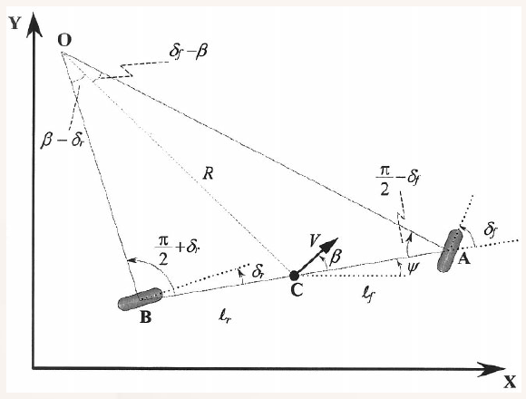

*그림 1. 기구학적 자전거 모델의 기하 구조: 순간 회전 중심 O, 앞바퀴 A, 뒷바퀴 B, 무게 중심 C*

그림 1의 기호는 다음과 같다. 전역 좌표계 $(X, Y)$에서 A는 앞바퀴, B는 뒷바퀴, C는 무게 중심이고, $l_f = \lvert CA \rvert$, $l_r = \lvert CB \rvert$이다. 앞바퀴는 차체 축에 대해 $\delta_f$, 뒷바퀴는 $\delta_r$만큼 조향되어 있다. $V$는 무게 중심의 속도, $\beta$는 그 속도가 차체 축과 이루는 차체 슬립각, $\psi$는 차체 축이 $X$축과 이루는 **헤딩각(heading angle)** 이다.

> **용어 정의:** **순간 회전 중심(instantaneous rolling center)** O는 그 순간 차체 위의 모든 점이 O를 중심으로 원운동을 하는 것처럼 보이게 하는 점이다. 강체 위 한 점의 속도는 그 점과 O를 잇는 선에 수직이므로, A에서 앞바퀴 속도에 수직인 선과 B에서 뒷바퀴 속도에 수직인 선이 만나는 점이 O이다. 무게 중심의 회전 반경은 $R = \lvert OC \rvert$이다.

슬립각이 0이면 A의 속도는 앞바퀴 방향, B의 속도는 뒷바퀴 방향과 같다. 그러면 삼각형 OCA와 OCB의 각을 다음과 같이 구할 수 있다.

- **삼각형 OCA:** O에서의 각은 A의 속도 방향과 C의 속도 방향의 차이인 $\delta_f - \beta$이다(OA와 OC가 각각 두 속도에 수직이므로). A에서의 각은 차체 축(AC 방향)과 OA 사이의 각으로 $\pi/2 - \delta_f$이다. O의 대변은 $\lvert CA \rvert = l_f$, A의 대변은 $\lvert OC \rvert = R$이다.
- **삼각형 OCB:** O에서의 각은 $\beta - \delta_r$, B에서의 각은 $\pi/2 + \delta_r$이다. O의 대변은 $\lvert CB \rvert = l_r$, B의 대변은 $R$이다.

사인 법칙(삼각형의 변 $a$, $b$, $c$와 그 대각 $\theta_a$, $\theta_b$, $\theta_c$에 대해 $a / \sin\theta_a = b / \sin\theta_b = c / \sin\theta_c$)을 두 삼각형에 적용한다.

$$
\frac{\sin(\delta_f - \beta)}{l_f} = \frac{\sin\left(\frac{\pi}{2} - \delta_f\right)}{R}, \qquad \frac{\sin(\beta - \delta_r)}{l_r} = \frac{\sin\left(\frac{\pi}{2} + \delta_r\right)}{R}
$$

**앞바퀴 식 정리.** $\sin(\delta_f - \beta) = \sin\delta_f\cos\beta - \cos\delta_f\sin\beta$이고 $\sin(\pi/2 - \delta_f) = \cos\delta_f$이다. 양변에 $l_f / \cos\delta_f$를 곱한다.

$$
\tan\delta_f\cos\beta - \sin\beta = \frac{l_f}{R} \qquad \text{(식 1)}
$$

**뒷바퀴 식 정리.** $\sin(\beta - \delta_r) = \sin\beta\cos\delta_r - \cos\beta\sin\delta_r$이고 $\sin(\pi/2 + \delta_r) = \cos\delta_r$이다. 양변에 $l_r / \cos\delta_r$를 곱한다.

$$
\sin\beta - \tan\delta_r\cos\beta = \frac{l_r}{R} \qquad \text{(식 2)}
$$

### 1.3 회전 반경, 요레이트, 차체 슬립각

**회전 반경.** (식 1)과 (식 2)를 더하면 $\sin\beta$가 지워진다.

$$
(\tan\delta_f - \tan\delta_r)\cos\beta = \frac{l_f + l_r}{R} \qquad \text{(식 3)}
$$

**요레이트.** 차량이 저속으로 달려 회전 반경이 천천히 변한다고 가정하면, 무게 중심은 O를 중심으로 반경 $R$의 원 위를 속도 $V$로 움직이고 차체 전체가 O를 중심으로 같은 각속도로 돈다. 따라서 헤딩각의 변화율은 원운동의 각속도와 같다.

$$
\dot\psi = \frac{V}{R}
$$

(식 3)에서 $1/R = (\tan\delta_f - \tan\delta_r)\cos\beta / (l_f + l_r)$를 넣으면 요레이트가 조향각으로 표현된다.

$$
\dot\psi = \frac{V\cos\beta}{l_f + l_r}\left(\tan\delta_f - \tan\delta_r\right)
$$

**차체 슬립각.** $R$을 지우기 위해 (식 2)에 $l_f$를, (식 1)에 $l_r$를 곱해 뺀다. 우변은 $l_f l_r/R - l_r l_f/R = 0$이다.

$$
l_f\sin\beta - l_f\tan\delta_r\cos\beta - l_r\tan\delta_f\cos\beta + l_r\sin\beta = 0
$$

$\sin\beta$의 항과 $\cos\beta$의 항을 모으면 $(l_f + l_r)\sin\beta = (l_f\tan\delta_r + l_r\tan\delta_f)\cos\beta$이고, 양변을 $(l_f + l_r)\cos\beta$로 나누면 다음을 얻는다.

$$
\beta = \tan^{-1}\left(\frac{l_f\tan\delta_r + l_r\tan\delta_f}{l_f + l_r}\right)
$$

기구학 모델에서 차체 슬립각은 조향각과 무게 중심의 위치만으로 정해진다. 미분 방정식을 풀 필요가 없는 대수식이라는 점이 2.1절에서 중요해진다.

### 1.4 전역 좌표계에서의 운동 방정식

무게 중심의 속도는 차체 축에서 $\beta$만큼 돌아간 방향이고 차체 축은 $X$축에서 $\psi$만큼 돌아가 있으므로, 전역 좌표계에서 속도의 방향은 $\psi + \beta$이다. 따라서 기구학적 자전거 모델은 다음과 같다 [1].

$$
\begin{aligned}
\dot X &= V\cos(\psi + \beta) \\
\dot Y &= V\sin(\psi + \beta) \\
\dot\psi &= \frac{V\cos\beta}{l_f + l_r}\left(\tan\delta_f - \tan\delta_r\right) \\
\beta &= \tan^{-1}\left(\frac{l_f\tan\delta_r + l_r\tan\delta_f}{l_f + l_r}\right)
\end{aligned}
$$

입력은 $V$, $\delta_f$, $\delta_r$이고 상태는 $X$, $Y$, $\psi$이다. 앞바퀴만 조향하면 $\delta_r = 0$이다.

> **참고:** 기준점을 무게 중심 대신 뒷바퀴 축의 가운데로 잡으면 $l_r = 0$, $l_f = L$(축간거리)이므로 $\beta = \tan^{-1}(\tan\delta_r) = \delta_r$가 되고, 앞바퀴만 조향하면 $\beta = 0$, $\dot\psi = V\tan\delta_f / L$로 단순해진다. 3주차의 pure pursuit가 곡률 $\kappa$를 조향각 $\delta = \tan^{-1}(L\kappa)$로 바꿀 때와 3.1절의 wf_simulator가 조향 모델에서 쓰는 식이 이 형태이다.

### 1.5 계산 예와 뒷바퀴 조향의 효과

$l_f = 1.2$ m, $l_r = 1.5$ m, $V = 5$ m/s, $\delta_f = 10°$, $\delta_r = 0$인 차량을 계산한다.

1. $\tan\delta_f = \tan 10° = 0.17633$이다.
2. 차체 슬립각: $\tan\beta = 1.5 \times 0.17633 / 2.7 = 0.09796$이므로 $\beta = 0.09765$ rad(5.59°)이고 $\cos\beta = 0.99524$이다.
3. 요레이트: $\dot\psi = 5 \times 0.99524 \times 0.17633 / 2.7 = 0.3250$ rad/s이다.
4. 회전 반경: $R = V / \dot\psi = 5 / 0.3250 = 15.39$ m이다.
5. 검산: (식 1)의 좌변은 $0.17633 \times 0.99524 - \sin(0.09765) = 0.07799$이고 우변 $l_f / R = 1.2 / 15.39 = 0.07799$와 같다.

처음 헤딩각이 $\psi(0) = 0$이고 원점에서 출발하면, $t$초 뒤의 헤딩각은 $\psi(t) = \dot\psi t$이고 위치는 원 위의 점이다.

$$
X(t) = R\left[\sin(\psi(t) + \beta) - \sin\beta\right], \qquad Y(t) = R\left[\cos\beta - \cos(\psi(t) + \beta)\right]
$$

$t = 2$ s이면 $\psi = 0.650$ rad이고 $X = 8.960$ m, $Y = 4.030$ m이다. 운동 방정식을 작은 시간 간격으로 수치 적분해도 같은 값이 나온다.

뒷바퀴를 함께 조향하면 운동이 크게 달라진다. 같은 $\delta_f = 10°$에서 뒷바퀴의 조향만 바꾸어 비교한다.

| 뒷바퀴 조향 | 차체 슬립각 $\beta$ | 요레이트 $\dot\psi$ | 회전 반경 $R$ | 운동 |
|:-----|:-----|:-----|:-----|:-----|
| $\delta_r = 0$ | 5.59° | 0.325 rad/s | 15.39 m | 보통의 선회 |
| $\delta_r = -10°$ (역위상) | 1.12° | 0.653 rad/s | 7.66 m | 회전 반경이 약 절반으로 줄어든다 |
| $\delta_r = +10°$ (동위상) | 10.0° | 0 | $\infty$ | 차체가 돌지 않고 비스듬히 평행 이동한다 |

*표 1. 앞바퀴 조향각 10°에서 뒷바퀴 조향에 따른 기구학 모델의 응답*

역위상(앞뒤를 반대 방향으로 조향)은 저속에서 회전 반경을 줄여 좁은 곳에서 방향을 바꾸기 쉽게 하고, 동위상(같은 방향으로 조향)은 차체의 방향을 유지한 채 옆으로 이동하게 한다. 11주차 그림 12의 네 바퀴 독립 조향 차량이 이런 운동을 할 수 있다.

### 1.6 차량의 폭을 고려한 기구학

자전거 모델은 좌우 바퀴를 하나로 합치므로 [1], 실제로는 바깥쪽 바퀴의 조향각 $\delta_o$와 안쪽 바퀴의 조향각 $\delta_i$가 다르다는 사실을 나타내지 못한다.

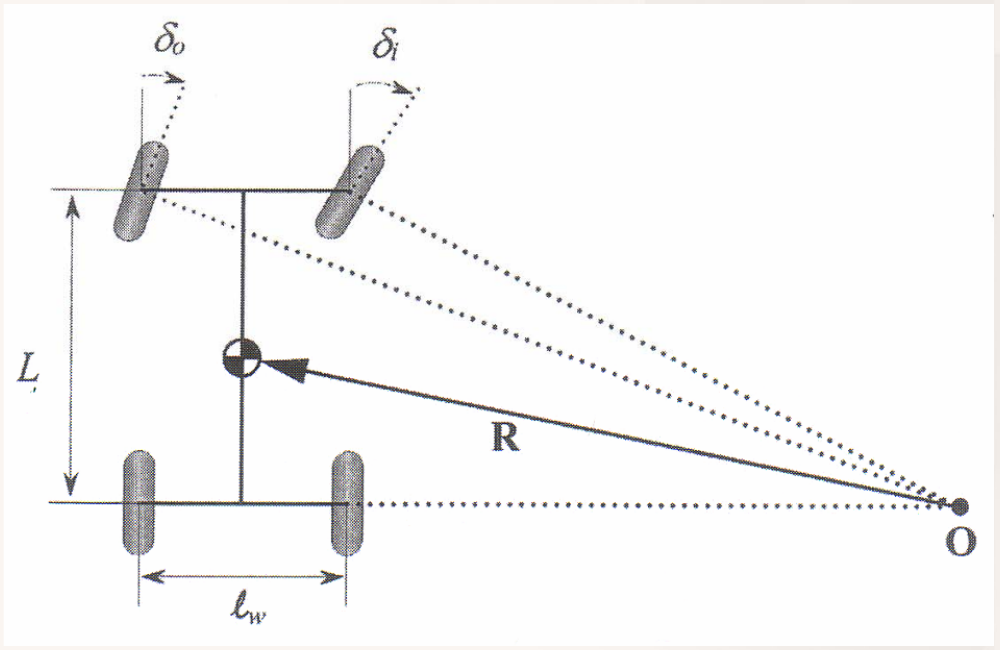

*그림 2. 차량의 폭을 고려한 선회: 바깥쪽과 안쪽 앞바퀴의 조향각과 회전 중심 O*

그림 2에서 $L$은 축간거리, $l_w$는 좌우 바퀴 사이의 거리(**윤거, track width**), $R$은 회전 반경이다. 네 바퀴가 모두 미끄러지지 않고 구르려면 네 바퀴 각각에서 속도에 수직인 선이 한 점 O에서 만나야 한다. 뒷바퀴를 조향하지 않으면 O는 뒷바퀴 축의 연장선 위에 있으므로, 안쪽 바퀴는 바깥쪽 바퀴보다 O에 가깝고 더 크게 꺾여야 한다.

자전거 모델에서 슬립각이 작고 $\delta_r = 0$이면 $\cos\beta \approx 1$, $\tan\delta_f \approx \delta_f$이므로 다음 두 식이 성립한다.

$$
\dot\psi = \frac{V\delta_f}{l_f + l_r} = \frac{V\delta_f}{L}, \qquad \dot\psi = \frac{V}{R} \quad \Longrightarrow \quad \delta_f = \frac{L}{R}
$$

이 관계를 좌우 바퀴에 각각 적용한다. 바깥쪽 바퀴는 반경 $R + l_w/2$, 안쪽 바퀴는 반경 $R - l_w/2$의 원을 도는 것으로 보고, 두 바퀴 조향각의 평균은 근사적으로 자전거 모델의 조향각과 같다.

$$
\delta_f = \frac{L}{R} \approx \frac{\delta_o + \delta_i}{2}, \qquad \delta_o = \frac{L}{R + \frac{l_w}{2}}, \qquad \delta_i = \frac{L}{R - \frac{l_w}{2}}
$$

두 조향각의 차이는 $\delta_i - \delta_o = L l_w / (R^2 - l_w^2/4) \approx L l_w / R^2 = \delta_f^2\,l_w / L$로, 조향각의 제곱에 비례한다. 큰 반경의 완만한 선회에서는 차이가 작지만 주차처럼 작은 반경에서 크게 꺾을 때는 차이가 커진다.

**계산 예.** $L = 2.7$ m, $l_w = 1.6$ m인 차량이 $R = 10$ m로 선회한다.

1. 자전거 모델의 조향각: $\delta_f = 2.7 / 10 = 0.27$ rad(15.47°)이다.
2. 바깥쪽 바퀴: $\delta_o = 2.7 / 10.8 = 0.25$ rad(14.32°)이다.
3. 안쪽 바퀴: $\delta_i = 2.7 / 9.2 = 0.2935$ rad(16.82°)이다.
4. 차이: $\delta_i - \delta_o = 0.0435$ rad(2.49°)이고, 근사식 $\delta_f^2l_w / L = 0.27^2 \times 1.6 / 2.7 = 0.0432$ rad와 거의 같다.

> **참고:** 위의 식은 각이 작다는 근사($\tan\delta \approx \delta$)를 쓴 것이다. 근사 없이 쓰면 $\tan\delta_o = L/(R + l_w/2)$, $\tan\delta_i = L/(R - l_w/2)$이고, 두 식에서 $R$을 지우면 $\cot\delta_o - \cot\delta_i = l_w / L$을 얻는다. 이를 **애커먼 조건(Ackermann condition)** 이라 하며, 위의 예에서 정확한 값은 $\delta_o = 14.04°$, $\delta_i = 16.36°$이고 $\cot\delta_o - \cot\delta_i = 4.000 - 3.407 = 0.593 = 1.6 / 2.7$이다.

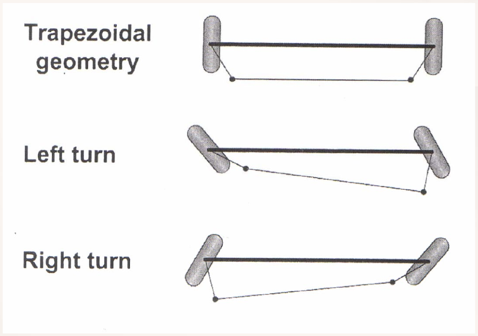

*그림 3. 사다리꼴 타이로드 배치와 왼쪽 선회, 오른쪽 선회에서의 바퀴 각도*

실제 차량은 $\delta_i > \delta_o$를 기계적으로 만들기 위해 **사다리꼴 타이로드 배치(trapezoidal tie rod arrangement)** 를 쓴다. 그림 3의 맨 위처럼 두 바퀴의 조향 너클 팔이 안쪽으로 기울어져 있어, 이들을 잇는 타이로드와 앞 축이 사다리꼴을 이룬다. 왼쪽으로 선회하면(가운데) 왼쪽 바퀴가, 오른쪽으로 선회하면(아래) 오른쪽 바퀴가 더 크게 꺾여, 언제나 안쪽 바퀴의 조향각이 커진다. 좌우 바퀴를 같은 각도로 꺾으면 두 바퀴의 회전 중심이 어긋나 한쪽 타이어가 옆으로 끌리고, 마모와 소음이 생긴다.

---

<br>

## 2. 상태 공간 모델과 횡방향 제어기 설계

### 2.1 기구학 모델과 동역학 모델의 전환

11주차 1.5절의 횡방향 제어기는 차체 슬립각을 추정해 쓰며, 추정에 쓰는 관측기는 속도에 따라 두 모델 가운데 하나를 고른다.

| 속도 구간 | 쓰는 모델 | 특징 |
|:-----|:-----|:-----|
| 저속 | 기구학 모델 | 초기 수렴 시간이 필요 없다(발산 위험 없음). 18 km/h 이하에서 안정적이다 |
| 고속 | 동역학 모델 | 초기 수렴 시간이 필요하다(발산 위험 있음). 고속에서 안정적이다 |

*표 2. 속도 구간에 따른 관측기 모델의 선택*

**기구학 모델이 저속에 맞는 이유.** 1.3절의 차체 슬립각은 $\beta = \tan^{-1}(l_r\tan\delta_f / L)$처럼 조향각에서 바로 계산되는 대수식이다. 미분 방정식을 적분하지 않으므로 초기값에서 참값으로 다가가는 수렴 시간이 없고, 적분 오차가 쌓여 발산할 위험도 없다. 또 1.1절에서 본 것처럼 저속에서는 슬립각이 0이라는 가정이 잘 맞으며, 18 km/h는 5 m/s로 기구학 모델의 적용 범위와 일치한다 [1].

**동역학 모델이 저속에 맞지 않는 이유.** 11주차 3.3절의 상태 행렬은 원소가 $1/V$, $1/V^2$에 비례한다. 11주차 3.7절에서 추정한 파라미터로 속도별 행렬 원소와 고유값을 계산하면 다음과 같다.

| 차속 | $a_{11}$ | $a_{12}$ | $a_{21}$ | $a_{22}$ | 고유값 |
|:-----|:-----|:-----|:-----|:-----|:-----|
| 1 km/h | −336.3 | 276.1 | 16.6 | −431.1 | −301.0, −466.3 |
| 5 km/h | −67.3 | 10.1 | 16.6 | −86.2 | −60.7, −92.8 |
| 10 km/h | −33.6 | 1.77 | 16.6 | −43.1 | −31.2, −45.6 |
| 15 km/h | −22.4 | 0.23 | 16.6 | −28.7 | −21.9, −29.3 |
| 40 km/h | −8.41 | −0.83 | 16.6 | −10.8 | −9.59 ± 3.51j |
| 80 km/h | −4.20 | −0.96 | 16.6 | −5.39 | −4.80 ± 3.94j |

*표 3. 추정 파라미터로 계산한 동역학 모델의 상태 행렬 원소와 고유값*

속도가 낮아지면 원소와 고유값의 크기가 급격히 커진다. 고유값의 크기가 크다는 것은 시간 상수가 매우 짧다는 뜻이므로, 관측기를 이산 시간으로 구현하면 샘플링 주기가 이를 따라가지 못한다. 예를 들어 100 Hz($\Delta t = 0.01$ s)의 오일러 적분은 $-2 < \lambda\Delta t < 0$일 때만 안정한데, 1 km/h에서는 $\lambda\Delta t = -4.66$으로 이 범위를 벗어나 계산이 발산한다. 또 $V \to 0$이면 $1/V$, $1/V^2$ 항이 한없이 커져 모델 자체가 정의되지 않으므로, 정지 근처에서는 동역학 모델을 쓸 수 없다. 동역학 모델로 바꾼 직후에는 관측기의 추정값이 참값으로 수렴하는 시간도 필요하다.

**히스테리시스.** 두 모델을 한 임계 속도(예: 12.5 km/h)에서 바꾸면, 차량이 그 속도 근처에서 오르내릴 때 모델이 계속 바뀐다(채터링). 모델을 바꿀 때마다 추정값이 흔들리므로, 올라갈 때와 내려갈 때의 임계값을 다르게 하는 **히스테리시스(hysteresis)** 속성을 준다.

- **정지에서 가속하는 상황:** 15 km/h 미만에서는 기구학 모델, 15 km/h 이상이 되면 동역학 모델을 쓴다.
- **고속에서 감속하는 상황:** 10 km/h 이상에서는 동역학 모델을 유지하고, 10 km/h 미만이 되면 기구학 모델로 바꾼다.

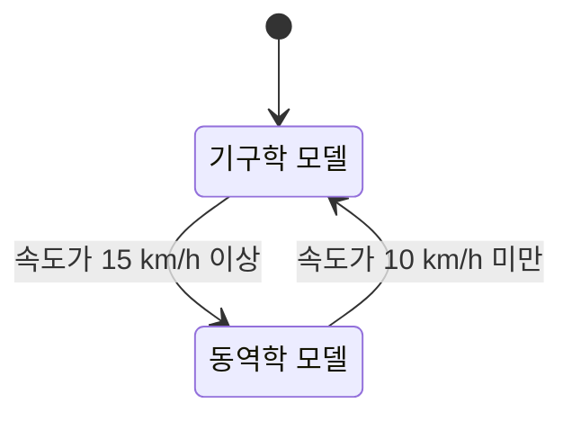

*그림 4. 히스테리시스를 둔 관측기 모델의 상태 전이*

10\~15 km/h 구간에서는 현재 모델을 그대로 유지한다. 속도가 다음과 같이 변할 때 두 방식의 모델 선택을 비교한다.

| 속도 (km/h) | 0 | 8 | 12 | 16 | 13 | 11 | 9 | 12 | 16 |
|:-----|:-----|:-----|:-----|:-----|:-----|:-----|:-----|:-----|:-----|
| 히스테리시스 (15/10) | 기구학 | 기구학 | 기구학 | 동역학 | 동역학 | 동역학 | 기구학 | 기구학 | 동역학 |
| 단일 임계값 (12.5) | 기구학 | 기구학 | 기구학 | 동역학 | 동역학 | 기구학 | 기구학 | 기구학 | 동역학 |

*표 4. 속도 변화에 따른 관측기 모델 선택의 예*

히스테리시스를 두면 16 km/h에서 동역학 모델로 바뀐 뒤 13, 11 km/h로 내려가도 유지되다가 9 km/h에서 한 번만 바뀐다. 단일 임계값 방식에서는 속도가 12와 13 km/h 사이를 오가면 주기마다 모델이 바뀐다. 11주차 그림 8의 구조도처럼 임계값을 15 km/h와 20 km/h로 둘 수도 있으며, 두 임계값은 차량과 센서에 맞추어 정하는 설계 값이다.

### 2.2 상태 공간 모델

동역학 모델(11주차 3.3절)을 제어기 설계에 쓰기 위해 **상태 공간 모델(state-space model)** 로 쓴다. 상태 $\mathbf{x} = [\beta \;\; r]^T$, 입력 $u = \delta$, 출력 $y$에 대해 다음과 같다. 문헌에 따라 요레이트를 $\gamma$로 쓰기도 하며, 기구학 모델의 $\dot\psi$와 같은 양이다.

$$
\dot{\mathbf{x}} = A\mathbf{x} + Bu, \qquad y = C\mathbf{x}
$$

$$
A = \begin{bmatrix} a_{11} & a_{12} \\ a_{21} & a_{22} \end{bmatrix} =
\begin{bmatrix}
-\dfrac{C_r + C_f}{mV} & -1 + \dfrac{C_r l_r - C_f l_f}{mV^2} \\
\dfrac{C_r l_r - C_f l_f}{I_{zz}} & -\dfrac{C_r l_r^2 + C_f l_f^2}{I_{zz} V}
\end{bmatrix}, \qquad
B = \begin{bmatrix} b_{11} \\ b_{21} \end{bmatrix} =
\begin{bmatrix} \dfrac{C_f}{mV} \\ \dfrac{C_f l_f}{I_{zz}} \end{bmatrix}, \qquad
C = \begin{bmatrix} 0 & 1 \end{bmatrix}
$$

$I_{zz}$는 11주차의 요 관성 모멘트 $I$이다. 출력 행렬 $C = [0 \;\; 1]$은 상태 가운데 요레이트만 측정한다는 뜻이다. 요레이트는 차량의 자이로 센서로 잴 수 있지만, 차체 슬립각은 보통의 차량 센서로 직접 잴 수 없다(2.8절).

**계산 예.** 11주차 표 8의 추정 파라미터로 40 km/h($V = 11.11$ m/s)의 행렬을 계산한다.

1. $a_{11} = -(50544 + 136180) / (1999.1 \times 11.11) = -8.406$이다.
2. $a_{12} = -1 + 42743 / (1999.1 \times 11.11^2) = -1 + 0.173 = -0.827$이다.
3. $a_{21} = 42743 / 2573.4 = 16.61$이다.
4. $a_{22} = -(50544 \times 2.3038^2 + 136180 \times 0.5412^2) / (2573.4 \times 11.11) = -10.78$이다.
5. $b_{11} = 136180 / (1999.1 \times 11.11) = 6.131$, $b_{21} = 136180 \times 0.5412 / 2573.4 = 28.64$이다.

고유값은 $-9.59 \pm 3.51j$로 실수부가 음수이므로, 조향 입력이 없으면 $\beta$와 $r$는 진동하면서 0으로 줄어든다(안정).

> **[선형대수학]** $A$가 대각화 가능하면 선형 시스템 $\dot{\mathbf{x}} = A\mathbf{x}$의 해는 $A$의 고유값 $\lambda$마다 $e^{\lambda t}$ 꼴의 성분으로 이루어진다(중근 때문에 대각화할 수 없으면 $te^{\lambda t}$ 같은 항이 더해진다). 모든 고유값의 실수부가 음수이면 해가 0으로 수렴하고(안정), 허수부가 있으면 진동한다. $2 \times 2$ 행렬의 고유값은 특성 방정식 $\lambda^2 - (a_{11} + a_{22})\lambda + (a_{11}a_{22} - a_{12}a_{21}) = 0$의 근이다.

### 2.3 경로 추종 오차 모델

제어기는 차량이 경로에서 얼마나 벗어났는지를 다음 변수로 나타낸다.

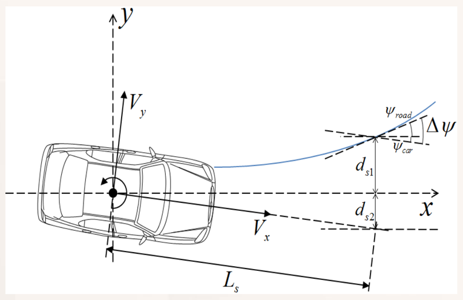

*그림 5. 경로 추종 오차의 정의: 전방 주시 거리 L_s 앞의 횡방향 이탈거리 d_s와 상대 헤딩각 Δψ*

| 기호 | 이름 | 뜻 |
|:-----|:-----|:-----|
| $L_s$ | 전방 주시 거리(look ahead distance) | 무게 중심에서 차체 축을 따라 앞으로 잰 거리로, 이 위치의 점을 전방 주시점이라 한다 |
| $d_s$ | 횡방향 이탈거리(lateral distance) | 전방 주시점에서 기준 경로까지의 횡방향 거리, 전방 주시점이 경로의 왼쪽에 있으면 양수 |
| $\Delta\psi$ | 상대 헤딩각(relative angle) | 차체의 헤딩각과 전방 주시점에서 잰 경로 접선 방향의 차, $\Delta\psi = \psi - \psi_{road}$ |
| $\rho$ | 기준 경로의 곡률(curvature of reference path) | 전방 주시점에서 경로가 휘는 정도, 반경의 역수 |

*표 5. 경로 추종 오차 모델의 변수*

그림 5에서 $d_s$는 $x$축 위아래의 두 부분 $d_{s1}$과 $d_{s2}$를 더한 길이로, 차체 축의 연장선 위 전방 주시점과 경로 사이의 거리이다. 무게 중심에서 오차를 재지 않고 앞의 점에서 재는 이유는, 운전자가 차 바로 앞이 아니라 멀리 앞을 보고 운전하듯이 미리 오차를 보고 조향하면 응답이 부드럽고 안정해지기 때문이다.

**$d_s$의 변화율.** 전방 주시점은 차체 위의 한 점이므로 그 속도는 무게 중심의 속도에 회전이 만드는 속도 $L_s r$(차체 축에 수직)를 더한 것이다(11주차 2.1절).

1. 무게 중심의 속도는 차체 축에서 $\beta$, 경로 방향에서 $\beta + \Delta\psi$만큼 돌아가 있으므로, 경로에 수직인 성분은 $V\sin(\beta + \Delta\psi) \approx V(\beta + \Delta\psi)$이다.
2. 회전이 만드는 속도 $L_s r$는 차체 축에 수직이므로, 경로에 수직인 성분은 $L_s r\cos\Delta\psi \approx L_s r$이다.

$$
\dot d_s = V(\beta + \Delta\psi) + L_s r
$$

**$\Delta\psi$의 변화율.** 차체의 헤딩각은 $r$로 바뀌고, 경로의 접선 방향은 경로를 따라 속도 $V$로 이동할 때 곡률만큼 $V\rho$로 바뀐다.

$$
\Delta\dot\psi = r - V\rho
$$

2.2절의 동역학 모델과 합치면 경로 추종 전체를 나타내는 4차 모델이 된다.

$$
\begin{aligned}
\dot\beta &= a_{11}\beta + a_{12} r + b_{11}\delta \\
\dot r &= a_{21}\beta + a_{22} r + b_{21}\delta \\
\Delta\dot\psi &= r - V\rho \\
\dot d_s &= V\beta + V\Delta\psi + L_s r
\end{aligned}
$$

### 2.4 연속 구조와 백스테핑

4차 모델의 변수는 변하는 빠르기가 다르다.

- **도로 상태 변수** $d_s$, $\Delta\psi$, $\rho$는 서서히 변하는 성질을 가진 상태 변수이다(일반적인 도로의 특성).
- **차량 상태 변수** $\beta$, $r$는 도로 상태 변수에 비해 급격하게 변하는 변수이다.

그래서 제어기를 두 개로 나누어 연속 형태(cascade form)로 순차 배치한다. 첫 제어기는 횡방향 이탈거리로부터 원하는 요레이트를 정하고, 둘째 제어기는 그 요레이트를 만드는 조향각을 정한다. 이렇게 앞 단계의 출력을 가상의 입력으로 삼아 단계마다 안정한 제어 법칙을 쌓아 올리는 설계 방법을 **백스테핑(backstepping)** 이라 한다 [2].

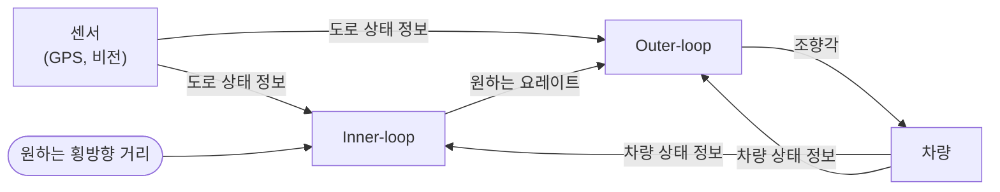

*그림 6. 두 제어기를 연속 구조로 배치한 횡방향 제어기*

그림 6의 Inner-loop은 횡방향 이탈거리에 대한 부분 시스템(sub-system)으로, 원하는 요레이트를 계산하여 Outer-loop에 전달한다. Outer-loop은 요레이트에 대한 부분 시스템으로, 조향각을 계산하여 차량을 직접 제어한다. 11주차 그림 8의 구조도에서 "원하는 요레이트 계산" 블록이 Inner-loop, "제어 입력" 블록이 Outer-loop에 해당한다.

> **참고:** 일반적인 연속 제어의 용어에서는 액추에이터에 가깝고 빠르게 움직이는 루프(여기서는 요레이트 루프)를 안쪽(inner) 루프, 느린 위치 루프를 바깥쪽(outer) 루프라 부른다. 이 설계는 반대로 횡방향 이탈거리의 루프를 Inner-loop, 요레이트의 루프를 Outer-loop이라 부르므로, 다른 문헌을 읽을 때는 이름보다 각 루프가 무엇을 받아 무엇을 내보내는지로 구분한다.

### 2.5 1단계: 원하는 요레이트

먼저 요레이트 $r$를 마음대로 정할 수 있는 가상의 입력이라고 보고, $d_s$가 0으로 가도록 원하는 요레이트 $r_d$를 정한다. $\dot d_s = V(\beta + \Delta\psi) + L_s r$에서 $r = r_d$일 때 $\dot d_s = -K_d d_s$($K_d > 0$)가 되게 하려면 다음과 같이 둔다.

$$
r_d = -\frac{V(\beta + \Delta\psi) + K_d d_s}{L_s}
$$

$r = r_d$이면 $\dot d_s = V(\beta + \Delta\psi) - V(\beta + \Delta\psi) - K_d d_s = -K_d d_s$이므로 $d_s(t) = d_s(0)e^{-K_d t}$로 지수적으로 줄어든다. 첫 항 $-V(\beta + \Delta\psi)/L_s$는 차량이 경로에 대해 비스듬히 움직여 생기는 이탈을 없애고, 둘째 항 $-K_d d_s / L_s$는 이미 생긴 이탈을 되돌린다. 실제 요레이트는 $r_d$와 다를 수 있으므로 그 차이를 요레이트 오차 $e_r = r - r_d$로 두면, $r = r_d + e_r$를 대입하여 다음을 얻는다.

$$
\dot d_s = -K_d d_s + L_s e_r
$$

### 2.6 2단계: 조향각

이제 실제 입력 $\delta$로 $e_r$를 0으로 보낸다. $e_r$의 변화율은 $\dot e_r = \dot r - \dot r_d$이다.

**(1) $\dot r_d$ 계산.** $r_d$의 식을 미분하면 $\dot r_d = -\frac{1}{L_s}\left[V(\dot\beta + \Delta\dot\psi) + K_d \dot d_s\right]$이다($V$는 일정).

**(2) 대입.** $\dot r$, $\dot\beta$, $\Delta\dot\psi$, $\dot d_s$에 2.3절의 4차 모델을 넣는다.

$$
\dot e_r = (a_{21}\beta + a_{22} r + b_{21}\delta) + \frac{V}{L_s}\left(a_{11}\beta + a_{12} r + b_{11}\delta + r - V\rho\right) + \frac{K_d}{L_s}\left(V\beta + V\Delta\psi + L_s r\right)
$$

**(3) 정리.** 같은 변수끼리 모으면 다음과 같다.

$$
\dot e_r = f(\beta, r, \Delta\psi, \rho) + b_\delta\,\delta, \qquad f \equiv h_\beta\beta + h_r r + h_\psi\Delta\psi - h_\rho\rho
$$

$$
b_\delta = b_{21} + \frac{V b_{11}}{L_s}, \quad h_\beta = \frac{V a_{11} + V K_d + L_s a_{21}}{L_s}, \quad h_r = \frac{V a_{12} + V + K_d L_s + L_s a_{22}}{L_s}, \quad h_\psi = \frac{K_d V}{L_s}, \quad h_\rho = \frac{V^2}{L_s}
$$

**(4) 리아프노프 함수로 조향각 정하기.** 두 오차의 크기를 재는 함수 $\mathcal{V} = \frac{1}{2}W_d d_s^2 + \frac{1}{2}W_r e_r^2$($W_d, W_r > 0$는 가중치)를 잡고 그 변화율을 계산한다.

$$
\dot{\mathcal{V}} = W_d d_s\dot d_s + W_r e_r\dot e_r = -W_d K_d d_s^2 + W_d L_s d_s e_r + W_r e_r\left(f + b_\delta\delta\right)
$$

가운데 항 $W_d L_s d_s e_r$는 부호가 정해지지 않은 교차항이다. 조향각을 다음과 같이 정하면 괄호 안이 $-\frac{W_d L_s}{W_r}d_s - K_r e_r$($K_r > 0$)가 되어 교차항이 지워진다.

$$
\delta = \frac{1}{b_\delta}\left[-f(\beta, r, \Delta\psi, \rho) - \frac{W_d L_s}{W_r}d_s - K_r e_r\right]
$$

$$
\dot{\mathcal{V}} = -W_d K_d d_s^2 - W_r K_r e_r^2 < 0 \quad \left((d_s, e_r) \neq (0, 0)\right)
$$

$\mathcal{V}$는 오차가 0일 때만 0이고 그 밖에서는 양수이며 계속 줄어들므로, 모델이 정확하면 $d_s$와 $e_r$가 모두 0으로 수렴한다. 조향각 식의 세 항은 각각 알려진 차량과 도로의 동역학(곡률 항 $h_\rho\rho$ 포함)을 상쇄하는 앞먹임, 교차항을 지우는 항, 요레이트 오차를 줄이는 되먹임이다. 이 식은 $b_\delta \neq 0$, 즉 조향이 $\dot e_r$에 영향을 줄 때만 쓸 수 있다.

> **용어 정의:** **리아프노프 함수(Lyapunov function)** 는 상태가 평형점에 있을 때만 0이고 그 밖에서는 양수이며, 시스템을 따라 시간이 지나면 줄어드는 함수이다. 이런 함수가 있으면 해를 직접 구하지 않아도 상태가 평형점으로 간다는 것을 보일 수 있다. 백스테핑은 단계마다 이 함수에 항을 더하면서 그 변화율이 음수가 되도록 제어 입력을 정하는 방법이다 [2].

11주차 그림 8의 구조도에 이 결과를 대응시키면, "원하는 요레이트 계산" 블록이 $r_d$의 식을, "제어 입력" 블록이 $\delta$의 식을 계산한다. 추정 차체 슬립각과 추정 요레이트는 2.8절의 관측기에서, $d_s$, $\Delta\psi$, $\rho$는 DGPS에서 들어온다. 관측기는 차량 센서가 잰 요레이트, 차속, 조향 휠 각도를 입력으로 받고, 제어 입력 블록이 계산한 조향 휠 각도 명령은 조향 액추에이터를 거쳐 차량을 움직인다.

### 2.7 수치 예

40 km/h의 행렬(2.2절)과 $L_s = 10$ m, $K_d = 0.5$ s⁻¹, $K_r = 5$ s⁻¹, $W_d / W_r = 0.1$로 계산한다.

1. 계수: $b_\delta = 28.64 + 11.11 \times 6.131 / 10 = 35.45$, $h_\beta = 7.825$, $h_r = -10.085$, $h_\psi = 0.5 \times 11.11 / 10 = 0.556$, $h_\rho = 11.11^2 / 10 = 12.35$이다.
2. 현재 상태가 $d_s = 0.3$ m(전방 주시점이 경로 왼쪽 30 cm), $\beta = 0.005$ rad, $\Delta\psi = 0.01$ rad, $r = 0.02$ rad/s, $\rho = 0$이라 하자.
3. 원하는 요레이트: $r_d = -(11.11 \times 0.015 + 0.5 \times 0.3) / 10 = -(0.1667 + 0.15) / 10 = -0.03167$ rad/s이다. 오른쪽으로 돌아야 한다.
4. 요레이트 오차: $e_r = 0.02 - (-0.03167) = 0.05167$ rad/s이다.
5. $f = 7.825 \times 0.005 + (-10.085) \times 0.02 + 0.556 \times 0.01 = 0.0391 - 0.2017 + 0.0056 = -0.1570$이다.
6. 조향각: $\delta = (0.1570 - 0.1 \times 10 \times 0.3 - 5 \times 0.05167) / 35.45 = (0.1570 - 0.3 - 0.2583) / 35.45 = -0.01132$ rad($-0.65°$)이다. 오른쪽으로 조금 조향한다.

같은 설정에서 $d_s(0) = 0.5$ m, 나머지 상태가 0인 상황을 4차 모델로 모의하면 다음과 같다.

| 시간 | $d_s$ | 조향각 $\delta$ |
|:-----|:-----|:-----|
| 0 s | 0.500 m | −1.01° |
| 1 s | 0.012 m | 0.29° |
| 2 s | −0.003 m | 0.17° |
| 3 s | 0.000 m | 0.06° |

*표 6. 백스테핑 제어기의 폐루프 응답 예(40 km/h, 초기 이탈 0.5 m)*

이탈거리는 약 2초 안에 거의 사라지고, 그동안 조향각의 크기는 최대 1.11°이다. 모의하는 동안 $\mathcal{V}$는 계속 줄어든다.

### 2.8 상태 관측기

2.6절의 조향각 식에는 $\beta$가 필요하지만 차체 슬립각은 보통의 차량 센서로 잴 수 없다(고가의 광학 속도 센서나 두 안테나 GNSS가 필요하다). 측정할 수 있는 요레이트와 입력으로부터 측정하지 못하는 상태를 계산하는 장치를 **상태 관측기(state observer)** 라 한다.

**관측기의 구조.** 모델을 실시간으로 함께 계산하면서, 모델이 예측한 출력 $C\hat{\mathbf{x}}$와 실제 측정 $y$의 차이로 추정값을 고친다 [3].

$$
\dot{\hat{\mathbf{x}}} = A\hat{\mathbf{x}} + B\delta + \mathbf{l}\left(y - C\hat{\mathbf{x}}\right), \qquad \mathbf{l} = \begin{bmatrix} l_1 \\ l_2 \end{bmatrix}
$$

추정 오차 $\mathbf{e} = \mathbf{x} - \hat{\mathbf{x}}$의 변화율은 $\dot{\mathbf{e}} = A\mathbf{x} + B\delta - A\hat{\mathbf{x}} - B\delta - \mathbf{l}C(\mathbf{x} - \hat{\mathbf{x}}) = (A - \mathbf{l}C)\mathbf{e}$이다. 따라서 $A - \mathbf{l}C$의 고유값이 모두 음의 실수부를 가지도록 이득 $\mathbf{l}$을 고르면, 처음 추정값이 틀려도 오차가 0으로 줄어든다.

**관측 가능 조건.** 요레이트만 재서 $\beta$를 알아낼 수 있으려면 $\beta$가 요레이트의 변화에 흔적을 남겨야 한다. 관측 가능성 행렬로 이를 확인한다.

$$
\mathcal{O} = \begin{bmatrix} C \\ CA \end{bmatrix} = \begin{bmatrix} 0 & 1 \\ a_{21} & a_{22} \end{bmatrix}, \qquad \det\mathcal{O} = -a_{21}
$$

$\mathcal{O}$의 계수(rank)가 2, 즉 $a_{21} = (C_r l_r - C_f l_f)/I_{zz} \neq 0$이어야 관측 가능하다. $C_r l_r = C_f l_f$인 차량에서는 $\dot r$의 식에 $\beta$가 나타나지 않아 요레이트만으로 $\beta$를 알 수 없다. 추정 파라미터에서는 $a_{21} = 16.61 \neq 0$이므로 관측 가능하다.

**이득 계산 예.** 40 km/h에서 $A - \mathbf{l}C$의 고유값을 $-20$, $-25$로 정한다. 플랜트의 고유값($-9.59 \pm 3.51j$)보다 두 배 이상 빠르게 하여 추정값이 실제 상태를 빨리 따라잡게 한다.

1. $A - \mathbf{l}C$의 원소는 차례로 $a_{11}$, $a_{12} - l_1$, $a_{21}$, $a_{22} - l_2$이므로 특성 방정식은 $\lambda^2 - (a_{11} + a_{22} - l_2)\lambda + a_{11}(a_{22} - l_2) - a_{21}(a_{12} - l_1) = 0$이다.
2. 원하는 특성 방정식은 $(\lambda + 20)(\lambda + 25) = \lambda^2 + 45\lambda + 500 = 0$이다.
3. $\lambda$의 계수를 맞추면 $l_2 = a_{11} + a_{22} + 45 = -8.406 - 10.777 + 45 = 25.82$이다.
4. 상수항을 맞추면 $a_{11}(a_{22} - l_2) = -8.406 \times (-36.59) = 307.6$이므로 $a_{21}(a_{12} - l_1) = 307.6 - 500 = -192.4$이고, $l_1 = a_{12} + 192.4 / 16.61 = -0.827 + 11.58 = 10.76$이다.

참 상태가 $\beta(0) = 0$인데 관측기가 $\hat\beta(0) = 0.02$ rad로 시작하고 조향 입력이 $\delta = 0.03\sin(\pi t)$인 경우를 모의하면, 추정 오차 $\beta - \hat\beta$는 $-0.02$ rad에서 0.1 s 뒤 $-0.0052$ rad, 0.2 s 뒤 $-0.0009$ rad, 0.5 s 뒤 약 $-3 \times 10^{-6}$ rad로 줄어든다. 행렬 $A$가 속도에 따라 바뀌므로 실제 관측기는 속도마다 이득을 다시 계산하고, 저속에서는 2.1절처럼 기구학 모델로 바꾼다.

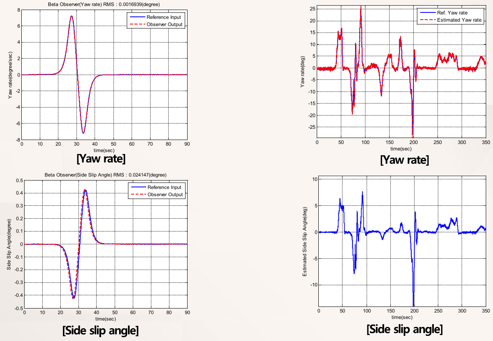

*그림 7. 상태 관측기의 결과: 시뮬레이션(왼쪽)과 실차 실험(오른쪽)의 요레이트와 차체 슬립각*

그림 7의 왼쪽은 시뮬레이션 결과로, 기준 입력(파란색)과 관측기 출력(빨간 점선)이 거의 겹친다. RMS 오차는 요레이트 0.0016939°/s, 차체 슬립각 0.024147°이다. 오른쪽은 실차 실험 결과로, 측정한 요레이트(파란색)와 추정 요레이트(빨간 점선)가 350초 동안 잘 일치하고, 아래 그래프는 같은 주행에서 추정한 차체 슬립각이다. 급하게 선회하는 구간(약 75\~90 s와 200 s 부근)에서 슬립각이 크게 나타난다.

### 2.9 실차 실험 결과

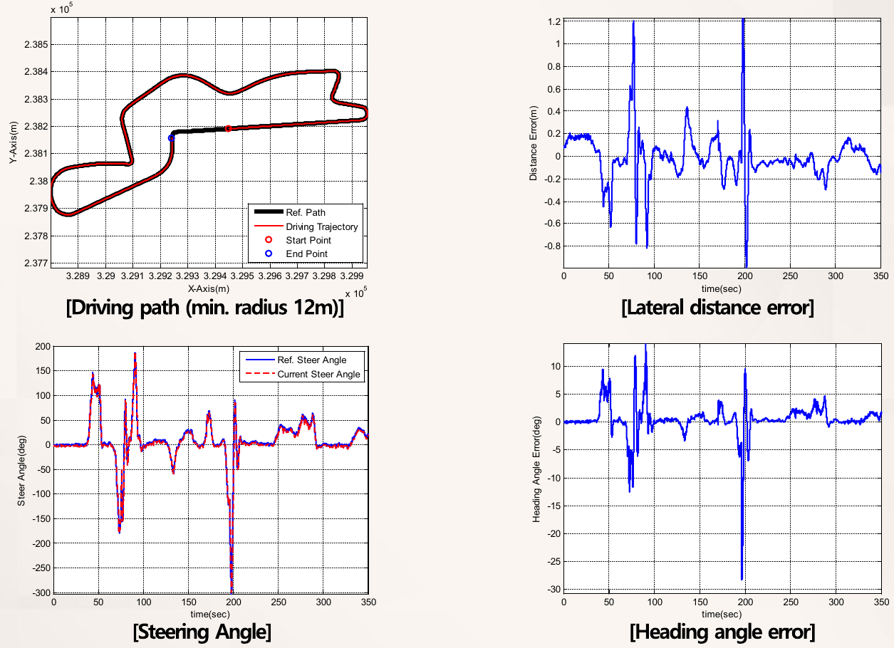

*그림 8. 횡방향 제어기의 실차 실험: 주행 경로(최소 반경 12 m), 횡방향 거리 오차, 조향각, 헤딩각 오차*

그림 8은 최소 회전 반경이 12 m인 시험로를 한 바퀴 돈 결과이다. 왼쪽 위의 기준 경로(검은색)와 주행 궤적(빨간색)이 거의 겹친다. 횡방향 거리 오차는 대부분 ±0.2 m 안에 있지만 급한 곡선에 들어가는 순간(약 75\~90 s와 200 s 부근)에는 최대 1.2 m 정도까지 커진다. 조향각 그래프는 조향 휠 각도로, 명령(파란색)과 실제 값(빨간 점선)이 잘 일치하며, 헤딩각 오차도 급한 곡선에서만 크게 튄다.

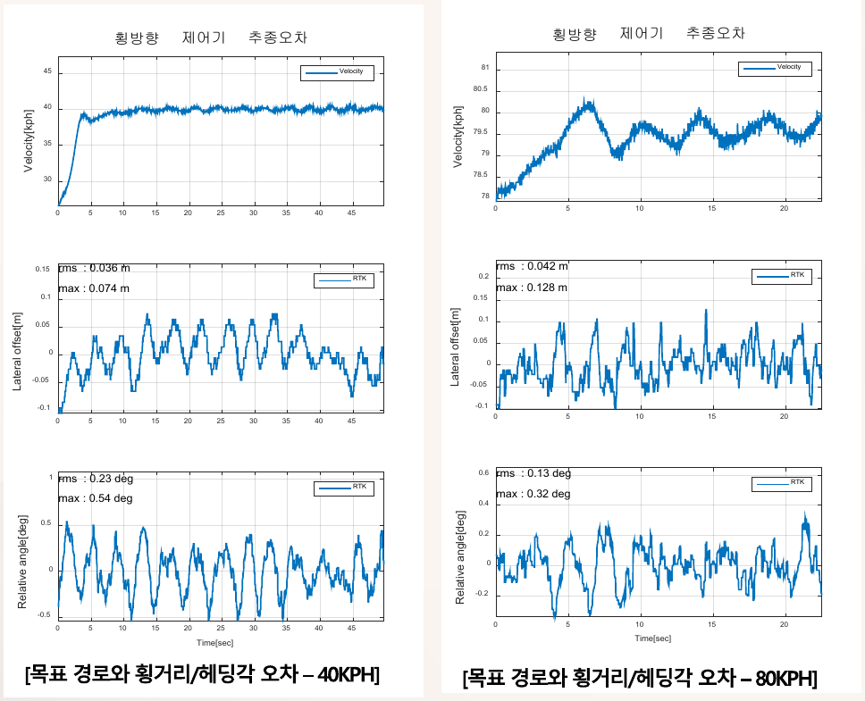

*그림 9. 직선로에서 40 km/h와 80 km/h로 달릴 때의 속도, 횡방향 이탈거리, 상대 헤딩각*

그림 9는 직선로에서 RTK GPS로 잰 추종 오차이다. 목표치와 결과를 정리하면 다음과 같다.

| 항목 | 목표치 | 40 km/h | 80 km/h |
|:-----|:-----|:-----|:-----|
| 횡거리 오차 RMS | 10 cm | 3.6 cm | 4.2 cm |
| 횡거리 오차 최대 | 15 cm | 7.4 cm | 12.8 cm |
| 헤딩각 오차 RMS | 1° | 0.23° | 0.13° |
| 헤딩각 오차 최대 | 1.5° | 0.54° | 0.32° |

*표 7. 직선로 횡방향 제어 성능의 목표치와 결과*

두 속도 모두 목표치를 만족한다. 속도가 높아지면 횡거리 오차의 최대값은 커지지만, 헤딩각 오차는 오히려 줄어든다. 이는 경로에 수직인 속도 성분이 약 $V\Delta\psi$이므로, 같은 횡방향 속도로 경로에 돌아오는 데 필요한 상대 헤딩각이 고속일수록 작다는 점과 들어맞는다.

---

<br>

## 3. Autoware를 이용한 시뮬레이션

### 3.1 wf_simulator

실차 없이 경로 계획과 경로 추종 노드를 시험하려면 차량을 대신하는 시뮬레이터가 필요하다. Autoware.ai의 **wf_simulator**(waypoint follower simulator)는 경로 추종 노드가 내는 차량 명령 `/vehicle_cmd`를 받아 차량 모델을 적분하고, 그 결과를 실제 위치 인식 결과처럼 `/current_pose`, `/current_velocity`, `/localizer_pose`, TF로 발행한다 [4]. 따라서 위치 인식(NDT)과 실차가 하던 일을 하나의 노드가 대신한다. launch 파일의 기본 설정에서는 RViz의 2D Pose Estimate가 발행하는 `/initialpose`로 차량의 초기 위치를 받고, 출력에 작은 측정 잡음을 더한다 [4].

| 차량 모델 | 쓰는 명령 | 운동 방정식 |
|:-----|:-----|:-----|
| IDEAL_TWIST (기본값) | 속도 $v$와 각속도 $\omega$ | $\dot X = v\cos\psi$, $\dot Y = v\sin\psi$, $\dot\psi = \omega$ |
| IDEAL_STEER | 속도 $v$와 조향각 $\delta$ | $\dot X = v\cos\psi$, $\dot Y = v\sin\psi$, $\dot\psi = v\tan\delta / L$ |
| DELAY_TWIST | 속도와 각속도 | 명령이 시간 지연과 1차 지연을 거쳐 반영되는 IDEAL_TWIST |
| DELAY_STEER | 속도와 조향각 | 명령이 시간 지연과 1차 지연을 거쳐 반영되는 IDEAL_STEER |
| CONST_ACCEL_TWIST | 속도와 각속도 | 속도와 각속도가 일정한 가속도와 각가속도로 명령값을 따라가는 IDEAL_TWIST |

*표 8. wf_simulator의 차량 모델*

IDEAL_STEER는 1.4절의 참고에서 본, 뒷바퀴 축을 기준점으로 한 기구학적 자전거 모델이며 축간거리 $L$은 기본값 2.7 m이다 [4], [5]. 기본값인 IDEAL_TWIST는 pure_pursuit가 계산한 $v$와 $\omega = v\kappa$를 그대로 적분하므로, 경로 추종 알고리즘 자체를 시험하기에 알맞다. 지연 모델은 실제 차량의 구동계와 조향계가 명령을 늦게 따라가는 현상을 흉내 내어, 제어기가 지연에 얼마나 강한지 시험할 때 쓴다.

### 3.2 노드 구성과 데이터 흐름

시뮬레이션에서 실행하는 노드와 토픽의 흐름은 다음과 같다. 3주차의 경로 계획과 경로 추종 흐름에서 위치 인식과 차량 자리에 wf_simulator가 들어간 구조이다.

```mermaid
flowchart LR
    WL["waypoint_loader"] -->|"/based/lane_waypoints_raw"| WR["waypoint_replanner"]
    WR -->|"/lane_waypoints_array"| LR["lane_rule"]
    LR -->|"/red_waypoints_array<br>/green_waypoints_array"| LS["lane_stop"]
    LS -->|"/traffic_waypoints_array"| SEL["lane_select"]
    SEL -->|"/base_waypoints<br>/closest_waypoint"| AA["astar_avoid"]
    AA -->|"/safety_waypoints"| VS["velocity_set"]
    VS -->|"/final_waypoints"| PP["pure_pursuit"]
    PP -->|"/twist_raw, /ctrl_raw"| TF["twist_filter"]
    TF -->|"/twist_cmd, /ctrl_cmd"| TG["twist_gate"]
    TG -->|"/vehicle_cmd"| WF["wf_simulator"]
    RV["RViz<br>2D Pose Estimate"] -->|"/initialpose"| WF
    WF -->|"/current_pose<br>/current_velocity"| PP
```

*그림 10. wf_simulator를 쓰는 시뮬레이션의 노드와 토픽 흐름*

wf_simulator가 발행하는 `/current_pose`와 `/current_velocity`는 pure_pursuit뿐 아니라 lane_select, astar_avoid, velocity_set에도 들어가 닫힌 루프를 이룬다. 그림에는 줄였지만 lane_rule도 `/traffic_waypoints_array`를 발행하며, lane_stop은 신호등 상태에 따라 빨간 신호용과 초록 신호용 웨이포인트 가운데 하나를 골라 같은 토픽으로 낸다.

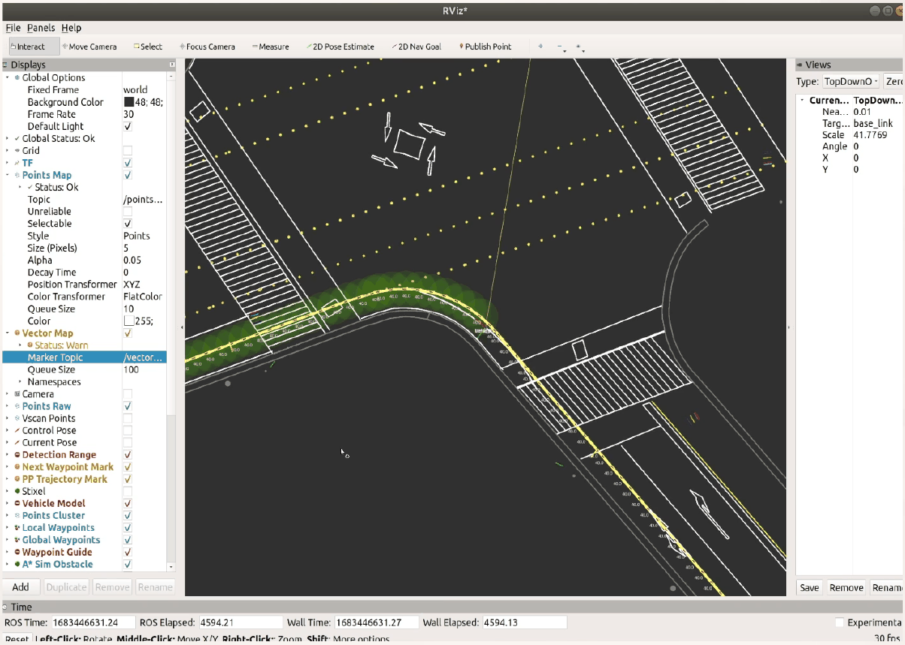

*그림 11. wf_simulator 시뮬레이션 예: RViz에 표시된 경로와 장애물 탐지 범위*

그림 11은 시뮬레이션이 실행되는 모습이다. 벡터 지도의 차선과 횡단보도 위로 노란색 웨이포인트 경로가 교차로를 돌아 이어지고, 경로의 앞부분을 따라 겹쳐 그려진 초록색 원들은 Detection Range 표시, 즉 velocity_set이 장애물을 찾는 범위이다. 경로 옆의 숫자 40.0은 웨이포인트의 목표 속도(km/h)이다. 이하 3.3\~3.8절은 이 결과를 얻는 절차이다.

### 3.3 TF와 지도 불러오기

Autoware.ai 1.14.0이 빌드되어 있고(4\~5주차), 9주차의 Moriyama 샘플 데이터가 `~/.autoware/data`에 풀려 있다고 가정한다. 5주차의 방법으로 Runtime Manager를 띄운다.

```bash
cd ~/autoware.ai
source install/setup.bash
roslaunch runtime_manager runtime_manager.launch
```

**1단계: Setup 탭.** Localizer로 Velodyne을 고르고, Baselink to Localizer에 LiDAR가 차량 기준점(base_link)에서 어디에 달려 있는지 입력한 뒤 TF 버튼을 누른다.

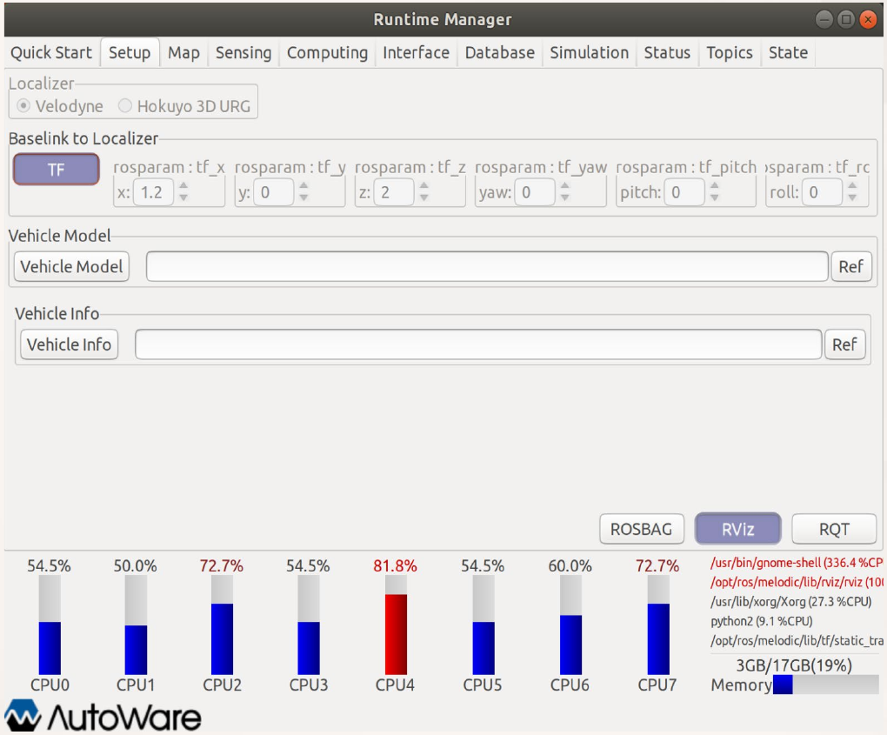

*그림 12. Setup 탭에서 base_link와 LiDAR 사이의 TF 설정*

그림 12의 값은 $x = 1.2$ m, $y = 0$, $z = 2$ m, yaw, pitch, roll은 모두 0으로, LiDAR가 기준점보다 1.2 m 앞, 2 m 위에 똑바로 달려 있다는 뜻이다. 이 변환은 `base_link`와 `velodyne` 좌표계 사이의 TF로 발행된다. Vehicle Model과 Vehicle Info는 이 예에서 비워 둔다.

**2단계: Map 탭.** 포인트 클라우드 지도, 벡터 지도, 지도 좌표계의 TF를 차례로 불러온다.

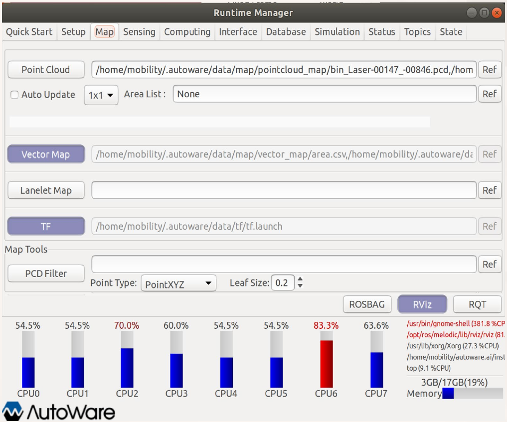

*그림 13. Map 탭에서 포인트 클라우드 지도, 벡터 지도, TF 불러오기*

1. **Point Cloud:** Ref 버튼으로 `~/.autoware/data/map/pointcloud_map/`의 `.pcd` 파일들을 모두 고르고 Point Cloud 버튼을 누른다.
2. **Vector Map:** `~/.autoware/data/map/vector_map/`의 `.csv` 파일들을 모두 고르고 Vector Map 버튼을 누른다.
3. **TF:** `~/.autoware/data/tf/tf.launch`를 고르고 TF 버튼을 누른다. 이 launch 파일은 `world`와 `map` 좌표계 사이의 변환 같은 지도 좌표계의 정적 변환을 발행한다(그림 20의 `/world_to_map`, `/map_to_mobility` 노드).
4. 오른쪽 아래의 RViz 버튼으로 RViz를 연다.

### 3.4 웨이포인트 만들기

벡터 지도의 차선 위에 경로를 만든다. 절차는 3주차 4.2절과 같다.

1. Computing 탭의 Motion Planning, waypoint_maker 아래에서 waypoint_clicker의 [app]을 연다.
2. `/waypoint_clicker/velocity`에 웨이포인트에 기록할 속도(예: 40 km/h)를, `/waypoint_clicker/output_file`에 저장할 파일(예: `~/.autoware/lane_waypoint.csv`)을 입력하고 OK를 누른 뒤 waypoint_clicker를 체크하여 실행한다.
3. RViz에 벡터 지도의 차선 점(LANE 노드)이 노란색으로 표시된다.
4. RViz 위쪽의 Publish Point를 고르고 출발점을 클릭한 뒤, 다시 Publish Point를 고르고 끝점을 클릭하면 두 점 사이에 차선을 따르는 경로가 만들어진다.

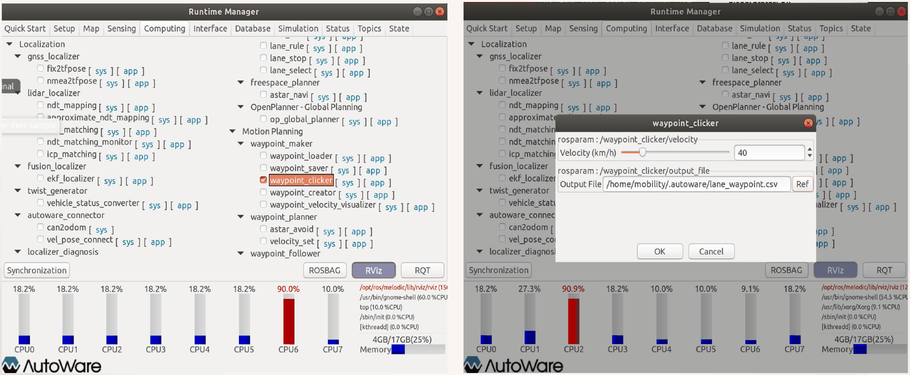

*그림 14. waypoint_clicker 실행과 속도, 출력 파일 설정*

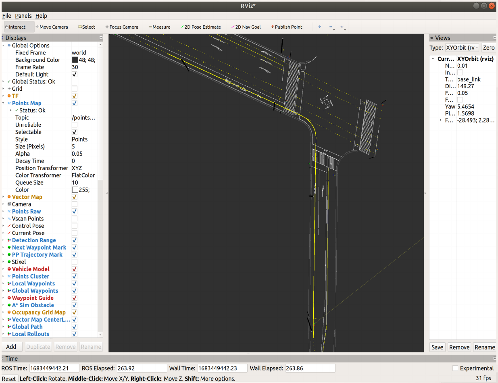

*그림 15. RViz에서 Publish Point로 출발점과 끝점을 찍어 만든 경로(노란색)*

waypoint_clicker는 RViz가 발행하는 `/clicked_point`를 받아, 벡터 지도의 차선(`/vector_map_info/lane`, `/vector_map_info/node`, `/vector_map_info/point`)을 따라 클릭한 점들을 잇는 경로를 찾고, 그 점들을 지정한 속도와 함께 출력 파일에 쓴다 [6]. 그림 15에서는 교차로를 지나 아래쪽으로 꺾이는 경로가 만들어졌다.

### 3.5 웨이포인트 불러오기

만든 파일을 경로 계획 노드가 쓸 수 있도록 불러온다.

1. waypoint_clicker의 체크를 해제하고, waypoint_maker 아래의 waypoint_loader에서 [app]을 연다.
2. load csv를 체크하고 multi_lane에 3.4절의 파일 `~/.autoware/lane_waypoint.csv`를 지정한 뒤 OK를 누르고 waypoint_loader를 체크한다.

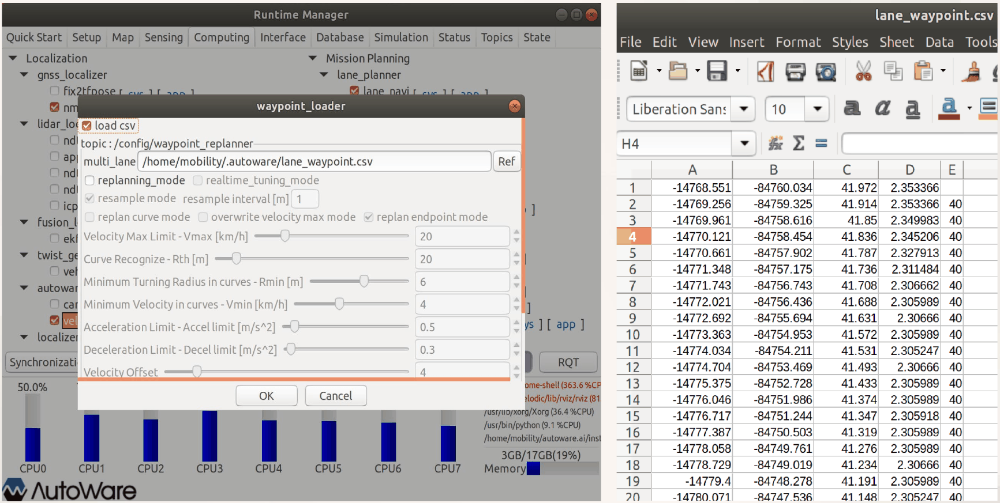

*그림 16. waypoint_loader 설정(왼쪽)과 웨이포인트 파일의 내용(오른쪽)*

그림 16의 오른쪽은 웨이포인트 파일을 스프레드시트로 연 모습이다. 한 줄이 웨이포인트 하나이고, 열은 차례로 $x$, $y$, $z$(m, 지도 좌표계), yaw(rad), 속도(km/h)이다. 첫 줄에는 속도 없이 네 값만 있는데, waypoint_loader는 첫 줄의 열 개수로 파일 형식을 판별하며 네 열이면 "x, y, z, yaw, 속도" 형식으로 읽는다. 첫 줄은 이 판별에만 쓰고 웨이포인트로 읽지 않는다 [6]. 나머지 줄의 속도는 모두 waypoint_clicker에서 정한 40이다.

대화 상자의 값은 `/config/waypoint_replanner` 토픽으로 waypoint_replanner에 전달된다. replanning_mode를 켜면 waypoint_replanner가 불러온 경로의 속도를 다시 계획한다. 이 예에서는 꺼져 있으므로 아래 항목들은 회색으로 비활성 상태이고, 파일의 속도가 그대로 쓰인다. 아래의 체크 상자는 다시 계획할 때 적용할 단계를 고른다. resample mode는 웨이포인트를 resample interval 간격으로 다시 배치하고, replan curve mode는 아래 식의 곡선 감속을 적용하며, overwrite velocity max mode는 곡선 감속에 앞서 모든 웨이포인트의 속도를 Vmax로 덮어쓴다. replan endpoint mode는 경로 끝의 몇 개 웨이포인트를 Vmin으로 감속하고 맨 끝 웨이포인트들의 속도를 0으로 두어 차량을 세우며, realtime_tuning_mode는 대화 상자의 값을 바꿀 때마다 경로를 다시 계획하여 발행한다 [6]. 그림 16에서는 기본값대로 resample mode와 replan endpoint mode가 켜져 있다.

| 항목 | 예시 값 | 뜻 |
|:-----|:-----|:-----|
| resample interval | 1 m | 웨이포인트를 이 간격으로 다시 배치한다 |
| Velocity Max Limit (Vmax) | 20 km/h | 경로 전체의 최대 속도 |
| Curve Recognize (Rth) | 20 m | 곡률 반경이 이 값 이하인 구간을 곡선으로 인식한다 |
| Minimum Turning Radius in curves (Rmin) | 6 m | 곡선 반경의 하한, 이보다 작은 반경은 이 값으로 본다 |
| Minimum Velocity in curves (Vmin) | 4 km/h | 곡선에서의 최저 속도 |
| Accel limit, Decel limit | 0.5, 0.3 m/s² | 속도를 바꿀 때의 가속도와 감속도 한계 |
| Velocity Offset | 4 | 곡선의 속도 제한 구간을 웨이포인트 4개만큼 앞당겨, 차량의 응답 지연을 감안해 곡선에 들어가기 전에 감속하게 한다 |

*표 9. waypoint_loader 대화 상자의 속도 재계획 설정*

replan curve mode를 켜면 Autoware.ai 1.14.0의 waypoint_replanner는 곡률 반경이 $R_{th}$ 이하인 곡선 구간마다 가장 작은 곡률 반경 $R$(하한 $R_{\min}$)을 찾고, 그 구간의 속도 상한을 $R_{\min}$에서 $V_{\min}$, $R_{th}$에서 $V_{\max}$가 되도록 선형으로 정한다 [6].

$$
V(R) = V_{\max} - \frac{V_{\max} - V_{\min}}{R_{th} - R_{\min}}\left(R_{th} - R\right)
$$

예를 들어 표 9의 값에서 반경 13 m인 곡선의 속도 상한은 $20 - 16 \times 7 / 14 = 12$ km/h이다. 11주차 1.3절이 횡방향 가속도로부터 $\sqrt{0.3 g R}$를 쓴 것과 같은 목적(곡선에서 감속)을 더 단순한 선형 규칙으로 구현한 것이다.

### 3.6 위치 인식을 시뮬레이터 모드로 바꾸기

실차에서는 NDT 매칭(9주차)이 낸 `/ndt_pose`와 `/estimate_twist`를 vel_pose_connect가 `/current_pose`와 `/current_velocity`로 이어 주고, 경로 계획과 경로 추종 노드는 이 두 토픽만 본다. 시뮬레이션에서는 이 연결을 끊고 wf_simulator의 출력을 쓴다.

1. Computing 탭의 autoware_connector 아래 vel_pose_connect에서 [app]을 열고, `/current_pose`의 원본이 `/ndt_pose`, `/current_velocity`의 원본이 `/estimate_twist`로 되어 있는 것을 확인한 뒤 Simulation Mode를 체크한다. 그리고 vel_pose_connect를 체크한다.
2. gnss_localizer 아래 nmea2tfpose에서 [app]을 열고 Simulation Mode를 체크한 뒤 nmea2tfpose를 체크한다.

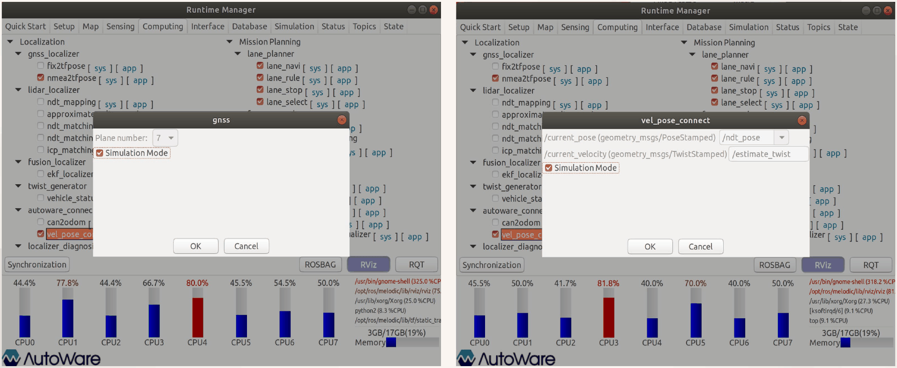

*그림 17. nmea2tfpose(왼쪽)와 vel_pose_connect(오른쪽)의 Simulation Mode 설정*

Simulation Mode의 vel_pose_connect는 NDT의 출력 대신 `/sim_pose`와 `/sim_velocity`를 이어 주도록 바뀐다 [7]. wf_simulator가 `/current_pose`와 `/current_velocity`를 직접 발행하므로, 결과적으로 이 두 토픽에는 시뮬레이터의 값만 들어간다. nmea2tfpose의 Plane number는 GNSS의 위도와 경도를 평면 좌표로 바꿀 때 쓰는 일본 평면 직각 좌표계의 구역 번호로 기본값이 7이다 [5], [7]. Simulation Mode를 체크하면 이 메뉴가 비활성화되고(그림 17 왼쪽의 회색 7), 평면 좌표의 원점을 위도 0°, 경도 0°에 두는 시뮬레이션용 설정이 된다 [8].

### 3.7 경로 계획, 경로 추종, 시뮬레이터 실행

Computing 탭에서 다음 노드들을 체크한다.

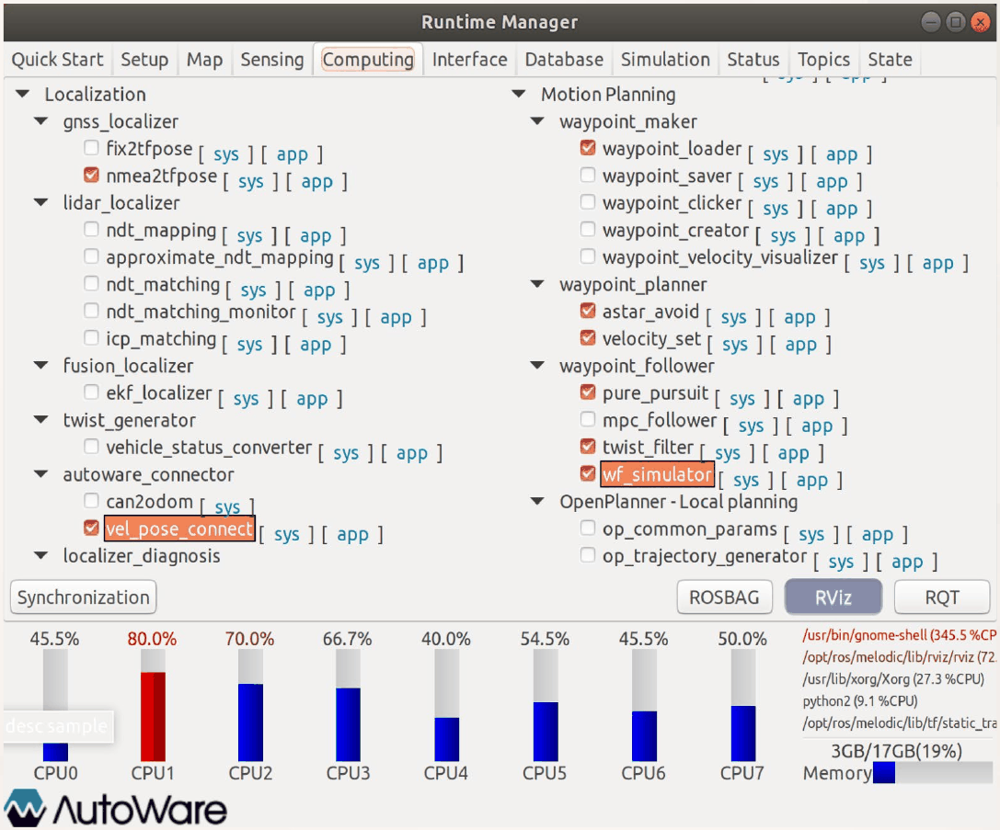

*그림 18. Computing 탭에서 경로 계획, 경로 추종 노드와 wf_simulator를 실행한 상태*

| 분류 | 노드 | 역할 |
|:-----|:-----|:-----|
| Mission Planning, lane_planner | lane_navi, lane_rule, lane_stop, lane_select | lane_navi는 벡터 지도의 경로를 웨이포인트로 바꾸고, lane_rule과 lane_stop은 정지선과 신호 규칙을 반영하며, lane_select는 따라갈 차선과 가장 가까운 웨이포인트를 고른다(3주차) |
| Motion Planning, waypoint_maker | waypoint_loader | 3.5절의 웨이포인트 파일을 발행한다 |
| Motion Planning, waypoint_planner | astar_avoid, velocity_set | 장애물이 있으면 A\*로 회피 경로를 만들고, 장애물과 정지선 앞에서 속도를 조절한다 |
| Motion Planning, waypoint_follower | pure_pursuit, twist_filter | 목표 속도와 각속도를 계산하고 횡방향 가속도를 제한한다(3주차). twist_filter의 launch 파일은 명령을 골라 `/vehicle_cmd`로 내보내는 twist_gate도 함께 실행한다 [6] |
| Motion Planning, waypoint_follower | wf_simulator | 차량 명령으로 차량의 움직임을 모의한다(3.1절) |

*표 10. 시뮬레이션에서 실행하는 Computing 탭의 노드*

wf_simulator의 [app]에서 초기 위치를 받을 곳을 정하는 Initialize Source는 RVIZ(2D Pose Estimate의 `/initialpose`), NDT(`/ndt_pose`), GNSS(`/gnss_pose`), ORIGIN(지도 원점) 가운데 기본값인 RVIZ로 둔다 [4]. 모든 노드를 실행한 뒤 RViz에서 2D Pose Estimate를 고르고, 경로의 출발점 근처를 클릭한 채 진행 방향으로 끌어 차량의 초기 위치와 방향을 정한다. 그러면 wf_simulator가 그 위치에서 출발하여 경로를 따라 달리기 시작한다.

### 3.8 실행 결과 확인

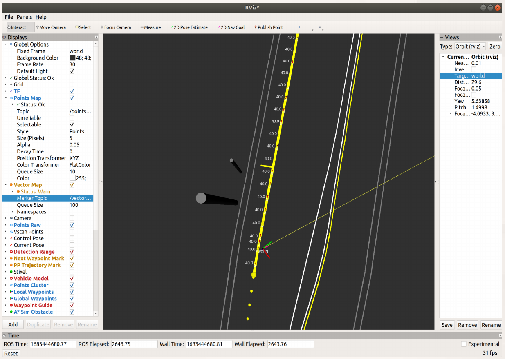

*그림 19. 시뮬레이션 중의 RViz: 목표 속도 40.0 km/h가 표시된 노란색 경로*

그림 19에서 노란색 굵은 선은 따라갈 경로, 그 옆의 숫자는 웨이포인트의 목표 속도 40.0 km/h이다. RViz의 Displays 목록에서 Vehicle Model(차량 모델), Next Waypoint Mark(다음 목표 웨이포인트), PP Trajectory Mark(pure pursuit가 계산한 원호), Detection Range(장애물 탐지 범위)를 켜 두면 차량이 경로를 따라가는 모습과 제어 과정을 함께 볼 수 있다.

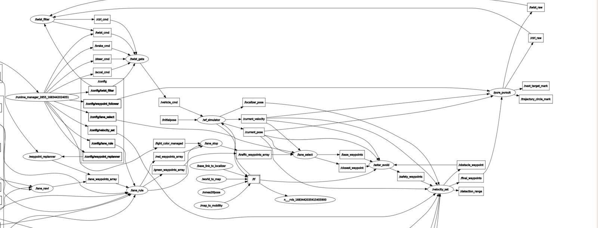

*그림 20. 시뮬레이션 중의 rqt_graph 가운데 경로 계획, 경로 추종, wf_simulator 부분*

`rqt_graph`로 노드 그래프를 열면 그림 20처럼 그림 10의 흐름을 실제 연결로 확인할 수 있다. 가운데의 `/wf_simulator`는 `/vehicle_cmd`와 `/initialpose`를 받아 `/current_pose`, `/current_velocity`, `/localizer_pose`, `/tf`를 발행하고, 오른쪽의 `/pure_pursuit`는 `/final_waypoints`와 현재 위치, 속도를 받아 다음 목표점 표시(`/next_target_mark`)와 원호 표시(`/trajectory_circle_mark`)를 발행한다. 왼쪽 위의 `/twist_filter`, `/twist_gate`가 명령을 거르고 골라 `/vehicle_cmd`로 내보내면 루프가 닫힌다. 그림에서 생략한 그래프의 왼쪽에는 `/vector_map_loader`가 `/vector_map_info/` 아래의 차선, 정지선, 신호 같은 토픽을 여러 노드에 발행하고, `/waypoint_loader`가 `/based/lane_waypoints_raw`를 발행하며, vel_pose_connect가 실행한 `/pose_relay`와 `/vel_relay`도 나타난다. 시뮬레이션이 원하는 대로 움직이지 않으면 이 그래프에서 끊어진 토픽(예: `/current_pose`를 받지 못하는 노드)을 먼저 찾는다.

---

<br>

## 개념 적용

**T/F 점검:**

| 문장 | 판단과 근거 |
|:-----|:-----|
| 기구학 모델은 저속에서 두 바퀴의 타이어 슬립각이 0이라고 가정한다. | **T.** 구심력 $mV^2/R$이 속도의 제곱에 비례하여 저속에서는 작으므로 필요한 슬립각도 작다. |
| 앞뒤 바퀴를 같은 방향으로 같은 각만큼 조향하면 차량은 가장 작은 반경으로 돈다. | **F.** $\tan\delta_f - \tan\delta_r = 0$이므로 $\dot\psi = 0$이 되어 차체가 돌지 않고 비스듬히 평행 이동한다. 반경을 줄이는 것은 역위상 조향이다. |
| 선회할 때 안쪽 앞바퀴의 조향각은 바깥쪽 앞바퀴보다 크다. | **T.** 안쪽 바퀴가 회전 중심에 더 가까우므로 $\delta_i = L/(R - l_w/2) > \delta_o = L/(R + l_w/2)$이다. |
| 히스테리시스를 두면 모델을 바꾸는 임계 속도가 하나로 정해진다. | **F.** 가속할 때(15 km/h)와 감속할 때(10 km/h)의 임계값을 다르게 두어, 그 사이에서는 현재 모델을 유지한다. |
| 백스테핑 제어기에서 $d_s$와 $e_r$가 0으로 수렴하는 근거는 리아프노프 함수의 변화율이 음수라는 것이다. | **T.** $\dot{\mathcal{V}} = -W_d K_d d_s^2 - W_r K_r e_r^2 < 0$이다. |
| $C_r l_r = C_f l_f$인 차량에서도 요레이트 측정만으로 차체 슬립각을 관측할 수 있다. | **F.** $a_{21} = 0$이 되어 관측 가능성 행렬의 행렬식이 0이므로 관측할 수 없다. |
| wf_simulator의 기본 차량 모델은 pure_pursuit가 낸 속도와 각속도를 그대로 적분한다. | **T.** IDEAL_TWIST는 $\dot X = v\cos\psi$, $\dot Y = v\sin\psi$, $\dot\psi = \omega$를 적분한다. |

---

<br>

## 요약

| 개념 | 핵심 요약 |
|:-----|:-----|
| 기구학 모델의 가정 | 저속에서 횡력이 작아 두 바퀴의 슬립각을 0으로 보고, 바퀴 속도에 수직인 선들이 만나는 순간 회전 중심을 쓴다. |
| 기구학적 자전거 모델 | 사인 법칙으로 $\dot\psi = V\cos\beta(\tan\delta_f - \tan\delta_r)/(l_f + l_r)$와 $\beta = \tan^{-1}((l_f\tan\delta_r + l_r\tan\delta_f)/(l_f + l_r))$를 얻고, $\dot X = V\cos(\psi + \beta)$, $\dot Y = V\sin(\psi + \beta)$로 위치를 적분한다. |
| 애커먼 조향 | 작은 각에서 $\delta_f = L/R$이고 $\delta_o = L/(R + l_w/2)$, $\delta_i = L/(R - l_w/2)$로 안쪽 바퀴가 더 꺾이며, 사다리꼴 타이로드 배치로 구현한다. |
| 모델 전환과 히스테리시스 | 저속에는 수렴 시간과 발산 위험이 없는 기구학 모델, 고속에는 동역학 모델을 쓰고, 15 km/h와 10 km/h의 두 임계값으로 잦은 전환을 막는다. |
| 상태 공간 모델 | 상태 $[\beta \;\; r]^T$, 입력 $\delta$, 출력 $y = [0 \;\; 1]\mathbf{x}$(요레이트 측정)로 쓰며, 행렬 원소가 $1/V$, $1/V^2$에 비례한다. |
| 경로 추종 오차 모델 | 전방 주시점의 횡방향 이탈거리와 상대 헤딩각이 $\dot d_s = V(\beta + \Delta\psi) + L_s r$, $\Delta\dot\psi = r - V\rho$를 따른다. |
| 백스테핑 제어기 | Inner-loop이 $r_d = -(V(\beta + \Delta\psi) + K_d d_s)/L_s$를 정하고, Outer-loop이 리아프노프 함수의 교차항을 지우는 조향각 $\delta = (-f - (W_d L_s/W_r)d_s - K_r e_r)/b_\delta$를 낸다. |
| 상태 관측기 | $\dot{\hat{\mathbf{x}}} = A\hat{\mathbf{x}} + B\delta + \mathbf{l}(y - C\hat{\mathbf{x}})$로 요레이트 측정에서 차체 슬립각을 추정하며, $a_{21} \neq 0$이어야 관측 가능하다. |
| 실차 성능 | 직선로에서 횡거리 오차 RMS 3.6 cm(40 km/h), 4.2 cm(80 km/h), 최대 12.8 cm 이하로 목표치(RMS 10 cm, 최대 15 cm)를 만족한다. |
| wf_simulator | `/vehicle_cmd`로 차량 모델을 적분하여 `/current_pose`, `/current_velocity`를 발행하므로 위치 인식과 실차 없이 경로 계획과 경로 추종을 시험할 수 있다. |
| 시뮬레이션 절차 | TF와 지도를 불러오고, waypoint_clicker로 경로를 만들어 waypoint_loader로 불러오고, 위치 인식을 Simulation Mode로 바꾼 뒤 경로 계획, 경로 추종 노드와 wf_simulator를 실행하고 2D Pose Estimate로 출발시킨다. |

---

<br>

## 점검 문제

1. **기구학 모델:** $l_f = 1.0$ m, $l_r = 1.6$ m인 차량이 $V = 4$ m/s, $\delta_f = 8°$, $\delta_r = 0$으로 달린다. 차체 슬립각, 요레이트, 회전 반경을 구하라($\tan 8° = 0.14054$).

   <details>
   <summary>정답</summary>

   $\tan\beta = 1.6 \times 0.14054 / 2.6 = 0.08649$이므로 $\beta = 0.08627$ rad(4.94°)이고 $\cos\beta = 0.99628$이다. 요레이트는 $\dot\psi = 4 \times 0.99628 \times 0.14054 / 2.6 = 0.2154$ rad/s이고, 회전 반경은 $R = V / \dot\psi = 4 / 0.2154 = 18.57$ m이다.

   </details>

2. **차체 슬립각의 유도:** (식 1) $\tan\delta_f\cos\beta - \sin\beta = l_f / R$와 (식 2) $\sin\beta - \tan\delta_r\cos\beta = l_r / R$에서 $R$을 지워 $\beta$의 식을 유도하라.

   <details>
   <summary>정답</summary>

   (식 2)에 $l_f$, (식 1)에 $l_r$를 곱하면 우변이 모두 $l_f l_r / R$이 되므로 빼면 0이다. 좌변을 빼면 $l_f\sin\beta - l_f\tan\delta_r\cos\beta - l_r\tan\delta_f\cos\beta + l_r\sin\beta = 0$이고, 정리하면 $(l_f + l_r)\sin\beta = (l_f\tan\delta_r + l_r\tan\delta_f)\cos\beta$이다. 양변을 $(l_f + l_r)\cos\beta$로 나누면 $\beta = \tan^{-1}((l_f\tan\delta_r + l_r\tan\delta_f)/(l_f + l_r))$이다.

   </details>

3. **애커먼 조향:** $L = 2.8$ m, $l_w = 1.5$ m인 차량이 $R = 7$ m로 선회한다. 작은 각도 근사로 $\delta_f$, $\delta_o$, $\delta_i$를 구하라.

   <details>
   <summary>정답</summary>

   $\delta_f = 2.8 / 7 = 0.4$ rad(22.9°)이다. $\delta_o = 2.8 / (7 + 0.75) = 0.3613$ rad(20.7°), $\delta_i = 2.8 / (7 - 0.75) = 0.448$ rad(25.7°)이다. 차이는 0.0867 rad(약 5.0°)로, 반경이 작을수록 좌우 바퀴의 각도 차이가 커진다.

   </details>

4. **히스테리시스:** 차량이 18, 14, 11, 9, 11, 14, 16 km/h의 순서로 속도가 바뀐다. 처음에 동역학 모델을 쓰고 있었다면, 각 시점의 관측기 모델을 쓰라(가속 임계값 15 km/h, 감속 임계값 10 km/h).

   <details>
   <summary>정답</summary>

   18(동역학), 14(동역학), 11(동역학), 9(기구학), 11(기구학), 14(기구학), 16(동역학)이다. 동역학 모델은 10 km/h 미만인 9 km/h에서야 기구학 모델로 바뀌고, 기구학 모델은 15 km/h 이상인 16 km/h에서야 동역학 모델로 바뀐다.

   </details>

5. **원하는 요레이트:** $V = 20$ m/s, $L_s = 15$ m, $K_d = 0.4$ s⁻¹, $\beta = 0$, $\Delta\psi = -0.01$ rad, $d_s = -0.5$ m일 때 원하는 요레이트를 구하고, 차량이 어느 쪽으로 돌아야 하는지 설명하라.

   <details>
   <summary>정답</summary>

   $r_d = -(20 \times (0 - 0.01) + 0.4 \times (-0.5)) / 15 = -(-0.2 - 0.2) / 15 = 0.4 / 15 = 0.0267$ rad/s이다. 양수이므로 왼쪽(반시계 방향)으로 돌아야 한다. 전방 주시점이 경로의 오른쪽 50 cm에 있고 차체도 경로보다 오른쪽을 향하고 있으므로, 왼쪽으로 돌아 경로로 돌아온다.

   </details>

6. **백스테핑:** 2.6절에서 조향각 식의 $-\frac{W_d L_s}{W_r}d_s$ 항이 하는 일을 리아프노프 함수의 변화율로 설명하라.

   <details>
   <summary>정답</summary>

   $\dot{\mathcal{V}}$에는 $\dot d_s = -K_d d_s + L_s e_r$에서 오는 교차항 $W_d L_s d_s e_r$가 있는데, 이 항은 $d_s$와 $e_r$의 부호에 따라 양수가 될 수 있다. 조향각에 $-\frac{W_d L_s}{W_r}d_s$를 넣으면 $W_r e_r(f + b_\delta\delta)$에서 $-W_d L_s d_s e_r$가 생겨 교차항을 정확히 지운다. 그 결과 $\dot{\mathcal{V}} = -W_d K_d d_s^2 - W_r K_r e_r^2$로 항상 음수가 된다.

   </details>

7. **관측 가능성:** $C = [0 \;\; 1]$이고 $A$의 원소가 $a_{11} = -5$, $a_{12} = -0.9$, $a_{21} = 0$, $a_{22} = -6$인 시스템에서 차체 슬립각을 관측할 수 있는지 판단하고 그 이유를 쓰라.

   <details>
   <summary>정답</summary>

   관측 가능성 행렬 $\mathcal{O}$의 두 행은 $[0 \;\; 1]$과 $[a_{21} \;\; a_{22}] = [0 \;\; -6]$이고 행렬식이 0(계수 1)이므로 관측할 수 없다. $a_{21} = 0$이어서 $\dot r = -6r + b_{21}\delta$에 $\beta$가 나타나지 않으므로, 요레이트의 측정값에 $\beta$의 정보가 전혀 담기지 않는다.

   </details>

8. **시뮬레이션 절차:** 시뮬레이션에서 vel_pose_connect를 Simulation Mode로 두는 이유는 무엇인가? 또 wf_simulator를 실행했는데 차량이 움직이지 않을 때 가장 먼저 확인할 것은 무엇인가?

   <details>
   <summary>정답</summary>

   Simulation Mode가 아니면 vel_pose_connect가 NDT의 출력(`/ndt_pose`, `/estimate_twist`)을 `/current_pose`, `/current_velocity`로 이어 주므로, NDT가 실행되면 그 값이 wf_simulator가 발행하는 같은 토픽의 값과 섞인다. Simulation Mode에서는 이 연결이 `/sim_pose`, `/sim_velocity`로 바뀌어 두 토픽에 시뮬레이터의 값만 들어간다. 차량이 움직이지 않으면 먼저 RViz의 2D Pose Estimate로 초기 위치를 주었는지 확인한다. 기본 설정의 wf_simulator는 `/initialpose`를 받기 전까지 초기 위치를 기다린다. 그다음 `rqt_graph`에서 `/vehicle_cmd`와 `/final_waypoints`가 이어져 있는지 확인한다.

   </details>

---

<br>

## 참고 문헌

1. R. Rajamani, *Vehicle Dynamics and Control*, 2nd ed. New York, NY, USA: Springer, 2012, doi: 10.1007/978-1-4614-1433-9.
2. H. K. Khalil, *Nonlinear Systems*, 3rd ed. Upper Saddle River, NJ, USA: Prentice Hall, 2002.
3. D. G. Luenberger, "Observing the state of a linear system," *IEEE Trans. Mil. Electron.*, vol. MIL-8, no. 2, pp. 74-80, Apr. 1964, doi: 10.1109/TME.1964.4323124.
4. Autoware Foundation, "simulation: wf_simulator," GitHub repository, Autoware.ai. https://github.com/Autoware-AI/simulation
5. Autoware Foundation, "common: vehicle_sim_model, gnss," GitHub repository, Autoware.ai. https://github.com/Autoware-AI/common
6. Autoware Foundation, "core_planning: waypoint_maker," GitHub repository, Autoware.ai. https://github.com/Autoware-AI/core_planning
7. Autoware Foundation, "core_perception: autoware_connector, gnss_localizer," GitHub repository, Autoware.ai. https://github.com/Autoware-AI/core_perception
8. Autoware Foundation, "utilities: runtime_manager," GitHub repository, Autoware.ai. https://github.com/Autoware-AI/utilities
