# Week 12 Lecture — Lateral Control of Autonomous Vehicles II

[Repository Guide](../../README.md) | [English](Concepts_Lecture.md) | [한국어](Concepts_Lecture.ko.md)

> **Last Updated:** 2026-11-04

> **Learning Objectives:**
> 1. Derive the kinematic bicycle model (yaw rate, sideslip angle, rates of change of position) with the law of sines under the assumption that the slip angles of the wheels are zero
> 2. Compute the steering angles of the inner and outer wheels in Ackermann steering that takes the width of the vehicle into account
> 3. Explain why the kinematic and dynamic models are switched according to speed and how hysteresis prevents frequent switching
> 4. Build a path tracking error model from the lateral offset and the relative heading angle, and derive the desired yaw rate and the steering angle by backstepping
> 5. Design a state observer that estimates the sideslip angle from yaw rate measurements, and explain the observability condition
> 6. Run a simulation from waypoint generation to path following with the wf_simulator of Autoware

---

## Table of Contents

- [1. Kinematics of Lateral Vehicle Motion](#1-kinematics-of-lateral-vehicle-motion)
  - [1.1 Assumptions of the Kinematic Model](#11-assumptions-of-the-kinematic-model)
  - [1.2 Geometry and the Law of Sines](#12-geometry-and-the-law-of-sines)
  - [1.3 Turning Radius, Yaw Rate, and Sideslip Angle](#13-turning-radius-yaw-rate-and-sideslip-angle)
  - [1.4 Equations of Motion in Global Coordinates](#14-equations-of-motion-in-global-coordinates)
  - [1.5 A Worked Example and the Effect of Rear-Wheel Steering](#15-a-worked-example-and-the-effect-of-rear-wheel-steering)
  - [1.6 Kinematics Considering the Vehicle Width](#16-kinematics-considering-the-vehicle-width)
- [2. State-Space Model and Lateral Controller Design](#2-state-space-model-and-lateral-controller-design)
  - [2.1 Switching Between the Kinematic and Dynamic Models](#21-switching-between-the-kinematic-and-dynamic-models)
  - [2.2 State-Space Model](#22-state-space-model)
  - [2.3 Path Tracking Error Model](#23-path-tracking-error-model)
  - [2.4 Cascade Structure and Backstepping](#24-cascade-structure-and-backstepping)
  - [2.5 Step 1: The Desired Yaw Rate](#25-step-1-the-desired-yaw-rate)
  - [2.6 Step 2: The Steering Angle](#26-step-2-the-steering-angle)
  - [2.7 Numerical Example](#27-numerical-example)
  - [2.8 State Observer](#28-state-observer)
  - [2.9 Real Vehicle Test Results](#29-real-vehicle-test-results)
- [3. Simulation with Autoware](#3-simulation-with-autoware)
  - [3.1 wf_simulator](#31-wf_simulator)
  - [3.2 Node Configuration and Data Flow](#32-node-configuration-and-data-flow)
  - [3.3 Loading the TF and the Maps](#33-loading-the-tf-and-the-maps)
  - [3.4 Creating Waypoints](#34-creating-waypoints)
  - [3.5 Loading Waypoints](#35-loading-waypoints)
  - [3.6 Switching Localization to Simulator Mode](#36-switching-localization-to-simulator-mode)
  - [3.7 Running Path Planning, Path Following, and the Simulator](#37-running-path-planning-path-following-and-the-simulator)
  - [3.8 Checking the Results](#38-checking-the-results)
- [Concept Applications](#concept-applications)
- [Summary](#summary)
- [Self-Check Questions](#self-check-questions)
- [References](#references)

---

<br>

## 1. Kinematics of Lateral Vehicle Motion

### 1.1 Assumptions of the Kinematic Model

The dynamic bicycle model of Week 11 explained lateral motion through the lateral forces and slip angles of the tires. The **kinematic model** of this section describes the motion of the vehicle from geometric relations alone, without considering forces. Its key assumption is that the velocities at the front and rear wheel positions point in the directions the wheels face, that is, **the tire slip angles of both wheels are zero** [1].

This assumption fits well at low speed. To drive around a circle of radius $R$ at speed $V$, the two wheels together must produce the centripetal force $mV^2/R$, and since this force is proportional to the square of the speed, it is small at low speed. When the lateral force is small, the required slip angle is also small and can be regarded as zero. For example, when a vehicle with $m = 2000$ kg drives around a circle of radius 20 m, the required lateral force is $2000 \times 25 / 20 = 2500$ N at $V = 5$ m/s, but 40000 N at $V = 20$ m/s, 16 times larger. If the sum of the cornering stiffnesses of the two axles is about 140000 N/rad, the required slip angle is roughly 0.018 rad (1.0°) and 0.29 rad (16°); the former is negligible, but the latter exceeds even the range of the linear tire model. The kinematic model is useful at low speeds of about 5 m/s (18 km/h) or less [1].

### 1.2 Geometry and the Law of Sines

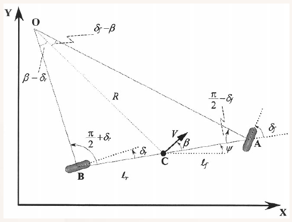

*Figure 1. Geometry of the kinematic bicycle model: instantaneous rolling center O, front wheel A, rear wheel B, center of gravity C*

The symbols in Figure 1 are as follows. In the global frame $(X, Y)$, A is the front wheel, B is the rear wheel, C is the center of gravity, $l_f = \lvert CA \rvert$, and $l_r = \lvert CB \rvert$. The front wheel is steered by $\delta_f$ and the rear wheel by $\delta_r$ with respect to the body axis. $V$ is the velocity of the center of gravity, $\beta$ is the sideslip angle that this velocity makes with the body axis, and $\psi$ is the **heading angle** that the body axis makes with the $X$ axis.

> **Definition:** The **instantaneous rolling center** O is the point about which every point of the body appears to move in a circle at that instant. The velocity of a point on a rigid body is perpendicular to the line joining that point and O, so O is the intersection of the line through A perpendicular to the front wheel velocity and the line through B perpendicular to the rear wheel velocity. The turning radius of the center of gravity is $R = \lvert OC \rvert$.

If the slip angles are zero, the velocity of A points in the direction of the front wheel and the velocity of B in the direction of the rear wheel. The angles of triangles OCA and OCB can then be found as follows.

- **Triangle OCA:** The angle at O is $\delta_f - \beta$, the difference between the velocity directions of A and C (because OA and OC are perpendicular to these two velocities). The angle at A, between the body axis (direction AC) and OA, is $\pi/2 - \delta_f$. The side opposite O is $\lvert CA \rvert = l_f$, and the side opposite A is $\lvert OC \rvert = R$.
- **Triangle OCB:** The angle at O is $\beta - \delta_r$, and the angle at B is $\pi/2 + \delta_r$. The side opposite O is $\lvert CB \rvert = l_r$, and the side opposite B is $R$.

Apply the law of sines (for the sides $a$, $b$, $c$ of a triangle and their opposite angles $\theta_a$, $\theta_b$, $\theta_c$, $a / \sin\theta_a = b / \sin\theta_b = c / \sin\theta_c$) to the two triangles.

$$
\frac{\sin(\delta_f - \beta)}{l_f} = \frac{\sin\left(\frac{\pi}{2} - \delta_f\right)}{R}, \qquad \frac{\sin(\beta - \delta_r)}{l_r} = \frac{\sin\left(\frac{\pi}{2} + \delta_r\right)}{R}
$$

**Rearranging the front wheel equation.** $\sin(\delta_f - \beta) = \sin\delta_f\cos\beta - \cos\delta_f\sin\beta$ and $\sin(\pi/2 - \delta_f) = \cos\delta_f$. Multiply both sides by $l_f / \cos\delta_f$.

$$
\tan\delta_f\cos\beta - \sin\beta = \frac{l_f}{R} \qquad \text{(Eq. 1)}
$$

**Rearranging the rear wheel equation.** $\sin(\beta - \delta_r) = \sin\beta\cos\delta_r - \cos\beta\sin\delta_r$ and $\sin(\pi/2 + \delta_r) = \cos\delta_r$. Multiply both sides by $l_r / \cos\delta_r$.

$$
\sin\beta - \tan\delta_r\cos\beta = \frac{l_r}{R} \qquad \text{(Eq. 2)}
$$

### 1.3 Turning Radius, Yaw Rate, and Sideslip Angle

**Turning radius.** Adding (Eq. 1) and (Eq. 2) eliminates $\sin\beta$.

$$
(\tan\delta_f - \tan\delta_r)\cos\beta = \frac{l_f + l_r}{R} \qquad \text{(Eq. 3)}
$$

**Yaw rate.** If the vehicle drives at low speed so that the turning radius changes slowly, the center of gravity moves at speed $V$ on a circle of radius $R$ about O, and the whole body rotates about O with the same angular velocity. Therefore the rate of change of the heading angle equals the angular velocity of the circular motion.

$$
\dot\psi = \frac{V}{R}
$$

Substituting $1/R = (\tan\delta_f - \tan\delta_r)\cos\beta / (l_f + l_r)$ from (Eq. 3) expresses the yaw rate in terms of the steering angles.

$$
\dot\psi = \frac{V\cos\beta}{l_f + l_r}\left(\tan\delta_f - \tan\delta_r\right)
$$

**Sideslip angle.** To eliminate $R$, multiply (Eq. 2) by $l_f$ and (Eq. 1) by $l_r$ and subtract. The right-hand side becomes $l_f l_r/R - l_r l_f/R = 0$.

$$
l_f\sin\beta - l_f\tan\delta_r\cos\beta - l_r\tan\delta_f\cos\beta + l_r\sin\beta = 0
$$

Collecting the $\sin\beta$ terms and the $\cos\beta$ terms gives $(l_f + l_r)\sin\beta = (l_f\tan\delta_r + l_r\tan\delta_f)\cos\beta$, and dividing both sides by $(l_f + l_r)\cos\beta$ gives the following.

$$
\beta = \tan^{-1}\left(\frac{l_f\tan\delta_r + l_r\tan\delta_f}{l_f + l_r}\right)
$$

In the kinematic model, the sideslip angle is determined only by the steering angles and the position of the center of gravity. The fact that it is an algebraic formula, with no differential equation to solve, becomes important in Section 2.1.

### 1.4 Equations of Motion in Global Coordinates

The velocity of the center of gravity is rotated by $\beta$ from the body axis, and the body axis is rotated by $\psi$ from the $X$ axis, so the direction of the velocity in the global frame is $\psi + \beta$. The kinematic bicycle model is therefore as follows [1].

$$
\begin{aligned}
\dot X &= V\cos(\psi + \beta) \\
\dot Y &= V\sin(\psi + \beta) \\
\dot\psi &= \frac{V\cos\beta}{l_f + l_r}\left(\tan\delta_f - \tan\delta_r\right) \\
\beta &= \tan^{-1}\left(\frac{l_f\tan\delta_r + l_r\tan\delta_f}{l_f + l_r}\right)
\end{aligned}
$$

The inputs are $V$, $\delta_f$, and $\delta_r$, and the states are $X$, $Y$, and $\psi$. If only the front wheel is steered, $\delta_r = 0$.

> **Note:** If the reference point is the center of the rear axle instead of the center of gravity, then $l_r = 0$ and $l_f = L$ (the wheelbase), so $\beta = \tan^{-1}(\tan\delta_r) = \delta_r$; with front-wheel steering only, $\beta = 0$ and the model simplifies to $\dot\psi = V\tan\delta_f / L$. This is the form used when pure pursuit in Week 3 converts the curvature $\kappa$ into the steering angle $\delta = \tan^{-1}(L\kappa)$, and in the steering model of the wf_simulator in Section 3.1.

### 1.5 A Worked Example and the Effect of Rear-Wheel Steering

Compute for a vehicle with $l_f = 1.2$ m, $l_r = 1.5$ m, $V = 5$ m/s, $\delta_f = 10°$, and $\delta_r = 0$.

1. $\tan\delta_f = \tan 10° = 0.17633$.
2. Sideslip angle: $\tan\beta = 1.5 \times 0.17633 / 2.7 = 0.09796$, so $\beta = 0.09765$ rad (5.59°) and $\cos\beta = 0.99524$.
3. Yaw rate: $\dot\psi = 5 \times 0.99524 \times 0.17633 / 2.7 = 0.3250$ rad/s.
4. Turning radius: $R = V / \dot\psi = 5 / 0.3250 = 15.39$ m.
5. Check: the left-hand side of (Eq. 1) is $0.17633 \times 0.99524 - \sin(0.09765) = 0.07799$, equal to the right-hand side $l_f / R = 1.2 / 15.39 = 0.07799$.

If the initial heading angle is $\psi(0) = 0$ and the vehicle starts at the origin, the heading angle after $t$ seconds is $\psi(t) = \dot\psi t$ and the position is a point on the circle.

$$
X(t) = R\left[\sin(\psi(t) + \beta) - \sin\beta\right], \qquad Y(t) = R\left[\cos\beta - \cos(\psi(t) + \beta)\right]
$$

At $t = 2$ s, $\psi = 0.650$ rad, $X = 8.960$ m, and $Y = 4.030$ m. Integrating the equations of motion numerically with a small time step gives the same values.

Steering the rear wheel as well changes the motion greatly. With the same $\delta_f = 10°$, compare different rear-wheel steering angles.

| Rear-wheel steering | Sideslip angle $\beta$ | Yaw rate $\dot\psi$ | Turning radius $R$ | Motion |
|:-----|:-----|:-----|:-----|:-----|
| $\delta_r = 0$ | 5.59° | 0.325 rad/s | 15.39 m | Ordinary turning |
| $\delta_r = -10°$ (opposite phase) | 1.12° | 0.653 rad/s | 7.66 m | The turning radius shrinks to about half |
| $\delta_r = +10°$ (same phase) | 10.0° | 0 | $\infty$ | The body does not rotate and translates diagonally |

*Table 1. Response of the kinematic model to rear-wheel steering for a front steering angle of 10°*

Opposite-phase steering (front and rear steered in opposite directions) reduces the turning radius at low speed and makes it easier to change direction in tight spaces, while same-phase steering (steered in the same direction) moves the vehicle sideways while keeping the direction of the body. The four-wheel independent steering vehicle of Figure 12 in Week 11 can perform such motions.

### 1.6 Kinematics Considering the Vehicle Width

Because the bicycle model combines the left and right wheels into one [1], it cannot express the fact that, in reality, the steering angle $\delta_o$ of the outer wheel differs from the steering angle $\delta_i$ of the inner wheel.

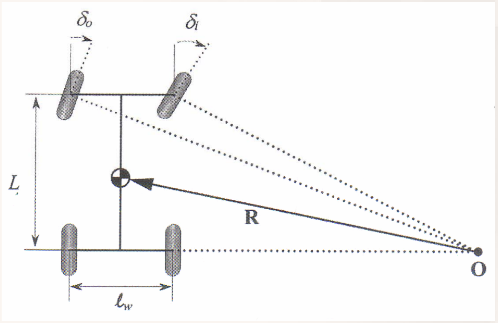

*Figure 2. Turning with the vehicle width considered: steering angles of the outer and inner front wheels and the center of rotation O*

In Figure 2, $L$ is the wheelbase, $l_w$ is the distance between the left and right wheels (the **track width**), and $R$ is the turning radius. For all four wheels to roll without slipping, the lines perpendicular to the velocities at the four wheels must meet at a single point O. Since O lies on the extension of the rear axle, the inner wheel is closer to O than the outer wheel and must be turned more.

In the bicycle model with small slip and $\delta_r = 0$, $\cos\beta \approx 1$ and $\tan\delta_f \approx \delta_f$, so the following two equations hold.

$$
\dot\psi = \frac{V\delta_f}{l_f + l_r} = \frac{V\delta_f}{L}, \qquad \dot\psi = \frac{V}{R} \quad \Longrightarrow \quad \delta_f = \frac{L}{R}
$$

Apply this relation to the left and right wheels separately. Regard the outer wheel as turning on a circle of radius $R + l_w/2$ and the inner wheel on a circle of radius $R - l_w/2$, and the average of the two wheel angles approximately equals the steering angle of the bicycle model.

$$
\delta_f = \frac{L}{R} \approx \frac{\delta_o + \delta_i}{2}, \qquad \delta_o = \frac{L}{R + \frac{l_w}{2}}, \qquad \delta_i = \frac{L}{R - \frac{l_w}{2}}
$$

The difference between the two steering angles is $\delta_i - \delta_o = L l_w / (R^2 - l_w^2/4) \approx L l_w / R^2 = \delta_f^2\,l_w / L$, which is proportional to the square of the steering angle. The difference is small in a gentle turn with a large radius but becomes large when the wheels are turned sharply with a small radius, as in parking.

**Worked example.** A vehicle with $L = 2.7$ m and $l_w = 1.6$ m turns with $R = 10$ m.

1. Steering angle of the bicycle model: $\delta_f = 2.7 / 10 = 0.27$ rad (15.47°).
2. Outer wheel: $\delta_o = 2.7 / 10.8 = 0.25$ rad (14.32°).
3. Inner wheel: $\delta_i = 2.7 / 9.2 = 0.2935$ rad (16.82°).
4. Difference: $\delta_i - \delta_o = 0.0435$ rad (2.49°), almost the same as the approximation $\delta_f^2l_w / L = 0.27^2 \times 1.6 / 2.7 = 0.0432$ rad.

> **Note:** The formulas above use the small-angle approximation ($\tan\delta \approx \delta$). Without the approximation, $\tan\delta_o = L/(R + l_w/2)$ and $\tan\delta_i = L/(R - l_w/2)$, and eliminating $R$ from the two equations gives $\cot\delta_o - \cot\delta_i = l_w / L$. This is called the **Ackermann condition**; in the example above the exact values are $\delta_o = 14.04°$ and $\delta_i = 16.36°$, and $\cot\delta_o - \cot\delta_i = 4.000 - 3.407 = 0.593 = 1.6 / 2.7$.

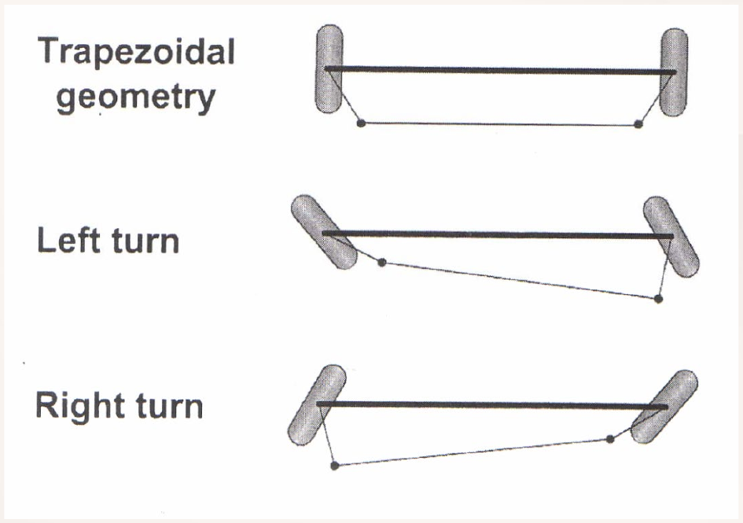

*Figure 3. Trapezoidal tie rod arrangement and the wheel angles in a left turn and a right turn*

Real vehicles use a **trapezoidal tie rod arrangement** to produce $\delta_i > \delta_o$ mechanically. As at the top of Figure 3, the steering knuckle arms of the two wheels are angled inward, so the tie rod connecting them and the front axle form a trapezoid. In a left turn (middle) the left wheel turns more, and in a right turn (bottom) the right wheel turns more, so the steering angle of the inner wheel is always larger. If the left and right wheels were turned by the same angle, their centers of rotation would not coincide, one tire would be dragged sideways, and wear and noise would result.

---

<br>

## 2. State-Space Model and Lateral Controller Design

### 2.1 Switching Between the Kinematic and Dynamic Models

The lateral controller of Section 1.5 in Week 11 uses an estimated sideslip angle, and the observer used for the estimation chooses one of two models according to the speed.

| Speed range | Model used | Characteristics |
|:-----|:-----|:-----|
| Low speed | Kinematic model | No initial convergence time is needed (no risk of divergence). Stable at 18 km/h or below |
| High speed | Dynamic model | Initial convergence time is needed (risk of divergence). Stable at high speed |

*Table 2. Choice of the observer model by speed range*

**Why the kinematic model suits low speed.** The sideslip angle of Section 1.3 is an algebraic formula computed directly from the steering angle, $\beta = \tan^{-1}(l_r\tan\delta_f / L)$. Because no differential equation is integrated, there is no convergence time from an initial value to the true value, and there is no risk of divergence from accumulated integration errors. Also, as seen in Section 1.1, the zero-slip assumption fits well at low speed, and 18 km/h is 5 m/s, matching the range of the kinematic model [1].

**Why the dynamic model does not suit low speed.** The entries of the state matrix in Section 3.3 of Week 11 are proportional to $1/V$ and $1/V^2$. Computing the matrix entries and eigenvalues at several speeds with the parameters estimated in Section 3.7 of Week 11 gives the following.

| Vehicle speed | $a_{11}$ | $a_{12}$ | $a_{21}$ | $a_{22}$ | Eigenvalues |
|:-----|:-----|:-----|:-----|:-----|:-----|
| 1 km/h | −336.3 | 276.1 | 16.6 | −431.1 | −301.0, −466.3 |
| 5 km/h | −67.3 | 10.1 | 16.6 | −86.2 | −60.7, −92.8 |
| 10 km/h | −33.6 | 1.77 | 16.6 | −43.1 | −31.2, −45.6 |
| 15 km/h | −22.4 | 0.23 | 16.6 | −28.7 | −21.9, −29.3 |
| 40 km/h | −8.41 | −0.83 | 16.6 | −10.8 | −9.59 ± 3.51j |
| 80 km/h | −4.20 | −0.96 | 16.6 | −5.39 | −4.80 ± 3.94j |

*Table 3. State matrix entries and eigenvalues of the dynamic model computed with the estimated parameters*

As the speed decreases, the magnitudes of the entries and eigenvalues grow rapidly. A large eigenvalue magnitude means a very short time constant, so when the observer is implemented in discrete time, the sampling period cannot keep up. For example, Euler integration at 100 Hz ($\Delta t = 0.01$ s) is stable only when $-2 < \lambda\Delta t < 0$, but at 1 km/h $\lambda\Delta t = -4.66$, outside this range, so the computation diverges. Also, because of $1/V$, small measurement errors in the yaw rate turn into large sideslip angle errors. Right after switching to the dynamic model, time is also needed for the estimate of the observer to converge to the true value.

**Hysteresis.** If the two models are switched at a single threshold speed (for example, 12.5 km/h), the model keeps switching when the vehicle speed moves up and down around that speed (chattering). Because the estimate fluctuates at every switch, a **hysteresis** property is given by using different thresholds for rising and falling speeds.

- **Accelerating from a stop:** Below 15 km/h the kinematic model is used, and at 15 km/h or above the dynamic model is used.
- **Decelerating from high speed:** At 10 km/h or above the dynamic model is kept, and below 10 km/h the observer switches to the kinematic model.

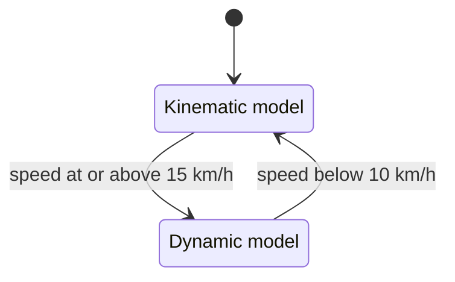

*Figure 4. State transitions of the observer model with hysteresis*

In the 10-15 km/h band the current model is kept. Compare the model selection of the two methods when the speed changes as follows.

| Speed (km/h) | 0 | 8 | 12 | 16 | 13 | 11 | 9 | 12 | 16 |
|:-----|:-----|:-----|:-----|:-----|:-----|:-----|:-----|:-----|:-----|
| Hysteresis (15/10) | Kinematic | Kinematic | Kinematic | Dynamic | Dynamic | Dynamic | Kinematic | Kinematic | Dynamic |
| Single threshold (12.5) | Kinematic | Kinematic | Kinematic | Dynamic | Dynamic | Kinematic | Kinematic | Kinematic | Dynamic |

*Table 4. Example of observer model selection as the speed changes*

With hysteresis, once the model switches to the dynamic model at 16 km/h, it is kept as the speed drops to 13 and 11 km/h and switches only once, at 9 km/h. With a single threshold, the model switches every cycle when the speed moves between 12 and 13 km/h. The thresholds may also be set to 15 km/h and 20 km/h as in the block diagram of Figure 8 in Week 11; the two thresholds are design values chosen to suit the vehicle and its sensors.

### 2.2 State-Space Model

To use the dynamic model (Section 3.3 of Week 11) for controller design, it is written as a **state-space model**. For the state $\mathbf{x} = [\beta \;\; r]^T$, the input $u = \delta$, and the output $y$, it is as follows. Some references write the yaw rate as $\gamma$; it is the same quantity as $\dot\psi$ of the kinematic model.

$$
\dot{\mathbf{x}} = A\mathbf{x} + Bu, \qquad y = C\mathbf{x}
$$

$$
A = \begin{bmatrix} a_{11} & a_{12} \\ a_{21} & a_{22} \end{bmatrix} =
\begin{bmatrix}
-\dfrac{C_r + C_f}{mV} & -1 + \dfrac{C_r l_r - C_f l_f}{mV^2} \\
\dfrac{C_r l_r - C_f l_f}{I_{zz}} & -\dfrac{C_r l_r^2 + C_f l_f^2}{I_{zz} V}
\end{bmatrix}, \qquad
B = \begin{bmatrix} b_{11} \\ b_{21} \end{bmatrix} =
\begin{bmatrix} \dfrac{C_f}{mV} \\ \dfrac{C_f l_f}{I_{zz}} \end{bmatrix}, \qquad
C = \begin{bmatrix} 0 & 1 \end{bmatrix}
$$

$I_{zz}$ is the yaw moment of inertia $I$ of Week 11. The output matrix $C = [0 \;\; 1]$ means that only the yaw rate among the states is measured. The yaw rate can be measured by the gyro sensor of the vehicle, but the sideslip angle cannot be measured directly by ordinary vehicle sensors (Section 2.8).

**Worked example.** Compute the matrices at 40 km/h ($V = 11.11$ m/s) with the estimated parameters of Table 8 in Week 11.

1. $a_{11} = -(50544 + 136180) / (1999.1 \times 11.11) = -8.406$.
2. $a_{12} = -1 + 42743 / (1999.1 \times 11.11^2) = -1 + 0.173 = -0.827$.
3. $a_{21} = 42743 / 2573.4 = 16.61$.
4. $a_{22} = -(50544 \times 2.3038^2 + 136180 \times 0.5412^2) / (2573.4 \times 11.11) = -10.78$.
5. $b_{11} = 136180 / (1999.1 \times 11.11) = 6.131$ and $b_{21} = 136180 \times 0.5412 / 2573.4 = 28.64$.

The eigenvalues are $-9.59 \pm 3.51j$ with negative real parts, so without a steering input $\beta$ and $r$ decay to 0 while oscillating (stable).

> **[Linear Algebra]** The solution of a linear system $\dot{\mathbf{x}} = A\mathbf{x}$ consists of components of the form $e^{\lambda t}$, one for each eigenvalue $\lambda$ of $A$. If all eigenvalues have negative real parts, the solution converges to 0 (stable), and if they have imaginary parts, it oscillates. The eigenvalues of a $2 \times 2$ matrix are the roots of the characteristic equation $\lambda^2 - (a_{11} + a_{22})\lambda + (a_{11}a_{22} - a_{12}a_{21}) = 0$.

### 2.3 Path Tracking Error Model

The controller expresses how far the vehicle has departed from the path with the following variables.

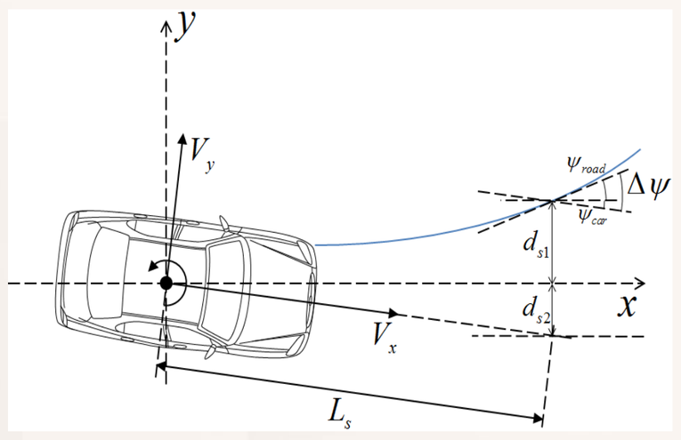

*Figure 5. Definition of the path tracking error: lateral offset d_s and relative heading angle Δψ at the lookahead distance L_s*

| Symbol | Name | Meaning |
|:-----|:-----|:-----|
| $L_s$ | Lookahead distance | Distance measured forward from the center of gravity along the body axis; the point at this position is called the lookahead point |
| $d_s$ | Lateral offset (lateral distance) | Lateral distance from the lookahead point to the reference path, positive when the lookahead point is to the left of the path |
| $\Delta\psi$ | Relative heading angle (relative angle) | Difference between the heading angle of the body and the tangent direction of the path at the lookahead point, $\Delta\psi = \psi - \psi_{road}$ |
| $\rho$ | Curvature of reference path | How sharply the path bends at the lookahead point, the reciprocal of the radius |

*Table 5. Variables of the path tracking error model*

In Figure 5, $d_s$ is the sum of the two parts $d_{s1}$ and $d_{s2}$ above and below the $x$ axis, that is, the distance between the path and the lookahead point on the extension of the body axis. The error is measured at a point ahead rather than at the center of gravity because, just as a driver looks far ahead rather than right in front of the car, steering after seeing the error in advance makes the response smooth and stable.

**Rate of change of $d_s$.** The lookahead point is a point on the body, so its velocity is the velocity of the center of gravity plus the velocity $L_s r$ (perpendicular to the body axis) created by the rotation (Section 2.1 of Week 11).

1. The velocity of the center of gravity is rotated by $\beta$ from the body axis and by $\beta + \Delta\psi$ from the path direction, so its component perpendicular to the path is $V\sin(\beta + \Delta\psi) \approx V(\beta + \Delta\psi)$.
2. The velocity $L_s r$ created by the rotation is perpendicular to the body axis, so its component perpendicular to the path is $L_s r\cos\Delta\psi \approx L_s r$.

$$
\dot d_s = V(\beta + \Delta\psi) + L_s r
$$

**Rate of change of $\Delta\psi$.** The heading angle of the body changes at $r$, and the tangent direction of the path changes at $V\rho$ by the curvature as the point moves along the path at speed $V$.

$$
\Delta\dot\psi = r - V\rho
$$

Combined with the dynamic model of Section 2.2, this gives a fourth-order model of the whole path tracking problem.

$$
\begin{aligned}
\dot\beta &= a_{11}\beta + a_{12} r + b_{11}\delta \\
\dot r &= a_{21}\beta + a_{22} r + b_{21}\delta \\
\Delta\dot\psi &= r - V\rho \\
\dot d_s &= V\beta + V\Delta\psi + L_s r
\end{aligned}
$$

### 2.4 Cascade Structure and Backstepping

The variables of the fourth-order model change at different speeds.

- **Road state variables** $d_s$, $\Delta\psi$, $\rho$ are state variables that change slowly (a general property of roads).
- **Vehicle state variables** $\beta$, $r$ change rapidly compared with the road state variables.

Therefore the controller is split into two controllers arranged sequentially in a cascade form. The first controller sets the desired yaw rate from the lateral offset, and the second controller sets the steering angle that produces that yaw rate. A design method that builds up a stable control law step by step in this way, using the output of the previous step as a virtual input, is called **backstepping** [2].

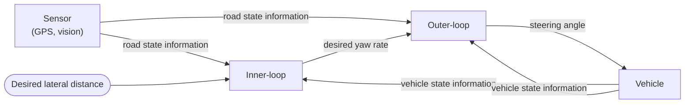

*Figure 6. Lateral controller with two controllers arranged in a cascade structure*

The Inner-loop in Figure 6 is the sub-system for the lateral offset; it computes the desired yaw rate and passes it to the Outer-loop. The Outer-loop is the sub-system for the yaw rate; it computes the steering angle and controls the vehicle directly. In the block diagram of Figure 8 in Week 11, the "desired yaw rate computation" block corresponds to the Inner-loop and the "control input" block to the Outer-loop.

> **Note:** In general cascade control terminology, the fast loop close to the actuator (here the yaw rate loop) is called the inner loop and the slow position loop the outer loop. The names in this design call the step designed first in backstepping the Inner-loop, so when reading other references, distinguish the loops by what each one takes in and puts out rather than by their names.

### 2.5 Step 1: The Desired Yaw Rate

First, regard the yaw rate $r$ as a virtual input that can be chosen freely, and set the desired yaw rate $r_d$ so that $d_s$ goes to 0. In $\dot d_s = V(\beta + \Delta\psi) + L_s r$, to make $\dot d_s = -K_d d_s$ ($K_d > 0$) when $r = r_d$, set the following.

$$
r_d = -\frac{V(\beta + \Delta\psi) + K_d d_s}{L_s}
$$

If $r = r_d$, then $\dot d_s = V(\beta + \Delta\psi) - V(\beta + \Delta\psi) - K_d d_s = -K_d d_s$, so $d_s(t) = d_s(0)e^{-K_d t}$ decays exponentially. The first term $-V(\beta + \Delta\psi)/L_s$ cancels the departure caused by the vehicle moving at an angle to the path, and the second term $-K_d d_s / L_s$ brings back a departure that has already occurred. Because the actual yaw rate may differ from $r_d$, let the difference be the yaw rate error $e_r = r - r_d$; substituting $r = r_d + e_r$ gives the following.

$$
\dot d_s = -K_d d_s + L_s e_r
$$

### 2.6 Step 2: The Steering Angle

Now drive $e_r$ to 0 with the actual input $\delta$. The rate of change of $e_r$ is $\dot e_r = \dot r - \dot r_d$.

**Step 1: compute $\dot r_d$.** Differentiating the formula for $r_d$ gives $\dot r_d = -\frac{1}{L_s}\left[V(\dot\beta + \Delta\dot\psi) + K_d \dot d_s\right]$ ($V$ is constant).

**Step 2: substitute.** Insert the fourth-order model of Section 2.3 for $\dot r$, $\dot\beta$, $\Delta\dot\psi$, and $\dot d_s$.

$$
\dot e_r = (a_{21}\beta + a_{22} r + b_{21}\delta) + \frac{V}{L_s}\left(a_{11}\beta + a_{12} r + b_{11}\delta + r - V\rho\right) + \frac{K_d}{L_s}\left(V\beta + V\Delta\psi + L_s r\right)
$$

**Step 3: rearrange.** Collecting the terms of each variable gives the following.

$$
\dot e_r = f(\beta, r, \Delta\psi, \rho) + b_\delta\,\delta, \qquad f \equiv h_\beta\beta + h_r r + h_\psi\Delta\psi - h_\rho\rho
$$

$$
b_\delta = b_{21} + \frac{V b_{11}}{L_s}, \quad h_\beta = \frac{V a_{11} + V K_d + L_s a_{21}}{L_s}, \quad h_r = \frac{V a_{12} + V + K_d L_s + L_s a_{22}}{L_s}, \quad h_\psi = \frac{K_d V}{L_s}, \quad h_\rho = \frac{V^2}{L_s}
$$

**Step 4: choose the steering angle with a Lyapunov function.** Take the function $\mathcal{V} = \frac{1}{2}W_d d_s^2 + \frac{1}{2}W_r e_r^2$ ($W_d, W_r > 0$ are weights) that measures the size of the two errors, and compute its rate of change.

$$
\dot{\mathcal{V}} = W_d d_s\dot d_s + W_r e_r\dot e_r = -W_d K_d d_s^2 + W_d L_s d_s e_r + W_r e_r\left(f + b_\delta\delta\right)
$$

The middle term $W_d L_s d_s e_r$ is a cross term whose sign is not fixed. Choosing the steering angle as follows makes the expression in parentheses $-\frac{W_d L_s}{W_r}d_s - K_r e_r$ ($K_r > 0$), which cancels the cross term.

$$
\delta = \frac{1}{b_\delta}\left[-f(\beta, r, \Delta\psi, \rho) - \frac{W_d L_s}{W_r}d_s - K_r e_r\right]
$$

$$
\dot{\mathcal{V}} = -W_d K_d d_s^2 - W_r K_r e_r^2 < 0 \quad \left((d_s, e_r) \neq (0, 0)\right)
$$

$\mathcal{V}$ is 0 only when the errors are 0, positive elsewhere, and keeps decreasing, so if the model is exact, both $d_s$ and $e_r$ converge to 0. The three terms of the steering formula are, in order, a feedforward that cancels the known vehicle and road dynamics (including the curvature term $h_\rho\rho$), a term that cancels the cross term, and a feedback that reduces the yaw rate error. This formula can be used only when $b_\delta \neq 0$, that is, when the steering affects $\dot e_r$.

> **Note:** A **Lyapunov function** is a function that is 0 only when the state is at the equilibrium, positive elsewhere, and decreases as time passes along the system. If such a function exists, it can be shown that the state goes to the equilibrium without solving for the solution directly. Backstepping is a method that adds a term to this function at each step and chooses the control input so that its rate of change is negative [2].

Mapping this result onto the block diagram of Figure 8 in Week 11, the "desired yaw rate computation" block computes the formula for $r_d$, and the "control input" block computes the formula for $\delta$. The estimated sideslip angle and the estimated yaw rate come from the observer of Section 2.8, and $d_s$, $\Delta\psi$, $\rho$ come from DGPS.

### 2.7 Numerical Example

Compute with the matrices at 40 km/h (Section 2.2) and $L_s = 10$ m, $K_d = 0.5$ s⁻¹, $K_r = 5$ s⁻¹, $W_d / W_r = 0.1$.

1. Coefficients: $b_\delta = 28.64 + 11.11 \times 6.131 / 10 = 35.45$, $h_\beta = 7.825$, $h_r = -10.085$, $h_\psi = 0.5 \times 11.11 / 10 = 0.556$, $h_\rho = 11.11^2 / 10 = 12.35$.
2. Let the current state be $d_s = 0.3$ m (the lookahead point is 30 cm to the left of the path), $\beta = 0.005$ rad, $\Delta\psi = 0.01$ rad, $r = 0.02$ rad/s, and $\rho = 0$.
3. Desired yaw rate: $r_d = -(11.11 \times 0.015 + 0.5 \times 0.3) / 10 = -(0.1667 + 0.15) / 10 = -0.03167$ rad/s. The vehicle must turn right.
4. Yaw rate error: $e_r = 0.02 - (-0.03167) = 0.05167$ rad/s.
5. $f = 7.825 \times 0.005 + (-10.085) \times 0.02 + 0.556 \times 0.01 = 0.0391 - 0.2017 + 0.0056 = -0.1570$.
6. Steering angle: $\delta = (0.1570 - 0.1 \times 10 \times 0.3 - 5 \times 0.05167) / 35.45 = (0.1570 - 0.3 - 0.2583) / 35.45 = -0.01132$ rad ($-0.65°$). The vehicle steers slightly to the right.

Simulating the fourth-order model with the same settings, starting from $d_s(0) = 0.5$ m with the other states at 0, gives the following.

| Time | $d_s$ | Steering angle $\delta$ |
|:-----|:-----|:-----|
| 0 s | 0.500 m | −1.01° |
| 1 s | 0.012 m | 0.29° |
| 2 s | −0.003 m | 0.17° |
| 3 s | 0.000 m | 0.06° |

*Table 6. Example of the closed-loop response of the backstepping controller (40 km/h, initial offset 0.5 m)*

The offset almost disappears within about 2 seconds, and the magnitude of the steering angle during that time is at most 1.11°. Throughout the simulation, $\mathcal{V}$ keeps decreasing.

### 2.8 State Observer

The steering formula of Section 2.6 needs $\beta$, but the sideslip angle cannot be measured by ordinary vehicle sensors (an expensive optical velocity sensor or a dual-antenna GNSS is required). A device that computes unmeasured states from the measurable yaw rate and the input is called a **state observer**.

**Structure of the observer.** The observer runs the model in real time and corrects the estimate with the difference between the output predicted by the model $C\hat{\mathbf{x}}$ and the actual measurement $y$ [3].

$$
\dot{\hat{\mathbf{x}}} = A\hat{\mathbf{x}} + B\delta + \mathbf{l}\left(y - C\hat{\mathbf{x}}\right), \qquad \mathbf{l} = \begin{bmatrix} l_1 \\ l_2 \end{bmatrix}
$$

The rate of change of the estimation error $\mathbf{e} = \mathbf{x} - \hat{\mathbf{x}}$ is $\dot{\mathbf{e}} = A\mathbf{x} + B\delta - A\hat{\mathbf{x}} - B\delta - \mathbf{l}C(\mathbf{x} - \hat{\mathbf{x}}) = (A - \mathbf{l}C)\mathbf{e}$. Therefore, if the gain $\mathbf{l}$ is chosen so that all eigenvalues of $A - \mathbf{l}C$ have negative real parts, the error decays to 0 even if the initial estimate is wrong.

**Observability condition.** For $\beta$ to be determined from yaw rate measurements alone, $\beta$ must leave a trace in the change of the yaw rate. This is checked with the observability matrix.

$$
\mathcal{O} = \begin{bmatrix} C \\ CA \end{bmatrix} = \begin{bmatrix} 0 & 1 \\ a_{21} & a_{22} \end{bmatrix}, \qquad \det\mathcal{O} = -a_{21}
$$

The system is observable when the rank of $\mathcal{O}$ is 2, that is, when $a_{21} = (C_r l_r - C_f l_f)/I_{zz} \neq 0$. For a vehicle with $C_r l_r = C_f l_f$, $\beta$ does not appear in the equation for $\dot r$, so $\beta$ cannot be determined from the yaw rate alone. With the estimated parameters, $a_{21} = 16.61 \neq 0$, so the system is observable.

**Example of computing the gain.** At 40 km/h, set the eigenvalues of $A - \mathbf{l}C$ to $-20$ and $-25$. Making them more than twice as fast as the eigenvalues of the plant ($-9.59 \pm 3.51j$) lets the estimate catch up with the actual state quickly.

1. The entries of $A - \mathbf{l}C$ are $a_{11}$, $a_{12} - l_1$, $a_{21}$, and $a_{22} - l_2$ in order, so its characteristic equation is $\lambda^2 - (a_{11} + a_{22} - l_2)\lambda + a_{11}(a_{22} - l_2) - a_{21}(a_{12} - l_1) = 0$.
2. The desired characteristic equation is $(\lambda + 20)(\lambda + 25) = \lambda^2 + 45\lambda + 500 = 0$.
3. Matching the coefficients of $\lambda$ gives $l_2 = a_{11} + a_{22} + 45 = -8.406 - 10.777 + 45 = 25.82$.
4. Matching the constant terms: $a_{11}(a_{22} - l_2) = -8.406 \times (-36.59) = 307.6$, so $a_{21}(a_{12} - l_1) = 307.6 - 500 = -192.4$ and $l_1 = a_{12} + 192.4 / 16.61 = -0.827 + 11.58 = 10.76$.

Simulating the case where the true state is $\beta(0) = 0$, the observer starts at $\hat\beta(0) = 0.02$ rad, and the steering input is $\delta = 0.03\sin(\pi t)$, the estimation error $\beta - \hat\beta$ shrinks from $-0.02$ rad to $-0.0052$ rad after 0.1 s, $-0.0009$ rad after 0.2 s, and about $-3 \times 10^{-6}$ rad after 0.5 s. Because the matrix $A$ changes with speed, an actual observer recomputes the gain for each speed and switches to the kinematic model at low speed as in Section 2.1.

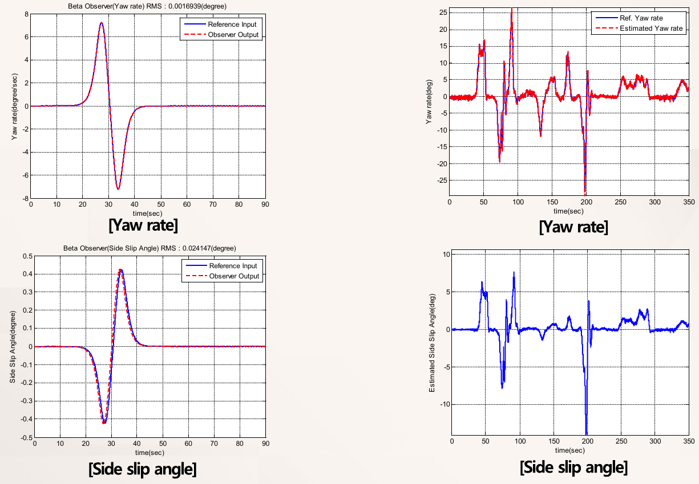

*Figure 7. Results of the state observer: yaw rate and sideslip angle in simulation (left) and a real vehicle test (right)*

The left side of Figure 7 shows simulation results in which the reference input (blue) and the observer output (red dashed) almost coincide. The RMS errors are 0.0016939°/s for the yaw rate and 0.024147° for the sideslip angle. The right side shows real vehicle test results in which the measured yaw rate (blue) and the estimated yaw rate (red dashed) agree well over 350 seconds, and the lower graph is the sideslip angle estimated during the same drive. The sideslip angle becomes large in sections of sharp turning (around 75 s and 200 s).

### 2.9 Real Vehicle Test Results

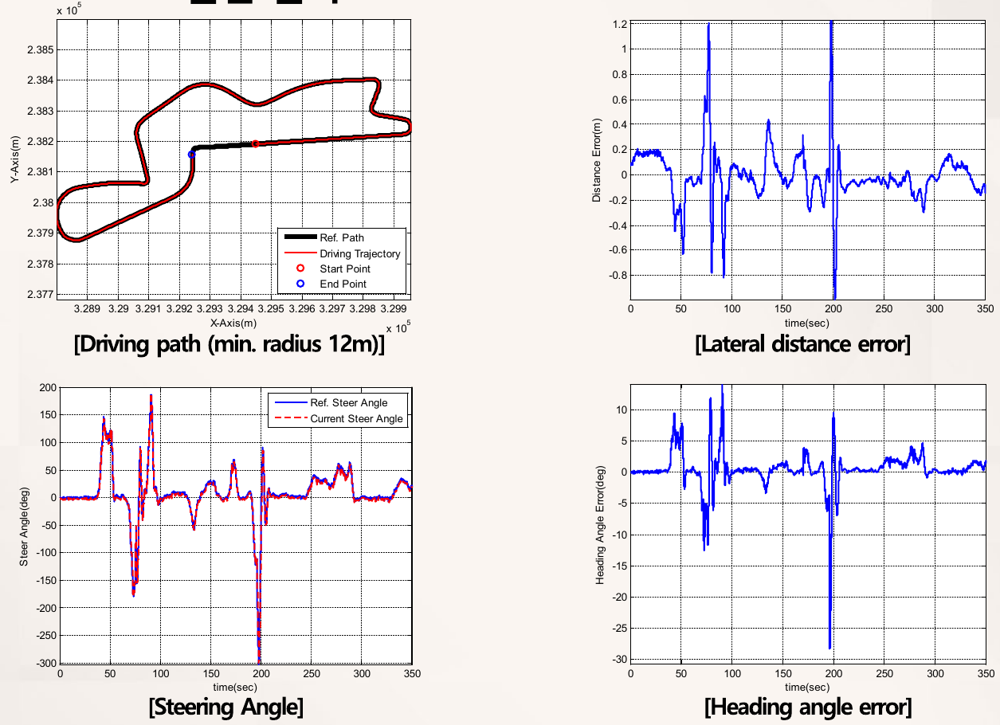

*Figure 8. Real vehicle test of the lateral controller: driving path (minimum radius 12 m), lateral distance error, steering angle, and heading angle error*

Figure 8 shows the result of one lap of a test track with a minimum turning radius of 12 m. The reference path (black) and the driving trajectory (red) at the upper left almost coincide. The lateral distance error stays mostly within ±0.2 m but grows to around 1 m at the moments of entering sharp curves (around 75 s and 200 s). The steering angle graph shows the steering wheel angle; the command (blue) and the actual value (red dashed) agree well, and the heading angle error also spikes only in sharp curves.

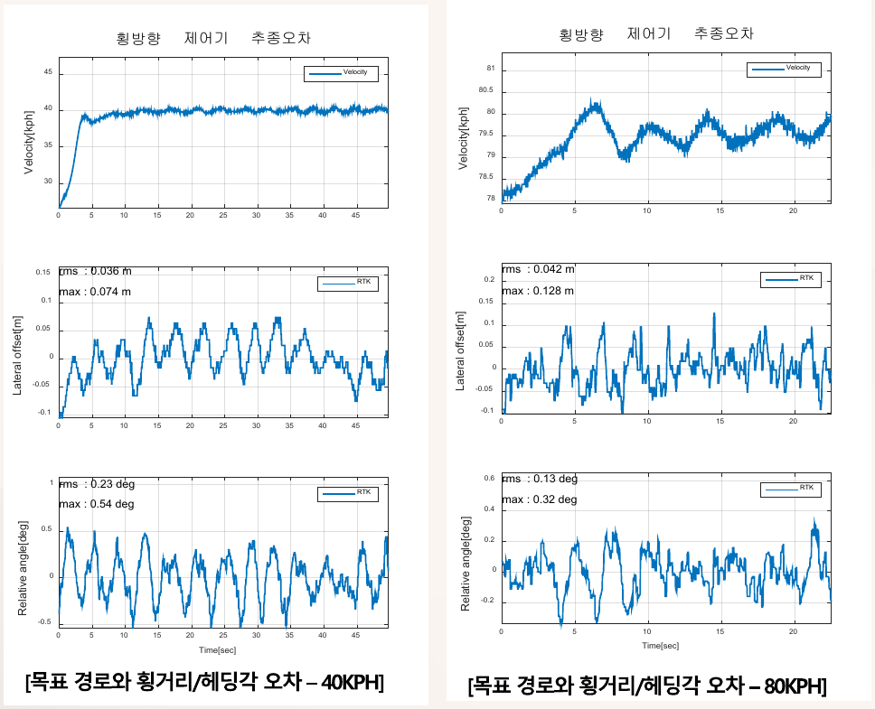

*Figure 9. Speed, lateral offset, and relative heading angle when driving at 40 km/h and 80 km/h on a straight road*

Figure 9 shows the tracking errors measured with RTK GPS on a straight road. The targets and results are summarized as follows.

| Item | Target | 40 km/h | 80 km/h |
|:-----|:-----|:-----|:-----|
| Lateral distance error, RMS | 10 cm | 3.6 cm | 4.2 cm |
| Lateral distance error, maximum | 15 cm | 7.4 cm | 12.8 cm |
| Heading angle error, RMS | 1° | 0.23° | 0.13° |
| Heading angle error, maximum | 1.5° | 0.54° | 0.32° |

*Table 7. Targets and results of lateral control performance on a straight road*

Both speeds meet the targets. At higher speed the maximum lateral distance error increases, but the heading angle error actually decreases. This is because at high speed a smaller heading angle is needed for the same lateral movement.

---

<br>

## 3. Simulation with Autoware

### 3.1 wf_simulator

Testing path planning and path following nodes without a real vehicle requires a simulator that takes the place of the vehicle. The **wf_simulator** (waypoint follower simulator) of Autoware.ai receives the vehicle command `/vehicle_cmd` produced by the path following nodes, integrates a vehicle model, and publishes the result as `/current_pose`, `/current_velocity`, `/localizer_pose`, and TF as if it were a real localization result [4]. Thus one node takes over the work done by localization (NDT) and the real vehicle. With the default settings of the launch file, it receives the initial position of the vehicle from `/initialpose`, published by 2D Pose Estimate in RViz, and adds small measurement noise to its outputs [4].

| Vehicle model | Command used | Equations of motion |
|:-----|:-----|:-----|
| IDEAL_TWIST (default) | Speed $v$ and angular velocity $\omega$ | $\dot X = v\cos\psi$, $\dot Y = v\sin\psi$, $\dot\psi = \omega$ |
| IDEAL_STEER | Speed $v$ and steering angle $\delta$ | $\dot X = v\cos\psi$, $\dot Y = v\sin\psi$, $\dot\psi = v\tan\delta / L$ |
| DELAY_TWIST | Speed and angular velocity | IDEAL_TWIST with the commands applied through a time delay and a first-order lag |
| DELAY_STEER | Speed and steering angle | IDEAL_STEER with the commands applied through a time delay and a first-order lag |

*Table 8. Vehicle models of the wf_simulator*

IDEAL_STEER is the kinematic bicycle model with the rear axle as the reference point, seen in the note of Section 1.4, and its wheelbase $L$ has a default value of 2.7 m [4], [5]. The default IDEAL_TWIST integrates the $v$ and $\omega = v\kappa$ computed by pure_pursuit as they are, so it is suitable for testing the path following algorithm itself. The delay models imitate the way the drivetrain and steering system of a real vehicle follow commands late, and are used to test how robust a controller is to delays.

### 3.2 Node Configuration and Data Flow

The nodes run in the simulation and the flow of topics are as follows. It is the path planning and path following flow of Week 3 with the wf_simulator in place of localization and the vehicle.

```mermaid
flowchart LR
    WL["waypoint_loader"] -->|"/based/lane_waypoints_raw"| WR["waypoint_replanner"]
    WR -->|"/lane_waypoints_array"| LR["lane_rule"]
    LR -->|"/red_waypoints_array<br>/green_waypoints_array"| LS["lane_stop"]
    LS -->|"/traffic_waypoints_array"| SEL["lane_select"]
    SEL -->|"/base_waypoints<br>/closest_waypoint"| AA["astar_avoid"]
    AA -->|"/safety_waypoints"| VS["velocity_set"]
    VS -->|"/final_waypoints"| PP["pure_pursuit"]
    PP -->|"/twist_raw, /ctrl_raw"| TF["twist_filter"]
    TF -->|"/twist_cmd, /ctrl_cmd"| TG["twist_gate"]
    TG -->|"/vehicle_cmd"| WF["wf_simulator"]
    RV["RViz<br>2D Pose Estimate"] -->|"/initialpose"| WF
    WF -->|"/current_pose<br>/current_velocity"| PP
```

*Figure 10. Node and topic flow of a simulation that uses the wf_simulator*

The `/current_pose` and `/current_velocity` published by the wf_simulator go not only to pure_pursuit but also to lane_select, astar_avoid, and velocity_set, closing the loop. Although simplified in the figure, lane_rule also publishes `/traffic_waypoints_array`, and lane_stop chooses between the waypoints for a red light and those for a green light according to the traffic light state and publishes them on the same topic.

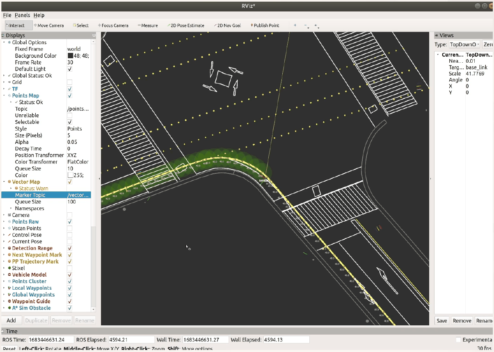

*Figure 11. Example of a wf_simulator simulation: a vehicle following a path in RViz*

Figure 11 shows the simulation running. A yellow waypoint path is drawn over the lanes and crosswalks of the vector map, and the vehicle, surrounded by a green circle (the obstacle detection range), turns through the intersection and follows the path. The number 40.0 is the target speed of the waypoints (km/h). Sections 3.3-3.8 below give the procedure for obtaining this result.

### 3.3 Loading the TF and the Maps

Assume that Autoware.ai 1.14.0 has been built (Weeks 4-5) and that the Moriyama sample data of Week 9 has been extracted into `~/.autoware/data`. Launch the Runtime Manager as in Week 5.

```bash
cd ~/autoware.ai
source install/setup.bash
roslaunch runtime_manager runtime_manager.launch
```

**Step 1: Setup tab.** Select Velodyne as the Localizer, enter in Baselink to Localizer where the LiDAR is mounted relative to the vehicle reference point (base_link), and press the TF button.

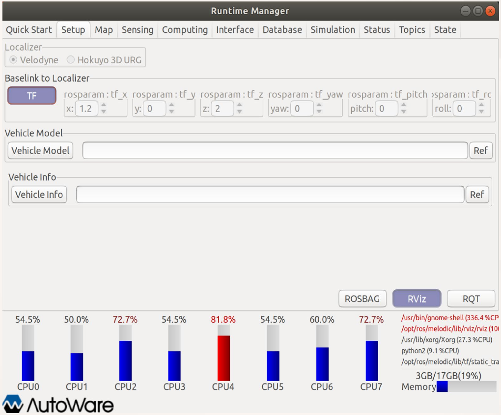

*Figure 12. TF setting between base_link and the LiDAR in the Setup tab*

The values in Figure 12 are $x = 1.2$ m, $y = 0$, $z = 2$ m, and yaw, pitch, and roll all 0, meaning that the LiDAR is mounted straight, 1.2 m ahead of and 2 m above the reference point. This transform is published as the TF between the `base_link` and `velodyne` frames. Vehicle Model and Vehicle Info are left empty in this example.

**Step 2: Map tab.** Load the point cloud map, the vector map, and the TF of the map frame in order.

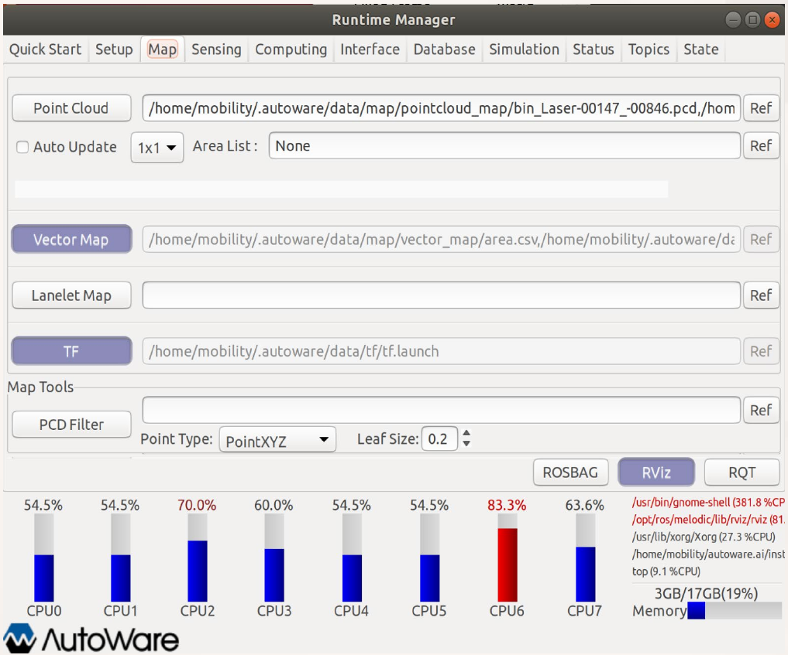

*Figure 13. Loading the point cloud map, the vector map, and the TF in the Map tab*

1. **Point Cloud:** With the Ref button, select all `.pcd` files in `~/.autoware/data/map/pointcloud_map/` and press the Point Cloud button.
2. **Vector Map:** Select all `.csv` files in `~/.autoware/data/map/vector_map/` and press the Vector Map button.
3. **TF:** Select `~/.autoware/data/tf/tf.launch` and press the TF button. This launch file publishes the transform between the `world` and `map` frames.
4. Open RViz with the RViz button at the lower right.

### 3.4 Creating Waypoints

Create a path on the lanes of the vector map. The procedure is the same as in Section 4.2 of Week 3.

1. Under Motion Planning and waypoint_maker in the Computing tab, open the [app] of waypoint_clicker.
2. Enter in `/waypoint_clicker/velocity` the speed to record in the waypoints (for example, 40 km/h) and in `/waypoint_clicker/output_file` the file to save (for example, `~/.autoware/lane_waypoint.csv`), press OK, and check waypoint_clicker to run it.
3. The lane points of the vector map (LANE nodes) are displayed in yellow in RViz.
4. Choose Publish Point at the top of RViz and click the start point, then choose Publish Point again and click the end point; a path that follows the lanes is created between the two points.

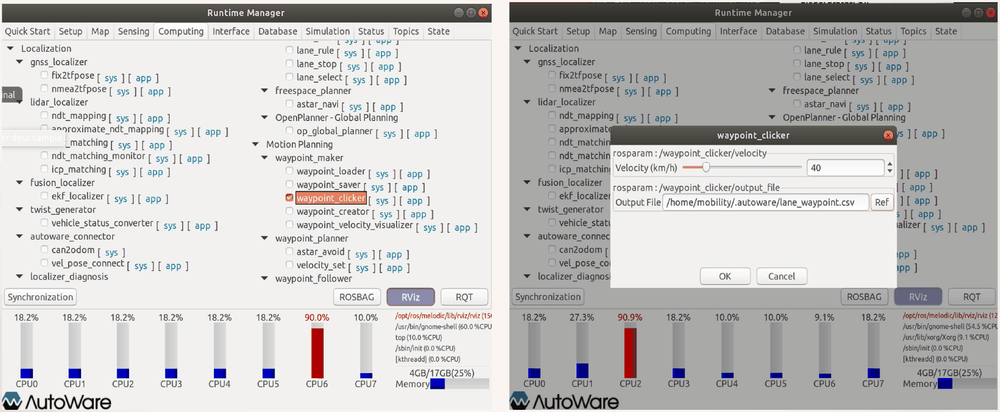

*Figure 14. Running waypoint_clicker and setting the speed and output file*

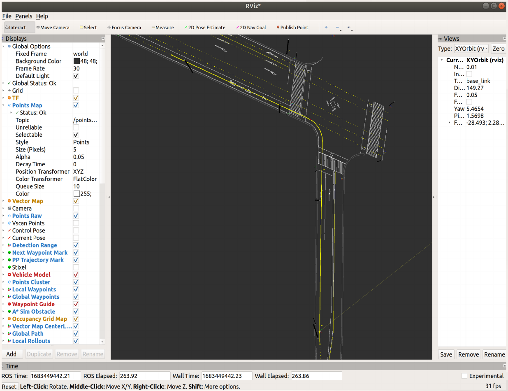

*Figure 15. A path (yellow) created by marking the start and end points with Publish Point in RViz*

waypoint_clicker receives `/clicked_point` published by RViz, finds a path that joins the clicked points along the lanes of the vector map (`/vector_map_info/lane`, `/vector_map_info/node`, `/vector_map_info/point`), and writes those points together with the specified speed to the output file [6]. In Figure 15, a path that passes the intersection and turns downward has been created.

### 3.5 Loading Waypoints

Load the created file so that the path planning nodes can use it.

1. Uncheck waypoint_clicker and open the [app] of waypoint_loader under waypoint_maker.
2. Check load csv, set multi_lane to the file `~/.autoware/lane_waypoint.csv` of Section 3.4, press OK, and check waypoint_loader.

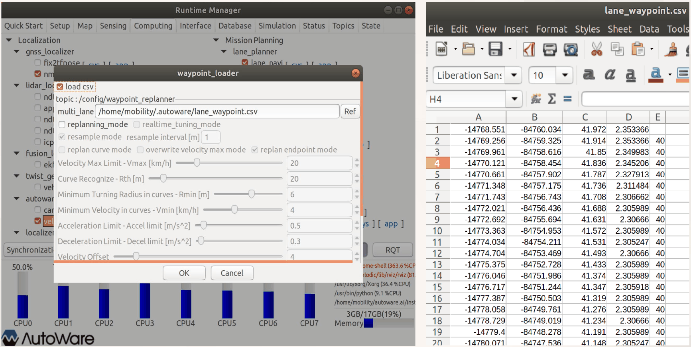

*Figure 16. waypoint_loader settings (left) and the contents of the waypoint file (right)*

The right side of Figure 16 shows the waypoint file opened in a spreadsheet. Each row is one waypoint, and the columns are, in order, $x$, $y$, $z$ (m, map frame), yaw (rad), and speed (km/h). The first row has only four values without a speed; waypoint_loader determines the file format from the number of columns in the first row, and with four columns it reads the file in the "x, y, z, yaw, speed" format [6]. The speeds of the remaining rows are all 40, as set in waypoint_clicker.

Turning on replanning_mode in the dialog makes waypoint_replanner replan the speeds of the loaded path. In this example it is off, so the items below are grayed out and inactive, and the speeds in the file are used as they are.

| Item | Example value | Meaning |
|:-----|:-----|:-----|
| resample interval | 1 m | The waypoints are rearranged at this spacing |
| Velocity Max Limit (Vmax) | 20 km/h | Maximum speed over the whole path |
| Curve Recognize (Rth) | 20 m | Segments whose radius of curvature is at most this value are recognized as curves |
| Minimum Turning Radius in curves (Rmin) | 6 m | Lower bound of the curve radius; smaller radii are treated as this value |
| Minimum Velocity in curves (Vmin) | 4 km/h | Lowest speed in curves |
| Accel limit, Decel limit | 0.5, 0.3 m/s² | Limits of acceleration and deceleration when changing speed |
| Velocity Offset | 4 | Deceleration starts 4 waypoints before the curve |

*Table 9. Speed replanning settings in the waypoint_loader dialog*

The waypoint_replanner of Autoware.ai 1.14.0 finds the smallest radius of curvature $R$ (lower bound $R_{\min}$) in each curve segment and sets the speed limit of that segment linearly, so that it is $V_{\min}$ at $R_{\min}$ and $V_{\max}$ at $R_{th}$ [6].

$$
V(R) = V_{\max} - \frac{V_{\max} - V_{\min}}{R_{th} - R_{\min}}\left(R_{th} - R\right)
$$

For example, with the values in Table 9, the speed limit of a curve with radius 13 m is $20 - 16 \times 7 / 14 = 12$ km/h. This implements the same goal as the $\sqrt{0.3 g R}$ from the lateral acceleration in Section 1.3 of Week 11 (slowing down in curves) with a simpler linear rule.

### 3.6 Switching Localization to Simulator Mode

In a real vehicle, vel_pose_connect relays `/ndt_pose` and `/estimate_twist` from NDT matching (Week 9) to `/current_pose` and `/current_velocity`, and the path planning and path following nodes look only at these two topics. In simulation, this connection is cut and the output of the wf_simulator is used.

1. Under autoware_connector in the Computing tab, open the [app] of vel_pose_connect, check that the source of `/current_pose` is `/ndt_pose` and the source of `/current_velocity` is `/estimate_twist`, and check Simulation Mode. Then check vel_pose_connect.
2. Under gnss_localizer, open the [app] of nmea2tfpose, check Simulation Mode, and check nmea2tfpose.

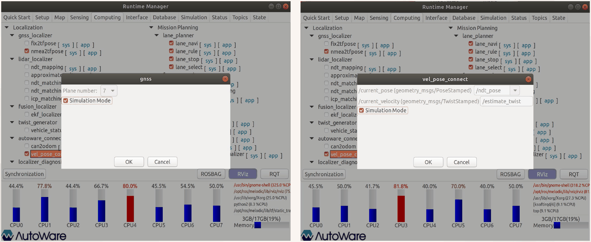

*Figure 17. Simulation Mode settings of nmea2tfpose (left) and vel_pose_connect (right)*

In Simulation Mode, vel_pose_connect switches to relaying `/sim_pose` and `/sim_velocity` instead of the NDT outputs [7]. Because the wf_simulator publishes `/current_pose` and `/current_velocity` directly, only the values of the simulator end up on these two topics. The Plane number of nmea2tfpose is the zone number of the Japanese plane rectangular coordinate system used to convert the latitude and longitude of GNSS into plane coordinates, with a default of 7; in Simulation Mode it changes to zone 0, whose origin is at latitude 0 and longitude 0 [5], [7].

### 3.7 Running Path Planning, Path Following, and the Simulator

Check the following nodes in the Computing tab.

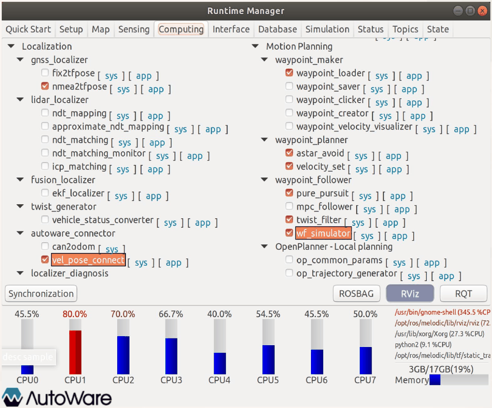

*Figure 18. The Computing tab with the path planning and path following nodes and the wf_simulator running*

| Group | Nodes | Role |
|:-----|:-----|:-----|
| Mission Planning, lane_planner | lane_navi, lane_rule, lane_stop, lane_select | lane_navi converts a route on the vector map into waypoints, lane_rule and lane_stop apply stop line and traffic light rules, and lane_select chooses the lane to follow and the closest waypoint (Week 3) |
| Motion Planning, waypoint_maker | waypoint_loader | Publishes the waypoint file of Section 3.5 |
| Motion Planning, waypoint_planner | astar_avoid, velocity_set | Creates an avoidance path with A\* when there is an obstacle, and adjusts the speed in front of obstacles and stop lines |
| Motion Planning, waypoint_follower | pure_pursuit, twist_filter | Computes the target speed and angular velocity and limits the lateral acceleration (Week 3) |
| Motion Planning, waypoint_follower | wf_simulator | Simulates the motion of the vehicle from the vehicle commands (Section 3.1) |

*Table 10. Nodes of the Computing tab run in the simulation*

In the [app] of wf_simulator, leave Initialize Source at its default value, RVIZ. After all nodes are running, choose 2D Pose Estimate in RViz, click near the start of the path, and drag in the direction of travel to set the initial position and orientation of the vehicle. The wf_simulator then starts from that position and begins following the path.

### 3.8 Checking the Results

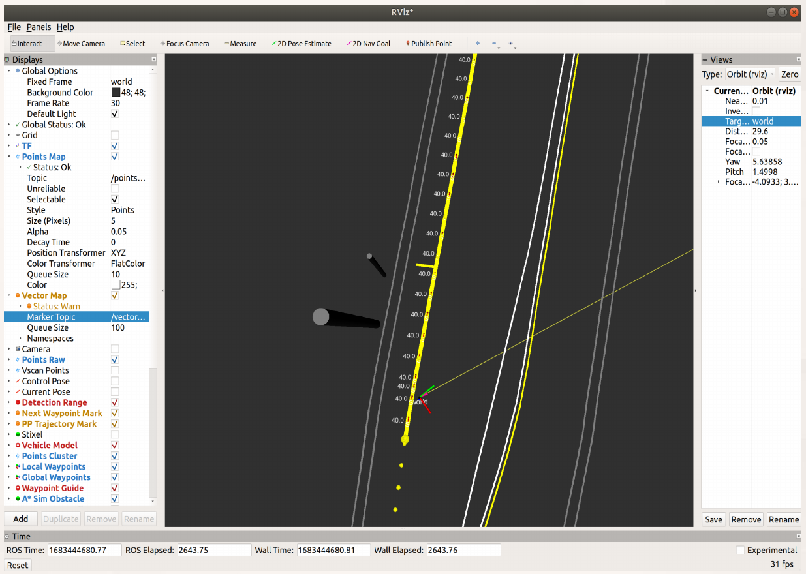

*Figure 19. RViz during the simulation: the yellow path and the vehicle driving on it*

In Figure 19, the thick yellow line is the path to follow, and the numbers beside it are the target speed of the waypoints, 40.0 km/h. The vehicle model drives along the path, and turning on Next Waypoint Mark (the next target waypoint), PP Trajectory Mark (the arc computed by pure pursuit), and Detection Range (the obstacle detection range) in the Displays list of RViz shows the control process as well.

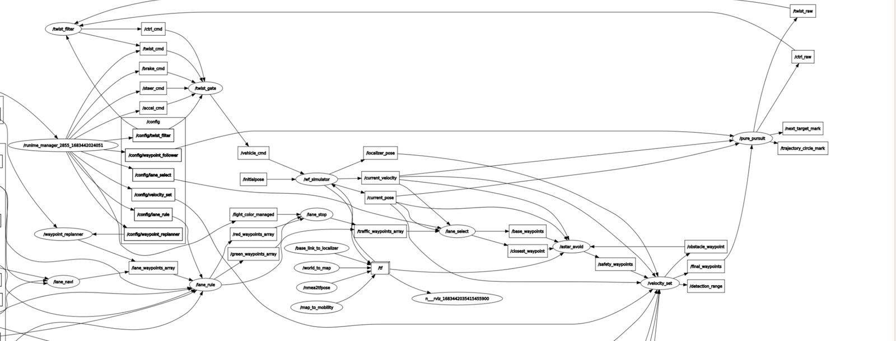

*Figure 20. rqt_graph during the simulation (connections of nodes and topics)*

Opening the node graph with `rqt_graph` shows the flow of Figure 10 as actual connections, as in Figure 20. The `/wf_simulator` in the middle receives `/vehicle_cmd` and `/initialpose` and publishes `/current_pose`, `/current_velocity`, `/localizer_pose`, and `/tf`, and `/pure_pursuit` on the right receives `/final_waypoints` and the current position and speed and publishes the next target marker (`/next_target_mark`) and the arc marker (`/trajectory_circle_mark`). When `/twist_filter` and `/twist_gate` at the upper left filter and select the commands and send them out as `/vehicle_cmd`, the loop is closed. If the simulation does not behave as intended, first look in this graph for a broken topic (for example, a node that does not receive `/current_pose`).

---

<br>

## Concept Applications

**True/False Check:**

| Statement | Judgment and reason |
|:-----|:-----|
| The kinematic model assumes that the tire slip angles of both wheels are zero at low speed. | **T.** The centripetal force $mV^2/R$ is proportional to the square of the speed and is small at low speed, so the required slip angles are also small. |
| Steering the front and rear wheels by the same angle in the same direction makes the vehicle turn with the smallest radius. | **F.** Since $\tan\delta_f - \tan\delta_r = 0$, $\dot\psi = 0$, so the body does not rotate and translates diagonally. Opposite-phase steering is what reduces the radius. |
| During a turn, the steering angle of the inner front wheel is larger than that of the outer front wheel. | **T.** The inner wheel is closer to the center of rotation, so $\delta_i = L/(R - l_w/2) > \delta_o = L/(R + l_w/2)$. |
| With hysteresis, a single threshold speed is used for switching models. | **F.** Different thresholds are used when accelerating (15 km/h) and decelerating (10 km/h), and the current model is kept in between. |
| In the backstepping controller, the reason $d_s$ and $e_r$ converge to 0 is that the rate of change of the Lyapunov function is negative. | **T.** $\dot{\mathcal{V}} = -W_d K_d d_s^2 - W_r K_r e_r^2 < 0$. |
| Even for a vehicle with $C_r l_r = C_f l_f$, the sideslip angle can be observed from yaw rate measurements alone. | **F.** Then $a_{21} = 0$ and the determinant of the observability matrix is 0, so it cannot be observed. |
| The default vehicle model of the wf_simulator integrates the speed and angular velocity produced by pure_pursuit as they are. | **T.** IDEAL_TWIST integrates $\dot X = v\cos\psi$, $\dot Y = v\sin\psi$, $\dot\psi = \omega$. |

---

<br>

## Summary

| Concept | Key Summary |
|:-----|:-----|
| Assumptions of the kinematic model | At low speed the lateral forces are small, so the slip angles of both wheels are taken as zero, and the instantaneous rolling center where the lines perpendicular to the wheel velocities meet is used. |
| Kinematic bicycle model | The law of sines gives $\dot\psi = V\cos\beta(\tan\delta_f - \tan\delta_r)/(l_f + l_r)$ and $\beta = \tan^{-1}((l_f\tan\delta_r + l_r\tan\delta_f)/(l_f + l_r))$, and the position is integrated with $\dot X = V\cos(\psi + \beta)$, $\dot Y = V\sin(\psi + \beta)$. |
| Ackermann steering | For small angles $\delta_f = L/R$, and with $\delta_o = L/(R + l_w/2)$, $\delta_i = L/(R - l_w/2)$ the inner wheel turns more; this is realized by a trapezoidal tie rod arrangement. |
| Model switching and hysteresis | The kinematic model, with no convergence time and no risk of divergence, is used at low speed and the dynamic model at high speed, and two thresholds of 15 km/h and 10 km/h prevent frequent switching. |
| State-space model | Written with the state $[\beta \;\; r]^T$, the input $\delta$, and the output $y = [0 \;\; 1]\mathbf{x}$ (yaw rate measurement), with matrix entries proportional to $1/V$ and $1/V^2$. |
| Path tracking error model | The lateral offset and relative heading angle at the lookahead point follow $\dot d_s = V(\beta + \Delta\psi) + L_s r$ and $\Delta\dot\psi = r - V\rho$. |
| Backstepping controller | The Inner-loop sets $r_d = -(V(\beta + \Delta\psi) + K_d d_s)/L_s$, and the Outer-loop outputs the steering angle $\delta = (-f - (W_d L_s/W_r)d_s - K_r e_r)/b_\delta$, which cancels the cross term of the Lyapunov function. |
| State observer | Estimates the sideslip angle from yaw rate measurements with $\dot{\hat{\mathbf{x}}} = A\hat{\mathbf{x}} + B\delta + \mathbf{l}(y - C\hat{\mathbf{x}})$; the system is observable only if $a_{21} \neq 0$. |
| Real vehicle performance | On a straight road, the lateral distance error is 3.6 cm RMS (40 km/h) and 4.2 cm RMS (80 km/h), with a maximum of 12.8 cm or less, meeting the targets (10 cm RMS, 15 cm maximum). |
| wf_simulator | Integrates a vehicle model with `/vehicle_cmd` and publishes `/current_pose` and `/current_velocity`, so path planning and path following can be tested without localization and a real vehicle. |
| Simulation procedure | Load the TF and maps, create a path with waypoint_clicker and load it with waypoint_loader, switch localization to Simulation Mode, run the path planning and path following nodes and the wf_simulator, and start the vehicle with 2D Pose Estimate. |

---

<br>

## Self-Check Questions

1. **Kinematic model:** A vehicle with $l_f = 1.0$ m and $l_r = 1.6$ m drives with $V = 4$ m/s, $\delta_f = 8°$, and $\delta_r = 0$. Find the sideslip angle, the yaw rate, and the turning radius ($\tan 8° = 0.14054$).

   <details>
   <summary>Answer</summary>

   $\tan\beta = 1.6 \times 0.14054 / 2.6 = 0.08649$, so $\beta = 0.08627$ rad (4.94°) and $\cos\beta = 0.99628$. The yaw rate is $\dot\psi = 4 \times 0.99628 \times 0.14054 / 2.6 = 0.2154$ rad/s, and the turning radius is $R = V / \dot\psi = 4 / 0.2154 = 18.57$ m.

   </details>

2. **Deriving the sideslip angle:** Eliminate $R$ from (Eq. 1) $\tan\delta_f\cos\beta - \sin\beta = l_f / R$ and (Eq. 2) $\sin\beta - \tan\delta_r\cos\beta = l_r / R$ to derive the formula for $\beta$.

   <details>
   <summary>Answer</summary>

   Multiplying (Eq. 2) by $l_f$ and (Eq. 1) by $l_r$ makes both right-hand sides $l_f l_r / R$, so their difference is 0. Subtracting the left-hand sides gives $l_f\sin\beta - l_f\tan\delta_r\cos\beta - l_r\tan\delta_f\cos\beta + l_r\sin\beta = 0$, which rearranges to $(l_f + l_r)\sin\beta = (l_f\tan\delta_r + l_r\tan\delta_f)\cos\beta$. Dividing both sides by $(l_f + l_r)\cos\beta$ gives $\beta = \tan^{-1}((l_f\tan\delta_r + l_r\tan\delta_f)/(l_f + l_r))$.

   </details>

3. **Ackermann steering:** A vehicle with $L = 2.8$ m and $l_w = 1.5$ m turns with $R = 7$ m. Find $\delta_f$, $\delta_o$, and $\delta_i$ with the small-angle approximation.

   <details>
   <summary>Answer</summary>

   $\delta_f = 2.8 / 7 = 0.4$ rad (22.9°). $\delta_o = 2.8 / (7 + 0.75) = 0.3613$ rad (20.7°) and $\delta_i = 2.8 / (7 - 0.75) = 0.448$ rad (25.7°). The difference is 0.0867 rad (about 5.0°); the smaller the radius, the larger the difference between the left and right wheel angles.

   </details>

4. **Hysteresis:** The speed of a vehicle changes in the order 18, 14, 11, 9, 11, 14, 16 km/h. If the dynamic model was in use at first, state the observer model at each moment (acceleration threshold 15 km/h, deceleration threshold 10 km/h).

   <details>
   <summary>Answer</summary>

   18 (dynamic), 14 (dynamic), 11 (dynamic), 9 (kinematic), 11 (kinematic), 14 (kinematic), 16 (dynamic). The dynamic model switches to the kinematic model only at 9 km/h, below 10 km/h, and the kinematic model switches to the dynamic model only at 16 km/h, at or above 15 km/h.

   </details>

5. **Desired yaw rate:** For $V = 20$ m/s, $L_s = 15$ m, $K_d = 0.4$ s⁻¹, $\beta = 0$, $\Delta\psi = -0.01$ rad, and $d_s = -0.5$ m, find the desired yaw rate and explain which way the vehicle must turn.

   <details>
   <summary>Answer</summary>

   $r_d = -(20 \times (0 - 0.01) + 0.4 \times (-0.5)) / 15 = -(-0.2 - 0.2) / 15 = 0.4 / 15 = 0.0267$ rad/s. It is positive, so the vehicle must turn left (counterclockwise). The lookahead point is 50 cm to the right of the path and the body also points to the right of the path, so the vehicle turns left to return to the path.

   </details>

6. **Backstepping:** Explain the role of the term $-\frac{W_d L_s}{W_r}d_s$ in the steering formula of Section 2.6 using the rate of change of the Lyapunov function.

   <details>
   <summary>Answer</summary>

   $\dot{\mathcal{V}}$ contains the cross term $W_d L_s d_s e_r$ coming from $\dot d_s = -K_d d_s + L_s e_r$, and this term can be positive depending on the signs of $d_s$ and $e_r$. Putting $-\frac{W_d L_s}{W_r}d_s$ into the steering angle produces $-W_d L_s d_s e_r$ in $W_r e_r(f + b_\delta\delta)$, which cancels the cross term exactly. As a result, $\dot{\mathcal{V}} = -W_d K_d d_s^2 - W_r K_r e_r^2$ is always negative.

   </details>

7. **Observability:** For a system with $C = [0 \;\; 1]$ and the entries of $A$ given by $a_{11} = -5$, $a_{12} = -0.9$, $a_{21} = 0$, $a_{22} = -6$, decide whether the sideslip angle can be observed and give the reason.

   <details>
   <summary>Answer</summary>

   The two rows of the observability matrix $\mathcal{O}$ are $[0 \;\; 1]$ and $[a_{21} \;\; a_{22}] = [0 \;\; -6]$, and its determinant is 0 (rank 1), so the sideslip angle cannot be observed. Because $a_{21} = 0$, $\beta$ does not appear in $\dot r = -6r + b_{21}\delta$, so the yaw rate measurements carry no information about $\beta$.

   </details>

8. **Simulation procedure:** Why is vel_pose_connect set to Simulation Mode in the simulation? Also, what should be checked first if the vehicle does not move after the wf_simulator is started?

   <details>
   <summary>Answer</summary>

   Outside Simulation Mode, vel_pose_connect relays the NDT outputs (`/ndt_pose`, `/estimate_twist`) to `/current_pose` and `/current_velocity`, so if NDT runs, its values are mixed with the values of the same topics published by the wf_simulator. In Simulation Mode this connection changes to `/sim_pose` and `/sim_velocity`, so only the values of the simulator reach the two topics. If the vehicle does not move, first check whether the initial position was given with 2D Pose Estimate in RViz. With the default settings, the wf_simulator waits for an initial position until it receives `/initialpose`. Next, check in `rqt_graph` whether `/vehicle_cmd` and `/final_waypoints` are connected.

   </details>

---

<br>

## References

1. R. Rajamani, *Vehicle Dynamics and Control*, 2nd ed. New York, NY, USA: Springer, 2012, doi: 10.1007/978-1-4614-1433-9.
2. H. K. Khalil, *Nonlinear Systems*, 3rd ed. Upper Saddle River, NJ, USA: Prentice Hall, 2002.
3. D. G. Luenberger, "Observing the state of a linear system," *IEEE Trans. Mil. Electron.*, vol. MIL-8, no. 2, pp. 74-80, Apr. 1964, doi: 10.1109/TME.1964.4323124.
4. Autoware Foundation, "simulation: wf_simulator," GitHub repository, Autoware.ai. https://github.com/Autoware-AI/simulation
5. Autoware Foundation, "common: vehicle_sim_model, gnss," GitHub repository, Autoware.ai. https://github.com/Autoware-AI/common
6. Autoware Foundation, "core_planning: waypoint_maker," GitHub repository, Autoware.ai. https://github.com/Autoware-AI/core_planning
7. Autoware Foundation, "core_perception: autoware_connector, gnss_localizer," GitHub repository, Autoware.ai. https://github.com/Autoware-AI/core_perception
