# 13주차 이론 — 자율주행 센서와 CAN 버스

[레포지토리 안내](../../README.ko.md) | [English](Concepts_Lecture.md) | [한국어](Concepts_Lecture.ko.md)

> **최종 수정일:** 2026-11-04

> **학습 목표:**
> 1. GNSS가 의사거리로 위치를 구하는 원리와 위성, 대기, 지상에서 생기는 위치 오차의 요인을 설명할 수 있다
> 2. DGPS와 RTK가 기준국의 보정 정보로 오차를 줄이는 원리를 설명하고, 코드 기반 측정과 반송파 위상 측정의 정확도 차이를 파장으로 설명할 수 있다
> 3. LiDAR와 레이더의 비행 시간 측정 원리와 장단점을 비교하고, 자율주행차가 여러 센서를 함께 쓰는 이유를 설명할 수 있다
> 4. CAN이 차량 통신에 쓰이는 이유와 꼬임쌍선, 차동 신호, 종단 저항으로 이루어진 버스 구조를 설명할 수 있다
> 5. CAN 데이터 프레임의 필드를 설명하고, 식별자에 의한 비트 단위 중재 과정을 추적할 수 있다
> 6. 표준 CAN과 확장 CAN, 저속 CAN과 고속 CAN을 구분하고, CAN의 한계와 CAN FD, 차량용 이더넷 같은 대안을 설명할 수 있다

---

## 목차

- [1. 위성항법과 정밀 측위](#1-위성항법과-정밀-측위)
  - [1.1 GNSS와 위성항법 시스템](#11-gnss와-위성항법-시스템)
  - [1.2 의사거리와 측위 원리](#12-의사거리와-측위-원리)
  - [1.3 위치 오차의 요인](#13-위치-오차의-요인)
  - [1.4 차분 GNSS의 원리](#14-차분-gnss의-원리)
  - [1.5 한국의 기준국망](#15-한국의-기준국망)
  - [1.6 DGPS: 코드 기반 측정](#16-dgps-코드-기반-측정)
  - [1.7 RTK: 반송파 위상 측정](#17-rtk-반송파-위상-측정)
  - [1.8 GPS, DGPS, RTK의 비교](#18-gps-dgps-rtk의-비교)
- [2. LiDAR와 레이더](#2-lidar와-레이더)
  - [2.1 비행 시간을 이용한 거리 측정](#21-비행-시간을-이용한-거리-측정)
  - [2.2 LiDAR](#22-lidar)
  - [2.3 2D LiDAR와 산업 안전](#23-2d-lidar와-산업-안전)
  - [2.4 레이더](#24-레이더)
  - [2.5 LiDAR와 레이더의 비교](#25-lidar와-레이더의-비교)
  - [2.6 자율주행차의 센서 구성과 센서 융합](#26-자율주행차의-센서-구성과-센서-융합)
- [3. CAN 버스](#3-can-버스)
  - [3.1 CAN이 필요한 이유](#31-can이-필요한-이유)
  - [3.2 CAN의 특징](#32-can의-특징)
  - [3.3 물리 계층: 꼬임쌍선과 차동 신호](#33-물리-계층-꼬임쌍선과-차동-신호)
  - [3.4 버스 구조와 종단 저항](#34-버스-구조와-종단-저항)
  - [3.5 데이터 프레임의 구조](#35-데이터-프레임의-구조)
  - [3.6 중재와 우선순위](#36-중재와-우선순위)
  - [3.7 표준 CAN과 확장 CAN, ISO 규격](#37-표준-can과-확장-can-iso-규격)
  - [3.8 오류 검출과 처리](#38-오류-검출과-처리)
  - [3.9 CAN의 한계와 차량 네트워크의 변화](#39-can의-한계와-차량-네트워크의-변화)
  - [3.10 PC와 CAN 버스의 연결](#310-pc와-can-버스의-연결)
- [개념 적용](#개념-적용)
- [요약](#요약)
- [점검 문제](#점검-문제)
- [참고 문헌](#참고-문헌)

---

<br>

## 1. 위성항법과 정밀 측위

### 1.1 GNSS와 위성항법 시스템

자율주행차가 지도 위에서 자신의 위치를 찾으려면 지구 전체에서 통하는 좌표, 곧 위도, 경도, 높이로 나타낸 위치가 필요하다. **GNSS(Global Navigation Satellite System, 전 지구 위성항법 시스템)** 는 궤도를 도는 여러 위성이 보내는 전파를 수신기가 받아 수신기의 위치와 시각을 구하는 시스템을 통틀어 부르는 이름이다 [1]. 미국의 **GPS(Global Positioning System)** 가 가장 먼저 운영되어 GPS라는 말이 위성항법 전체를 가리키는 말처럼 쓰이기도 하지만, 오늘날에는 여러 나라가 각자의 시스템을 운영한다.

| 구분 | GPS | GLONASS | Galileo | BeiDou | QZSS | NavIC |
|:-----|:-----|:-----|:-----|:-----|:-----|:-----|
| 운영 주체 | 미국 | 러시아 | 유럽 연합 | 중국 | 일본 | 인도 |
| 서비스 범위 | 전 지구 | 전 지구 | 전 지구 | 전 지구 | 일본 주변 지역 | 인도 주변 지역 |
| 최초 발사 | 1978 | 1982 | 2011 | 2007 | 2010 | 2013 |
| 완전 운용(FOC) | 1995 | 2011 | 2020 | 2020 | (2024) | (2022) |
| 위성 수 | 31 | 27 | 28 | 42 | 4 | 8 |
| 운영 중 | 31 | 23 | 22 | 34 | 4 | 7 |
| 유지보수 중 | | 2 | | | | |
| 시험 단계 | | 1 | 2 | | | |
| 기타 | | | 2 | 8 | | 1 |

*표 1. 위성항법 시스템별 운영 주체와 위성 현황*

**FOC(Full Operational Capability, 완전 운용 능력)** 는 계획한 위성을 모두 갖추어 정해진 성능의 서비스를 제공하기 시작한 시점이며, 괄호 안의 연도는 목표 시점이다. GPS, GLONASS, Galileo, BeiDou는 지구 전체를 대상으로 하고, QZSS와 NavIC는 자국 주변에서 위성항법의 성능을 높이기 위한 지역 시스템이다 [1].

> **참고:** 위성의 수는 새 위성의 발사와 오래된 위성의 퇴역에 따라 계속 바뀌므로 표 1의 값은 한 시점의 현황이다. 여러 시스템의 신호를 함께 받는 다중 GNSS 수신기는 볼 수 있는 위성이 많아, 높은 건물이 하늘을 가리는 도심에서도 위치를 구할 가능성이 높아진다.

### 1.2 의사거리와 측위 원리

각 위성은 자신의 궤도 정보와 신호를 보낸 시각을 실어 전파를 보낸다. 수신기는 신호가 도착한 시각에서 보낸 시각을 빼 전파의 이동 시간 $\Delta t$를 구하고, 여기에 빛의 속도 $c \approx 3 \times 10^{8}$ m/s를 곱해 위성까지의 거리를 계산한다. 그런데 위성은 원자시계를 쓰지만 수신기는 값싼 수정 시계를 쓰므로 두 시계가 맞지 않고, 계산한 거리에는 수신기 시계 오차에 해당하는 거리가 섞인다. 이렇게 시계 오차를 포함한 거리를 **의사거리(pseudorange)** 라고 한다 [1].

$$\rho_i = \sqrt{(x_i - x)^2 + (y_i - y)^2 + (z_i - z)^2} + c\,\delta t_r + \varepsilon_i$$

여기서 $\rho_i$는 $i$번째 위성까지의 의사거리, $(x_i, y_i, z_i)$는 궤도 정보로 아는 위성의 위치, $(x, y, z)$는 구하려는 수신기의 위치, $\delta t_r$는 수신기의 시계 오차, $\varepsilon_i$는 1.3절에서 다룰 나머지 오차이다. 모르는 값이 $x, y, z, \delta t_r$의 네 개이므로 **위성이 최소 4개 보여야** 위치를 구할 수 있다. 시계 오차가 없다면 위성 3개까지의 거리로 만든 세 구의 교점이 수신기의 위치가 되며, 네 번째 위성은 시계 오차를 풀기 위해 필요하다.

시계 오차가 얼마나 중요한지는 간단한 계산으로 알 수 있다. GPS 위성은 약 20,200 km 높이에 있으므로 전파는 $20{,}200{,}000 / (3 \times 10^{8}) \approx 0.067$ s 만에 도착한다. 이때 시계가 1 µs만 틀려도 거리 오차는 $3 \times 10^{8} \times 10^{-6} = 300$ m이고, 1.5 m의 거리 오차는 $1.5 / (3 \times 10^{8}) = 5$ ns의 시계 오차에 해당한다. 그래서 위치 정확도를 높이는 일은 결국 나노초 단위의 시간 오차와 그에 해당하는 거리 오차를 줄이는 일이다.

> **[선형대수학]** 의사거리 식은 위치에 대해 비선형이므로, 현재 추정한 위치 주변에서 선형화하여 보정량 $\Delta \mathbf{x}$에 대한 연립일차방정식 $H \Delta \mathbf{x} = \Delta \boldsymbol{\rho}$를 만든다. 위성이 4개보다 많으면 식이 미지수보다 많으므로 최소제곱 해 $\Delta \mathbf{x} = (H^{\mathsf{T}} H)^{-1} H^{\mathsf{T}} \Delta \boldsymbol{\rho}$를 구하고, 추정 위치를 고쳐 가며 이 과정을 반복한다 [1]. 위성이 하늘에 고르게 퍼져 있을수록 $H$의 조건이 좋아져 같은 측정 오차에서도 위치 오차가 작아진다.

### 1.3 위치 오차의 요인

의사거리에 섞이는 오차는 생기는 곳에 따라 세 갈래로 나뉜다.

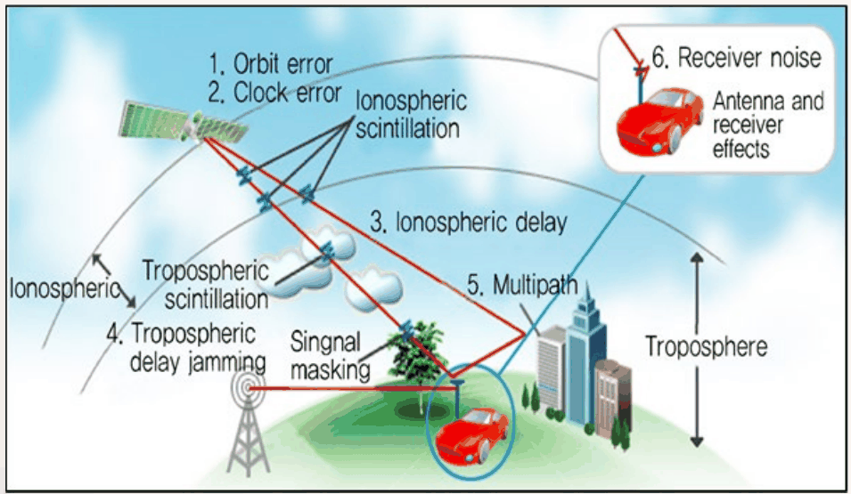

*그림 1. GNSS 신호가 수신기에 닿기까지 생기는 오차의 요인*

1. **위성 오차:** 위성 궤도 오차, 위성 시계(시각) 오차, 위성이 보내는 항법 데이터의 오차이다.
2. **대기 오차:** 신호가 전리층과 대류권을 지나며 생기는 전달 시간의 지연이다.
3. **지상 오차:** 신호의 왜곡, 건물 등에 반사된 신호에 의한 다중 경로 오차, 수신기 자체의 오차이다.

| 오차 요인 | 세부 사항 | 오차 크기 |
|:-----|:-----|:-----|
| 위성 시계 오차 | 위성이 보내는 시각 정보의 오차 | 0\~1.5 m |
| 위성 궤도 오차 | 위성이 보내는 궤도 정보의 오차 | 1\~5 m |
| 전리층 굴절 | GNSS 신호가 전리층을 지날 때 생기는 전달 시간 지연 | 0\~30 m |
| 대류권 굴절 | GNSS 신호가 대류권을 지날 때 생기는 전달 시간 지연 | 0\~30 m |
| 수신기 오차 | 안테나 위치 오차, 잡음 | 0\~10 m |
| 다중 경로 | GNSS 신호가 여러 경로로 들어와 생기는 오차 | 0\~1 m |
| SA(Selective Availability) | 고의로 넣은 잡음, 2000년 5월 해제 | 0\~70 m |

*표 2. GNSS 위치 오차의 요인과 크기*

각 요인의 원인은 다음과 같다 [1], [2].

- **위성 시계 오차:** 원자시계도 조금씩 어긋나므로 지상 관제국이 시계 보정값을 계산해 위성으로 올려 보낸다. 수신기는 이 보정값을 적용하지만 예측에 남는 오차가 있고, 1.2절의 계산처럼 수 ns의 오차가 1 m 안팎의 거리 오차가 된다.
- **위성 궤도 오차:** 위성이 보내는 궤도 정보(ephemeris)는 미리 예측한 값이므로 실제 궤도와 조금 다르다. 위성의 위치가 틀리면 의사거리 식의 $(x_i, y_i, z_i)$가 틀려 위치가 어긋난다.
- **전리층 지연:** 고도 약 50\~1,000 km의 **전리층(ionosphere)** 에는 태양 복사로 생긴 자유 전자가 있어 전파를 늦춘다. 지연은 낮과 밤, 계절, 태양 활동에 따라 크게 변하며, 주파수의 제곱에 반비례하므로 두 주파수를 받는 수신기는 두 측정값을 비교해 대부분을 없앨 수 있다.
- **대류권 지연:** 지표에서 약 10 km 남짓까지의 **대류권(troposphere)** 에서는 공기와 수증기가 전파를 늦춘다. 주파수와 무관하므로 두 주파수로 없앨 수 없고, 기온, 기압, 습도를 쓰는 모델로 대부분을 보정한다. 위성이 지평선에 가까울수록 신호가 대기를 길게 지나므로 지연이 커진다.
- **수신기 오차:** 안테나가 실제로 신호를 받는 점의 위치 오차와 수신기 회로의 열잡음이다.
- **다중 경로(multipath):** 건물이나 지면에 반사되어 돌아 들어온 신호는 직접 들어온 신호보다 먼 길을 지나므로 거리가 길게 측정된다. 높은 건물 사이의 도로처럼 반사면이 많은 곳에서 커진다.
- **SA(Selective Availability, 선택적 가용성):** 미국이 민간용 GPS 신호에 고의로 넣던 오차로, 2000년 5월 2일에 해제되었다 [3].

그림 1에는 이 밖에도 전리층과 대류권의 불규칙성 때문에 신호의 세기와 위상이 빠르게 흔들리는 **신틸레이션(scintillation)**, 고의로 강한 전파를 쏘아 수신을 방해하는 **재밍(jamming)**, 건물이나 지형에 위성이 가려지는 **신호 차단(masking)** 이 나타나 있다. 재밍과 신호 차단은 거리 오차를 키우기보다 볼 수 있는 위성의 수를 줄여 위치를 아예 구하지 못하게 만들 수 있다.

### 1.4 차분 GNSS의 원리

표 2의 오차 가운데 위성 시계, 위성 궤도, 전리층, 대류권 오차는 가까이 있는 두 수신기에 거의 같게 나타난다. 같은 위성의 같은 신호가 거의 같은 대기를 지나오기 때문이다. **차분 GNSS(Differential GNSS, DGNSS)** 는 이 성질을 이용해 GNSS 오차를 보상하는 기술이다.

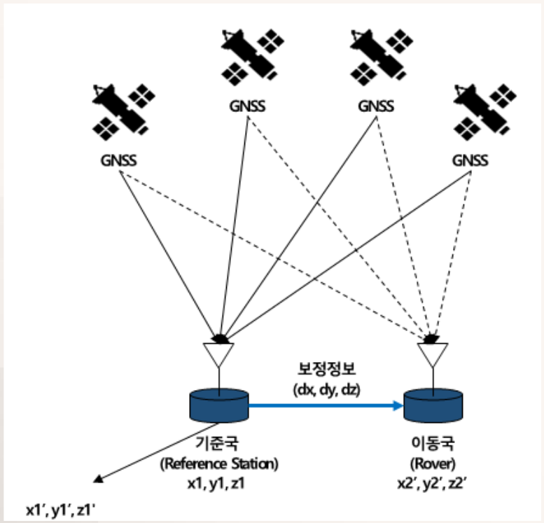

*그림 2. 기준국이 만든 보정 정보를 이동국에 보내는 DGNSS의 구성*

- 정밀하게 측량하여 절대 좌표를 아는 곳에 **기준국(reference station)** 을 설치한다.
- 기준국은 자신이 아는 좌표 $(x_1, y_1, z_1)$와 GNSS로 측정한 좌표 $(x_1', y_1', z_1')$의 차이로 보정 정보를 만들고, 유효 반경 안에 있는 차량, 곧 **이동국(rover)** 에 보낸다.
- 보정 정보를 받은 이동국은 자신이 측정한 좌표 $(x_2', y_2', z_2')$에 보정 정보를 더해 오차를 보정한다.

$$(dx,\ dy,\ dz) = (x_1 - x_1',\ y_1 - y_1',\ z_1 - z_1')$$

$$(x_2,\ y_2,\ z_2) = (x_2' + dx,\ y_2' + dy,\ z_2' + dz)$$

예를 들어 지역 좌표계(단위 m)에서 기준국의 참 좌표가 $(1000.0, 2000.0, 50.0)$인데 측정 좌표가 $(1002.3, 1998.6, 53.1)$이면 보정 정보는 $(1000.0 - 1002.3,\ 2000.0 - 1998.6,\ 50.0 - 53.1) = (-2.3, +1.4, -3.1)$이다. 같은 순간 이동국의 측정 좌표가 $(1502.1, 2501.2, 55.0)$이면 보정한 좌표는 $(1502.1 - 2.3,\ 2501.2 + 1.4,\ 55.0 - 3.1) = (1499.8, 2502.6, 51.9)$이다.

이 방법으로 줄일 수 있는 것은 두 수신기에 **공통으로 나타나는 오차**뿐이다. 다중 경로와 수신기 잡음은 수신기마다 따로 생기므로 보정 정보로 없앨 수 없다. 또 기준국과 이동국 사이가 멀어질수록 두 신호가 지나는 대기가 달라져 공통 오차의 비율이 줄어들므로, 보정 정보에는 유효 반경이 있다.

> **주의:** 위의 식처럼 좌표의 차이를 그대로 더하는 방식은 두 수신기가 같은 위성들을 쓸 때에만 맞는다. 실제 DGNSS는 위성마다 의사거리의 보정값을 보내고, 이동국이 자신이 쓰는 위성의 보정값만 골라 적용한다. 보정 정보의 형식으로는 RTCM SC-104 표준이 널리 쓰인다 [4].

DGNSS에는 의사거리를 보정하는 **DGPS(Differential GPS)** 와 반송파 위상을 이용하는 **RTK(Real Time Kinematic)** 가 있으며, 1.6절과 1.7절에서 차례로 다룬다.

### 1.5 한국의 기준국망

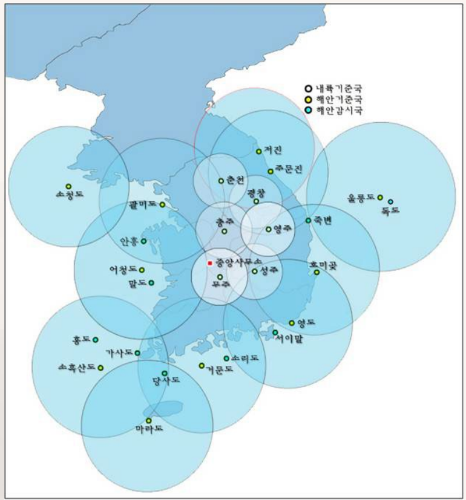

*그림 3. 한국의 공공 DGPS 기준국과 각 기준국의 유효 반경*

한국의 공공 DGPS는 대전 중앙사무소에 있는 통제국 1개소, 기준국(RS, Reference Station) 11개소, 감시국(IM, Integrity Monitor) 8개소로 구성되어 운영된다. 기준국은 보정 정보를 만들어 방송하고, **감시국**은 방송된 보정 정보를 실제로 받아 그 정보로 보정한 위치가 맞는지 검사하여 이상이 있으면 알린다. 통제국은 전체 기준국과 감시국을 관리한다. 그림 3의 원은 각 기준국의 보정 정보가 유효한 범위를 나타내며, 원이 서로 겹쳐 국토 대부분을 덮는다.

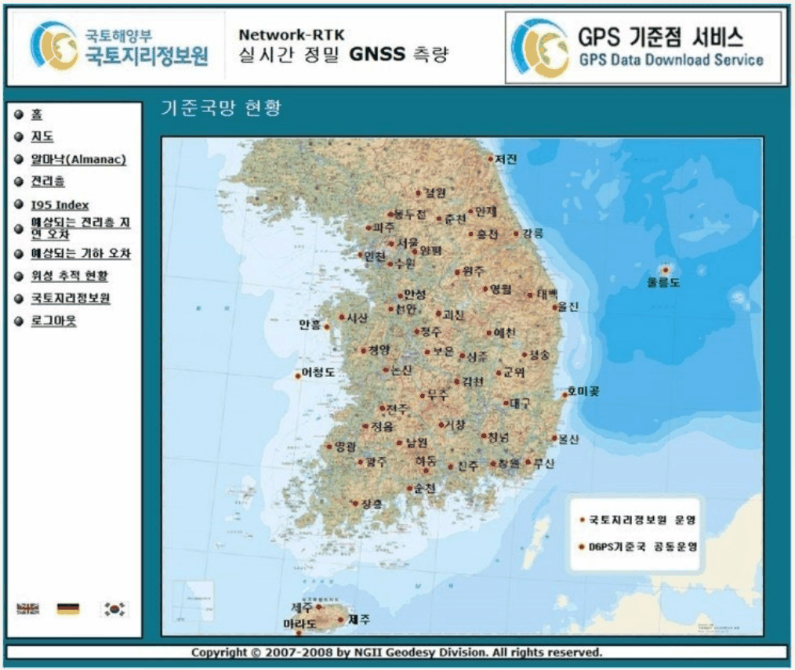

*그림 4. 국토지리정보원의 네트워크 RTK 서비스와 기준국망*

국토지리정보원은 전국에 설치한 위성 기준국에서 받은 관측 데이터를 제공하고, 이를 이용한 실시간 정밀 GNSS 측량(네트워크 RTK) 서비스를 운영한다 [5]. 그림 4의 지도에는 국토지리정보원이 운영하는 기준국과 DGPS 기준국을 공동 운영하는 지점이 표시되어 있다. **네트워크 RTK(network RTK)** 는 여러 기준국의 관측값으로 지역 전체의 오차를 모델링하여, 사용자 가까이에 가상의 기준국이 있는 것처럼 보정 정보를 만들어 준다. 그래서 기준국 하나만 쓰는 RTK보다 넓은 지역에서 고른 정확도를 얻는다 [1].

### 1.6 DGPS: 코드 기반 측정

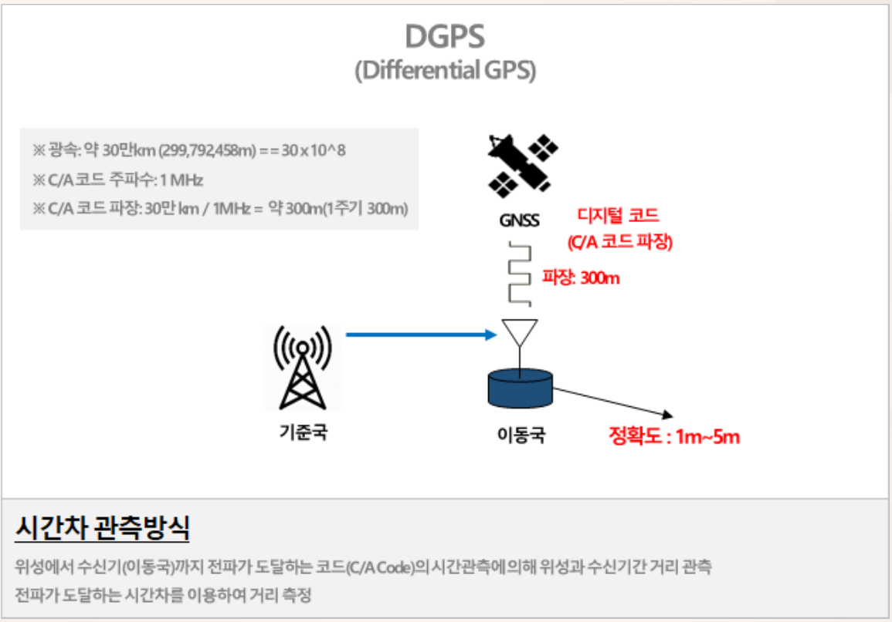

*그림 5. C/A 코드의 시간차로 거리를 재는 DGPS*

DGPS는 **시간차 관측 방식**으로 거리를 잰다. 위성은 **C/A 코드(Coarse/Acquisition code)** 라는 0과 1의 정해진 디지털 부호열을 반복해서 보내고, 수신기는 같은 부호열을 스스로 만들어 받은 신호와 겹쳐 보며 얼마나 늦게 도착했는지 찾는다. 이렇게 위성에서 수신기(이동국)까지 코드가 도달하는 시간을 관측하여 위성과 수신기 사이의 거리를 구한다.

코드의 한 비트를 **칩(chip)** 이라 하는데, GPS C/A 코드는 초당 $1.023 \times 10^{6}$개의 칩을 보낸다 [6]. 칩 하나가 전파의 진행 방향으로 차지하는 길이, 곧 코드의 "파장"은 다음과 같다.

$$\lambda_{\text{C/A}} = \frac{c}{f_{\text{C/A}}} = \frac{299{,}792{,}458\ \text{m/s}}{1.023 \times 10^{6}\ \text{Hz}} \approx 293\ \text{m}$$

칩 속도를 1 MHz로 어림하면 $3 \times 10^{8} / 10^{6} = 300$ m가 된다. 수신기는 이 수백 m 길이의 칩을 기준으로 도착 시각을 맞추므로, 칩 하나 안에서의 위치를 아무리 잘 읽어도 측정 잡음이 수 m 수준으로 남는다. 보정 정보를 적용한 DGPS의 정확도는 **1\~5 m** 정도이다.

### 1.7 RTK: 반송파 위상 측정

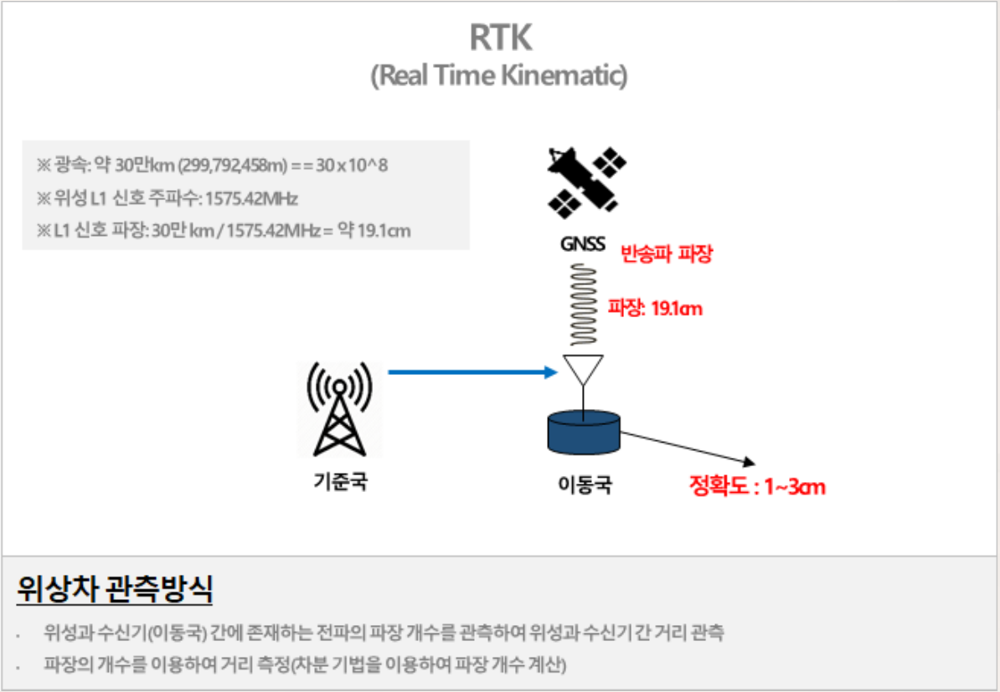

*그림 6. 반송파의 파장 개수로 거리를 재는 RTK*

코드는 **반송파(carrier)** 라는 고주파 사인파에 실려 전송된다. RTK는 코드 대신 이 반송파 자체를 자로 쓰는 **위상차 관측 방식**으로, 위성과 수신기(이동국) 사이에 반송파의 파장이 몇 개 들어가는지 관측하여 거리를 구한다. GPS L1 신호의 반송파 주파수는 1575.42 MHz이므로 파장은 다음과 같다 [6].

$$\lambda_{L1} = \frac{c}{f_{L1}} = \frac{299{,}792{,}458\ \text{m/s}}{1575.42 \times 10^{6}\ \text{Hz}} \approx 0.190\ \text{m} = 19\ \text{cm}$$

두 측정의 자 눈금을 비교하면 $1575.42 / 1.023 = 1540$이므로 반송파의 파장은 C/A 코드 칩 길이의 1/1540이다. 두 측정에서 한 파장(칩) 안의 위치를 같은 비율, 예를 들어 1%의 정밀도로 읽는다고 하면 코드 측정의 잡음은 $293 \times 0.01 \approx 2.9$ m이고 반송파 측정의 잡음은 $0.19 \times 0.01 \approx 0.0019$ m, 곧 약 2 mm이다. 반송파 위상 측정이 코드 측정보다 훨씬 정밀한 이유가 여기에 있다.

문제는 수신기가 한 파장 안의 위상(소수 부분)은 정밀하게 재지만, 위성까지 **파장이 정수로 몇 개 들어가는지**는 알 수 없다는 점이다. 이 모르는 정수 $N$을 **정수 모호성(integer ambiguity)** 이라 하며, 반송파 위상으로 잰 거리는 다음과 같이 쓸 수 있다.

$$\Phi = \lambda \left( N + \frac{\phi}{2\pi} \right)$$

여기서 $\phi$는 수신기가 재는 위상(라디안)이다. RTK는 **차분 기법**으로 $N$을 구한다 [1], [2].

1. **단일 차분:** 같은 위성의 신호를 기준국과 이동국이 함께 받아 두 측정값을 빼면 위성 시계 오차가 없어지고, 두 수신기가 가까우면 전리층과 대류권 지연도 대부분 없어진다.
2. **이중 차분:** 두 위성에 대한 단일 차분을 다시 빼면 두 수신기의 시계 오차가 없어진다. 남는 것은 기준국과 이동국의 상대 위치에 관한 기하학적 거리 차이, 정수 모호성의 차이, 작은 잡음이다.
3. **모호성 결정:** 여러 위성과 여러 시점의 이중 차분을 모아 모호성이 정수라는 조건으로 풀면 정수 값이 정해지고, 이후에는 mm 단위의 위상 측정이 그대로 거리 측정이 된다.

**실시간(real time)** 이라는 이름은 기준국이 자신의 반송파 위상 관측값을 무선 통신이나 인터넷으로 이동국에 실시간으로 보내고, 이동국이 그 자리에서 위치를 계산한다는 뜻이다. RTK의 정확도는 **1\~3 cm** 정도이다.

> **주의:** RTK는 기준국과 이동국이 충분히 가까워야 대기 오차가 상쇄되므로 기준국 하나로 쓸 수 있는 거리가 대개 수십 km 이내로 제한되고, 보정 정보를 받을 통신 연결이 계속 필요하다. 또 터널이나 고가 도로 아래에서 신호가 끊기면 위상의 정수 개수를 잃어(cycle slip) 모호성을 다시 풀어야 한다 [1]. 그래서 자율주행차는 GNSS만 믿지 않고, 9주차의 NDT 매칭처럼 LiDAR와 지도를 이용한 위치 인식이나 관성 센서를 함께 쓴다.

### 1.8 GPS, DGPS, RTK의 비교

| 방식 | 거리 측정 | 보정 정보 | 정확도 |
|:-----|:-----|:-----|:-----|
| 단독 GPS | C/A 코드의 도착 시간(의사거리) | 없음 | 표 2의 오차가 그대로 남아 수 m 이상 |
| DGPS | C/A 코드의 도착 시간 | 기준국이 보낸 의사거리 또는 좌표 보정값 | 1\~5 m |
| RTK | 반송파 위상(파장의 개수)과 코드 | 기준국이 보낸 반송파 위상 관측값 | 1\~3 cm |

*표 3. GPS, DGPS, RTK의 측정 방식과 정확도*

> **핵심:** DGPS와 RTK는 모두 위치를 아는 기준국의 측정으로 공통 오차를 없애는 차분 GNSS이다. DGPS는 칩 길이가 약 300 m인 코드로 거리를 재므로 m 단위에 머물고, RTK는 파장이 약 19 cm인 반송파의 위상으로 거리를 재고 정수 모호성을 풀어 cm 단위에 이른다.

---

<br>

## 2. LiDAR와 레이더

### 2.1 비행 시간을 이용한 거리 측정

카메라가 주변의 빛을 받기만 하는 **수동 센서**라면, LiDAR와 레이더는 스스로 파동을 쏘고 반사되어 돌아온 파동을 받는 **능동 센서**이다.

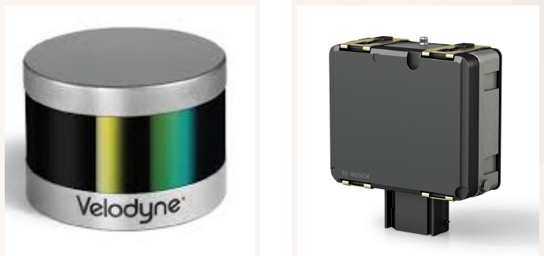

*그림 7. 회전형 LiDAR와 차량용 레이더*

- **LiDAR(Light Detection And Ranging):** 레이저를 쏘아 물체에 부딪혀 반사되어 돌아오는 시간으로 거리를 잰다.
- **레이더(Radar, Radio Detection And Ranging):** 전파를 쏘아 물체에 부딪혀 반사되어 돌아오는 시간으로 거리를 잰다.

두 센서 모두 파동이 물체까지 갔다가 돌아오는 시간, 곧 **비행 시간(Time of Flight, ToF)** $t$를 재며, 파동은 빛의 속도 $c$로 왕복하므로 물체까지의 거리 $d$는 다음과 같다.

$$d = \frac{c \cdot t}{2}$$

2로 나누는 이유는 $t$가 왕복 시간이기 때문이다. 예를 들어 반사파가 200 ns 뒤에 돌아왔다면 $d = (3 \times 10^{8} \times 200 \times 10^{-9}) / 2 = 60 / 2 = 30$ m이다. 반대로 거리를 1 cm 단위로 구분하려면 $t = 2 \times 0.01 / (3 \times 10^{8}) \approx 6.7 \times 10^{-11}$ s, 곧 약 67 ps의 시간 차이를 가려내야 하므로, 이런 센서에는 매우 정밀한 시간 측정 회로가 들어간다.

### 2.2 LiDAR

LiDAR는 근적외선 레이저(흔히 파장 905 nm나 1550 nm)를 짧은 펄스로 쏘면서 방향을 바꾸어 가며 주변을 훑는다 [7]. 펄스 하나가 돌아올 때마다 거리 $d$와 그 순간 레이저가 향한 방향을 함께 알게 되므로, 반사 지점 하나의 3차원 좌표가 정해진다.

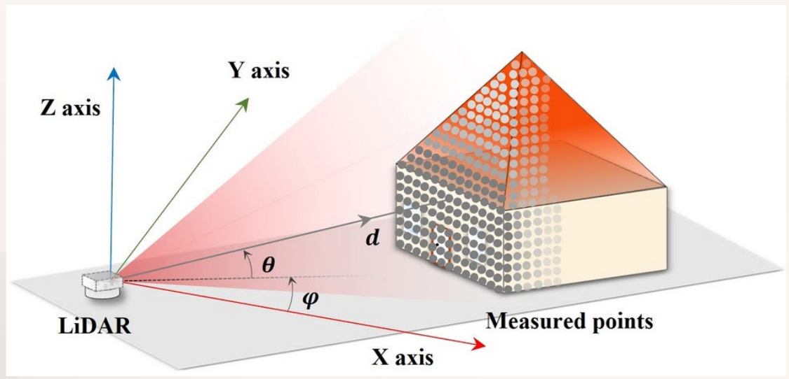

*그림 8. LiDAR가 측정한 거리와 두 각도로 정해지는 반사점의 좌표*

그림 8에서 $\varphi$는 수평면에서 X축으로부터 잰 방위각, $\theta$는 수평면에서 위로 잰 고도각이다 [8]. 반사점의 좌표는 다음과 같다.

$$x = d \cos\theta \cos\varphi, \qquad y = d \cos\theta \sin\varphi, \qquad z = d \sin\theta$$

예를 들어 $d = 20$ m, $\theta = 5°$, $\varphi = 30°$이면 $\cos 5° \approx 0.9962$, $\sin 5° \approx 0.0872$, $\cos 30° \approx 0.8660$, $\sin 30° = 0.5$이므로 $x = 20 \times 0.9962 \times 0.8660 \approx 17.25$ m, $y = 20 \times 0.9962 \times 0.5 \approx 9.96$ m, $z = 20 \times 0.0872 \approx 1.74$ m이다. 이런 점을 초당 수십만 개 모은 것이 2주차와 9주차에서 지도 작성과 NDT 매칭에 쓴 **포인트 클라우드(point cloud)** 이다.

> **용어 정의:** **3D LiDAR**는 여러 층의 레이저를 위아래로 쌓거나 거울로 빔을 두 방향으로 움직여 공간 전체를 측정한다. 그림 7의 회전형 LiDAR는 레이저 여러 개를 세로로 배열하고 몸체를 360° 회전시키며, 그림 8의 출처 연구는 MEMS 거울로 빔을 움직인다 [8]. **2D LiDAR**는 레이저 한 층으로 한 평면만 훑어 그 평면 위의 거리 단면을 얻는다.

LiDAR의 특징은 다음과 같다.

- 가격이 매우 비싸다.
- 빛은 차체를 통과하지 못하므로 지붕처럼 시야가 트인 차량 외부에 장착한다.
- 물체의 형상을 인식할 수 있어 혼자서도 주변을 파악하기에 충분하며, 카메라와 함께 쓰면 더 좋다.
- 빛(레이저)을 쏘아 다시 돌아오는 것을 이용해 주변을 이미지로 만든다.
- 파장이 짧아 작은 물체도 감지할 수 있다.
- 정확한 3D 단색 이미지를 만들 수 있다. 각 점에는 거리와 반사 세기만 있고 색 정보는 없다.
- 비, 안개, 눈처럼 빛을 흩뜨리는 날씨에서는 성능이 떨어진다.

> **참고:** LiDAR가 작은 물체를 감지할 수 있는 이유는 주파수가 낮아서가 아니라 **파장이 짧아서**이다. 근적외선의 주파수는 수백 THz로 레이더보다 훨씬 높다. 또 LiDAR는 스스로 빛을 내는 능동 센서이므로 야간에도 동작하며, 어둠에 약한 것은 주변 빛에 의존하는 카메라이다. LiDAR의 성능을 떨어뜨리는 것은 어둠이 아니라 빛을 흩뜨리고 흡수하는 짙은 안개, 비, 눈이다 [7]. 그림 14의 비교에서도 LiDAR는 어둠에서의 가용성이 높게 나타난다.

### 2.3 2D LiDAR와 산업 안전

2D LiDAR는 **AGV(Automated Guided Vehicle, 무인 운반차)** 같은 실내 이동 로봇에 필수로 쓰인다. 바닥 가까이의 한 평면만 훑어도 벽과 장애물의 단면을 얻을 수 있어, 지도 작성과 장애물 감지에 충분하기 때문이다.

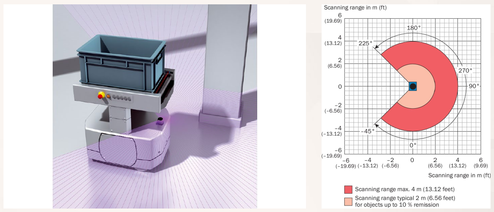

*그림 9. 2D LiDAR를 단 AGV와 안전 레이저 스캐너의 스캔 범위*

그림 9의 오른쪽 그래프는 2D 안전 레이저 스캐너 한 대가 보는 범위를 위에서 본 것이다. 스캐너는 -45°에서 225°까지 270°를 훑고, 진한 영역은 최대 4 m, 옅은 영역은 반사율(remission) 10%의 어두운 물체를 감지할 수 있는 일반적인 거리 2 m를 나타낸다. 반사율이 낮은 물체는 돌아오는 빛이 약하므로 감지 거리가 짧아진다. 스캐너 뒤쪽 90°는 보이지 않으므로 한 대로는 AGV의 둘레 전체를 볼 수 없다.

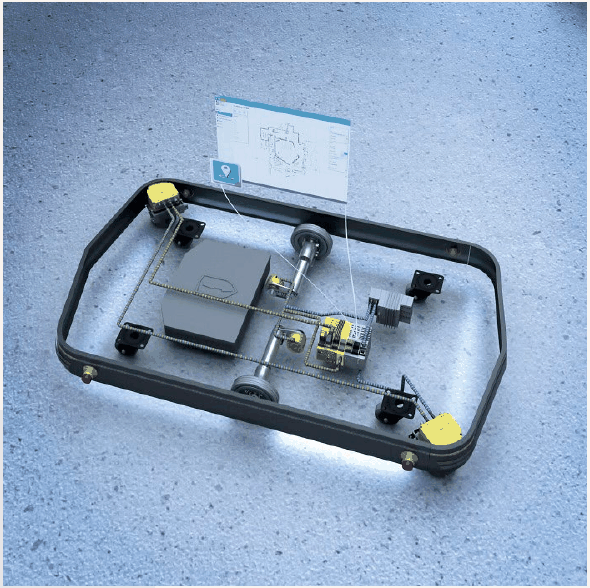

*그림 10. 사각이 최소화되도록 LiDAR를 배치한 AGV*

그래서 AGV는 사각이 최소화되도록 LiDAR를 배치하고, **안전 LiDAR**를 활용하여 AGV 구동을 제어하는 방식이 표준이다. 그림 10처럼 대각선의 두 모서리에 270° 스캐너를 하나씩 달면 두 시야가 겹쳐 둘레 360°를 덮는다. 안전 레이저 스캐너에는 보통 바깥쪽의 **경고 영역(warning field)** 과 안쪽의 **보호 영역(protective field)** 을 설정하며, 경고 영역에 사람이나 물체가 들어오면 감속하고 보호 영역에 들어오면 정지 신호를 내어 충돌을 막는다 [9].

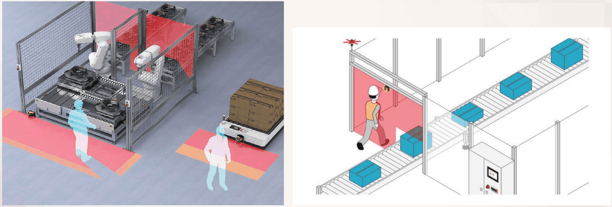

*그림 11. 로봇 작업 구역과 컨베이어 출입구의 위험 구역을 감시하는 2D LiDAR*

2D LiDAR는 이동 로봇 밖의 산업 현장에서도 다양한 용도로 쓰인다. 그림 11의 왼쪽은 로봇 팔이 일하는 구역의 바닥을 2D LiDAR로 감시하여 사람이 위험 구역(붉은 영역)에 들어오면 로봇을 멈추거나 늦추는 예이고, 오른쪽은 컨베이어 출입구에서 상자는 통과시키고 사람이 들어오는 것은 감지하는 예이다 [10].

### 2.4 레이더

레이더는 전파를 쏘아 반사파로 장애물을 탐지한다. 차량용 레이더는 주로 24 GHz와 76\~81 GHz 대역의 **밀리미터파(millimeter wave)** 를 쓴다 [11]. 77 GHz 전파의 파장은 $299{,}792{,}458 / (77 \times 10^{9}) \approx 3.9$ mm이다.

거리 측정의 원리는 2.1절의 비행 시간이지만, 차량용 레이더 대부분은 펄스의 도착 시간을 직접 재는 대신 **FMCW(Frequency Modulated Continuous Wave)** 방식을 쓴다. 주파수가 시간에 따라 일정하게 높아지는 신호(chirp)를 보내면, 반사파는 비행 시간만큼 늦게 돌아오므로 그 순간 보내고 있는 신호와 주파수가 다르다. 이 주파수 차이가 비행 시간에 비례하므로 주파수 차이로 거리를 구한다 [11].

레이더의 큰 장점은 **상대 속도를 직접 잰다**는 것이다. 가까워지거나 멀어지는 물체에 반사된 전파는 **도플러 효과(Doppler effect)** 로 주파수가 바뀌며, 그 변화량 $f_D$는 시선 방향 속도 $v$에 비례한다 [12].

$$f_D = \frac{2v}{\lambda}$$

예를 들어 77 GHz 레이더($\lambda \approx 0.00389$ m) 앞의 차가 20 m/s로 다가오면 $f_D = 2 \times 20 / 0.00389 \approx 10{,}300$ Hz, 곧 약 10.3 kHz의 주파수 변화가 생긴다. LiDAR와 카메라는 여러 시점의 위치 변화로 속도를 추정해야 하지만, 레이더는 한 번의 측정으로 속도를 얻는다.

레이더의 특징은 다음과 같다.

- 비교적 저렴하다.
- 전파는 플라스틱 범퍼를 통과하므로 범퍼 안쪽처럼 차량 내부에 장착할 수 있다.
- 물체가 무엇인지 정확히 판단하려면 주로 카메라와 함께 장착한다.
- 전자기파를 쏘고 다시 돌아오는 것을 이용해 장애물을 탐지한다.
- LiDAR보다 작동 거리가 길다.
- 작은 물체를 감지하기 어렵고, 물체의 정밀한 이미지를 제공하지 못한다.
- 구름이 많은 날씨와 야간에도 쉽게 작동한다.

레이더의 해상도가 낮은 이유는 파장에 있다. 안테나 빔의 각도 폭은 대략 파장을 안테나 크기 $D$로 나눈 $\lambda / D$ 라디안이다 [12]. 크기 10 cm의 안테나에 77 GHz 전파를 쓰면 $0.0039 / 0.1 = 0.039$ rad, 곧 약 2.2°이므로, 수십 m 앞에서는 빔이 m 단위로 넓어져 작은 물체를 구분하기 어렵다. 905 nm 레이저의 파장은 77 GHz 전파보다 약 4,300배 짧아 훨씬 가는 빔을 만들 수 있다.

### 2.5 LiDAR와 레이더의 비교

| 항목 | LiDAR | 레이더 |
|:-----|:-----|:-----|
| 쏘는 파동 | 빛(근적외선 레이저) | 전파(밀리미터파) |
| 가격 | 매우 비싸다 | 비교적 저렴하다 |
| 장착 위치 | 차량 외부 | 차량 내부(범퍼 안쪽 등) |
| 카메라와의 관계 | 물체 형상을 인식할 수 있어 혼자서도 충분하며, 카메라와 함께 쓰면 더 좋다 | 물체를 정확히 판단하려면 카메라가 함께 있어야 한다 |
| 작동 거리 | 레이더보다 짧다 | LiDAR보다 길다 |
| 작은 물체 | 짧은 파장으로 작은 물체도 감지한다 | 작은 물체를 감지하기 어렵다 |
| 결과물 | 정확한 3D 단색 이미지 | 물체의 정밀한 이미지를 제공하지 못한다 |
| 속도 측정 | 여러 측정의 위치 변화로 추정한다 | 도플러 효과로 직접 잰다 |
| 날씨와 야간 | 비, 안개, 눈에서 성능이 떨어진다 | 구름 많은 날씨와 야간에도 쉽게 작동한다 |

*표 4. LiDAR와 레이더의 비교*

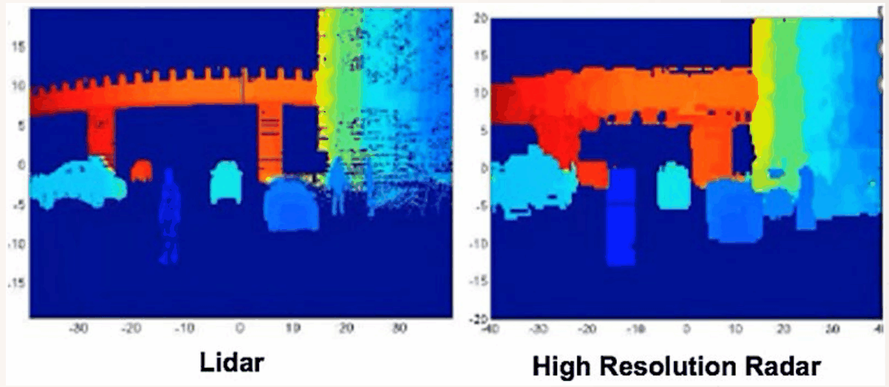

*그림 12. 같은 장면을 측정한 LiDAR와 고해상도 레이더의 결과*

그림 12는 같은 거리 장면을 두 센서로 측정하여 거리를 색으로 나타낸 것이다. 고해상도 레이더도 장면의 큰 구조를 구분하지만, LiDAR는 보행자와 차량의 윤곽을 더 촘촘한 점으로 그려 낸다. 정리하면 LiDAR는 레이저를 사용하므로 해상도에서 이점이 있지만 비싸고 날씨의 영향을 받으며, 레이더는 저렴하여 상용 차량에 적용하기 알맞지만 해상도가 좋지 않아 비전 센서(카메라)와 함께 써야 한다 [13].

### 2.6 자율주행차의 센서 구성과 센서 융합

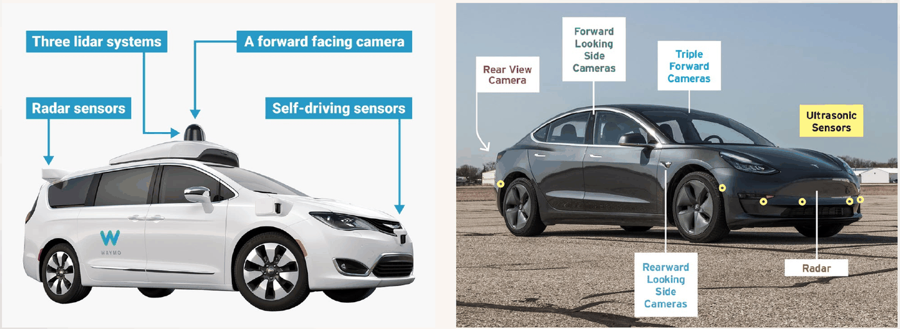

*그림 13. Waymo 자율주행차와 Tesla 차량의 센서 구성*

그림 13은 두 회사의 차량에 달린 센서를 보여 준다 [14], [15]. 왼쪽의 Waymo 차량은 LiDAR 시스템 세 개, 앞을 보는 카메라, 레이더 센서, 지붕의 자율주행 센서 묶음을 달아 LiDAR를 중심으로 여러 센서를 겹쳐 쓴다. 오른쪽의 Tesla 차량은 LiDAR 없이 후방 카메라, 앞쪽과 뒤쪽을 보는 측면 카메라, 전방 카메라 세 개, 레이더, **초음파 센서(ultrasonic sensor)** 를 쓴다. 초음파 센서는 음파의 비행 시간으로 수 m 이내의 가까운 물체를 감지하며 주차에 주로 쓰인다.

> **참고:** Tesla는 그 뒤 레이더와 초음파 센서를 빼고 카메라만으로 주변을 인식하는 방식(Tesla Vision)으로 바꾸었다 [16]. 같은 자율주행 문제를 놓고도 LiDAR 중심의 구성과 카메라 중심의 구성이라는 서로 다른 설계가 공존한다.

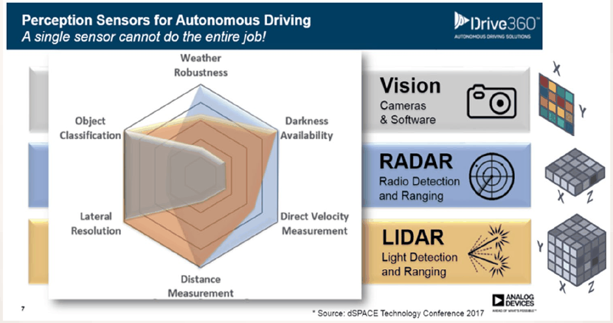

*그림 14. 카메라, 레이더, LiDAR의 인지 성능 비교*

그림 14는 자율주행에 쓰이는 세 인지 센서를 여섯 가지 기준으로 비교하여 "센서 하나로는 모든 일을 할 수 없다"는 점을 보여 준다 [17]. 세 센서의 일반적인 특성을 그림의 여섯 기준으로 정리하면 다음과 같다 [7].

| 기준 | 카메라 | 레이더 | LiDAR |
|:-----|:-----|:-----|:-----|
| 물체 분류 | 강하다(색, 질감, 글자) | 약하다 | 중간(형상) |
| 횡방향 해상도 | 강하다 | 약하다 | 강하다 |
| 거리 측정 | 약하다 | 강하다 | 강하다 |
| 속도 직접 측정 | 약하다 | 강하다(도플러) | 약하다 |
| 어둠에서의 가용성 | 약하다 | 강하다 | 강하다 |
| 날씨에 대한 강건성 | 약하다 | 강하다 | 중간 |

*표 5. 인지 센서별 강점과 약점*

세 센서의 강점이 서로 겹치지 않으므로, 자율주행차는 여러 센서의 측정을 합쳐 각 센서의 약점을 메우는 **센서 융합(sensor fusion)** 을 쓴다. 예를 들어 카메라로 앞의 물체가 보행자라는 것을 알아내고, LiDAR로 그 위치와 형상을, 레이더로 다가오는 속도를 잰 뒤 하나의 물체 정보로 묶는다.

> **핵심:** LiDAR와 레이더는 모두 비행 시간으로 거리를 재는 능동 센서이다. 파장이 짧은 LiDAR는 해상도가 높지만 비싸고 궂은 날씨에 약하며, 파장이 긴 레이더는 해상도가 낮지만 싸고 날씨에 강하며 속도를 직접 잰다. 어느 센서도 혼자서 모든 조건을 만족하지 못하므로 센서 융합이 필요하다.

---

<br>

## 3. CAN 버스

### 3.1 CAN이 필요한 이유

오늘날의 자동차에는 엔진, 변속기, 브레이크, 조향, 에어백, 문, 좌석을 각각 맡는 수십 개의 **ECU(Electronic Control Unit, 전자 제어 장치)** 가 있다. 그림 15처럼 연료 직접 분사, 전자식 스로틀 밸브 제어, 능동형 서스펜션, 전동식 파워 스티어링이 전자 제어로 바뀌었고, 브레이크와 조향의 기계적 연결을 전기 신호로 대신하는 **브레이크 바이 와이어(brake-by-wire)** 와 **스티어 바이 와이어(steer-by-wire)** 도 등장했다. 자율주행차가 차량을 움직이려면 결국 이 제어기들에 명령을 보내야 한다.

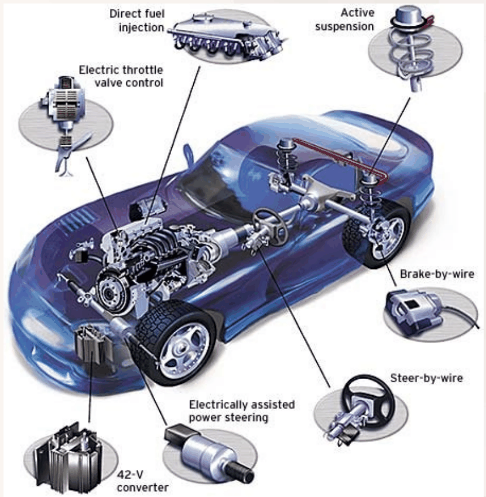

*그림 15. 전자 제어 장치로 바뀐 차량의 여러 기능*

제어기가 늘어나면 제어기끼리 정보를 효율적으로 나누기 위한 통신 표준이 필요하다. 엔진 제어기가 아는 엔진 회전수를 변속기 제어기와 계기판이 함께 써야 하고, 바퀴 속도는 ABS와 서스펜션과 계기판이 함께 써야 하기 때문이다.

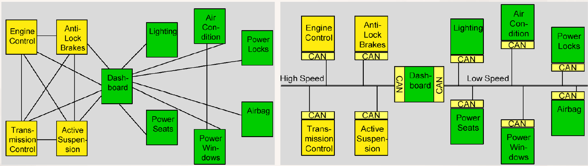

*그림 16. 제어기를 각각 선으로 잇는 배선과 CAN 버스로 잇는 배선*

그림 16의 왼쪽처럼 정보가 필요한 제어기끼리 각각 선을 이으면 배선이 제어기 수에 따라 빠르게 늘어난다. 극단적으로 $n$개의 제어기를 모두 서로 직접 이으면 $n(n-1)/2$개의 연결이 필요하며, 그림의 11개 모듈이라면 $11 \times 10 / 2 = 55$개이다. 오른쪽처럼 모든 제어기가 한 쌍의 선, 곧 **버스(bus)** 를 함께 쓰면 제어기마다 버스에 한 번만 연결하면 된다. 그림에서는 엔진, ABS, 변속기, 서스펜션처럼 빠른 응답이 필요한 제어기는 고속 버스에, 조명, 에어컨, 문 잠금, 좌석, 창문, 에어백 모듈은 저속 버스에 연결하고, 계기판이 두 버스 사이에서 정보를 중계한다.

**CAN(Controller Area Network)** 은 이런 차량용 제어기 사이의 통신을 위해 Bosch가 1980년대 중반부터 개발하여 표준화한 직렬 버스 통신 방식이다. Bosch는 1991년 CAN 2.0 사양을 발표했고 [18], CAN은 유럽의 표준을 거쳐 1993년 ISO 11898로 국제 표준이 되었다 [19]. 제어기 사이의 네트워크를 구현할 수 있게 되면서 여러 제어기의 정보를 엮는 다양한 응용 기능을 개발할 기반이 마련되었다.

> **참고:** CAN의 공식 이름은 Controller Area Network이다. Control Area Network라고 쓰는 경우도 있지만 같은 대상을 가리킨다.

CAN이 쓰이는 이유는 다음 네 가지로 정리된다.

| 이유 | 설명 |
|:-----|:-----|
| 잡음이 많은 환경에서 강하다 | 꼬임쌍선과 차동 신호를 써서 엔진과 모터가 만드는 전기적 잡음에 강하다(3.3절). |
| 신호의 우선순위를 정할 수 있다 | 메시지의 식별자가 우선순위를 겸하여, 여러 제어기가 동시에 보내도 급한 메시지가 먼저 전송된다(3.6절). |
| 모든 장치가 버스의 모든 비트를 받는다 | 한 제어기가 보낸 메시지를 버스의 모든 제어기가 받으므로, 같은 정보를 여러 제어기에 따로 보낼 필요가 없다(3.2절). |
| 비용이 적게 든다 | 두 가닥의 선으로 모든 제어기를 이어 배선의 길이, 무게, 비용이 줄어든다. |

*표 6. CAN이 차량 통신에 쓰이는 이유*

### 3.2 CAN의 특징

| 특징 | 설명 |
|:-----|:-----|
| 다중 마스터(multi-master) 방식 | 중앙의 주 장치 없이 어느 제어기든 버스가 비어 있으면 전송을 시작할 수 있고, 보낸 메시지는 모든 제어기에 방송(broadcast)된다. |
| 2선 접속 방식 | CAN_H와 CAN_L 두 가닥의 선으로 통신 선로를 간편하게 구성한다. |
| 고속 통신 | 최대 1 Mbit/s로 실시간 정보 교환이 가능하다. |
| 신뢰성과 안전성 | 여러 단계의 오류 검출과 처리 기능을 갖는다(3.8절). |
| 비동기식 직렬 통신 | 별도의 클럭 선 없이 한 가닥의 신호(차동 쌍)로 비트를 하나씩 보낸다. |

*표 7. CAN의 특징*

CAN 메시지에는 받는 제어기의 주소가 없다. 대신 메시지 앞부분의 **식별자(identifier, ID)** 가 엔진 회전수나 바퀴 속도처럼 **메시지의 내용**을 나타내고, 각 제어기는 자신에게 필요한 ID의 메시지만 골라 받는다. 이를 **수신 필터링(acceptance filtering)** 이라 한다 [18]. 그래서 새 제어기를 버스에 추가해도 기존 제어기의 설정을 바꿀 필요가 없다.

**비동기식**이라는 말은 송신기와 수신기가 클럭 신호를 공유하지 않는다는 뜻이다. 각 제어기는 미리 약속한 비트 속도로 동작하고, 프레임의 첫 비트에서 시점을 맞춘 뒤 비트 값이 바뀌는 순간마다 자신의 시점을 다시 맞춘다. 같은 값이 오래 이어지면 시점을 맞출 기회가 없으므로, CAN은 같은 비트가 5개 이어지면 반대 값의 비트 하나를 끼워 넣는 **비트 스터핑(bit stuffing)** 을 쓴다 [18].

| 구분 | 비트 속도 | 용도 |
|:-----|:-----|:-----|
| 저속 CAN(Low Speed CAN) | 125 kbit/s 이하 | 차체 제어(문, 창문, 좌석, 조명)와 일반 데이터 통신 |
| 고속 CAN(High Speed CAN) | 125 kbit/s 초과, 최대 1 Mbit/s | 실시간 제어(파워트레인, 섀시) |

*표 8. 저속 CAN과 고속 CAN*

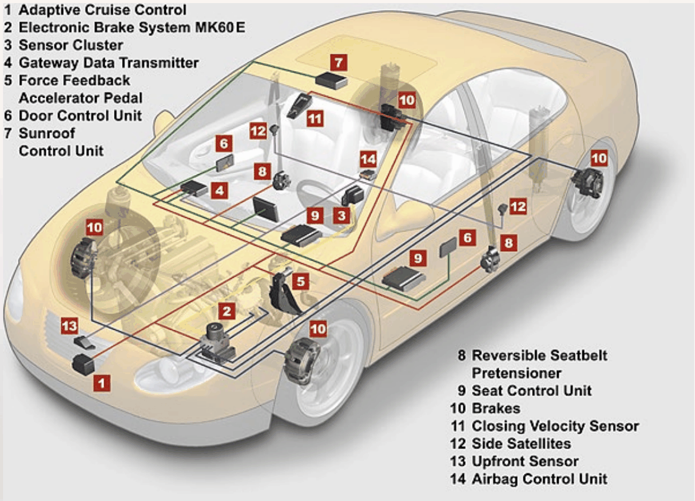

*그림 17. 차량 곳곳에 배치된 여러 제어기*

그림 17은 차량 한 대에 들어가는 제어기와 센서의 예이다. 적응형 순항 제어, 전자식 브레이크 시스템, 센서 클러스터, 게이트웨이, 반력 피드백 가속 페달, 문 제어기, 선루프 제어기, 가역식 안전띠 프리텐셔너, 좌석 제어기, 브레이크, 접근 속도 센서, 측면 충돌 센서, 전방 충돌 센서, 에어백 제어기가 차체 곳곳에 흩어져 있고, 이들이 버스로 연결되어 정보를 주고받는다.

### 3.3 물리 계층: 꼬임쌍선과 차동 신호

CAN은 광섬유나 **꼬임쌍선(twisted pair wire)** 같은 여러 종류의 매체로 통신할 수 있으며, 차량에서는 주로 꼬임쌍선을 쓴다. 꼬인 두 선을 각각 **CAN_H(CAN High)** 와 **CAN_L(CAN Low)** 로 사용한다.

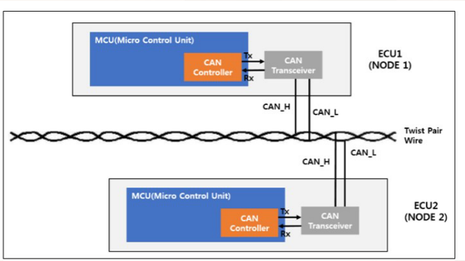

*그림 18. 두 ECU를 꼬임쌍선으로 연결한 CAN*

그림 18의 각 ECU는 세 부분으로 이루어진다.

- **MCU(Micro Control Unit):** 제어 프로그램을 실행하고 보낼 데이터를 정하는 마이크로컨트롤러이다.
- **CAN 컨트롤러(CAN controller):** 프레임 구성, 중재, CRC 계산, 응답 확인처럼 CAN 프로토콜의 규칙을 처리하고, 송신 비트(Tx)와 수신 비트(Rx)를 논리 신호로 주고받는다.
- **CAN 트랜시버(CAN transceiver):** 컨트롤러의 논리 신호를 CAN_H와 CAN_L의 전압으로 바꾸어 버스에 싣고, 버스의 전압을 다시 논리 신호로 바꾼다.

CAN은 한 선의 전압이 아니라 두 선의 **전압 차이**로 비트를 나타내는 **차동 신호(differential signaling)** 를 쓴다 [20].

| 버스 상태 | 논리값 | CAN_H | CAN_L | 차동 전압(CAN_H - CAN_L) |
|:-----|:-----|:-----|:-----|:-----|
| 열성(recessive) | 1 | 약 2.5 V | 약 2.5 V | 약 0 V |
| 우성(dominant) | 0 | 약 3.5 V | 약 1.5 V | 약 2 V |

*표 9. 고속 CAN의 버스 상태별 전압*

외부의 잡음은 나란히 꼬여 있는 두 선에 거의 똑같이 들어온다. 예를 들어 우성 상태에서 잡음이 두 선에 +1 V씩 더해지면 CAN_H는 4.5 V, CAN_L은 2.5 V가 되지만 차이는 여전히 $4.5 - 2.5 = 2$ V이다. 수신기는 차이만 보므로 두 선에 공통으로 들어온 잡음은 저절로 상쇄된다.

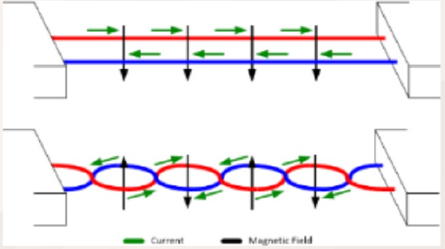

*그림 19. 평행한 두 선과 꼬인 두 선의 전류와 자기장*

선을 꼬는 이유도 같은 원리이다. 그림 19의 위처럼 두 선이 평행하면 두 선이 만드는 고리를 지나는 외부 자기장이 한 방향의 전압을 유도하지만, 아래처럼 선을 꼬면 꼬임마다 고리의 방향이 바뀌어 이웃한 꼬임에 유도된 전압이 서로 상쇄된다. 또 두 선에 반대 방향으로 흐르는 전류가 만드는 자기장도 꼬임마다 상쇄되어, 꼬임쌍선은 잡음을 덜 받을 뿐 아니라 덜 내보낸다.

> **핵심:** 우성(0)과 열성(1)이 버스에서 만나면 우성이 이긴다. 한 제어기라도 우성을 내보내면 두 선 사이에 전압 차이가 생기고, 모두 열성일 때에만 차이가 0이 되기 때문이다. 이 성질을 **와이어드 AND(wired-AND)** 라 하며, 3.6절의 중재가 이 성질 위에서 동작한다.

### 3.4 버스 구조와 종단 저항

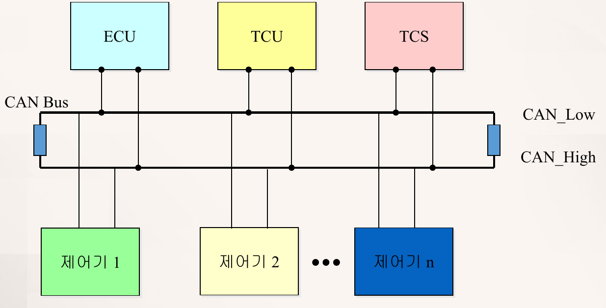

*그림 20. 양 끝에 종단 저항을 단 CAN 버스에 여러 제어기를 연결한 구조*

그림 20처럼 CAN 버스는 한 줄로 이어진 CAN_H와 CAN_L에 ECU(엔진 제어기), TCU(Transmission Control Unit, 변속기 제어기), TCS(Traction Control System, 구동력 제어 장치)와 같은 제어기 $1, 2, \dots, n$이 짧은 가지선으로 연결되는 **선형(line) 구조**이다. 버스의 양 끝에는 CAN_H와 CAN_L 사이에 **120 Ω 종단 저항**을 하나씩 단다.

종단 저항이 하는 일은 두 가지이다 [20].

1. **반사 방지:** 신호는 선의 끝에서 반사되어 되돌아오는데, 반사파가 다음 비트와 겹치면 비트가 일그러진다. 선의 특성 임피던스(약 120 Ω)와 같은 저항으로 끝을 막으면 신호 에너지가 저항에서 흡수되어 반사가 생기지 않는다. 잡음 제거 효과는 이렇게 신호의 일그러짐을 막는 데서 나온다.
2. **열성 상태로의 복귀:** 우성을 만들던 트랜시버가 출력을 멈추면 종단 저항이 두 선의 전압을 같게 끌어당겨 버스를 빠르게 열성 상태로 되돌린다.

두 종단 저항은 CAN_H와 CAN_L 사이에서 병렬이므로 합성 저항은 $\dfrac{120 \times 120}{120 + 120} = 60$ Ω이다. 그래서 전원을 끈 차량에서 CAN_H와 CAN_L 사이의 저항을 재어 약 60 Ω이 나오면 두 종단 저항이 모두 제대로 달려 있다고 판단할 수 있고, 약 120 Ω이 나오면 한쪽이 빠졌다고 판단할 수 있다.

### 3.5 데이터 프레임의 구조

CAN에서 데이터를 담아 보내는 단위를 **데이터 프레임(data frame)** 이라 한다. 표준 형식(11비트 ID)의 데이터 프레임은 다음과 같이 구성되며, 각 칸 아래의 숫자는 비트 수이다.

```text
          |<---------------------------------- Data Frame ---------------------------------->|
Interframe| SOF | Identifier | RTR | Control | Data      | CRC      | CRC | ACK  | ACK | EOF | Interframe
  space   |     |            |     |  IDE,r0 | Field     | Sequence | Del | Slot | Del |     |   space
          |     |            |     |  DLC    |           |          |     |      |     |     |
   >= 3   |  1  |  11 (29)   |  1  |    6    | 0-8 bytes |    15    |  1  |  1   |  1  |  7  |   >= 3
          |     |<- Arbitration -->|
```

*그림 21. 표준 CAN 데이터 프레임의 필드와 비트 수*

| 필드 | 비트 수 | 역할 |
|:-----|:-----|:-----|
| SOF(Start of Frame) | 1 | 우성 비트 하나로 프레임의 시작을 알린다. 모든 수신기가 이 비트의 시작에 시점을 맞춘다. |
| 식별자(Identifier) | 11 (확장 형식 29) | 메시지의 내용과 우선순위를 나타낸다. |
| RTR(Remote Transmission Request) | 1 | 데이터 프레임이면 우성, 다른 제어기에 데이터를 요청하는 원격 프레임이면 열성이다. |
| 제어 필드(Control Field) | 6 | 형식을 구분하는 IDE 1비트, 예약 비트 r0 1비트, 데이터 길이를 바이트 수로 나타내는 DLC(Data Length Code) 4비트이다. |
| 데이터 필드(Data Field) | 0\~64 (0\~8바이트) | 실제로 전달할 데이터이다. |
| CRC 시퀀스(CRC Sequence) | 15 | SOF부터 데이터 필드까지로 계산한 순환 중복 검사(Cyclic Redundancy Code) 값이다. |
| CRC 구분자(CRC Delimiter) | 1 | 열성 비트로 CRC 필드의 끝을 표시한다. |
| ACK 슬롯(ACK Slot) | 1 | 송신기는 열성을 내보내고, 프레임을 올바르게 받은 수신기는 이 자리에 우성을 써서 응답(Acknowledge)한다. |
| ACK 구분자(ACK Delimiter) | 1 | 열성 비트로 ACK 필드의 끝을 표시한다. |
| EOF(End of Frame) | 7 | 열성 비트 7개로 프레임의 끝을 표시한다. |
| 프레임 간 공간(Interframe space) | 3 이상 | 다음 프레임과의 사이를 띄우는 열성 비트이다. |

*표 10. 표준 CAN 데이터 프레임의 필드*

식별자와 RTR 비트를 합쳐 **중재 필드(arbitration field)** 라 부른다. ACK 슬롯 덕분에 송신기는 적어도 하나의 제어기가 프레임을 올바르게 받았음을 프레임이 끝나기 전에 알 수 있다.

> **[컴퓨터네트워크]** CAN의 CRC는 생성 다항식 $x^{15} + x^{14} + x^{10} + x^{8} + x^{7} + x^{4} + x^{3} + 1$로 계산한 15비트 값이다 [18]. 차수가 15인 CRC는 길이 15비트 이하의 연속 오류(버스트 오류)를 모두 검출한다. 수신기는 받은 비트로 CRC를 다시 계산하여 받은 CRC 시퀀스와 비교한다.

데이터 8바이트를 담은 프레임의 길이를 계산하면 다음과 같다.

$$1 + 11 + 1 + 6 + 64 + 15 + 1 + 1 + 1 + 7 = 108 \text{ 비트}, \qquad 108 + 3 = 111 \text{ 비트(프레임 간 공간 포함)}$$

비트 속도가 500 kbit/s이면 비트 하나에 $1 / (500 \times 10^{3}) = 2$ µs가 걸리므로 프레임 하나에 $111 \times 2 = 222$ µs가 걸리고, 버스는 1초에 최대 $1 / (222 \times 10^{-6}) \approx 4{,}500$개의 프레임을 나른다. 전체 111비트 가운데 데이터는 64비트이므로 효율은 $64 / 111 \approx 57.7\%$이다. 실제로는 비트 스터핑으로 비트가 더 들어가며, 표준 형식에서 8바이트 프레임에 들어갈 수 있는 스터핑 비트는 최대 24개이다 [21].

### 3.6 중재와 우선순위

여러 제어기가 동시에 전송을 시작하면 어느 것을 먼저 보낼지 정해야 한다. CAN은 **비트 단위 중재(bitwise arbitration)** 로 이를 해결한다 [18].

1. 버스가 비어 있으면 보낼 메시지가 있는 제어기들이 동시에 SOF를 보내고 식별자를 최상위 비트부터 내보낸다.
2. 각 제어기는 비트를 내보내면서 버스의 실제 값을 함께 읽는다.
3. 열성(1)을 보냈는데 버스가 우성(0)으로 읽히면, 더 작은 ID를 보내는 제어기가 있다는 뜻이므로 즉시 송신을 멈추고 수신기로 바뀐다.
4. 끝까지 남은 제어기 하나가 프레임을 계속 보낸다. 진 제어기는 버스가 다시 비면 재전송을 시도한다.

와이어드 AND 덕분에 이긴 제어기의 비트는 버스에 그대로 남으므로, 충돌이 일어나도 이긴 메시지는 전혀 손상되지 않는다. 이를 **비파괴적 중재(non-destructive arbitration)** 라 한다. 결과적으로 **ID가 작을수록 우선순위가 높다**.

예를 들어 세 제어기가 ID `0x102`, `0x103`, `0x120`의 메시지를 동시에 보내기 시작한 경우를 생각한다. 11비트 이진수로 쓰면 `0x102 = 001 0000 0010`, `0x103 = 001 0000 0011`, `0x120 = 001 0010 0000`이다.

| 식별자 비트 | 10 | 9 | 8 | 7 | 6 | 5 | 4 | 3 | 2 | 1 | 0 |
|:-----|:-----|:-----|:-----|:-----|:-----|:-----|:-----|:-----|:-----|:-----|:-----|
| 제어기 A (`0x102`) | 0 | 0 | 1 | 0 | 0 | 0 | 0 | 0 | 0 | 1 | 0 |
| 제어기 B (`0x103`) | 0 | 0 | 1 | 0 | 0 | 0 | 0 | 0 | 0 | 1 | 1, 패배 |
| 제어기 C (`0x120`) | 0 | 0 | 1 | 0 | 0 | 1, 패배 | | | | | |
| 버스 | 0 | 0 | 1 | 0 | 0 | 0 | 0 | 0 | 0 | 1 | 0 |

*표 11. 세 식별자의 비트 단위 중재 과정*

비트 10\~6에서는 세 제어기가 같은 값을 보내므로 아무도 지지 않는다. 비트 5에서 C는 열성 1을 보냈는데 A와 B의 우성 0 때문에 버스가 0으로 읽히므로 C가 물러난다. 비트 4\~1은 A와 B가 같고, 비트 0에서 B가 열성 1을 보내고 버스에서 0을 읽어 물러난다. 남은 A(`0x102`)가 프레임을 끝까지 보내고, B와 C는 다음 기회에 다시 경쟁한다. 14주차의 CAN 노드는 속도 명령에 `0x102`, 조향 명령에 `0x103`을 쓰므로 두 프레임이 동시에 경쟁하면 속도 명령이 먼저 나간다.

> **주의:** 중재는 식별자 비트로 결정되므로 같은 ID를 두 제어기가 동시에 데이터 프레임으로 보내면 중재로 구분되지 않고 데이터 필드에서 충돌한다. 그래서 하나의 ID는 하나의 제어기만 보내도록 네트워크를 설계한다. 또 급한 메시지(브레이크, 조향)에 작은 ID를 주어야 버스가 붐빌 때에도 제때 전달된다.

### 3.7 표준 CAN과 확장 CAN, ISO 규격

메시지 ID의 길이에 따라 두 가지 형식이 있다 [18].

| 형식 | 사양 | ID 길이 | 구분할 수 있는 ID 수 |
|:-----|:-----|:-----|:-----|
| 표준 CAN | CAN 2.0A | 11비트 | $2^{11} = 2048$ |
| 확장 CAN | CAN 2.0B | 29비트 | $2^{29} = 536{,}870{,}912$ |

*표 12. 표준 CAN과 확장 CAN*

확장 형식의 식별자는 앞의 11비트(기본 ID) 뒤에 열성 비트 SRR(Substitute Remote Request)과 IDE를 두고 나머지 18비트를 잇는다. 기본 ID가 같으면 표준 프레임은 그 뒤의 RTR(데이터 프레임이면 우성)이나 IDE(표준 형식이면 우성) 자리에서 우성을 보내고 확장 프레임은 같은 자리에서 열성인 SRR과 IDE를 보내므로, 표준 프레임이 이긴다.

- **CAN 2.0A 컨트롤러**는 표준 CAN 형식의 메시지만 송수신한다. 확장 CAN 형식의 메시지는 수신할 수 없고, 메시지를 수신하더라도 그 데이터는 무시한다.
- **CAN 2.0B 컨트롤러**는 두 형식을 모두 송수신할 수 있다.

> **참고:** Bosch의 CAN 2.0A 사양은 상위 7비트가 모두 열성인 ID를 쓰지 않도록 하므로, 표준 형식에서 실제로 쓸 수 있는 ID는 $2048 - 16 = 2032$개이다 [18]. 또 2.0A만 지원하는 오래된 컨트롤러 가운데에는 확장 프레임을 오류로 처리하는 것이 있어, 확장 프레임이 흐르는 버스에서는 확장 프레임을 오류 없이 무시하는 컨트롤러(2.0B passive)나 2.0B 컨트롤러를 써야 한다.

ISO 규격에 따라서는 다음과 같이 나뉜다.

| 규격 | 내용 | 최대 비트 속도 |
|:-----|:-----|:-----|
| ISO 11898 | 고속 CAN | 1 Mbit/s |
| ISO 11519 | 저속 CAN | 125 kbit/s |

*표 13. CAN의 ISO 규격*

지금의 ISO 11898은 여러 부분으로 나뉘어, Part 1이 데이터 링크 계층과 물리적 신호를, Part 2가 고속 CAN의 물리 계층을, Part 3이 선 하나가 끊어져도 통신을 이어 가는 저속 내결함성 CAN의 물리 계층을 다룬다 [22], [23], [24]. 저속 CAN을 정의하던 ISO 11519-2의 내용은 ISO 11898-3으로 이어졌다 [25].

> **참고:** ISO 11898의 고속 CAN은 "1 Mbit/s 이상"이 아니라 **최대 1 Mbit/s**까지 통신한다. 1 Mbit/s를 넘는 속도는 3.9절의 CAN FD에서 데이터 구간의 비트 속도를 높여 얻는다.

### 3.8 오류 검출과 처리

CAN의 높은 신뢰성은 다섯 가지 오류 검출 방법과 오류를 낸 제어기를 스스로 격리하는 규칙에서 나온다 [18].

| 오류 검출 | 방법 |
|:-----|:-----|
| 비트 오류(bit error) | 송신기는 자신이 보낸 비트를 버스에서 다시 읽어, 중재 필드와 ACK 슬롯 밖에서 값이 다르면 오류로 본다. |
| 스터핑 오류(stuff error) | 스터핑 구간에서 같은 비트가 6개 연속으로 보이면 오류로 본다. |
| CRC 오류(CRC error) | 수신기가 계산한 CRC와 받은 CRC 시퀀스가 다르면 오류로 본다. |
| 형식 오류(form error) | CRC 구분자, ACK 구분자, EOF처럼 값이 정해진 비트가 다르면 오류로 본다. |
| ACK 오류(ACK error) | 송신기가 ACK 슬롯에서 우성을 읽지 못하면 아무도 제대로 받지 못한 것으로 본다. |

*표 14. CAN의 다섯 가지 오류 검출 방법*

오류를 발견한 제어기는 우성 비트 6개로 된 오류 플래그(error flag)로 시작하는 **오류 프레임(error frame)** 을 즉시 보낸다. 같은 비트 6개는 스터핑 규칙을 일부러 어기는 비트열이므로 버스의 모든 제어기가 오류가 났음을 알게 되고, 송신기는 프레임을 자동으로 다시 보낸다. 또 각 제어기는 송신 오류와 수신 오류의 횟수를 세어, 어느 한쪽이 127을 넘으면 **오류 수동(error passive)** 상태로 물러나 오류 플래그를 열성 비트로만 보내 다른 제어기를 방해하지 않게 하고, 송신 오류 횟수가 255를 넘으면 **버스 오프(bus off)** 상태가 되어 버스에서 스스로 떨어져 나간다. 고장 난 제어기 하나가 버스 전체를 마비시키지 못하게 하는 장치이다.

### 3.9 CAN의 한계와 차량 네트워크의 변화

CAN의 데이터 전송 속도는 1 Mbit/s로 제한되므로, ECU의 수가 많아지고 주고받는 데이터가 늘어날수록 효율이 떨어진다. 한계는 다음과 같다.

- **속도와 길이:** 중재가 동작하려면 한 비트가 버스의 가장 먼 제어기까지 갔다가 돌아오는 시간이, 비트가 시작된 뒤 각 제어기가 비트 값을 읽는 시점(샘플 시점)까지의 시간보다 짧아야 한다. 그래서 비트 속도를 높이면 버스 길이가 짧아져야 하며, 1 Mbit/s에서 버스 길이는 약 40 m로 제한된다 [20].
- **작은 데이터:** 한 프레임에 최대 8바이트만 담을 수 있고, 3.5절의 계산처럼 프레임의 절반 가까이가 제어용 비트이다.
- **대용량 데이터:** 카메라 영상이나 LiDAR 포인트 클라우드처럼 초당 수십 MB에 이르는 데이터는 CAN으로 나를 수 없다.

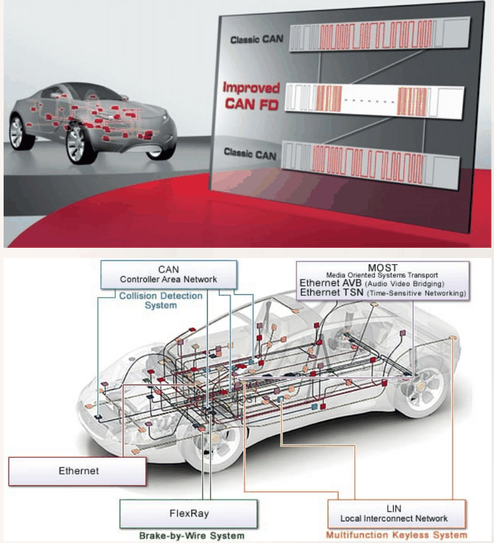

*그림 22. 기존 CAN과 CAN FD의 비교와 차량에 쓰이는 여러 네트워크*

**CAN FD(CAN with Flexible Data-rate)** 는 이 한계를 줄이기 위해 2012년 Bosch가 발표한 확장으로, 중재 구간은 기존 속도로 보내 중재 방식을 유지하고 데이터 구간에서만 비트 속도를 높이며, 한 프레임에 최대 64바이트를 담는다 [26]. 데이터 구간의 속도는 최대 8\~10 Mbit/s 정도이다. 그림 22의 위쪽은 같은 데이터를 보낼 때 CAN FD 프레임이 기존 CAN 프레임보다 짧게 끝나는 모습을 나타낸다.

그림 22의 아래쪽처럼 차량에는 CAN 외에도 용도가 다른 여러 네트워크가 함께 쓰인다 [27].

| 네트워크 | 특징 | 주요 용도 |
|:-----|:-----|:-----|
| LIN(Local Interconnect Network) | 선 하나를 쓰는 저가의 저속 버스(최대 약 20 kbit/s), 주 장치 하나가 통신을 관리 | 스마트 키, 스위치, 창문 같은 편의 장치 |
| CAN | 최대 1 Mbit/s, 다중 마스터, 우선순위 중재 | 파워트레인, 섀시, 차체 제어 전반, 충돌 감지 시스템 |
| CAN FD | 데이터 구간 수 Mbit/s, 최대 64바이트 | CAN보다 많은 데이터가 필요한 제어기 |
| FlexRay | 10 Mbit/s, 정해진 시간 칸에 전송하는 시간 결정적 통신 | 브레이크 바이 와이어처럼 지연이 일정해야 하는 제어 |
| MOST(Media Oriented Systems Transport) | 멀티미디어 데이터 전송 | 오디오, 비디오, 인포테인먼트 |
| 차량용 이더넷(Ethernet) | 100 Mbit/s 이상, 스위치 기반, AVB와 TSN으로 시간 보장 | 카메라, LiDAR, 제어기 사이의 백본 |

*표 15. 차량에 쓰이는 네트워크의 비교*

최근에는 이더넷을 CAN과 함께 쓰는 방향으로 통신 방식이 바뀌고 있다. 차량용 이더넷은 꼬임쌍선 한 쌍으로 100 Mbit/s를 보내는 100BASE-T1 같은 규격으로 정의된다 [28]. 이더넷의 장점과 단점은 다음과 같다.

- 카메라, LiDAR 같은 대용량 데이터를 처리하기 쉽다.
- 외부에서 쉽게 접속하여 차량 상태를 확인할 수 있으므로, 소프트웨어 서비스 중심으로 바뀌어 가는 미래 자동차에 알맞다.
- 물리 계층 인터페이스가 상대적으로 비싸고, 스위치를 설치하는 비용이 드는 것이 단점이다.

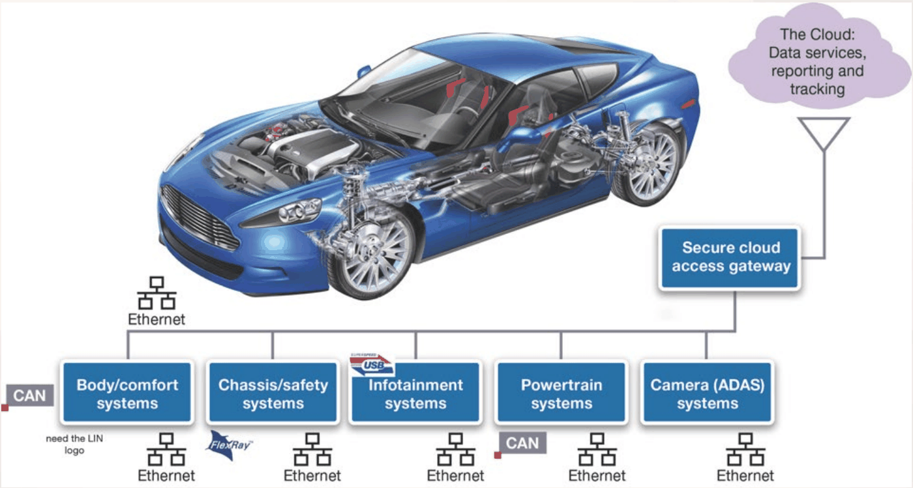

*그림 23. 이더넷 백본으로 기능 영역을 묶고 클라우드와 연결하는 차량 네트워크*

그림 23은 이런 구조의 예이다. 차체와 편의, 섀시와 안전, 인포테인먼트, 파워트레인, 카메라(ADAS) 시스템이 각각 하나의 기능 영역(domain)을 이루고, 영역끼리는 이더넷 백본으로 연결된다. 각 영역 안에서는 여전히 CAN, LIN, FlexRay가 제어기들을 잇는다. 보안이 적용된 클라우드 접속 게이트웨이는 차량을 외부의 클라우드에 연결하여 데이터 서비스, 상태 보고, 위치 추적을 제공한다. 이더넷이 늘어나도 실시간 제어 신호를 나르는 CAN의 역할은 계속 남는다.

> **핵심:** CAN은 꼬임쌍선과 차동 신호로 잡음에 강하고, 식별자로 우선순위를 정하는 비파괴적 중재와 여러 겹의 오류 검출로 신뢰성이 높은 차량용 버스이다. 속도(1 Mbit/s)와 데이터 크기(8바이트)의 한계는 CAN FD와 차량용 이더넷이 보완한다.

### 3.10 PC와 CAN 버스의 연결

자율주행 소프트웨어는 보통 차량에 실은 PC에서 동작하므로, PC가 만든 명령을 차량의 CAN 버스에 실으려면 USB 같은 PC의 포트를 CAN 버스에 연결하는 **CAN 인터페이스 장치**가 필요하다. Kvaser 같은 제조사가 USB-CAN 인터페이스와 이를 다루는 소프트웨어 라이브러리를 제공한다 [29]. PC의 ROS 노드는 이 라이브러리로 CAN 프레임을 만들어 보내고, 버스의 제어기들은 그 프레임을 받아 구동기를 움직인다. 이 노드를 만드는 과정은 14주차에서 다룬다.

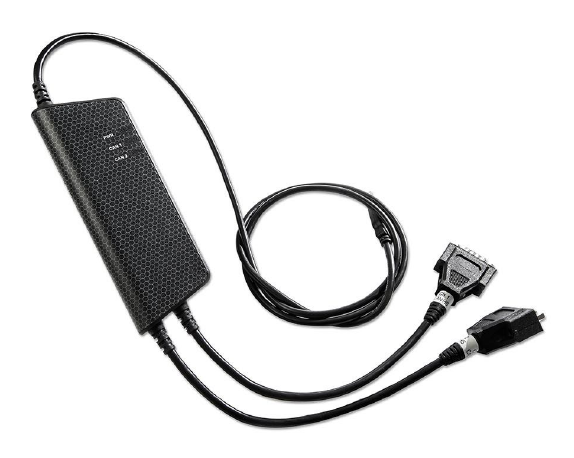

*그림 24. PC의 USB 포트를 CAN 버스에 연결하는 두 채널 USB-CAN 인터페이스*

---

<br>

## 개념 적용

| 상황 | 결과와 이유 |
|:-----|:------------|
| 높은 빌딩 사이의 도로에서 GNSS 위치가 수십 m씩 튄다. | **다중 경로와 신호 차단의 영향이다.** 반사파가 거리를 길게 만들고 볼 수 있는 위성이 줄어들며, 이 오차는 수신기마다 따로 생기므로 DGPS 보정으로도 없앨 수 없다. |
| 기준국에서 5 km 떨어진 곳과 300 km 떨어진 곳에서 같은 보정 정보로 DGPS를 쓴다. | **5 km 지점의 보정 효과가 더 크다.** 거리가 멀어질수록 두 수신기의 신호가 지나는 대기가 달라져 공통 오차의 비율이 줄어든다. |
| 자율주행차의 차선 단위 위치 인식에 DGPS를 쓰려 한다. | **정확도가 부족하다.** 차선 폭은 약 3.5 m인데 DGPS의 정확도는 1\~5 m이므로, cm 단위의 RTK나 LiDAR와 지도를 이용한 위치 인식이 필요하다. |
| 안개가 짙은 고속도로에서 앞차와의 거리와 상대 속도를 재야 한다. | **레이더가 알맞다.** 밀리미터파는 안개를 잘 통과하고, 도플러 효과로 상대 속도를 한 번에 잰다. |
| 실내 물류 창고의 AGV가 사람과 부딪히지 않게 해야 한다. | **2D 안전 레이저 스캐너를 모서리에 배치한다.** 시야를 겹쳐 사각을 없애고, 경고 영역에서는 감속, 보호 영역에서는 정지하도록 구동을 제어한다. |
| 엔진 제어기와 라디오가 동시에 ID `0x0A0`과 `0x3F0`의 프레임을 보내기 시작한다. | **`0x0A0`이 먼저 전송된다.** ID가 작을수록 앞쪽 비트에 우성 0이 먼저 나타나 중재에서 이긴다. |
| 전원을 끈 차량에서 CAN_H와 CAN_L 사이의 저항이 120 Ω으로 측정된다. | **종단 저항 하나가 빠졌다.** 두 120 Ω 저항이 병렬이면 60 Ω이어야 하며, 종단이 한쪽뿐이면 반사로 통신이 불안정해진다. |
| 카메라 4대의 영상을 중앙 컴퓨터로 보내야 한다. | **CAN이 아니라 이더넷을 쓴다.** CAN은 최대 1 Mbit/s에 프레임당 8바이트이므로 영상 데이터를 나를 수 없다. |

*표 16. 자율주행 센서와 CAN에 관한 상황별 결과와 그 이유*

**T/F 점검:**

| 문장 | 판단과 근거 |
|:-----|:------------|
| 수신기의 위치(x, y, z)만 모르므로 위성 3개만 보이면 위치를 구할 수 있다. | **F.** 수신기 시계 오차도 모르는 값이므로 위성이 최소 4개 필요하다. |
| DGPS 보정 정보로 다중 경로 오차를 없앨 수 있다. | **F.** 다중 경로는 수신기 주변 환경에 따라 수신기마다 따로 생기므로 기준국과 공통이 아니다. |
| RTK가 cm 단위의 정확도를 내는 것은 반송파의 파장(약 19 cm)이 C/A 코드의 칩 길이(약 293 m)보다 훨씬 짧기 때문이다. | **T.** 같은 비율의 정밀도로 위상을 읽으면 파장이 짧을수록 거리 정밀도가 높으며, 정수 모호성을 풀어야 그 정밀도를 거리로 쓸 수 있다. |
| LiDAR는 빛을 이용하므로 야간에는 쓸 수 없다. | **F.** LiDAR는 스스로 레이저를 쏘는 능동 센서이므로 어둠과 무관하게 동작한다. 성능을 떨어뜨리는 것은 안개, 비, 눈이다. |
| 레이더는 한 번의 측정으로 물체의 상대 속도를 알 수 있다. | **T.** 반사파의 도플러 주파수 변화가 시선 방향 속도에 비례한다. |
| CAN에서 두 제어기가 동시에 보내면 두 메시지가 모두 깨져 둘 다 다시 보내야 한다. | **F.** 비파괴적 중재로 ID가 작은 메시지는 손상 없이 전송되고, 진 제어기만 나중에 다시 보낸다. |
| CAN 메시지의 식별자는 받는 제어기의 주소이다. | **F.** 식별자는 메시지의 내용과 우선순위를 나타내며, 수신 제어기는 필요한 ID를 골라 받는다. |
| CAN 2.0B 컨트롤러는 11비트 ID와 29비트 ID의 프레임을 모두 송수신할 수 있다. | **T.** 2.0A 컨트롤러는 표준 형식만 다룬다. |

---

<br>

## 요약

| 개념 | 핵심 요약 |
|:--------|:------------|
| GNSS | 여러 위성의 전파로 수신기의 위치와 시각을 구하는 시스템으로, GPS, GLONASS, Galileo, BeiDou와 지역 시스템 QZSS, NavIC가 있다. |
| 의사거리 | 전파의 이동 시간에 빛의 속도를 곱한 거리로 수신기 시계 오차를 포함하므로, 위치 세 성분과 시계 오차를 풀려면 위성이 4개 이상 필요하다. |
| 위치 오차 | 위성 오차(시계, 궤도), 대기 오차(전리층, 대류권), 지상 오차(다중 경로, 수신기)로 나뉘며, SA는 2000년 5월 해제되었다. |
| 차분 GNSS | 위치를 아는 기준국의 측정 오차로 보정 정보를 만들어 이동국에 보내 공통 오차를 없앤다. 다중 경로와 수신기 잡음은 없애지 못한다. |
| 기준국망 | 한국의 공공 DGPS는 통제국 1, 기준국 11, 감시국 8개소로 운영되고, 국토지리정보원은 네트워크 RTK 서비스를 제공한다. |
| DGPS | 칩 길이 약 293 m인 C/A 코드의 도착 시간으로 거리를 재며 정확도는 1\~5 m이다. |
| RTK | 파장 약 19 cm인 L1 반송파의 위상으로 거리를 재고, 이중 차분으로 정수 모호성을 풀어 1\~3 cm의 정확도를 낸다. |
| 비행 시간 | 파동이 물체까지 왕복한 시간 $t$로 거리 $d = ct/2$를 구하는 LiDAR와 레이더의 공통 원리이다. |
| LiDAR | 근적외선 레이저로 거리와 방향을 재어 3D 포인트 클라우드를 만든다. 해상도가 높지만 비싸고 궂은 날씨에 약하다. |
| 2D LiDAR | 한 평면을 훑는 LiDAR로, AGV의 지도 작성, 장애물 감지, 경고 영역과 보호 영역을 이용한 안전 제어에 쓰인다. |
| 레이더 | 밀리미터파로 거리를 재고 도플러 효과로 속도를 직접 잰다. 싸고 날씨에 강하지만 해상도가 낮아 카메라와 함께 쓴다. |
| 센서 융합 | 카메라(분류), LiDAR(형상과 거리), 레이더(속도와 날씨)의 강점을 합쳐 각 센서의 약점을 메운다. |
| CAN | Bosch가 개발한 차량용 직렬 버스로, 다중 마스터, 방송형, 비동기식 통신을 최대 1 Mbit/s로 한다. |
| 차동 신호 | CAN_H와 CAN_L의 전압 차이로 우성(0)과 열성(1)을 나타내어 두 선에 공통으로 들어온 잡음을 상쇄한다. |
| 종단 저항 | 버스 양 끝의 120 Ω 저항으로 신호 반사를 막으며, 두 저항의 합성 저항은 60 Ω이다. |
| 데이터 프레임 | SOF, 식별자, RTR, 제어 필드, 0\~8바이트 데이터, CRC, ACK, EOF로 구성되며 8바이트 프레임은 108비트이다. |
| 중재 | 식별자를 비트 단위로 비교하여 우성이 이기는 비파괴적 방식으로, ID가 작을수록 우선순위가 높다. |
| 표준 CAN과 확장 CAN | CAN 2.0A는 11비트 ID, CAN 2.0B는 29비트 ID를 쓰며, 2.0B 컨트롤러는 두 형식을 모두 다룬다. |
| CAN의 한계와 대안 | 1 Mbit/s와 8바이트의 한계를 CAN FD(최대 64바이트, 수 Mbit/s)와 차량용 이더넷이 보완한다. |

---

<br>

## 점검 문제

1. **최소 위성 수:** GNSS 수신기가 위치를 구하려면 위성이 최소 몇 개 필요한지 쓰고, 그 이유를 의사거리 식의 미지수로 설명하라.

   <details>
   <summary>정답</summary>

   최소 4개가 필요하다. 의사거리 식 $\rho_i = \sqrt{(x_i - x)^2 + (y_i - y)^2 + (z_i - z)^2} + c\,\delta t_r + \varepsilon_i$에서 모르는 값은 수신기 위치 $x, y, z$와 수신기 시계 오차 $\delta t_r$의 네 개이다. 미지수가 네 개이므로 독립된 식, 곧 서로 다른 위성의 의사거리가 적어도 네 개 있어야 한다.

   </details>

2. **시계 오차의 크기:** 수신기 시계가 0.1 µs 틀리면 의사거리에는 몇 m의 오차가 생기는가?

   <details>
   <summary>정답</summary>

   거리 오차는 빛의 속도와 시간 오차의 곱이다. $3 \times 10^{8} \times 0.1 \times 10^{-6} = 30$ m이다. 이 오차는 모든 위성에 같게 들어가므로 네 번째 미지수로 함께 풀어 없앤다.

   </details>

3. **DGNSS 보정:** 기준국의 참 좌표가 $(500.0, 800.0, 30.0)$, 측정 좌표가 $(497.5, 801.2, 34.0)$이고, 같은 순간 이동국의 측정 좌표가 $(620.4, 905.0, 36.5)$이다. 보정 정보와 보정한 이동국 좌표를 구하라(단위 m).

   <details>
   <summary>정답</summary>

   보정 정보는 참 좌표에서 측정 좌표를 뺀 값이다. $(500.0 - 497.5,\ 800.0 - 801.2,\ 30.0 - 34.0) = (+2.5, -1.2, -4.0)$이다. 이동국의 측정 좌표에 더하면 $(620.4 + 2.5,\ 905.0 - 1.2,\ 36.5 - 4.0) = (622.9, 903.8, 32.5)$이다. 이 보정은 두 수신기가 같은 위성을 쓰고 오차가 공통이라는 가정 아래에서 맞는다.

   </details>

4. **코드와 반송파:** C/A 코드의 칩 길이와 L1 반송파의 파장을 각각 계산하고, RTK가 DGPS보다 정확한 이유를 설명하라. 그리고 RTK가 반송파로 거리를 재려면 무엇을 해결해야 하는지 쓰라.

   <details>
   <summary>정답</summary>

   칩 길이는 $299{,}792{,}458 / (1.023 \times 10^{6}) \approx 293$ m, L1 파장은 $299{,}792{,}458 / (1575.42 \times 10^{6}) \approx 0.19$ m이다. 반송파의 눈금이 코드보다 1540배 촘촘하므로 같은 비율의 정밀도로 위상을 읽으면 거리 정밀도가 1540배 높아진다(예: 1%면 약 2.9 m 대 약 2 mm). 다만 수신기는 한 파장 안의 위상만 재므로, 위성까지 들어가는 파장의 정수 개수인 정수 모호성을 기준국과의 이중 차분으로 풀어야 한다.

   </details>

5. **LiDAR의 거리와 좌표:** LiDAR의 반사파가 100 ns 뒤에 돌아왔다. 물체까지의 거리를 구하고, 이때 방위각 $\varphi = 0°$, 고도각 $\theta = 30°$였다면 반사점의 좌표 $(x, y, z)$를 구하라.

   <details>
   <summary>정답</summary>

   $d = (3 \times 10^{8} \times 100 \times 10^{-9}) / 2 = 30 / 2 = 15$ m이다. $\cos 30° \approx 0.866$, $\sin 30° = 0.5$, $\cos 0° = 1$, $\sin 0° = 0$이므로 $x = 15 \times 0.866 \times 1 \approx 12.99$ m, $y = 15 \times 0.866 \times 0 = 0$ m, $z = 15 \times 0.5 = 7.5$ m이다.

   </details>

6. **레이더의 도플러:** 77 GHz 레이더($\lambda \approx 3.9$ mm)에서 도플러 주파수 변화가 5.13 kHz로 측정되었다. 물체의 시선 방향 상대 속도를 구하라.

   <details>
   <summary>정답</summary>

   $f_D = 2v / \lambda$에서 $v = f_D \lambda / 2 = 5130 \times 0.0039 / 2 \approx 10$ m/s이다. 물체가 약 10 m/s(36 km/h)로 다가오거나 멀어지고 있으며, 방향은 주파수가 높아졌는지 낮아졌는지로 구분한다.

   </details>

7. **센서 선택:** LiDAR와 레이더를 해상도, 날씨, 속도 측정, 가격, 장착 위치의 다섯 기준으로 비교하고, 두 센서를 카메라와 함께 쓰는 이유를 설명하라.

   <details>
   <summary>정답</summary>

   LiDAR는 파장이 짧아 해상도가 높고 작은 물체와 형상을 인식하지만, 안개, 비, 눈에 약하고 속도는 여러 측정의 위치 변화로 추정해야 하며, 비싸고 차량 외부에 달아야 한다. 레이더는 해상도가 낮아 작은 물체와 정밀한 형상을 알기 어렵지만, 날씨와 어둠에 강하고 도플러로 속도를 직접 재며, 싸고 범퍼 안쪽에 달 수 있다. 두 센서 모두 물체의 종류를 색과 글자로 분류하는 데에는 카메라보다 약하므로, 카메라의 분류 능력과 합치는 센서 융합으로 각 센서의 약점을 메운다.

   </details>

8. **차동 신호와 종단 저항:** CAN이 차동 신호와 꼬임쌍선을 쓰는 이유를 설명하고, 종단 저항이 하나 빠졌을 때 생기는 문제와 그것을 측정으로 알아내는 방법을 쓰라.

   <details>
   <summary>정답</summary>

   외부 잡음은 나란히 꼬인 두 선에 거의 같게 들어오는데, 수신기는 두 선의 전압 차이만 보므로 공통 잡음이 상쇄된다. 선을 꼬면 꼬임마다 유도 전압의 방향이 바뀌어 잡음이 더 줄고 바깥으로 내보내는 잡음도 준다. 종단 저항이 빠지면 선 끝에서 신호가 반사되어 다음 비트와 겹쳐 오류가 늘어난다. 전원을 끄고 CAN_H와 CAN_L 사이의 저항을 재면 정상일 때 두 120 Ω의 병렬인 60 Ω, 하나가 빠졌을 때 120 Ω이 나온다.

   </details>

9. **중재 추적:** 세 제어기가 ID `0x245`, `0x241`, `0x2C0`의 프레임을 동시에 보내기 시작했다. 11비트 이진수로 바꾸어 어느 비트에서 누가 지는지 추적하고, 전송 순서를 쓰라.

   <details>
   <summary>정답</summary>

   `0x245 = 010 0100 0101`, `0x241 = 010 0100 0001`, `0x2C0 = 010 1100 0000`이다. 비트 10\~8(`010`)은 셋이 같다. 비트 7에서 `0x2C0`은 1, 나머지는 0이므로 `0x2C0`이 진다. 비트 6\~3(`1000`)은 `0x245`와 `0x241`이 같고, 비트 2에서 `0x245`는 1, `0x241`은 0이므로 `0x245`가 진다. 따라서 `0x241`이 먼저 전송되고, 다음 중재에서 `0x245`, 마지막으로 `0x2C0`이 전송된다. ID 크기 순서(`0x241 < 0x245 < 0x2C0`)와 같다.

   </details>

10. **프레임 길이와 버스 부하:** 비트 속도 500 kbit/s의 버스에서 데이터 8바이트의 표준 프레임 두 개를 20 ms마다 보낸다. 스터핑 비트를 무시하고 프레임 간 공간 3비트를 포함하여 버스 부하(버스가 사용되는 시간의 비율)를 구하라.

    <details>
    <summary>정답</summary>

    프레임 하나는 $1 + 11 + 1 + 6 + 64 + 15 + 1 + 1 + 1 + 7 + 3 = 111$비트이고 비트 하나는 2 µs이므로 222 µs가 걸린다. 20 ms마다 두 개이면 1초에 $2 \times 50 = 100$개이므로 1초에 $100 \times 222 = 22{,}200$ µs, 곧 0.0222 s를 쓴다. 버스 부하는 약 2.2%이다.

    </details>

11. **CAN의 한계:** CAN의 비트 속도를 무작정 높일 수 없는 이유를 중재와 관련지어 설명하고, CAN FD가 중재 방식을 유지하면서 속도를 높이는 방법을 쓰라.

    <details>
    <summary>정답</summary>

    중재에서 각 제어기는 자신이 보낸 비트와 버스의 값을 같은 비트 시간 안에 비교해야 하므로, 신호가 가장 먼 제어기까지 왕복하는 시간이 비트 시간, 정확히는 비트 값을 읽는 샘플 시점까지의 시간보다 짧아야 한다. 비트 속도를 높이면 비트 시간이 짧아져 버스 길이가 줄어야 하며, 1 Mbit/s에서 약 40 m가 한계이다. CAN FD는 중재 구간은 기존 속도로 보내 중재가 그대로 동작하게 하고, 중재가 끝난 뒤 한 송신기만 남는 데이터 구간에서만 비트 속도를 높이며, 한 프레임에 최대 64바이트를 담는다.

    </details>

---

<br>

## 참고 문헌

1. E. D. Kaplan and C. J. Hegarty, Eds., *Understanding GPS/GNSS: Principles and Applications*, 3rd ed. Norwood, MA, USA: Artech House, 2017.
2. P. Misra and P. Enge, *Global Positioning System: Signals, Measurements, and Performance*, 2nd ed. Lincoln, MA, USA: Ganga-Jamuna Press, 2006.
3. GPS.gov, "Selective Availability." https://www.gps.gov/selective-availability
4. RTCM Special Committee No. 104, "Differential GNSS (Global Navigation Satellite Systems) Services - Version 3," RTCM Standard 10403.3, 2016.
5. National Geographic Information Institute (NGII), Republic of Korea. https://www.ngii.go.kr
6. U.S. Space Force, "NAVSTAR GPS Space Segment/Navigation User Segment Interfaces," IS-GPS-200N, 2022.
7. Y. Li and J. Ibanez-Guzman, "Lidar for autonomous driving: The principles, challenges, and trends for automotive lidar and perception systems," *IEEE Signal Processing Magazine*, vol. 37, no. 4, pp. 50-61, 2020.
8. D. Yang *et al.*, "Development of the high angular resolution 360° LiDAR based on scanning MEMS mirror," *Scientific Reports*, vol. 13, no. 1, Art. no. 1540, 2023.
9. SICK AG, "Safety laser scanners." https://www.sick.com
10. Canadian Metalworking, "Technology spotlight: Safety laser scanner." https://www.canadianmetalworking.com/canadianmetalworking/article/management/technology-spotlight-safety-laser-scanner
11. C. Iovescu and S. Rao, "The fundamentals of millimeter wave radar sensors," Texas Instruments, White Paper SPYY005A, 2020.
12. M. I. Skolnik, *Introduction to Radar Systems*, 3rd ed. New York, NY, USA: McGraw-Hill, 2001.
13. Fierce Electronics. https://www.fierceelectronics.com/components/lidar-vs-radar
14. Waymo. https://waymo.com
15. Tesla. https://www.tesla.com
16. Tesla, "Tesla Vision Update: Replacing Ultrasonic Sensors with Tesla Vision," Tesla Support. https://www.tesla.com/support/transitioning-tesla-vision
17. B. Baker, "Finding the correct LiDAR application," *Microcontroller Tips*, Jun. 10, 2022. https://www.microcontrollertips.com/finding-the-correct-lidar-application/
18. Robert Bosch GmbH, "CAN Specification, Version 2.0," Stuttgart, Germany, 1991.
19. CAN in Automation (CiA), "History of CAN technology." https://www.can-cia.org/can-knowledge/history-of-can-technology
20. S. Corrigan, "Introduction to the Controller Area Network (CAN)," Texas Instruments, Application Report SLOA101B, 2016.
21. R. I. Davis, A. Burns, R. J. Bril, and J. J. Lukkien, "Controller Area Network (CAN) schedulability analysis: Refuted, revisited and revised," *Real-Time Systems*, vol. 35, no. 3, pp. 239-272, 2007.
22. ISO 11898-1:2015, "Road vehicles - Controller area network (CAN) - Part 1: Data link layer and physical signalling," International Organization for Standardization, Geneva, Switzerland, 2015.
23. ISO 11898-2:2016, "Road vehicles - Controller area network (CAN) - Part 2: High-speed medium access unit," International Organization for Standardization, Geneva, Switzerland, 2016.
24. ISO 11898-3:2006, "Road vehicles - Controller area network (CAN) - Part 3: Low-speed, fault-tolerant, medium-dependent interface," International Organization for Standardization, Geneva, Switzerland, 2006.
25. ISO 11519-2:1994, "Road vehicles - Low-speed serial data communication - Part 2: Low-speed controller area network (CAN)," International Organization for Standardization, Geneva, Switzerland, 1994. https://www.iso.org/standard/19470.html
26. F. Hartwich, "CAN with flexible data-rate," in *Proc. 13th International CAN Conference (iCC)*, Hambach Castle, Germany, 2012.
27. N. Navet, Y. Song, F. Simonot-Lion, and C. Wilwert, "Trends in automotive communication systems," *Proceedings of the IEEE*, vol. 93, no. 6, pp. 1204-1223, 2005.
28. IEEE Std 802.3bw-2015, "IEEE Standard for Ethernet Amendment 1: Physical Layer Specifications and Management Parameters for 100 Mb/s Operation over a Single Balanced Twisted Pair Cable (100BASE-T1)," 2016.
29. Kvaser AB. https://www.kvaser.com
