# Week 13 Lecture — Autonomous Driving Sensors and the CAN Bus

[Repository Guide](../../README.md) | [English](Concepts_Lecture.md) | [한국어](Concepts_Lecture.ko.md)

> **Last Updated:** 2026-11-04

> **Learning Objectives:**
> 1. Explain how GNSS computes a position from pseudoranges and the sources of position error that arise in the satellites, the atmosphere, and on the ground
> 2. Explain how DGPS and RTK reduce errors with correction information from a reference station, and explain the accuracy gap between code-based ranging and carrier-phase ranging in terms of wavelength
> 3. Compare the time-of-flight principle and the strengths and weaknesses of LiDAR and radar, and explain why autonomous vehicles use several sensors together
> 4. Explain why CAN is used for in-vehicle communication and the bus structure built from twisted pairs, differential signaling, and termination resistors
> 5. Explain the fields of a CAN data frame and trace the bitwise arbitration process driven by identifiers
> 6. Distinguish standard and extended CAN and low-speed and high-speed CAN, and explain the limits of CAN and alternatives such as CAN FD and automotive Ethernet

---

## Table of Contents

- [1. Satellite Navigation and Precise Positioning](#1-satellite-navigation-and-precise-positioning)
  - [1.1 GNSS and Satellite Navigation Systems](#11-gnss-and-satellite-navigation-systems)
  - [1.2 Pseudoranges and the Positioning Principle](#12-pseudoranges-and-the-positioning-principle)
  - [1.3 Sources of Position Error](#13-sources-of-position-error)
  - [1.4 The Principle of Differential GNSS](#14-the-principle-of-differential-gnss)
  - [1.5 Reference Station Networks in Korea](#15-reference-station-networks-in-korea)
  - [1.6 DGPS: Code-Based Ranging](#16-dgps-code-based-ranging)
  - [1.7 RTK: Carrier-Phase Ranging](#17-rtk-carrier-phase-ranging)
  - [1.8 Comparing GPS, DGPS, and RTK](#18-comparing-gps-dgps-and-rtk)
- [2. LiDAR and Radar](#2-lidar-and-radar)
  - [2.1 Ranging by Time of Flight](#21-ranging-by-time-of-flight)
  - [2.2 LiDAR](#22-lidar)
  - [2.3 2D LiDAR and Industrial Safety](#23-2d-lidar-and-industrial-safety)
  - [2.4 Radar](#24-radar)
  - [2.5 Comparing LiDAR and Radar](#25-comparing-lidar-and-radar)
  - [2.6 Sensor Suites of Autonomous Vehicles and Sensor Fusion](#26-sensor-suites-of-autonomous-vehicles-and-sensor-fusion)
- [3. The CAN Bus](#3-the-can-bus)
  - [3.1 Why CAN Is Needed](#31-why-can-is-needed)
  - [3.2 Characteristics of CAN](#32-characteristics-of-can)
  - [3.3 Physical Layer: Twisted Pairs and Differential Signaling](#33-physical-layer-twisted-pairs-and-differential-signaling)
  - [3.4 Bus Structure and Termination Resistors](#34-bus-structure-and-termination-resistors)
  - [3.5 Structure of the Data Frame](#35-structure-of-the-data-frame)
  - [3.6 Arbitration and Priority](#36-arbitration-and-priority)
  - [3.7 Standard and Extended CAN, and the ISO Standards](#37-standard-and-extended-can-and-the-iso-standards)
  - [3.8 Error Detection and Handling](#38-error-detection-and-handling)
  - [3.9 Limits of CAN and the Evolution of Vehicle Networks](#39-limits-of-can-and-the-evolution-of-vehicle-networks)
  - [3.10 Connecting a PC to the CAN Bus](#310-connecting-a-pc-to-the-can-bus)
- [Concept Applications](#concept-applications)
- [Summary](#summary)
- [Self-Check Questions](#self-check-questions)
- [References](#references)

---

<br>

## 1. Satellite Navigation and Precise Positioning

### 1.1 GNSS and Satellite Navigation Systems

For an autonomous vehicle to find itself on a map, it needs a position in coordinates valid over the whole Earth, that is, latitude, longitude, and height. **GNSS (Global Navigation Satellite System)** is the collective name for systems in which a receiver picks up radio signals from many orbiting satellites and computes its own position and time [1]. Because the U.S. **GPS (Global Positioning System)** was the first to operate, the word GPS is sometimes used as if it meant satellite navigation in general, but today several countries run their own systems.

| Item | GPS | GLONASS | Galileo | BeiDou | QZSS | NavIC |
|:-----|:-----|:-----|:-----|:-----|:-----|:-----|
| Operator | United States | Russia | European Union | China | Japan | India |
| Coverage | Global | Global | Global | Global | Region around Japan | Region around India |
| First launch | 1978 | 1982 | 2011 | 2007 | 2010 | 2013 |
| Full operation (FOC) | 1995 | 2011 | 2020 | 2020 | (2024) | (2022) |
| Satellites | 31 | 27 | 28 | 42 | 4 | 8 |
| Operational | 31 | 23 | 22 | 34 | 4 | 7 |
| Under maintenance | | 2 | | | | |
| Test phase | | 1 | 2 | | | |
| Other | | | 2 | 8 | | 1 |

*Table 1. Operators and satellite status of the satellite navigation systems*

**FOC (Full Operational Capability)** is the point at which a system has all its planned satellites and starts providing service with the specified performance; the years in parentheses are target dates. GPS, GLONASS, Galileo, and BeiDou cover the whole Earth, whereas QZSS and NavIC are regional systems that improve satellite navigation performance around their own countries [1].

> **Note:** The number of satellites keeps changing as new satellites are launched and old ones are retired, so the values in Table 1 are a snapshot of one point in time. A multi-GNSS receiver that tracks signals from several systems sees more satellites, which raises the chance of obtaining a position even in a city where tall buildings block much of the sky.

### 1.2 Pseudoranges and the Positioning Principle

Each satellite broadcasts its orbit information and the time at which it sent the signal. The receiver subtracts the transmission time from the arrival time to get the travel time $\Delta t$ of the signal and multiplies it by the speed of light $c \approx 3 \times 10^{8}$ m/s to compute the distance to the satellite. The satellites, however, carry atomic clocks while the receiver uses an inexpensive quartz clock, so the two clocks disagree and the computed distance contains a term caused by the receiver clock error. A distance that includes this clock error is called a **pseudorange** [1].

```math
\rho_i = \sqrt{(x_i - x)^2 + (y_i - y)^2 + (z_i - z)^2} + c\,\delta t_r + \varepsilon_i
```

Here $\rho_i$ is the pseudorange to the $i$-th satellite, $(x_i, y_i, z_i)$ is the satellite position known from the orbit information, $(x, y, z)$ is the receiver position to be found, $\delta t_r$ is the receiver clock error, and $\varepsilon_i$ collects the remaining errors discussed in Section 1.3. There are four unknowns, $x, y, z, \delta t_r$, so **at least four satellites must be visible** to obtain a position. Without the clock error, the intersection of three spheres built from the distances to three satellites would be the receiver position; the fourth satellite is needed to solve for the clock error.

A short calculation shows how much the clock error matters. GPS satellites orbit at an altitude of about 20,200 km, so the signal arrives after $20{,}200{,}000 / (3 \times 10^{8}) \approx 0.067$ s. If the clock is off by only 1 µs, the range error is $3 \times 10^{8} \times 10^{-6} = 300$ m, and a range error of 1.5 m corresponds to a clock error of $1.5 / (3 \times 10^{8}) = 5$ ns. Improving position accuracy therefore comes down to reducing timing errors at the nanosecond level and the range errors they cause.

> **[Linear Algebra]** The pseudorange equation is nonlinear in the position, so it is linearized around the current position estimate to form a system of linear equations $H \Delta \mathbf{x} = \Delta \boldsymbol{\rho}$ for the correction $\Delta \mathbf{x}$. With more than four satellites there are more equations than unknowns, so the least-squares solution $\Delta \mathbf{x} = (H^{\mathsf{T}} H)^{-1} H^{\mathsf{T}} \Delta \boldsymbol{\rho}$ is computed and the process is repeated while the position estimate is refined [1]. The more evenly the satellites are spread across the sky, the better conditioned $H$ becomes, and the smaller the position error for the same measurement error.

### 1.3 Sources of Position Error

The errors mixed into a pseudorange fall into three groups according to where they arise.

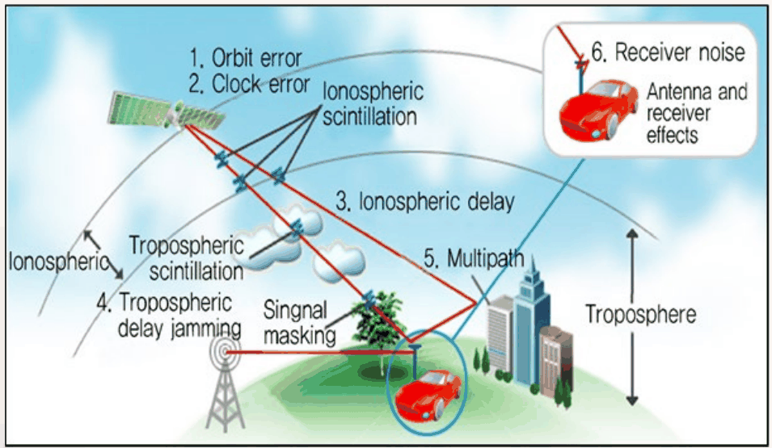

*Figure 1. Sources of error that arise before a GNSS signal reaches the receiver*

1. **Satellite errors:** satellite orbit errors, satellite clock (time) errors, and errors in the navigation data the satellite broadcasts.
2. **Atmospheric errors:** delays in propagation time as the signal passes through the ionosphere and the troposphere.
3. **Ground errors:** signal distortion, multipath errors caused by signals reflected from buildings and other surfaces, and errors of the receiver itself.

| Error Source | Details | Error Size |
|:-----|:-----|:-----|
| Satellite clock error | Error in the time information broadcast by the satellite | 0-1.5 m |
| Satellite orbit error | Error in the orbit information broadcast by the satellite | 1-5 m |
| Ionospheric refraction | Propagation delay as the GNSS signal passes through the ionosphere | 0-30 m |
| Tropospheric refraction | Propagation delay as the GNSS signal passes through the troposphere | 0-30 m |
| Receiver error | Antenna position error, noise | 0-10 m |
| Multipath | Error caused by the GNSS signal arriving over several paths | 0-1 m |
| SA (Selective Availability) | Intentionally added noise, turned off in May 2000 | 0-70 m |

*Table 2. Sources and sizes of GNSS position error*

The causes of each source are as follows [1], [2].

- **Satellite clock error:** Even atomic clocks drift slightly, so ground control stations compute clock corrections and upload them to the satellites. The receiver applies these corrections, but some prediction error remains, and as the calculation in Section 1.2 shows, a few nanoseconds of error become a range error of around 1 m.
- **Satellite orbit error:** The orbit information (ephemeris) broadcast by a satellite is a prediction made in advance, so it differs slightly from the actual orbit. If the satellite position is wrong, $(x_i, y_i, z_i)$ in the pseudorange equation is wrong and the position is shifted.
- **Ionospheric delay:** The **ionosphere**, at altitudes of about 50-1,000 km, contains free electrons produced by solar radiation that slow down radio waves. The delay varies strongly with day and night, season, and solar activity, and because it is inversely proportional to the square of the frequency, a receiver that tracks two frequencies can remove most of it by comparing the two measurements.
- **Tropospheric delay:** In the **troposphere**, extending from the ground to a little over 10 km, air and water vapor slow down radio waves. The delay does not depend on frequency, so it cannot be removed with two frequencies, and most of it is corrected with models that use temperature, pressure, and humidity. The closer a satellite is to the horizon, the longer its signal travels through the atmosphere and the larger the delay.
- **Receiver error:** the position error of the point where the antenna actually receives the signal, and thermal noise in the receiver circuits.
- **Multipath:** A signal reflected from a building or the ground travels a longer path than the direct signal, so the measured range is too long. It grows in places with many reflecting surfaces, such as streets between tall buildings.
- **SA (Selective Availability):** an error that the United States intentionally added to the civilian GPS signal; it was turned off on May 2, 2000 [3].

Figure 1 also shows **scintillation**, rapid fluctuations in signal strength and phase caused by irregularities in the ionosphere and troposphere, **jamming**, deliberate interference with strong radio signals, and **signal masking**, where buildings or terrain hide a satellite. Rather than enlarging range errors, jamming and masking can reduce the number of visible satellites so far that no position can be computed at all.

### 1.4 The Principle of Differential GNSS

Among the errors in Table 2, the satellite clock, satellite orbit, ionospheric, and tropospheric errors appear almost identically at two receivers that are close to each other, because the same signal from the same satellite passes through nearly the same atmosphere. **Differential GNSS (DGNSS)** is a technique that exploits this property to compensate for GNSS errors.

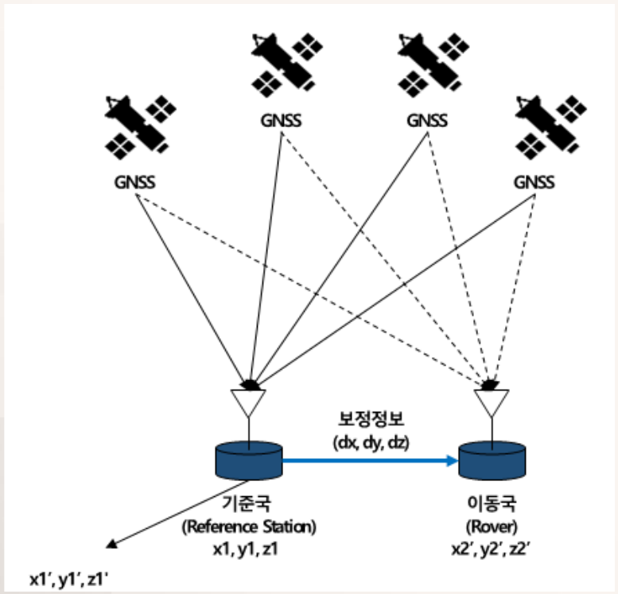

*Figure 2. Structure of DGNSS, in which a reference station sends correction information to a rover*

- A **reference station** is installed at a precisely surveyed location whose absolute coordinates are known.
- The reference station builds correction information from the difference between its known coordinates $(x_1, y_1, z_1)$ and the coordinates $(x_1', y_1', z_1')$ measured with GNSS, and sends it to vehicles within an effective radius, which are called **rovers**.
- A rover that receives the correction information adds it to its own measured coordinates $(x_2', y_2', z_2')$ to correct the error.

```math
(dx,\ dy,\ dz) = (x_1 - x_1',\ y_1 - y_1',\ z_1 - z_1')
```

```math
(x_2,\ y_2,\ z_2) = (x_2' + dx,\ y_2' + dy,\ z_2' + dz)
```

For example, in a local coordinate system (in m), if the true coordinates of the reference station are $(1000.0, 2000.0, 50.0)$ and its measured coordinates are $(1002.3, 1998.6, 53.1)$, the correction is $`(1000.0 - 1002.3,\ 2000.0 - 1998.6,\ 50.0 - 53.1) = (-2.3, +1.4, -3.1)`$. If the rover measures $(1502.1, 2501.2, 55.0)$ at the same moment, its corrected coordinates are $`(1502.1 - 2.3,\ 2501.2 + 1.4,\ 55.0 - 3.1) = (1499.8, 2502.6, 51.9)`$.

This method can reduce only the **errors common to both receivers**. Multipath and receiver noise arise separately at each receiver, so correction information cannot remove them. Also, the farther apart the reference station and the rover are, the more the atmosphere along their signal paths differs and the smaller the share of common error becomes, so correction information has an effective radius.

> **Caution:** Adding coordinate differences directly, as in the equations above, is valid only when both receivers use the same satellites. A real DGNSS broadcasts a pseudorange correction for each satellite, and the rover applies only the corrections for the satellites it uses. The RTCM SC-104 standard is widely used as the format for correction information [4].

DGNSS comes in two forms, **DGPS (Differential GPS)**, which corrects pseudoranges, and **RTK (Real Time Kinematic)**, which uses the carrier phase; Sections 1.6 and 1.7 cover them in turn.

### 1.5 Reference Station Networks in Korea

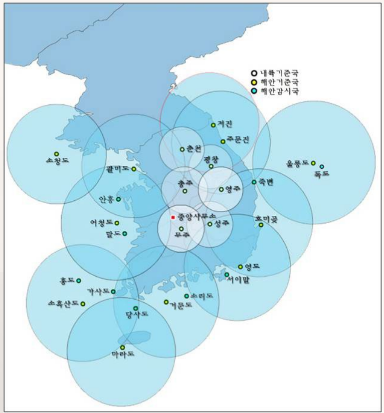

*Figure 3. Public DGPS reference stations in Korea and the effective radius of each station*

Korea's public DGPS is operated with one control station at the central office in Daejeon, 11 reference stations (RS), and 8 integrity monitors (IM). A reference station generates and broadcasts correction information, and an **integrity monitor** actually receives the broadcast corrections, checks whether positions corrected with them are right, and raises an alert if something is wrong. The control station manages all the reference stations and integrity monitors. The circles in Figure 3 show the range within which each station's correction information is valid, and the overlapping circles cover most of the country.

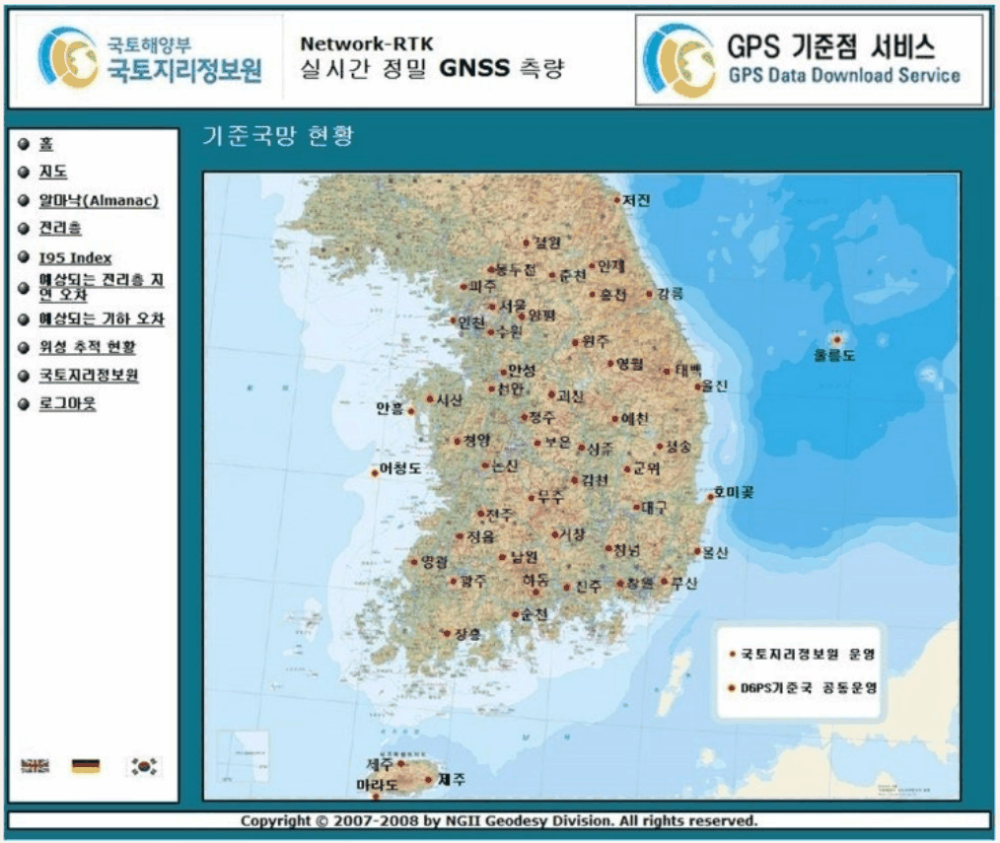

*Figure 4. The network RTK service and reference station network of the National Geographic Information Institute*

The National Geographic Information Institute (NGII) of Korea provides observation data from satellite reference stations installed across the country and operates a real-time precise GNSS surveying service (network RTK) based on them [5]. The map in Figure 4 marks the stations operated by the NGII and the sites operated jointly with DGPS reference stations. **Network RTK** models the errors over a whole region from the observations of several reference stations and generates corrections as if a virtual reference station were located close to the user. It therefore provides uniform accuracy over a wider area than RTK with a single reference station [1].

### 1.6 DGPS: Code-Based Ranging

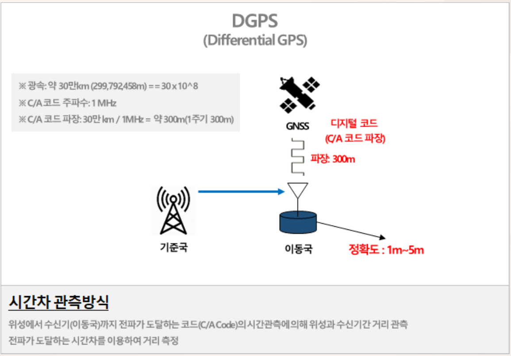

*Figure 5. DGPS, which measures range from the time difference of the C/A code*

DGPS measures range with the **time-difference observation method**. A satellite repeatedly broadcasts a fixed digital sequence of 0s and 1s called the **C/A code (Coarse/Acquisition code)**, and the receiver generates the same sequence itself and slides it against the received signal to find how late the signal arrived. By observing the time the code takes to travel from the satellite to the receiver (rover) in this way, the receiver obtains the distance between the satellite and the receiver.

One bit of the code is called a **chip**, and the GPS C/A code is sent at $1.023 \times 10^{6}$ chips per second [6]. The length that one chip occupies along the direction of propagation, that is, the "wavelength" of the code, is as follows.

```math
\lambda_{\text{C/A}} = \frac{c}{f_{\text{C/A}}} = \frac{299{,}792{,}458\ \text{m/s}}{1.023 \times 10^{6}\ \text{Hz}} \approx 293\ \text{m}
```

Rounding the chip rate to 1 MHz gives $3 \times 10^{8} / 10^{6} = 300$ m. Because the receiver aligns arrival times against chips several hundred meters long, measurement noise of a few meters remains no matter how well it reads the position within a chip. The accuracy of DGPS with corrections applied is about **1-5 m**.

### 1.7 RTK: Carrier-Phase Ranging

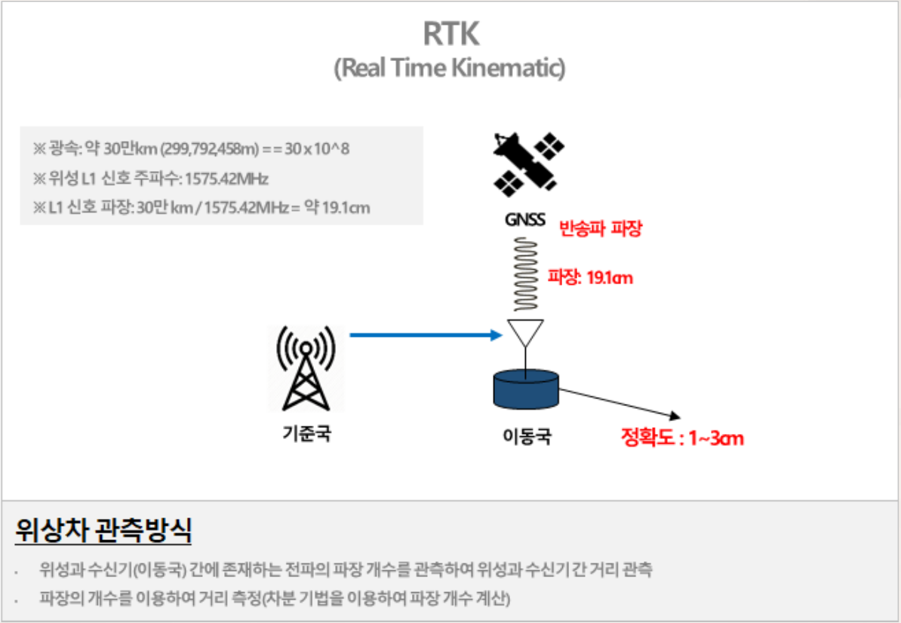

*Figure 6. RTK, which measures range from the number of carrier wavelengths*

The code is transmitted on a high-frequency sine wave called the **carrier**. RTK uses this carrier itself as a ruler instead of the code, in the **phase-difference observation method**: it observes how many carrier wavelengths fit between the satellite and the receiver (rover) to obtain the distance. The carrier frequency of the GPS L1 signal is 1575.42 MHz, so its wavelength is as follows [6].

```math
\lambda_{L1} = \frac{c}{f_{L1}} = \frac{299{,}792{,}458\ \text{m/s}}{1575.42 \times 10^{6}\ \text{Hz}} \approx 0.190\ \text{m} = 19\ \text{cm}
```

Comparing the two rulers gives $1575.42 / 1.023 = 1540$, so the carrier wavelength is 1/1540 of the C/A code chip length. If both measurements read the position within one wavelength (chip) with the same relative precision, say 1%, the code measurement noise is $293 \times 0.01 \approx 2.9$ m while the carrier measurement noise is $0.19 \times 0.01 \approx 0.0019$ m, about 2 mm. This is why carrier-phase ranging is far more precise than code ranging.

The problem is that the receiver measures the phase within one wavelength (the fractional part) precisely but cannot know **how many whole wavelengths** lie between it and the satellite. This unknown integer $N$ is called the **integer ambiguity**, and the range measured with the carrier phase can be written as follows.

```math
\Phi = \lambda \left( N + \frac{\phi}{2\pi} \right)
```

Here $\phi$ is the phase (in radians) measured by the receiver. RTK determines $N$ with **differencing techniques** [1], [2].

1. **Single differencing:** When the reference station and the rover both receive the signal of the same satellite and their measurements are subtracted, the satellite clock error disappears, and if the two receivers are close, most of the ionospheric and tropospheric delay disappears as well.
2. **Double differencing:** Subtracting the single differences for two satellites removes the clock errors of the two receivers. What remains is the geometric range difference related to the relative position of the reference station and the rover, the difference of the integer ambiguities, and small noise.
3. **Ambiguity resolution:** Collecting double differences over many satellites and epochs and solving them under the constraint that the ambiguities are integers fixes their integer values, after which millimeter-level phase measurements become range measurements directly.

The name **real time** means that the reference station sends its carrier-phase observations to the rover in real time over a radio link or the Internet, and the rover computes its position on the spot. The accuracy of RTK is about **1-3 cm**.

> **Caution:** RTK needs the reference station and the rover to be close enough for the atmospheric errors to cancel, so the distance usable with a single reference station is usually limited to within a few tens of kilometers, and a communication link for receiving corrections is needed continuously. When the signal is interrupted in a tunnel or under an overpass, the receiver loses the whole-cycle count of the phase (cycle slip) and must resolve the ambiguities again [1]. Autonomous vehicles therefore do not rely on GNSS alone; they also use localization with LiDAR and maps, such as the NDT matching of Week 9, and inertial sensors.

### 1.8 Comparing GPS, DGPS, and RTK

| Method | Ranging | Correction Information | Accuracy |
|:-----|:-----|:-----|:-----|
| Standalone GPS | Arrival time of the C/A code (pseudorange) | None | A few meters or more, since the errors in Table 2 remain |
| DGPS | Arrival time of the C/A code | Pseudorange or coordinate corrections sent by the reference station | 1-5 m |
| RTK | Carrier phase (number of wavelengths) and code | Carrier-phase observations sent by the reference station | 1-3 cm |

*Table 3. Ranging methods and accuracy of GPS, DGPS, and RTK*

> **Key Point:** DGPS and RTK are both forms of differential GNSS that remove common errors using the measurements of a reference station at a known position. DGPS measures range with a code whose chips are about 300 m long, so it stays at the meter level, whereas RTK measures range with the phase of a carrier whose wavelength is about 19 cm and resolves the integer ambiguity to reach the centimeter level.

---

<br>

## 2. LiDAR and Radar

### 2.1 Ranging by Time of Flight

Whereas a camera is a **passive sensor** that only receives ambient light, LiDAR and radar are **active sensors** that emit waves themselves and receive the waves reflected back.

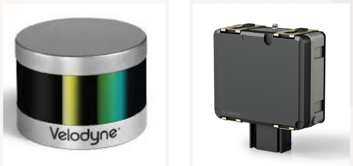

*Figure 7. A rotating LiDAR and an automotive radar*

- **LiDAR (Light Detection And Ranging):** emits laser light and measures range from the time it takes to hit an object and return.
- **Radar (Radio Detection And Ranging):** emits radio waves and measures range from the time they take to hit an object and return.

Both sensors measure the time the wave takes to reach the object and come back, the **time of flight (ToF)** $t$, and since the wave makes the round trip at the speed of light $c$, the distance $d$ to the object is as follows.

```math
d = \frac{c \cdot t}{2}
```

The division by 2 is needed because $t$ is a round-trip time. For example, if the reflection returns after 200 ns, $d = (3 \times 10^{8} \times 200 \times 10^{-9}) / 2 = 60 / 2 = 30$ m. Conversely, distinguishing distances in steps of 1 cm requires resolving time differences of $t = 2 \times 0.01 / (3 \times 10^{8}) \approx 6.7 \times 10^{-11}$ s, about 67 ps, so these sensors contain very precise timing circuits.

### 2.2 LiDAR

A LiDAR fires short pulses of near-infrared laser light (commonly at a wavelength of 905 nm or 1550 nm) while sweeping its direction across the surroundings [7]. Every time a pulse returns, the LiDAR knows both the range $d$ and the direction in which the laser was pointing at that moment, so the 3D coordinates of one reflection point are determined.

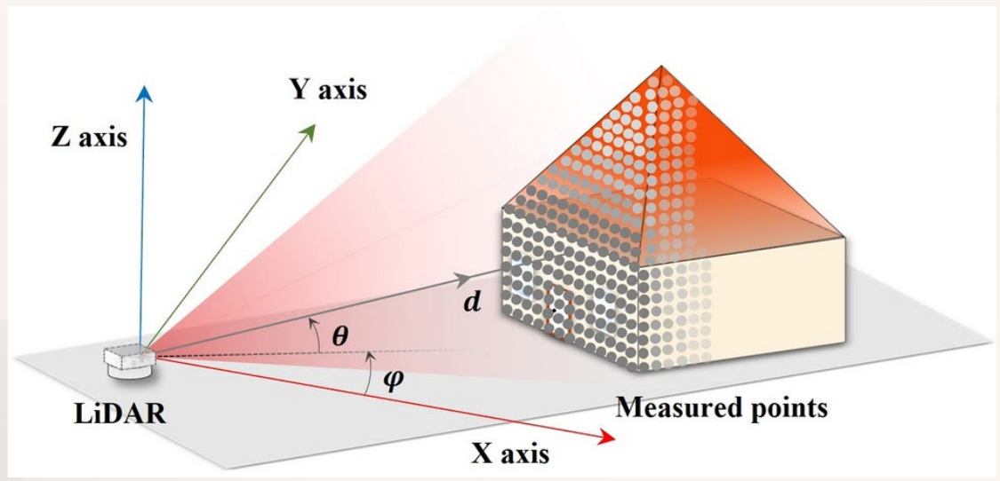

*Figure 8. Coordinates of a reflection point determined by the range and two angles measured by a LiDAR*

In Figure 8, $\varphi$ is the azimuth measured from the X axis in the horizontal plane and $\theta$ is the elevation measured upward from the horizontal plane [8]. The coordinates of the reflection point are as follows.

```math
x = d \cos\theta \cos\varphi, \qquad y = d \cos\theta \sin\varphi, \qquad z = d \sin\theta
```

For example, with $d = 20$ m, $\theta = 5°$, and $\varphi = 30°$, the values $\cos 5° \approx 0.9962$, $\sin 5° \approx 0.0872$, $\cos 30° \approx 0.8660$, and $\sin 30° = 0.5$ give $x = 20 \times 0.9962 \times 0.8660 \approx 17.25$ m, $y = 20 \times 0.9962 \times 0.5 \approx 9.96$ m, and $z = 20 \times 0.0872 \approx 1.74$ m. Hundreds of thousands of such points collected every second form the **point cloud** used for map building and NDT matching in Weeks 2 and 9.

> **Definition:** A **3D LiDAR** measures the whole space by stacking several laser layers vertically or by steering the beam in two directions with mirrors. The rotating LiDAR in Figure 7 arranges several lasers vertically and spins its body through 360°, while the study that is the source of Figure 8 steers the beam with a MEMS mirror [8]. A **2D LiDAR** sweeps only one plane with a single laser layer and obtains a range profile in that plane.

The characteristics of LiDAR are as follows.

- It is very expensive.
- Light cannot pass through the car body, so it is mounted outside the vehicle where the view is open, such as on the roof.
- It can recognize the shape of objects, so it is sufficient on its own to understand the surroundings, and it is even better when combined with a camera.
- It builds an image of the surroundings from laser light that is emitted and returns.
- Its short wavelength lets it detect even small objects.
- It can produce accurate 3D monochrome images. Each point carries only range and reflection intensity, with no color information.
- Its performance degrades in weather that scatters light, such as rain, fog, and snow.

> **Note:** LiDAR can detect small objects not because its frequency is low but because **its wavelength is short**. The frequency of near-infrared light is several hundred THz, far higher than that of radar. LiDAR is also an active sensor that emits its own light, so it works at night; the sensor that is weak in darkness is the camera, which depends on ambient light. What degrades LiDAR is not darkness but dense fog, rain, and snow, which scatter and absorb light [7]. The comparison in Figure 14 also shows LiDAR with high availability in darkness.

### 2.3 2D LiDAR and Industrial Safety

A 2D LiDAR is essential for indoor mobile robots such as the **AGV (Automated Guided Vehicle)**. Sweeping a single plane near the floor already gives cross-sections of walls and obstacles, which is enough for map building and obstacle detection.

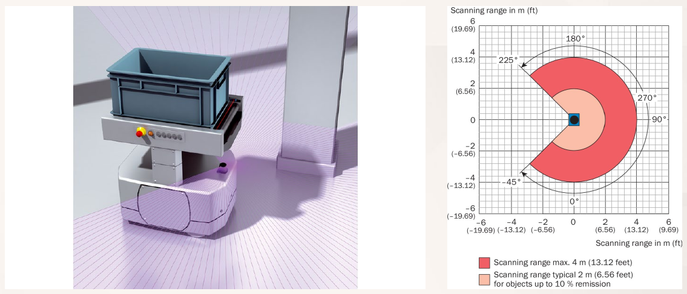

*Figure 9. An AGV with a 2D LiDAR and the scanning range of a safety laser scanner*

The graph on the right of Figure 9 is a top view of the range covered by one 2D safety laser scanner. The scanner sweeps 270° from -45° to 225°; the darker region shows the maximum range of 4 m, and the lighter region shows the typical range of 2 m within which a dark object with 10% remission (reflectivity) can be detected. An object with low remission returns weak light, so its detection range is shorter. The 90° behind the scanner is invisible, so a single scanner cannot see all around an AGV.

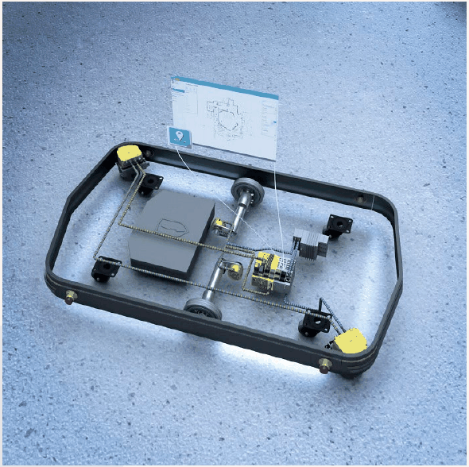

*Figure 10. An AGV with LiDARs arranged to minimize blind spots*

AGVs therefore place their LiDARs so that blind spots are minimized, and the standard approach is to control the AGV drive with **safety LiDARs**. With one 270° scanner at each of two diagonal corners, as in Figure 10, the two fields of view overlap and cover the full 360° around the vehicle. A safety laser scanner is usually configured with an outer **warning field** and an inner **protective field**; when a person or object enters the warning field the vehicle slows down, and when something enters the protective field the scanner issues a stop signal to prevent a collision [9].

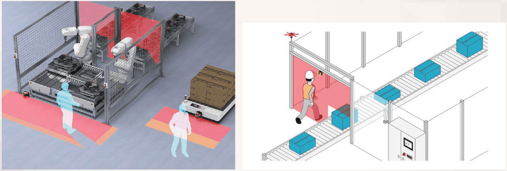

*Figure 11. 2D LiDARs monitoring hazardous zones in a robot work cell and at a conveyor opening*

2D LiDARs are also used for many purposes in industry beyond mobile robots. The left of Figure 11 shows a 2D LiDAR monitoring the floor of a robot arm's work cell and stopping or slowing the robot when a person enters the hazardous zone (red area), and the right shows a conveyor opening where boxes are let through but a person entering is detected [10].

### 2.4 Radar

A radar emits radio waves and detects obstacles from their reflections. Automotive radars mainly use **millimeter waves** in the 24 GHz and 76-81 GHz bands [11]. The wavelength of a 77 GHz wave is $299{,}792{,}458 / (77 \times 10^{9}) \approx 3.9$ mm.

The ranging principle is the time of flight of Section 2.1, but most automotive radars use the **FMCW (Frequency Modulated Continuous Wave)** method instead of directly timing the arrival of a pulse. When the radar transmits a signal whose frequency rises steadily over time (a chirp), the reflection returns late by the time of flight and therefore has a different frequency from the signal being transmitted at that moment. This frequency difference is proportional to the time of flight, so the range is obtained from the frequency difference [11].

A major advantage of radar is that it **measures relative velocity directly**. A radio wave reflected from an approaching or receding object changes frequency through the **Doppler effect**, and the change $f_D$ is proportional to the radial velocity $v$ [12].

```math
f_D = \frac{2v}{\lambda}
```

For example, if a car in front of a 77 GHz radar ($\lambda \approx 0.00389$ m) approaches at 20 m/s, $f_D = 2 \times 20 / 0.00389 \approx 10{,}300$ Hz, a frequency change of about 10.3 kHz. LiDAR and cameras must estimate velocity from the change in position over several measurements, but radar obtains velocity from a single measurement.

The characteristics of radar are as follows.

- It is relatively inexpensive.
- Radio waves pass through a plastic bumper, so it can be mounted inside the vehicle, for example behind the bumper.
- To judge accurately what an object is, it is usually installed together with a camera.
- It detects obstacles from electromagnetic waves that are emitted and return.
- Its operating range is longer than that of LiDAR.
- It has difficulty detecting small objects and cannot provide a precise image of an object.
- It works easily in cloudy weather and at night.

The reason for the low resolution of radar lies in its wavelength. The angular width of an antenna beam is roughly the wavelength divided by the antenna size $D$, $\lambda / D$ radians [12]. With a 10 cm antenna at 77 GHz, this gives $0.0039 / 0.1 = 0.039$ rad, about 2.2°, so a few tens of meters ahead the beam is meters wide and small objects are hard to separate. The wavelength of a 905 nm laser is about 4,300 times shorter than that of a 77 GHz wave, which allows far narrower beams.

### 2.5 Comparing LiDAR and Radar

| Item | LiDAR | Radar |
|:-----|:-----|:-----|
| Emitted wave | Light (near-infrared laser) | Radio waves (millimeter waves) |
| Price | Very expensive | Relatively inexpensive |
| Mounting position | Outside the vehicle | Inside the vehicle (behind the bumper, etc.) |
| Relation to cameras | Recognizes object shapes, so it is sufficient on its own and better with a camera | Needs a camera to judge objects accurately |
| Operating range | Shorter than radar | Longer than LiDAR |
| Small objects | Detects even small objects thanks to its short wavelength | Has difficulty detecting small objects |
| Output | Accurate 3D monochrome images | Cannot provide precise images of objects |
| Velocity measurement | Estimated from position changes over several measurements | Measured directly by the Doppler effect |
| Weather and night | Degrades in rain, fog, and snow | Works easily in cloudy weather and at night |

*Table 4. Comparison of LiDAR and radar*

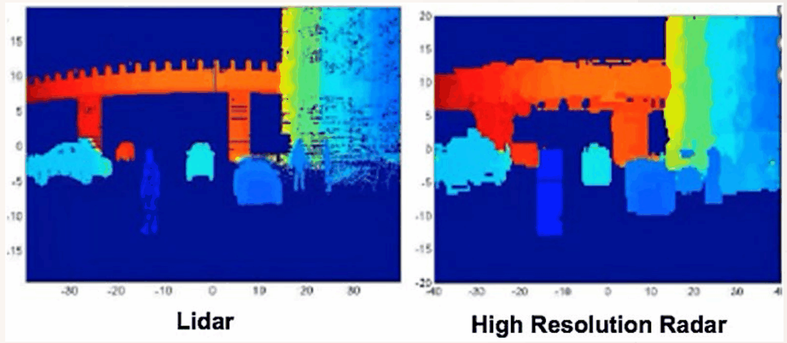

*Figure 12. Results of a LiDAR and a high-resolution radar measuring the same scene*

Figure 12 shows the same street scene measured by the two sensors, with range shown as color. The high-resolution radar also distinguishes the large structures of the scene, but the LiDAR draws the outlines of pedestrians and vehicles with denser points. In short, LiDAR has an advantage in resolution because it uses lasers but is expensive and affected by weather, whereas radar is inexpensive and suitable for production vehicles but has poor resolution and must be used together with vision sensors (cameras) [13].

### 2.6 Sensor Suites of Autonomous Vehicles and Sensor Fusion

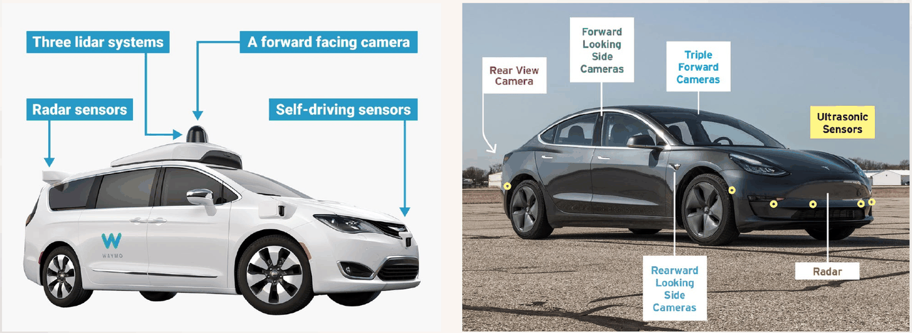

*Figure 13. Sensor suites of a Waymo autonomous vehicle and a Tesla vehicle*

Figure 13 shows the sensors mounted on the vehicles of two companies [14], [15]. The Waymo vehicle on the left carries three LiDAR systems, a forward-facing camera, radar sensors, and a roof-mounted self-driving sensor unit, layering several sensors around LiDAR. The Tesla vehicle on the right has no LiDAR and uses a rear-view camera, side cameras looking forward and rearward, three forward cameras, radar, and **ultrasonic sensors**. An ultrasonic sensor detects nearby objects within a few meters from the time of flight of sound waves and is used mainly for parking.

> **Note:** Tesla later removed radar and ultrasonic sensors and switched to perceiving the surroundings with cameras alone (Tesla Vision) [16]. Even for the same autonomous driving problem, different designs coexist: suites centered on LiDAR and suites centered on cameras.

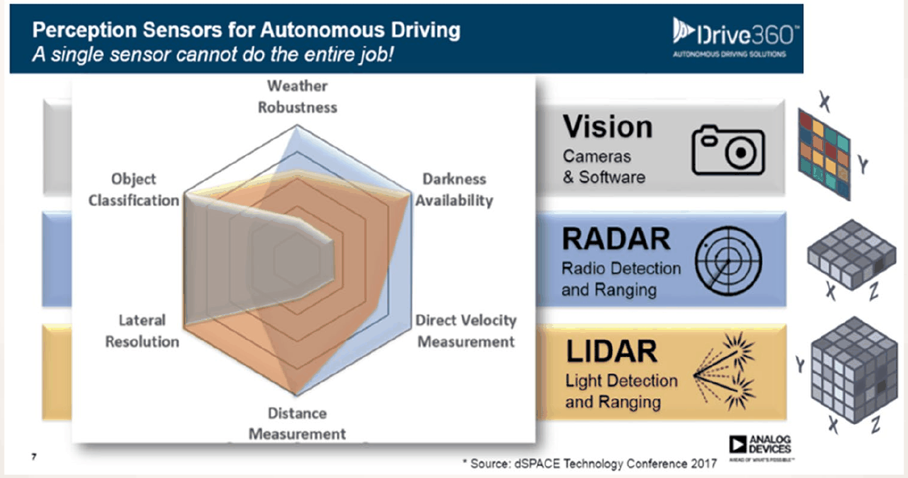

*Figure 14. Comparison of the perception performance of cameras, radar, and LiDAR*

Figure 14 compares the three perception sensors used in autonomous driving on six criteria and shows that "a single sensor cannot do the entire job" [17]. The general characteristics of the three sensors, organized by the six criteria of the figure, are as follows [7].

| Criterion | Camera | Radar | LiDAR |
|:-----|:-----|:-----|:-----|
| Object classification | Strong (color, texture, text) | Weak | Medium (shape) |
| Lateral resolution | Strong | Weak | Strong |
| Distance measurement | Weak | Strong | Strong |
| Direct velocity measurement | Weak | Strong (Doppler) | Weak |
| Availability in darkness | Weak | Strong | Strong |
| Weather robustness | Weak | Strong | Medium |

*Table 5. Strengths and weaknesses of each perception sensor*

Because the strengths of the three sensors do not overlap, autonomous vehicles use **sensor fusion**, combining the measurements of several sensors so that each covers the others' weaknesses. For example, the camera recognizes that the object ahead is a pedestrian, the LiDAR measures its position and shape, and the radar measures how fast it is approaching, and the results are merged into a single object description.

> **Key Point:** LiDAR and radar are both active sensors that measure range by time of flight. LiDAR, with its short wavelength, has high resolution but is expensive and weak in bad weather, whereas radar, with its long wavelength, has low resolution but is inexpensive, robust to weather, and measures velocity directly. No sensor satisfies every condition on its own, so sensor fusion is needed.

---

<br>

## 3. The CAN Bus

### 3.1 Why CAN Is Needed

A modern car contains dozens of **ECUs (Electronic Control Units)**, each responsible for the engine, transmission, brakes, steering, airbags, doors, or seats. As Figure 15 shows, direct fuel injection, electric throttle valve control, active suspension, and electrically assisted power steering have become electronically controlled, and **brake-by-wire** and **steer-by-wire**, which replace the mechanical links of the brakes and steering with electrical signals, have appeared. For an autonomous vehicle to move the car, it must ultimately send commands to these controllers.

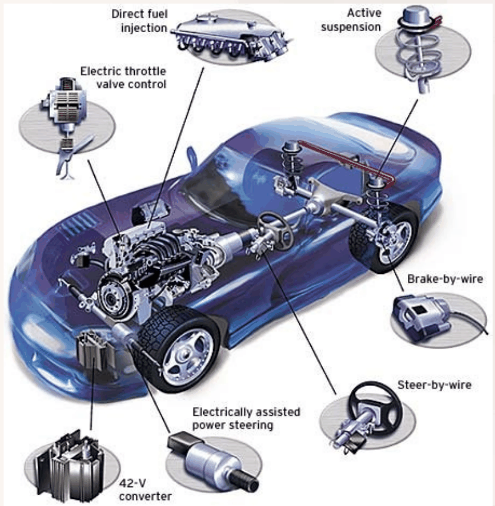

*Figure 15. Vehicle functions that have become electronically controlled*

As controllers multiply, a communication standard is needed for sharing information among them efficiently. The engine speed known to the engine controller must also be used by the transmission controller and the instrument cluster, and the wheel speeds must be shared by the ABS, the suspension, and the instrument cluster.

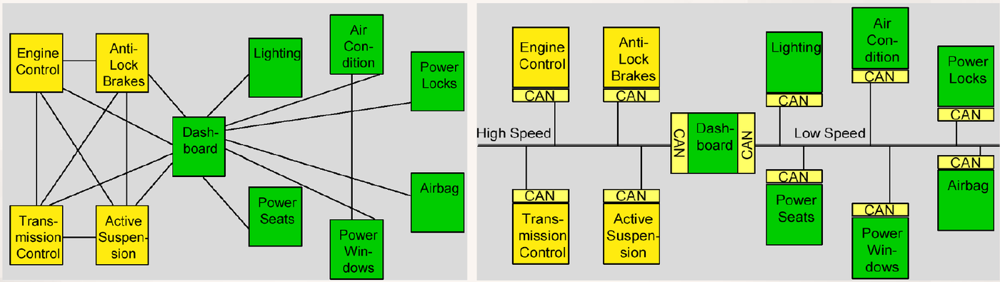

*Figure 16. Wiring that connects controllers with individual wires and wiring that connects them through a CAN bus*

If every pair of controllers that needs to exchange information is connected by its own wire, as on the left of Figure 16, the wiring grows quickly with the number of controllers. In the extreme case of connecting all $n$ controllers directly to one another, $n(n-1)/2$ connections are needed, which is $11 \times 10 / 2 = 55$ for the 11 modules in the figure. If all controllers share one pair of wires, a **bus**, as on the right, each controller needs to connect to the bus only once. In the figure, controllers that need fast responses, such as the engine, ABS, transmission, and suspension, are connected to a high-speed bus; the lighting, air conditioning, door lock, seat, window, and airbag modules are connected to a low-speed bus; and the dashboard relays information between the two buses.

**CAN (Controller Area Network)** is a serial bus communication method that Bosch developed and standardized from the mid-1980s for communication among such vehicle controllers. Bosch published the CAN 2.0 specification in 1991 [18], and CAN became a European standard and then, in 1993, an international standard as ISO 11898 [19]. Being able to build networks among controllers laid the foundation for developing a wide range of applications that combine information from several controllers.

> **Note:** The official name of CAN is Controller Area Network. It is sometimes written as Control Area Network, but both refer to the same thing.

The reasons CAN is used can be summarized in four points.

| Reason | Explanation |
|:-----|:-----|
| It is robust in noisy environments | Twisted pairs and differential signaling make it robust to the electrical noise generated by engines and motors (Section 3.3). |
| Signal priorities can be set | The message identifier doubles as the priority, so urgent messages are sent first even when several controllers transmit at once (Section 3.6). |
| All devices receive every bit on the bus | Every controller on the bus receives a message sent by one controller, so the same information does not need to be sent separately to several controllers (Section 3.2). |
| It is cost-effective | Connecting all controllers with two wires reduces the length, weight, and cost of the wiring. |

*Table 6. Reasons CAN is used for in-vehicle communication*

### 3.2 Characteristics of CAN

| Characteristic | Explanation |
|:-----|:-----|
| Multi-master | With no central master, any controller may start transmitting when the bus is idle, and the transmitted message is broadcast to all controllers. |
| Two-wire connection | The communication line is built simply from two wires, CAN_H and CAN_L. |
| High-speed communication | Up to 1 Mbit/s, which allows real-time information exchange. |
| Reliability and safety | It has several layers of error detection and handling (Section 3.8). |
| Asynchronous serial communication | Bits are sent one at a time over a single signal (a differential pair) without a separate clock line. |

*Table 7. Characteristics of CAN*

A CAN message carries no address of the receiving controller. Instead, the **identifier (ID)** at the start of the message describes **the content of the message**, such as engine speed or wheel speed, and each controller accepts only the messages whose IDs it needs. This is called **acceptance filtering** [18]. Adding a new controller to the bus therefore requires no change to the settings of existing controllers.

**Asynchronous** means that the transmitter and the receivers do not share a clock signal. Each controller runs at a bit rate agreed on in advance, aligns its timing at the first bit of a frame, and realigns it at every moment the bit value changes. If the same value continues for a long time there is no chance to realign, so CAN uses **bit stuffing**, inserting one bit of the opposite value after five identical consecutive bits [18].

| Type | Bit Rate | Use |
|:-----|:-----|:-----|
| Low-speed CAN | 125 kbit/s or less | Body control (doors, windows, seats, lighting) and general data communication |
| High-speed CAN | Above 125 kbit/s, up to 1 Mbit/s | Real-time control (powertrain, chassis) |

*Table 8. Low-speed and high-speed CAN*

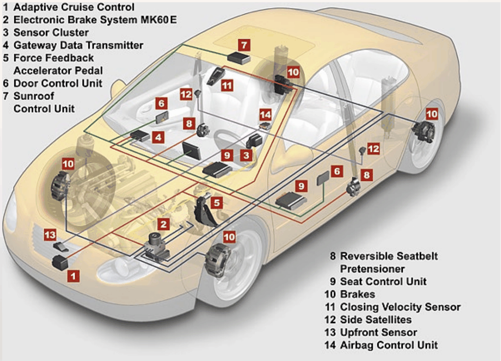

*Figure 17. Controllers distributed throughout a vehicle*

Figure 17 is an example of the controllers and sensors in a single vehicle. Adaptive cruise control, an electronic brake system, a sensor cluster, a gateway, a force-feedback accelerator pedal, door control units, a sunroof control unit, reversible seatbelt pretensioners, a seat control unit, brakes, a closing velocity sensor, side satellites, an upfront sensor, and an airbag control unit are scattered throughout the body, and they exchange information over the bus.

### 3.3 Physical Layer: Twisted Pairs and Differential Signaling

CAN can communicate over various media such as optical fiber and the **twisted pair wire**, and vehicles mainly use twisted pairs. The two twisted wires are used as **CAN_H (CAN High)** and **CAN_L (CAN Low)**.

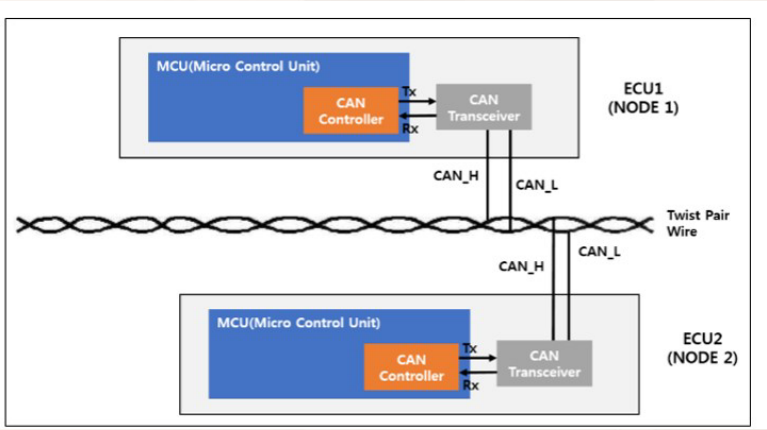

*Figure 18. CAN connecting two ECUs with a twisted pair*

Each ECU in Figure 18 consists of three parts.

- **MCU (Micro Control Unit):** the microcontroller that runs the control program and decides which data to send.
- **CAN controller:** handles the rules of the CAN protocol, such as framing, arbitration, CRC computation, and acknowledgment, and exchanges the transmitted bits (Tx) and received bits (Rx) as logic signals.
- **CAN transceiver:** converts the controller's logic signals into voltages on CAN_H and CAN_L and puts them on the bus, and converts the bus voltages back into logic signals.

CAN uses **differential signaling**, which represents bits not by the voltage of one wire but by the **voltage difference** between two wires [20].

| Bus State | Logic Value | CAN_H | CAN_L | Differential Voltage (CAN_H - CAN_L) |
|:-----|:-----|:-----|:-----|:-----|
| Recessive | 1 | About 2.5 V | About 2.5 V | About 0 V |
| Dominant | 0 | About 3.5 V | About 1.5 V | About 2 V |

*Table 9. Voltages of high-speed CAN in each bus state*

External noise enters the two wires twisted side by side almost equally. For example, if noise adds +1 V to both wires in the dominant state, CAN_H becomes 4.5 V and CAN_L becomes 2.5 V, but the difference is still $4.5 - 2.5 = 2$ V. The receiver looks only at the difference, so noise common to both wires cancels out by itself.

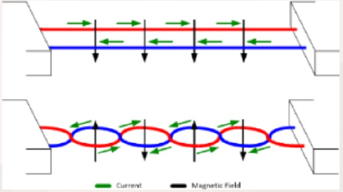

*Figure 19. Currents and magnetic fields of two parallel wires and two twisted wires*

The reason for twisting the wires follows the same principle. When the two wires run in parallel, as at the top of Figure 19, an external magnetic field passing through the loop formed by the wires induces a voltage in one direction; when the wires are twisted, as at the bottom, the orientation of the loop flips at every twist and the voltages induced in neighboring twists cancel. The magnetic fields produced by the currents flowing in opposite directions in the two wires also cancel twist by twist, so a twisted pair not only picks up less noise but also emits less.

> **Key Point:** When dominant (0) and recessive (1) meet on the bus, dominant wins, because a voltage difference appears between the wires if even one controller drives dominant, and the difference is zero only when all controllers send recessive. This property is called **wired-AND**, and the arbitration of Section 3.6 is built on it.

### 3.4 Bus Structure and Termination Resistors

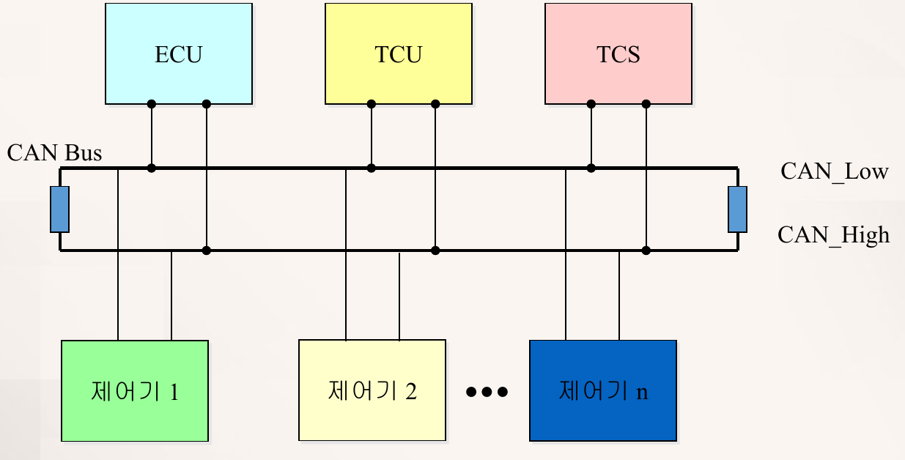

*Figure 20. Structure of a CAN bus with termination resistors at both ends and several controllers attached*

As in Figure 20, a CAN bus has a **line structure** in which controllers $1, 2, \dots, n$, such as the ECU (engine controller), TCU (Transmission Control Unit), and TCS (Traction Control System), are attached by short stubs to CAN_H and CAN_L running in a single line. At each end of the bus, one **120 Ω termination resistor** is connected between CAN_H and CAN_L.

The termination resistors do two things [20].

1. **Preventing reflections:** A signal is reflected back at the end of a line, and if the reflection overlaps the next bit, the bit is distorted. Terminating the line with a resistor equal to its characteristic impedance (about 120 Ω) absorbs the signal energy in the resistor so that no reflection occurs. The noise-removal effect comes from preventing this distortion of the signal.
2. **Returning to the recessive state:** When a transceiver that was driving dominant stops driving, the termination resistors pull the two wire voltages together and quickly return the bus to the recessive state.

The two termination resistors are in parallel between CAN_H and CAN_L, so their combined resistance is $\dfrac{120 \times 120}{120 + 120} = 60$ Ω. Therefore, when the resistance between CAN_H and CAN_L is measured on a vehicle with the power off, about 60 Ω indicates that both termination resistors are properly installed, and about 120 Ω indicates that one is missing.

### 3.5 Structure of the Data Frame

The unit in which CAN carries data is called a **data frame**. A data frame in the standard format (11-bit ID) is structured as follows, where the number under each field is its bit count.

```text
          |<---------------------------------- Data Frame ---------------------------------->|
Interframe| SOF | Identifier | RTR | Control | Data      | CRC      | CRC | ACK  | ACK | EOF | Interframe
  space   |     |            |     |  IDE,r0 | Field     | Sequence | Del | Slot | Del |     |   space
          |     |            |     |  DLC    |           |          |     |      |     |     |
   >= 3   |  1  |  11 (29)   |  1  |    6    | 0-8 bytes |    15    |  1  |  1   |  1  |  7  |   >= 3
          |     |<- Arbitration -->|
```

*Figure 21. Fields and bit counts of a standard CAN data frame*

| Field | Bits | Role |
|:-----|:-----|:-----|
| SOF (Start of Frame) | 1 | A single dominant bit announces the start of a frame. All receivers align their timing to the start of this bit. |
| Identifier | 11 (29 in the extended format) | Indicates the content and priority of the message. |
| RTR (Remote Transmission Request) | 1 | Dominant for a data frame, recessive for a remote frame that requests data from another controller. |
| Control field | 6 | One IDE bit that distinguishes the format, one reserved bit r0, and the 4-bit DLC (Data Length Code) giving the data length in bytes. |
| Data field | 0-64 (0-8 bytes) | The data actually delivered. |
| CRC sequence | 15 | The Cyclic Redundancy Code value computed over the bits from the SOF to the data field. |
| CRC delimiter | 1 | A recessive bit marking the end of the CRC field. |
| ACK slot | 1 | The transmitter sends recessive, and every receiver that received the frame correctly writes dominant in this position to acknowledge it. |
| ACK delimiter | 1 | A recessive bit marking the end of the ACK field. |
| EOF (End of Frame) | 7 | Seven recessive bits marking the end of the frame. |
| Interframe space | 3 or more | Recessive bits separating the frame from the next one. |

*Table 10. Fields of a standard CAN data frame*

The identifier and the RTR bit together are called the **arbitration field**. Thanks to the ACK slot, the transmitter learns before the frame ends that at least one controller has received it correctly.

> **[Computer Networks]** The CAN CRC is a 15-bit value computed with the generator polynomial $x^{15} + x^{14} + x^{10} + x^{8} + x^{7} + x^{4} + x^{3} + 1$ [18]. A CRC of degree 15 detects all consecutive errors (burst errors) of 15 bits or fewer. The receiver recomputes the CRC from the bits it received and compares it with the received CRC sequence.

The length of a frame carrying 8 bytes of data is computed as follows.

```math
1 + 11 + 1 + 6 + 64 + 15 + 1 + 1 + 1 + 7 = 108 \text{ bits}, \qquad 108 + 3 = 111 \text{ bits (including the interframe space)}
```

At a bit rate of 500 kbit/s, one bit takes $1 / (500 \times 10^{3}) = 2$ µs, so one frame takes $111 \times 2 = 222$ µs and the bus carries at most $1 / (222 \times 10^{-6}) \approx 4{,}500$ frames per second. Of the 111 bits, 64 are data, so the efficiency is $`64 / 111 \approx 57.7\%`$. In practice bit stuffing adds more bits; in the standard format, an 8-byte frame can contain up to 24 stuff bits [21].

### 3.6 Arbitration and Priority

When several controllers start transmitting at the same time, it must be decided which one goes first. CAN solves this with **bitwise arbitration** [18].

1. When the bus is idle, the controllers with messages to send transmit the SOF simultaneously and then send their identifiers starting from the most significant bit.
2. Each controller reads the actual value of the bus while it sends each bit.
3. If a controller sends recessive (1) but reads dominant (0) on the bus, another controller is sending a smaller ID, so it immediately stops transmitting and becomes a receiver.
4. The one controller that remains to the end continues sending the frame. The controllers that lost try again when the bus becomes idle.

Thanks to wired-AND, the bits of the winning controller stay on the bus unchanged, so the winning message is not damaged at all even though a collision occurred. This is called **non-destructive arbitration**. As a result, **the smaller the ID, the higher the priority**.

For example, consider three controllers that start sending messages with IDs `0x102`, `0x103`, and `0x120` at the same time. Written as 11-bit binary numbers, `0x102 = 001 0000 0010`, `0x103 = 001 0000 0011`, and `0x120 = 001 0010 0000`.

| Identifier Bit | 10 | 9 | 8 | 7 | 6 | 5 | 4 | 3 | 2 | 1 | 0 |
|:-----|:-----|:-----|:-----|:-----|:-----|:-----|:-----|:-----|:-----|:-----|:-----|
| Controller A (`0x102`) | 0 | 0 | 1 | 0 | 0 | 0 | 0 | 0 | 0 | 1 | 0 |
| Controller B (`0x103`) | 0 | 0 | 1 | 0 | 0 | 0 | 0 | 0 | 0 | 1 | 1, loses |
| Controller C (`0x120`) | 0 | 0 | 1 | 0 | 0 | 1, loses | | | | | |
| Bus | 0 | 0 | 1 | 0 | 0 | 0 | 0 | 0 | 0 | 1 | 0 |

*Table 11. Bitwise arbitration among three identifiers*

In bits 10-6 all three controllers send the same values, so nobody loses. In bit 5, C sends a recessive 1, but the bus reads 0 because of the dominant 0 from A and B, so C withdraws. Bits 4-1 are the same for A and B, and in bit 0 B sends a recessive 1, reads 0 on the bus, and withdraws. The remaining A (`0x102`) sends its frame to the end, and B and C compete again at the next opportunity. The CAN node of Week 14 uses `0x102` for speed commands and `0x103` for steering commands, so when the two frames compete at the same time, the speed command goes out first.

> **Caution:** Arbitration is decided by the identifier bits, so if two controllers send data frames with the same ID at the same time, arbitration cannot separate them and they collide in the data field. Networks are therefore designed so that each ID is sent by only one controller. Urgent messages (brakes, steering) must also be given small IDs so that they are delivered on time even when the bus is busy.

### 3.7 Standard and Extended CAN, and the ISO Standards

There are two formats depending on the length of the message ID [18].

| Format | Specification | ID Length | Distinguishable IDs |
|:-----|:-----|:-----|:-----|
| Standard CAN | CAN 2.0A | 11 bits | $2^{11} = 2048$ |
| Extended CAN | CAN 2.0B | 29 bits | $2^{29} = 536{,}870{,}912$ |

*Table 12. Standard and extended CAN*

The identifier of the extended format places the recessive bits SRR (Substitute Remote Request) and IDE after the first 11 bits (the base ID) and then continues with the remaining 18 bits. If the base IDs are equal, a standard frame sends dominant in the RTR position (dominant for a data frame) or the IDE position (dominant for the standard format), while an extended frame sends the recessive SRR and IDE in the same positions, so the standard frame wins.

- A **CAN 2.0A controller** sends and receives only messages in the standard CAN format. It cannot receive messages in the extended CAN format, and even if it receives such a message, it ignores the data.
- A **CAN 2.0B controller** can send and receive both formats.

> **Note:** Bosch's CAN 2.0A specification does not allow IDs whose seven most significant bits are all recessive, so the number of IDs actually usable in the standard format is $2048 - 16 = 2032$ [18]. Some old controllers that support only 2.0A also treat extended frames as errors, so on a bus that carries extended frames, controllers that ignore extended frames without errors (2.0B passive) or 2.0B controllers must be used.

By ISO standard, CAN is divided as follows.

| Standard | Content | Maximum Bit Rate |
|:-----|:-----|:-----|
| ISO 11898 | High-speed CAN | 1 Mbit/s |
| ISO 11519 | Low-speed CAN | 125 kbit/s |

*Table 13. ISO standards for CAN*

Today ISO 11898 is divided into several parts: Part 1 covers the data link layer and physical signaling, Part 2 the physical layer of high-speed CAN, and Part 3 the physical layer of low-speed fault-tolerant CAN, which keeps communicating even if one wire breaks [22], [23], [24]. The content of ISO 11519-2, which used to define low-speed CAN, was carried over into ISO 11898-3 [25].

> **Note:** High-speed CAN under ISO 11898 communicates **up to 1 Mbit/s**, not "1 Mbit/s or more". Speeds above 1 Mbit/s are obtained with CAN FD in Section 3.9 by raising the bit rate of the data phase.

### 3.8 Error Detection and Handling

The high reliability of CAN comes from five error detection methods and from rules by which a faulty controller isolates itself [18].

| Error Detection | Method |
|:-----|:-----|
| Bit error | The transmitter reads back each bit it sent from the bus and treats a mismatch outside the arbitration field and the ACK slot as an error. |
| Stuff error | Six identical consecutive bits within the stuffed region are treated as an error. |
| CRC error | A mismatch between the CRC computed by the receiver and the received CRC sequence is treated as an error. |
| Form error | A wrong value in a bit with a fixed value, such as the CRC delimiter, ACK delimiter, or EOF, is treated as an error. |
| ACK error | If the transmitter does not read dominant in the ACK slot, it concludes that nobody received the frame correctly. |

*Table 14. The five error detection methods of CAN*

A controller that detects an error immediately sends an **error frame** that begins with an error flag of six dominant bits. Six identical bits deliberately violate the stuffing rule, so every controller on the bus learns that an error occurred, and the transmitter automatically resends the frame. Each controller also counts its transmit and receive errors; if either count exceeds 127, it falls back to the **error passive** state and sends its error flags only as recessive bits so that it does not disturb other controllers, and if its transmit error count exceeds 255, it enters the **bus off** state and disconnects itself from the bus. This mechanism prevents a single faulty controller from paralyzing the whole bus.

### 3.9 Limits of CAN and the Evolution of Vehicle Networks

The data rate of CAN is limited to 1 Mbit/s, so as the number of ECUs grows and the exchanged data increases, its efficiency drops. Its limits are as follows.

- **Speed and length:** For arbitration to work, the time for a bit to travel to the farthest controller on the bus and back must be shorter than the time from the start of the bit to the moment at which each controller reads the bit value (the sample point). Raising the bit rate therefore requires a shorter bus, and at 1 Mbit/s the bus length is limited to about 40 m [20].
- **Small payloads:** A frame can carry at most 8 bytes, and as the calculation in Section 3.5 shows, nearly half of the frame consists of control bits.
- **High-volume data:** Data reaching tens of megabytes per second, such as camera video or LiDAR point clouds, cannot be carried over CAN.

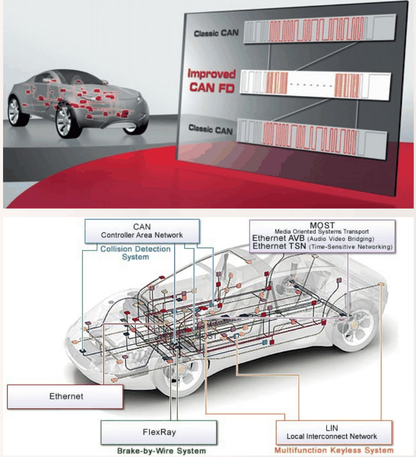

*Figure 22. Comparison of classic CAN and CAN FD, and the various networks used in vehicles*

**CAN FD (CAN with Flexible Data-rate)** is an extension published by Bosch in 2012 to ease these limits. It sends the arbitration phase at the classic speed to keep the arbitration scheme, raises the bit rate only in the data phase, and carries up to 64 bytes per frame [26]. The data-phase speed reaches up to about 8-10 Mbit/s. The top of Figure 22 shows a CAN FD frame finishing sooner than a classic CAN frame when sending the same data.

As the bottom of Figure 22 shows, vehicles use several networks with different purposes alongside CAN [27].

| Network | Characteristics | Main Uses |
|:-----|:-----|:-----|
| LIN (Local Interconnect Network) | Low-cost, low-speed single-wire bus (up to about 20 kbit/s) managed by one master | Convenience devices such as smart keys, switches, and windows |
| CAN | Up to 1 Mbit/s, multi-master, priority arbitration | Powertrain, chassis, and body control in general, collision detection systems |
| CAN FD | Several Mbit/s in the data phase, up to 64 bytes | Controllers that need more data than CAN |
| FlexRay | 10 Mbit/s, time-deterministic communication in fixed time slots | Control that needs constant latency, such as brake-by-wire |
| MOST (Media Oriented Systems Transport) | Multimedia data transmission | Audio, video, infotainment |
| Automotive Ethernet | 100 Mbit/s or more, switch-based, timing guaranteed by AVB and TSN | Cameras, LiDAR, backbone between controllers |

*Table 15. Comparison of networks used in vehicles*

Recently, communication has been shifting toward using Ethernet together with CAN. Automotive Ethernet is defined by standards such as 100BASE-T1, which carries 100 Mbit/s over a single twisted pair [28]. The strengths and weaknesses of Ethernet are as follows.

- It handles high-volume data from cameras and LiDARs easily.
- The vehicle status can be checked easily by connecting from outside, so it suits future vehicles that are becoming centered on software services.
- Its drawbacks are the relatively expensive physical layer interfaces and the cost of installing switches.

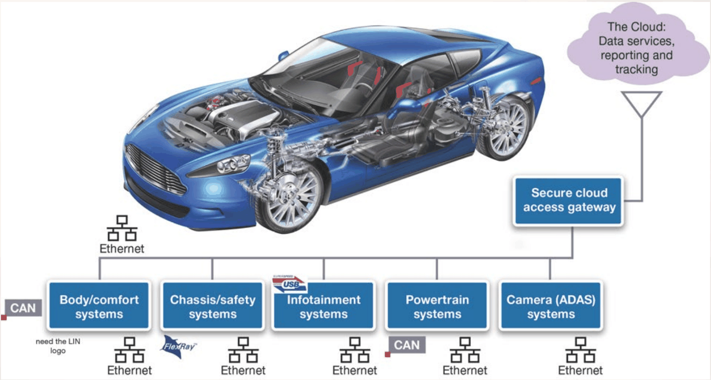

*Figure 23. A vehicle network that ties functional domains together with an Ethernet backbone and connects to the cloud*

Figure 23 is an example of such a structure. The body and comfort, chassis and safety, infotainment, powertrain, and camera (ADAS) systems each form a functional domain, and the domains are connected by an Ethernet backbone. Within each domain, CAN, LIN, and FlexRay still connect the controllers. A secure cloud access gateway connects the vehicle to an external cloud and provides data services, status reporting, and tracking. Even as Ethernet spreads, CAN keeps its role of carrying real-time control signals.

> **Key Point:** CAN is a vehicle bus that is robust to noise thanks to twisted pairs and differential signaling, and highly reliable thanks to non-destructive arbitration that sets priorities by identifier and several layers of error detection. Its limits in speed (1 Mbit/s) and payload size (8 bytes) are complemented by CAN FD and automotive Ethernet.

### 3.10 Connecting a PC to the CAN Bus

Autonomous driving software usually runs on a PC in the vehicle, so putting the commands generated by the PC onto the vehicle's CAN bus requires a **CAN interface device** that connects a PC port such as USB to the CAN bus. Manufacturers such as Kvaser provide USB-to-CAN interfaces and software libraries to drive them [29]. A ROS node on the PC uses such a library to build and send CAN frames, and the controllers on the bus receive the frames and move the actuators. Week 14 covers how to build this node.

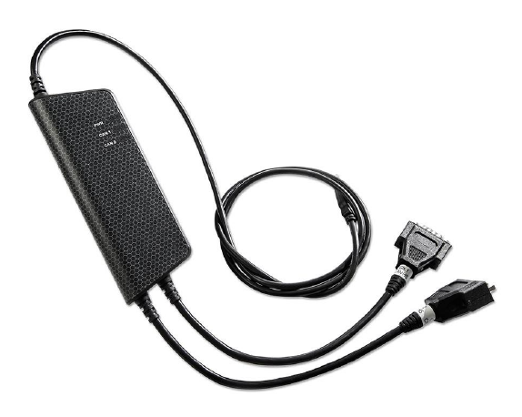

*Figure 24. A two-channel USB-to-CAN interface that connects a PC's USB port to the CAN bus*

---

<br>

## Concept Applications

| Situation | Result and Reason |
|:-----|:------------|
| On a street between tall buildings, the GNSS position jumps by tens of meters. | **This is the effect of multipath and signal masking.** Reflections lengthen the measured ranges and fewer satellites are visible, and because these errors arise separately at each receiver, DGPS corrections cannot remove them. |
| DGPS is used with the same correction information at points 5 km and 300 km from the reference station. | **The correction works better at the 5 km point.** The farther apart the receivers, the more the atmosphere along their signal paths differs and the smaller the share of common error. |
| DGPS is to be used for lane-level localization of an autonomous vehicle. | **Its accuracy is insufficient.** A lane is about 3.5 m wide while DGPS accuracy is 1-5 m, so centimeter-level RTK or localization with LiDAR and maps is needed. |
| On a highway in dense fog, the distance and relative speed to the car ahead must be measured. | **Radar is suitable.** Millimeter waves pass through fog well, and the Doppler effect gives the relative speed in a single measurement. |
| An AGV in an indoor logistics warehouse must not collide with people. | **Place 2D safety laser scanners at its corners.** Overlapping their fields of view removes blind spots, and the drive is controlled to slow down in the warning field and stop in the protective field. |
| The engine controller and the radio start sending frames with IDs `0x0A0` and `0x3F0` at the same time. | **`0x0A0` is sent first.** The smaller ID shows a dominant 0 in an earlier bit and wins arbitration. |
| On a vehicle with the power off, the resistance between CAN_H and CAN_L measures 120 Ω. | **One termination resistor is missing.** Two 120 Ω resistors in parallel should give 60 Ω, and with termination on only one end, reflections make communication unstable. |
| Video from four cameras must be sent to a central computer. | **Use Ethernet, not CAN.** CAN carries at most 1 Mbit/s and 8 bytes per frame, so it cannot carry video data. |

*Table 16. Results and reasons for situations involving autonomous driving sensors and CAN*

**True/False Check:**

| Statement | Judgment and Reason |
|:-----|:------------|
| Since only the receiver position (x, y, z) is unknown, three visible satellites are enough to compute a position. | **F.** The receiver clock error is also unknown, so at least four satellites are needed. |
| DGPS correction information can remove multipath errors. | **F.** Multipath arises separately at each receiver depending on its surroundings, so it is not common with the reference station. |
| RTK reaches centimeter-level accuracy because the carrier wavelength (about 19 cm) is far shorter than the chip length of the C/A code (about 293 m). | **T.** When the phase is read with the same relative precision, a shorter wavelength gives higher range precision, and the integer ambiguity must be resolved to turn that precision into range. |
| LiDAR uses light, so it cannot be used at night. | **F.** LiDAR is an active sensor that emits its own laser light, so it works regardless of darkness. What degrades it is fog, rain, and snow. |
| Radar can determine the relative velocity of an object from a single measurement. | **T.** The Doppler frequency shift of the reflection is proportional to the radial velocity. |
| On CAN, when two controllers transmit at the same time, both messages are corrupted and both must be resent. | **F.** With non-destructive arbitration, the message with the smaller ID is sent undamaged, and only the losing controller resends later. |
| The identifier of a CAN message is the address of the receiving controller. | **F.** The identifier indicates the content and priority of the message, and receiving controllers pick the IDs they need. |
| A CAN 2.0B controller can send and receive frames with both 11-bit and 29-bit IDs. | **T.** A 2.0A controller handles only the standard format. |

---

<br>

## Summary

| Concept | Key Summary |
|:--------|:------------|
| GNSS | Systems that compute a receiver's position and time from the signals of many satellites, including GPS, GLONASS, Galileo, BeiDou, and the regional systems QZSS and NavIC. |
| Pseudorange | The signal travel time multiplied by the speed of light, which includes the receiver clock error, so four or more satellites are needed to solve for three position components and the clock error. |
| Position error | Divided into satellite errors (clock, orbit), atmospheric errors (ionosphere, troposphere), and ground errors (multipath, receiver); SA was turned off in May 2000. |
| Differential GNSS | Builds correction information from the measurement error of a reference station at a known position and sends it to rovers to remove common errors. It cannot remove multipath or receiver noise. |
| Reference station networks | Korea's public DGPS runs with 1 control station, 11 reference stations, and 8 integrity monitors, and the NGII provides a network RTK service. |
| DGPS | Measures range from the arrival time of the C/A code, whose chips are about 293 m long, with an accuracy of 1-5 m. |
| RTK | Measures range from the phase of the L1 carrier, whose wavelength is about 19 cm, and resolves the integer ambiguity by double differencing to achieve 1-3 cm accuracy. |
| Time of flight | The common principle of LiDAR and radar, which compute the range $d = ct/2$ from the round-trip time $t$ of a wave to an object. |
| LiDAR | Measures range and direction with a near-infrared laser to build a 3D point cloud. It has high resolution but is expensive and weak in bad weather. |
| 2D LiDAR | A LiDAR that sweeps one plane, used for AGV map building, obstacle detection, and safety control with warning and protective fields. |
| Radar | Measures range with millimeter waves and velocity directly through the Doppler effect. It is inexpensive and robust to weather but has low resolution, so it is used with cameras. |
| Sensor fusion | Combines the strengths of cameras (classification), LiDAR (shape and distance), and radar (velocity and weather) to cover the weaknesses of each sensor. |
| CAN | A vehicle serial bus developed by Bosch that provides multi-master, broadcast, asynchronous communication at up to 1 Mbit/s. |
| Differential signaling | Represents dominant (0) and recessive (1) by the voltage difference between CAN_H and CAN_L, canceling noise common to both wires. |
| Termination resistors | 120 Ω resistors at both ends of the bus that prevent signal reflections; together they measure 60 Ω. |
| Data frame | Consists of the SOF, identifier, RTR, control field, 0-8 bytes of data, CRC, ACK, and EOF; an 8-byte frame is 108 bits long. |
| Arbitration | A non-destructive scheme that compares identifiers bit by bit with dominant winning, so the smaller the ID, the higher the priority. |
| Standard and extended CAN | CAN 2.0A uses 11-bit IDs and CAN 2.0B uses 29-bit IDs, and 2.0B controllers handle both formats. |
| Limits of CAN and alternatives | The limits of 1 Mbit/s and 8 bytes are complemented by CAN FD (up to 64 bytes, several Mbit/s) and automotive Ethernet. |

---

<br>

## Self-Check Questions

1. **Minimum number of satellites:** State the minimum number of satellites a GNSS receiver needs to compute its position, and explain why in terms of the unknowns of the pseudorange equation.

   <details>
   <summary>Answer</summary>

   At least four are needed. In the pseudorange equation $`\rho_i = \sqrt{(x_i - x)^2 + (y_i - y)^2 + (z_i - z)^2} + c\,\delta t_r + \varepsilon_i`$, the unknowns are the receiver position $x, y, z$ and the receiver clock error $\delta t_r$, four in total. With four unknowns, at least four independent equations, that is, pseudoranges to four different satellites, are needed.

   </details>

2. **Size of a clock error:** If the receiver clock is off by 0.1 µs, how many meters of error appear in the pseudorange?

   <details>
   <summary>Answer</summary>

   The range error is the speed of light times the time error: $3 \times 10^{8} \times 0.1 \times 10^{-6} = 30$ m. This error enters every satellite equally, so it is removed by solving for it as the fourth unknown.

   </details>

3. **DGNSS correction:** The true coordinates of a reference station are $(500.0, 800.0, 30.0)$, its measured coordinates are $(497.5, 801.2, 34.0)$, and at the same moment a rover measures $(620.4, 905.0, 36.5)$. Find the correction and the corrected rover coordinates (in m).

   <details>
   <summary>Answer</summary>

   The correction is the true coordinates minus the measured coordinates: $`(500.0 - 497.5,\ 800.0 - 801.2,\ 30.0 - 34.0) = (+2.5, -1.2, -4.0)`$. Adding it to the rover's measured coordinates gives $`(620.4 + 2.5,\ 905.0 - 1.2,\ 36.5 - 4.0) = (622.9, 903.8, 32.5)`$. This correction holds under the assumption that the two receivers use the same satellites and their errors are common.

   </details>

4. **Code and carrier:** Compute the chip length of the C/A code and the wavelength of the L1 carrier, and explain why RTK is more accurate than DGPS. Then state what RTK must resolve in order to measure range with the carrier.

   <details>
   <summary>Answer</summary>

   The chip length is $299{,}792{,}458 / (1.023 \times 10^{6}) \approx 293$ m and the L1 wavelength is $299{,}792{,}458 / (1575.42 \times 10^{6}) \approx 0.19$ m. The carrier's scale is 1540 times finer than the code's, so reading the phase with the same relative precision gives 1540 times higher range precision (for example, at 1%, about 2.9 m versus about 2 mm). However, the receiver measures only the phase within one wavelength, so the integer ambiguity, the whole number of wavelengths to the satellite, must be resolved by double differencing with the reference station.

   </details>

5. **LiDAR range and coordinates:** A LiDAR reflection returned after 100 ns. Find the range to the object, and if the azimuth was $\varphi = 0°$ and the elevation $\theta = 30°$, find the coordinates $(x, y, z)$ of the reflection point.

   <details>
   <summary>Answer</summary>

   $d = (3 \times 10^{8} \times 100 \times 10^{-9}) / 2 = 30 / 2 = 15$ m. Since $\cos 30° \approx 0.866$, $\sin 30° = 0.5$, $\cos 0° = 1$, and $\sin 0° = 0$, the coordinates are $x = 15 \times 0.866 \times 1 \approx 12.99$ m, $y = 15 \times 0.866 \times 0 = 0$ m, and $z = 15 \times 0.5 = 7.5$ m.

   </details>

6. **Radar Doppler:** A 77 GHz radar ($\lambda \approx 3.9$ mm) measures a Doppler frequency shift of 5.13 kHz. Find the radial relative velocity of the object.

   <details>
   <summary>Answer</summary>

   From $f_D = 2v / \lambda$, $v = f_D \lambda / 2 = 5130 \times 0.0039 / 2 \approx 10$ m/s. The object is approaching or receding at about 10 m/s (36 km/h), and the direction is determined by whether the frequency increased or decreased.

   </details>

7. **Choosing sensors:** Compare LiDAR and radar on five criteria (resolution, weather, velocity measurement, price, and mounting position), and explain why both are used together with cameras.

   <details>
   <summary>Answer</summary>

   LiDAR has a short wavelength and therefore high resolution, recognizing small objects and shapes, but it is weak in fog, rain, and snow, must estimate velocity from position changes over several measurements, is expensive, and must be mounted outside the vehicle. Radar has low resolution and struggles with small objects and precise shapes, but it is robust to weather and darkness, measures velocity directly through the Doppler effect, is inexpensive, and can be mounted behind the bumper. Both are weaker than cameras at classifying objects by color and text, so sensor fusion with the classification ability of cameras covers the weaknesses of each sensor.

   </details>

8. **Differential signaling and termination:** Explain why CAN uses differential signaling and twisted pairs, and describe the problem caused by a missing termination resistor and how to detect it by measurement.

   <details>
   <summary>Answer</summary>

   External noise enters the two wires twisted side by side almost equally, and the receiver looks only at the voltage difference between them, so common noise cancels. Twisting flips the direction of the induced voltage at each twist, reducing noise further and also reducing the noise emitted. If a termination resistor is missing, signals are reflected at the end of the line and overlap the next bit, increasing errors. Measuring the resistance between CAN_H and CAN_L with the power off gives 60 Ω, two 120 Ω resistors in parallel, when the bus is normal, and 120 Ω when one is missing.

   </details>

9. **Tracing arbitration:** Three controllers start sending frames with IDs `0x245`, `0x241`, and `0x2C0` at the same time. Convert them to 11-bit binary, trace in which bit each one loses, and give the transmission order.

   <details>
   <summary>Answer</summary>

   `0x245 = 010 0100 0101`, `0x241 = 010 0100 0001`, and `0x2C0 = 010 1100 0000`. Bits 10-8 (`010`) are the same for all three. In bit 7, `0x2C0` has 1 while the others have 0, so `0x2C0` loses. Bits 6-3 (`1000`) are the same for `0x245` and `0x241`, and in bit 2 `0x245` has 1 while `0x241` has 0, so `0x245` loses. Therefore `0x241` is sent first, `0x245` in the next arbitration, and `0x2C0` last, which matches the order of the IDs (`0x241 < 0x245 < 0x2C0`).

   </details>

10. **Frame length and bus load:** On a 500 kbit/s bus, two standard frames with 8 bytes of data are sent every 20 ms. Ignoring stuff bits and including a 3-bit interframe space, find the bus load (the fraction of time the bus is in use).

    <details>
    <summary>Answer</summary>

    One frame is $1 + 11 + 1 + 6 + 64 + 15 + 1 + 1 + 1 + 7 + 3 = 111$ bits, and one bit takes 2 µs, so a frame takes 222 µs. Two frames every 20 ms means $2 \times 50 = 100$ frames per second, which use $100 \times 222 = 22{,}200$ µs, or 0.0222 s, per second. The bus load is about 2.2%.

    </details>

11. **Limits of CAN:** Explain, in connection with arbitration, why the bit rate of CAN cannot simply be raised, and describe how CAN FD raises the speed while keeping the arbitration scheme.

    <details>
    <summary>Answer</summary>

    During arbitration, each controller must compare the bit it sent with the bus value within the same bit time, so the round-trip time of a signal to the farthest controller must be shorter than the bit time, or more precisely, than the time to the sample point at which the bit value is read. Raising the bit rate shortens the bit time and requires a shorter bus, with about 40 m as the limit at 1 Mbit/s. CAN FD sends the arbitration phase at the classic speed so that arbitration works as before, raises the bit rate only in the data phase, where a single transmitter remains after arbitration, and carries up to 64 bytes per frame.

    </details>

---

<br>

## References

1. E. D. Kaplan and C. J. Hegarty, Eds., *Understanding GPS/GNSS: Principles and Applications*, 3rd ed. Norwood, MA, USA: Artech House, 2017.
2. P. Misra and P. Enge, *Global Positioning System: Signals, Measurements, and Performance*, 2nd ed. Lincoln, MA, USA: Ganga-Jamuna Press, 2006.
3. GPS.gov, "Selective Availability." https://www.gps.gov/selective-availability
4. RTCM Special Committee No. 104, "Differential GNSS (Global Navigation Satellite Systems) Services - Version 3," RTCM Standard 10403.3, 2016.
5. National Geographic Information Institute (NGII), Republic of Korea. https://www.ngii.go.kr
6. U.S. Space Force, "NAVSTAR GPS Space Segment/Navigation User Segment Interfaces," IS-GPS-200N, 2022.
7. Y. Li and J. Ibanez-Guzman, "Lidar for autonomous driving: The principles, challenges, and trends for automotive lidar and perception systems," *IEEE Signal Processing Magazine*, vol. 37, no. 4, pp. 50-61, 2020.
8. D. Yang *et al.*, "Development of the high angular resolution 360° LiDAR based on scanning MEMS mirror," *Scientific Reports*, vol. 13, no. 1, Art. no. 1540, 2023.
9. SICK AG, "Safety laser scanners." https://www.sick.com
10. Canadian Metalworking, "Technology spotlight: Safety laser scanner." https://www.canadianmetalworking.com/canadianmetalworking/article/management/technology-spotlight-safety-laser-scanner
11. C. Iovescu and S. Rao, "The fundamentals of millimeter wave radar sensors," Texas Instruments, White Paper SPYY005A, 2020.
12. M. I. Skolnik, *Introduction to Radar Systems*, 3rd ed. New York, NY, USA: McGraw-Hill, 2001.
13. Fierce Electronics. https://www.fierceelectronics.com/components/lidar-vs-radar
14. Waymo. https://waymo.com
15. Tesla. https://www.tesla.com
16. Tesla, "Tesla Vision Update: Replacing Ultrasonic Sensors with Tesla Vision," Tesla Support. https://www.tesla.com/support/transitioning-tesla-vision
17. B. Baker, "Finding the correct LiDAR application," *Microcontroller Tips*, Jun. 10, 2022. https://www.microcontrollertips.com/finding-the-correct-lidar-application/
18. Robert Bosch GmbH, "CAN Specification, Version 2.0," Stuttgart, Germany, 1991.
19. CAN in Automation (CiA), "History of CAN technology." https://www.can-cia.org/can-knowledge/history-of-can-technology
20. S. Corrigan, "Introduction to the Controller Area Network (CAN)," Texas Instruments, Application Report SLOA101B, 2016.
21. R. I. Davis, A. Burns, R. J. Bril, and J. J. Lukkien, "Controller Area Network (CAN) schedulability analysis: Refuted, revisited and revised," *Real-Time Systems*, vol. 35, no. 3, pp. 239-272, 2007.
22. ISO 11898-1:2015, "Road vehicles - Controller area network (CAN) - Part 1: Data link layer and physical signalling," International Organization for Standardization, Geneva, Switzerland, 2015.
23. ISO 11898-2:2016, "Road vehicles - Controller area network (CAN) - Part 2: High-speed medium access unit," International Organization for Standardization, Geneva, Switzerland, 2016.
24. ISO 11898-3:2006, "Road vehicles - Controller area network (CAN) - Part 3: Low-speed, fault-tolerant, medium-dependent interface," International Organization for Standardization, Geneva, Switzerland, 2006.
25. ISO 11519-2:1994, "Road vehicles - Low-speed serial data communication - Part 2: Low-speed controller area network (CAN)," International Organization for Standardization, Geneva, Switzerland, 1994. https://www.iso.org/standard/19470.html
26. F. Hartwich, "CAN with flexible data-rate," in *Proc. 13th International CAN Conference (iCC)*, Hambach Castle, Germany, 2012.
27. N. Navet, Y. Song, F. Simonot-Lion, and C. Wilwert, "Trends in automotive communication systems," *Proceedings of the IEEE*, vol. 93, no. 6, pp. 1204-1223, 2005.
28. IEEE Std 802.3bw-2015, "IEEE Standard for Ethernet Amendment 1: Physical Layer Specifications and Management Parameters for 100 Mb/s Operation over a Single Balanced Twisted Pair Cable (100BASE-T1)," 2016.
29. Kvaser AB. https://www.kvaser.com
