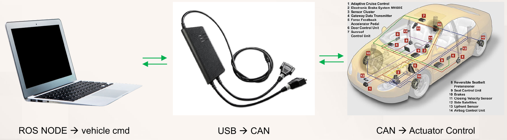
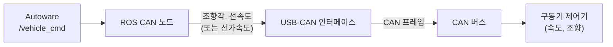
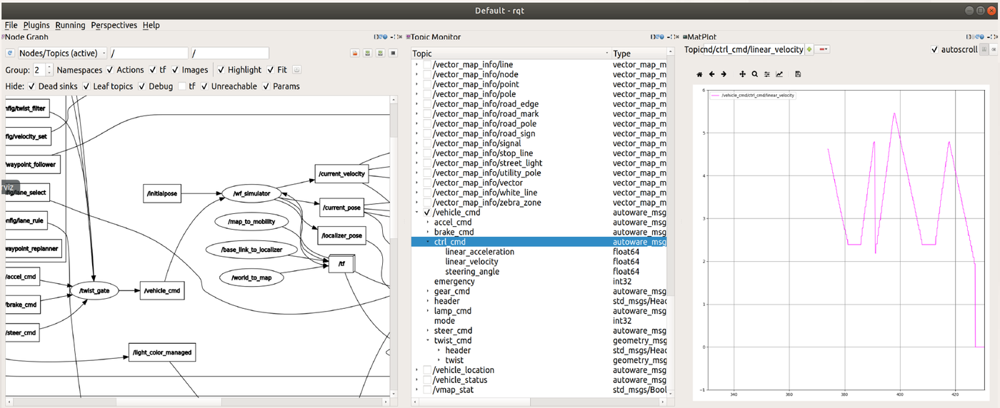
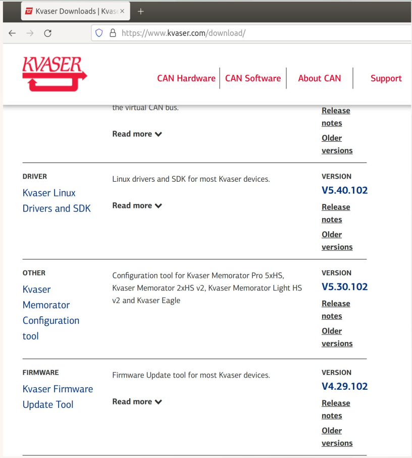
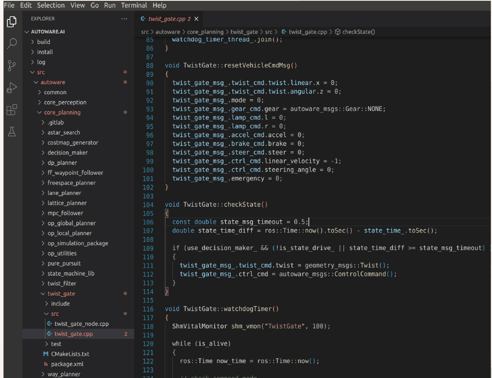
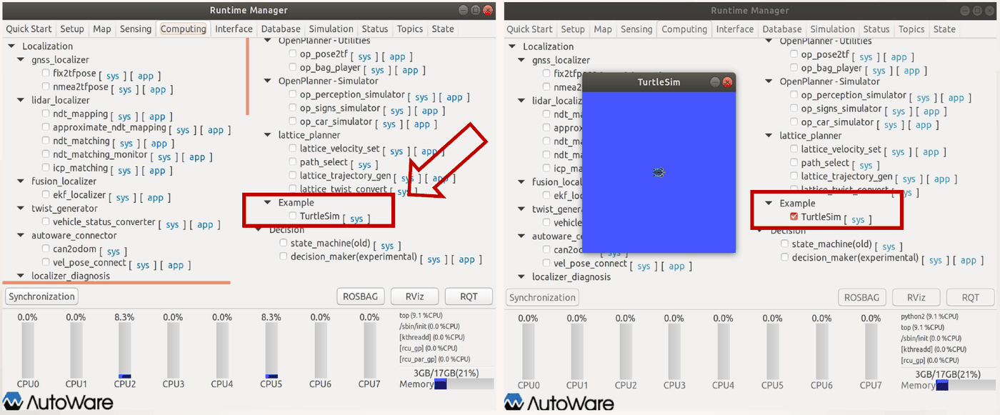
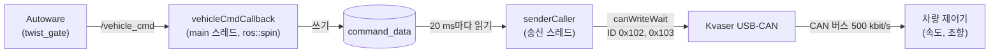

# 14주차 이론 — Autoware CAN 노드

[레포지토리 안내](../../README.ko.md) | [English](Concepts_Lecture.md) | [한국어](Concepts_Lecture.ko.md)

> **최종 수정일:** 2026-11-04

> **학습 목표:**
> 1. Autoware의 `/vehicle_cmd` 메시지가 ROS CAN 노드와 USB-CAN 인터페이스를 거쳐 실제 차량의 구동기 명령이 되는 흐름을 설명할 수 있다
> 2. Kvaser의 리눅스 드라이버와 CANlib(linuxcan)를 설치하고 설치 결과를 확인할 수 있다
> 3. Autoware가 권장하는 패키지 구조에 맞게 노드를 구성하고, CMakeLists.txt와 package.xml을 고쳐 colcon으로 빌드하고 실행할 수 있다
> 4. computing.yaml을 고쳐 Runtime Manager의 Computing 탭에 노드를 추가할 수 있다
> 5. `can_mobility_test` 노드가 속도와 조향 명령을 저역 통과 필터, 단위 변환, 바이트 분할을 거쳐 CAN 프레임으로 주기적으로 송신하는 과정을 코드 수준에서 설명할 수 있다

---

## 목차

- [1. ROS CAN 노드와 Kvaser CANlib](#1-ros-can-노드와-kvaser-canlib)
  - [1.1 ROS 노드에서 차량 구동기까지](#11-ros-노드에서-차량-구동기까지)
  - [1.2 /vehicle_cmd 메시지](#12-vehicle_cmd-메시지)
  - [1.3 Kvaser CAN 인터페이스와 CANlib](#13-kvaser-can-인터페이스와-canlib)
  - [1.4 linuxcan 설치](#14-linuxcan-설치)
- [2. Autoware ROS 노드의 작성과 실행](#2-autoware-ros-노드의-작성과-실행)
  - [2.1 노드 작성 순서](#21-노드-작성-순서)
  - [2.2 Autoware의 권장 패키지 구조](#22-autoware의-권장-패키지-구조)
  - [2.3 예: twist_gate 패키지](#23-예-twist_gate-패키지)
  - [2.4 CMakeLists.txt 수정](#24-cmakeliststxt-수정)
  - [2.5 colcon 빌드](#25-colcon-빌드)
  - [2.6 노드 실행](#26-노드-실행)
  - [2.7 Runtime Manager에 노드 추가](#27-runtime-manager에-노드-추가)
- [3. CAN 통신 노드 작성: can_mobility_test](#3-can-통신-노드-작성-can_mobility_test)
  - [3.1 패키지 생성](#31-패키지-생성)
  - [3.2 CMakeLists.txt와 package.xml 수정](#32-cmakeliststxt와-packagexml-수정)
  - [3.3 노드의 구조: 수신부와 송신부](#33-노드의-구조-수신부와-송신부)
  - [3.4 헤더와 전역 선언](#34-헤더와-전역-선언)
  - [3.5 오류 확인 함수와 신호 처리기](#35-오류-확인-함수와-신호-처리기)
  - [3.6 명령 데이터와 콜백 함수](#36-명령-데이터와-콜백-함수)
  - [3.7 송신 스레드의 준비: CAN 채널 열기](#37-송신-스레드의-준비-can-채널-열기)
  - [3.8 송신 루프 1: 속도 변환과 저역 통과 필터](#38-송신-루프-1-속도-변환과-저역-통과-필터)
  - [3.9 송신 루프 2: 조향 값의 인코딩과 송신](#39-송신-루프-2-조향-값의-인코딩과-송신)
  - [3.10 main 함수](#310-main-함수)
  - [3.11 송신되는 CAN 프레임과 계산 예](#311-송신되는-can-프레임과-계산-예)
  - [3.12 빌드, 실행, 개선할 점](#312-빌드-실행-개선할-점)
- [개념 적용](#개념-적용)
- [요약](#요약)
- [점검 문제](#점검-문제)
- [참고 문헌](#참고-문헌)

---

<br>

## 1. ROS CAN 노드와 Kvaser CANlib

### 1.1 ROS 노드에서 차량 구동기까지

Autoware는 경로 계획과 경로 추종의 결과로 차량이 낼 속도와 조향각을 계산하지만, 그 값은 PC 안의 ROS 메시지일 뿐이다. 실제 차량을 움직이려면 이 값을 차량의 **구동기(actuator)**, 곧 모터, 조향 장치, 브레이크처럼 물리적으로 힘을 내는 장치의 제어기에 전달해야 하며, 13주차에서 본 것처럼 차량의 제어기들은 CAN 버스로 연결되어 있다.



*그림 1. ROS 노드, USB-CAN 인터페이스, 차량 제어기의 연결*



*그림 2. vehicle_cmd가 구동기 명령으로 바뀌는 흐름*

전체 흐름은 다음 세 단계이다.

1. **ROS 노드 → vehicle_cmd:** ROS CAN 노드는 Autoware가 발행하는 `/vehicle_cmd` 토픽을 구독하여 조향각(steering angle)과 선속도(linear velocity) 또는 선가속도(linear acceleration) 명령을 받는다.
2. **USB → CAN:** 노드는 받은 값을 제어 대상 차량의 CAN 프로토콜에 맞는 프레임으로 바꾸어, PC의 USB 포트에 꽂은 USB-CAN 인터페이스로 보낸다. 인터페이스는 이 프레임을 CAN 버스의 전기 신호로 내보낸다.
3. **CAN → 구동기 제어:** 버스에 연결된 속도 제어기와 조향 제어기가 프레임을 받아 실제 차량에 속도와 조향각 명령을 전달한다.

여기서 **CAN 프로토콜을 반영한다**는 말은 차량마다 정해진 메시지 명세를 따른다는 뜻이다. 어떤 식별자(ID)의 프레임에 어떤 신호가 몇 번째 바이트에 어떤 단위와 배율로 들어가는지는 차량 제조사나 제어기 제작사가 정하며, CAN 노드는 그 명세대로 값을 바꾸어 넣어야 한다. 3절의 `can_mobility_test` 노드가 그 예이다.

### 1.2 /vehicle_cmd 메시지



*그림 3. rqt에서 본 노드 그래프, /vehicle_cmd의 필드, 명령 속도의 그래프*

그림 3은 12주차의 wf_simulator로 Autoware 시뮬레이션을 실행하면서 rqt로 본 화면이다. 왼쪽의 노드 그래프에서 `/twist_gate` 노드는 경로 추종 노드가 낸 명령과 여러 명령 토픽(`/accel_cmd`, `/brake_cmd`, `/steer_cmd` 등)을 모아 `/vehicle_cmd` 토픽을 발행하고, `/wf_simulator`가 이를 구독하여 가상 차량을 움직인 뒤 `/current_velocity`, `/current_pose`, `/localizer_pose`, `/tf`를 발행한다. 가운데의 Topic Monitor는 `/vehicle_cmd` 메시지의 필드를 펼쳐 보인 것이고, 오른쪽의 MatPlot은 `/vehicle_cmd/ctrl_cmd/linear_velocity` 값을 시간에 따라 그린 것이다. 같은 방법으로 `/vehicle_cmd/ctrl_cmd/linear_acceleration`을 그리면 가속도 명령의 변화를 볼 수 있다. 시뮬레이션에서는 wf_simulator가 차량 역할을 하고, 실제 차량에서는 CAN 노드가 그 자리에서 `/vehicle_cmd`를 받아 차량에 전달한다.

`/vehicle_cmd`의 메시지 형식은 `autoware_msgs/VehicleCmd`이며, Autoware 작업 공간의 `src/autoware/messages/autoware_msgs/msg/VehicleCmd.msg`에 다음과 같이 정의되어 있다 [1].

```text
Header header
autoware_msgs/SteerCmd steer_cmd
autoware_msgs/AccelCmd accel_cmd
autoware_msgs/BrakeCmd brake_cmd
autoware_msgs/LampCmd lamp_cmd
autoware_msgs/Gear gear_cmd
int32 mode
geometry_msgs/TwistStamped twist_cmd
autoware_msgs/ControlCommand ctrl_cmd
int32 emergency
```

| 필드 | 형식 | 내용 |
|:-----|:-----|:-----|
| `header` | `std_msgs/Header` | 메시지의 시각과 좌표계 |
| `steer_cmd`, `accel_cmd`, `brake_cmd` | `autoware_msgs` 형식 | 조향, 가속 페달, 브레이크 페달을 직접 조작하는 정수 명령(`steer`, `accel`, `brake`) |
| `lamp_cmd` | `autoware_msgs/LampCmd` | 왼쪽(`l`)과 오른쪽(`r`) 방향 지시등 |
| `gear_cmd` | `autoware_msgs/Gear` | 변속 기어 |
| `mode` | `int32` | 제어 모드 |
| `twist_cmd` | `geometry_msgs/TwistStamped` | 목표 선속도(`twist.linear.x`)와 각속도(`twist.angular.z`) |
| `ctrl_cmd` | `autoware_msgs/ControlCommand` | 목표 선속도 `linear_velocity`, 선가속도 `linear_acceleration`, 조향각 `steering_angle`(모두 `float64`) |
| `emergency` | `int32` | 비상 정지 여부 |

*표 1. autoware_msgs/VehicleCmd 메시지의 필드*

ROS는 SI 단위를 쓰므로 `ctrl_cmd`의 속도는 m/s, 가속도는 m/s², 조향각은 라디안이다 [2]. 이 조향각은 운전대의 회전각이 아니라 앞바퀴(타이어)가 꺾인 각으로, 12주차의 자전거 모델에서 쓴 앞바퀴 조향각 $\delta_f$와 같은 양이다. 3절의 CAN 노드는 이 가운데 `ctrl_cmd.linear_velocity`와 `ctrl_cmd.steering_angle`만 쓴다.

### 1.3 Kvaser CAN 인터페이스와 CANlib

**Kvaser**는 CAN 인터페이스 장치를 만드는 스웨덴의 회사로, 그림 1 가운데의 장치처럼 한쪽은 PC의 USB에, 다른 쪽은 CAN 버스 커넥터에 연결하는 USB-CAN 인터페이스를 판매한다. 응용 프로그램은 장치를 직접 다루지 않고 Kvaser가 제공하는 **CANlib**라는 C 라이브러리를 호출하며, 같은 CANlib 코드가 Kvaser의 여러 장치에서 그대로 동작한다 [3]. 리눅스용 드라이버와 CANlib는 **Kvaser Linux Drivers and SDK**라는 이름으로 함께 배포되며, 내려받는 파일 이름이 `linuxcan.tar.gz`이므로 흔히 linuxcan이라 부른다 [4]. 이 패키지에는 다음이 들어 있다.

- **커널 드라이버:** USB-CAN 장치를 리눅스 커널이 인식하게 하는 커널 모듈이다.
- **CANlib 라이브러리와 헤더:** 응용 프로그램이 링크하는 `libcanlib`와 함수 선언이 담긴 `canlib.h`이다.
- **예제 프로그램:** 채널 목록 확인, 송수신 같은 기본 동작을 보여 주는 예제이다.

4주차의 Autoware 설치에서 CANlib 설치를 선택 사항으로 다루었는데, CAN 노드를 빌드하려면 이 설치가 필요하다.

### 1.4 linuxcan 설치

**1단계: 내려받기.** Kvaser 사이트의 다운로드 페이지(https://www.kvaser.com/download/)에서 "Kvaser Linux Drivers and SDK"를 클릭하여 `linuxcan.tar.gz`를 내려받는다.



*그림 4. Kvaser 다운로드 페이지의 Kvaser Linux Drivers and SDK 항목*

**2단계: 빌드 도구 준비.** 드라이버는 커널 모듈이므로 지금 실행 중인 커널과 같은 버전의 커널 헤더와 컴파일러가 있어야 빌드된다 [4].

```bash
sudo apt update
sudo apt install build-essential linux-headers-$(uname -r)
```

`build-essential`은 `gcc`, `g++`, `make` 같은 기본 빌드 도구의 묶음이고, `$(uname -r)`은 현재 커널의 버전 문자열로 바뀌므로 `linux-headers-$(uname -r)`은 현재 커널에 맞는 헤더 패키지를 가리킨다.

**3단계: 압축 해제와 설치.** 내려받은 파일이 `~/Downloads`에 있다고 가정한다. 파일 관리자에서 파일을 오른쪽 클릭하여 Extract Here로 풀어도 되고, 터미널에서 다음과 같이 풀어도 된다.

```bash
cd ~/Downloads
tar xzf linuxcan.tar.gz
cd linuxcan
make
sudo make install
```

- `tar xzf linuxcan.tar.gz`는 gzip으로 압축된(`z`) tar 묶음을 풀어(`x`) 지정한 파일(`f`)의 내용을 `linuxcan` 디렉토리로 꺼낸다.
- `make`는 커널 드라이버 모듈과 CANlib 라이브러리, 예제 프로그램을 빌드한다. 관리자 권한이 필요 없으므로 일반 사용자로 실행한다.
- `sudo make install`은 빌드한 드라이버 모듈을 커널 모듈 디렉토리에, 라이브러리와 헤더를 시스템 경로에 복사한다. 시스템 디렉토리에 쓰므로 `sudo`가 필요하다. 헤더와 라이브러리가 컴파일러의 기본 검색 경로에 놓이므로, 이후 CMake에서 라이브러리 이름 `canlib`만 적어도 링크된다(3.2절).

**4단계: 확인.** USB-CAN 인터페이스를 꽂은 뒤 linuxcan의 예제 프로그램 `listChannels`를 실행하면 CANlib가 인식한 채널의 목록과 장치 이름이 출력된다.

```bash
cd ~/Downloads/linuxcan/canlib/examples
./listChannels
```

장치가 목록에 나타나면 드라이버와 라이브러리가 제대로 설치된 것이다. 목록의 순서가 CANlib에서 쓰는 채널 번호이며, 첫 채널이 0번이다.

> **주의:** 드라이버는 설치할 때의 커널 버전에 맞추어 빌드되므로, 커널이 업데이트되면 `make`와 `sudo make install`을 다시 해야 한다. 또 UEFI 보안 부팅(Secure Boot)이 켜진 컴퓨터에서는 서명되지 않은 커널 모듈이 적재되지 않을 수 있으므로, 모듈에 서명하거나 보안 부팅 설정을 확인해야 한다 [5].

---

<br>

## 2. Autoware ROS 노드의 작성과 실행

### 2.1 노드 작성 순서

Autoware의 노드도 기본적으로 일반 ROS 노드와 같은 방법으로 작성한다. 5주차에서 `hello_dsc` 노드를 만든 순서 그대로이다.

1. 패키지(package)를 만든다.
2. 노드(node)의 소스 코드를 작성한다.
3. 노드를 빌드(build)한다.
4. 노드의 동작을 확인한다.

다른 점은 작업 공간의 위치와 빌드 도구이다. 5주차의 노드는 별도의 catkin 작업 공간에서 `catkin_make`로 빌드했지만, Autoware 노드는 Autoware.ai 작업 공간(`~/autoware.ai`) 안에 패키지를 만들고 Autoware 전체를 빌드할 때 쓴 **colcon**으로 빌드한다(2.5절).

### 2.2 Autoware의 권장 패키지 구조

Autoware에서는 패키지를 만들 때 다음 조건을 충족하는 것을 권장한다.

1. `src/autoware/core_planning/twist_filter`처럼 각 범주(category)마다 패키지를 모으는 디렉토리가 있으며, 그 바로 아래에 패키지를 만든다.
2. `nodes` 디렉토리에 노드 이름과 같은 디렉토리를 만들고, 그 아래에 노드의 소스 코드 등을 둔다.
3. 메시지 파일은 `messages` 디렉토리에 추가한다.
4. 여러 노드에서 공통으로 쓰는 처리를 라이브러리로 만든 경우에는 `lib`나 `include` 등의 디렉토리에 라이브러리의 소스 코드를 둔다.

또 노드 하나하나를 **네임스페이스(namespace)** 로 구분하는 방법이 권장된다. Autoware에는 수백 개의 노드와 토픽이 있으므로, 노드의 코드와 이름을 고유한 네임스페이스 안에 두면 다른 패키지의 같은 이름과 충돌하지 않는다.

```text
src/autoware/<category>/<package>/
├── package.xml
├── CMakeLists.txt
├── src/
│   ├── <node>.cpp
│   ├── <node>.py        (other source code)
│   └── ...
├── include/
│   └── (header files of libraries, etc.)
└── lib/
    └── (library source code)

src/autoware/messages/<message package>/
└── msg/
    ├── <message 1>.msg
    └── <message 2>.msg
```

*그림 5. Autoware 패키지와 메시지 패키지의 디렉토리 구조*

그림 5의 각 항목은 다음과 같다.

- **`<category>`:** `common`, `core_perception`, `core_planning`처럼 기능별로 패키지를 묶는 범주 디렉토리이다.
- **`package.xml`:** 패키지의 이름, 버전, 의존하는 다른 패키지를 적는 매니페스트이다.
- **`CMakeLists.txt`:** 소스 코드를 어떻게 컴파일하고 무엇과 링크할지 적는 빌드 설정이다.
- **`src/`:** 노드의 C++ 소스(`<node>.cpp`)와 Python 스크립트(`<node>.py`) 같은 소스 코드를 둔다.
- **`include/`와 `lib/`:** 노드들이 함께 쓰는 라이브러리의 헤더 파일과 소스 코드를 둔다.
- **`messages/<message package>/msg/`:** 새 메시지 형식을 정의하는 `.msg` 파일을 둔다. 메시지를 별도 패키지로 모아 두면 여러 패키지가 같은 메시지 정의를 공유할 수 있다. Autoware.ai 1.14의 `src/autoware/messages` 아래에는 `autoware_can_msgs`, `autoware_config_msgs`, `autoware_external_msgs`, `autoware_lanelet2_msgs`, `autoware_map_msgs`, `autoware_msgs` 같은 메시지 패키지가 있으며, 1.2절의 `VehicleCmd.msg`는 `autoware_msgs/msg/` 아래에 `AccelCmd.msg`, `BrakeCmd.msg`, `ControlCommand.msg` 같은 다른 메시지 정의와 함께 있다.

> **참고:** 권장 조건 2의 `nodes/<노드 이름>/` 구성은 예전 Autoware 패키지들이 쓰던 방식이고, 그림 5와 Autoware.ai 1.14의 많은 패키지는 소스를 `src/` 아래에 둔다. 어느 쪽을 쓰든 2.4절의 `add_executable`에 적는 소스 경로가 실제 파일 위치와 같아야 한다.

### 2.3 예: twist_gate 패키지



*그림 6. VS Code로 연 Autoware 작업 공간과 twist_gate.cpp*

그림 6은 VS Code로 Autoware 작업 공간을 연 화면이다. 작업 공간 아래에 colcon이 만드는 `build`, `install`, `log` 디렉토리와 소스 디렉토리 `src`가 있고, `src/autoware` 아래에 `common`, `core_perception`, `core_planning` 같은 범주 디렉토리가 있다. `core_planning` 범주에는 `astar_search`, `decision_maker`, `lane_planner`, `mpc_follower`, `pure_pursuit`, `twist_filter`, `twist_gate`, `waypoint_follower` 같은 경로 계획과 추종 패키지가 모여 있다. `twist_gate` 패키지는 `include`, `src`(`twist_gate_node.cpp`, `twist_gate.cpp`), `test`, `CMakeLists.txt`, `package.xml`로 구성되어 그림 5의 구조를 따른다 [6].

`twist_gate`는 1.2절에서 본 것처럼 여러 명령을 모아 `/vehicle_cmd`를 발행하는 노드이다. 그림 6에 열린 `twist_gate.cpp`의 일부는 다음과 같다.

```cpp
void TwistGate::resetVehicleCmdMsg()
{
  twist_gate_msg_.twist_cmd.twist.linear.x = 0;
  twist_gate_msg_.twist_cmd.twist.angular.z = 0;
  twist_gate_msg_.mode = 0;
  twist_gate_msg_.gear_cmd.gear = autoware_msgs::Gear::NONE;
  twist_gate_msg_.lamp_cmd.l = 0;
  twist_gate_msg_.lamp_cmd.r = 0;
  twist_gate_msg_.accel_cmd.accel = 0;
  twist_gate_msg_.brake_cmd.brake = 0;
  twist_gate_msg_.steer_cmd.steer = 0;
  twist_gate_msg_.ctrl_cmd.linear_velocity = -1;
  twist_gate_msg_.ctrl_cmd.steering_angle = 0;
  twist_gate_msg_.emergency = 0;
}

void TwistGate::checkState()
{
  const double state_msg_timeout = 0.5;
  double state_time_diff = ros::Time::now().toSec() - state_time_.toSec();

  if (use_decision_maker_ && (!is_state_drive_ || state_time_diff >= state_msg_timeout))
  {
    twist_gate_msg_.twist_cmd.twist = geometry_msgs::Twist();
    twist_gate_msg_.ctrl_cmd = autoware_msgs::ControlCommand();
  }
}
```

- **`resetVehicleCmdMsg()`:** 발행할 `VehicleCmd` 메시지(`twist_gate_msg_`)의 모든 필드를 초기값으로 되돌린다. 목표 속도와 각속도, 모드, 페달과 조향 명령, 비상 정지를 0으로, 기어를 `NONE`으로 둔다. `ctrl_cmd.linear_velocity`만 0이 아닌 -1로 두는 점에 주의할 필요가 있다. CAN 노드가 이 값을 어떻게 전송하는지는 3.12절에서 다룬다.
- **`checkState()`:** 상태 관리 노드(decision_maker)를 쓰도록 설정되어 있을 때, 차량 상태가 주행 상태가 아니거나 마지막 상태 메시지를 받은 지 0.5초 이상 지났으면 속도 명령(`twist_cmd.twist`)과 제어 명령(`ctrl_cmd`)을 모두 0으로 만든다. 상태 정보가 끊기면 차량을 멈추는 안전 장치이다. `geometry_msgs::Twist()`와 `autoware_msgs::ControlCommand()`는 모든 필드가 0인 메시지를 만든다.

`twist_gate`의 `CMakeLists.txt`는 다음과 같다.

```cmake
cmake_minimum_required(VERSION 2.8.3)
project(twist_gate)

find_package(autoware_build_flags REQUIRED)
find_package(
  catkin REQUIRED COMPONENTS
    autoware_config_msgs
    autoware_health_checker
    autoware_msgs
    geometry_msgs
    ros_observer
    roscpp
    roslint
    std_msgs
    tablet_socket_msgs
)

catkin_package(
  INCLUDE_DIRS include
)

SET(CMAKE_CXX_FLAGS "-O2 -g -Wall ${CMAKE_CXX_FLAGS}")
set(ROSLINT_CPP_OPTS "--filter=-build/c++11")

roslint_cpp()

include_directories(
  include
  ${catkin_INCLUDE_DIRS}
)
```

- `cmake_minimum_required`와 `project`는 필요한 CMake의 최소 버전과 패키지(프로젝트) 이름을 정한다.
- `find_package(autoware_build_flags REQUIRED)`는 Autoware 패키지들이 공통으로 쓰는 빌드 옵션을 불러온다.
- `find_package(catkin REQUIRED COMPONENTS ...)`는 이 패키지가 의존하는 ROS 패키지를 찾는다. 찾은 패키지들의 헤더 경로와 라이브러리는 `catkin_INCLUDE_DIRS`와 `catkin_LIBRARIES` 변수에 모인다 [7].
- `catkin_package(INCLUDE_DIRS include)`는 이 패키지를 쓰는 다른 패키지에 `include` 디렉토리의 헤더를 공개한다.
- `SET(CMAKE_CXX_FLAGS ...)`와 `set(ROSLINT_CPP_OPTS ...)`, `roslint_cpp()`는 2.4절에서 설명한다.
- `include_directories`는 컴파일할 때 이 패키지의 `include`와 의존 패키지의 헤더 경로를 검색하게 한다.

### 2.4 CMakeLists.txt 수정

새 노드를 빌드하기 전에 `CMakeLists.txt`를 다음과 같이 고친다. Autoware는 C++를 컴파일할 때 특정 옵션을 지정하므로, 먼저 다음 두 줄을 추가한다.

```cmake
SET(CMAKE_CXX_FLAGS "-O2 -g -Wall ${CMAKE_CXX_FLAGS}")
set(ROSLINT_CPP_OPTS "--filter=-build/c++11")
```

- **`CMAKE_CXX_FLAGS`:** C++ 컴파일러에 넘기는 옵션이다. `-O2`는 2단계 최적화, `-g`는 디버거가 쓸 디버깅 정보 포함, `-Wall`은 흔한 실수에 대한 경고를 모두 켜는 옵션이다. 뒤의 `${CMAKE_CXX_FLAGS}`는 이미 설정되어 있던 옵션을 지우지 않고 뒤에 이어 붙이기 위한 것이다.
- **`ROSLINT_CPP_OPTS`:** **roslint**는 코드가 정해진 작성 규칙을 따르는지 검사하는 ROS의 도구로, C++ 코드에는 Google의 cpplint를 쓴다 [8]. `--filter=-build/c++11`은 cpplint의 검사 항목 가운데 `<thread>`, `<chrono>` 같은 C++11 헤더의 사용을 경고하는 `build/c++11` 항목을 끈다 [9]. 이 설정은 `twist_gate`처럼 `roslint_cpp()`로 검사를 켠 패키지에서 효과가 있다.

다음으로, 작성한 노드(예: `mynode`)의 소스 코드가 `src/mynode.cpp`임을 나타내는 한 줄을 추가한다. 그림 5와 달리 `nodes/mynode/mynode.cpp`에 두었다면 그 경로를 적는다.

```cmake
add_executable(mynode src/mynode.cpp)
```

`add_executable(이름 소스...)`는 소스 파일을 컴파일하여 `mynode`라는 실행 파일을 만들라는 뜻이다. 이 이름이 나중에 `rosrun`으로 실행할 노드 실행 파일의 이름이 된다.

마지막으로, ROS의 일반 라이브러리를 링크하도록 다음 줄을 추가한다.

```cmake
target_link_libraries(mynode
  ${catkin_LIBRARIES}
)
```

`target_link_libraries`는 `mynode` 실행 파일을 만들 때 `find_package`로 찾은 ROS 라이브러리(`roscpp` 등)를 함께 링크하게 한다. 이 줄이 없으면 컴파일은 되지만 `ros::init` 같은 함수의 정의를 찾지 못해 링크 단계에서 실패한다. `target_link_libraries`는 대상을 만드는 `add_executable`보다 뒤에 와야 한다.

### 2.5 colcon 빌드

**colcon**은 작업 공간 안의 패키지를 하나하나 격리하여 따로 빌드하는 빌드 도구로, 의존하는 패키지를 먼저 빌드하는 순서를 지키면서 서로 의존하지 않는 패키지는 동시에 빌드한다 [10]. catkin 패키지와 ROS 2 패키지를 모두 빌드할 수 있으며, 4주차에서 설치한 Autoware.ai 1.14도 colcon으로 빌드한다. 작업 공간의 최상위 디렉토리에서 다음 명령을 실행한다.

```bash
cd ~/autoware.ai
colcon build --cmake-args -DCMAKE_BUILD_TYPE=Release
```

`--cmake-args` 뒤의 인자는 각 패키지의 CMake에 그대로 전달되며, `-DCMAKE_BUILD_TYPE=Release`는 최적화를 켜고 디버깅용 검사를 끈 배포용 빌드를 뜻한다. 빌드 결과는 다음 세 디렉토리에 생긴다.

| 디렉토리 | 내용 |
|:-----|:-----|
| `build/` | 패키지마다 CMake가 만든 중간 파일 |
| `install/` | 패키지마다 설치된 실행 파일, 라이브러리, 실행에 필요한 환경 설정 스크립트(`setup.bash`) |
| `log/` | 빌드할 때의 로그 |

*표 2. colcon이 만드는 디렉토리*

위 명령은 작업 공간의 모든 패키지를 빌드하므로, 매번 실행하면 시간이 많이 걸린다. 수정한 패키지만 빌드하여 시간을 줄이려면 다음과 같이 패키지 이름을 지정한다.

```bash
colcon build --packages-select mypkg
```

`--packages-select` 뒤에는 노드 이름이 아니라 **패키지 이름**을 적는다. 여기서 `mypkg`는 `mynode`를 담은 패키지의 이름이다. 이 옵션은 지정한 패키지만 빌드하므로, 그 패키지가 의존하는 다른 패키지는 이미 빌드되어 있어야 한다.

> **참고:** 5주차의 `catkin_make`는 작업 공간의 모든 패키지를 하나의 CMake 프로젝트로 묶어 빌드하고 결과를 `devel/`에 두지만, colcon은 패키지마다 따로 빌드하여 결과를 `install/`에 둔다. 그래서 colcon 작업 공간에서는 `source devel/setup.bash` 대신 `source install/setup.bash`로 환경을 설정한다.

### 2.6 노드 실행

먼저 ROS의 기본 프로그램(마스터, 매개변수 서버 등)을 시작하기 위해 `roscore`를 실행한다.

```bash
roscore
```

다른 터미널을 열어, 작업 공간의 환경을 불러온 뒤 작성한 `mynode`를 `rosrun` 명령으로 실행한다.

```bash
cd ~/autoware.ai
source install/setup.bash
rosrun mypkg mynode
```

`source install/setup.bash`는 이 작업 공간에서 빌드한 패키지의 위치를 환경 변수에 등록하므로, 새 터미널을 열 때마다 다시 실행해야 한다. `rosrun 패키지 실행파일`은 그 패키지에서 `add_executable`로 만든 실행 파일을 찾아 실행한다.

### 2.7 Runtime Manager에 노드 추가

**Runtime Manager**는 4주차에 `roslaunch runtime_manager runtime_manager.launch`로 실행한 Autoware의 GUI로, 체크 상자를 눌러 ROS 노드를 실행하고 종료할 수 있다. 직접 작성한 노드도 Runtime Manager에 추가하여 같은 방식으로 실행하고 종료할 수 있다 [11].

Computing 탭에 표시되는 각 열의 항목은 다음 경로의 파일에 정의되어 있다.

```text
src/autoware/utilities/runtime_manager/scripts/computing.yaml
```

예를 들어 Computing 탭의 Localization 아래 lidar_localizer 항목에 있는 ndt_matching의 설정은 이 파일의 다음 위치에 작성되어 있다. `# ...`은 생략한 부분이다.

```yaml
name : Computing
subs :
- subs :
  - name : Localization
    desc : Localization desc sample
    subs :
    - name : gnss_localizer
      # ... (fix2tfpose, nmea2tfpose)
    - name : lidar_localizer
      desc : lidar_localizer desc sample
      subs :
      - name : ndt_mapping
        desc : ndt_mapping desc sample
        cmd  : roslaunch lidar_localizer ndt_mapping.launch
        param: ndt_mapping
      # ... (approximate_ndt_mapping)
      - name : ndt_matching
        desc : ndt_matching desc sample
        cmd  : roslaunch lidar_localizer ndt_matching.launch
        param: ndt
```

- **`name`:** 화면에 표시되는 이름이다.
- **`subs`:** 그 아래에 들어가는 하위 항목의 목록이다. 항목은 `- name`으로 시작하며, 들여쓰기 깊이가 화면의 계층을 정한다.
- **`desc`:** 항목의 설명 문구이다.
- **`cmd`:** 체크 상자를 켰을 때 실행할 명령이다. 체크를 끄면 이 명령으로 시작한 프로세스가 종료된다.
- **`param`:** 매개변수 설정 창의 정의 이름이다. `param`이 있는 항목에는 설정 창을 여는 `[app]` 버튼이 함께 표시된다.

이제 Motion Planning 열의 바로 아래 계층 끝에 Example 항목을 새로 추가하고, 그 안에 `turtlesim` 패키지의 `turtlesim_node` 노드를 실행하고 종료하는 TurtleSim 항목을 넣는다. Motion Planning의 `subs` 목록 맨 끝에, 같은 계층의 다른 항목(예: lattice_planner)과 같은 깊이로 다음을 추가한다.

```yaml
- name : Example
  subs :
    - name : TurtleSim
      cmd : rosrun turtlesim turtlesim_node
```

YAML은 들여쓰기로 계층을 나타내므로, 탭 대신 공백을 쓰고 이웃한 항목과 들여쓰기를 정확히 맞추어야 한다. 파일을 고친 뒤 `runtime_manager` 패키지를 다시 빌드하고 Runtime Manager를 다시 실행한다.

```bash
cd ~/autoware.ai
colcon build --packages-select runtime_manager
source install/setup.bash
roslaunch runtime_manager runtime_manager.launch
```



*그림 7. Computing 탭에 추가한 Example과 TurtleSim 항목, TurtleSim을 켰을 때 열린 창*

그림 7의 왼쪽처럼 Computing 탭의 lattice_planner 아래에 Example과 TurtleSim 항목이 나타난다. TurtleSim은 `param`이 없으므로 `[app]` 버튼 없이 `[sys]` 버튼만 표시된다. 오른쪽처럼 TurtleSim의 체크 상자를 켜면 `cmd`의 `rosrun turtlesim turtlesim_node`가 실행되어 거북이 창이 열리고, 체크를 끄면 창이 닫힌다. 3절에서 만들 CAN 노드도 같은 방법으로 Runtime Manager에 추가할 수 있다.

---

<br>

## 3. CAN 통신 노드 작성: can_mobility_test

### 3.1 패키지 생성

Autoware와 연계해서 CAN 통신하는 ROS 노드 `can_mobility_test`를 작성한다. 먼저 `src/autoware/core_planning`으로 이동하여 패키지를 만든다.

```bash
cd ~/autoware.ai/src/autoware/core_planning
catkin_create_pkg can_mobility_test roscpp std_msgs
```

`catkin_create_pkg 패키지이름 의존패키지...`는 새 catkin 패키지의 뼈대를 만든다. 여기서는 C++ ROS 클라이언트 라이브러리 `roscpp`와 표준 메시지 `std_msgs`에 의존하는 `can_mobility_test` 패키지를 만든다. 명령을 실행하면 `include`, `src`, `CMakeLists.txt`, `package.xml`이 생성된다. 이어서 `src` 디렉토리에 노드의 소스 파일 `can_mobility_test.cpp`를 만든다.

```text
core_planning/
├── astar_search/
├── ...
└── can_mobility_test/
    ├── include/
    │   └── can_mobility_test/
    ├── src/
    │   └── can_mobility_test.cpp
    ├── CMakeLists.txt
    └── package.xml
```

*그림 8. 만든 can_mobility_test 패키지의 구조*

### 3.2 CMakeLists.txt와 package.xml 수정

`CMakeLists.txt`에 다음 내용을 추가한다. 앞의 두 줄은 2.4절의 Autoware 컴파일 옵션이고, 그다음은 노드 실행 파일과 ROS 라이브러리 링크이다.

```cmake
SET(CMAKE_CXX_FLAGS "-O2 -g -Wall ${CMAKE_CXX_FLAGS}")
set(ROSLINT_CPP_OPTS "--filter=-build/c++11")

add_executable(can_mobility_test src/can_mobility_test.cpp)

target_link_libraries(can_mobility_test ${catkin_LIBRARIES})
```

이 노드는 `autoware_msgs/VehicleCmd` 메시지와 Kvaser CANlib를 쓰므로 다음 내용도 추가한다.

```cmake
find_package(catkin REQUIRED COMPONENTS
  roscpp
  std_msgs
  autoware_msgs
)

catkin_package(

)

target_link_libraries(can_mobility_test canlib)
add_dependencies(can_mobility_test ${catkin_EXPORTED_TARGETS})
```

- **`find_package(... autoware_msgs)`:** `catkin_create_pkg`가 만든 `find_package`에 `autoware_msgs`를 더해, `autoware_msgs/VehicleCmd.h` 헤더를 찾을 수 있게 한다.
- **`catkin_package()`:** 이 패키지가 다른 패키지에 공개할 것이 없으므로 빈 괄호로 둔다. 이 호출이 있어야 catkin이 패키지의 설치 위치와 환경을 설정한다.
- **`target_link_libraries(can_mobility_test canlib)`:** 1.4절에서 설치한 CANlib(`libcanlib`)를 링크한다. 라이브러리가 기본 검색 경로에 있으므로 이름만 적으면 된다.
- **`add_dependencies(... ${catkin_EXPORTED_TARGETS})`:** 메시지 헤더(`VehicleCmd.h`)를 생성하는 작업이 이 노드의 컴파일보다 먼저 끝나도록 순서를 정한다. 이 줄이 없으면 작업 공간을 처음 빌드할 때 헤더가 아직 없어 컴파일이 실패할 수 있다.

CMake는 위에서 아래로 실행되므로 `find_package`와 `catkin_package`가 `add_executable`보다 앞에, `target_link_libraries`와 `add_dependencies`가 `add_executable`보다 뒤에 와야 한다. `catkin_create_pkg`가 만든 템플릿에 이미 있는 `include_directories`와 함께 정리하면 `CMakeLists.txt`는 다음과 같다.

```cmake
cmake_minimum_required(VERSION 2.8.3)
project(can_mobility_test)

find_package(catkin REQUIRED COMPONENTS
  roscpp
  std_msgs
  autoware_msgs
)

catkin_package(

)

SET(CMAKE_CXX_FLAGS "-O2 -g -Wall ${CMAKE_CXX_FLAGS}")
set(ROSLINT_CPP_OPTS "--filter=-build/c++11")

include_directories(
  ${catkin_INCLUDE_DIRS}
)

add_executable(can_mobility_test src/can_mobility_test.cpp)
target_link_libraries(can_mobility_test ${catkin_LIBRARIES})
target_link_libraries(can_mobility_test canlib)
add_dependencies(can_mobility_test ${catkin_EXPORTED_TARGETS})
```

`package.xml`에는 다음 세 줄을 추가한다.

```xml
<build_depend>autoware_msgs</build_depend>
<build_export_depend>autoware_msgs</build_export_depend>
<exec_depend>autoware_msgs</exec_depend>
```

`package.xml`의 의존성 태그는 그 패키지가 언제 필요한지를 나타낸다 [12]. `build_depend`는 이 패키지를 빌드할 때, `build_export_depend`는 이 패키지의 헤더를 쓰는 다른 패키지를 빌드할 때, `exec_depend`는 이 패키지를 실행할 때 `autoware_msgs`가 필요하다는 뜻이다. colcon은 이 정보로 `autoware_msgs`를 먼저 빌드하는 순서를 정한다.

### 3.3 노드의 구조: 수신부와 송신부

`can_mobility_test.cpp`는 `/vehicle_cmd`를 받아 실제 차량으로 속도 값과 조향각 명령을 전달한다. 노드는 두 부분으로 나뉜다.

- **vehicle_cmd 수신부:** `/vehicle_cmd` 메시지를 구독하여, 받을 때마다 속도와 조향각을 공유 변수에 저장한다. ROS의 콜백 함수로 구현하며 main 스레드의 `ros::spin()`이 호출한다.
- **CAN 통신 송신부:** 별도의 스레드에서 공유 변수를 주기적으로 읽어 CAN 명령을 만들고 보낸다.



*그림 9. can_mobility_test 노드의 두 스레드와 데이터 흐름*

두 부분을 스레드로 나누는 이유는 두 일의 주기가 다르기 때문이다. `/vehicle_cmd`는 Autoware가 정한 주기로 들어오지만, 차량의 제어기는 정해진 주기로 명령이 계속 들어오기를 기대한다. 송신 스레드가 수신과 무관하게 20 ms마다 가장 최근의 명령을 보내므로, 메시지가 늦게 오거나 잠시 끊겨도 CAN 명령의 주기는 일정하게 유지된다. 7주차에서 스레드마다 다른 주기로 토픽을 발행한 것과 같은 구조이다.

### 3.4 헤더와 전역 선언

```cpp
#include <canlib.h>
#include <signal.h>
#include <errno.h>
#include <unistd.h>
#include <pthread.h>
#include <iostream>
#include <cmath>

#include "ros/ros.h"
#include "autoware_msgs/VehicleCmd.h"

#include "std_msgs/String.h"
#include "std_msgs/Int32.h"

#define ALARM_INTERVAL_IN_S (1)
#define WRITE_WAIT_INFINITE (unsigned long)(-1)

#define READ_WAIT_INFINITE (unsigned long)(-1)

static unsigned int msgCounter = 0;
static int willExit = 0;
```

- `<canlib.h>`는 CANlib의 함수와 형식(`canHandle`, `canStatus`, `canOpenChannel` 등)을 선언한다.
- `<signal.h>`는 `signal`, `siginterrupt`와 신호 번호 `SIGINT`, `SIGALRM`을, `<unistd.h>`는 `alarm`과 `usleep`을, `<pthread.h>`는 POSIX 스레드 함수를 선언한다. `<errno.h>`, `<iostream>`, `<cmath>`는 오류 번호, 입출력, 수학 함수의 헤더이다.
- `"ros/ros.h"`는 roscpp의 기본 헤더이고, `"autoware_msgs/VehicleCmd.h"`는 `VehicleCmd.msg`로부터 빌드할 때 생성된 C++ 메시지 헤더이다. `std_msgs/String.h`와 `std_msgs/Int32.h`는 포함되어 있지만 이 코드에서는 쓰이지 않는다.
- `ALARM_INTERVAL_IN_S`는 송신 속도를 출력하는 알람의 간격(1초)이다.
- `WRITE_WAIT_INFINITE`는 -1을 `unsigned long`으로 바꾼 값, 곧 `unsigned long`이 나타낼 수 있는 가장 큰 수이다. CANlib의 대기 함수에 시간 제한으로 넘기면 사실상 무한히 기다리라는 뜻이 된다. `READ_WAIT_INFINITE`는 같은 값이지만 이 코드에서는 수신을 하지 않으므로 쓰이지 않는다.
- `msgCounter`는 보낸 메시지 수를, `willExit`는 종료 요청 여부를 저장하는 전역 변수이다. `static`은 이 파일 안에서만 보이게 한다.

### 3.5 오류 확인 함수와 신호 처리기

```cpp
static void check(char* id, canStatus stat)
{
    if (stat != canOK) {
        char buf[100];
        buf[0] = '\0';
        canGetErrorText(stat, buf, sizeof(buf));
        printf("%s: failed, stat=%d (%s)\n", id, (int)stat, buf);
    }
}

static void sighand(int sig)
{
    static unsigned int last;

    switch (sig) {
    case SIGINT:
        willExit = 1;
        break;
    case SIGALRM:
        if (msgCounter - last) {
            printf("msg/s = %d, total=%u\n",
                (msgCounter - last) / ALARM_INTERVAL_IN_S, msgCounter);
        }
        last = msgCounter;
        alarm(ALARM_INTERVAL_IN_S);
        break;
    }
}
```

**`check` 함수**는 CANlib 함수가 돌려준 상태 코드 `stat`을 검사한다. CANlib 함수는 성공하면 `canOK`(0)를, 실패하면 음수의 오류 코드를 돌려준다 [3].

- `stat`이 `canOK`가 아니면 100바이트 버퍼를 만들고 첫 글자를 `'\0'`으로 두어 빈 문자열로 초기화한다.
- `canGetErrorText(stat, buf, sizeof(buf))`는 오류 코드에 해당하는 설명 문장을 버퍼에 채운다.
- `printf`로 어느 호출(`id`)이 실패했는지, 오류 코드와 설명을 출력한다.

**`sighand` 함수**는 운영체제가 보내는 신호(signal)를 처리한다.

- `SIGINT`는 터미널에서 Ctrl+C를 눌렀을 때 오는 신호로, `willExit`를 1로 바꾸어 송신 루프가 끝나게 한다.
- `SIGALRM`은 `alarm`으로 맞춘 시간이 지나면 오는 신호이다. 지난 알람 이후 늘어난 메시지 수(`msgCounter - last`)가 0이 아니면 초당 메시지 수와 전체 메시지 수를 출력한다. 그다음 `last`를 갱신하고 `alarm`을 다시 맞춘다. `alarm`은 한 번만 울리므로 매번 다시 맞추어야 1초마다 반복된다.
- `static unsigned int last`는 함수가 끝나도 값이 유지되는 지역 변수로, 지난 알람 때의 `msgCounter`를 기억한다.

> **[시스템프로그래밍]** 신호는 운영체제가 프로세스에 비동기적으로 보내는 알림이다. `signal(번호, 함수)`로 처리기를 등록하면, 신호가 오는 순간 프로세스는 하던 일을 멈추고 처리기를 실행한 뒤 돌아간다. 처리기는 프로그램의 어느 지점에서든 끼어들 수 있으므로, 처리기 안에서는 비동기 신호에 안전한(async-signal-safe) 함수만 부르는 것이 원칙이다. `printf`는 이 목록에 없으므로 엄밀히는 처리기에서 피해야 한다 [13].

### 3.6 명령 데이터와 콜백 함수

```cpp
struct CommandData
{
    double linear_velocity;
    double steering_angle;

    void reset();
};

void CommandData::reset()
{
    linear_velocity = 0;
    steering_angle = 0;
}

static CommandData command_data;

static void vehicleCmdCallback(const autoware_msgs::VehicleCmd& msg)
{
    command_data.linear_velocity = msg.ctrl_cmd.linear_velocity;
    command_data.steering_angle = msg.ctrl_cmd.steering_angle;
}
```

- `CommandData` 구조체는 CAN으로 보낼 두 값, 선속도(m/s)와 조향각(rad)을 담고, `reset()`은 두 값을 0으로 만든다.
- `command_data`는 이 구조체의 전역 변수로, 수신부가 쓰고 송신부가 읽는 공유 변수이다.
- `vehicleCmdCallback`은 `/vehicle_cmd` 메시지가 도착할 때마다 roscpp가 호출하는 콜백 함수이다. 메시지의 `ctrl_cmd.linear_velocity`와 `ctrl_cmd.steering_angle`을 `command_data`에 복사한다. 매개변수를 `const` 참조로 받아 메시지를 복사하지 않고 읽는다.

### 3.7 송신 스레드의 준비: CAN 채널 열기

```cpp
static void* senderCaller(void *unused)
{
    //CAN ---------------------------
    canHandle hnd;
    canStatus stat;

    char msg_velo[8] = "";
    char msg_steer[8] = "";
    int channel = 0;

    long speed_id = 258; //0x102
    long steer_id = 259; //0x103

    /* Use sighand as our signal handler */
    signal(SIGALRM, sighand);
    signal(SIGINT, sighand);
    alarm(ALARM_INTERVAL_IN_S);

    /* Allow signals to interrupt syscalls */
    siginterrupt(SIGINT, 1);

    canInitializeLibrary();

    /* Open channel, set parameters and go on bus */
    //hnd = canOpenChannel(channel, canOPEN_EXCLUSIVE | canOPEN_REQUIRE_EXTENDED);
    hnd = canOpenChannel(channel, canOPEN_EXCLUSIVE);

    if (hnd < 0) {
        printf("canOpenChannel %d", channel);
        // check("", hnd);
        return nullptr;
    }

    stat = canSetBusParams(hnd, canBITRATE_500K, 0, 0, 0, 0, 0);
    check("canSetBusParams", stat);
    // if (stat != canOK) {
    // goto ErrorExit;
    // }
    stat = canBusOn(hnd);
    check("canBusOn", stat);
    // if (stat != canOK) {
    // goto ErrorExit;
    // }

    int bin[16] = {0,};
    int check_num = 0;

    double steer_value = 0;
    double steer_gain = 16.5;

    double steer_raw = 0;
    double steer_smooth = 0;
    float LPF_Beta = 0.05; // 0<β<1
```

`senderCaller`는 송신 스레드가 실행하는 함수이다. POSIX 스레드의 시작 함수는 `void*` 하나를 받고 `void*`를 돌려주는 형식이어야 하므로 이런 모양이며, 인자 `unused`는 쓰지 않는다.

- **변수 선언:** `hnd`는 열린 CAN 채널을 가리키는 핸들, `stat`은 CANlib 함수의 상태 코드이다. `msg_velo`와 `msg_steer`는 속도 프레임과 조향 프레임의 데이터 8바이트로, `""`로 초기화하면 8바이트가 모두 0이 된다. `channel = 0`은 1.4절의 `listChannels` 목록에서 첫 번째 채널을 쓴다는 뜻이다.
- **CAN ID:** 속도 프레임의 ID는 258(`0x102`), 조향 프레임의 ID는 259(`0x103`)이다. 둘 다 11비트 표준 ID이며, 13주차의 중재 규칙에 따라 두 프레임이 동시에 경쟁하면 ID가 작은 속도 프레임이 먼저 나간다.
- **신호 설정:** `SIGALRM`과 `SIGINT`의 처리기로 `sighand`를 등록하고, `alarm(1)`로 1초 뒤의 첫 알람을 맞춘다. `siginterrupt(SIGINT, 1)`은 `SIGINT`가 오면 대기 중인 시스템 호출을 자동으로 다시 시작하지 않고 중단시켜, 프로그램이 블록된 상태에서도 종료 요청에 반응하게 한다 [14].
- **`canInitializeLibrary()`:** CANlib를 초기화한다. 다른 CANlib 함수보다 먼저 호출해야 한다 [3].
- **`canOpenChannel(channel, canOPEN_EXCLUSIVE)`:** 0번 채널을 열고 핸들을 돌려받는다. `canOPEN_EXCLUSIVE`는 다른 프로그램이 같은 채널을 함께 열지 못하게 독점한다. 주석 처리된 줄의 `canOPEN_REQUIRE_EXTENDED`는 29비트 확장 ID를 지원하는 채널을 요구하는 옵션으로, 이 노드는 11비트 표준 ID만 쓰므로 필요 없다. 핸들이 음수이면 채널을 열지 못한 것이므로 메시지를 출력하고 스레드를 끝낸다.
- **`canSetBusParams(hnd, canBITRATE_500K, 0, 0, 0, 0, 0)`:** 버스의 비트 속도를 500 kbit/s로 정한다. 미리 정의된 `canBITRATE_` 상수로 비트 속도를 정할 때에는 비트 타이밍을 정하는 뒤의 매개변수를 모두 0으로 넘긴다 [3]. 버스의 모든 제어기는 같은 비트 속도를 써야 하므로, 이 값은 차량의 CAN 버스에 맞추어야 한다.
- **`canBusOn(hnd)`:** 채널을 버스에 참여시킨다. 이때부터 프레임을 보내고 받을 수 있다.
- 각 단계의 결과는 `check`로 출력한다. 주석 처리된 `goto ErrorExit`는 실패하면 정리 코드로 건너뛰는 구조의 흔적이며, 이 코드에는 `ErrorExit` 레이블이 없으므로 쓰이지 않는다.
- **루프 변수:** `bin`은 조향 값의 16비트를 담는 배열, `check_num`은 0\~15를 도는 카운터, `steer_gain = 16.5`는 조향비, `steer_raw`와 `steer_smooth`는 필터의 입력과 출력, `LPF_Beta = 0.05`는 필터 계수이다. 각각의 의미는 3.8절과 3.9절에서 설명한다.

### 3.8 송신 루프 1: 속도 변환과 저역 통과 필터

```cpp
    // CAN sending ----------------------------
    while ((stat == canOK) && !willExit) {

        if (check_num > 15) {
            check_num = 0;
        }

        // Real driving
        msg_velo[2] = command_data.linear_velocity * 3600 / 1000;

        msg_velo[7] = check_num;

        // low pass filter
        steer_raw = command_data.steering_angle * 180 / 3.14159 * steer_gain;
        steer_smooth = steer_smooth - (LPF_Beta * (steer_smooth - steer_raw));

        steer_value = steer_smooth;

        if (steer_value > 450) {
            steer_value = 450;
        }
        else if (steer_value < -450) {
            steer_value = -450;
        }
```

- **루프 조건:** 마지막 CANlib 호출이 성공했고(`stat == canOK`) 종료 요청이 없는(`!willExit`) 동안 반복한다.
- **카운터:** `check_num`이 15를 넘으면 0으로 되돌려 0, 1, ..., 15, 0, 1, ...을 반복한다. 이 값은 두 프레임의 마지막 바이트에 들어가는 **얼라이브 카운터(alive counter)** 로, 받는 제어기는 값이 프레임마다 1씩 바뀌는지 보고 송신 노드가 살아 있는지, 같은 프레임이 반복되거나 빠지지 않았는지 확인한다.
- **속도 변환:** `linear_velocity`(m/s)에 3600/1000을 곱해 km/h로 바꾼다. 1 m/s는 1시간(3600 s)에 3600 m, 곧 3.6 km이기 때문이다. 결과는 `char` 하나에 저장되므로 소수점 아래는 버려지며, 속도 프레임의 2번 바이트가 된다. 예를 들어 5.0 m/s는 $5.0 \times 3.6 = 18$ km/h이므로 `msg_velo[2] = 18`(`0x12`)이고, 4.2 m/s는 15.12 km/h에서 소수 부분이 버려져 15가 된다.
- `msg_velo[7] = check_num`은 속도 프레임의 마지막 바이트에 카운터를 넣는다.

**조향각 변환.** `steering_angle`은 앞바퀴의 조향각(rad)인데, 차량의 조향 제어기는 운전대의 회전각(°)을 명령으로 받는다. 운전대를 돌린 각과 바퀴가 꺾인 각의 비를 **조향비(steering ratio)** 라 하며, 코드는 이 차량의 조향비를 `steer_gain = 16.5`로 둔다.

```math
\theta_{\text{sw}} = \delta \times \frac{180}{\pi} \times 16.5
```

여기서 $\delta$는 바퀴의 조향각(rad), $\theta_{\text{sw}}$는 운전대의 각도(°)이고, $180/\pi \approx 57.2958$은 라디안을 도로 바꾸는 계수이다. 코드는 $\pi$ 대신 3.14159를 쓴다. 예를 들어 $\delta = 0.1$ rad이면 바퀴는 $0.1 \times 57.2958 \approx 5.73°$ 꺾이고, 운전대는 $5.73 \times 16.5 \approx 94.54°$ 돌아가야 한다.

**저역 통과 필터.** 조향 명령이 갑자기 바뀌면 운전대가 튀듯이 돌아가 승차감이 나빠지고 구동기에 무리가 간다. 그래서 코드는 계산한 운전대 각도 `steer_raw`를 바로 쓰지 않고 **저역 통과 필터(low-pass filter)** 로 부드럽게 만든다. 필터 식을 $x[n]$ = `steer_raw`, $y[n]$ = `steer_smooth`로 쓰면 다음과 같다.

```math
y[n] = y[n-1] - \beta \left( y[n-1] - x[n] \right) = (1 - \beta)\, y[n-1] + \beta\, x[n]
```

출력은 이전 출력의 95%와 새 입력의 5%를 섞은 값($`\beta = 0.05`$)이다. 이 식은 이전 값들에 지수적으로 줄어드는 가중치를 주는 **지수 이동 평균(exponential moving average)** 이며, 빠르게 변하는 성분(높은 주파수)을 줄이고 천천히 변하는 성분(낮은 주파수)을 통과시키는 1차 저역 통과 필터이다 [15]. $\beta$가 작을수록 출력이 더 부드럽지만 더 늦게 따라간다.

처음 $y = 0$인 상태에서 입력이 갑자기 $X$로 바뀌어 유지되면 출력은 $y[n] = X \left( 1 - (1 - \beta)^{n+1} \right)$으로 다가간다. $X = 94.54°$일 때 첫 반복은 $0.05 \times 94.54 \approx 4.73°$, 두 번째는 $0.95 \times 4.73 + 0.05 \times 94.54 \approx 9.22°$이다. 출력이 목표의 $`1 - e^{-1} \approx 63\%`$에 이르는 반복 수는 $(0.95)^{n} = e^{-1}$에서 $n = -1/\ln 0.95 \approx 19.5$이고, 한 반복이 약 20 ms이므로 약 0.39 s가 걸린다. 곧 운전대는 명령이 바뀐 뒤 약 0.4초가 지나야 목표 각도의 약 2/3에 이른다.

**제한.** 필터를 거친 각도는 ±450°로 제한한다. 운전대가 좌우로 각각 450°(1.25바퀴)까지 돌아가기 때문이다. 이는 바퀴 각도로 $450 / 16.5 \approx 27.3°$, 약 0.476 rad에 해당한다.

### 3.9 송신 루프 2: 조향 값의 인코딩과 송신

```cpp
        steer_value = (steer_value + 450 + 90) * 10;

        for(int i = 15; i >= 0; i--){
            if(((int)steer_value & (1 << i)) != 0){
                bin[i] = 1;
            }else{
                bin[i] = 0;
            }
        }

        msg_steer[0] = bin[7]*128 + bin[6]*64 + bin[5]*32 + bin[4]*16 + bin[3]*8 + bin[2]*4 + bin[1]*2 + bin[0]*1;
        msg_steer[1] = bin[15]*128 + bin[14]*64 + bin[13]*32 + bin[12]*16 + bin[11]*8 + bin[10]*4 + bin[9]*2 + bin[8]*1;

        msg_steer[7] = check_num;

        stat = canWriteWait(hnd, speed_id, msg_velo, sizeof(msg_velo) / sizeof(msg_velo[0]), canMSG_STD, WRITE_WAIT_INFINITE);
        stat = canWriteWait(hnd, steer_id, msg_steer, sizeof(msg_steer) / sizeof(msg_steer[0]), canMSG_STD, WRITE_WAIT_INFINITE);

        check_num++;

        usleep(20*1000);
    }
    return nullptr;
}
```

**인코딩.** 조향 제어기의 프로토콜은 운전대 각도를 음수가 없는 16비트 정수로 받는다. 코드는 각도에 540(= 450 + 90)을 더해 음수를 없애고 10을 곱해 0.1° 단위의 정수로 만든다.

```math
\text{raw} = (\theta_{\text{sw}} + 540) \times 10
```

-450°는 900, 0°는 5400, 450°는 9900이 되므로 값은 900\~9900 사이에 있고 16비트(최대 65535)에 충분히 들어간다. 오프셋 540과 배율 10은 이 차량의 조향 제어기가 정한 값이며, 다른 차량에서는 그 차량의 명세를 따라야 한다.

**비트 분할.** `for` 루프는 `(int)steer_value`의 비트 15부터 0까지를 차례로 검사한다. `1 << i`는 $i$번째 비트만 1인 수이므로, `&`의 결과가 0이 아니면 그 비트가 1이다. 그 결과를 `bin[i]`에 저장한 뒤, 하위 8비트(`bin[0]`\~`bin[7]`)에 각 자리의 값 $2^0, 2^1, \dots, 2^7$을 곱해 더하면 하위 바이트가, 상위 8비트(`bin[8]`\~`bin[15]`)로 같은 계산을 하면 상위 바이트가 된다. 하위 바이트를 0번, 상위 바이트를 1번에 넣으므로, 두 바이트로 된 값을 낮은 바이트부터 보내는 **리틀 엔디언(little-endian)** 순서이다. 같은 일을 비트 연산으로 짧게 쓰면 다음과 같다. 이 코드는 설명을 위해 다시 쓴 것으로, 위 코드와 결과가 같다.

```cpp
int raw = (int)steer_value;
msg_steer[0] = raw & 0xFF;         // low byte  (bits 0-7)
msg_steer[1] = (raw >> 8) & 0xFF;  // high byte (bits 8-15)
```

> **[컴퓨터구조]** 여러 바이트로 된 값을 메모리나 통신에 놓는 순서를 바이트 순서(endianness)라 한다. 낮은 자리 바이트를 먼저(낮은 주소에) 두면 리틀 엔디언, 높은 자리 바이트를 먼저 두면 빅 엔디언이다. CAN에서는 차량 명세마다 바이트 순서가 다르므로(흔히 Intel 순서와 Motorola 순서라고 부른다), 받는 쪽의 명세와 같은 순서로 나누어 넣어야 한다.

- `msg_steer[7] = check_num`은 조향 프레임의 마지막 바이트에 같은 카운터를 넣는다.
- **송신:** `canWriteWait(hnd, id, msg, dlc, flag, timeout)`은 프레임 하나를 보내고 실제로 버스에 전송될 때까지 기다린다 [3]. `sizeof(msg_velo) / sizeof(msg_velo[0])`은 배열의 원소 수 8로, 데이터 길이(DLC)가 된다. `canMSG_STD`는 11비트 표준 ID 프레임이라는 뜻이고, `WRITE_WAIT_INFINITE`는 전송될 때까지 시간 제한 없이 기다린다는 뜻이다. 속도 프레임(`0x102`)을 먼저, 조향 프레임(`0x103`)을 다음에 보낸다.
- `check_num++`로 카운터를 늘리고, `usleep(20*1000)`으로 20,000 µs(20 ms) 동안 쉰다. 따라서 루프는 약 50 Hz로 돌며, 송신에 걸리는 시간만큼 주기가 조금 더 길어진다.
- 루프가 끝나면 `nullptr`를 돌려주어 스레드를 마친다.

### 3.10 main 함수

```cpp
int main(int argc, char **argv)
{
    ros::init(argc, argv, "can_mobility_test");
    ros::NodeHandle n;

    ros::Subscriber sub = n.subscribe("/vehicle_cmd", 10, vehicleCmdCallback);

    command_data.reset();

    pthread_t th;
    if(pthread_create(&th, nullptr, senderCaller, nullptr) != 0){
        std::perror("pthread_create");
        std::exit(1);
    }

    if (pthread_detach(th) != 0){
        std::perror("pthread_detach");
        std::exit(1);
    }

    ros::spin();
    return 0;
}
```

- `ros::init(argc, argv, "can_mobility_test")`는 노드 이름을 `can_mobility_test`로 정하고 ROS를 초기화한다. `ros::NodeHandle n`은 마스터와 통신하는 핸들을 만든다.
- `n.subscribe("/vehicle_cmd", 10, vehicleCmdCallback)`은 `/vehicle_cmd`를 구독하고, 메시지가 오면 `vehicleCmdCallback`을 부르게 한다. 10은 처리되기를 기다리는 메시지를 최대 10개까지 쌓아 두는 큐의 크기이다. 반환된 `sub` 객체가 살아 있는 동안 구독이 유지된다.
- `command_data.reset()`은 첫 메시지가 오기 전의 명령을 속도 0, 조향각 0으로 둔다.
- `pthread_create(&th, nullptr, senderCaller, nullptr)`는 기본 속성(`nullptr`)으로 새 스레드를 만들어 `senderCaller`를 실행하게 한다. 0이 아닌 값을 돌려주면 실패이므로 `perror`로 원인을 출력하고 종료한다. 다만 `pthread_create`는 `errno`를 설정하지 않고 오류 번호를 반환값으로 돌려주므로 [16], `perror`가 출력하는 원인은 실제 오류와 다를 수 있으며, 정확한 원인은 반환값을 `strerror`로 바꾸어 출력해야 한다.
- `pthread_detach(th)`는 스레드를 분리하여, 스레드가 끝나면 그 자원이 자동으로 회수되게 한다. 분리한 스레드는 `pthread_join`으로 기다릴 필요가 없다. 7주차에서 쓴 방법과 같다.
- `ros::spin()`은 노드가 종료될 때까지 메시지를 기다리며 콜백을 호출한다. 따라서 수신부는 main 스레드에서, 송신부는 새 스레드에서 동시에 동작한다.

### 3.11 송신되는 CAN 프레임과 계산 예

노드가 20 ms마다 보내는 두 프레임의 구성은 다음과 같다. 값을 넣지 않은 바이트는 초기값 0으로 남는다.

```text
ID 0x102 (speed command), standard frame, DLC = 8
 byte      0         1         2         3         4         5         6         7
      +---------+---------+---------+---------+---------+---------+---------+---------+
      |   0x00  |   0x00  |  speed  |   0x00  |   0x00  |   0x00  |   0x00  | counter |
      |         |         |   km/h  |         |         |         |         |   0-15  |
      +---------+---------+---------+---------+---------+---------+---------+---------+

ID 0x103 (steering command), standard frame, DLC = 8
 byte      0         1         2         3         4         5         6         7
      +---------+---------+---------+---------+---------+---------+---------+---------+
      |  angle  |  angle  |   0x00  |   0x00  |   0x00  |   0x00  |   0x00  | counter |
      |   low   |   high  |         |         |         |         |         |   0-15  |
      +---------+---------+---------+---------+---------+---------+---------+---------+
```

*그림 10. 속도 프레임과 조향 프레임의 바이트 구성*

예를 들어 Autoware가 `linear_velocity = 5.0` m/s, `steering_angle = 0.1` rad를 계속 보내는 경우를 생각한다. 속도 프레임의 2번 바이트는 매번 18(`0x12`)이다. 조향 값은 필터 때문에 다음과 같이 서서히 바뀐다.

| 반복 | `steer_smooth` (°) | 인코딩 값 `(int)raw` | 16진수 | `msg_steer[0]` | `msg_steer[1]` |
|:-----|:-----|:-----|:-----|:-----|:-----|
| 1번째 | 4.73 | 5447 | `0x1547` | `0x47` | `0x15` |
| 2번째 | 9.22 | 5492 | `0x1574` | `0x74` | `0x15` |
| 3번째 | 13.48 | 5534 | `0x159E` | `0x9E` | `0x15` |
| 20번째 | 60.65 | 6006 | `0x1776` | `0x76` | `0x17` |
| 충분히 지난 뒤 | 94.54 | 6345 | `0x18C9` | `0xC9` | `0x18` |

*표 3. 조향각 0.1 rad 명령에 대한 조향 프레임 값의 변화*

첫 반복을 따라가면, `steer_raw` $= 0.1 \times 180 / 3.14159 \times 16.5 \approx 94.54$, `steer_smooth` $= 0 - 0.05 \times (0 - 94.54) \approx 4.73$이고, 인코딩 값은 $(4.73 + 540) \times 10 = 5447.3$에서 정수 부분 5447이다. $5447 = 1 \times 16^3 + 5 \times 16^2 + 4 \times 16 + 7$이므로 16진수로 `0x1547`이며, 하위 바이트 `0x47`이 `msg_steer[0]`, 상위 바이트 `0x15`가 `msg_steer[1]`에 들어간다. 조향 명령이 0이면 인코딩 값은 5400(`0x1518`)이므로 두 바이트는 `0x18`, `0x15`이다.

### 3.12 빌드, 실행, 개선할 점

작업 공간의 최상위에서 패키지를 빌드하고, `roscore`가 실행 중인 상태에서 노드를 실행한다.

```bash
cd ~/autoware.ai
colcon build --packages-select can_mobility_test
source install/setup.bash
rosrun can_mobility_test can_mobility_test
```

Autoware 전체를 실행하지 않고 노드만 시험하려면, 다른 터미널에서 `rostopic pub`로 `/vehicle_cmd`를 직접 발행한다. 지정하지 않은 필드는 0으로 채워진다.

```bash
rostopic pub -r 10 /vehicle_cmd autoware_msgs/VehicleCmd "{ctrl_cmd: {linear_velocity: 5.0, steering_angle: 0.1}}"
```

`-r 10`은 초당 10번 반복해서 발행하라는 뜻이다. 실제 차량에 연결하기 전에는 구동기가 움직이지 않는 상태에서 CAN 모니터로 프레임을 먼저 확인하는 것이 안전하다.

`can_mobility_test`는 CAN 노드의 구조를 보여 주는 시험용 코드이므로, 실제 차량에 쓰기 전에 다음을 고려할 필요가 있다.

| 문제 | 결과 | 개선 방법 |
|:-----|:-----|:-----|
| `msgCounter`를 늘리는 코드가 없다 | `SIGALRM` 처리기의 초당 메시지 수가 출력되지 않는다 | 송신이 성공할 때마다 `msgCounter++`를 한다 |
| 송신 스레드가 `SIGINT` 처리기를 다시 등록한다 | roscpp는 노드를 만들 때 Ctrl+C로 노드를 끝내는 자신의 `SIGINT` 처리기를 등록하는데 [17], 이것이 `sighand`로 바뀌어 Ctrl+C를 눌러도 송신 루프만 끝나고 `ros::spin()`은 계속된다 | `SIGINT` 처리기를 등록하지 않고 루프 조건에 `ros::ok()`를 쓰거나, 처리기에서 `ros::requestShutdown()`을 호출한다 |
| `command_data`를 두 스레드가 잠금 없이 읽고 쓴다 | 한 스레드가 쓰는 도중에 다른 스레드가 읽으면 속도와 조향각이 서로 다른 메시지에서 온 값이 될 수 있다(데이터 경쟁) | `std::mutex`로 읽기와 쓰기를 보호한다 |
| 두 `canWriteWait`의 결과를 같은 `stat`에 덮어쓴다 | 속도 프레임의 송신 실패가 무시된다 | 호출마다 `check`로 결과를 확인한다 |
| 루프가 끝나도 채널을 닫지 않는다 | 채널이 버스에 남아 다음 실행에서 열기에 실패할 수 있다 | 루프 뒤에 `canBusOff(hnd)`와 `canClose(hnd)`를 호출한다 |
| 속도를 `char` 하나에 넣는다 | 127 km/h를 넘는 값은 표현되지 않고, `twist_gate`의 초기값 -1 m/s는 -3이 되어 `0xFD`로 전송된다 | 차량 명세의 범위로 값을 제한하고, 음수 속도를 어떻게 다룰지 명세에 맞추어 정한다 |
| `willExit`가 일반 `int`이다 | 신호 처리기와 루프가 함께 쓰는 변수를 컴파일러가 최적화하여 변경을 놓칠 수 있다 | `volatile sig_atomic_t`로 선언한다 |
| `check`의 첫 매개변수가 `char*`이다 | 문자열 상수를 넘길 때 컴파일러 경고가 난다 | `const char*`로 바꾼다 |

*표 4. can_mobility_test 코드의 개선할 점*

> **[운영체제]** 두 스레드가 공유 변수에 동시에 접근하고 그중 하나가 쓰기이면 실행 순서에 따라 결과가 달라지는 **데이터 경쟁(data race)** 이 생긴다. 뮤텍스(mutex)로 임계 구역을 감싸 한 번에 한 스레드만 공유 변수에 접근하게 하면, 송신 스레드는 항상 같은 메시지에서 온 속도와 조향각을 한 쌍으로 읽는다.

> **주의:** CAN 노드는 실제 차량을 움직이므로 소프트웨어의 오류가 곧 사고로 이어질 수 있다. 처음 시험할 때에는 바퀴를 들어 올리거나 넓고 안전한 곳에서 낮은 속도로 시험하고, 비상 정지 장치를 언제든 쓸 수 있게 한다.

---

<br>

## 개념 적용

| 상황 | 결과와 이유 |
|:-----|:------------|
| `canlib.h`를 찾지 못한다는 오류로 `can_mobility_test`의 빌드가 실패한다. | **linuxcan이 설치되지 않았다.** 1.4절의 `make`와 `sudo make install`로 헤더와 라이브러리를 시스템 경로에 설치해야 한다. |
| 커널을 업데이트한 뒤 `listChannels`에 장치가 나타나지 않는다. | **드라이버를 다시 빌드해야 한다.** 커널 모듈은 설치할 때의 커널 버전에 맞추어 빌드되므로 새 커널에서 `make`와 `sudo make install`을 다시 한다. |
| `colcon build --packages-select mynode`를 실행했는데 아무 패키지도 빌드되지 않는다. | **노드 이름이 아니라 패키지 이름을 적어야 한다.** `mynode`를 담은 패키지 이름(예: `mypkg`)을 적는다. |
| 새 터미널에서 `rosrun mypkg mynode`가 패키지를 찾지 못한다. | **작업 공간의 환경을 불러오지 않았다.** colcon 작업 공간에서는 `source install/setup.bash`를 먼저 실행한다. |
| computing.yaml에 Example 항목을 추가했는데 Runtime Manager의 계층이 이상하게 나타난다. | **들여쓰기가 맞지 않는다.** YAML은 들여쓰기로 계층을 정하므로 이웃 항목과 같은 깊이로, 탭이 아닌 공백으로 맞춘다. |
| 차량의 CAN 버스가 250 kbit/s인데 노드를 그대로 실행한다. | **통신이 되지 않는다.** 버스의 모든 제어기는 같은 비트 속도를 써야 하므로 `canSetBusParams`의 `canBITRATE_500K`를 버스에 맞게 바꾼다. |
| 다른 차량에서는 운전대 각도의 오프셋이 1000, 배율이 0.1°이고 상위 바이트를 먼저 보낸다. | **인코딩과 바이트 순서를 바꾸어야 한다.** `(θ + 1000) × 10`으로 인코딩하고 `msg_steer[0]`에 상위 바이트, `msg_steer[1]`에 하위 바이트를 넣는다. |
| `LPF_Beta`를 0.05에서 0.5로 바꾼다. | **운전대가 명령을 더 빨리 따라가지만 덜 부드러워진다.** 한 번에 새 입력의 50%를 반영하므로 두 번의 반복으로 목표의 75%, 세 번이면 87.5%에 이른다. |

*표 5. CAN 노드의 설치, 빌드, 실행에 관한 상황별 결과와 그 이유*

**T/F 점검:**

| 문장 | 판단과 근거 |
|:-----|:------------|
| `/vehicle_cmd`의 `ctrl_cmd.steering_angle`은 운전대의 회전각을 도 단위로 나타낸다. | **F.** 앞바퀴의 조향각을 라디안으로 나타내며, CAN 노드가 조향비 16.5를 곱하고 도로 바꾸어 운전대 각도를 만든다. |
| `colcon build`의 결과로 생기는 실행 환경 스크립트는 `devel/setup.bash`이다. | **F.** colcon은 결과를 `install/`에 두므로 `install/setup.bash`이다. `devel/`은 `catkin_make`의 결과이다. |
| `add_dependencies(can_mobility_test ${catkin_EXPORTED_TARGETS})`는 메시지 헤더가 노드보다 먼저 생성되게 한다. | **T.** 메시지 헤더 생성 대상에 대한 의존을 추가하여 빌드 순서를 정한다. |
| Runtime Manager의 Computing 탭 항목은 C++ 코드에 하드코딩되어 있어 바꿀 수 없다. | **F.** `computing.yaml`에 정의되어 있으므로 파일을 고쳐 항목을 추가할 수 있다. |
| `can_mobility_test`에서 속도 프레임과 조향 프레임이 동시에 경쟁하면 조향 프레임이 먼저 전송된다. | **F.** 속도 프레임의 ID `0x102`가 조향 프레임의 `0x103`보다 작으므로 속도 프레임이 중재에서 이긴다. |
| 조향 명령이 0 rad이면 조향 프레임의 0번, 1번 바이트는 `0x18`, `0x15`이다. | **T.** $(0 + 540) \times 10 = 5400 =$ `0x1518`이고 하위 바이트를 먼저 넣는다. |
| `pthread_detach`로 분리한 스레드는 main 함수가 `pthread_join`으로 끝나기를 기다려야 자원이 회수된다. | **F.** 분리한 스레드는 끝나면 자원이 자동으로 회수되며, `pthread_join`으로 기다릴 수 없다. |

---

<br>

## 요약

| 개념 | 핵심 요약 |
|:--------|:------------|
| ROS CAN 노드 | `/vehicle_cmd`를 받아 차량의 CAN 프로토콜에 맞는 프레임으로 바꾸어 USB-CAN 인터페이스로 구동기 제어기에 보내는 노드이다. |
| `/vehicle_cmd` | `autoware_msgs/VehicleCmd` 형식으로, `ctrl_cmd`에 선속도(m/s), 선가속도(m/s²), 앞바퀴 조향각(rad)이 들어 있다. |
| CANlib와 linuxcan | Kvaser 장치를 다루는 C 라이브러리로, 리눅스에서는 드라이버, 라이브러리, 예제를 담은 linuxcan을 `make`, `sudo make install`로 설치한다. |
| Autoware 패키지 구조 | 범주 디렉토리 아래에 패키지를 두고 `src`, `include`, `lib`, `package.xml`, `CMakeLists.txt`로 구성하며, 메시지는 `messages` 아래의 별도 패키지에 둔다. |
| CMakeLists.txt | Autoware의 컴파일 옵션(`-O2 -g -Wall`)을 더하고, `add_executable`로 실행 파일을, `target_link_libraries`로 링크할 라이브러리를 정한다. |
| colcon | 패키지마다 따로 빌드하여 결과를 `install/`에 두는 빌드 도구로, `--packages-select`로 지정한 패키지만 빌드할 수 있다. |
| Runtime Manager | Autoware의 GUI로, Computing 탭의 항목은 `computing.yaml`의 `name`, `subs`, `cmd`, `param`으로 정의된다. |
| package.xml 의존성 | `build_depend`, `build_export_depend`, `exec_depend`로 빌드, 다른 패키지의 빌드, 실행 시점의 의존을 밝힌다. |
| 수신부와 송신부 | 콜백 함수가 main 스레드에서 명령을 공유 변수에 저장하고, 분리된 송신 스레드가 20 ms마다 읽어 CAN으로 보낸다. |
| CAN 채널 준비 | `canInitializeLibrary`, `canOpenChannel`, `canSetBusParams`(500 kbit/s), `canBusOn` 순서로 채널을 연다. |
| 속도 변환 | m/s에 3.6을 곱한 km/h 정수를 ID `0x102` 프레임의 2번 바이트에 넣는다. |
| 저역 통과 필터 | $y[n] = (1 - \beta) y[n-1] + \beta x[n]$, $\beta = 0.05$의 지수 이동 평균으로 조향 명령을 부드럽게 하며 시상수는 약 0.39 s이다. |
| 조향 인코딩 | 바퀴 각도에 조향비 16.5를 곱한 운전대 각도를 ±450°로 제한하고 $(\theta + 540) \times 10$으로 바꾸어 리틀 엔디언 두 바이트로 ID `0x103` 프레임에 넣는다. |
| 얼라이브 카운터 | 두 프레임의 마지막 바이트에 0\~15를 도는 값을 넣어 받는 쪽이 송신의 연속성을 확인하게 한다. |

---

<br>

## 점검 문제

1. **전체 흐름:** Autoware가 계산한 조향각이 실제 차량의 조향 장치를 움직이기까지 거치는 단계를 노드, 장치, 버스의 순서로 쓰라.

   <details>
   <summary>정답</summary>

   `twist_gate`가 `/vehicle_cmd`를 발행하면 ROS CAN 노드가 이를 구독하여 `ctrl_cmd.steering_angle`(앞바퀴 조향각, rad)을 받는다. 노드는 이 값을 차량의 CAN 명세에 맞게 운전대 각도의 정수로 바꾸어 CAN 프레임에 넣고, CANlib로 USB-CAN 인터페이스에 보낸다. 인터페이스는 프레임을 CAN 버스의 차동 신호로 내보내고, 버스의 조향 제어기가 해당 ID의 프레임을 받아 조향 구동기를 움직인다.

   </details>

2. **설치 명령:** linuxcan 설치에서 `make`와 `sudo make install`을 나누어 실행하는 이유와, 커널을 업데이트한 뒤 다시 해야 하는 일을 쓰라.

   <details>
   <summary>정답</summary>

   `make`는 작업 디렉토리 안에서 드라이버 모듈, 라이브러리, 예제를 빌드하므로 관리자 권한이 필요 없고, `sudo make install`은 결과를 커널 모듈 디렉토리와 시스템의 라이브러리, 헤더 경로처럼 일반 사용자가 쓸 수 없는 곳에 복사하므로 관리자 권한이 필요하다. 권한이 필요한 단계만 `sudo`로 실행하는 것이 안전하다. 커널 모듈은 특정 커널 버전에 맞추어 빌드되므로, 커널을 업데이트하면 커널 헤더를 갖춘 뒤 `make`와 `sudo make install`을 다시 해야 한다.

   </details>

3. **CMakeLists.txt:** `can_mobility_test`의 `CMakeLists.txt`에서 다음 줄이 각각 빠지면 어떤 문제가 생기는지 쓰라. (가) `find_package`의 `autoware_msgs`, (나) `target_link_libraries(can_mobility_test canlib)`, (다) `add_dependencies(can_mobility_test ${catkin_EXPORTED_TARGETS})`

   <details>
   <summary>정답</summary>

   (가) `autoware_msgs`의 헤더 경로가 `catkin_INCLUDE_DIRS`에 들어가지 않아 `autoware_msgs/VehicleCmd.h`를 찾지 못하고 컴파일이 실패한다. (나) 컴파일은 되지만 `canOpenChannel` 같은 CANlib 함수의 정의를 찾지 못해 링크 단계에서 실패한다. (다) 메시지 헤더 생성과 노드 컴파일의 순서가 보장되지 않아, 작업 공간을 처음 빌드할 때 헤더가 아직 생성되지 않았으면 컴파일이 실패할 수 있다.

   </details>

4. **colcon:** 작업 공간 전체가 이미 빌드된 상태에서 `can_mobility_test.cpp`만 고쳤다. 빌드하고 실행하는 명령을 순서대로 쓰고, 각 명령의 역할을 설명하라.

   <details>
   <summary>정답</summary>

   `cd ~/autoware.ai`로 작업 공간의 최상위로 가서 `colcon build --packages-select can_mobility_test`로 고친 패키지만 빌드한다. `source install/setup.bash`로 빌드 결과의 위치를 환경 변수에 등록하고, `roscore`가 실행 중인 상태에서 `rosrun can_mobility_test can_mobility_test`로 패키지의 실행 파일을 실행한다.

   </details>

5. **Runtime Manager:** Computing 탭에 `can_mobility_test` 노드를 켜고 끄는 항목을 Example 아래에 추가하려면 computing.yaml에 무엇을 써야 하는지 쓰라.

   <details>
   <summary>정답</summary>

   Example의 `subs` 목록에 TurtleSim과 같은 깊이로 `- name : CanMobilityTest`와 `cmd : rosrun can_mobility_test can_mobility_test`를 추가한다. 이름은 화면에 표시될 문자열이므로 다른 이름이어도 된다. 매개변수 창이 필요 없으므로 `param`은 쓰지 않는다. 파일을 고친 뒤 `runtime_manager` 패키지를 다시 빌드하고 Runtime Manager를 다시 실행한다.

   </details>

6. **속도 프레임:** 명령 속도가 12.5 m/s일 때 속도 프레임의 2번 바이트 값을 10진수와 16진수로 쓰라.

   <details>
   <summary>정답</summary>

   $12.5 \times 3600 / 1000 = 45$ km/h이므로 2번 바이트는 45, 16진수로 `0x2D`이다.

   </details>

7. **조향 인코딩:** 필터가 충분히 수렴한 뒤 앞바퀴 조향각 명령이 -0.2 rad이다. 운전대 각도, 인코딩 값, 조향 프레임의 0번과 1번 바이트를 구하라(코드처럼 $\pi$ 대신 3.14159를 쓴다).

   <details>
   <summary>정답</summary>

   운전대 각도는 $-0.2 \times 180 / 3.14159 \times 16.5 \approx -0.2 \times 57.2958 \times 16.5 \approx -189.08°$이고 ±450° 안이므로 그대로 쓴다. 인코딩 값은 $(-189.08 + 540) \times 10 = 3509.2$에서 정수 부분 3509이다. $3509 = 13 \times 256 + 181$이므로 상위 바이트는 13(`0x0D`), 하위 바이트는 181(`0xB5`)이고, 16진수로 `0x0DB5`이다. 따라서 `msg_steer[0] = 0xB5`, `msg_steer[1] = 0x0D`이다.

   </details>

8. **저역 통과 필터:** 조향 명령이 0에서 94.54°(운전대 각도)로 갑자기 바뀌었다. `steer_smooth`가 처음 두 번의 반복에서 갖는 값을 구하고, $\beta$를 크게 하면 어떻게 달라지는지 설명하라.

   <details>
   <summary>정답</summary>

   첫 반복은 $0 - 0.05 \times (0 - 94.54) \approx 4.73°$, 두 번째는 $4.73 - 0.05 \times (4.73 - 94.54) \approx 4.73 + 4.49 = 9.22°$이다. $\beta$를 크게 하면 매 반복에 새 입력을 더 많이 반영하므로 목표를 더 빨리 따라가지만, 명령의 급한 변화와 잡음도 더 많이 통과하여 운전대의 움직임이 덜 부드러워진다.

   </details>

9. **스레드 구조:** `can_mobility_test`가 수신과 송신을 서로 다른 스레드에서 하는 이유를 쓰고, 이 구조에서 생길 수 있는 데이터 경쟁과 그 해결 방법을 설명하라.

   <details>
   <summary>정답</summary>

   차량의 제어기는 정해진 주기로 명령이 계속 들어오기를 기대하지만 `/vehicle_cmd`는 Autoware의 주기로 들어오므로, 송신 스레드가 수신과 무관하게 20 ms마다 가장 최근 명령을 보내 송신 주기를 일정하게 유지한다. 콜백이 `command_data`의 두 필드를 쓰는 도중에 송신 스레드가 읽으면 속도는 새 메시지, 조향각은 이전 메시지의 값을 읽을 수 있다. `std::mutex`로 콜백의 쓰기와 송신 스레드의 읽기를 감싸 한 번에 한 스레드만 접근하게 하면, 두 값을 항상 같은 메시지의 한 쌍으로 읽는다.

   </details>

10. **종료 처리:** `can_mobility_test`를 실행한 터미널에서 Ctrl+C를 누르면 어떤 일이 일어나는지 코드의 신호 처리를 근거로 설명하고, 노드 전체가 종료되게 고치는 방법을 쓰라.

    <details>
    <summary>정답</summary>

    송신 스레드가 `signal(SIGINT, sighand)`로 roscpp가 등록한 `SIGINT` 처리기를 `sighand`로 바꾸었으므로, Ctrl+C를 누르면 `sighand`가 `willExit = 1`만 설정한다. 송신 루프는 조건 `!willExit`가 거짓이 되어 끝나지만 roscpp에는 종료가 요청되지 않으므로 main 스레드의 `ros::spin()`은 계속 돌아 노드가 끝나지 않는다. 송신 스레드에서 `SIGINT` 처리기를 등록하지 않고 루프 조건을 `(stat == canOK) && ros::ok()`로 바꾸면 roscpp의 처리기가 노드를 종료하고 송신 루프도 함께 끝난다. 처리기를 유지하려면 그 안에서 `ros::requestShutdown()`을 호출한다. 루프가 끝난 뒤에는 `canBusOff`와 `canClose`로 채널을 정리한다.

    </details>

---

<br>

## 참고 문헌

1. Autoware-AI, "messages," GitHub repository. https://github.com/Autoware-AI/messages
2. ROS Enhancement Proposals, "REP 103: Standard Units of Measure and Coordinate Conventions." https://www.ros.org/reps/rep-0103.html
3. Kvaser, "CANlib SDK documentation." https://www.kvaser.com/canlib-webhelp/
4. Kvaser, "Kvaser Downloads." https://www.kvaser.com/download/
5. Ubuntu Wiki, "UEFI/SecureBoot." https://wiki.ubuntu.com/UEFI/SecureBoot
6. Autoware-AI, "core_planning," GitHub repository. https://github.com/Autoware-AI/core_planning
7. ROS Wiki, "catkin/CMakeLists.txt." https://wiki.ros.org/catkin/CMakeLists.txt
8. ROS Wiki, "roslint." https://wiki.ros.org/roslint
9. cpplint contributors, "cpplint," GitHub repository. https://github.com/cpplint/cpplint
10. colcon contributors, "colcon documentation." https://colcon.readthedocs.io
11. Autoware-AI, "utilities," GitHub repository. https://github.com/Autoware-AI/utilities
12. ROS Enhancement Proposals, "REP 140: Package Manifest Format Two Specification." https://www.ros.org/reps/rep-0140.html
13. M. Kerrisk, "signal-safety(7)," *Linux Manual Pages*. https://man7.org/linux/man-pages/man7/signal-safety.7.html
14. M. Kerrisk, "siginterrupt(3)," *Linux Manual Pages*. https://man7.org/linux/man-pages/man3/siginterrupt.3.html
15. A. V. Oppenheim and R. W. Schafer, *Discrete-Time Signal Processing*, 3rd ed. Upper Saddle River, NJ, USA: Pearson, 2010.
16. M. Kerrisk, "pthread_create(3)," *Linux Manual Pages*. https://man7.org/linux/man-pages/man3/pthread_create.3.html
17. ROS Wiki, "roscpp/Overview/Initialization and Shutdown." https://wiki.ros.org/roscpp/Overview/Initialization%20and%20Shutdown
