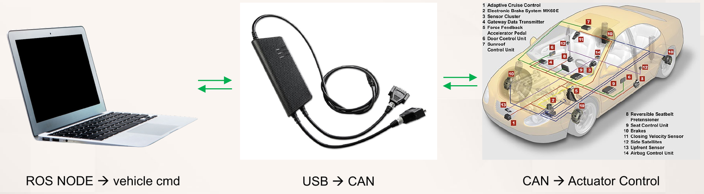
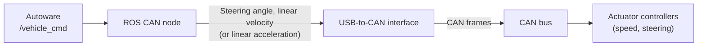
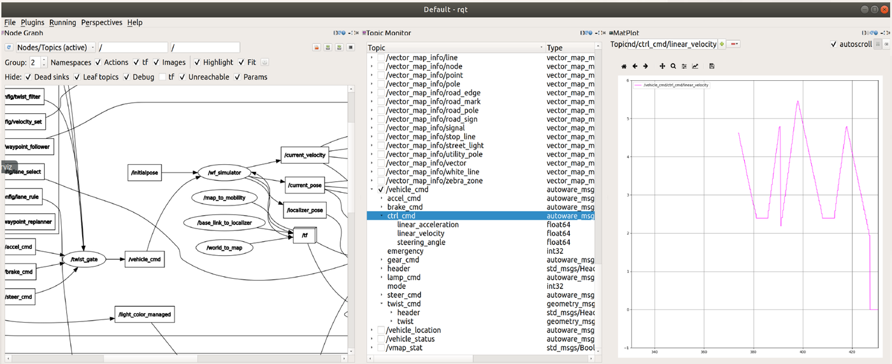
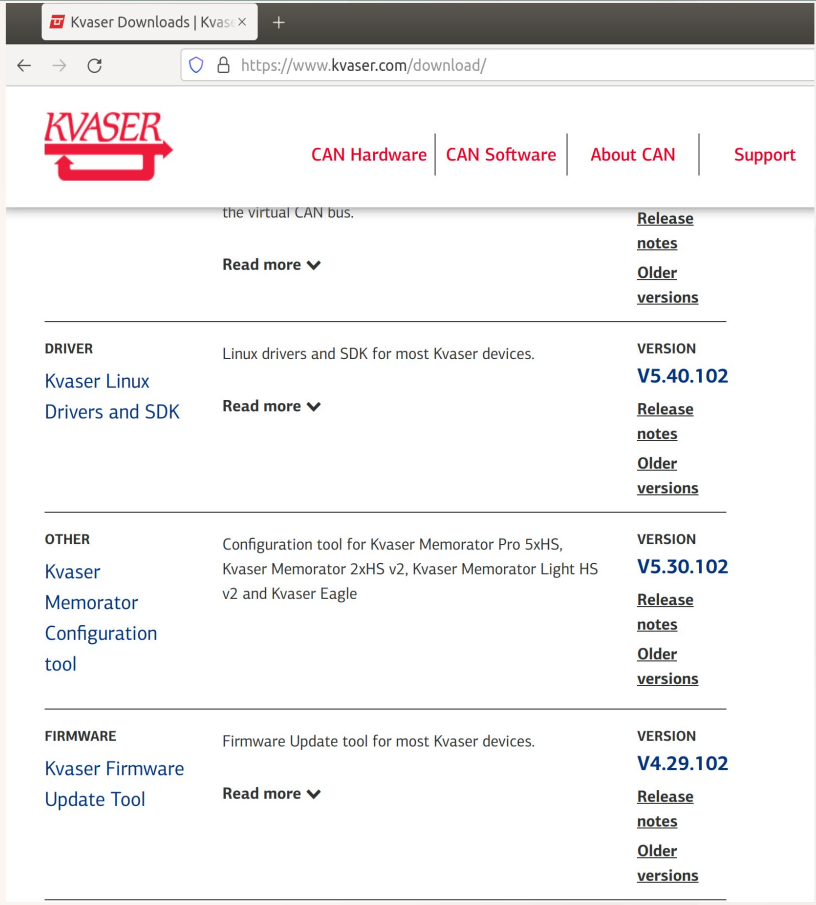
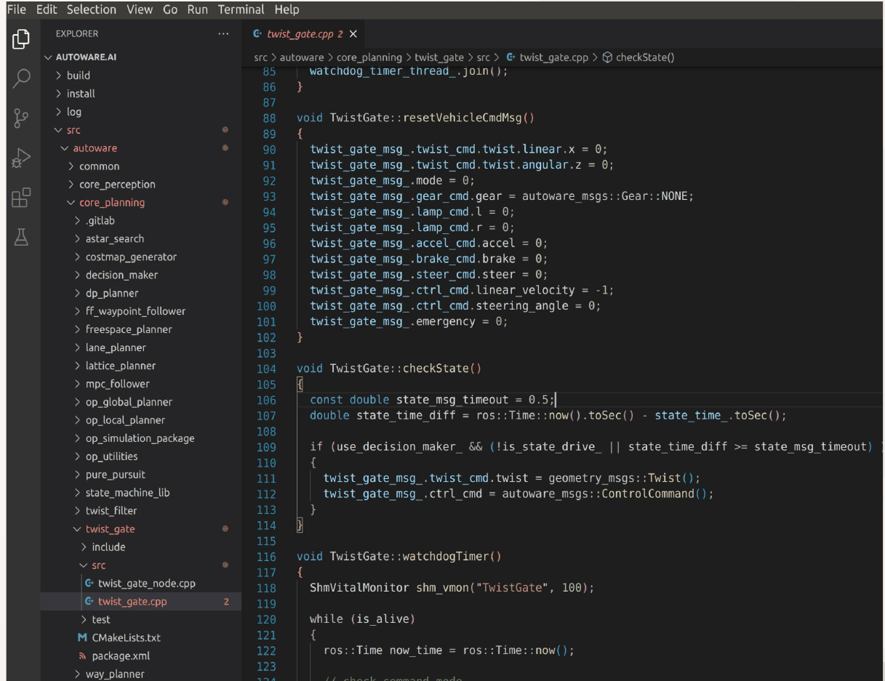
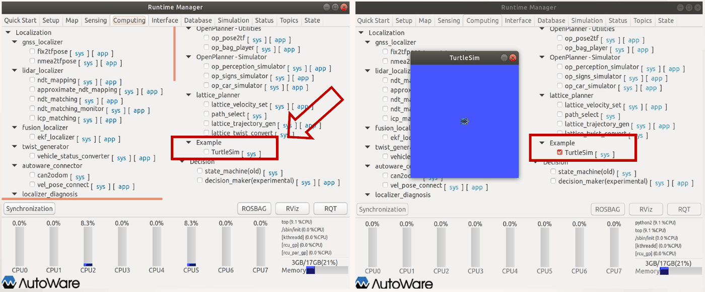
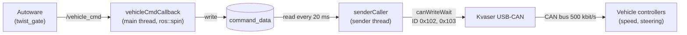

# Week 14 Lecture — The Autoware CAN Node

[Repository Guide](../../README.md) | [English](Concepts_Lecture.md) | [한국어](Concepts_Lecture.ko.md)

> **Last Updated:** 2026-11-04

> **Learning Objectives:**
> 1. Explain how the Autoware `/vehicle_cmd` message passes through a ROS CAN node and a USB-to-CAN interface to become actuator commands for a real vehicle
> 2. Install Kvaser's Linux drivers and CANlib (linuxcan) and verify the installation
> 3. Organize a node according to the package structure recommended by Autoware, and modify CMakeLists.txt and package.xml to build it with colcon and run it
> 4. Modify computing.yaml to add a node to the Computing tab of the Runtime Manager
> 5. Explain at the code level how the `can_mobility_test` node periodically sends speed and steering commands as CAN frames after low-pass filtering, unit conversion, and byte splitting

---

## Table of Contents

- [1. The ROS CAN Node and Kvaser CANlib](#1-the-ros-can-node-and-kvaser-canlib)
  - [1.1 From a ROS Node to the Vehicle Actuators](#11-from-a-ros-node-to-the-vehicle-actuators)
  - [1.2 The /vehicle_cmd Message](#12-the-vehicle_cmd-message)
  - [1.3 Kvaser CAN Interfaces and CANlib](#13-kvaser-can-interfaces-and-canlib)
  - [1.4 Installing linuxcan](#14-installing-linuxcan)
- [2. Writing and Running an Autoware ROS Node](#2-writing-and-running-an-autoware-ros-node)
  - [2.1 Steps for Writing a Node](#21-steps-for-writing-a-node)
  - [2.2 Autoware's Recommended Package Structure](#22-autowares-recommended-package-structure)
  - [2.3 Example: The twist_gate Package](#23-example-the-twist_gate-package)
  - [2.4 Modifying CMakeLists.txt](#24-modifying-cmakeliststxt)
  - [2.5 Building with colcon](#25-building-with-colcon)
  - [2.6 Running the Node](#26-running-the-node)
  - [2.7 Adding a Node to the Runtime Manager](#27-adding-a-node-to-the-runtime-manager)
- [3. Writing a CAN Communication Node: can_mobility_test](#3-writing-a-can-communication-node-can_mobility_test)
  - [3.1 Creating the Package](#31-creating-the-package)
  - [3.2 Modifying CMakeLists.txt and package.xml](#32-modifying-cmakeliststxt-and-packagexml)
  - [3.3 Structure of the Node: Receiver and Sender](#33-structure-of-the-node-receiver-and-sender)
  - [3.4 Headers and Global Declarations](#34-headers-and-global-declarations)
  - [3.5 The Error-Check Function and the Signal Handler](#35-the-error-check-function-and-the-signal-handler)
  - [3.6 Command Data and the Callback Function](#36-command-data-and-the-callback-function)
  - [3.7 Preparing the Sender Thread: Opening the CAN Channel](#37-preparing-the-sender-thread-opening-the-can-channel)
  - [3.8 Sending Loop 1: Speed Conversion and the Low-Pass Filter](#38-sending-loop-1-speed-conversion-and-the-low-pass-filter)
  - [3.9 Sending Loop 2: Encoding and Sending the Steering Value](#39-sending-loop-2-encoding-and-sending-the-steering-value)
  - [3.10 The main Function](#310-the-main-function)
  - [3.11 The Transmitted CAN Frames and a Worked Example](#311-the-transmitted-can-frames-and-a-worked-example)
  - [3.12 Building, Running, and Points to Improve](#312-building-running-and-points-to-improve)
- [Concept Applications](#concept-applications)
- [Summary](#summary)
- [Self-Check Questions](#self-check-questions)
- [References](#references)

---

<br>

## 1. The ROS CAN Node and Kvaser CANlib

### 1.1 From a ROS Node to the Vehicle Actuators

Autoware computes the speed and steering angle the vehicle should follow as the result of path planning and path following, but these values are only ROS messages inside a PC. To move a real vehicle, they must be delivered to the controllers of the vehicle's **actuators**, the devices that physically produce force, such as motors, the steering unit, and the brakes, and as Week 13 showed, the vehicle's controllers are connected by a CAN bus.



*Figure 1. Connection of a ROS node, a USB-to-CAN interface, and the vehicle controllers*



*Figure 2. Flow in which vehicle_cmd becomes actuator commands*

The overall flow has three stages.

1. **ROS node → vehicle_cmd:** The ROS CAN node subscribes to the `/vehicle_cmd` topic published by Autoware and receives steering angle and linear velocity (or linear acceleration) commands.
2. **USB → CAN:** The node converts the received values into frames that follow the CAN protocol of the target vehicle and sends them to a USB-to-CAN interface plugged into the PC's USB port. The interface puts these frames onto the CAN bus as electrical signals.
3. **CAN → actuator control:** The speed controller and steering controller on the bus receive the frames and deliver the speed and steering angle commands to the real vehicle.

Here, **reflecting the CAN protocol** means following the message specification defined for each vehicle. Which signal goes into which byte of a frame with which identifier (ID), in which unit and scale, is defined by the vehicle maker or the controller maker, and the CAN node must convert and insert values according to that specification. The `can_mobility_test` node of Section 3 is an example.

### 1.2 The /vehicle_cmd Message



*Figure 3. The node graph, the fields of /vehicle_cmd, and a plot of the commanded speed in rqt*

Figure 3 shows rqt while an Autoware simulation runs with the wf_simulator of Week 12. In the node graph on the left, the `/twist_gate` node collects the commands from the path-following node and several command topics (`/accel_cmd`, `/brake_cmd`, `/steer_cmd`, and so on) and publishes the `/vehicle_cmd` topic, and `/wf_simulator` subscribes to it, moves a virtual vehicle, and publishes `/current_velocity`, `/current_pose`, `/localizer_pose`, and `/tf`. The Topic Monitor in the middle expands the fields of the `/vehicle_cmd` message, and the MatPlot on the right plots the value of `/vehicle_cmd/ctrl_cmd/linear_velocity` over time. Plotting `/vehicle_cmd/ctrl_cmd/linear_acceleration` in the same way shows how the acceleration command changes. In simulation the wf_simulator plays the role of the vehicle, and on a real vehicle the CAN node takes its place, receiving `/vehicle_cmd` and passing it to the vehicle.

The message type of `/vehicle_cmd` is `autoware_msgs/VehicleCmd`, defined as follows in `src/autoware/messages/autoware_msgs/msg/VehicleCmd.msg` of the Autoware workspace [1].

```text
Header header
autoware_msgs/SteerCmd steer_cmd
autoware_msgs/AccelCmd accel_cmd
autoware_msgs/BrakeCmd brake_cmd
autoware_msgs/LampCmd lamp_cmd
autoware_msgs/Gear gear_cmd
int32 mode
geometry_msgs/TwistStamped twist_cmd
autoware_msgs/ControlCommand ctrl_cmd
int32 emergency
```

| Field | Type | Content |
|:-----|:-----|:-----|
| `header` | `std_msgs/Header` | Time stamp and coordinate frame of the message |
| `steer_cmd`, `accel_cmd`, `brake_cmd` | `autoware_msgs` types | Integer commands that operate the steering, accelerator pedal, and brake pedal directly (`steer`, `accel`, `brake`) |
| `lamp_cmd` | `autoware_msgs/LampCmd` | Left (`l`) and right (`r`) turn signals |
| `gear_cmd` | `autoware_msgs/Gear` | Transmission gear |
| `mode` | `int32` | Control mode |
| `twist_cmd` | `geometry_msgs/TwistStamped` | Target linear velocity (`twist.linear.x`) and angular velocity (`twist.angular.z`) |
| `ctrl_cmd` | `autoware_msgs/ControlCommand` | Target linear velocity `linear_velocity`, linear acceleration `linear_acceleration`, and steering angle `steering_angle` (all `float64`) |
| `emergency` | `int32` | Whether an emergency stop is requested |

*Table 1. Fields of the autoware_msgs/VehicleCmd message*

ROS uses SI units, so in `ctrl_cmd` the velocity is in m/s, the acceleration in m/s², and the steering angle in radians [2]. This steering angle is not the rotation of the steering wheel but the angle by which the front wheels (tires) are turned, the same quantity as the front-wheel steering angle $\delta_f$ in the bicycle model of Week 12. The CAN node of Section 3 uses only `ctrl_cmd.linear_velocity` and `ctrl_cmd.steering_angle`.

### 1.3 Kvaser CAN Interfaces and CANlib

**Kvaser** is a Swedish company that makes CAN interface devices and sells USB-to-CAN interfaces like the device in the middle of Figure 1, which connects to a PC's USB port on one side and to a CAN bus connector on the other. Applications do not handle the device directly but call a C library from Kvaser called **CANlib**, and the same CANlib code works unchanged across Kvaser's devices [3]. The Linux drivers and CANlib are distributed together under the name **Kvaser Linux Drivers and SDK**, and because the downloaded file is named `linuxcan.tar.gz`, the package is commonly called linuxcan [4]. The package contains the following.

- **Kernel drivers:** kernel modules that let the Linux kernel recognize USB-to-CAN devices.
- **CANlib library and headers:** `libcanlib`, which applications link against, and `canlib.h`, which contains the function declarations.
- **Example programs:** examples demonstrating basic operations such as listing channels, sending, and receiving.

The Autoware installation of Week 4 treated the CANlib installation as optional, but building the CAN node requires it.

### 1.4 Installing linuxcan

**Step 1: Download.** On the download page of the Kvaser website (https://www.kvaser.com/download/), click "Kvaser Linux Drivers and SDK" and download `linuxcan.tar.gz`.



*Figure 4. The Kvaser Linux Drivers and SDK entry on the Kvaser download page*

**Step 2: Prepare the build tools.** The drivers are kernel modules, so building them requires a compiler and kernel headers of the same version as the running kernel [4].

```bash
sudo apt update
sudo apt install build-essential linux-headers-$(uname -r)
```

`build-essential` is a bundle of basic build tools such as `gcc`, `g++`, and `make`, and `$(uname -r)` is replaced with the version string of the current kernel, so `linux-headers-$(uname -r)` refers to the header package matching the current kernel.

**Step 3: Extract and install.** Assume the downloaded file is in `~/Downloads`. It can be extracted by right-clicking the file in the file manager and choosing Extract Here, or in a terminal as follows.

```bash
cd ~/Downloads
tar xzf linuxcan.tar.gz
cd linuxcan
make
sudo make install
```

- `tar xzf linuxcan.tar.gz` extracts (`x`) the gzip-compressed (`z`) tar archive in the given file (`f`) into the `linuxcan` directory.
- `make` builds the kernel driver modules, the CANlib library, and the example programs. It needs no administrator rights, so it is run as a normal user.
- `sudo make install` copies the built driver modules into the kernel module directory and the library and headers into system paths. It writes to system directories, so it needs `sudo`. Because the headers and the library are placed in the compiler's default search paths, writing only the library name `canlib` in CMake is enough to link it later (Section 3.2).

**Step 4: Verify.** After plugging in the USB-to-CAN interface, run the linuxcan example program `listChannels`, which prints the list of channels recognized by CANlib and the device names.

```bash
cd ~/Downloads/linuxcan/canlib/examples
./listChannels
```

If the device appears in the list, the driver and library are installed correctly. The order of the list gives the channel numbers used in CANlib, and the first channel is number 0.

> **Caution:** The drivers are built for the kernel version present at installation, so after a kernel update `make` and `sudo make install` must be run again. On a computer with UEFI Secure Boot enabled, unsigned kernel modules may not load, so the modules must be signed or the Secure Boot settings checked [5].

---

<br>

## 2. Writing and Running an Autoware ROS Node

### 2.1 Steps for Writing a Node

An Autoware node is basically written in the same way as an ordinary ROS node, following exactly the steps used to build the `hello_dsc` node in Week 5.

1. Create a package.
2. Write the source code of the node.
3. Build the node.
4. Check the behavior of the node.

The differences are the location of the workspace and the build tool. The node of Week 5 was built with `catkin_make` in a separate catkin workspace, whereas an Autoware node is created as a package inside the Autoware.ai workspace (`~/autoware.ai`) and built with **colcon**, the tool used to build the whole of Autoware (Section 2.5).

### 2.2 Autoware's Recommended Package Structure

Autoware recommends that packages satisfy the following conditions.

1. For each category there is a directory that collects packages, such as `src/autoware/core_planning/twist_filter`, and packages are created directly under it.
2. A directory with the same name as the node is created in a `nodes` directory, and the node's source code and related files are placed under it.
3. Message files are added to the `messages` directory.
4. When processing shared by several nodes is made into a library, the library's source code is placed in directories such as `lib` or `include`.

It is also recommended to separate each node with a **namespace**. Autoware has hundreds of nodes and topics, so placing a node's code and names inside a unique namespace prevents collisions with identical names in other packages.

```text
src/autoware/<category>/<package>/
├── package.xml
├── CMakeLists.txt
├── src/
│   ├── <node>.cpp
│   ├── <node>.py        (other source code)
│   └── ...
├── include/
│   └── (header files of libraries, etc.)
└── lib/
    └── (library source code)

src/autoware/messages/<message package>/
└── msg/
    ├── <message 1>.msg
    └── <message 2>.msg
```

*Figure 5. Directory structure of an Autoware package and a message package*

The items in Figure 5 are as follows.

- **`<category>`:** a category directory that groups packages by function, such as `common`, `core_perception`, and `core_planning`.
- **`package.xml`:** the manifest that records the package's name, version, and the other packages it depends on.
- **`CMakeLists.txt`:** the build configuration that states how to compile the source code and what to link it with.
- **`src/`:** holds source code such as the node's C++ source (`<node>.cpp`) and Python scripts (`<node>.py`).
- **`include/` and `lib/`:** hold the header files and source code of libraries shared by the nodes.
- **`messages/<message package>/msg/`:** holds `.msg` files that define new message types. Gathering messages into a separate package lets several packages share the same message definitions. Under `src/autoware/messages` in Autoware.ai 1.14 there are message packages such as `autoware_can_msgs`, `autoware_config_msgs`, `autoware_external_msgs`, `autoware_lanelet2_msgs`, `autoware_map_msgs`, and `autoware_msgs`, and the `VehicleCmd.msg` of Section 1.2 sits in `autoware_msgs/msg/` together with other message definitions such as `AccelCmd.msg`, `BrakeCmd.msg`, and `ControlCommand.msg`.

> **Note:** The `nodes/<node name>/` layout of recommendation 2 is the style used by older Autoware packages, while Figure 5 and many packages of Autoware.ai 1.14 place their sources under `src/`. Whichever is used, the source path written in `add_executable` in Section 2.4 must match the actual file location.

### 2.3 Example: The twist_gate Package



*Figure 6. The Autoware workspace and twist_gate.cpp opened in VS Code*

Figure 6 shows the Autoware workspace opened in VS Code. Under the workspace are the `build`, `install`, and `log` directories created by colcon and the source directory `src`, and under `src/autoware` are category directories such as `common`, `core_perception`, and `core_planning`. The `core_planning` category gathers path planning and following packages such as `astar_search`, `decision_maker`, `lane_planner`, `mpc_follower`, `pure_pursuit`, `twist_filter`, `twist_gate`, and `waypoint_follower`. The `twist_gate` package consists of `include`, `src` (`twist_gate_node.cpp`, `twist_gate.cpp`), `test`, `CMakeLists.txt`, and `package.xml`, following the structure of Figure 5 [6].

As seen in Section 1.2, `twist_gate` is the node that collects several commands and publishes `/vehicle_cmd`. Part of `twist_gate.cpp`, open in Figure 6, is as follows.

```cpp
void TwistGate::resetVehicleCmdMsg()
{
  twist_gate_msg_.twist_cmd.twist.linear.x = 0;
  twist_gate_msg_.twist_cmd.twist.angular.z = 0;
  twist_gate_msg_.mode = 0;
  twist_gate_msg_.gear_cmd.gear = autoware_msgs::Gear::NONE;
  twist_gate_msg_.lamp_cmd.l = 0;
  twist_gate_msg_.lamp_cmd.r = 0;
  twist_gate_msg_.accel_cmd.accel = 0;
  twist_gate_msg_.brake_cmd.brake = 0;
  twist_gate_msg_.steer_cmd.steer = 0;
  twist_gate_msg_.ctrl_cmd.linear_velocity = -1;
  twist_gate_msg_.ctrl_cmd.steering_angle = 0;
  twist_gate_msg_.emergency = 0;
}

void TwistGate::checkState()
{
  const double state_msg_timeout = 0.5;
  double state_time_diff = ros::Time::now().toSec() - state_time_.toSec();

  if (use_decision_maker_ && (!is_state_drive_ || state_time_diff >= state_msg_timeout))
  {
    twist_gate_msg_.twist_cmd.twist = geometry_msgs::Twist();
    twist_gate_msg_.ctrl_cmd = autoware_msgs::ControlCommand();
  }
}
```

- **`resetVehicleCmdMsg()`:** returns every field of the `VehicleCmd` message to be published (`twist_gate_msg_`) to its initial value. It sets the target velocity and angular velocity, the mode, the pedal and steering commands, and the emergency stop to 0, and the gear to `NONE`. Note that only `ctrl_cmd.linear_velocity` is set to -1 rather than 0. Section 3.12 discusses how the CAN node transmits this value.
- **`checkState()`:** When the node is configured to use the state management node (decision_maker), it sets both the velocity command (`twist_cmd.twist`) and the control command (`ctrl_cmd`) to 0 if the vehicle is not in the driving state or if 0.5 seconds or more have passed since the last state message. It is a safety mechanism that stops the vehicle when state information is lost. `geometry_msgs::Twist()` and `autoware_msgs::ControlCommand()` create messages whose fields are all 0.

The `CMakeLists.txt` of `twist_gate` is as follows.

```cmake
cmake_minimum_required(VERSION 2.8.3)
project(twist_gate)

find_package(autoware_build_flags REQUIRED)
find_package(
  catkin REQUIRED COMPONENTS
    autoware_config_msgs
    autoware_health_checker
    autoware_msgs
    geometry_msgs
    ros_observer
    roscpp
    roslint
    std_msgs
    tablet_socket_msgs
)

catkin_package(
  INCLUDE_DIRS include
)

SET(CMAKE_CXX_FLAGS "-O2 -g -Wall ${CMAKE_CXX_FLAGS}")
set(ROSLINT_CPP_OPTS "--filter=-build/c++11")

roslint_cpp()

include_directories(
  include
  ${catkin_INCLUDE_DIRS}
)
```

- `cmake_minimum_required` and `project` set the minimum required CMake version and the package (project) name.
- `find_package(autoware_build_flags REQUIRED)` loads the build options shared by Autoware packages.
- `find_package(catkin REQUIRED COMPONENTS ...)` finds the ROS packages this package depends on. The header paths and libraries of the found packages are collected in the `catkin_INCLUDE_DIRS` and `catkin_LIBRARIES` variables [7].
- `catkin_package(INCLUDE_DIRS include)` exposes the headers in the `include` directory to other packages that use this package.
- `SET(CMAKE_CXX_FLAGS ...)`, `set(ROSLINT_CPP_OPTS ...)`, and `roslint_cpp()` are explained in Section 2.4.
- `include_directories` makes the compiler search this package's `include` and the header paths of the dependencies.

### 2.4 Modifying CMakeLists.txt

Before building a new node, modify `CMakeLists.txt` as follows. Autoware specifies particular options when compiling C++, so first add the following two lines.

```cmake
SET(CMAKE_CXX_FLAGS "-O2 -g -Wall ${CMAKE_CXX_FLAGS}")
set(ROSLINT_CPP_OPTS "--filter=-build/c++11")
```

- **`CMAKE_CXX_FLAGS`:** the options passed to the C++ compiler. `-O2` enables level-2 optimization, `-g` includes debugging information for debuggers, and `-Wall` turns on warnings for common mistakes. The trailing `${CMAKE_CXX_FLAGS}` appends the options already set instead of discarding them.
- **`ROSLINT_CPP_OPTS`:** **roslint** is a ROS tool that checks whether code follows given style rules, and for C++ code it uses Google's cpplint [8]. `--filter=-build/c++11` turns off the cpplint category `build/c++11`, which warns about the use of C++11 headers such as `<thread>` and `<chrono>` [9]. This setting takes effect in packages that enable checking with `roslint_cpp()`, such as `twist_gate`.

Next, add a line stating that the source code of the node (for example, `mynode`) is `src/mynode.cpp`. If, unlike Figure 5, it is placed at `nodes/mynode/mynode.cpp`, write that path instead.

```cmake
add_executable(mynode src/mynode.cpp)
```

`add_executable(name sources...)` means to compile the source files into an executable named `mynode`. This name becomes the name of the node executable that is run later with `rosrun`.

Finally, add the following lines to link the general ROS libraries.

```cmake
target_link_libraries(mynode
  ${catkin_LIBRARIES}
)
```

`target_link_libraries` links the ROS libraries found by `find_package` (such as `roscpp`) when building the `mynode` executable. Without this line the code compiles, but linking fails because definitions of functions such as `ros::init` cannot be found. `target_link_libraries` must come after the `add_executable` that creates the target.

### 2.5 Building with colcon

**colcon** is a build tool that builds each package in a workspace separately, in isolation; it builds dependencies before the packages that need them and builds packages that do not depend on each other in parallel [10]. It can build both catkin packages and ROS 2 packages, and Autoware.ai 1.14, installed in Week 4, is also built with colcon. Run the following command in the top-level directory of the workspace.

```bash
cd ~/autoware.ai
colcon build --cmake-args -DCMAKE_BUILD_TYPE=Release
```

The arguments after `--cmake-args` are passed unchanged to each package's CMake, and `-DCMAKE_BUILD_TYPE=Release` means a release build with optimization enabled and debugging checks disabled. The build results appear in the following three directories.

| Directory | Content |
|:-----|:-----|
| `build/` | Intermediate files generated by CMake for each package |
| `install/` | Installed executables and libraries of each package, and environment setup scripts needed to run them (`setup.bash`) |
| `log/` | Logs from the build |

*Table 2. Directories created by colcon*

The command above builds every package in the workspace, so running it every time takes a long time. To save time by building only the modified package, specify the package name as follows.

```bash
colcon build --packages-select mypkg
```

After `--packages-select`, write the **package name**, not the node name. Here `mypkg` is the name of the package that contains `mynode`. This option builds only the specified package, so the other packages it depends on must already be built.

> **Note:** `catkin_make` from Week 5 builds all packages of a workspace as a single CMake project and places the results in `devel/`, whereas colcon builds each package separately and places the results in `install/`. In a colcon workspace, therefore, the environment is set up with `source install/setup.bash` instead of `source devel/setup.bash`.

### 2.6 Running the Node

First, run `roscore` to start the basic ROS programs (the master, the parameter server, and so on).

```bash
roscore
```

Open another terminal, load the workspace environment, and run the `mynode` node with the `rosrun` command.

```bash
cd ~/autoware.ai
source install/setup.bash
rosrun mypkg mynode
```

`source install/setup.bash` registers the locations of the packages built in this workspace in environment variables, so it must be run again each time a new terminal is opened. `rosrun package executable` finds and runs the executable created with `add_executable` in that package.

### 2.7 Adding a Node to the Runtime Manager

The **Runtime Manager** is Autoware's GUI, launched in Week 4 with `roslaunch runtime_manager runtime_manager.launch`, which starts and stops ROS nodes through check boxes. Nodes written by the user can also be added to the Runtime Manager and started and stopped in the same way [11].

The items shown in each column of the Computing tab are defined in the file at the following path.

```text
src/autoware/utilities/runtime_manager/scripts/computing.yaml
```

For example, the settings of ndt_matching under the lidar_localizer item of Localization in the Computing tab are written at the following position in this file. `# ...` marks omitted parts.

```yaml
name : Computing
subs :
- subs :
  - name : Localization
    desc : Localization desc sample
    subs :
    - name : gnss_localizer
      # ... (fix2tfpose, nmea2tfpose)
    - name : lidar_localizer
      desc : lidar_localizer desc sample
      subs :
      - name : ndt_mapping
        desc : ndt_mapping desc sample
        cmd  : roslaunch lidar_localizer ndt_mapping.launch
        param: ndt_mapping
      # ... (approximate_ndt_mapping)
      - name : ndt_matching
        desc : ndt_matching desc sample
        cmd  : roslaunch lidar_localizer ndt_matching.launch
        param: ndt
```

- **`name`:** the name shown on the screen.
- **`subs`:** the list of child items below it. Each item starts with `- name`, and the indentation depth determines the hierarchy on the screen.
- **`desc`:** the description text of the item.
- **`cmd`:** the command executed when the check box is turned on. Turning the check box off terminates the process started by this command.
- **`param`:** the name of the definition of a parameter dialog. Items that have `param` also show an `[app]` button that opens the dialog.

Now add a new Example item at the end of the hierarchy directly under the Motion Planning column, and inside it a TurtleSim item that starts and stops the `turtlesim_node` node of the `turtlesim` package. Add the following at the end of the `subs` list of Motion Planning, at the same depth as the other items in that level (for example, lattice_planner).

```yaml
- name : Example
  subs :
    - name : TurtleSim
      cmd : rosrun turtlesim turtlesim_node
```

YAML expresses hierarchy with indentation, so use spaces instead of tabs and match the indentation of the neighboring items exactly. After editing the file, rebuild the `runtime_manager` package and restart the Runtime Manager.

```bash
cd ~/autoware.ai
colcon build --packages-select runtime_manager
source install/setup.bash
roslaunch runtime_manager runtime_manager.launch
```



*Figure 7. The Example and TurtleSim items added to the Computing tab, and the window opened when TurtleSim is turned on*

As on the left of Figure 7, the Example and TurtleSim items appear below lattice_planner in the Computing tab. TurtleSim has no `param`, so it shows only the `[sys]` button without an `[app]` button. As on the right, turning on the TurtleSim check box runs `rosrun turtlesim turtlesim_node` from `cmd` and opens the turtle window, and turning it off closes the window. The CAN node built in Section 3 can be added to the Runtime Manager in the same way.

---

<br>

## 3. Writing a CAN Communication Node: can_mobility_test

### 3.1 Creating the Package

This section writes `can_mobility_test`, a ROS node that communicates over CAN in cooperation with Autoware. First, move to `src/autoware/core_planning` and create the package.

```bash
cd ~/autoware.ai/src/autoware/core_planning
catkin_create_pkg can_mobility_test roscpp std_msgs
```

`catkin_create_pkg package_name dependencies...` creates the skeleton of a new catkin package. Here it creates the `can_mobility_test` package, which depends on the C++ ROS client library `roscpp` and the standard messages `std_msgs`. Running the command creates `include`, `src`, `CMakeLists.txt`, and `package.xml`. Next, create the node's source file `can_mobility_test.cpp` in the `src` directory.

```text
core_planning/
├── astar_search/
├── ...
└── can_mobility_test/
    ├── include/
    │   └── can_mobility_test/
    ├── src/
    │   └── can_mobility_test.cpp
    ├── CMakeLists.txt
    └── package.xml
```

*Figure 8. Structure of the created can_mobility_test package*

### 3.2 Modifying CMakeLists.txt and package.xml

Add the following to `CMakeLists.txt`. The first two lines are the Autoware compile options of Section 2.4, and the rest create the node executable and link the ROS libraries.

```cmake
SET(CMAKE_CXX_FLAGS "-O2 -g -Wall ${CMAKE_CXX_FLAGS}")
set(ROSLINT_CPP_OPTS "--filter=-build/c++11")

add_executable(can_mobility_test src/can_mobility_test.cpp)

target_link_libraries(can_mobility_test ${catkin_LIBRARIES})
```

This node uses the `autoware_msgs/VehicleCmd` message and Kvaser CANlib, so add the following as well.

```cmake
find_package(catkin REQUIRED COMPONENTS
  roscpp
  std_msgs
  autoware_msgs
)

catkin_package(

)

target_link_libraries(can_mobility_test canlib)
add_dependencies(can_mobility_test ${catkin_EXPORTED_TARGETS})
```

- **`find_package(... autoware_msgs)`:** adds `autoware_msgs` to the `find_package` created by `catkin_create_pkg` so that the `autoware_msgs/VehicleCmd.h` header can be found.
- **`catkin_package()`:** left with empty parentheses because this package exposes nothing to other packages. This call is needed for catkin to set up the package's install locations and environment.
- **`target_link_libraries(can_mobility_test canlib)`:** links the CANlib (`libcanlib`) installed in Section 1.4. The library is in the default search path, so its name alone is enough.
- **`add_dependencies(... ${catkin_EXPORTED_TARGETS})`:** orders the build so that the generation of message headers (`VehicleCmd.h`) finishes before this node is compiled. Without this line, compilation can fail on the first build of the workspace because the header does not exist yet.

CMake runs from top to bottom, so `find_package` and `catkin_package` must come before `add_executable`, and `target_link_libraries` and `add_dependencies` must come after `add_executable`. Organized together with the `include_directories` already present in the template created by `catkin_create_pkg`, `CMakeLists.txt` looks as follows.

```cmake
cmake_minimum_required(VERSION 2.8.3)
project(can_mobility_test)

find_package(catkin REQUIRED COMPONENTS
  roscpp
  std_msgs
  autoware_msgs
)

catkin_package(

)

SET(CMAKE_CXX_FLAGS "-O2 -g -Wall ${CMAKE_CXX_FLAGS}")
set(ROSLINT_CPP_OPTS "--filter=-build/c++11")

include_directories(
  ${catkin_INCLUDE_DIRS}
)

add_executable(can_mobility_test src/can_mobility_test.cpp)
target_link_libraries(can_mobility_test ${catkin_LIBRARIES})
target_link_libraries(can_mobility_test canlib)
add_dependencies(can_mobility_test ${catkin_EXPORTED_TARGETS})
```

Add the following three lines to `package.xml`.

```xml
<build_depend>autoware_msgs</build_depend>
<build_export_depend>autoware_msgs</build_export_depend>
<exec_depend>autoware_msgs</exec_depend>
```

The dependency tags of `package.xml` state when a package is needed [12]. `build_depend` means `autoware_msgs` is needed when building this package, `build_export_depend` when building other packages that use this package's headers, and `exec_depend` when running this package. colcon uses this information to build `autoware_msgs` first.

### 3.3 Structure of the Node: Receiver and Sender

`can_mobility_test.cpp` receives `/vehicle_cmd` and delivers speed values and steering angle commands to the real vehicle. The node is divided into two parts.

- **vehicle_cmd receiver:** subscribes to the `/vehicle_cmd` message and stores the speed and steering angle in shared variables each time a message arrives. It is implemented as a ROS callback function called by `ros::spin()` in the main thread.
- **CAN sender:** in a separate thread, periodically reads the shared variables, builds CAN commands, and sends them.



*Figure 9. The two threads and the data flow of the can_mobility_test node*

The two parts are split into threads because the two jobs have different periods. `/vehicle_cmd` arrives at the period Autoware decides, while the vehicle's controllers expect commands to keep arriving at a fixed period. Because the sender thread sends the latest command every 20 ms independently of reception, the period of the CAN commands stays constant even if messages arrive late or stop briefly. This is the same structure as publishing topics at different rates per thread in Week 7.

### 3.4 Headers and Global Declarations

```cpp
#include <canlib.h>
#include <signal.h>
#include <errno.h>
#include <unistd.h>
#include <pthread.h>
#include <iostream>
#include <cmath>

#include "ros/ros.h"
#include "autoware_msgs/VehicleCmd.h"

#include "std_msgs/String.h"
#include "std_msgs/Int32.h"

#define ALARM_INTERVAL_IN_S (1)
#define WRITE_WAIT_INFINITE (unsigned long)(-1)

#define READ_WAIT_INFINITE (unsigned long)(-1)

static unsigned int msgCounter = 0;
static int willExit = 0;
```

- `<canlib.h>` declares the CANlib functions and types (`canHandle`, `canStatus`, `canOpenChannel`, and so on).
- `<signal.h>` declares `signal`, `siginterrupt`, and the signal numbers `SIGINT` and `SIGALRM`; `<unistd.h>` declares `alarm` and `usleep`; and `<pthread.h>` declares the POSIX thread functions. `<errno.h>`, `<iostream>`, and `<cmath>` are the headers for error numbers, input and output, and math functions.
- `"ros/ros.h"` is the basic roscpp header, and `"autoware_msgs/VehicleCmd.h"` is the C++ message header generated from `VehicleCmd.msg` during the build. `std_msgs/String.h` and `std_msgs/Int32.h` are included but not used in this code.
- `ALARM_INTERVAL_IN_S` is the interval (1 second) of the alarm that prints the sending rate.
- `WRITE_WAIT_INFINITE` is -1 converted to `unsigned long`, that is, the largest number an `unsigned long` can represent. Passed as the timeout of a CANlib waiting function, it effectively means to wait forever. `READ_WAIT_INFINITE` has the same value but is not used because this code does not receive.
- `msgCounter` stores the number of sent messages and `willExit` whether termination has been requested; both are global variables. `static` makes them visible only within this file.

### 3.5 The Error-Check Function and the Signal Handler

```cpp
static void check(char* id, canStatus stat)
{
    if (stat != canOK) {
        char buf[100];
        buf[0] = '\0';
        canGetErrorText(stat, buf, sizeof(buf));
        printf("%s: failed, stat=%d (%s)\n", id, (int)stat, buf);
    }
}

static void sighand(int sig)
{
    static unsigned int last;

    switch (sig) {
    case SIGINT:
        willExit = 1;
        break;
    case SIGALRM:
        if (msgCounter - last) {
            printf("msg/s = %d, total=%u\n",
                (msgCounter - last) / ALARM_INTERVAL_IN_S, msgCounter);
        }
        last = msgCounter;
        alarm(ALARM_INTERVAL_IN_S);
        break;
    }
}
```

**The `check` function** examines the status code `stat` returned by a CANlib function. CANlib functions return `canOK` (0) on success and a negative error code on failure [3].

- If `stat` is not `canOK`, it creates a 100-byte buffer and sets the first character to `'\0'` to initialize it as an empty string.
- `canGetErrorText(stat, buf, sizeof(buf))` fills the buffer with the description of the error code.
- `printf` prints which call (`id`) failed, the error code, and its description.

**The `sighand` function** handles signals sent by the operating system.

- `SIGINT` is the signal sent when Ctrl+C is pressed in the terminal; the handler sets `willExit` to 1 so that the sending loop ends.
- `SIGALRM` is the signal sent when the time set with `alarm` has elapsed. If the number of messages added since the previous alarm (`msgCounter - last`) is not 0, it prints the messages per second and the total number of messages. It then updates `last` and sets `alarm` again. `alarm` fires only once, so it must be reset each time to repeat every second.
- `static unsigned int last` is a local variable whose value persists after the function returns; it remembers `msgCounter` at the previous alarm.

> **[Systems Programming]** A signal is a notification that the operating system sends to a process asynchronously. When a handler is registered with `signal(number, function)`, the process stops what it is doing the moment the signal arrives, runs the handler, and then resumes. Because a handler can interrupt the program at any point, the rule is to call only async-signal-safe functions inside a handler. `printf` is not on that list, so strictly speaking it should be avoided in handlers [13].

### 3.6 Command Data and the Callback Function

```cpp
struct CommandData
{
    double linear_velocity;
    double steering_angle;

    void reset();
};

void CommandData::reset()
{
    linear_velocity = 0;
    steering_angle = 0;
}

static CommandData command_data;

static void vehicleCmdCallback(const autoware_msgs::VehicleCmd& msg)
{
    command_data.linear_velocity = msg.ctrl_cmd.linear_velocity;
    command_data.steering_angle = msg.ctrl_cmd.steering_angle;
}
```

- The `CommandData` struct holds the two values to be sent over CAN, the linear velocity (m/s) and the steering angle (rad), and `reset()` sets both to 0.
- `command_data` is a global variable of this struct, the shared variable written by the receiver and read by the sender.
- `vehicleCmdCallback` is the callback function that roscpp calls every time a `/vehicle_cmd` message arrives. It copies the message's `ctrl_cmd.linear_velocity` and `ctrl_cmd.steering_angle` into `command_data`. The parameter is taken by `const` reference so that the message is read without being copied.

### 3.7 Preparing the Sender Thread: Opening the CAN Channel

```cpp
static void* senderCaller(void *unused)
{
    //CAN ---------------------------
    canHandle hnd;
    canStatus stat;

    char msg_velo[8] = "";
    char msg_steer[8] = "";
    int channel = 0;

    long speed_id = 258; //0x102
    long steer_id = 259; //0x103

    /* Use sighand as our signal handler */
    signal(SIGALRM, sighand);
    signal(SIGINT, sighand);
    alarm(ALARM_INTERVAL_IN_S);

    /* Allow signals to interrupt syscalls */
    siginterrupt(SIGINT, 1);

    canInitializeLibrary();

    /* Open channel, set parameters and go on bus */
    //hnd = canOpenChannel(channel, canOPEN_EXCLUSIVE | canOPEN_REQUIRE_EXTENDED);
    hnd = canOpenChannel(channel, canOPEN_EXCLUSIVE);

    if (hnd < 0) {
        printf("canOpenChannel %d", channel);
        // check("", hnd);
        return nullptr;
    }

    stat = canSetBusParams(hnd, canBITRATE_500K, 0, 0, 0, 0, 0);
    check("canSetBusParams", stat);
    // if (stat != canOK) {
    // goto ErrorExit;
    // }
    stat = canBusOn(hnd);
    check("canBusOn", stat);
    // if (stat != canOK) {
    // goto ErrorExit;
    // }

    int bin[16] = {0,};
    int check_num = 0;

    double steer_value = 0;
    double steer_gain = 16.5;

    double steer_raw = 0;
    double steer_smooth = 0;
    float LPF_Beta = 0.05; // 0<β<1
```

`senderCaller` is the function executed by the sender thread. The start function of a POSIX thread must take one `void*` and return a `void*`, hence this shape; the argument `unused` is not used.

- **Variable declarations:** `hnd` is the handle that refers to the opened CAN channel, and `stat` is the status code of CANlib functions. `msg_velo` and `msg_steer` are the 8 data bytes of the speed frame and the steering frame; initializing them with `""` sets all 8 bytes to 0. `channel = 0` means using the first channel in the `listChannels` list of Section 1.4.
- **CAN IDs:** The ID of the speed frame is 258 (`0x102`) and that of the steering frame is 259 (`0x103`). Both are 11-bit standard IDs, and by the arbitration rule of Week 13, when the two frames compete at the same time, the speed frame with the smaller ID goes out first.
- **Signal setup:** `sighand` is registered as the handler for `SIGALRM` and `SIGINT`, and `alarm(1)` sets the first alarm one second later. `siginterrupt(SIGINT, 1)` makes a pending system call be interrupted rather than restarted automatically when `SIGINT` arrives, so that the program responds to a termination request even while blocked [14].
- **`canInitializeLibrary()`:** initializes CANlib. It must be called before any other CANlib function [3].
- **`canOpenChannel(channel, canOPEN_EXCLUSIVE)`:** opens channel 0 and returns a handle. `canOPEN_EXCLUSIVE` takes the channel exclusively so that no other program can open it at the same time. `canOPEN_REQUIRE_EXTENDED` in the commented-out line is an option that requires a channel supporting 29-bit extended IDs; this node uses only 11-bit standard IDs, so it does not need it. A negative handle means the channel could not be opened, so the thread prints a message and ends.
- **`canSetBusParams(hnd, canBITRATE_500K, 0, 0, 0, 0, 0)`:** sets the bus bit rate to 500 kbit/s. When the bit rate is set with a predefined `canBITRATE_` constant, the subsequent parameters that set the bit timing are all passed as 0 [3]. Every controller on a bus must use the same bit rate, so this value must match the vehicle's CAN bus.
- **`canBusOn(hnd)`:** puts the channel on the bus. From this point frames can be sent and received.
- The result of each step is printed with `check`. The commented-out `goto ErrorExit` is a trace of a structure that jumps to cleanup code on failure; this code has no `ErrorExit` label, so it is not used.
- **Loop variables:** `bin` is an array that holds the 16 bits of the steering value, `check_num` is a counter that cycles through 0-15, `steer_gain = 16.5` is the steering ratio, `steer_raw` and `steer_smooth` are the input and output of the filter, and `LPF_Beta = 0.05` is the filter coefficient. Their meanings are explained in Sections 3.8 and 3.9.

### 3.8 Sending Loop 1: Speed Conversion and the Low-Pass Filter

```cpp
    // CAN sending ----------------------------
    while ((stat == canOK) && !willExit) {

        if (check_num > 15) {
            check_num = 0;
        }

        // Real driving
        msg_velo[2] = command_data.linear_velocity * 3600 / 1000;

        msg_velo[7] = check_num;

        // low pass filter
        steer_raw = command_data.steering_angle * 180 / 3.14159 * steer_gain;
        steer_smooth = steer_smooth - (LPF_Beta * (steer_smooth - steer_raw));

        steer_value = steer_smooth;

        if (steer_value > 450) {
            steer_value = 450;
        }
        else if (steer_value < -450) {
            steer_value = -450;
        }
```

- **Loop condition:** the loop repeats while the last CANlib call succeeded (`stat == canOK`) and no termination has been requested (`!willExit`).
- **Counter:** when `check_num` exceeds 15 it is reset to 0, so it repeats 0, 1, ..., 15, 0, 1, .... This value is an **alive counter** placed in the last byte of both frames; the receiving controller checks that the value changes by 1 in every frame to confirm that the sending node is alive and that frames are not repeated or lost.
- **Speed conversion:** `linear_velocity` (m/s) is multiplied by 3600/1000 to convert it to km/h, because 1 m/s is 3600 m in one hour (3600 s), that is, 3.6 km. The result is stored in a single `char`, so the fractional part is discarded, and it becomes byte 2 of the speed frame. For example, 5.0 m/s is $5.0 \times 3.6 = 18$ km/h, so `msg_velo[2] = 18` (`0x12`), and 4.2 m/s becomes 15 after the fractional part of 15.12 km/h is discarded.
- `msg_velo[7] = check_num` puts the counter in the last byte of the speed frame.

**Steering angle conversion.** `steering_angle` is the steering angle of the front wheels (rad), but the vehicle's steering controller takes the rotation angle of the steering wheel (°) as its command. The ratio between the angle the steering wheel is turned and the angle the wheels turn is called the **steering ratio**, and the code sets the steering ratio of this vehicle to `steer_gain = 16.5`.

$$\theta_{\text{sw}} = \delta \times \frac{180}{\pi} \times 16.5$$

Here $\delta$ is the steering angle of the wheels (rad), $\theta_{\text{sw}}$ is the steering wheel angle (°), and $180/\pi \approx 57.2958$ is the factor that converts radians to degrees. The code uses 3.14159 for $\pi$. For example, with $\delta = 0.1$ rad the wheels turn by $0.1 \times 57.2958 \approx 5.73°$, and the steering wheel must turn by $5.73 \times 16.5 \approx 94.54°$.

**Low-pass filter.** If the steering command changes abruptly, the steering wheel jerks, which spoils ride comfort and strains the actuator. The code therefore does not use the computed steering wheel angle `steer_raw` directly but smooths it with a **low-pass filter**. Writing the filter with $x[n]$ = `steer_raw` and $y[n]$ = `steer_smooth` gives the following.

$$y[n] = y[n-1] - \beta \left( y[n-1] - x[n] \right) = (1 - \beta)\, y[n-1] + \beta\, x[n]$$

The output mixes 95% of the previous output with 5% of the new input ($\beta = 0.05$). This equation is an **exponential moving average**, which gives exponentially decreasing weights to past values, and it is a first-order low-pass filter that attenuates fast-changing components (high frequencies) and passes slowly changing components (low frequencies) [15]. The smaller $\beta$ is, the smoother but slower the output becomes.

Starting from $y = 0$, if the input suddenly changes to $X$ and stays there, the output approaches it as $y[n] = X \left( 1 - (1 - \beta)^{n+1} \right)$. With $X = 94.54°$, the first iteration gives $0.05 \times 94.54 \approx 4.73°$ and the second $0.95 \times 4.73 + 0.05 \times 94.54 \approx 9.22°$. The number of iterations for the output to reach $1 - e^{-1} \approx 63\%$ of the target follows from $(0.95)^{n} = e^{-1}$, giving $n = -1/\ln 0.95 \approx 19.5$, and since one iteration takes about 20 ms, this takes about 0.39 s. In other words, the steering wheel reaches about 2/3 of the target angle only about 0.4 seconds after the command changes.

**Limiting.** The filtered angle is limited to ±450°, because the steering wheel turns up to 450° (1.25 turns) to each side. This corresponds to $450 / 16.5 \approx 27.3°$, about 0.476 rad, at the wheels.

### 3.9 Sending Loop 2: Encoding and Sending the Steering Value

```cpp
        steer_value = (steer_value + 450 + 90) * 10;

        for(int i = 15; i >= 0; i--){
            if(((int)steer_value & (1 << i)) != 0){
                bin[i] = 1;
            }else{
                bin[i] = 0;
            }
        }

        msg_steer[0] = bin[7]*128 + bin[6]*64 + bin[5]*32 + bin[4]*16 + bin[3]*8 + bin[2]*4 + bin[1]*2 + bin[0]*1;
        msg_steer[1] = bin[15]*128 + bin[14]*64 + bin[13]*32 + bin[12]*16 + bin[11]*8 + bin[10]*4 + bin[9]*2 + bin[8]*1;

        msg_steer[7] = check_num;

        stat = canWriteWait(hnd, speed_id, msg_velo, sizeof(msg_velo) / sizeof(msg_velo[0]), canMSG_STD, WRITE_WAIT_INFINITE);
        stat = canWriteWait(hnd, steer_id, msg_steer, sizeof(msg_steer) / sizeof(msg_steer[0]), canMSG_STD, WRITE_WAIT_INFINITE);

        check_num++;

        usleep(20*1000);
    }
    return nullptr;
}
```

**Encoding.** The protocol of the steering controller takes the steering wheel angle as a non-negative 16-bit integer. The code adds 540 (= 450 + 90) to the angle to remove negative values and multiplies by 10 to obtain an integer in units of 0.1°.

$$\text{raw} = (\theta_{\text{sw}} + 540) \times 10$$

-450° becomes 900, 0° becomes 5400, and 450° becomes 9900, so the value lies between 900 and 9900 and fits easily in 16 bits (maximum 65535). The offset 540 and the scale 10 are defined by this vehicle's steering controller, and other vehicles require following their own specifications.

**Bit splitting.** The `for` loop examines bits 15 down to 0 of `(int)steer_value` in turn. `1 << i` is a number in which only bit $i$ is 1, so if the result of `&` is not 0, that bit is 1. The results are stored in `bin[i]`; multiplying the lower 8 bits (`bin[0]`-`bin[7]`) by their place values $2^0, 2^1, \dots, 2^7$ and adding them gives the low byte, and the same calculation on the upper 8 bits (`bin[8]`-`bin[15]`) gives the high byte. The low byte goes into byte 0 and the high byte into byte 1, so this is **little-endian** order, in which a two-byte value is sent starting from the low byte. The same work written briefly with bit operations is as follows. This code is rewritten for explanation and gives the same result as the code above.

```cpp
int raw = (int)steer_value;
msg_steer[0] = raw & 0xFF;         // low byte  (bits 0-7)
msg_steer[1] = (raw >> 8) & 0xFF;  // high byte (bits 8-15)
```

> **[Computer Architecture]** The order in which the bytes of a multi-byte value are placed in memory or on a communication link is called byte order (endianness). Placing the least significant byte first (at the lower address) is little-endian, and placing the most significant byte first is big-endian. In CAN, byte order differs between vehicle specifications (often called Intel order and Motorola order), so values must be split and inserted in the same order as the receiver's specification.

- `msg_steer[7] = check_num` puts the same counter in the last byte of the steering frame.
- **Sending:** `canWriteWait(hnd, id, msg, dlc, flag, timeout)` sends one frame and waits until it has actually been transmitted on the bus [3]. `sizeof(msg_velo) / sizeof(msg_velo[0])` is the number of array elements, 8, which becomes the data length (DLC). `canMSG_STD` means a frame with an 11-bit standard ID, and `WRITE_WAIT_INFINITE` means waiting without a time limit until it is transmitted. The speed frame (`0x102`) is sent first and the steering frame (`0x103`) next.
- `check_num++` increments the counter, and `usleep(20*1000)` sleeps for 20,000 µs (20 ms). The loop therefore runs at about 50 Hz, with the period slightly longer by the time spent sending.
- When the loop ends, the function returns `nullptr` and the thread finishes.

### 3.10 The main Function

```cpp
int main(int argc, char **argv)
{
    ros::init(argc, argv, "can_mobility_test");
    ros::NodeHandle n;

    ros::Subscriber sub = n.subscribe("/vehicle_cmd", 10, vehicleCmdCallback);

    command_data.reset();

    pthread_t th;
    if(pthread_create(&th, nullptr, senderCaller, nullptr) != 0){
        std::perror("pthread_create");
        std::exit(1);
    }

    if (pthread_detach(th) != 0){
        std::perror("pthread_detach");
        std::exit(1);
    }

    ros::spin();
    return 0;
}
```

- `ros::init(argc, argv, "can_mobility_test")` sets the node name to `can_mobility_test` and initializes ROS. `ros::NodeHandle n` creates a handle for communicating with the master.
- `n.subscribe("/vehicle_cmd", 10, vehicleCmdCallback)` subscribes to `/vehicle_cmd` and arranges for `vehicleCmdCallback` to be called when a message arrives. 10 is the size of the queue that holds up to 10 messages waiting to be processed. The subscription remains active as long as the returned `sub` object is alive.
- `command_data.reset()` sets the command before the first message arrives to speed 0 and steering angle 0.
- `pthread_create(&th, nullptr, senderCaller, nullptr)` creates a new thread with default attributes (`nullptr`) and has it run `senderCaller`. A nonzero return value means failure, so the program prints the cause with `perror` and exits. However, `pthread_create` does not set `errno` and instead returns the error number as its return value [16], so the cause printed by `perror` can differ from the actual error; to print the exact cause, the return value must be converted with `strerror`.
- `pthread_detach(th)` detaches the thread so that its resources are reclaimed automatically when it ends. A detached thread does not need to be waited for with `pthread_join`. This is the same method used in Week 7.
- `ros::spin()` waits for messages and calls callbacks until the node shuts down. The receiver therefore runs in the main thread and the sender in the new thread, at the same time.

### 3.11 The Transmitted CAN Frames and a Worked Example

The two frames the node sends every 20 ms are laid out as follows. Bytes that are not set remain at their initial value of 0.

```text
ID 0x102 (speed command), standard frame, DLC = 8
 byte      0         1         2         3         4         5         6         7
      +---------+---------+---------+---------+---------+---------+---------+---------+
      |   0x00  |   0x00  |  speed  |   0x00  |   0x00  |   0x00  |   0x00  | counter |
      |         |         |   km/h  |         |         |         |         |   0-15  |
      +---------+---------+---------+---------+---------+---------+---------+---------+

ID 0x103 (steering command), standard frame, DLC = 8
 byte      0         1         2         3         4         5         6         7
      +---------+---------+---------+---------+---------+---------+---------+---------+
      |  angle  |  angle  |   0x00  |   0x00  |   0x00  |   0x00  |   0x00  | counter |
      |   low   |   high  |         |         |         |         |         |   0-15  |
      +---------+---------+---------+---------+---------+---------+---------+---------+
```

*Figure 10. Byte layout of the speed frame and the steering frame*

For example, suppose Autoware keeps sending `linear_velocity = 5.0` m/s and `steering_angle = 0.1` rad. Byte 2 of the speed frame is always 18 (`0x12`). Because of the filter, the steering value changes gradually as follows.

| Iteration | `steer_smooth` (°) | Encoded Value `(int)raw` | Hexadecimal | `msg_steer[0]` | `msg_steer[1]` |
|:-----|:-----|:-----|:-----|:-----|:-----|
| 1st | 4.73 | 5447 | `0x1547` | `0x47` | `0x15` |
| 2nd | 9.22 | 5492 | `0x1574` | `0x74` | `0x15` |
| 3rd | 13.48 | 5534 | `0x159E` | `0x9E` | `0x15` |
| 20th | 60.65 | 6006 | `0x1776` | `0x76` | `0x17` |
| After a long time | 94.54 | 6345 | `0x18C9` | `0xC9` | `0x18` |

*Table 3. Change of the steering frame values for a 0.1 rad steering command*

Following the first iteration, `steer_raw` $= 0.1 \times 180 / 3.14159 \times 16.5 \approx 94.54$ and `steer_smooth` $= 0 - 0.05 \times (0 - 94.54) \approx 4.73$, and the encoded value is the integer part 5447 of $(4.73 + 540) \times 10 = 5447.3$. Since $5447 = 1 \times 16^3 + 5 \times 16^2 + 4 \times 16 + 7$, it is `0x1547` in hexadecimal; the low byte `0x47` goes into `msg_steer[0]` and the high byte `0x15` into `msg_steer[1]`. When the steering command is 0, the encoded value is 5400 (`0x1518`), so the two bytes are `0x18` and `0x15`.

### 3.12 Building, Running, and Points to Improve

Build the package from the top of the workspace and run the node while `roscore` is running.

```bash
cd ~/autoware.ai
colcon build --packages-select can_mobility_test
source install/setup.bash
rosrun can_mobility_test can_mobility_test
```

To test the node alone without running all of Autoware, publish `/vehicle_cmd` directly with `rostopic pub` in another terminal. Fields that are not specified are filled with 0.

```bash
rostopic pub -r 10 /vehicle_cmd autoware_msgs/VehicleCmd "{ctrl_cmd: {linear_velocity: 5.0, steering_angle: 0.1}}"
```

`-r 10` means to publish repeatedly 10 times per second. Before connecting to a real vehicle, it is safer to check the frames first with a CAN monitor while the actuators cannot move.

`can_mobility_test` is test code that shows the structure of a CAN node, so the following points need to be considered before using it on a real vehicle.

| Problem | Consequence | Improvement |
|:-----|:-----|:-----|
| No code increments `msgCounter` | The messages per second in the `SIGALRM` handler are never printed | Execute `msgCounter++` after each successful send |
| The sender thread registers a `SIGINT` handler again | When a node is created, roscpp registers its own `SIGINT` handler that shuts the node down on Ctrl+C [17]; it is replaced by `sighand`, so pressing Ctrl+C ends only the sending loop while `ros::spin()` keeps running | Do not register a `SIGINT` handler and use `ros::ok()` in the loop condition, or call `ros::requestShutdown()` in the handler |
| Two threads read and write `command_data` without a lock | If one thread reads while the other is writing, the speed and steering angle can come from different messages (a data race) | Protect reads and writes with a `std::mutex` |
| The results of the two `canWriteWait` calls overwrite the same `stat` | A failure to send the speed frame is ignored | Check the result of each call with `check` |
| The channel is not closed when the loop ends | The channel stays on the bus, and opening it may fail on the next run | Call `canBusOff(hnd)` and `canClose(hnd)` after the loop |
| The speed is put into a single `char` | Values above 127 km/h cannot be represented, and the initial value of -1 m/s from `twist_gate` becomes -3 and is sent as `0xFD` | Limit the value to the range of the vehicle specification and decide how to handle negative speeds according to the specification |
| `willExit` is a plain `int` | The compiler may optimize accesses to a variable shared by a signal handler and a loop and miss the change | Declare it as `volatile sig_atomic_t` |
| The first parameter of `check` is `char*` | Passing string literals produces compiler warnings | Change it to `const char*` |

*Table 4. Points to improve in the can_mobility_test code*

> **[Operating Systems]** When two threads access a shared variable at the same time and at least one access is a write, a **data race** occurs and the result depends on the execution order. Wrapping the critical section with a mutex so that only one thread at a time accesses the shared variable guarantees that the sender thread always reads the speed and steering angle as a pair from the same message.

> **Caution:** A CAN node moves a real vehicle, so a software error can directly cause an accident. For the first tests, lift the wheels off the ground or test at low speed in a wide, safe area, and keep an emergency stop device ready to use at any time.

---

<br>

## Concept Applications

| Situation | Result and Reason |
|:-----|:------------|
| Building `can_mobility_test` fails with an error that `canlib.h` cannot be found. | **linuxcan is not installed.** The headers and library must be installed into system paths with `make` and `sudo make install` as in Section 1.4. |
| After a kernel update, the device does not appear in `listChannels`. | **The driver must be rebuilt.** Kernel modules are built for the kernel version present at installation, so run `make` and `sudo make install` again on the new kernel. |
| Running `colcon build --packages-select mynode` builds no package. | **The package name, not the node name, must be given.** Write the name of the package that contains `mynode` (for example, `mypkg`). |
| In a new terminal, `rosrun mypkg mynode` cannot find the package. | **The workspace environment has not been loaded.** In a colcon workspace, run `source install/setup.bash` first. |
| After adding an Example item to computing.yaml, the hierarchy in the Runtime Manager looks wrong. | **The indentation does not match.** YAML sets the hierarchy by indentation, so align the item with its neighbors at the same depth using spaces, not tabs. |
| The vehicle's CAN bus runs at 250 kbit/s, but the node is run unchanged. | **Communication fails.** Every controller on a bus must use the same bit rate, so change `canBITRATE_500K` in `canSetBusParams` to match the bus. |
| Another vehicle uses an offset of 1000 and a scale of 0.1° for the steering wheel angle and sends the high byte first. | **The encoding and byte order must be changed.** Encode as `(θ + 1000) × 10`, put the high byte in `msg_steer[0]`, and put the low byte in `msg_steer[1]`. |
| `LPF_Beta` is changed from 0.05 to 0.5. | **The steering wheel follows the command faster but less smoothly.** Each step reflects 50% of the new input, so it reaches 75% of the target in two iterations and 87.5% in three. |

*Table 5. Results and reasons for situations involving installing, building, and running the CAN node*

**True/False Check:**

| Statement | Judgment and Reason |
|:-----|:------------|
| `ctrl_cmd.steering_angle` of `/vehicle_cmd` gives the rotation of the steering wheel in degrees. | **F.** It gives the steering angle of the front wheels in radians; the CAN node multiplies it by the steering ratio 16.5 and converts it to degrees to obtain the steering wheel angle. |
| The environment script produced by `colcon build` is `devel/setup.bash`. | **F.** colcon places its results in `install/`, so it is `install/setup.bash`. `devel/` is the result of `catkin_make`. |
| `add_dependencies(can_mobility_test ${catkin_EXPORTED_TARGETS})` makes the message headers be generated before the node. | **T.** It adds a dependency on the message header generation targets and fixes the build order. |
| The items of the Computing tab of the Runtime Manager are hard-coded in C++ and cannot be changed. | **F.** They are defined in `computing.yaml`, so items can be added by editing the file. |
| In `can_mobility_test`, when the speed frame and the steering frame compete, the steering frame is transmitted first. | **F.** The speed frame's ID `0x102` is smaller than the steering frame's `0x103`, so the speed frame wins arbitration. |
| When the steering command is 0 rad, bytes 0 and 1 of the steering frame are `0x18` and `0x15`. | **T.** $(0 + 540) \times 10 = 5400 =$ `0x1518`, and the low byte is placed first. |
| A thread detached with `pthread_detach` has its resources reclaimed only after the main function waits for it with `pthread_join`. | **F.** A detached thread's resources are reclaimed automatically when it ends, and it cannot be waited for with `pthread_join`. |

---

<br>

## Summary

| Concept | Key Summary |
|:--------|:------------|
| ROS CAN node | A node that receives `/vehicle_cmd`, converts it into frames matching the vehicle's CAN protocol, and sends them through a USB-to-CAN interface to the actuator controllers. |
| `/vehicle_cmd` | Of type `autoware_msgs/VehicleCmd`; `ctrl_cmd` contains the linear velocity (m/s), linear acceleration (m/s²), and front-wheel steering angle (rad). |
| CANlib and linuxcan | The C library for Kvaser devices; on Linux, linuxcan, which contains the drivers, library, and examples, is installed with `make` and `sudo make install`. |
| Autoware package structure | Packages are placed under category directories and consist of `src`, `include`, `lib`, `package.xml`, and `CMakeLists.txt`, with messages kept in separate packages under `messages`. |
| CMakeLists.txt | Adds Autoware's compile options (`-O2 -g -Wall`), defines the executable with `add_executable`, and the libraries to link with `target_link_libraries`. |
| colcon | A build tool that builds each package separately and places the results in `install/`; `--packages-select` builds only the specified packages. |
| Runtime Manager | Autoware's GUI, whose Computing tab items are defined by `name`, `subs`, `cmd`, and `param` in `computing.yaml`. |
| package.xml dependencies | `build_depend`, `build_export_depend`, and `exec_depend` declare dependencies at build time, at the build of other packages, and at run time. |
| Receiver and sender | The callback stores commands in shared variables in the main thread, and a detached sender thread reads them every 20 ms and sends them over CAN. |
| Preparing the CAN channel | The channel is opened in the order `canInitializeLibrary`, `canOpenChannel`, `canSetBusParams` (500 kbit/s), `canBusOn`. |
| Speed conversion | The speed in m/s multiplied by 3.6 is placed as an integer in km/h in byte 2 of the frame with ID `0x102`. |
| Low-pass filter | An exponential moving average $y[n] = (1 - \beta) y[n-1] + \beta x[n]$ with $\beta = 0.05$ smooths the steering command, with a time constant of about 0.39 s. |
| Steering encoding | The steering wheel angle, the wheel angle multiplied by the steering ratio 16.5, is limited to ±450°, converted with $(\theta + 540) \times 10$, and placed in two little-endian bytes of the frame with ID `0x103`. |
| Alive counter | A value cycling through 0-15 in the last byte of both frames lets the receiver confirm the continuity of the transmission. |

---

<br>

## Self-Check Questions

1. **Overall flow:** List, in order of nodes, devices, and bus, the stages through which a steering angle computed by Autoware passes before it moves the steering unit of a real vehicle.

   <details>
   <summary>Answer</summary>

   When `twist_gate` publishes `/vehicle_cmd`, the ROS CAN node subscribes to it and receives `ctrl_cmd.steering_angle` (the front-wheel steering angle in rad). The node converts this value into an integer steering wheel angle according to the vehicle's CAN specification, puts it into a CAN frame, and sends it to the USB-to-CAN interface through CANlib. The interface puts the frame onto the CAN bus as a differential signal, and the steering controller on the bus receives the frame with that ID and moves the steering actuator.

   </details>

2. **Installation commands:** Explain why `make` and `sudo make install` are run separately when installing linuxcan, and what must be done again after a kernel update.

   <details>
   <summary>Answer</summary>

   `make` builds the driver modules, library, and examples inside the working directory, so it needs no administrator rights, whereas `sudo make install` copies the results into places normal users cannot write, such as the kernel module directory and the system library and header paths, so it needs administrator rights. Running only the steps that need privileges with `sudo` is safer. Kernel modules are built for a specific kernel version, so after a kernel update, `make` and `sudo make install` must be run again with the matching kernel headers in place.

   </details>

3. **CMakeLists.txt:** State what goes wrong if each of the following lines is missing from the `CMakeLists.txt` of `can_mobility_test`. (a) `autoware_msgs` in `find_package`, (b) `target_link_libraries(can_mobility_test canlib)`, (c) `add_dependencies(can_mobility_test ${catkin_EXPORTED_TARGETS})`

   <details>
   <summary>Answer</summary>

   (a) The header path of `autoware_msgs` is not added to `catkin_INCLUDE_DIRS`, so `autoware_msgs/VehicleCmd.h` cannot be found and compilation fails. (b) The code compiles, but linking fails because the definitions of CANlib functions such as `canOpenChannel` cannot be found. (c) The order of message header generation and node compilation is not guaranteed, so on the first build of the workspace, compilation can fail if the header has not been generated yet.

   </details>

4. **colcon:** The whole workspace has already been built, and only `can_mobility_test.cpp` has been modified. Write the commands to build and run it in order, and explain the role of each.

   <details>
   <summary>Answer</summary>

   Go to the top of the workspace with `cd ~/autoware.ai` and build only the modified package with `colcon build --packages-select can_mobility_test`. Register the location of the build results in environment variables with `source install/setup.bash`, and with `roscore` running, run the package's executable with `rosrun can_mobility_test can_mobility_test`.

   </details>

5. **Runtime Manager:** State what must be written in computing.yaml to add an item under Example that turns the `can_mobility_test` node on and off in the Computing tab.

   <details>
   <summary>Answer</summary>

   Add `- name : CanMobilityTest` and `cmd : rosrun can_mobility_test can_mobility_test` to the `subs` list of Example, at the same depth as TurtleSim. The name is the string shown on the screen, so another name may be used. No parameter dialog is needed, so `param` is omitted. After editing the file, rebuild the `runtime_manager` package and restart the Runtime Manager.

   </details>

6. **Speed frame:** When the commanded speed is 12.5 m/s, give the value of byte 2 of the speed frame in decimal and hexadecimal.

   <details>
   <summary>Answer</summary>

   $12.5 \times 3600 / 1000 = 45$ km/h, so byte 2 is 45, or `0x2D` in hexadecimal.

   </details>

7. **Steering encoding:** After the filter has fully converged, the front-wheel steering angle command is -0.2 rad. Find the steering wheel angle, the encoded value, and bytes 0 and 1 of the steering frame (use 3.14159 for $\pi$, as the code does).

   <details>
   <summary>Answer</summary>

   The steering wheel angle is $-0.2 \times 180 / 3.14159 \times 16.5 \approx -0.2 \times 57.2958 \times 16.5 \approx -189.08°$, which is within ±450° and is used as is. The encoded value is the integer part 3509 of $(-189.08 + 540) \times 10 = 3509.2$. Since $3509 = 13 \times 256 + 181$, the high byte is 13 (`0x0D`) and the low byte 181 (`0xB5`), or `0x0DB5` in hexadecimal. Therefore `msg_steer[0] = 0xB5` and `msg_steer[1] = 0x0D`.

   </details>

8. **Low-pass filter:** The steering command changes suddenly from 0 to 94.54° (steering wheel angle). Find the values of `steer_smooth` in the first two iterations, and explain what changes if $\beta$ is increased.

   <details>
   <summary>Answer</summary>

   The first iteration gives $0 - 0.05 \times (0 - 94.54) \approx 4.73°$ and the second $4.73 - 0.05 \times (4.73 - 94.54) \approx 4.73 + 4.49 = 9.22°$. Increasing $\beta$ reflects more of the new input in each iteration, so the output follows the target faster, but abrupt command changes and noise also pass through more, and the steering wheel moves less smoothly.

   </details>

9. **Thread structure:** Explain why `can_mobility_test` receives and sends in different threads, and describe the data race that can occur in this structure and how to fix it.

   <details>
   <summary>Answer</summary>

   The vehicle's controllers expect commands to keep arriving at a fixed period, but `/vehicle_cmd` arrives at Autoware's period, so the sender thread sends the latest command every 20 ms independently of reception to keep the sending period constant. If the sender thread reads `command_data` while the callback is writing its two fields, it can read the speed from the new message and the steering angle from the previous one. Wrapping the callback's write and the sender thread's read with a `std::mutex` so that only one thread accesses the data at a time ensures that the two values are always read as a pair from the same message.

   </details>

10. **Shutdown handling:** Explain, based on the code's signal handling, what happens when Ctrl+C is pressed in the terminal running `can_mobility_test`, and describe how to fix it so that the whole node shuts down.

    <details>
    <summary>Answer</summary>

    The sender thread replaced the `SIGINT` handler registered by roscpp with `sighand` through `signal(SIGINT, sighand)`, so pressing Ctrl+C makes `sighand` only set `willExit = 1`. The sending loop ends because the condition `!willExit` becomes false, but no shutdown is requested from roscpp, so `ros::spin()` in the main thread keeps running and the node does not end. If the sender thread does not register a `SIGINT` handler and the loop condition is changed to `(stat == canOK) && ros::ok()`, roscpp's handler shuts down the node and the sending loop ends with it. To keep the handler, call `ros::requestShutdown()` inside it. After the loop ends, clean up the channel with `canBusOff` and `canClose`.

    </details>

---

<br>

## References

1. Autoware-AI, "messages," GitHub repository. https://github.com/Autoware-AI/messages
2. ROS Enhancement Proposals, "REP 103: Standard Units of Measure and Coordinate Conventions." https://www.ros.org/reps/rep-0103.html
3. Kvaser, "CANlib SDK documentation." https://www.kvaser.com/canlib-webhelp/
4. Kvaser, "Kvaser Downloads." https://www.kvaser.com/download/
5. Ubuntu Wiki, "UEFI/SecureBoot." https://wiki.ubuntu.com/UEFI/SecureBoot
6. Autoware-AI, "core_planning," GitHub repository. https://github.com/Autoware-AI/core_planning
7. ROS Wiki, "catkin/CMakeLists.txt." https://wiki.ros.org/catkin/CMakeLists.txt
8. ROS Wiki, "roslint." https://wiki.ros.org/roslint
9. cpplint contributors, "cpplint," GitHub repository. https://github.com/cpplint/cpplint
10. colcon contributors, "colcon documentation." https://colcon.readthedocs.io
11. Autoware-AI, "utilities," GitHub repository. https://github.com/Autoware-AI/utilities
12. ROS Enhancement Proposals, "REP 140: Package Manifest Format Two Specification." https://www.ros.org/reps/rep-0140.html
13. M. Kerrisk, "signal-safety(7)," *Linux Manual Pages*. https://man7.org/linux/man-pages/man7/signal-safety.7.html
14. M. Kerrisk, "siginterrupt(3)," *Linux Manual Pages*. https://man7.org/linux/man-pages/man3/siginterrupt.3.html
15. A. V. Oppenheim and R. W. Schafer, *Discrete-Time Signal Processing*, 3rd ed. Upper Saddle River, NJ, USA: Pearson, 2010.
16. M. Kerrisk, "pthread_create(3)," *Linux Manual Pages*. https://man7.org/linux/man-pages/man3/pthread_create.3.html
17. ROS Wiki, "roscpp/Overview/Initialization and Shutdown." https://wiki.ros.org/roscpp/Overview/Initialization%20and%20Shutdown
